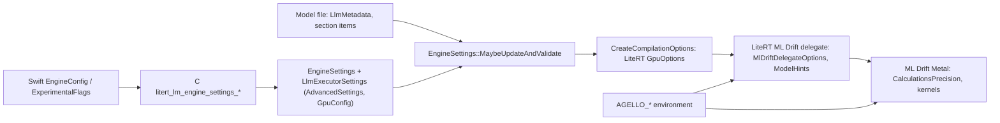

# Configuration

> **Scope:** every setting that changes how LiteRT-LM, LiteRT and ML Drift run, in one place, one
> table per layer: the Swift API (`EngineConfig`, `ConversationConfig`, `SamplerConfig`,
> `ThinkingConfig`, per-message arguments, `ExperimentalFlags`, the embedding engine), C setters with
> no Swift counterpart, the C++ `EngineSettings` / `SessionConfig` / `ConversationConfig` /
> `AdvancedSettings` / executor configs, values the model file supplies, LiteRT environment, CPU and
> GPU options, the ML Drift delegate options LiteRT-LM sets, command-line flags, Bazel configs,
> feature flags and defines, environment variables, the Apple app's own settings, and what Agello
> sets. **Out of scope:** what each setting does in depth (each row links the page that owns it);
> the full lists of C functions ([`generated/c-api-inventory.md`](generated/c-api-inventory.md)),
> Swift symbols ([`generated/swift-api-inventory.md`](generated/swift-api-inventory.md)), proto
> fields ([`generated/proto-fields.md`](generated/proto-fields.md)) and CLI flags
> ([`generated/cli-flags.md`](generated/cli-flags.md)).
> **Pinned to:** LiteRT-LM `7b872544`, LiteRT `362759838`, ML Drift `15fa9e2`; the shipped wrapper
> at `85b1a776` (v0.18.0); Agello at `93122b647a`.
> **Applies to:** Apple (iOS, macOS); rows say when a setting only matters elsewhere.
> **Last verified:** 2026-10-15

## Summary

Settings enter at five moments: when the framework is **built** (Bazel flags and defines), when the
process **loads** it (environment variables), when an **engine is created** (`EngineConfig`, most
`ExperimentalFlags`, the C engine setters, everything the file supplies), when a **conversation is
created** (`ConversationConfig`, three flags), and with each **message** (per-message arguments).
A setting read at one moment can't be changed later without redoing that step: a new context size or
backend means a new engine, a new sampler or thinking setting means a new conversation.

For Agello the ones that matter are few: the main backend (GPU, CPU as fallback), `maxNumTokens`
(the allocated context, rewritten into the file's 32003 placeholder), the cache directory, the vision
and audio backends (CPU), speculative decoding (MTP) per engine and per conversation, the sampler,
thinking budget and visual token budget per conversation, `enableBenchmark` (which also forces busy
GPU waits), and `filterChannelContentFromKvCache`. Everything else runs on defaults, and many knobs
(thread counts, prefill chunking, the GPU "artisan" options, kernel batch size) have
no effect on Apple's GPU path at all.

## Concepts

### Layers

| Layer | Where it lives | Who sets it in Agello |
| --- | --- | --- |
| Swift | `EngineConfig`, `ConversationConfig`, `SamplerConfig`, `ThinkingConfig`, `ExperimentalFlags`, `EmbeddingEngineConfig`, `EmbeddingOptions` ([swift-api.md](litert-lm/swift-api.md)) | `ChatEngine.swift`, `Embedding.swift` |
| C | `litert_lm_engine_settings_*`, `litert_lm_session_config_*`, `litert_lm_conversation_config_*`, `litert_lm_embedding_*` ([c-api.md](litert-lm/c-api.md)) | through Swift only |
| C++ engine | `EngineSettings`, `SessionConfig`, `ConversationConfig::Builder`, `OptionalArgs` ([engine-and-sessions.md](litert-lm/engine-and-sessions.md), [conversation.md](litert-lm/conversation.md)) | through C |
| Executor | `LlmExecutorSettings`, `AdvancedSettings`, `CpuConfig`, `GpuConfig` ([executors.md](litert-lm/executors.md)) | defaults, plus what the engine derives |
| Model file | section items `backend_constraint` / `prefer_activation_type`, `LlmMetadata` ([file-format.md](litert-lm/file-format.md)) | the file Agello downloads |
| LiteRT | environment options, CPU / GPU / runtime compilation options ([runtime.md](litert/runtime.md)) | LiteRT-LM fills them |
| ML Drift delegate | `MlDriftDelegateOptions`, `ModelHints` ([ml-drift-delegate.md](litert/ml-drift-delegate.md)) | LiteRT fills them from the GPU options |
| Build | `.bazelrc` configs, `build_config` flags, `--define`s, `WORKSPACE` pins ([build-and-release.md](litert-lm/build-and-release.md)) | `--config=agello` for our builds |
| Process | environment variables (`AGELLO_*`) | the device harness only |

### When a setting is read

| Moment | Read then | Evidence |
| --- | --- | --- |
| Build | Bazel flags, `--define`s, `WORKSPACE` pins, the xcframework's minimum OS | [Bazel configs](#bazel-configs-feature-flags-and-defines) |
| Library load | `AGELLO_TELEMETRY`; whether `AGELLO_TELEMETRY_OUT` gets an exit writer | [`agello/telemetry/agello/agello_telemetry.cc:52-59`](https://github.com/PowerBeef/agello-litert-lm/blob/7b872544fdbd81308f98b1e2acf8c5798a549df6/agello/telemetry/agello/agello_telemetry.cc#L52-L59) |
| First use in the process | `AGELLO_BOUNDED_ATTENTION`, `AGELLO_BOUNDED_WINDOW`, `AGELLO_SHARED_WEIGHT_CACHE`, `AGELLO_VERIFY_DIRECT_COPIES` (cached in statics) | <!-- c:RT-DLG-038 --> [`ml_drift_delegate/delegate/delegate_kernel.cc:110-125`](https://github.com/PowerBeef/LiteRT/blob/362759838e34e1525f1cc27daddaf663a193c059/ml_drift_delegate/delegate/delegate_kernel.cc#L110-L125) [`ml_drift_delegate/delegate/buffer_handler_metal.mm:253-261`](https://github.com/PowerBeef/LiteRT/blob/362759838e34e1525f1cc27daddaf663a193c059/ml_drift_delegate/delegate/buffer_handler_metal.mm#L253-L261) |
| Every GPU environment and delegate initialization | `AGELLO_SIMULATE_APPLE_GPU` | <!-- c:MD-ARC-020 --> |
| `Engine.initialize` | `EngineConfig`; `ExperimentalFlags.enableBenchmark`, `enableSpeculativeDecoding`, `visualTokenBudget`, `gpuEnableMetalResidencySet`, `enableYnnpack` | <!-- c:LM-SWIFT-004 --> |
| Engine creation (C++) | `EngineSettings`, resolved against the file: context size, sampler defaults, activation type, backend constraints | <!-- c:LM-ENG-008 --> <!-- c:LM-FMT-012 --> |
| `createConversation` | `ConversationConfig`; `enableConversationConstrainedDecoding`, `enableConversationToolCallStreaming` (and its channel name), `filterChannelContentFromKvCache` | <!-- c:LM-SWIFT-008 --> <!-- c:LM-SWIFT-009 --> |
| First sampled token on the engine | the internal sampler's parameters, kept for every later session of that engine | <!-- c:LM-ENG-062 --> |
| Each message | per-message arguments; `ExperimentalFlags.visualTokenBudget` when the conversation has no budget | <!-- c:LM-SWIFT-033 --> |
| Each tool call | `convertCamelToSnakeCaseInToolDescription` (again) | <!-- c:LM-SWIFT-028 --> |
| Any time on a live engine | the Metal residency set (`updateGPUEnableMetalResidencySet`) | <!-- c:LM-CAPI-015 --> <!-- c:LM-SWIFT-055 --> |

`ExperimentalFlags` are process-wide static variables: every engine and conversation in the process
sees the same values, nothing synchronizes them, and setters are ignored until
`optIntoExperimentalAPIs()` has been called, which can't be undone. <!-- c:LM-SWIFT-032 --> An app
with two engines (Agello's chat engine and embedder) must set a flag right before the call that reads
it.

### How to read the tables

- **Default** is what applies when nobody sets the value. A Swift `nil` usually means "don't call the
  C setter", so the C++ default (next column or next table) applies.
- **Read at** links the code that consumes the value at the pins.
- **Added**: the first release that has it, when known. "≤ v0.18.0" means it is already in the v0.18.0
  tree behind what Agello ships; "ours" names our commit; "—" means not traced.
- **Agello** is what Agello at `93122b647a` does (`Agello/Inference/ChatEngine.swift`,
  `Agello/Knowledge/Embedding.swift`).
- A claim tag (an HTML comment holding `c:` and a claim ID, visible in the source) after a row
  points to the ledger claim that states its default and where it is read.

## How it works

### How a setting reaches the GPU

1. Swift's `Engine.initialize` creates C engine settings from the three backend strings, then calls
   each C setter whose Swift value is set. <!-- c:X-CFG-001 --> <!-- c:LM-SWIFT-002 -->
2. `EngineSettings::MaybeUpdateAndValidate` fills what the caller left unset from the file: the
   context size (`max_num_tokens`), sampler parameters, activation type, backend constraints,
   `allow_src_quantized_fc_conv_ops`, `is_benchmark`. <!-- c:LM-ENG-008 --> <!-- c:LM-CMP-036 -->
   <!-- c:LM-FMT-013 --> <!-- c:MD-ARC-058 --> <!-- c:LM-ENG-090 --> Details:
   [Settings resolved at load](litert-lm/engine-and-sessions.md#settings-resolved-at-load).
3. The executor turns its settings into LiteRT compilation options with `CreateCompilationOptions`:
   precision from the activation type, texture weights off on Apple, the residency set, argument
   buffers, cache files, external-tensor patterns, the wait type. <!-- c:RT-DLG-004 -->
   [`runtime/executor/llm_executor_settings_utils.cc:82-103`](https://github.com/PowerBeef/agello-litert-lm/blob/7b872544fdbd81308f98b1e2acf8c5798a549df6/runtime/executor/llm_executor_settings_utils.cc#L82-L103) [`runtime/executor/llm_executor_settings_utils.cc:160-164`](https://github.com/PowerBeef/agello-litert-lm/blob/7b872544fdbd81308f98b1e2acf8c5798a549df6/runtime/executor/llm_executor_settings_utils.cc#L160-L164) [`runtime/executor/llm_executor_settings_utils.cc:204-235`](https://github.com/PowerBeef/agello-litert-lm/blob/7b872544fdbd81308f98b1e2acf8c5798a549df6/runtime/executor/llm_executor_settings_utils.cc#L204-L235)
4. LiteRT's accelerator builds `MlDriftDelegateOptions` from the GPU options, and the delegate turns
   them into ML Drift `ModelHints` and a calculation precision. <!-- c:RT-DLG-005 -->
   <!-- c:MD-ARC-050 --> Details:
   [Creating the delegate from GPU options](litert/ml-drift-delegate.md#creating-the-delegate-from-gpu-options).

## Swift API

The Swift wrapper is the only API Agello uses. `Config.swift` and `EmbeddingEngineConfig.swift` are
identical in the shipped wrapper (`85b1a776`) and agello-next, so every Swift row applies to both;
`ExperimentalFlags.enableYnnpack` is the one Swift setting only agello-next has.
<!-- c:X-CFG-001 --> <!-- c:LM-SWIFT-034 --> Depth: [swift-api.md](litert-lm/swift-api.md).

### EngineConfig

Read once, by `Engine.initialize`; changing any of these means creating a new engine.
[`swift/Config.swift:109-130`](https://github.com/google-ai-edge/LiteRT-LM/blob/df6df5b84d5845b49889f631ed4cac80b4325dd3/swift/Config.swift#L109-L130) [`swift/Engine.swift:73-85`](https://github.com/google-ai-edge/LiteRT-LM/blob/df6df5b84d5845b49889f631ed4cac80b4325dd3/swift/Engine.swift#L73-L85) [`swift/Engine.swift:88-133`](https://github.com/google-ai-edge/LiteRT-LM/blob/df6df5b84d5845b49889f631ed4cac80b4325dd3/swift/Engine.swift#L88-L133)

| Setting | Default | Read at | Effect on Apple | Added | Agello | Notes |
| --- | --- | --- | --- | --- | --- | --- |
| `modelPath` | required | [`swift/Engine.swift:73-85`](https://github.com/google-ai-edge/LiteRT-LM/blob/df6df5b84d5845b49889f631ed4cac80b4325dd3/swift/Engine.swift#L73-L85) | the `.litertlm` file; its sections are memory-mapped | ≤ v0.18.0 | yes | <!-- c:LM-SWIFT-002 --> |
| `backend` | `.cpu()` | [`swift/Engine.swift:73-85`](https://github.com/google-ai-edge/LiteRT-LM/blob/df6df5b84d5845b49889f631ed4cac80b4325dd3/swift/Engine.swift#L73-L85) | `.gpu`: LiteRT compiled model with the ML Drift Metal delegate, main graph GPU-only (no CPU fallback for leftover ops); `.cpu()`: XNNPACK | ≤ v0.18.0 | `.gpu`, then `.cpu()` if loading fails | <!-- c:X-CFG-001 --> <!-- c:RT-RUN-016 --> Swift has only `cpu` and `gpu`; C also parses `npu` and the artisan backends <!-- c:LM-CAPI-012 --> |
| `Backend.cpu(threadCount:)` | `nil` | [`swift/Engine.swift:88-133`](https://github.com/google-ai-edge/LiteRT-LM/blob/df6df5b84d5845b49889f631ed4cac80b4325dd3/swift/Engine.swift#L88-L133) | ignored by `Engine` (the LLM keeps 4 CPU threads); applied by `EmbeddingEngine` when > 0 | ≤ v0.18.0 | `.cpu()` | <!-- c:LM-SWIFT-003 --> <!-- c:RT-CPU-007 --> |
| `visionBackend`, `audioBackend` | `nil`: no vision / audio executor | [`swift/Engine.swift:73-85`](https://github.com/google-ai-edge/LiteRT-LM/blob/df6df5b84d5845b49889f631ed4cac80b4325dd3/swift/Engine.swift#L73-L85) | vision encoder on the chosen backend, its adapter always on the CPU; the Gemma 4 audio encoder must be CPU (`backend_constraint=cpu`, else engine creation fails) | ≤ v0.18.0 | `.cpu()` for each when enabled | <!-- c:LM-EXE-028 --> <!-- c:LM-EXE-031 --> <!-- c:LM-EXE-029 --> |
| `maxNumTokens` | `nil` → C++ 0 → file's `max_num_tokens`, else `((prompt + 1023) / 4096 + 1) * 4096` = 4,096 through the C API | [`runtime/engine/engine_settings.cc:342-361`](https://github.com/google-ai-edge/LiteRT-LM/blob/df6df5b84d5845b49889f631ed4cac80b4325dd3/runtime/engine/engine_settings.cc#L342-L361) [`runtime/executor/magic_number_configs_helper.cc:307-314`](https://github.com/google-ai-edge/LiteRT-LM/blob/df6df5b84d5845b49889f631ed4cac80b4325dd3/runtime/executor/magic_number_configs_helper.cc#L307-L314) | allocated context: replaces the 32003 placeholder when below 32,003, else 32,000; no 4,096 cap on Apple; must be > 0 | ≤ v0.18.0 | yes, from its budget | <!-- c:LM-ENG-008 --> <!-- c:LM-EXE-003 --> <!-- c:LM-EXE-005 --> <!-- c:LM-SWIFT-053 --> |
| `cacheDir` | `nil`: next to the model file | [`runtime/executor/executor_settings_base.cc:384-430`](https://github.com/google-ai-edge/LiteRT-LM/blob/df6df5b84d5845b49889f631ed4cac80b4325dd3/runtime/executor/executor_settings_base.cc#L384-L430) [`runtime/executor/litert_compiled_model_executor_utils.cc:1073-1131`](https://github.com/google-ai-edge/LiteRT-LM/blob/df6df5b84d5845b49889f631ed4cac80b4325dd3/runtime/executor/litert_compiled_model_executor_utils.cc#L1073-L1131) | GPU program cache and weight cache files (CPU: XNNPACK weight cache); `":nocache"` disables all of them | ≤ v0.18.0 | yes, see [What Agello sets](#what-agello-sets) | <!-- c:RT-DLG-044 --> <!-- c:LM-CAPI-047 --> <!-- c:RT-CPU-009 --> |
| `activationDataType` | `nil` → file's `prefer_activation_type`, else FP16 for the static GPU executor | [`runtime/executor/llm_litert_compiled_model_executor.cc:2127-2132`](https://github.com/PowerBeef/agello-litert-lm/blob/7b872544fdbd81308f98b1e2acf8c5798a549df6/runtime/executor/llm_litert_compiled_model_executor.cc#L2127-L2132) | FP16 gives ML Drift `kF16`; FP32 gives `kF32` (avoids #3913 on Google's E4B file at about half the decode speed) | ≤ v0.18.0 | no | <!-- c:MD-KRN-008 --> <!-- c:LM-FMT-013 --> <!-- c:MD-ARC-029 --> <!-- c:MOD-E4B-082 --> |
| `loraRank`, `audioLoraRank` | `nil` | [`swift/Engine.swift:88-133`](https://github.com/google-ai-edge/LiteRT-LM/blob/df6df5b84d5845b49889f631ed4cac80b4325dd3/swift/Engine.swift#L88-L133) | a text LoRA can't be used: creating a conversation with one fails "Lora is not supported." | ≤ v0.18.0 | no | <!-- c:LM-CMP-071 --> |

### ConversationConfig

Read once, by `createConversation`; the C++ conversation keeps them for its life.
`samplerConfig`, `loraPath`, `audioLoraPath`, `enableSpeculativeDecoding` and `chatTemplate` reach the
C API only when set. <!-- c:X-CFG-002 --> [`swift/Config.swift:251-265`](https://github.com/google-ai-edge/LiteRT-LM/blob/df6df5b84d5845b49889f631ed4cac80b4325dd3/swift/Config.swift#L251-L265) [`swift/Engine.swift:244-268`](https://github.com/google-ai-edge/LiteRT-LM/blob/df6df5b84d5845b49889f631ed4cac80b4325dd3/swift/Engine.swift#L244-L268) [`swift/Engine.swift:270-292`](https://github.com/google-ai-edge/LiteRT-LM/blob/df6df5b84d5845b49889f631ed4cac80b4325dd3/swift/Engine.swift#L270-L292) [`swift/Engine.swift:325-360`](https://github.com/google-ai-edge/LiteRT-LM/blob/df6df5b84d5845b49889f631ed4cac80b4325dd3/swift/Engine.swift#L325-L360)

| Setting | Default | Read at | Effect on Apple | Added | Agello | Notes |
| --- | --- | --- | --- | --- | --- | --- |
| `systemMessage`, `initialMessages`, `tools` | `nil`, `[]`, `[]` | [`swift/Config.swift:251-265`](https://github.com/google-ai-edge/LiteRT-LM/blob/df6df5b84d5845b49889f631ed4cac80b4325dd3/swift/Config.swift#L251-L265) | preface of the conversation | ≤ v0.18.0 | system prompt, replayed history, tools | an empty system message is dropped <!-- c:LM-SWIFT-054 --> <!-- c:LM-SWIFT-062 --> |
| `samplerConfig` | `nil` → session takes the file's `sampler_params`, else top-p with k 1, p 0.95, temperature 1, seed 0 (greedy) | [`swift/Engine.swift:244-268`](https://github.com/google-ai-edge/LiteRT-LM/blob/df6df5b84d5845b49889f631ed4cac80b4325dd3/swift/Engine.swift#L244-L268) [`runtime/engine/engine_settings.cc:417-442`](https://github.com/google-ai-edge/LiteRT-LM/blob/df6df5b84d5845b49889f631ed4cac80b4325dd3/runtime/engine/engine_settings.cc#L417-L442) | always sent as `kLiteRtLmSamplerTypeTopP`; on the engine's internal sampler the first session to sample fixes the parameters for the engine's life | ≤ v0.18.0 | chat: its settings; transcription helper: k 1, p 1, temperature 0 | <!-- c:LM-SWIFT-007 --> <!-- c:LM-ENG-010 --> <!-- c:LM-CMP-036 --> <!-- c:LM-ENG-062 --> <!-- c:X-CFG-007 --> |
| `thinkingConfig` | `nil` (thinking off, budget 0); `ThinkingConfig()` = on, budget −1 (unlimited) | [`runtime/conversation/conversation.cc:360-388`](https://github.com/google-ai-edge/LiteRT-LM/blob/df6df5b84d5845b49889f631ed4cac80b4325dd3/runtime/conversation/conversation.cc#L360-L388) | `<\|think\|>` in the system turn; budget enforced by `ThinkingBudgetConstraint` | ≤ v0.18.0 | `ThinkingConfig(enableThinking: true, thinkingTokenBudget:)` from its plan | <!-- c:LM-SWIFT-053 --> <!-- c:LM-CNV-010 --> <!-- c:LM-CMP-057 --> |
| `enableResponseFormat` | `false` | [`swift/Engine.swift:325-360`](https://github.com/google-ai-edge/LiteRT-LM/blob/df6df5b84d5845b49889f631ed4cac80b4325dd3/swift/Engine.swift#L325-L360) | llguidance constraint provider plus constrained decoding; needed for `responseFormat` | ≤ v0.18.0 | JSON helpers only | <!-- c:LM-SWIFT-008 --> <!-- c:LM-SWIFT-030 --> |
| `automaticToolCalling` | `true` | [`swift/Conversation.swift:124-133`](https://github.com/PowerBeef/agello-litert-lm/blob/7b872544fdbd81308f98b1e2acf8c5798a549df6/swift/Conversation.swift#L124-L133) | `sendMessage` runs tools itself (up to 25 rounds); streams run tools even when false | ≤ v0.18.0 | default | <!-- c:LM-SWIFT-012 --> <!-- c:LM-SWIFT-017 --> |
| `enableToolCallStreaming` | `false` | [`swift/Engine.swift:325-360`](https://github.com/google-ai-edge/LiteRT-LM/blob/df6df5b84d5845b49889f631ed4cac80b4325dd3/swift/Engine.swift#L325-L360) | streams tool-call text only if `ExperimentalFlags.enableConversationToolCallStreaming` is also true | ≤ v0.18.0 | no | <!-- c:LM-SWIFT-008 --> |
| `visualTokenBudget` | `nil` → the flag's value at send time → file's `max_num_patches` / 9 (280 for E2B/E4B) | [`runtime/conversation/model_data_processor/multimodal_processor_helper.cc:91-103`](https://github.com/google-ai-edge/LiteRT-LM/blob/df6df5b84d5845b49889f631ed4cac80b4325dd3/runtime/conversation/model_data_processor/multimodal_processor_helper.cc#L91-L103) [`c/conversation.cc:73-85`](https://github.com/google-ai-edge/LiteRT-LM/blob/df6df5b84d5845b49889f631ed4cac80b4325dd3/c/conversation.cc#L73-L85) | image resolution in tokens; above the engine's max vision tokens per image (280 for E4B) is InvalidArgument; passed only for Gemma 4 | ≤ v0.18.0 | yes: 140 / 280 / 560, lowered to the file's 280 | <!-- c:LM-SWIFT-033 --> <!-- c:LM-CNV-034 --> <!-- c:MOD-E4B-050 --> <!-- c:LM-CAPI-031 --> <!-- c:MOD-E4B-051 --> |
| `enableSpeculativeDecoding` | `nil`: MTP iff a drafter is loaded (engine flag) | [`runtime/executor/llm_litert_compiled_model_executor.cc:1317-1332`](https://github.com/PowerBeef/agello-litert-lm/blob/7b872544fdbd81308f98b1e2acf8c5798a549df6/runtime/executor/llm_litert_compiled_model_executor.cc#L1317-L1332) | `true` on an engine without the drafter loads it lazily on the first decode | ≤ v0.18.0 | chat and text helpers: from its plan; JSON helpers: `false` | <!-- c:LM-EXE-072 --> <!-- c:LM-EXE-071 --> <!-- c:LM-SWIFT-059 --> |
| `chatTemplate` | `nil`: the file's `jinja_prompt_template` | [`runtime/conversation/conversation.cc:159-179`](https://github.com/google-ai-edge/LiteRT-LM/blob/df6df5b84d5845b49889f631ed4cac80b4325dd3/runtime/conversation/conversation.cc#L159-L179) | replaces the template; the E2B/E4B files' template differs from Google's Hugging Face one | ≤ v0.18.0 | no | <!-- c:LM-CNV-027 --> <!-- c:MOD-TOK-030 --> |
| `loraPath`, `audioLoraPath` | `nil` | [`runtime/framework/resource_management/resource_manager.cc:603-619`](https://github.com/PowerBeef/agello-litert-lm/blob/7b872544fdbd81308f98b1e2acf8c5798a549df6/runtime/framework/resource_management/resource_manager.cc#L603-L619) | text LoRA fails "Lora is not supported."; audio LoRA loads into the audio encoder | ≤ v0.18.0 | no | <!-- c:LM-CMP-071 --> |

`SamplerConfig(topK:topP:temperature:seed:)` has no defaults except `seed: 0`, and throws for
`topK <= 0`, `topP` outside [0, 1] or a negative temperature. <!-- c:X-CFG-003 --> <!-- c:LM-SWIFT-053 -->
The CPU sampler only implements top-p (`TOP_K` and `GREEDY` from C return Unimplemented), and with
k = 1 our build takes a greedy path over FP16 logits. <!-- c:LM-CMP-024 --> Samplers in depth:
[components.md](litert-lm/components.md#samplers).

### Per-message arguments

`sendMessage` and `sendMessageStream` take these per call, all `nil` by default. <!-- c:X-CFG-003 -->
[`swift/Conversation.swift:124-133`](https://github.com/PowerBeef/agello-litert-lm/blob/7b872544fdbd81308f98b1e2acf8c5798a549df6/swift/Conversation.swift#L124-L133) [`swift/Conversation.swift:478-487`](https://github.com/PowerBeef/agello-litert-lm/blob/7b872544fdbd81308f98b1e2acf8c5798a549df6/swift/Conversation.swift#L478-L487)

| Argument | Effect | Notes |
| --- | --- | --- |
| `maxOutputTokens` | caps the decode steps of this reply, thinking included; C++ default `INT_MAX` | the KV cache (`maxNumTokens`) is a separate limit over the conversation's life <!-- c:LM-ENG-021 --> |
| `thinkingConfig` | overrides the conversation's for this message | the system turn's `<\|think\|>` from the first prefill stays in the KV cache <!-- c:LM-CNV-059 --> |
| `responseFormat` | `.json(schema:)` or `.regex(pattern:)` through llguidance; throws unless `enableResponseFormat` | once set, the constraint also applies to later messages of the conversation <!-- c:LM-SWIFT-030 --> <!-- c:LM-CNV-071 --> |
| `repetitionPenaltyConfig` | repetition, presence, frequency penalties over a window; disabled by default | sparse logit mask <!-- c:LM-CMP-061 --> |
| `noRepeatNgramConfig` | bans repeated n-grams; window 0 = whole history | <!-- c:LM-CMP-064 --> |
| `suppressTokensConfig` | token IDs never sampled | bitmap mask ([components.md](litert-lm/components.md#logit-masks)) |
| `extraContext` | template variables merged over the preface's | [conversation.md](litert-lm/conversation.md#optionalargs) |

Agello passes `maxOutputTokens` on every send (1 for its engine validation probe) and
`responseFormat: .json(schema:)` for its JSON helpers. <!-- c:LM-SWIFT-058 --> <!-- c:LM-SWIFT-059 -->
<!-- c:LM-SWIFT-060 -->

### ExperimentalFlags

Process-wide; see [When a setting is read](#when-a-setting-is-read). Every setter is ignored without
the opt-in. <!-- c:X-CFG-004 --> <!-- c:LM-SWIFT-032 --> [`swift/ExperimentalFlags.swift:21-48`](https://github.com/google-ai-edge/LiteRT-LM/blob/df6df5b84d5845b49889f631ed4cac80b4325dd3/swift/ExperimentalFlags.swift#L21-L48) [`swift/ExperimentalFlags.swift:78-127`](https://github.com/google-ai-edge/LiteRT-LM/blob/df6df5b84d5845b49889f631ed4cac80b4325dd3/swift/ExperimentalFlags.swift#L78-L127) [`swift/ExperimentalFlags.swift:175-189`](https://github.com/google-ai-edge/LiteRT-LM/blob/df6df5b84d5845b49889f631ed4cac80b4325dd3/swift/ExperimentalFlags.swift#L175-L189) [`swift/ExperimentalFlags.swift:205-238`](https://github.com/google-ai-edge/LiteRT-LM/blob/df6df5b84d5845b49889f631ed4cac80b4325dd3/swift/ExperimentalFlags.swift#L205-L238)

| Flag | Default | Read at | Effect on Apple | Added | Agello | Notes |
| --- | --- | --- | --- | --- | --- | --- |
| `optIntoExperimentalAPIs()` | not opted in | [`swift/ExperimentalFlags.swift:21-48`](https://github.com/google-ai-edge/LiteRT-LM/blob/df6df5b84d5845b49889f631ed4cac80b4325dd3/swift/ExperimentalFlags.swift#L21-L48) | enables the setters below | ≤ v0.18.0 | yes, at every load | irreversible <!-- c:LM-SWIFT-056 --> |
| `enableBenchmark` | `false` | `Engine.initialize` [`swift/Engine.swift:134-177`](https://github.com/google-ai-edge/LiteRT-LM/blob/df6df5b84d5845b49889f631ed4cac80b4325dd3/swift/Engine.swift#L134-L177) | benchmark info (time to first token, tok/s); also `is_benchmark`, which makes every GPU wait an active (busy) wait | ≤ v0.18.0 | `true` (reply stats) | our passive waits (`645aaf65`) never apply in the app <!-- c:LM-EXE-038 --> <!-- c:OUR-034 --> <!-- c:RT-RUN-028 --> |
| `enableSpeculativeDecoding` | `nil` (C++ `false`) | `Engine.initialize` | `true`: the MTP drafter is created at load | ≤ v0.18.0 | from its plan, before each engine | <!-- c:LM-SWIFT-004 --> <!-- c:LM-SWIFT-056 --> |
| `visualTokenBudget` | `nil` | `Engine.initialize` and each send | engine: `max_vision_tokens_per_image`; send: budget when the conversation has none | ≤ v0.18.0 | no | <!-- c:LM-SWIFT-033 --> |
| `gpuEnableMetalResidencySet` | `nil` (C++ `false`) | `Engine.initialize` | `true`: residency set attached to the queue, requested, re-requested every 100 ms (iOS 18 / macOS 15+) | ≤ v0.18.0 | no | <!-- c:LM-CAPI-015 --> <!-- c:RT-DLG-069 --> <!-- c:APL-048 --> |
| `enableYnnpack` | `nil`; `true` if `ENABLE_YNNPACK` / `enable_ynnpack` is `"true"` or a launch argument holds `enable_ynnpack=true` | `Engine.initialize` | CPU backend only; YNNPACK isn't linked in our Apple build | after v0.18.0 (agello-next only) | no | <!-- c:LM-SWIFT-034 --> <!-- c:RT-CPU-029 --> |
| `filterChannelContentFromKvCache` | `nil` (C++ `true`) | `createConversation` | thinking removed from the KV cache after each reply (agello-next) or at the next message (v0.18.0) | ≤ v0.18.0 | `true` | <!-- c:LM-CNV-057 --> <!-- c:LM-CNV-058 --> <!-- c:LM-CNV-052 --> <!-- c:LM-CNV-054 --> |
| `enableConversationConstrainedDecoding` | `false` | `createConversation` | constrained decoding without a response format: tool-call constraints from the closed FST provider in Google's binary, none in ours | ≤ v0.18.0 | no | <!-- c:LM-SWIFT-008 --> <!-- c:LM-CNV-073 --> |
| `enableConversationToolCallStreaming`, `conversationToolCallStreamingChannelName` | `false`, `"tool_call"` | `createConversation` | with the config field, streams tool calls on that channel | ≤ v0.18.0 | no | <!-- c:LM-SWIFT-008 --> |
| `convertCamelToSnakeCaseInToolDescription` | `true` | conversation creation and every tool call | snake_case tool and parameter names | ≤ v0.18.0 | default | <!-- c:LM-SWIFT-027 --> <!-- c:LM-SWIFT-028 --> |

The table in [swift-api.md](litert-lm/swift-api.md#experimentalflags) has the same flags with their
exact read sites.

### Embedding engine

`EmbeddingEngineConfig` is read by `EmbeddingEngine.initialize`; `EmbeddingOptions` per call, where
`nil` leaves the C++ default. <!-- c:X-CFG-005 --> [`swift/EmbeddingEngineConfig.swift:42-58`](https://github.com/google-ai-edge/LiteRT-LM/blob/df6df5b84d5845b49889f631ed4cac80b4325dd3/swift/EmbeddingEngineConfig.swift#L42-L58) [`swift/EmbeddingEngineConfig.swift:83-95`](https://github.com/google-ai-edge/LiteRT-LM/blob/df6df5b84d5845b49889f631ed4cac80b4325dd3/swift/EmbeddingEngineConfig.swift#L83-L95)

| Setting | Default | Read at | Effect on Apple | Added | Agello | Notes |
| --- | --- | --- | --- | --- | --- | --- |
| `backend` | `.cpu()` | [`swift/EmbeddingEngineConfig.swift:42-58`](https://github.com/google-ai-edge/LiteRT-LM/blob/df6df5b84d5845b49889f631ed4cac80b4325dd3/swift/EmbeddingEngineConfig.swift#L42-L58) | `.gpu`: text encoder on Metal; the token embedder stays on the CPU either way | ≤ v0.18.0 | `.gpu`, then `.cpu()` | <!-- c:MOD-EMB-072 --> <!-- c:MOD-EMB-059 --> |
| `Backend.cpu(threadCount:)` | `nil` | `EmbeddingEngine.initialize` | applied when > 0 | ≤ v0.18.0 | no | <!-- c:LM-SWIFT-041 --> |
| `cacheDir` | `nil`: next to the model | [`swift/EmbeddingEngineConfig.swift:42-58`](https://github.com/google-ai-edge/LiteRT-LM/blob/df6df5b84d5845b49889f631ed4cac80b4325dd3/swift/EmbeddingEngineConfig.swift#L42-L58) | GPU program and weight caches | ≤ v0.18.0 | `embedding` or `embedding-<build id>` | <!-- c:X-CFG-008 --> |
| `maxInputLength` | `nil` → file's `max_input_length` (1,024 for embeddinggemma-2-text-270m) | [`runtime/engine/embedding_engine_settings.cc:266-298`](https://github.com/google-ai-edge/LiteRT-LM/blob/df6df5b84d5845b49889f631ed4cac80b4325dd3/runtime/engine/embedding_engine_settings.cc#L266-L298) | compiles the encoder signatures up to the first ≥ this length; above the longest signature fails creation | ≤ v0.18.0 | no (so 1,022 text tokens plus BOS and EOS) | <!-- c:MOD-EMB-004 --> <!-- c:MOD-EMB-050 --> <!-- c:MOD-EMB-065 --> |
| `visionTokensPerImage` (config and options) | `nil` | [`swift/EmbeddingEngineConfig.swift:42-58`](https://github.com/google-ai-edge/LiteRT-LM/blob/df6df5b84d5845b49889f631ed4cac80b4325dd3/swift/EmbeddingEngineConfig.swift#L42-L58) | multimodal embedding models only | ≤ v0.18.0 | no | |
| `EmbeddingOptions.normalize` | `nil` → C++ `true` | [`runtime/core/embedding_engine_impl.cc:1589-1624`](https://github.com/google-ai-edge/LiteRT-LM/blob/df6df5b84d5845b49889f631ed4cac80b4325dd3/runtime/core/embedding_engine_impl.cc#L1589-L1624) | L2 normalization after truncation | ≤ v0.18.0 | `true` | <!-- c:LM-CAPI-044 --> <!-- c:MOD-EMB-054 --> |
| `EmbeddingOptions.outputSize` | `nil` → full width (768) | [`runtime/core/embedding_engine_impl.cc:1589-1624`](https://github.com/google-ai-edge/LiteRT-LM/blob/df6df5b84d5845b49889f631ed4cac80b4325dd3/runtime/core/embedding_engine_impl.cc#L1589-L1624) | Matryoshka truncation before normalization | ≤ v0.18.0 | 256 | <!-- c:MOD-EMB-054 --> <!-- c:MOD-EMB-005 --> |
| `EmbeddingOptions.insertSpecialTokens` | `nil` → C++ `true` | [`runtime/engine/embedding_engine.h:31-52`](https://github.com/google-ai-edge/LiteRT-LM/blob/df6df5b84d5845b49889f631ed4cac80b4325dd3/runtime/engine/embedding_engine.h#L31-L52) | BOS and EOS around the input (+2 tokens) | ≤ v0.18.0 | default | <!-- c:MOD-EMB-051 --> |
| input overflow strategy | C++ `kError` (not in Swift) | [`runtime/executor/embedding_litert_compiled_model_executor.cc:520-549`](https://github.com/google-ai-edge/LiteRT-LM/blob/df6df5b84d5845b49889f631ed4cac80b4325dd3/runtime/executor/embedding_litert_compiled_model_executor.cc#L520-L549) | an input longer than the longest loaded signature fails | ≤ v0.18.0 | default | <!-- c:LM-SWIFT-042 --> <!-- c:MOD-EMB-053 --> |
| activation type (C only) | GPU: FP16 unless the file says otherwise | [`runtime/engine/embedding_engine_settings.cc:183-208`](https://github.com/google-ai-edge/LiteRT-LM/blob/df6df5b84d5845b49889f631ed4cac80b4325dd3/runtime/engine/embedding_engine_settings.cc#L183-L208) | text encoder at GPU precision `kFp16`; the model card advises against float16 | ≤ v0.18.0 | default | <!-- c:MOD-EMB-049 --> <!-- c:MOD-EMB-073 --> |

## C API

Every Swift setting above maps to one C call ([c-api.md](litert-lm/c-api.md#engine-settings-and-the-engine)).
This section lists only what Swift can't reach.

### Setters with no Swift counterpart

Neither Swift wrapper (shipped `85b1a776`, agello-next `7b872544`) calls these, so the wrapper's
Swift API has no way to set them; only a direct call into the C API could. Output length and extra
context can still be set per message, through `sendMessage`'s `maxOutputTokens` and `extraContext`
arguments. <!-- c:X-CFG-006 -->
[`c/engine.h:747-804`](https://github.com/google-ai-edge/LiteRT-LM/blob/df6df5b84d5845b49889f631ed4cac80b4325dd3/c/engine.h#L747-L804) [`c/engine.h:887`](https://github.com/google-ai-edge/LiteRT-LM/blob/df6df5b84d5845b49889f631ed4cac80b4325dd3/c/engine.h#L887) [`c/engine.h:968-1008`](https://github.com/google-ai-edge/LiteRT-LM/blob/df6df5b84d5845b49889f631ed4cac80b4325dd3/c/engine.h#L968-L1008) [`c/engine.h:306-318`](https://github.com/google-ai-edge/LiteRT-LM/blob/df6df5b84d5845b49889f631ed4cac80b4325dd3/c/engine.h#L306-L318) [`c/engine.h:621`](https://github.com/google-ai-edge/LiteRT-LM/blob/df6df5b84d5845b49889f631ed4cac80b4325dd3/c/engine.h#L621) [`c/embedding_engine.h:221-252`](https://github.com/google-ai-edge/LiteRT-LM/blob/df6df5b84d5845b49889f631ed4cac80b4325dd3/c/embedding_engine.h#L221-L252) [`c/embedding_engine.h:351`](https://github.com/google-ai-edge/LiteRT-LM/blob/df6df5b84d5845b49889f631ed4cac80b4325dd3/c/embedding_engine.h#L351)

| C function | C++ setting and default | Read at | Effect on Apple | Notes |
| --- | --- | --- | --- | --- |
| `litert_lm_engine_settings_set_num_threads` | `CpuConfig::number_of_threads`, 4 | [`c/engine.cc:712-728`](https://github.com/google-ai-edge/LiteRT-LM/blob/df6df5b84d5845b49889f631ed4cac80b4325dd3/c/engine.cc#L712-L728) | CPU backend only; with `gpu` it changes nothing and still returns OK | <!-- c:LM-CAPI-014 --> <!-- c:RT-CPU-006 --> |
| `..._set_audio_num_threads` | audio executor threads, 4 | [`audio_executor_settings.h:173`](https://github.com/google-ai-edge/LiteRT-LM/blob/df6df5b84d5845b49889f631ed4cac80b4325dd3/runtime/executor/audio/audio_executor_settings.h#L173) | CPU audio encoder and adapter | not claimed |
| `..._set_parallel_file_section_loading` | `true` | [`runtime/core/engine_advanced_impl.cc:536-549`](https://github.com/google-ai-edge/LiteRT-LM/blob/df6df5b84d5845b49889f631ed4cac80b4325dd3/runtime/core/engine_advanced_impl.cc#L536-L549) | only chooses whether the tokenizer is built on a second thread during load | <!-- c:LM-ENG-005 --> <!-- c:LM-ENG-006 --> |
| `..._set_single_threaded_execution` | `false` | [`runtime/core/engine_advanced_impl.cc:662-679`](https://github.com/google-ai-edge/LiteRT-LM/blob/df6df5b84d5845b49889f631ed4cac80b4325dd3/runtime/core/engine_advanced_impl.cc#L662-L679) | `true`: `SerialExecutionManager`, work runs only inside waits (`litert_lm_conversation_wait_until_done`) | <!-- c:LM-ENG-016 --> <!-- c:LM-CAPI-029 --> |
| `..._set_prefill_chunk_size` | `CpuConfig::prefill_chunk_size`, −1 | [`c/engine.h:887`](https://github.com/google-ai-edge/LiteRT-LM/blob/df6df5b84d5845b49889f631ed4cac80b4325dd3/c/engine.h#L887) | dynamic CPU executor only; with `gpu` a warning and no effect | <!-- c:LM-EXE-046 --> |
| `..._set_gpu_decode_steps_per_sync`, `_set_gpu_wait_for_weight_uploads`, `_set_use_ringbuffers_local_attention` | `GpuArtisanConfig` | [`c/engine.h:968-1008`](https://github.com/google-ai-edge/LiteRT-LM/blob/df6df5b84d5845b49889f631ed4cac80b4325dd3/c/engine.h#L968-L1008) | none on `gpu`: they edit the artisan backend's config | ring buffers also turn conversation rewinding off <!-- c:LM-CAPI-014 --> <!-- c:LM-CAPI-021 --> |
| `..._set_max_num_images`, `_set_litert_dispatch_lib_dir` | — | [`c/engine.h:747-804`](https://github.com/google-ai-edge/LiteRT-LM/blob/df6df5b84d5845b49889f631ed4cac80b4325dd3/c/engine.h#L747-L804) | dispatch libraries: NPU only, no NPU on Apple | |
| `litert_lm_set_min_log_level` | library default | [`c/engine.h:621`](https://github.com/google-ai-edge/LiteRT-LM/blob/df6df5b84d5845b49889f631ed4cac80b4325dd3/c/engine.h#L621) | LiteRT-LM and LiteRT log level | |
| `litert_lm_session_config_set_max_output_tokens`, `_set_apply_prompt_template` | `INT_MAX`; `true` | [`c/engine.h:306-318`](https://github.com/google-ai-edge/LiteRT-LM/blob/df6df5b84d5845b49889f631ed4cac80b4325dd3/c/engine.h#L306-L318) | Swift passes the output cap per message instead; `Conversation` sets the template flag to false itself | <!-- c:LM-ENG-021 --> <!-- c:LM-ENG-024 --> |
| `litert_lm_session_config_set_sampler_params` with `kLiteRtLmSamplerTypeTopK` / `Greedy` | — | [`c/engine.cc:347-359`](https://github.com/google-ai-edge/LiteRT-LM/blob/df6df5b84d5845b49889f631ed4cac80b4325dd3/c/engine.cc#L347-L359) | Unimplemented in the CPU sampler, the only one in our build | Swift always sends top-p <!-- c:LM-CMP-025 --> <!-- c:LM-CMP-024 --> |
| `litert_lm_conversation_config_set_extra_context` | none | [`c/conversation.h:151`](https://github.com/google-ai-edge/LiteRT-LM/blob/df6df5b84d5845b49889f631ed4cac80b4325dd3/c/conversation.h#L151) | template variables for the whole conversation | Swift has `extraContext` per message only |
| `litert_lm_embedding_engine_settings_set_min_input_length`, `_set_activation_data_type` | unset; FP16 on GPU | [`c/embedding_engine.h:221-252`](https://github.com/google-ai-edge/LiteRT-LM/blob/df6df5b84d5845b49889f631ed4cac80b4325dd3/c/embedding_engine.h#L221-L252) | drops short encoder signatures; encoder precision | <!-- c:MOD-EMB-050 --> <!-- c:MOD-EMB-049 --> |
| `litert_lm_embedding_options_set_input_overflow_strategy` | `kError` | [`c/embedding_engine.h:351`](https://github.com/google-ai-edge/LiteRT-LM/blob/df6df5b84d5845b49889f631ed4cac80b4325dd3/c/embedding_engine.h#L351) | error, truncate (EOS kept) or chunk and average | <!-- c:LM-CAPI-044 --> <!-- c:MOD-EMB-053 --> |

C-only engine calls that Swift does reach under other names: `litert_lm_engine_settings_set_max_vision_tokens_per_image`
(through `ExperimentalFlags.visualTokenBudget`), `litert_lm_experimental_engine_update_gpu_enable_metal_residency_set`
(through `Engine.updateGPUEnableMetalResidencySet`), and the benchmark token counts (only through
`benchmark(...)`). <!-- c:LM-SWIFT-004 --> <!-- c:LM-SWIFT-055 --> <!-- c:LM-SWIFT-035 -->

## C++ settings

### EngineSettings and SessionConfig

`EngineSettings` is read when the engine is created; `SessionConfig` when each session (one per
conversation) is created. Fields not listed here are covered by the Swift rows above.
[`runtime/engine/engine_settings.h:184-190`](https://github.com/google-ai-edge/LiteRT-LM/blob/df6df5b84d5845b49889f631ed4cac80b4325dd3/runtime/engine/engine_settings.h#L184-L190) [`runtime/engine/engine_settings.h:332-395`](https://github.com/google-ai-edge/LiteRT-LM/blob/df6df5b84d5845b49889f631ed4cac80b4325dd3/runtime/engine/engine_settings.h#L332-L395)

| Setting | Default | Read at | Effect on Apple | Agello | Notes |
| --- | --- | --- | --- | --- | --- |
| `EngineSettings::max_vision_tokens_per_image` | unset → `max_num_patches / pooling²` = 280 for E4B, when vision is configured | [`runtime/core/engine_advanced_impl.cc:457-494`](https://github.com/google-ai-edge/LiteRT-LM/blob/df6df5b84d5845b49889f631ed4cac80b4325dd3/runtime/core/engine_advanced_impl.cc#L457-L494) | which `vision_*` signatures load; a caller value above 280 fails creation | no | <!-- c:LM-ENG-014 --> <!-- c:MOD-E4B-050 --> |
| benchmark params (`num_prefill_tokens`, `num_decode_tokens`) | off | [`runtime/engine/engine_settings.cc:512-515`](https://github.com/google-ai-edge/LiteRT-LM/blob/df6df5b84d5845b49889f631ed4cac80b4325dd3/runtime/engine/engine_settings.cc#L512-L515) | set `AdvancedSettings::is_benchmark`; decode then ignores stop tokens when `num_decode_tokens` > 0 | `enableBenchmark` (no counts) | <!-- c:LM-ENG-090 --> <!-- c:LM-ENG-091 --> |
| `SessionConfig` stop token IDs | from the file (E4B: 1, 50, 106) | [`runtime/engine/engine_settings.cc:759-769`](https://github.com/google-ai-edge/LiteRT-LM/blob/df6df5b84d5845b49889f631ed4cac80b4325dd3/runtime/engine/engine_settings.cc#L759-L769) | decode stops on them | default | InvalidArgument if none <!-- c:LM-ENG-020 --> |
| `SessionConfig` sampler backend | UNSPECIFIED → GPU for a GPU engine | [`runtime/engine/engine_settings.cc:809-818`](https://github.com/google-ai-edge/LiteRT-LM/blob/df6df5b84d5845b49889f631ed4cac80b4325dd3/runtime/engine/engine_settings.cc#L809-L818) | FP16 logits buffer; our build has no Metal sampler and falls back to the CPU top-p sampler | default | <!-- c:LM-ENG-020 --> <!-- c:LM-EXE-019 --> <!-- c:LM-EXE-020 --> |
| `SessionConfig::max_output_tokens` | `INT_MAX` | [`runtime/engine/engine_settings.h:332-395`](https://github.com/google-ai-edge/LiteRT-LM/blob/df6df5b84d5845b49889f631ed4cac80b4325dd3/runtime/engine/engine_settings.h#L332-L395) | per-request decode cap | per message | <!-- c:LM-ENG-021 --> |
| `SessionConfig` speculative decoding | unset: inherit | [`runtime/executor/llm_litert_compiled_model_executor.cc:1317-1332`](https://github.com/PowerBeef/agello-litert-lm/blob/7b872544fdbd81308f98b1e2acf8c5798a549df6/runtime/executor/llm_litert_compiled_model_executor.cc#L1317-L1332) | see `enableSpeculativeDecoding` | per conversation | <!-- c:LM-EXE-072 --> |
| `num_output_candidates`, `use_external_sampler`, `enable_audio_session_advanced` | 1, `false`, `false` | [`runtime/engine/engine_settings.h:332-395`](https://github.com/google-ai-edge/LiteRT-LM/blob/df6df5b84d5845b49889f631ed4cac80b4325dd3/runtime/engine/engine_settings.h#L332-L395) | not reachable from C | no | |
| `Engine::kDefaultTimeout` (constant) | 10 minutes | [`runtime/engine/engine.h:452-453`](https://github.com/google-ai-edge/LiteRT-LM/blob/df6df5b84d5845b49889f631ed4cac80b4325dd3/runtime/engine/engine.h#L452-L453) | session waits and destructors | n/a | <!-- c:LM-ENG-018 --> <!-- c:LM-CAPI-048 --> |

### ConversationConfig builder and OptionalArgs

The C++ builder's defaults apply wherever the C API passes nothing. [`runtime/conversation/conversation.h:272-282`](https://github.com/google-ai-edge/LiteRT-LM/blob/df6df5b84d5845b49889f631ed4cac80b4325dd3/runtime/conversation/conversation.h#L272-L282)

| Setting | Default | Reachable from | Effect | Notes |
| --- | --- | --- | --- | --- |
| `enable_constrained_decoding` | `false` | C, Swift (`enableResponseFormat` or the flag) | tool-call constraints from preface tools: none in our build (no FST provider) | <!-- c:LM-CNV-001 --> <!-- c:LM-CNV-070 --> <!-- c:LM-CNV-073 --> |
| constraint provider | none | C (llguidance only in agello-next) | `responseFormat` needs it | <!-- c:LM-CNV-068 --> |
| `filter_channel_content_from_kv_cache` | `true` | C, Swift flag | thinking kept out of the KV cache | <!-- c:LM-CNV-001 --> |
| `stream_tool_calls` (channel `"tool_call"`) | `false` | C, Swift | streamed tool-call text | <!-- c:LM-CNV-001 --> |
| `enable_rewinding` | `true` | C forces `false` only for artisan ring buffers | channel filtering by rewind (true) or saved context | <!-- c:LM-CNV-001 --> <!-- c:LM-CAPI-021 --> |
| `prefill_preface_on_init` | `false` | C++ only | prefill the preface at creation instead of with the first message | <!-- c:LM-CNV-001 --> <!-- c:LM-CNV-039 --> |
| `return_error_on_parse_failure`, `return_error_on_max_tokens_reached` | `true`, `false` | C++ only | an unparsable tool call fails the reply; a reply cut by the context completes normally | <!-- c:LM-CNV-001 --> |
| `OptionalArgs.has_pending_message` | `false` | C++ only | rejected for the Gemma 4 E2B/E4B templates | <!-- c:LM-CNV-019 --> |
| `OptionalArgs.task_group_id` | none | C++ only | enables `CancelGroup` | [conversation.md](litert-lm/conversation.md#optionalargs) |

### Executor settings and AdvancedSettings

`LlmExecutorSettings` (with `AdvancedSettings`, `CpuConfig`, `GpuConfig`) is built by the engine
from `EngineSettings` and read when the executor is created; none of these fields except those noted
is reachable from C or Swift. <!-- c:LM-EXE-089 --> [`runtime/executor/llm_executor_settings.h:167-311`](https://github.com/google-ai-edge/LiteRT-LM/blob/df6df5b84d5845b49889f631ed4cac80b4325dd3/runtime/executor/llm_executor_settings.h#L167-L311) [`runtime/executor/llm_executor_settings.h:109-141`](https://github.com/google-ai-edge/LiteRT-LM/blob/df6df5b84d5845b49889f631ed4cac80b4325dd3/runtime/executor/llm_executor_settings.h#L109-L141)

| Setting | Default | Read at | Effect on Apple | Notes |
| --- | --- | --- | --- | --- |
| `max_num_tokens` | 0 → resolved at load (see `maxNumTokens`) | [`runtime/engine/engine_settings.cc:342-361`](https://github.com/google-ai-edge/LiteRT-LM/blob/df6df5b84d5845b49889f631ed4cac80b4325dd3/runtime/engine/engine_settings.cc#L342-L361) | context size | C, Swift <!-- c:LM-EXE-005 --> |
| `activation_data_type` | unset → file hint → FP16 (static GPU executor) | [`runtime/executor/llm_litert_compiled_model_executor.cc:2127-2132`](https://github.com/PowerBeef/agello-litert-lm/blob/7b872544fdbd81308f98b1e2acf8c5798a549df6/runtime/executor/llm_litert_compiled_model_executor.cc#L2127-L2132) | GPU precision | C, Swift <!-- c:MD-KRN-008 --> |
| `sampler_backend` | UNSPECIFIED → main backend | [`runtime/executor/llm_executor_settings_utils.cc:52-68`](https://github.com/PowerBeef/agello-litert-lm/blob/7b872544fdbd81308f98b1e2acf8c5798a549df6/runtime/executor/llm_executor_settings_utils.cc#L52-L68) | GPU: FP16 logits and an external `logits` tensor | not in C or Swift <!-- c:LM-CMP-029 --> |
| `selected_signatures` | empty: all | [`runtime/executor/llm_litert_compiled_model_executor.cc:2144-2160`](https://github.com/PowerBeef/agello-litert-lm/blob/7b872544fdbd81308f98b1e2acf8c5798a549df6/runtime/executor/llm_litert_compiled_model_executor.cc#L2144-L2160) | restricts prefill signatures; must include `decode` | CLI only <!-- c:LM-EXE-044 --> |
| `AdvancedSettings::configure_magic_numbers` / `verify_magic_numbers` | `true` / `false` | [`runtime/executor/magic_number_configs_helper.cc:307-314`](https://github.com/google-ai-edge/LiteRT-LM/blob/df6df5b84d5845b49889f631ed4cac80b4325dd3/runtime/executor/magic_number_configs_helper.cc#L307-L314) | rewrite the 32003 placeholder at load; extra checks | <!-- c:LM-EXE-049 --> |
| `prefill_batch_sizes` | empty | [`runtime/executor/magic_number_configs_helper.cc:307-314`](https://github.com/google-ai-edge/LiteRT-LM/blob/df6df5b84d5845b49889f631ed4cac80b4325dd3/runtime/executor/magic_number_configs_helper.cc#L307-L314) | none for Gemma 4 (only the context is a magic number) | <!-- c:LM-EXE-002 --> |
| `clear_kv_cache_before_prefill` | `true` | [`runtime/executor/llm_executor_settings.h:167-311`](https://github.com/google-ai-edge/LiteRT-LM/blob/df6df5b84d5845b49889f631ed4cac80b4325dd3/runtime/executor/llm_executor_settings.h#L167-L311) | zeroes the first KV bank once, at allocation | <!-- c:LM-EXE-065 --> |
| `enable_speculative_decoding` | `false` | [`runtime/core/engine_advanced_impl.cc:937-946`](https://github.com/google-ai-edge/LiteRT-LM/blob/df6df5b84d5845b49889f631ed4cac80b4325dd3/runtime/core/engine_advanced_impl.cc#L937-L946) | drafter created at load | C, Swift flag <!-- c:LM-SWIFT-004 --> |
| `is_benchmark` | `false` | [`runtime/executor/llm_executor_settings_utils.cc:204-235`](https://github.com/PowerBeef/agello-litert-lm/blob/7b872544fdbd81308f98b1e2acf8c5798a549df6/runtime/executor/llm_executor_settings_utils.cc#L204-L235) | active GPU wait and weight-conversion wait | from `enableBenchmark` <!-- c:LM-ENG-090 --> <!-- c:LM-EXE-034 --> |
| `gpu_enable_metal_residency_set` | `false` | [`runtime/executor/llm_litert_compiled_model_executor.cc:1873-1883`](https://github.com/PowerBeef/agello-litert-lm/blob/7b872544fdbd81308f98b1e2acf8c5798a549df6/runtime/executor/llm_litert_compiled_model_executor.cc#L1873-L1883) | residency set requested (compile and every prefill and decode run, Apple only) | C, Swift flag <!-- c:LM-ENG-093 --> <!-- c:RT-DLG-069 --> |
| `allow_src_quantized_fc_conv_ops` | unset → `true` for a known model type (`gemma4`) | [`runtime/engine/engine_settings.cc:477-490`](https://github.com/google-ai-edge/LiteRT-LM/blob/df6df5b84d5845b49889f631ed4cac80b4325dd3/runtime/engine/engine_settings.cc#L477-L490) | `false` adds `kDisallow8bitConvs`: no INT8 `ConvAppleMPP` prefill on Apple10 | <!-- c:MD-ARC-058 --> <!-- c:MD-KRN-017 --> |
| `convert_weights_on_gpu`, `share_constant_tensors`, `gpu_madvise_original_shared_tensors` | `true`, `true`, `true` | [`runtime/executor/llm_executor_settings_utils.cc:204-235`](https://github.com/PowerBeef/agello-litert-lm/blob/7b872544fdbd81308f98b1e2acf8c5798a549df6/runtime/executor/llm_executor_settings_utils.cc#L204-L235) | batched GPU weight preparation, cache-first reload from the weight cache | <!-- c:RT-DLG-004 --> <!-- c:RT-DLG-057 --> |
| `cache_compiled_shaders_only` | `false` | [`runtime/executor/litert_compiled_model_executor_utils.cc:1073-1131`](https://github.com/google-ai-edge/LiteRT-LM/blob/df6df5b84d5845b49889f631ed4cac80b4325dd3/runtime/executor/litert_compiled_model_executor_utils.cc#L1073-L1131) | `true` turns the Metal program cache off entirely | <!-- c:RT-DLG-084 --> |
| `disable_delegate_clustering` | `false`; `true` for Gemma 4 on the CPU path | [`runtime/executor/llm_executor_settings.h:167-311`](https://github.com/google-ai-edge/LiteRT-LM/blob/df6df5b84d5845b49889f631ed4cac80b4325dd3/runtime/executor/llm_executor_settings.h#L167-L311) | TFLite node ordering (CPU path) | <!-- c:RT-CPU-025 --> |
| `sampler_handles_input` | `true` | [`runtime/executor/llm_executor_settings.h:167-311`](https://github.com/google-ai-edge/LiteRT-LM/blob/df6df5b84d5845b49889f631ed4cac80b4325dd3/runtime/executor/llm_executor_settings.h#L167-L311) | never used for Gemma 4 (embedding inputs) | <!-- c:LM-EXE-021 --> |
| `error_on_invalid_sampled_token_id` | `false` | [`runtime/executor/llm_executor_settings.h:167-311`](https://github.com/google-ai-edge/LiteRT-LM/blob/df6df5b84d5845b49889f631ed4cac80b4325dd3/runtime/executor/llm_executor_settings.h#L167-L311) | error instead of token 0 | <!-- c:LM-EXE-061 --> |
| `hint_waiting_for_completion`, `hint_kernel_batch_size`, `gpu_context_low_priority`, `optimize_shader_compilation`, `num_threads_to_upload` / `_compile`, `preferred_device_substr` | unset / defaults | [`runtime/executor/llm_executor_settings_utils.cc:204-235`](https://github.com/PowerBeef/agello-litert-lm/blob/7b872544fdbd81308f98b1e2acf8c5798a549df6/runtime/executor/llm_executor_settings_utils.cc#L204-L235) | not read by the ML Drift delegate (OpenCL, Vulkan, WebGPU options) | [ml-drift-delegate.md](litert/ml-drift-delegate.md#settings) |
| `num_logits_to_print_after_decode`, `enable_profiling` | 0, `false` | [`runtime/executor/llm_executor_settings.h:167-311`](https://github.com/google-ai-edge/LiteRT-LM/blob/df6df5b84d5845b49889f631ed4cac80b4325dd3/runtime/executor/llm_executor_settings.h#L167-L311) | debug logging; per-op profiler | CLI flags |
| `GpuConfig::external_tensor_mode` | `false` | [`runtime/executor/llm_executor_settings_utils.cc:204-235`](https://github.com/PowerBeef/agello-litert-lm/blob/7b872544fdbd81308f98b1e2acf8c5798a549df6/runtime/executor/llm_executor_settings_utils.cc#L204-L235) | no-external-tensors mode: KV caches, `param_tensor` and others marked external; the run waits for the GPU | <!-- c:RT-DLG-018 --> <!-- c:RT-DLG-085 --> |
| `GpuConfig::max_top_k` | 64 | [`runtime/executor/llm_executor_settings.h:109-141`](https://github.com/google-ai-edge/LiteRT-LM/blob/df6df5b84d5845b49889f631ed4cac80b4325dd3/runtime/executor/llm_executor_settings.h#L109-L141) | GPU sampler limit (no GPU sampler in our build) | <!-- c:LM-EXE-089 --> |
| `CpuConfig::kv_increment_size`, `prefill_chunk_size`, `number_of_threads` | 16, −1, 4 | [`runtime/executor/llm_executor_settings.h:109-141`](https://github.com/google-ai-edge/LiteRT-LM/blob/df6df5b84d5845b49889f631ed4cac80b4325dd3/runtime/executor/llm_executor_settings.h#L109-L141) | CPU backend (dynamic executor for the first two) | <!-- c:LM-EXE-089 --> <!-- c:LM-EXE-046 --> |

### Values the model file supplies

These come from the `.litertlm` file and fill whatever the caller left unset; they are read when the
engine is created. Details: [file-format.md](litert-lm/file-format.md#what-the-hints-do).

| Value | Read at | Effect | Notes |
| --- | --- | --- | --- |
| `backend_constraint` (section item) | [`runtime/engine/engine_settings.cc:81-145`](https://github.com/google-ai-edge/LiteRT-LM/blob/df6df5b84d5845b49889f631ed4cac80b4325dd3/runtime/engine/engine_settings.cc#L81-L145) | main, vision-encoder and audio-encoder backends must be listed (E2B/E4B: audio encoder `cpu`) | split on commas without trimming <!-- c:LM-FMT-012 --> <!-- c:LM-FMT-014 --> |
| `prefer_activation_type` (section item) | [`runtime/engine/engine_settings.cc:81-145`](https://github.com/google-ai-edge/LiteRT-LM/blob/df6df5b84d5845b49889f631ed4cac80b4325dd3/runtime/engine/engine_settings.cc#L81-L145) | activation type when the caller set none (E4B: `fp16`) | <!-- c:LM-FMT-013 --> <!-- c:MOD-E4B-075 --> |
| `LlmMetadata.max_num_tokens` | [`runtime/engine/engine_settings.cc:342-361`](https://github.com/google-ai-edge/LiteRT-LM/blob/df6df5b84d5845b49889f631ed4cac80b4325dd3/runtime/engine/engine_settings.cc#L342-L361) | default context; absent in every Gemma 4 file | <!-- c:LM-EXE-005 --> |
| `LlmMetadata.sampler_params` | [`runtime/engine/engine_settings.cc:417-442`](https://github.com/google-ai-edge/LiteRT-LM/blob/df6df5b84d5845b49889f631ed4cac80b4325dd3/runtime/engine/engine_settings.cc#L417-L442) | session sampler when the caller set none; absent in E2B/E4B, top-k 64 in the `-gpu` files | <!-- c:LM-CMP-036 --> <!-- c:LM-CMP-037 --> |
| `LlmMetadata.start_token`, `stop_tokens` | [`runtime/engine/engine_settings.cc:759-769`](https://github.com/google-ai-edge/LiteRT-LM/blob/df6df5b84d5845b49889f631ed4cac80b4325dd3/runtime/engine/engine_settings.cc#L759-L769) | BOS and stop tokens (E4B stops: 1, 50, 106) | <!-- c:LM-ENG-020 --> |
| `LlmMetadata.jinja_prompt_template` | [`runtime/conversation/conversation.cc:159-179`](https://github.com/google-ai-edge/LiteRT-LM/blob/df6df5b84d5845b49889f631ed4cac80b4325dd3/runtime/conversation/conversation.cc#L159-L179) | the chat template unless `chatTemplate` is set | <!-- c:MOD-TOK-030 --> |
| Gemma 4 `max_num_patches` (2520), pooling (3 by default) | [`runtime/core/engine_advanced_impl.cc:457-494`](https://github.com/google-ai-edge/LiteRT-LM/blob/df6df5b84d5845b49889f631ed4cac80b4325dd3/runtime/core/engine_advanced_impl.cc#L457-L494) | 280 vision tokens per image | <!-- c:MOD-E4B-049 --> |
| `LlmMetadata.min_runtime_version` | [`runtime/engine/engine_settings.cc:81-145`](https://github.com/google-ai-edge/LiteRT-LM/blob/df6df5b84d5845b49889f631ed4cac80b4325dd3/runtime/engine/engine_settings.cc#L81-L145) | a warning only | <!-- c:LM-FMT-032 --> |
| `EmbeddingMetadata.max_input_length` | [`runtime/engine/embedding_engine_settings.cc:266-298`](https://github.com/google-ai-edge/LiteRT-LM/blob/df6df5b84d5845b49889f631ed4cac80b4325dd3/runtime/engine/embedding_engine_settings.cc#L266-L298) | embedding signatures loaded (1,024) | <!-- c:MOD-EMB-004 --> |

## LiteRT

What LiteRT-LM passes to LiteRT, and what LiteRT does with the rest. Depth:
[runtime.md](litert/runtime.md#options), [cpu-xnnpack.md](litert/cpu-xnnpack.md#the-cpu-options-litert-lm-sets).

### Environment options

LiteRT-LM creates the LiteRT environment with only the magic-number configs (unless
`configure_magic_numbers` is off), NPU library folders (NPU backends only) and the minimum log
severity when one is set; it passes no Metal device or queue, which the ML Drift delegate creates
itself. <!-- c:RT-RUN-008 --> <!-- c:RT-RUN-009 -->

| Option (tag) | Default | Read at | Effect on Apple | LiteRT-LM sets it? | Notes |
| --- | --- | --- | --- | --- | --- |
| `kLiteRtEnvOptionTagMagicNumberConfigs` / `...Verifications` (16 / 17) | unset | [`litert/runtime/magic_number_utils.cc:776-819`](https://github.com/google-ai-edge/LiteRT/blob/ca21dc99de51c76bdcc572afeea1dd937d3c9e5c/litert/runtime/magic_number_utils.cc#L776-L819) | 32003 → the context size before compiling | yes | raw pointers that must outlive model initialization <!-- c:RT-RUN-040 --> |
| `kLiteRtEnvOptionTagAutoRegisterAccelerators` (24) | CPU, GPU, NPU, WebNN, registered in the order NPU, WebNN, GPU, CPU | [`litert/runtime/accelerators/auto_registration.cc:31-49`](https://github.com/google-ai-edge/LiteRT/blob/ca21dc99de51c76bdcc572afeea1dd937d3c9e5c/litert/runtime/accelerators/auto_registration.cc#L31-L49) | which accelerator registries run | no | <!-- c:RT-RUN-001 --> |
| `kLiteRtEnvOptionTagSystemGpuAcceleratorHandle` (30), `...RuntimeLibraryDir` (22) | unset | [`litert/runtime/accelerators/gpu_registry.cc:89-162`](https://github.com/google-ai-edge/LiteRT/blob/ca21dc99de51c76bdcc572afeea1dd937d3c9e5c/litert/runtime/accelerators/gpu_registry.cc#L89-L162) | an accelerator passed by pointer or a folder to `dlopen`; our build registers the statically linked Metal accelerator first | no | <!-- c:LM-BLD-018 --> |
| `kLiteRtEnvOptionTagMinLoggerSeverity` (25) | unset | [`litert/c/litert_environment.cc:39-72`](https://github.com/google-ai-edge/LiteRT/blob/ca21dc99de51c76bdcc572afeea1dd937d3c9e5c/litert/c/litert_environment.cc#L39-L72) | LiteRT log level | when a level is set | <!-- c:RT-RUN-008 --> |
| `kLiteRtEnvOptionTagMetalDevice` / `...MetalCommandQueue` (10 / 11) | unset | [`litert/runtime/gpu_environment.cc:135-152`](https://github.com/google-ai-edge/LiteRT/blob/ca21dc99de51c76bdcc572afeea1dd937d3c9e5c/litert/runtime/gpu_environment.cc#L135-L152) | the device and queue the GPU environment wraps | no: the ML Drift delegate does | <!-- c:RT-RUN-009 --> |
| `kLiteRtEnvOptionTagDispatchLibraryDir` / `...CompilerPluginLibraryDir` (1 / 0) | unset | [`litert/runtime/accelerators/dispatch/dispatch_accelerator.cc:147-160`](https://github.com/google-ai-edge/LiteRT/blob/ca21dc99de51c76bdcc572afeea1dd937d3c9e5c/litert/runtime/accelerators/dispatch/dispatch_accelerator.cc#L147-L160) | none: no NPU on Apple | NPU backends only | <!-- c:RT-RUN-008 --> |

### CPU options

Used when the main backend is `cpu`, and always for the parts that run on the CPU (embedders,
vision and audio adapters). <!-- c:RT-CPU-006 --> [`litert/runtime/compiled_model.cc:289-335`](https://github.com/PowerBeef/LiteRT/blob/362759838e34e1525f1cc27daddaf663a193c059/litert/runtime/compiled_model.cc#L289-L335) [`runtime/executor/litert_compiled_model_executor_utils.cc:999-1007`](https://github.com/google-ai-edge/LiteRT-LM/blob/df6df5b84d5845b49889f631ed4cac80b4325dd3/runtime/executor/litert_compiled_model_executor_utils.cc#L999-L1007)

| Option | LiteRT default | LiteRT-LM sets | Effect on Apple | Notes |
| --- | --- | --- | --- | --- |
| hardware accelerators | none (creation fails) | `kCpu` (CPU backend); `kGpu` alone for the GPU main graph | no automatic CPU fallback for nodes the GPU delegate doesn't take | [`litert/runtime/compiled_model.cc:922-940`](https://github.com/PowerBeef/LiteRT/blob/362759838e34e1525f1cc27daddaf663a193c059/litert/runtime/compiled_model.cc#L922-L940) <!-- c:RT-RUN-015 --> <!-- c:RT-RUN-016 --> |
| `num_threads` | XNNPACK 0 (no pool) | `CpuConfig::number_of_threads` (4) | XNNPACK creates its own pool only above 1 | <!-- c:RT-CPU-006 --> <!-- c:RT-CPU-008 --> |
| XNNPACK flags | XNNPACK defaults | adds `DYNAMIC_FULLY_CONNECTED` and `ENABLE_LATEST_OPERATORS` | XNNPACK for dynamic-weight fully connected ops | <!-- c:RT-CPU-026 --> |
| XNNPACK weight cache | none | a file in the cache directory (none with `":nocache"`) | packed weights mapped instead of repacked | <!-- c:RT-CPU-009 --> |
| `enable_ynnpack` | `false` | from `CpuConfig` (`false`) | YNNPACK is linked only with `--define=litert_enable_ynnpack=true` (LiteRT-LM sets it for `linux_arm64` only) | <!-- c:RT-CPU-029 --> |
| runtime options `compress_quantization_zero_points`, `disable_delegate_clustering` | `false`, `false` | `true`; `true` for Gemma 4 | zero points stored once; no delegate reordering | [`litert/runtime/compiled_model.cc:451-489`](https://github.com/PowerBeef/LiteRT/blob/362759838e34e1525f1cc27daddaf663a193c059/litert/runtime/compiled_model.cc#L451-L489) <!-- c:RT-CPU-006 --> <!-- c:RT-CPU-025 --> |
| presence of runtime options | absent | present on the CPU path | StableHLO composite inlining on | <!-- c:RT-RUN-043 --> <!-- c:RT-RUN-044 --> |
| KleidiAI (`xnn_enable_kleidiai`, XNNPACK build define) | on for Apple arm64 | — | KleidiAI micro-kernels linked | <!-- c:RT-CPU-010 --> |

### GPU options LiteRT-LM sets

`CreateCompilationOptions` (main LLM executor) and `SetCommonGpuOptions` (vision, audio, embedding,
and the main executor through its call) fill LiteRT's `GpuOptions`. The main executor's options
include `SetCommonGpuOptions`, so argument buffers are requested for the Gemma decoder too, in
agello-next and in the v0.18.0 source behind the shipped binary. <!-- c:X-CFG-009 -->
<!-- c:RT-DLG-071 --> [`runtime/executor/llm_executor_settings_utils.cc:82-103`](https://github.com/PowerBeef/agello-litert-lm/blob/7b872544fdbd81308f98b1e2acf8c5798a549df6/runtime/executor/llm_executor_settings_utils.cc#L82-L103) [`runtime/executor/llm_executor_settings_utils.cc:160-164`](https://github.com/PowerBeef/agello-litert-lm/blob/7b872544fdbd81308f98b1e2acf8c5798a549df6/runtime/executor/llm_executor_settings_utils.cc#L160-L164) [`runtime/executor/litert_compiled_model_executor_utils.cc:1009-1041`](https://github.com/google-ai-edge/LiteRT-LM/blob/df6df5b84d5845b49889f631ed4cac80b4325dd3/runtime/executor/litert_compiled_model_executor_utils.cc#L1009-L1041) [`runtime/executor/llm_executor_settings_utils.cc:204-235`](https://github.com/PowerBeef/agello-litert-lm/blob/7b872544fdbd81308f98b1e2acf8c5798a549df6/runtime/executor/llm_executor_settings_utils.cc#L204-L235)

| GPU option | Value LiteRT-LM sets on Apple | From | Effect | Notes |
| --- | --- | --- | --- | --- |
| precision | `kFp16`, or `kFp32` for FLOAT32 activations or mixed precision | activation type | ML Drift `kF16` (FP16 data and math) or `kF32` | <!-- c:MD-ARC-029 --> <!-- c:RT-DLG-005 --> |
| infinite-float capping | on (`EnableInfiniteFloatCapping(true)`) | fixed | passed to the delegate's options | <!-- c:RT-DLG-004 --> |
| `prefer_texture_weights` | `false` (true elsewhere) | `#if defined(__APPLE__)` | `kPreferTextureWeights` off | <!-- c:MD-ARC-051 --> |
| `use_metal_argument_buffers` | `true` | `SetCommonGpuOptions`, `__APPLE__` | argument-buffer binding, dropped on tier-1 devices; part of the program cache key | <!-- c:X-CFG-009 --> <!-- c:RT-DLG-006 --> <!-- c:RT-DLG-046 --> |
| Metal residency set | `AdvancedSettings::gpu_enable_metal_residency_set` (`false`) | `#if defined(__APPLE__)` | see `gpuEnableMetalResidencySet` | [`litert/runtime/accelerators/gpu/ml_drift_metal_accelerator.cc:88-122`](https://github.com/google-ai-edge/LiteRT/blob/ca21dc99de51c76bdcc572afeea1dd937d3c9e5c/litert/runtime/accelerators/gpu/ml_drift_metal_accelerator.cc#L88-L122) <!-- c:RT-DLG-069 --> |
| sync wait type | `kActive` when `is_benchmark`, else `kPassive` (ours `645aaf65`; v0.18.0 left the delegate default, active) | `is_benchmark` | busy-spin a CPU core vs sleep during each GPU wait | Agello's `enableBenchmark` keeps it active <!-- c:LM-EXE-034 --> <!-- c:RT-DLG-065 --> <!-- c:OUR-034 --> |
| external tensors mode and patterns | off; `kv_cache_`, `param_tensor`, `w_prime`, `lora_` (and `logits` with a GPU sampler) external | `GpuConfig` | KV caches stay GPU buffers, the run waits in `PostConvert` | <!-- c:RT-DLG-018 --> |
| fully delegated hint, hardware `kGpu` only | on | fixed | a leftover op fails compilation | <!-- c:RT-RUN-016 --> |
| `allow_src_quantized_fc_conv_ops` | on unless the setting is `false` | `AdvancedSettings` | INT8-activation convolutions allowed | <!-- c:MD-KRN-017 --> |
| madvise, GPU weight conversion, constant sharing | `true`, `true`, `true` | `AdvancedSettings` | see the AdvancedSettings table | <!-- c:RT-DLG-004 --> |
| program and weight cache files, model token | `<cache dir>/<model>_<mtime>_<size>_mldrift_{program,weight}_cache.bin` | cache directory | on-disk caches | <!-- c:RT-DLG-044 --> <!-- c:RT-DLG-062 --> |

### ML Drift delegate options

The ML Drift delegate starts from its own defaults and applies the GPU options above; the rest stay at
the defaults. <!-- c:RT-DLG-003 --> [`ml_drift_delegate/delegate/delegate_metal.mm:287-298`](https://github.com/google-ai-edge/LiteRT/blob/ca21dc99de51c76bdcc572afeea1dd937d3c9e5c/ml_drift_delegate/delegate/delegate_metal.mm#L287-L298) [`ml_drift_delegate/delegate/delegate_metal.mm:344-352`](https://github.com/google-ai-edge/LiteRT/blob/ca21dc99de51c76bdcc572afeea1dd937d3c9e5c/ml_drift_delegate/delegate/delegate_metal.mm#L344-L352) [`ml_drift_delegate/delegate/delegate_metal.mm:369-385`](https://github.com/google-ai-edge/LiteRT/blob/ca21dc99de51c76bdcc572afeea1dd937d3c9e5c/ml_drift_delegate/delegate/delegate_metal.mm#L369-L385) [`ml_drift_delegate/delegate/delegate_kernel.cc:330-344`](https://github.com/PowerBeef/LiteRT/blob/362759838e34e1525f1cc27daddaf663a193c059/ml_drift_delegate/delegate/delegate_kernel.cc#L330-L344)

| Delegate option | Default | Effect on Apple | Reachable from LiteRT-LM? | Notes |
| --- | --- | --- | --- | --- |
| precision | `kDefault` → `kF16` on Apple4+ | `kFp16` → `kF16`, `kFp32` → `kF32`, FP16-with-FP32-accumulation → `kF32F16` (never requested by LiteRT-LM) | yes (activation type) | <!-- c:MD-ARC-028 --> <!-- c:RT-DLG-005 --> |
| `enable_fast_tuning` | `true` | none: Metal always tunes with the first candidate | no | <!-- c:MD-MTL-009 --> |
| `serialize_program_cache`, `madvise_original_shared_tensors` | `true`, `true` | program cache written; original weight pages released | via cache options | <!-- c:RT-DLG-003 --> <!-- c:RT-DLG-043 --> |
| wait type | `kGpuDelegateWaitTypeActive` | active spin, passive `waitUntilCompleted`, or don't wait | yes (sync wait type) | [`litert/runtime/accelerators/gpu/ml_drift_delegate_create.cc:258-276`](https://github.com/google-ai-edge/LiteRT/blob/ca21dc99de51c76bdcc572afeea1dd937d3c9e5c/litert/runtime/accelerators/gpu/ml_drift_delegate_create.cc#L258-L276) <!-- c:RT-DLG-065 --> |
| `use_metal_argument_buffers` | `false` | forced off on `MTLArgumentBuffersTier1` | yes, `true` | [`litert/runtime/accelerators/gpu/ml_drift_delegate_create.cc:199-202`](https://github.com/google-ai-edge/LiteRT/blob/ca21dc99de51c76bdcc572afeea1dd937d3c9e5c/litert/runtime/accelerators/gpu/ml_drift_delegate_create.cc#L199-L202) <!-- c:RT-DLG-006 --> |
| `use_buffer_storage_type` | `false` | forces `kBuffer`, already the fastest type on Apple3+ | no | <!-- c:MD-ARC-014 --> |
| `use_ir_model` | `false` (unset; Bazel `--define=litert_gpu_use_ir_model`) | the IrModel pipeline, which skips our bounded attention | no | [`ml_drift_delegate/delegate/delegate_kernel.cc:236-243`](https://github.com/PowerBeef/LiteRT/blob/362759838e34e1525f1cc27daddaf663a193c059/ml_drift_delegate/delegate/delegate_kernel.cc#L236-L243) <!-- c:RT-DLG-015 --> <!-- c:RT-DLG-031 --> |
| `enable_qkv_norm_rope_fusion`, `enable_short_conv_step_fusion` | `false` | fusions not run | no (nothing sets them) | [`ml_drift_delegate/delegate/delegate_options.h:323-336`](https://github.com/google-ai-edge/LiteRT/blob/ca21dc99de51c76bdcc572afeea1dd937d3c9e5c/ml_drift_delegate/delegate/delegate_options.h#L323-L336) <!-- c:RT-DLG-029 --> |

How ML Drift picks kernels from the resulting precision and hints (16 rows per fully connected node at
`kF16`, 8 at `kF32`) is on [kernels.md](ml-drift/kernels.md). <!-- c:MD-KRN-010 -->

## Command-line flags

`litert_lm_main`, `litert_lm_advanced_main` and `embedding_litert_lm_main` take 94 flags; the full
table, generated from the sources, is [`generated/cli-flags.md`](generated/cli-flags.md). These are
the ones that map to settings above or matter on Apple (defaults from that table):

| Flag | Default | Maps to |
| --- | --- | --- |
| `--backend` | `gpu` (`litert_lm_main`), `cpu` (advanced and embedding mains) | main backend |
| `--vision_backend`, `--audio_backend` | none: chosen from the main backend | vision / audio executors |
| `--max_num_tokens` | 0 (heuristic; benchmark: at least prefill + decode tokens) | `maxNumTokens` |
| `--max_output_tokens` | −1 | per-request output cap |
| `--visual_token_budget` | −1 | visual token budget |
| `--force_f32` | `false` | FLOAT32 activations |
| `--enable_speculative_decoding` | `false` | engine-level MTP |
| `--sampler_backend` | `""` (chosen from the main backend) | sampler backend |
| `--cache_dir`, `--disable_cache`, `--disable_weight_cache`, `--disable_gpu_program_cache`, `--cache_compiled_shaders_only` | `""`, `false`, `false`, `false`, `false` | caches |
| `--benchmark`, `--benchmark_prefill_tokens`, `--benchmark_decode_tokens` | `false`, 0, 0 | benchmark mode (active GPU waits) |
| `--gpu_enable_metal_residency_set` | `false` | residency set |
| `--gpu_external_tensor_mode` | `false` | `GpuConfig::external_tensor_mode` |
| `--configure_magic_numbers`, `--verify_magic_numbers` | `true`, `false` | magic numbers |
| `--num_cpu_threads`, `--enable_ynnpack` | 0, `false` | CPU backend |
| `--selected_signatures`, `--prefill_chunk_size` (advanced main) | `{}`, −1 | signature selection; CPU chunking |
| `--repetition_penalty`, `--no_repeat_ngram_size`, `--suppress_tokens`, `--constraint_regex` | 1.0, 0, `""`, `""` | per-message constraints |
| `--min_log_severity` (advanced main) | −1 | log level |
| `--input_overflow_strategy` (embedding main) | `truncate` (the C++ default is `kError`) | overflow strategy |
| `--activation_data_type` (embedding main) | `""` (its help says FLOAT32 on GPU; the engine's own default is FP16) | embedding precision <!-- c:MOD-EMB-049 --> |

The `npu`, WebGPU and Vulkan flags (`--use_hw_*_for_npu`, `--preferred_device_substr`,
`--num_threads_to_upload`, `--optimize_shader_compilation`) have no effect on Apple. How to run the
tools is in [tools.md](tools.md#running-the-engine-from-the-command-line).

## Bazel configs, feature flags and defines

Read only at build time; changing one means rebuilding the xcframework. Our builds always use
`--config=agello` (via `agello/build-xcframework.sh`). <!-- c:LM-BLD-005 --> Depth:
[build-and-release.md](litert-lm/build-and-release.md#build-time-feature-flags).

| Setting | Default | Read at | Effect on Apple | Added | Agello build | Notes |
| --- | --- | --- | --- | --- | --- | --- |
| `--config=agello` | off | [`.bazelrc:553-566`](https://github.com/PowerBeef/agello-litert-lm/blob/7b872544fdbd81308f98b1e2acf8c5798a549df6/.bazelrc#L553-L566) | `LITERT_LM_FST_CONSTRAINTS_DISABLED=1`, C++20 / gnu++20, `-Wl,-undefined,error`, the build stamp | ours (`43f0f5c3`, `c7c744eb`) | yes | <!-- c:LM-BLD-006 --> <!-- c:LM-BLD-007 --> <!-- c:LM-BLD-008 --> <!-- c:LM-BLD-009 --> |
| `LITERT_LM_FST_CONSTRAINTS_DISABLED` / `//build_config:enable_fst_constraints` | unset / `True` | [`build_config/BUILD:219-243`](https://github.com/google-ai-edge/LiteRT-LM/blob/df6df5b84d5845b49889f631ed4cac80b4325dd3/build_config/BUILD#L219-L243) | the closed Gemma FST constraint provider isn't linked; tool-call constraints return Unimplemented and are skipped | define upstream; set by `--config=agello` | `=1` | <!-- c:LM-CNV-072 --> <!-- c:LM-CNV-073 --> <!-- c:LM-BLD-056 --> |
| other `//build_config:enable_*` flags | on, except diffusion, Google Tensor and the debugger; processor families `auto` | [`build_config/BUILD:89-91`](https://github.com/google-ai-edge/LiteRT-LM/blob/df6df5b84d5845b49889f631ed4cac80b4325dd3/build_config/BUILD#L89-L91) | NPU forced off on iOS (not macOS) | — | defaults | <!-- c:X-CFG-011 --> <!-- c:LM-BLD-011 --> <!-- c:LM-BLD-060 --> <!-- c:LM-BLD-062 --> |
| `//build_config:enable_huggingface_tokenizer`, `enable_sentencepiece_tokenizer` (`DISABLE_*_TOKENIZER` defines) | `True` | [`runtime/components/BUILD:338-343`](https://github.com/PowerBeef/agello-litert-lm/blob/7b872544fdbd81308f98b1e2acf8c5798a549df6/runtime/components/BUILD#L338-L343) | Gemma files need SentencePiece only | — | both on | <!-- c:LM-CMP-004 --> |
| `//build_config:enable_tool_use_parser` | `True` | [`runtime/components/tool_use/BUILD:218-242`](https://github.com/google-ai-edge/LiteRT-LM/blob/df6df5b84d5845b49889f631ed4cac80b4325dd3/runtime/components/tool_use/BUILD#L218-L242) | off: tool calls aren't parsed | — | on | [conversation.md](litert-lm/conversation.md#tool-calling) |
| `--define=litert_runtime_link_mode=dynamic` (LiteRT) | static | [`runtime/executor/BUILD:252-279`](https://github.com/PowerBeef/agello-litert-lm/blob/7b872544fdbd81308f98b1e2acf8c5798a549df6/runtime/executor/BUILD#L252-L279) [`litert/BUILD:361-380`](https://github.com/google-ai-edge/LiteRT/blob/ca21dc99de51c76bdcc572afeea1dd937d3c9e5c/litert/BUILD#L361-L380) | dynamic: no statically linked Metal accelerator (then `dlopen`) | ours (`43f0f5c3`) for the Apple dependency | static | <!-- c:LM-BLD-013 --> <!-- c:LM-BLD-059 --> |
| `LITERT_USE_STATIC_LINKED_GPU_ACCELERATOR` | defined in the static accelerator target | [`litert/build_common/litert_build_defs.bzl:660-700`](https://github.com/google-ai-edge/LiteRT/blob/ca21dc99de51c76bdcc572afeea1dd937d3c9e5c/litert/build_common/litert_build_defs.bzl#L660-L700) | the Metal accelerator registers itself at load | upstream | linked | <!-- c:RT-RUN-004 --> <!-- c:LM-BLD-016 --> |
| `//runtime/executor:gpu_accelerator` | `default` | [`runtime/executor/BUILD:179-194`](https://github.com/PowerBeef/agello-litert-lm/blob/7b872544fdbd81308f98b1e2acf8c5798a549df6/runtime/executor/BUILD#L179-L194) | none at the pin: no `select()` reads it; Metal is linked on iOS and macOS anyway | upstream | default | <!-- c:LM-BLD-061 --> |
| `//runtime/components:default_static_gpu_samplers` | empty | [`runtime/components/BUILD:240-259`](https://github.com/PowerBeef/agello-litert-lm/blob/7b872544fdbd81308f98b1e2acf8c5798a549df6/runtime/components/BUILD#L240-L259) | no Metal sampler from source | ≤ v0.18.0 | empty | <!-- c:LM-CMP-021 --> <!-- c:LM-BLD-015 --> |
| `--define=litert_enable_ynnpack=true` (LiteRT) | off | [`litert/runtime/accelerators/BUILD:72-103`](https://github.com/google-ai-edge/LiteRT/blob/ca21dc99de51c76bdcc572afeea1dd937d3c9e5c/litert/runtime/accelerators/BUILD#L72-L103) | links YNNPACK; set only for `linux_arm64` | — | off | <!-- c:RT-CPU-029 --> |
| `--define=litert_gpu_use_ir_model=true\|false` | unset | [`litert/c/options/BUILD:232-252`](https://github.com/google-ai-edge/LiteRT/blob/ca21dc99de51c76bdcc572afeea1dd937d3c9e5c/litert/c/options/BUILD#L232-L252) | IrModel pipeline | — | unset | <!-- c:RT-DLG-015 --> |
| `--define=enable_skia_image_preprocessor=true` | stb | [`support/preprocessor/BUILD:216-219`](https://github.com/google-ai-edge/LiteRT-LM/blob/df6df5b84d5845b49889f631ed4cac80b4325dd3/support/preprocessor/BUILD#L216-L219) | image decoder; `miniaudio_objc` for audio on Apple | — | stb | <!-- c:LM-CMP-082 --> |
| `--define litert_lm_std_thread=true` | pthreads | [`runtime/framework/BUILD:39-48`](https://github.com/google-ai-edge/LiteRT-LM/blob/df6df5b84d5845b49889f631ed4cac80b4325dd3/runtime/framework/BUILD#L39-L48) | `std::thread` workers | — | pthreads | <!-- c:LM-ENG-032 --> |
| `xnn_enable_kleidiai` (XNNPACK) | on for Apple arm64 | XNNPACK `BUILD.bazel` | KleidiAI micro-kernels | — | on | <!-- c:RT-CPU-010 --> |
| `LITERT_GPU_FORCE_COMPLETION` (compile define) | off | [`ml_drift_delegate/delegate/delegate_kernel.cc:104-108`](https://github.com/PowerBeef/LiteRT/blob/362759838e34e1525f1cc27daddaf663a193c059/ml_drift_delegate/delegate/delegate_kernel.cc#L104-L108) | wait after every dispatch (tracing) | — | off | <!-- c:RT-DLG-082 --> |
| `AGELLO_LITERT_COMMIT` / `_SHA256`, `ML_DRIFT_COMMIT` / `_SHA256` (`WORKSPACE`) | `362759838…`, `15fa9e2…` | [`WORKSPACE:493-540`](https://github.com/PowerBeef/agello-litert-lm/blob/7b872544fdbd81308f98b1e2acf8c5798a549df6/WORKSPACE#L493-L540) | which LiteRT and ML Drift are linked | ours | yes | <!-- c:LM-BLD-019 --> <!-- c:LM-BLD-020 --> |
| `build "--override_repository=<name>=<dir>"` in `.bazelrc.user` | absent | [`agello/workspace_status.sh:20-33`](https://github.com/PowerBeef/agello-litert-lm/blob/7b872544fdbd81308f98b1e2acf8c5798a549df6/agello/workspace_status.sh#L20-L33) | builds against local checkouts, stamped with their commits; the release script refuses it | ours | development only | <!-- c:LM-BLD-027 --> <!-- c:LM-BLD-037 --> |
| `minimum_os_versions` of `//agello:CLiteRTLM` | iOS 27.0, macOS 27.0 | [`agello/BUILD:36-39`](https://github.com/PowerBeef/agello-litert-lm/blob/7b872544fdbd81308f98b1e2acf8c5798a549df6/agello/BUILD#L36-L39) | the framework loads only on 27.0 and later; no simulator slice | ours (`3b2327cf`) | yes | `Package.swift` still says iOS 15 / macOS 12 <!-- c:LM-BLD-031 --> <!-- c:LM-BLD-048 --> |
| `CLiteRTLM` binary target in `Package.swift` | local `dist/` path (agello-next); Google's v0.18.0 URLs (shipped) | [`Package.swift:35-45`](https://github.com/PowerBeef/agello-litert-lm/blob/7b872544fdbd81308f98b1e2acf8c5798a549df6/Package.swift#L35-L45) | which native binary the app links | ours (`3b2327cf`) | v0.18.0 URLs | <!-- c:LM-SWIFT-045 --> <!-- c:LM-BLD-049 --> |
| `release-xcframework.sh --publish` | dry run | [`agello/release-xcframework.sh:67-74`](https://github.com/PowerBeef/agello-litert-lm/blob/7b872544fdbd81308f98b1e2acf8c5798a549df6/agello/release-xcframework.sh#L67-L74) | creates the GitHub release | ours | never without the user's OK | <!-- c:LM-BLD-039 --> |

## Environment variables

None of these is set by the app itself; the device harness passes them to the test process with the
`TEST_RUNNER_` prefix, which xcodebuild strips. <!-- c:APL-056 --> All `AGELLO_*` switches are ours and
exist only in agello-next builds: Google's v0.18.0 binary that Agello ships ignores them.
<!-- c:MD-KRN-085 --> <!-- c:RT-DLG-083 -->

| Variable | Default | Read at | Effect on Apple | Added | Agello | Notes |
| --- | --- | --- | --- | --- | --- | --- |
| `AGELLO_TELEMETRY` | unset → level 1 (counters) | [`agello/telemetry/agello/agello_telemetry.cc:52-59`](https://github.com/PowerBeef/agello-litert-lm/blob/7b872544fdbd81308f98b1e2acf8c5798a549df6/agello/telemetry/agello/agello_telemetry.cc#L52-L59) | 0–4, clamped; ≥ 2 per-command-buffer GPU time, ≥ 3 debug groups and trace, 4 one encoder per kernel (changes timing) | ours (LiteRT-LM, ML Drift) | harness only | read once at library load; `Telemetry.level` changes it later <!-- c:LM-CAPI-040 --> <!-- c:MD-MTL-032 --> <!-- c:MD-MTL-033 --> <!-- c:LM-SWIFT-044 --> |
| `AGELLO_TELEMETRY_OUT` | unset | [`agello/telemetry/agello/agello_telemetry.cc:755-772`](https://github.com/PowerBeef/agello-litert-lm/blob/7b872544fdbd81308f98b1e2acf8c5798a549df6/agello/telemetry/agello/agello_telemetry.cc#L755-L772) | snapshot JSON at exit; `<path>.trace.json` at level ≥ 3 | ours | harness only | must be set before load <!-- c:LM-CAPI-040 --> |
| `AGELLO_TELEMETRY_GRAPH_DIR` | unset | [`ml_drift/metal/inference_context.mm:637-640`](https://github.com/PowerBeef/ml-drift/blob/15fa9e2ba632145992299e3f04786dc1f575373c/ml_drift/metal/inference_context.mm#L637-L640) | `gpu-graph-<n>-<nodes>-nodes.json` per built or restored GPU graph, at any level | ours (ML Drift `55196d7`) | no | <!-- c:MD-MTL-034 --> |
| `AGELLO_SIMULATE_APPLE_GPU` | unset | [`ml_drift/common/gpu_info.cc:1365-1376`](https://github.com/PowerBeef/ml-drift/blob/15fa9e2ba632145992299e3f04786dc1f575373c/ml_drift/common/gpu_info.cc#L1365-L1376) [`ml_drift_delegate/delegate/delegate_kernel.cc:110-125`](https://github.com/PowerBeef/LiteRT/blob/362759838e34e1525f1cc27daddaf663a193c059/ml_drift_delegate/delegate/delegate_kernel.cc#L110-L125) | ML Drift's family and core-count decisions follow the named GPU (`Apple A17 Pro`, `Apple M2`, ...); MSL version, limits and arithmetic stay the device's; joins both cache keys | ours (ML Drift `ef08a67`, LiteRT `36275983`) | harness only | a name ML Drift doesn't know gives family Apple1 <!-- c:MD-ARC-016 --> <!-- c:MD-ARC-017 --> <!-- c:MD-KRN-080 --> <!-- c:APL-057 --> <!-- c:MD-ARC-018 --> |
| `AGELLO_BOUNDED_ATTENTION` | on (off if the value starts with `0`) | [`ml_drift_delegate/delegate/composite/bounded_attention.cc:293-307`](https://github.com/PowerBeef/LiteRT/blob/362759838e34e1525f1cc27daddaf663a193c059/ml_drift_delegate/delegate/composite/bounded_attention.cc#L293-L307) | `0`: no bounded-attention rewrite (softmax over the whole KV capacity) | ours (LiteRT `ede28c64`) | no (A/B only) | once per process; program cache key marker <!-- c:RT-DLG-038 --> <!-- c:MD-KRN-051 --> |
| `AGELLO_BOUNDED_WINDOW` | on | [`ml_drift_delegate/delegate/composite/bounded_attention.cc:293-307`](https://github.com/PowerBeef/LiteRT/blob/362759838e34e1525f1cc27daddaf663a193c059/ml_drift_delegate/delegate/composite/bounded_attention.cc#L293-L307) | `0`: keeps the filled-length bound, drops the local-layer window | ours (LiteRT `31386317`) | no | the log still names a window when off <!-- c:RT-DLG-038 --> |
| `AGELLO_SHARED_WEIGHT_CACHE` | on (off only for `0`) | [`ml_drift_delegate/delegate/delegate_kernel.cc:110-125`](https://github.com/PowerBeef/LiteRT/blob/362759838e34e1525f1cc27daddaf663a193c059/ml_drift_delegate/delegate/delegate_kernel.cc#L110-L125) | `0`: upstream's weight-cache key, one GPU weight copy per context size | ours (LiteRT `97e06d36`) | no | <!-- c:RT-DLG-055 --> <!-- c:RT-DLG-056 --> |
| `AGELLO_VERIFY_DIRECT_COPIES` | off (`1…` enables) | [`ml_drift_delegate/delegate/buffer_handler_metal.mm:253-261`](https://github.com/PowerBeef/LiteRT/blob/362759838e34e1525f1cc27daddaf663a193c059/ml_drift_delegate/delegate/buffer_handler_metal.mm#L253-L261) | re-runs ML Drift's conversion after each direct copy; error anomaly on any differing byte; slow | ours (LiteRT `584f3461`) | harness only | <!-- c:RT-DLG-078 --> |
| `ENABLE_YNNPACK`, `enable_ynnpack` | unset | [`swift/ExperimentalFlags.swift:205-238`](https://github.com/google-ai-edge/LiteRT-LM/blob/df6df5b84d5845b49889f631ed4cac80b4325dd3/swift/ExperimentalFlags.swift#L205-L238) | turns `ExperimentalFlags.enableYnnpack` on without the opt-in; no YNNPACK in our build | upstream, after v0.18.0 | no | <!-- c:LM-SWIFT-034 --> |
| `AGELLO_BUILD_FLAGS` | `unknown` in the stamp | [`agello/workspace_status.sh:20-33`](https://github.com/PowerBeef/agello-litert-lm/blob/7b872544fdbd81308f98b1e2acf8c5798a549df6/agello/workspace_status.sh#L20-L33) | part of the build stamp and build id | ours (`c7c744eb`) | set by `build-xcframework.sh` | <!-- c:LM-BLD-030 --> <!-- c:LM-BLD-005 --> |
| `LITERT_DISABLE_OPENCL`, `LITERT_DISABLE_OPENGL`, ML Drift delegate debug variables | unset | [`litert/runtime/gpu_environment.cc:213-225`](https://github.com/google-ai-edge/LiteRT/blob/ca21dc99de51c76bdcc572afeea1dd937d3c9e5c/litert/runtime/gpu_environment.cc#L213-L225) | none on Apple: read only in OpenCL / OpenGL / WebGPU code | upstream | no | <!-- c:X-CFG-010 --> |

`AGELLO_BOUNDED_ATTENTION` and `AGELLO_BOUNDED_WINDOW` are read once per process, so changing them
needs a new process. <!-- c:RT-DLG-038 --> `AGELLO_SIMULATE_APPLE_GPU` is read again whenever ML Drift
creates a Metal environment, once per `InferenceContext`. <!-- c:MD-ARC-020 --> When the
shared-weight-cache and direct-copy switches are read is in [Open questions](#open-questions). The harness's own variables
(`PLATFORM=mac` runs the iPhone app on this Mac and refuses the `ui`, `screenshots` and `memory`
suites) are covered by Agello's `agello-device-testing` skill. <!-- c:APL-065 -->

## The Apple app

Settings of the app bundle, not of LiteRT-LM, that decide where and how far the stack can run.
Depth: [apple-platform.md](apple-platform.md#the-entitlements).

| Setting | Value in Agello | Effect | Notes |
| --- | --- | --- | --- |
| `com.apple.developer.kernel.increased-memory-limit` | declared | raises the per-app limit on supported devices; 8 GiB (8,589,934,592 bytes) read on an iPhone 17 Pro after the first engine load | iOS 15.0+; the unentitled limit is unmeasured <!-- c:APL-009 --> <!-- c:APL-001 --> <!-- c:APL-005 --> |
| `com.apple.developer.kernel.extended-virtual-addressing` | declared | larger address space for the memory-mapped model | iOS 14.0+ <!-- c:APL-010 --> |
| `UIRequiredDeviceCapabilities` | `iphone-performance-gaming-tier` | installs on A17 Pro and newer: Apple9 and Apple10 GPUs | <!-- c:APL-041 --> <!-- c:APL-043 --> |
| `IPHONEOS_DEPLOYMENT_TARGET` | 27.0 (iPhone only) | every `@available(iOS 18/26)` Metal branch is active; MSL 4.0 on Metal 4 devices | <!-- c:APL-041 --> <!-- c:APL-037 --> |

## What Agello sets

Everything Agello at `93122b647a` sets, in one place (all through the Swift API):

| When | Setting | Value | Source | Tag |
| --- | --- | --- | --- | --- |
| every model load | `ExperimentalFlags.optIntoExperimentalAPIs()`, `enableBenchmark`, `filterChannelContentFromKvCache` | opted in, `true`, `true` | `ChatEngine.swift:141-147` | <!-- c:LM-SWIFT-056 --> <!-- c:LM-CNV-058 --> |
| before each engine | `ExperimentalFlags.enableSpeculativeDecoding` | from its plan | `ChatEngine.swift:174` | <!-- c:LM-SWIFT-056 --> |
| engine | `EngineConfig` | `.gpu` (then `.cpu()`), vision and audio `.cpu()` when enabled, `maxNumTokens` from its plan, a cache directory | `ChatEngine.swift:273-287` | <!-- c:LM-SWIFT-057 --> <!-- c:MOD-E4B-075 --> |
| engine validation | `ConversationConfig()`, `maxOutputTokens: 1` | one-token reply to "Hi" | `ChatEngine.swift:295-307` | <!-- c:LM-SWIFT-058 --> |
| chat conversation | system prompt, history, tools, `SamplerConfig`, `ThinkingConfig(budget)`, `visualTokenBudget`, `enableSpeculativeDecoding` | from its settings and plan | `ChatEngine.swift:309-334` | <!-- c:LM-SWIFT-062 --> <!-- c:X-CFG-007 --> |
| chat message | `sendMessageStream(_:maxOutputTokens:)`; `cancel()` on cancellation or when the reply would overflow the KV cache | cap from its budget | `ChatEngine.swift:626-685` | <!-- c:LM-SWIFT-060 --> |
| JSON helpers | `enableResponseFormat: true`, `enableSpeculativeDecoding: false`, `.json(schema:)` | per helper | `ChatEngine.swift:478-500` | <!-- c:LM-SWIFT-059 --> <!-- c:LM-CNV-079 --> |
| text helpers | `enableSpeculativeDecoding` from its plan, no sampler | per prompt | `ChatEngine.swift:504-530` | <!-- c:X-CFG-007 --> |
| transcription helper | `SamplerConfig(topK: 1, topP: 1, temperature: 0)` | greedy | `ChatEngine.swift:538-561` | <!-- c:X-CFG-007 --> |
| caches | `Library/Caches/com.patricedery.agello.litertlm/` `kv-<size>` (Google's binary, two kept) or `kv-all-<build id>` (ours); `embedding[-<build id>]`; `":nocache"` for the benchmark engine | per engine | `EngineCache.swift:21-130`, `AppState.swift:1147` | <!-- c:X-CFG-008 --> |
| embedder | `EmbeddingEngineConfig(modelPath:backend:cacheDir:)`, `.gpu` then `.cpu()`; `EmbeddingOptions(normalize: true, outputSize: 256)`; batches of 8 | on first use | `Embedding.swift:31-90` | <!-- c:LM-SWIFT-061 --> <!-- c:MOD-EMB-059 --> |
| image detail | visual token budget 140 / 280 / 560, lowered to the file's 280 | per conversation | `InferencePlanner` | <!-- c:MOD-E4B-051 --> |

What it leaves at defaults, among the settings that matter: `activationDataType` (so FP16 on the
GPU), `gpuEnableMetalResidencySet` (off), `maxInputLength` of the embedder (1,024), the sampler
backend (GPU, falling back to the CPU sampler in our build), argument buffers (on), and every
`AdvancedSettings` field. <!-- c:MOD-E4B-075 --> <!-- c:APL-048 --> <!-- c:MOD-EMB-004 -->
<!-- c:LM-EXE-019 -->

The engine's internal sampler takes its parameters from the first session that samples and keeps
them for every later session (every `Conversation` uses that path). <!-- c:LM-ENG-062 --> Agello's
validation probe passes no sampler config, so it samples with the default the engine derives from
the file (top-p with k 1, which is greedy), and it is the first sampling on each new engine.
<!-- c:X-CFG-007 --> <!-- c:LM-CMP-036 --> By that rule the chat's own top-k, top-p and temperature would
not reach plain decode steps; no run has checked it (see [Open questions](#open-questions)), so user
docs shouldn't describe the effect of those settings until one does.

## On Apple

- **Active on Apple only:** texture weights off, argument buffers requested, the Metal residency
  option, no 4,096-token cap on GPU context, no NPU executor on iOS. <!-- c:MD-ARC-051 -->
  <!-- c:X-CFG-009 --> <!-- c:LM-ENG-093 --> <!-- c:LM-ENG-008 --> <!-- c:LM-BLD-060 -->
- **No effect on Apple's GPU path:** CPU thread counts, prefill chunking, the artisan options, the
  OpenCL/WebGPU hints (`hint_kernel_batch_size`, `hint_waiting_for_completion`, upload and compile
  threads), `enable_fast_tuning`, `use_buffer_storage_type`. <!-- c:LM-CAPI-014 --> <!-- c:MD-MTL-009 -->
  <!-- c:MD-ARC-014 -->
- **Shipped vs documented:** the Swift settings are the same in both wrappers except
  `enableYnnpack`; the C++ defaults behind them are v0.18.0's in what ships. Our `AGELLO_*` switches,
  `--config=agello`, the passive GPU wait and the build stamp exist only in agello-next builds.
  <!-- c:LM-SWIFT-034 --> <!-- c:LM-EXE-034 --> <!-- c:MD-KRN-085 -->

## Limits and failure modes

| Symptom | Setting | Cause |
| --- | --- | --- |
| A flag change has no effect | any `ExperimentalFlags` | set before `optIntoExperimentalAPIs()`, or after the call that reads it (most are read at `Engine.initialize` or `createConversation`) <!-- c:LM-SWIFT-032 --> <!-- c:LM-SWIFT-004 --> |
| A 32K request allocates 32,000 positions | `maxNumTokens` ≥ 32,003 | the placeholder is replaced by the largest multiple of 256 below 32,003, with only a log warning <!-- c:LM-EXE-003 --> <!-- c:MOD-E4B-039 --> |
| Engine creation fails with "Audio backend constraint mismatch" | `audioBackend: .gpu` | the E2B/E4B audio encoder is CPU-only <!-- c:LM-EXE-031 --> |
| Engine creation fails with a vision token count above 280 | `ExperimentalFlags.visualTokenBudget` > 280 (E4B) | no vision signature that long <!-- c:MOD-E4B-050 --> |
| A message fails with InvalidArgument | `visualTokenBudget` above the engine's maximum | checked per message <!-- c:MOD-E4B-050 --> |
| Conversation creation fails "Lora is not supported." | `loraPath` | no code path loads a text LoRA <!-- c:LM-CMP-071 --> |
| Sampling fails Unimplemented | C sampler type `TopK` or `Greedy` | the CPU sampler implements top-p only <!-- c:LM-CMP-024 --> |
| `threadCount` ignored | `Backend.cpu(threadCount:)` on `Engine` | Swift never calls the thread setter <!-- c:LM-SWIFT-003 --> |
| A CPU core spins during every GPU wait | `enableBenchmark = true` | benchmark mode requests the active wait <!-- c:RT-RUN-028 --> |
| Sampler settings of a later conversation seem ignored | `samplerConfig` | the internal sampler keeps the first session's parameters <!-- c:LM-ENG-062 --> |
| A response-format constraint applies to later plain messages | `responseFormat` | the conversation keeps its constraint <!-- c:LM-CNV-071 --> |
| Long embedding input fails | input over the longest loaded signature | Swift has no overflow strategy (always error) <!-- c:LM-SWIFT-042 --> |
| A program cache from another build is reused | `cacheDir` shared across builds | cache keys hold no build identity; Agello separates folders by build id <!-- c:RT-DLG-048 --> <!-- c:X-CFG-008 --> |
| An `AGELLO_*` switch seems ignored in the app | env var with Google's binary | the shipped binary has none of our code <!-- c:RT-DLG-083 --> |

## Where in the code

| Concept | Symbol | Citation |
| --- | --- | --- |
| Swift engine settings | `EngineConfig.init`, `Engine.initializeInternal` | [`swift/Config.swift:109-130`](https://github.com/google-ai-edge/LiteRT-LM/blob/df6df5b84d5845b49889f631ed4cac80b4325dd3/swift/Config.swift#L109-L130) [`swift/Engine.swift:88-133`](https://github.com/google-ai-edge/LiteRT-LM/blob/df6df5b84d5845b49889f631ed4cac80b4325dd3/swift/Engine.swift#L88-L133) [`swift/Engine.swift:134-177`](https://github.com/google-ai-edge/LiteRT-LM/blob/df6df5b84d5845b49889f631ed4cac80b4325dd3/swift/Engine.swift#L134-L177) |
| Swift conversation settings | `ConversationConfig.init`, `Engine.createConversation` | [`swift/Config.swift:251-265`](https://github.com/google-ai-edge/LiteRT-LM/blob/df6df5b84d5845b49889f631ed4cac80b4325dd3/swift/Config.swift#L251-L265) [`swift/Engine.swift:244-268`](https://github.com/google-ai-edge/LiteRT-LM/blob/df6df5b84d5845b49889f631ed4cac80b4325dd3/swift/Engine.swift#L244-L268) [`swift/Engine.swift:325-360`](https://github.com/google-ai-edge/LiteRT-LM/blob/df6df5b84d5845b49889f631ed4cac80b4325dd3/swift/Engine.swift#L325-L360) |
| Process-wide flags | `ExperimentalFlags` | [`swift/ExperimentalFlags.swift:21-48`](https://github.com/google-ai-edge/LiteRT-LM/blob/df6df5b84d5845b49889f631ed4cac80b4325dd3/swift/ExperimentalFlags.swift#L21-L48) [`swift/ExperimentalFlags.swift:205-238`](https://github.com/google-ai-edge/LiteRT-LM/blob/df6df5b84d5845b49889f631ed4cac80b4325dd3/swift/ExperimentalFlags.swift#L205-L238) |
| Embedding settings | `EmbeddingEngineConfig`, `EmbeddingOptions` | [`swift/EmbeddingEngineConfig.swift:42-58`](https://github.com/google-ai-edge/LiteRT-LM/blob/df6df5b84d5845b49889f631ed4cac80b4325dd3/swift/EmbeddingEngineConfig.swift#L42-L58) [`swift/EmbeddingEngineConfig.swift:83-95`](https://github.com/google-ai-edge/LiteRT-LM/blob/df6df5b84d5845b49889f631ed4cac80b4325dd3/swift/EmbeddingEngineConfig.swift#L83-L95) |
| Engine and session fields | `EngineSettings`, `SessionConfig` | [`runtime/engine/engine_settings.h:184-190`](https://github.com/google-ai-edge/LiteRT-LM/blob/df6df5b84d5845b49889f631ed4cac80b4325dd3/runtime/engine/engine_settings.h#L184-L190) [`runtime/engine/engine_settings.h:332-395`](https://github.com/google-ai-edge/LiteRT-LM/blob/df6df5b84d5845b49889f631ed4cac80b4325dd3/runtime/engine/engine_settings.h#L332-L395) |
| Executor fields | `AdvancedSettings`, `GpuConfig`, `CpuConfig` | [`runtime/executor/llm_executor_settings.h:167-311`](https://github.com/google-ai-edge/LiteRT-LM/blob/df6df5b84d5845b49889f631ed4cac80b4325dd3/runtime/executor/llm_executor_settings.h#L167-L311) [`runtime/executor/llm_executor_settings.h:109-141`](https://github.com/google-ai-edge/LiteRT-LM/blob/df6df5b84d5845b49889f631ed4cac80b4325dd3/runtime/executor/llm_executor_settings.h#L109-L141) |
| Conversation builder defaults | `ConversationConfig::Builder` | [`runtime/conversation/conversation.h:272-282`](https://github.com/google-ai-edge/LiteRT-LM/blob/df6df5b84d5845b49889f631ed4cac80b4325dd3/runtime/conversation/conversation.h#L272-L282) |
| File values and defaults resolved at load | `EngineSettings::MaybeUpdateAndValidate` | [`runtime/engine/engine_settings.cc:81-145`](https://github.com/google-ai-edge/LiteRT-LM/blob/df6df5b84d5845b49889f631ed4cac80b4325dd3/runtime/engine/engine_settings.cc#L81-L145) [`runtime/engine/engine_settings.cc:342-361`](https://github.com/google-ai-edge/LiteRT-LM/blob/df6df5b84d5845b49889f631ed4cac80b4325dd3/runtime/engine/engine_settings.cc#L342-L361) [`runtime/engine/engine_settings.cc:417-442`](https://github.com/google-ai-edge/LiteRT-LM/blob/df6df5b84d5845b49889f631ed4cac80b4325dd3/runtime/engine/engine_settings.cc#L417-L442) |
| Settings → LiteRT GPU options | `CreateCompilationOptions`, `SetCommonGpuOptions` | [`runtime/executor/llm_executor_settings_utils.cc:82-103`](https://github.com/PowerBeef/agello-litert-lm/blob/7b872544fdbd81308f98b1e2acf8c5798a549df6/runtime/executor/llm_executor_settings_utils.cc#L82-L103) [`runtime/executor/llm_executor_settings_utils.cc:204-235`](https://github.com/PowerBeef/agello-litert-lm/blob/7b872544fdbd81308f98b1e2acf8c5798a549df6/runtime/executor/llm_executor_settings_utils.cc#L204-L235) [`runtime/executor/litert_compiled_model_executor_utils.cc:1009-1041`](https://github.com/google-ai-edge/LiteRT-LM/blob/df6df5b84d5845b49889f631ed4cac80b4325dd3/runtime/executor/litert_compiled_model_executor_utils.cc#L1009-L1041) |
| GPU options → delegate | `CreateMlDriftMetalDelegate`, `DelegateKernel` hints | [`ml_drift_delegate/delegate/delegate_metal.mm:287-298`](https://github.com/google-ai-edge/LiteRT/blob/ca21dc99de51c76bdcc572afeea1dd937d3c9e5c/ml_drift_delegate/delegate/delegate_metal.mm#L287-L298) [`ml_drift_delegate/delegate/delegate_metal.mm:369-385`](https://github.com/google-ai-edge/LiteRT/blob/ca21dc99de51c76bdcc572afeea1dd937d3c9e5c/ml_drift_delegate/delegate/delegate_metal.mm#L369-L385) [`ml_drift_delegate/delegate/delegate_kernel.cc:330-344`](https://github.com/PowerBeef/LiteRT/blob/362759838e34e1525f1cc27daddaf663a193c059/ml_drift_delegate/delegate/delegate_kernel.cc#L330-L344) |
| Our build config | `build:agello` | [`.bazelrc:553-566`](https://github.com/PowerBeef/agello-litert-lm/blob/7b872544fdbd81308f98b1e2acf8c5798a549df6/.bazelrc#L553-L566) |
| Our environment switches | `SharedWeightCacheEnabled`, `SimulatedAppleGpu`, `BoundedAttentionEnabled`, `VerifyDirectCopies`, `InitialLevel` | [`ml_drift_delegate/delegate/delegate_kernel.cc:110-125`](https://github.com/PowerBeef/LiteRT/blob/362759838e34e1525f1cc27daddaf663a193c059/ml_drift_delegate/delegate/delegate_kernel.cc#L110-L125) [`ml_drift_delegate/delegate/composite/bounded_attention.cc:293-307`](https://github.com/PowerBeef/LiteRT/blob/362759838e34e1525f1cc27daddaf663a193c059/ml_drift_delegate/delegate/composite/bounded_attention.cc#L293-L307) [`ml_drift_delegate/delegate/buffer_handler_metal.mm:253-261`](https://github.com/PowerBeef/LiteRT/blob/362759838e34e1525f1cc27daddaf663a193c059/ml_drift_delegate/delegate/buffer_handler_metal.mm#L253-L261) [`agello/telemetry/agello/agello_telemetry.cc:52-59`](https://github.com/PowerBeef/agello-litert-lm/blob/7b872544fdbd81308f98b1e2acf8c5798a549df6/agello/telemetry/agello/agello_telemetry.cc#L52-L59) |

## Open questions

- **Argument buffers for the decoder.** Argument buffers for the decoder are requested at both pins
  (X-CFG-009) and kept on Apple6+ (RT-DLG-006, APL-052). No engine run in `generated/` records the
  binding mode, so it isn't observed on a device.
- **Unverified:** that `AGELLO_SHARED_WEIGHT_CACHE` and `AGELLO_VERIFY_DIRECT_COPIES` are read once
  per process (X-CFG-015 is unsampled).
- **Which sampler parameters Agello's chat decodes with.** By LM-ENG-062 and X-CFG-007 the chat
  would decode plain steps with the validation probe's greedy parameters. Not verified by a run (a
  fresh engine, the probe, then the chat at temperature 1 against 0 with MTP off), in our build (CPU
  fallback sampler) or with Google's binary (closed Metal sampler).
- **Version added** is not traced for most C and C++ settings ("—" in the tables).
- `litert_lm_engine_settings_set_audio_num_threads`'s default (4) is read from
  `audio_executor_settings.h` but carries no verified claim.
