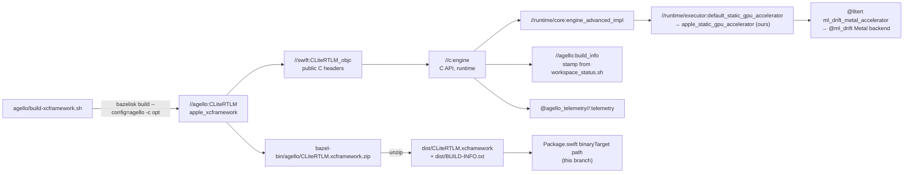
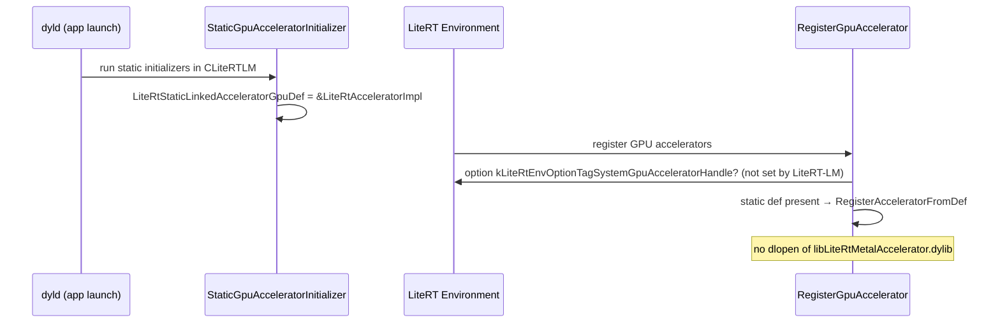
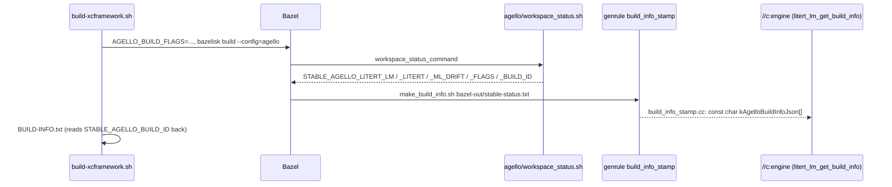

# Build and release

> **Scope:** how the documented LiteRT-LM build is made and shipped: Bazel and its configurations,
> the build-time feature flags, `--config=agello`, the Metal accelerator linked statically, the
> `WORKSPACE` pins of LiteRT and ML Drift and the local overrides, our XCFramework
> (`agello/build-xcframework.sh`, `//agello:CLiteRTLM`), build stamping, the release script, the
> third-party notices, the privacy manifest, Swift Package Manager, upstream's release artifacts and
> nightlies, the `prebuilt/` binaries, and the CMake build (mapped only).
> **Out of scope:** what changed between versions ([versions.md](../versions.md)); the C and Swift
> APIs the framework exports ([c-api.md](c-api.md), [swift-api.md](swift-api.md)); how LiteRT
> registers and runs accelerators ([../litert/runtime.md](../litert/runtime.md)); the delegate
> itself ([../litert/ml-drift-delegate.md](../litert/ml-drift-delegate.md)); what each of our
> commits does ([../patches.md](../patches.md)).
> **Pinned to:** LiteRT-LM `7b872544` (upstream base `df6df5b8`, `0.19.0-nightly.20261013`),
> LiteRT `362759838`, ML Drift `15fa9e2`; what Agello ships: LiteRT-LM `85b1a776` (`agello`) with
> Google's v0.18.0 binary.
> **Applies to:** Apple (iOS, macOS) for our build; all platforms for upstream's release process.
> **Last verified:** 2026-10-15

## Summary

- The documented build is a Bazel 7.6.1 build in `WORKSPACE` mode. <!-- c:LM-BLD-001 -->
  `agello/build-xcframework.sh` runs `bazelisk build --config=agello -c opt //agello:CLiteRTLM`
  and unpacks one `CLiteRTLM.xcframework` (iPhone `arm64` and Mac `arm64` slices) into `dist/`,
  next to a `BUILD-INFO.txt` that names every commit and the SHA-256 of each slice.
- `--config=agello` (ours) builds without Google's closed FST constraint provider, uses C++20 for
  C++ and Objective-C++, turns undefined symbols into link errors, and stamps the build. <!-- c:LM-BLD-006 -->
- LiteRT's Metal accelerator (ML Drift) is linked statically from source (ours: `43f0f5c3`);
  upstream's open BUILD files leave that hook empty and load prebuilt accelerators with `dlopen`.
  <!-- c:LM-BLD-012 --> <!-- c:LM-BLD-013 -->
- `WORKSPACE` pins LiteRT and ML Drift from our forks by commit and archive SHA-256. <!-- c:LM-BLD-019 -->
  `.bazelrc.user` (git-ignored) can point them at local checkouts instead.
- A re-pinned build is not byte-identical to the override build it replaces, because the build
  stamp compiled into the binary changes; compare replies instead. <!-- c:LM-BLD-029 -->
- Agello ships Google's v0.18.0 `CLiteRTLM.xcframework` today, not this build
  ([versions.md](../versions.md)). Our release script exists, but no release of
  `PowerBeef/agello-litert-lm` has been published as of 2026-10-15. <!-- c:LM-BLD-040 -->

## Concepts

| Term | Meaning here |
| --- | --- |
| `WORKSPACE` mode | Bazel resolves external repositories from the `WORKSPACE` file; bzlmod is off (`common --noenable_bzlmod`). |
| `--config=agello` | The block of `build:agello` lines at the end of `.bazelrc` (ours). Nothing applies it implicitly; the scripts pass it. |
| Static vs dynamic accelerator | Static: the accelerator's code is linked into `CLiteRTLM` and registers itself through a global pointer. Dynamic: LiteRT `dlopen`s `libLiteRtMetalAccelerator.dylib` (or another platform's library) at run time. |
| Pin | A repository's commit plus the SHA-256 of its GitHub archive in `WORKSPACE` (`AGELLO_LITERT_COMMIT`, `ML_DRIFT_COMMIT`). |
| Override | A `build "--override_repository=<name>=<dir>"` line in `.bazelrc.user` that replaces a pinned archive with a local checkout. |
| Build stamp | The JSON string `litert_lm_get_build_info()` returns: build id, the three commits, the flags. Generated from Bazel's `stable-status.txt`. |
| Build id | 12 hex digits of a SHA-256 over the three commits and the flags; `dev` outside `--config=agello`. |
| `BUILD-INFO.txt` | The text file `build-xcframework.sh` writes beside the framework: commits, Bazel and Xcode versions, flags, build id, date, SHA-256 per slice. Not inside the binary. |
| Release | `agello/release-xcframework.sh <tag>`: a zip, its SwiftPM checksum, a release `Package.swift`, notices and notes; `--publish` makes it a GitHub release. |
| Nightly | Upstream's daily Swift package update: when the binaries changed, a commit on the `nightly` branch and a tag `<VERSION>-nightly.<YYYYMMDD>`. |
| `prebuilt/` | Google's binaries stored in Git LFS: accelerators, the closed samplers and constraint provider, `libLiteRt`. |

## How it works

### The build in one command



1. The script exports `AGELLO_BUILD_FLAGS="--config=agello -c opt <extra flags>"`, runs Bazel through
   Bazelisk with the same flags, deletes `dist/CLiteRTLM.xcframework`, and unzips the new one there
   ([`agello/build-xcframework.sh:7-13`](https://github.com/PowerBeef/agello-litert-lm/blob/7b872544fdbd81308f98b1e2acf8c5798a549df6/agello/build-xcframework.sh#L7-L13)).
2. It writes `dist/BUILD-INFO.txt`: the LiteRT-LM commit (with ` (modified)` if the tree is dirty),
   the LiteRT and ML Drift sources (a pin, or a local checkout when `.bazelrc.user` overrides it),
   the Bazel and Xcode versions, the flags, the build id read back from
   `bazel-out/stable-status.txt`, the UTC date, and the SHA-256 of each slice's `CLiteRTLM` binary
   ([`agello/build-xcframework.sh:14-37`](https://github.com/PowerBeef/agello-litert-lm/blob/7b872544fdbd81308f98b1e2acf8c5798a549df6/agello/build-xcframework.sh#L14-L37)).
3. The branch's `Package.swift` points its single binary target at `dist/CLiteRTLM.xcframework`
   ([Swift Package Manager](#swift-package-manager)). `dist/` is git-ignored (ours,
   [`.gitignore:6-7`](https://github.com/PowerBeef/agello-litert-lm/blob/7b872544fdbd81308f98b1e2acf8c5798a549df6/.gitignore#L6-L7)).

On this Mac the last build (2026-10-15T18:49:46Z) came from exactly the pins: LiteRT-LM `7b872544`,
LiteRT `362759838`, ML Drift `15fa9e2`, build id `7023fa1a61d4`, Bazel 7.6.1, Xcode 27.0
([../generated/version-matrix.md](../generated/version-matrix.md), row "Our built framework").
<!-- c:LM-BLD-057 -->

### Bazel version and mode

- `.bazelversion` holds `7.6.1` ([`.bazelversion:1`](https://github.com/google-ai-edge/LiteRT-LM/blob/df6df5b84d5845b49889f631ed4cac80b4325dd3/.bazelversion#L1)); Google's build guide asks for the same
  version ([`docs/getting-started/build-and-run.md:30`](https://github.com/google-ai-edge/LiteRT-LM/blob/df6df5b84d5845b49889f631ed4cac80b4325dd3/docs/getting-started/build-and-run.md#L30)). Our scripts call `bazelisk`, which
  reads that file.
- bzlmod is disabled: `common --noenable_bzlmod` ([`.bazelrc:532-533`](https://github.com/PowerBeef/agello-litert-lm/blob/7b872544fdbd81308f98b1e2acf8c5798a549df6/.bazelrc#L532-L533)), so every external
  repository comes from `WORKSPACE`.
- Builds are optimized and sandbox-free by default: `build --spawn_strategy=standalone` and
  `build -c opt` ([`.bazelrc:75-76`](https://github.com/PowerBeef/agello-litert-lm/blob/7b872544fdbd81308f98b1e2acf8c5798a549df6/.bazelrc#L75-L76)). Named configs override them: `build:dbg` uses
  `-c dbg` ([`.bazelrc:206`](https://github.com/PowerBeef/agello-litert-lm/blob/7b872544fdbd81308f98b1e2acf8c5798a549df6/.bazelrc#L206)), and `build:windows`, enabled automatically on Windows hosts by
  `--enable_platform_specific_config`, uses `--spawn_strategy=local` ([`.bazelrc:371-373`](https://github.com/PowerBeef/agello-litert-lm/blob/7b872544fdbd81308f98b1e2acf8c5798a549df6/.bazelrc#L371-L373)).
  `build-xcframework.sh` passes `-c opt` again.
- `build --enable_platform_specific_config` ([`.bazelrc:89-90`](https://github.com/PowerBeef/agello-litert-lm/blob/7b872544fdbd81308f98b1e2acf8c5798a549df6/.bazelrc#L89-L90)) makes Bazel add the
  `build:<host os>` lines for the host: on a Mac, the `build:macos` block
  ([`.bazelrc:153-172`](https://github.com/PowerBeef/agello-litert-lm/blob/7b872544fdbd81308f98b1e2acf8c5798a549df6/.bazelrc#L153-L172)), which among other things links with
  `-Wl,-undefined,dynamic_lookup`.
- The Apple configurations upstream defines are `macos_arm64` (`--macos_minimum_os=11.0`) and the
  `ios*` family (`--ios_minimum_os=13.0`, C++ warnings off, `-Wno-c++11-narrowing`)
  ([`.bazelrc:174-195`](https://github.com/PowerBeef/agello-litert-lm/blob/7b872544fdbd81308f98b1e2acf8c5798a549df6/.bazelrc#L174-L195)). The XCFramework rule doesn't need them: `apple_xcframework`
  builds each slice for its own platform and minimum OS ([The XCFramework](#the-xcframework)).
- Other files are loaded with `try-import` (silently skipped when absent):
  `%workspace%/.tf_configure.bazelrc`, `%workspace%/xla_configure.bazelrc`,
  `%workspace%/.bazelrc.user` and `%workspace%/warnings.bazelrc`. The lines sit in the middle of the
  file, not at its end; Google's `build:v2` and cache configs and our `build:agello` lines follow
  ([`.bazelrc:436-444`](https://github.com/PowerBeef/agello-litert-lm/blob/7b872544fdbd81308f98b1e2acf8c5798a549df6/.bazelrc#L436-L444)).

### The agello config

`--config=agello` is ours (`43f0f5c3`, `3b2327cf`, `c7c744eb`). Each line and why
([`.bazelrc:553-566`](https://github.com/PowerBeef/agello-litert-lm/blob/7b872544fdbd81308f98b1e2acf8c5798a549df6/.bazelrc#L553-L566)):

| Line | Effect | Why |
| --- | --- | --- |
| `--define=LITERT_LM_FST_CONSTRAINTS_DISABLED=1` | Matches `//build_config:fst_constraints_disabled_by_define`, so `disable_fst_constraints` is true ([`build_config/BUILD:225-243`](https://github.com/google-ai-edge/LiteRT-LM/blob/df6df5b84d5845b49889f631ed4cac80b4325dd3/build_config/BUILD#L225-L243)); the data processors compile with `LITERT_LM_FST_CONSTRAINTS_DISABLED` ([`runtime/conversation/model_data_processor/BUILD:25-31`](https://github.com/google-ai-edge/LiteRT-LM/blob/df6df5b84d5845b49889f631ed4cac80b4325dd3/runtime/conversation/model_data_processor/BUILD#L25-L31)). | Google's Gemma constraint provider is closed and only exists as `prebuilt/` dylibs. Our `d1488ce7` keeps response formats working through llguidance without it ([conversation.md](conversation.md)). |
| `--cxxopt=-std=c++20 --host_cxxopt=-std=c++20` and `--objccopt=-std=gnu++20` | C++20 for C++ and Objective-C++ in every slice. | The comment: Abseil's status API differs between C++17 and C++20, so mixing them breaks the link; `build:macos` sets C++20 for C++ only. <!-- c:LM-BLD-007 --> |
| `--linkopt=-Wl,-undefined,error` | An unresolved symbol fails the link. | `build:macos` adds `-Wl,-undefined,dynamic_lookup` ([`.bazelrc:162-167`](https://github.com/PowerBeef/agello-litert-lm/blob/7b872544fdbd81308f98b1e2acf8c5798a549df6/.bazelrc#L162-L167)), which would turn a missing symbol into a null pointer at run time. <!-- c:LM-BLD-008 --> |
| `--workspace_status_command=agello/workspace_status.sh` | Bazel runs the script before each build and writes its `STABLE_*` lines to `stable-status.txt`. | The build stamp ([Build stamping](#build-stamping)). <!-- c:LM-BLD-009 --> |

Nothing in `.bazelrc` applies `build:agello` by default: a plain `bazel build //agello:CLiteRTLM`
builds with the closed-provider path enabled (and then needs the FST provider from `prebuilt/`),
and stamps `dev` ([Limits](#limits-and-failure-modes)).

### Build-time feature flags

`build_config/BUILD` (upstream `200545f7`, 2026-10-12) centralizes the optional parts of LiteRT-LM.
Each is a `bool_flag` (`--//build_config:<flag>=true|false`) with an equivalent `--define`, merged
into one `config_setting_group` the BUILD files `select()` on
([`build_config/BUILD:81-83`](https://github.com/google-ai-edge/LiteRT-LM/blob/df6df5b84d5845b49889f631ed4cac80b4325dd3/build_config/BUILD#L81-L83)):

| Flag (`//build_config:`) | `--define` | Default | Agello build | Notes for Apple |
| --- | --- | --- | --- | --- |
| `enable_sentencepiece_tokenizer` | `DISABLE_SENTENCEPIECE_TOKENIZER=1` | on | on | Gemma's tokenizer is SentencePiece ([components.md](components.md)) |
| `enable_huggingface_tokenizer` | `DISABLE_HUGGINGFACE_TOKENIZER=1` | on | on | Rust `tokenizers` 0.21.0 |
| `enable_minijinja_template` | `LITERT_LM_MINIJINJA_TEMPLATE_DISABLED=1` | on | on | Chat templates; a noop target exists since upstream `4d8a9a2d` |
| `enable_constrained_decoding` | `LITERT_LM_CONSTRAINED_DECODING_DISABLED=1` | on | on | Turning it off also disables llguidance and FST |
| `enable_llguidance` | `LITERT_LM_LLGUIDANCE_DISABLED=1` | on | on | JSON/regex/Lark constraints, Rust `llguidance` 1.3.0 |
| `enable_fst_constraints` | `LITERT_LM_FST_CONSTRAINTS_DISABLED=1` | on | **off** (`--config=agello`) | The closed provider ([The prebuilt binaries](#the-prebuilt-binaries)) |
| `enable_tool_use_parser` | `LITERT_LM_TOOL_USE_PARSER_DISABLED=1` | on | on | ANTLR parsers in Rust |
| `enable_gpu_backend` | `LITERT_LM_GPU_BACKEND_DISABLED=1` | on | on | Also off when LiteRT's `build_include` is `cpu_only` ([`build_config/BUILD:281-305`](https://github.com/google-ai-edge/LiteRT-LM/blob/df6df5b84d5845b49889f631ed4cac80b4325dd3/build_config/BUILD#L281-L305)) |
| `enable_npu_backend` | `LITERT_LM_NPU_BACKEND_DISABLED=1` | on | on (macOS); NPU LLM executor off on iOS | `disable_npu_backend` matches `@platforms//os:ios`, not macOS ([`build_config/BUILD:323-332`](https://github.com/google-ai-edge/LiteRT-LM/blob/df6df5b84d5845b49889f631ed4cac80b4325dd3/build_config/BUILD#L323-L332)). On iOS it removes `llm_litert_npu_compiled_model_executor` from `llm_litert_compiled_model_executor_factory` and defines `LITERT_DISABLE_NPU` for the factory and its dependents; the vision, audio and embedding executors and `runtime/util/litert_util.cc` don't get the define and still compile their NPU option code ([`runtime/executor/BUILD:452-490`](https://github.com/PowerBeef/agello-litert-lm/blob/7b872544fdbd81308f98b1e2acf8c5798a549df6/runtime/executor/BUILD#L452-L490), [`runtime/executor/vision_litert_compiled_model_executor.cc:48-51`](https://github.com/google-ai-edge/LiteRT-LM/blob/df6df5b84d5845b49889f631ed4cac80b4325dd3/runtime/executor/vision_litert_compiled_model_executor.cc#L48-L51), [`runtime/util/litert_util.cc:90-97`](https://github.com/google-ai-edge/LiteRT-LM/blob/df6df5b84d5845b49889f631ed4cac80b4325dd3/runtime/util/litert_util.cc#L90-L97)). macOS keeps the NPU executor unless the flag or define turns it off <!-- c:LM-BLD-060 --> |
| `enable_legacy_artisan_executors` | `LITERT_LM_EXCLUDE_LEGACY_EXECUTORS=1` | on | on | The open part of the GPU "artisan" path ([executors.md](executors.md)) |
| `enable_diffusion_executor` | `LITERT_LM_SATURN_ENABLED=1` | **off** | off | ([`build_config/BUILD:360-383`](https://github.com/google-ai-edge/LiteRT-LM/blob/df6df5b84d5845b49889f631ed4cac80b4325dd3/build_config/BUILD#L360-L383)) |
| `enable_google_tensor_backend` | `GOOGLE_TENSOR_ENABLED=1` | off | off | Android only: the settings carry an `@platforms//os:android` constraint |
| `enable_vision`, `enable_audio` | `LITERT_LM_VISION_DISABLED=1`, `LITERT_LM_AUDIO_DISABLED=1` | on | on | Gemma 4 E4B's encoders |
| `enable_debugger` | `LITERT_LM_DEBUGGER_ENABLED=1` | off | off | |
| `enable_all_model_processors`, `enabled_model_families`, `enable_<family>_processor(s)` | | all | all | Gemma, Qwen, FastVLM, LFM2, MiniCPM processors |

Two more switches live elsewhere:

- `--define=litert_runtime_link_mode=dynamic` (LiteRT's `//litert:litert_runtime_link_mode_dynamic`)
  empties `default_static_gpu_accelerator` and `default_static_gpu_samplers`, for builds that load
  the GPU libraries from `prebuilt/` ([Linking the Metal accelerator statically](#linking-the-metal-accelerator-statically)).
- `--//runtime/executor:gpu_accelerator=default|metal|webgpu` ([`runtime/executor/BUILD:179-194`](https://github.com/PowerBeef/agello-litert-lm/blob/7b872544fdbd81308f98b1e2acf8c5798a549df6/runtime/executor/BUILD#L179-L194)).
  Its comment says iOS defaults to Metal and macOS to WebGPU, and that it picks both the accelerator
  and the GPU sampler library (TopK Metal or WebGPU). In the open BUILD files at the pin, the settings derived from it (`ios_webgpu`,
  `macos_metal`, [`runtime/executor/BUILD:236-250`](https://github.com/PowerBeef/agello-litert-lm/blob/7b872544fdbd81308f98b1e2acf8c5798a549df6/runtime/executor/BUILD#L236-L250)) aren't used by any `select()`, and our
  `apple_static_gpu_accelerator` links Metal on both iOS and macOS whatever its value.

### Linking the Metal accelerator statically

Upstream's open `runtime/executor/BUILD` declares the hook but leaves it empty: with the default
link mode, `default_static_gpu_accelerator` has no dependencies
([`runtime/executor/BUILD:252-260`](https://github.com/google-ai-edge/LiteRT-LM/blob/df6df5b84d5845b49889f631ed4cac80b4325dd3/runtime/executor/BUILD#L252-L260)). Google's own builds fill it internally; open-source
builds run the GPU by building with `--define=litert_runtime_link_mode=dynamic` and copying the
`prebuilt/` accelerator libraries next to the binary, as Google's build guide says
([`docs/getting-started/build-and-run.md:90-97`](https://github.com/google-ai-edge/LiteRT-LM/blob/df6df5b84d5845b49889f631ed4cac80b4325dd3/docs/getting-started/build-and-run.md#L90-L97)).

Ours (`43f0f5c3`) fills it on Apple platforms ([`runtime/executor/BUILD:252-279`](https://github.com/PowerBeef/agello-litert-lm/blob/7b872544fdbd81308f98b1e2acf8c5798a549df6/runtime/executor/BUILD#L252-L279)):

- `default_static_gpu_accelerator` depends on `apple_static_gpu_accelerator` unless
  `litert_runtime_link_mode=dynamic`.
- `apple_static_gpu_accelerator` selects on `@platforms//os:ios` and `@platforms//os:macos`: it
  depends on `@litert//litert/runtime/accelerators/gpu:ml_drift_metal_accelerator` and links
  `-framework Metal -framework Foundation` (the open BUILD files leave Apple framework dependencies
  as placeholders). On any other platform it is empty.
- `//runtime/core:engine_advanced_impl` depends on it, and on `default_static_gpu_samplers`
  ([`runtime/core/BUILD:115-131`](https://github.com/PowerBeef/agello-litert-lm/blob/7b872544fdbd81308f98b1e2acf8c5798a549df6/runtime/core/BUILD#L115-L131)).
- `default_static_gpu_samplers` stays empty in every branch at the pin
  ([`runtime/components/BUILD:249-256`](https://github.com/PowerBeef/agello-litert-lm/blob/7b872544fdbd81308f98b1e2acf8c5798a549df6/runtime/components/BUILD#L249-L256)): our build links no GPU sampler, so sampling runs
  on the CPU ([components.md](components.md)). Google's v0.18.0 binary carries the closed Metal TopK
  sampler ([../generated/binaries.md](../generated/binaries.md), row "TopK Metal sampler").
  <!-- c:LM-BLD-015 -->

On the LiteRT side (our fork at `362759838`, files unchanged from Google's `ca21dc99`):

- `ml_drift_metal_accelerator` is a `litert_accelerator_library`
  ([`litert/runtime/accelerators/gpu/BUILD:365-391`](https://github.com/google-ai-edge/LiteRT/blob/ca21dc99de51c76bdcc572afeea1dd937d3c9e5c/litert/runtime/accelerators/gpu/BUILD#L365-L391)). The macro's static `cc_library` is
  `alwayslink` and defines `LITERT_USE_STATIC_LINKED_GPU_ACCELERATOR`
  ([`litert/build_common/litert_build_defs.bzl:660-700`](https://github.com/google-ai-edge/LiteRT/blob/ca21dc99de51c76bdcc572afeea1dd937d3c9e5c/litert/build_common/litert_build_defs.bzl#L660-L700)).
- Under that define, `ml_drift_metal_accelerator.cc` has a static initializer that stores its
  accelerator definition in the global `LiteRtStaticLinkedAcceleratorGpuDef`
  ([`litert/runtime/accelerators/gpu/ml_drift_metal_accelerator.cc:167-182`](https://github.com/google-ai-edge/LiteRT/blob/ca21dc99de51c76bdcc572afeea1dd937d3c9e5c/litert/runtime/accelerators/gpu/ml_drift_metal_accelerator.cc#L167-L182)).
- When the environment registers GPU accelerators, `RegisterGpuAccelerator` first takes an
  accelerator passed through the environment option `kLiteRtEnvOptionTagSystemGpuAcceleratorHandle`,
  then the static definition ("Statically linked GPU accelerator registered."), and only then tries
  to `dlopen` the library names ([`litert/runtime/accelerators/gpu_registry.cc:88-125`](https://github.com/google-ai-edge/LiteRT/blob/ca21dc99de51c76bdcc572afeea1dd937d3c9e5c/litert/runtime/accelerators/gpu_registry.cc#L88-L125)).



The result on Apple: our `CLiteRTLM` binary depends on `Metal.framework` and contains the
accelerator's code ([../generated/binaries.md](../generated/binaries.md), "ML Drift Metal
accelerator ... 9 / 0" and the linked frameworks). How the accelerator then compiles the model is
[../litert/ml-drift-delegate.md](../litert/ml-drift-delegate.md).

### External repositories and pins

Upstream's base declares LiteRT as Google's archive at `LITERT_REF`, with `patch_cmds` that rewrite
`@//third_party/` labels ([`WORKSPACE:447-459`](https://github.com/google-ai-edge/LiteRT-LM/blob/df6df5b84d5845b49889f631ed4cac80b4325dd3/WORKSPACE#L447-L459)), and doesn't declare ML Drift at all
(LiteRT-LM never linked the Metal accelerator from source). Our `WORKSPACE` (`e309971f` and the
re-pins after it) changes that:

| Repository | Declared as | Pin | Why |
| --- | --- | --- | --- |
| `litert` | `http_archive` of `PowerBeef/LiteRT/archive/<commit>.tar.gz` ([`WORKSPACE:493-508`](https://github.com/PowerBeef/agello-litert-lm/blob/7b872544fdbd81308f98b1e2acf8c5798a549df6/WORKSPACE#L493-L508)) | `362759838e34…`, sha256 `dd8d2dc4…` | Our LiteRT fork: `LITERT_REF` (`ca21dc99`) plus 12 commits ([../generated/patch-log.md](../generated/patch-log.md)). The `patch_cmds` moved into fork commits. |
| `ml_drift` | `http_archive` of `PowerBeef/ml-drift`, with `repo_mapping` `@fp16`→`@FP16`, `@com_github_google_re2`→`@com_googlesource_code_re2` ([`WORKSPACE:517-540`](https://github.com/PowerBeef/agello-litert-lm/blob/7b872544fdbd81308f98b1e2acf8c5798a549df6/WORKSPACE#L517-L540)) | `15fa9e2ba632…`, sha256 `880e9cd6…` | Needed to link the accelerator statically. Bazel doesn't read `@litert`'s `WORKSPACE`, so this repeats the declaration LiteRT makes for itself, which pins Google's `1b18771f` ([`WORKSPACE:497-512`](https://github.com/google-ai-edge/LiteRT/blob/ca21dc99de51c76bdcc572afeea1dd937d3c9e5c/WORKSPACE#L497-L512)). <!-- c:LM-BLD-020 --> |
| `agello_telemetry` | `local_repository` at `agello/telemetry` ([`WORKSPACE:510-515`](https://github.com/PowerBeef/agello-litert-lm/blob/7b872544fdbd81308f98b1e2acf8c5798a549df6/WORKSPACE#L510-L515)) | this commit | Our probes, a repository of its own so LiteRT and ML Drift can depend on `@agello_telemetry` too. `//c:engine` links it ([`c/BUILD:336-369`](https://github.com/PowerBeef/agello-litert-lm/blob/7b872544fdbd81308f98b1e2acf8c5798a549df6/c/BUILD#L336-L369)). |
| `XNNPACK` | `http_archive` at `d89ef666…` with `//agello/patches:xnnpack_qs8_qc8_scales.patch`, declared before `tf_workspace2()` so TensorFlow's own declaration is skipped ([`WORKSPACE:275-290`](https://github.com/PowerBeef/agello-litert-lm/blob/7b872544fdbd81308f98b1e2acf8c5798a549df6/WORKSPACE#L275-L290)) | TensorFlow's XNNPACK commit plus upstream XNNPACK `c72e2a4ae0` | The INT8 KV-cache scales fix on the CPU path ([../litert/cpu-xnnpack.md](../litert/cpu-xnnpack.md)). <!-- c:LM-BLD-023 --> |
| `FP16` | `http_archive` with a `build_file_content` that adds the lowercase alias `fp16` ([`WORKSPACE:152-179`](https://github.com/PowerBeef/agello-litert-lm/blob/7b872544fdbd81308f98b1e2acf8c5798a549df6/WORKSPACE#L152-L179)) | `4dfe081c…` (TensorFlow's) | ML Drift refers to `@fp16//:fp16`. |
| `org_tensorflow` | `http_archive` with `third_party/tensorflow/tensorflow.patch` ([`WORKSPACE:10-12`](https://github.com/PowerBeef/agello-litert-lm/blob/7b872544fdbd81308f98b1e2acf8c5798a549df6/WORKSPACE#L10-L12), [`WORKSPACE:181-187`](https://github.com/PowerBeef/agello-litert-lm/blob/7b872544fdbd81308f98b1e2acf8c5798a549df6/WORKSPACE#L181-L187)) | `a1179d3c…` | Upstream's. |
| `com_google_absl` | `http_archive` with `third_party/abseil/abseil.patch` ([`WORKSPACE:92-103`](https://github.com/PowerBeef/agello-litert-lm/blob/7b872544fdbd81308f98b1e2acf8c5798a549df6/WORKSPACE#L92-L103)) | `20260526.0` | Upstream's. |
| Apple rules | `build_bazel_rules_apple` 3.22.0, `build_bazel_rules_swift` 2.9.0, `build_bazel_apple_support` 1.23.1 ([`WORKSPACE:56-83`](https://github.com/PowerBeef/agello-litert-lm/blob/7b872544fdbd81308f98b1e2acf8c5798a549df6/WORKSPACE#L56-L83)) | | Upstream's; the comments explain the versions by macOS Tahoe signing and SDK issues. |
| Rust | `rules_rust` 0.61.0 ([`WORKSPACE:366-372`](https://github.com/PowerBeef/agello-litert-lm/blob/7b872544fdbd81308f98b1e2acf8c5798a549df6/WORKSPACE#L366-L372)); crates `llguidance` =1.3.0, `minijinja` =2.14.0, `tokenizers` =0.21.0 ([`Cargo.toml:18-22`](https://github.com/google-ai-edge/LiteRT-LM/blob/df6df5b84d5845b49889f631ed4cac80b4325dd3/Cargo.toml#L18-L22)) | | Upstream's. |

`LITERT_REF` and `LITERT_SHA256` stay at the top of `WORKSPACE` ([`WORKSPACE:5-8`](https://github.com/PowerBeef/agello-litert-lm/blob/7b872544fdbd81308f98b1e2acf8c5798a549df6/WORKSPACE#L5-L8)) to record
the upstream base, but no repository uses them any more.

### Local checkouts instead of pins

`.bazelrc` `try-import`s `%workspace%/.bazelrc.user`
([`.bazelrc:440-441`](https://github.com/PowerBeef/agello-litert-lm/blob/7b872544fdbd81308f98b1e2acf8c5798a549df6/.bazelrc#L440-L441)). The file isn't in the repository (on this Mac it is excluded through
`.git/info/exclude`), so it holds machine-local settings: disk and repository caches, job limits,
disk-cache garbage collection, and two commented lines:

```text
# build "--override_repository=litert=/Users/patricedery/Coding projects/LiteRT"
# build "--override_repository=ml_drift=/Users/patricedery/Coding projects/ml-drift"
```

Uncommented, Bazel uses those checkouts instead of the pinned archives. Both stamping scripts read
the same lines with one `sed` expression (the form must be exactly `build "--override_repository=<name>=<dir>"`,
quotes optional) and report the checkout's commit, plus a marker for uncommitted changes, instead of
the `WORKSPACE` pin ([`agello/workspace_status.sh:20-32`](https://github.com/PowerBeef/agello-litert-lm/blob/7b872544fdbd81308f98b1e2acf8c5798a549df6/agello/workspace_status.sh#L20-L32),
[`agello/build-xcframework.sh:14-22`](https://github.com/PowerBeef/agello-litert-lm/blob/7b872544fdbd81308f98b1e2acf8c5798a549df6/agello/build-xcframework.sh#L14-L22)). The release script refuses to run while any such
line is active ([The release script](#the-release-script)).

### Re-pinning LiteRT or ML Drift

1. Develop in the local checkouts with the overrides on; build with `agello/build-xcframework.sh`.
2. Commit and push the fork (`PowerBeef/LiteRT` or `PowerBeef/ml-drift`, branch `agello-next`).
3. Set the new commit and `shasum -a 256` of `https://github.com/PowerBeef/<repo>/archive/<commit>.tar.gz`
   in `WORKSPACE` (`AGELLO_LITERT_COMMIT`/`AGELLO_LITERT_SHA256` or `ML_DRIFT_COMMIT`/`ML_DRIFT_SHA256`).
4. Comment the overrides out and rebuild.
5. Check behavior, not bytes: run agello-bench `suites/short.json` (greedy digit copies) and compare
   replies with the override build's.

**Contradiction C5.** The `agello-litert-update` skill says the re-pinned framework "should come out
byte-identical" (Agello `93122b6`, `.claude/skills/agello-litert-update/SKILL.md` lines 160–164);
`docs/agello/BUILD.md` says it isn't, because the build info names the build. The code settles it for
BUILD.md. `workspace_status.sh` stamps the LiteRT-LM commit, with `+<12 hex digits of the SHA-256 of
git diff HEAD>` when the tree has uncommitted changes, and derives the build id from it
([`agello/workspace_status.sh:10-40`](https://github.com/PowerBeef/agello-litert-lm/blob/7b872544fdbd81308f98b1e2acf8c5798a549df6/agello/workspace_status.sh#L10-L40)); `make_build_info.sh` writes both into the
`kAgelloBuildInfoJson` constant ([`agello/make_build_info.sh:10-14`](https://github.com/PowerBeef/agello-litert-lm/blob/7b872544fdbd81308f98b1e2acf8c5798a549df6/agello/make_build_info.sh#L10-L14)) that
`litert_lm_get_build_info()` returns ([`c/build_info.cc:17-20`](https://github.com/PowerBeef/agello-litert-lm/blob/7b872544fdbd81308f98b1e2acf8c5798a549df6/c/build_info.cc#L17-L20)) and `//c:engine` links
([`c/BUILD:336-369`](https://github.com/PowerBeef/agello-litert-lm/blob/7b872544fdbd81308f98b1e2acf8c5798a549df6/c/BUILD#L336-L369)). In the order above, step 3 edits the tracked `WORKSPACE`, so the
rebuild's `litert_lm` field is either the same commit with `+<hash>` or the new re-pin commit, while
the override build stamped the commit before it. The constant's bytes, the build id and so the
binary's SHA-256 change. <!-- c:LM-BLD-029 --> The LiteRT and ML Drift fields don't: a clean local
checkout reports `git rev-parse HEAD`, the same full SHA as the pin. BUILD.md also reports a check
on 2026-10-15 (15/15 identical replies, build `2e54fbdb9ca9`); no results file in
`docs/agello/results/` backs it ([Open questions](#open-questions)).

### The XCFramework

`//agello:CLiteRTLM` (ours, `3b2327cf`) is an `apple_xcframework`
([`agello/BUILD:27-52`](https://github.com/PowerBeef/agello-litert-lm/blob/7b872544fdbd81308f98b1e2acf8c5798a549df6/agello/BUILD#L27-L52)):

| Attribute | Ours (`//agello:CLiteRTLM`) | Upstream (`//swift:CLiteRTLM`, `//swift:CLiteRTLM_mac`) |
| --- | --- | --- |
| Slices | iOS device `arm64`; macOS `arm64` | iOS device `arm64` and simulator `arm64`; macOS as a separate universal (`arm64`, `x86_64`) dylib zipped by a genrule ([`swift/BUILD:141-191`](https://github.com/PowerBeef/agello-litert-lm/blob/7b872544fdbd81308f98b1e2acf8c5798a549df6/swift/BUILD#L141-L191)) |
| Minimum OS | iOS 27.0, macOS 27.0 | iOS 15.0; macOS 12.0 |
| Bundle id | `com.patricedery.agello.CLiteRTLM` | `com.google.odml.litertlm.CLiteRTLM` |
| `Info.plist` version | `0.19.0` ([`agello/Info.plist:11-14`](https://github.com/PowerBeef/agello-litert-lm/blob/7b872544fdbd81308f98b1e2acf8c5798a549df6/agello/Info.plist#L11-L14)) | `swift/Info.plist` |
| Public headers | `api_export.h`, `conversation.h`, `embedding_engine.h`, `engine.h`, `error_reporter.h`, `experimental.h`, `model_info.h`, `telemetry.h`, `build_info.h` | the first seven, plus `telemetry.h` and `build_info.h` on our branch (ours, `c7c744eb`) |
| Dependency | `//swift:CLiteRTLM_objc` → `//c:engine` | same |
| Feature | `exported_symbols` | same |

<!-- c:LM-BLD-031 --> <!-- c:LM-BLD-033 -->

There is no simulator slice in our framework <!-- c:LM-BLD-031 -->, and Agello doesn't build or test
in the simulator by project rule. Google's v0.18.0 framework does have a simulator slice with the
Metal accelerator <!-- c:APL-066 -->; whether it runs E4B there is untested. <!-- c:APL-069 --> The macOS slice exists so the Mac can run the same Metal path as the iPhone in tools such as
agello-bench and in the `PLATFORM=mac` harness. The local build's iOS binary reports `minos 27.0`
(`otool -l`, `LC_BUILD_VERSION`).

Google's v0.18.0 iOS binary and ours differ in size and contents: 61.6 MB against 37.5 MB, 212
against 220 exported `litert_lm_*` functions; ours has no FST provider and almost none of the
closed TopK sampler and artisan code ([../generated/binaries.md](../generated/binaries.md)).
<!-- c:LM-BLD-056 -->

### Build stamping



- `workspace_status.sh` (ours, `c7c744eb`) prints five keys. `LITERT_LM` is the checkout's commit,
  with `+<hash>` for uncommitted changes. `LITERT` and `ML_DRIFT` are the local checkout described
  the same way when `.bazelrc.user` overrides it, else the `WORKSPACE` pin. `FLAGS` is
  `AGELLO_BUILD_FLAGS`, or `unknown` ([`agello/workspace_status.sh:10-40`](https://github.com/PowerBeef/agello-litert-lm/blob/7b872544fdbd81308f98b1e2acf8c5798a549df6/agello/workspace_status.sh#L10-L40)).
- The build id is the first 12 hex digits of the SHA-256 of those four values, one per line.
  <!-- c:LM-BLD-030 -->
- `//agello:build_info_stamp` is a genrule with `stamp = 1` that runs `make_build_info.sh` on
  `bazel-out/stable-status.txt`; `//agello:build_info` compiles it with `alwayslink`
  ([`agello/BUILD:11-25`](https://github.com/PowerBeef/agello-litert-lm/blob/7b872544fdbd81308f98b1e2acf8c5798a549df6/agello/BUILD#L11-L25)).
- `make_build_info.sh` escapes backslashes and quotes and falls back to `dev` for the build id and
  `unknown` for the rest when a key is missing, which is what a build without `--config=agello`
  gets ([`agello/make_build_info.sh:4-14`](https://github.com/PowerBeef/agello-litert-lm/blob/7b872544fdbd81308f98b1e2acf8c5798a549df6/agello/make_build_info.sh#L4-L14), [`c/build_info.h:29-33`](https://github.com/PowerBeef/agello-litert-lm/blob/7b872544fdbd81308f98b1e2acf8c5798a549df6/c/build_info.h#L29-L33)).
- Swift reads it through `LiteRTLM.BuildInfo.json`, `.fields` and `.id`
  ([`swift/BuildInfo.swift:19-30`](https://github.com/PowerBeef/agello-litert-lm/blob/7b872544fdbd81308f98b1e2acf8c5798a549df6/swift/BuildInfo.swift#L19-L30)). Google's binaries don't export
  `litert_lm_get_build_info`, so the Swift wrapper on this branch only links against our framework
  ([versions.md](../versions.md)).

Who reads it: agello-bench records it per machine, and Agello's harness puts it in the device
record (`runtimeBuild` in [../../results/iphone/2026-10-15/agello/](../../results/iphone/2026-10-15/README.md)
files); Google's binary leaves that record empty.

### The release script

`agello/release-xcframework.sh <tag> [--publish]` (ours, `57376f53`) packages a build for a GitHub
release of `PowerBeef/agello-litert-lm` ([`agello/release-xcframework.sh:1-74`](https://github.com/PowerBeef/agello-litert-lm/blob/7b872544fdbd81308f98b1e2acf8c5798a549df6/agello/release-xcframework.sh#L1-L74)):

1. It refuses to run when `.bazelrc.user` has an active `--override_repository` line or the tree has
   uncommitted changes (exit code 2) ([`agello/release-xcframework.sh:25-33`](https://github.com/PowerBeef/agello-litert-lm/blob/7b872544fdbd81308f98b1e2acf8c5798a549df6/agello/release-xcframework.sh#L25-L33)). <!-- c:LM-BLD-037 -->
2. It runs `agello/build-xcframework.sh` (from the pins).
3. In `dist/release/<tag>/` it writes `CLiteRTLM.xcframework.zip` (`zip -qry` of the framework),
   `checksum.txt` (`swift package compute-checksum`, the SHA-256 SwiftPM checks), a `Package.swift`
   whose `path: "dist/CLiteRTLM.xcframework"` line is replaced by the release URL and checksum (it
   stops if the substitution didn't happen), `BUILD-INFO.txt`, `THIRD_PARTY_NOTICES.md` and
   `NOTES.md` ([`agello/release-xcframework.sh:35-66`](https://github.com/PowerBeef/agello-litert-lm/blob/7b872544fdbd81308f98b1e2acf8c5798a549df6/agello/release-xcframework.sh#L35-L66)).
4. Without `--publish` it stops (a dry run). With it, `gh release create <tag> --target <commit>`
   uploads the zip, checksum, notices and build info ([`agello/release-xcframework.sh:67-74`](https://github.com/PowerBeef/agello-litert-lm/blob/7b872544fdbd81308f98b1e2acf8c5798a549df6/agello/release-xcframework.sh#L67-L74)).
   Publishing needs the user's OK. <!-- c:LM-BLD-039 -->

On the Agello side, `Vendor/use-release-litert.sh` takes `REF` (the `agello-next` commit) and `TAG`,
downloads the release's `checksum.txt`, vendors `Package.swift`, `swift/` and `LICENSE` from `REF`
with `refresh-litert-lm.sh`, and rewrites the binary target's `path:` to the release URL and checksum
(Agello `93122b6`, `Vendor/use-release-litert.sh`). <!-- c:LM-BLD-041 --> Before a release,
`Vendor/use-local-litert.sh` vendors the worktree's `dist/` build directly: it replaces
`Vendor/LiteRT-LM` with `Package.swift`, `LICENSE` and `swift/` from the checkout (default
`../agello-arms/next/LiteRT-LM`), copies the checkout's `dist/CLiteRTLM.xcframework` and
`dist/BUILD-INFO.txt` into `Vendor/LiteRT-LM/dist/`, which git ignores, and deletes stale
`CLiteRTLM-*.pcm` modules and `Debug-*` `CLiteRTLM.framework` products in Agello's DerivedData
(Agello `93122b6`, `Vendor/use-local-litert.sh`). <!-- c:LM-BLD-042 -->

### Third-party notices

`agello/third_party_notices.py` (ours, `57376f53`) writes `agello/THIRD_PARTY_NOTICES.md`:

- Components are the external repositories among the inputs of the framework's link actions:
  `bazelisk aquery --config=agello -c opt 'mnemonic("ObjcLink|CppLink", deps(//agello:CLiteRTLM))'`
  ([`agello/third_party_notices.py:58-61`](https://github.com/PowerBeef/agello-litert-lm/blob/7b872544fdbd81308f98b1e2acf8c5798a549df6/agello/third_party_notices.py#L58-L61)). Build tools (Python, Rust tooling, code
  generators) aren't link inputs, so they aren't listed.
- Toolchain repositories are skipped; a `rust_*_tools` repository becomes one "Rust standard
  library" entry ([`agello/third_party_notices.py:20-21`](https://github.com/PowerBeef/agello-litert-lm/blob/7b872544fdbd81308f98b1e2acf8c5798a549df6/agello/third_party_notices.py#L20-L21),
  [`agello/third_party_notices.py:78-97`](https://github.com/PowerBeef/agello-litert-lm/blob/7b872544fdbd81308f98b1e2acf8c5798a549df6/agello/third_party_notices.py#L78-L97)). <!-- c:LM-BLD-043 -->
- A Rust crate's license comes from its `Cargo.toml` `license` field; C and C++ repositories from a
  fixed table ([`agello/third_party_notices.py:23-48`](https://github.com/PowerBeef/agello-litert-lm/blob/7b872544fdbd81308f98b1e2acf8c5798a549df6/agello/third_party_notices.py#L23-L48)). Texts come from each repository's
  license file; identical texts are printed once with all the components that share them.
- The generated table at the pin lists 101 components: 79 Rust crates, LiteRT, ML Drift, Agello
  telemetry, 18 other C/C++ libraries, and the Rust standard library
  ([`agello/THIRD_PARTY_NOTICES.md:8-110`](https://github.com/PowerBeef/agello-litert-lm/blob/7b872544fdbd81308f98b1e2acf8c5798a549df6/agello/THIRD_PARTY_NOTICES.md#L8-L110)). <!-- c:LM-BLD-044 -->
- Every license in it is permissive: Apache-2.0, MIT, BSD-2/3-Clause, Zlib, Unlicense, MIT-0 and
  Ooura's FFT license, alone or as alternatives. No GPL, LGPL or MPL entry appears; Eigen (MPL-2.0)
  is in the script's table but not among the link inputs. <!-- c:LM-BLD-045 -->

Regenerate it whenever a dependency changes; the release script copies it into each release. Agello's
`NOTICE` has to carry it once Agello ships our build (the header of `use-release-litert.sh` says so).

### Privacy manifest

Neither build of `CLiteRTLM.framework` ships a privacy manifest: `//agello:CLiteRTLM` declares no
resources ([`agello/BUILD:27-52`](https://github.com/PowerBeef/agello-litert-lm/blob/7b872544fdbd81308f98b1e2acf8c5798a549df6/agello/BUILD#L27-L52)), and the repository has no `PrivacyInfo.xcprivacy`. The
app declares the framework's required-reason APIs instead. Agello's `Agello/PrivacyInfo.xcprivacy`
(at `93122b6`) lists `NSPrivacyAccessedAPICategoryFileTimestamp` with reason `C617.1` (model and
cache files inside the container, including `stat`/`fstat`/`fstatat`/`lstat` in `CLiteRTLM`) and
`NSPrivacyAccessedAPICategorySystemBootTime` with `35F9.1` (`mach_absolute_time` for inference
timing). <!-- c:LM-BLD-046 -->

Checked on 2026-10-15 with `nm -u` on the local build's iOS slice (build `7023fa1a61d4`): the binary
imports `stat`, `fstat`, `lstat` and `mach_absolute_time`, which those two categories cover, plus
`clock_gettime`, `sysctl` and `sysctlbyname`. Recheck on every release, since a new dependency can
add a category; `docs/agello/BUILD.md` records the same list.

### Swift Package Manager

| | Base `df6df5b8` (nightly) | Ours at `7b872544` | Agello today (`85b1a776` = v0.18.0's manifest) |
| --- | --- | --- | --- |
| Binary targets | `CLiteRTLM` and `CLiteRTLM_mac`, URLs on `storage.googleapis.com/litert/litert_lm/swift/nightly/` with checksums ([`Package.swift:35-57`](https://github.com/google-ai-edge/LiteRT-LM/blob/df6df5b84d5845b49889f631ed4cac80b4325dd3/Package.swift#L35-L57)) | one `CLiteRTLM` at `path: "dist/CLiteRTLM.xcframework"` ([`Package.swift:35-45`](https://github.com/PowerBeef/agello-litert-lm/blob/7b872544fdbd81308f98b1e2acf8c5798a549df6/Package.swift#L35-L45)) | `CLiteRTLM` and `CLiteRTLM_mac` from the v0.18.0 GitHub release ([`Package.swift:34-56`](https://github.com/google-ai-edge/LiteRT-LM/blob/b2f686e2ed4718fb84ec398a61dd59ca0f0aff27/Package.swift#L34-L56)) |
| `LiteRTLM` depends on | `CLiteRTLM` on iOS, `CLiteRTLM_mac` on macOS | `CLiteRTLM` on both | as base |
| Platforms | `.iOS(.v15)`, `.macOS(.v12)` ([`Package.swift:20-23`](https://github.com/PowerBeef/agello-litert-lm/blob/7b872544fdbd81308f98b1e2acf8c5798a549df6/Package.swift#L20-L23)) | same | same |
| Products | `LiteRTLM`, `LiteRTLMFoundationModels` (`swift/apple_fm`) | same | same |

<!-- c:LM-BLD-047 --> <!-- c:LM-BLD-049 -->

A remote binary target carries a `checksum`: SwiftPM downloads the zip and refuses it if its SHA-256
differs. Agello's committed `Vendor/LiteRT-LM/Package.swift` (at `93122b6`) keeps v0.18.0's two
remote targets, with checksums `d765b99592d4…` (iOS) and `5f6ee68d95ee…` (macOS). Agello vendors the
package (only `Package.swift`, `swift/` and `LICENSE`) instead of depending on the repository,
because the repository's Git LFS objects (`prebuilt/`) made package resolution fail
(`Vendor/README.md`).

The platforms line is the same as upstream's although our slices need 27.0: a client with a lower
deployment target resolves the package and then links a binary built for a newer OS. Agello's target
is iOS 27, so it doesn't hit this. <!-- c:LM-BLD-048 -->

### Upstream releases and nightlies

How Google produces what Agello downloads today:

- **Version number.** `version.bzl` holds `VERSION`, the release *in development*, bumped after each
  release, and `C_API_VERSION` ([`version.bzl:17-23`](https://github.com/google-ai-edge/LiteRT-LM/blob/df6df5b84d5845b49889f631ed4cac80b4325dd3/version.bzl#L17-L23)); see [versions.md](../versions.md).
- **Release tags.** Each release has a `release/vX.Y.Z` branch and a tag `vX.Y.Z` on it; v0.18.0's
  release targets `release/v0.18.0` (published 2026-10-06). Its assets are `CLiteRTLM.xcframework.zip`
  (124,129,650 bytes), `CLiteRTLM_mac.xcframework.zip` (45,143,303 bytes) and
  `litert_lm_main.macos_arm64` (16,578,288 bytes). <!-- c:LM-BLD-053 -->
- **Who builds the frameworks.** No public workflow builds `//swift:CLiteRTLM`: the only workflow
  that mentions `CLiteRTLM` is the nightly package update below, and it fetches checksums of zips
  built elsewhere ("after Kokoro macOS build finishes", [`.github/workflows/nightly-swift.yml:17-21`](https://github.com/google-ai-edge/LiteRT-LM/blob/df6df5b84d5845b49889f631ed4cac80b4325dd3/.github/workflows/nightly-swift.yml#L17-L21)).
  `CI-Mac` runs on pull requests, a daily cache refresh and `v*.*.*` tag pushes; it builds and tests
  `//runtime/engine:litert_lm_main` on macOS with `--define=litert_runtime_link_mode=dynamic`, and on
  a tag uploads that binary to the release as `litert_lm_main.macos_arm64`
  ([`.github/workflows/ci-build-mac.yml:16-19`](https://github.com/google-ai-edge/LiteRT-LM/blob/df6df5b84d5845b49889f631ed4cac80b4325dd3/.github/workflows/ci-build-mac.yml#L16-L19), [`.github/workflows/ci-build-mac.yml:125-150`](https://github.com/google-ai-edge/LiteRT-LM/blob/df6df5b84d5845b49889f631ed4cac80b4325dd3/.github/workflows/ci-build-mac.yml#L125-L150)).
  Its iOS simulator step is commented out ([`.github/workflows/ci-build-mac.yml:160-180`](https://github.com/google-ai-edge/LiteRT-LM/blob/df6df5b84d5845b49889f631ed4cac80b4325dd3/.github/workflows/ci-build-mac.yml#L160-L180)).
  <!-- c:LM-BLD-052 -->
- **Nightlies.** `Nightly-Swift-Package-Update` runs daily at 05:00 UTC, and manually
  ([`.github/workflows/nightly-swift.yml:17-21`](https://github.com/google-ai-edge/LiteRT-LM/blob/df6df5b84d5845b49889f631ed4cac80b4325dd3/.github/workflows/nightly-swift.yml#L17-L21)). On the `nightly` branch it builds the names
  `CLiteRTLM_<VERSION>-<YYYYMMDD>.xcframework.zip` and `CLiteRTLM_mac_<VERSION>-<YYYYMMDD>.xcframework.zip`
  from `version.bzl` and the Pacific date, falls back to the previous day when today's `.sha256` isn't
  on `storage.googleapis.com/litert/litert_lm/swift/nightly` yet, rewrites the two binary targets'
  URLs and checksums, and, only if `Package.swift` changed, commits, pushes to `nightly` and
  force-pushes the tag `<VERSION>-nightly.<YYYYMMDD>`
  ([`.github/workflows/nightly-swift.yml:47-105`](https://github.com/google-ai-edge/LiteRT-LM/blob/df6df5b84d5845b49889f631ed4cac80b4325dd3/.github/workflows/nightly-swift.yml#L47-L105), [`.github/workflows/nightly-swift.yml:107-123`](https://github.com/google-ai-edge/LiteRT-LM/blob/df6df5b84d5845b49889f631ed4cac80b4325dd3/.github/workflows/nightly-swift.yml#L107-L123)). <!-- c:LM-BLD-050 --> Google's sample
  README tells Swift users to pick `nightly` (a branch) or a nightly tag for daily builds
  ([`samples/ios_and_mac/README.md:39-46`](https://github.com/google-ai-edge/LiteRT-LM/blob/df6df5b84d5845b49889f631ed4cac80b4325dd3/samples/ios_and_mac/README.md#L39-L46)).
- **Python nightlies** are paused: the wheel workflows' `schedule` is commented out
  ([`.github/workflows/nightly-mac-arm64.yml:17-33`](https://github.com/google-ai-edge/LiteRT-LM/blob/df6df5b84d5845b49889f631ed4cac80b4325dd3/.github/workflows/nightly-mac-arm64.yml#L17-L33)).

### agello-bench and the Mac slice (C6)

**Contradiction C6.** agello-bench's README (on the `agello` branch, beside the shipped wrapper) is
stale in three places:

- It says Google's macOS binaries run on WebGPU and that the iPhone's Metal path runs on a Mac only
  through Agello "until our own builds add a macOS Metal slice", and calls `research/3913` a branch
  ([`tools/agello-bench/README.md:3-7`](https://github.com/PowerBeef/agello-litert-lm/blob/85b1a77695bc90fc8b34a1f455bbe5b2c7fdceff/tools/agello-bench/README.md#L3-L7), [`tools/agello-bench/README.md:48-51`](https://github.com/PowerBeef/agello-litert-lm/blob/85b1a77695bc90fc8b34a1f455bbe5b2c7fdceff/tools/agello-bench/README.md#L48-L51)).
  Our framework has had a macOS `arm64` slice since `3b2327cf` ([`agello/BUILD:27-39`](https://github.com/PowerBeef/agello-litert-lm/blob/7b872544fdbd81308f98b1e2acf8c5798a549df6/agello/BUILD#L27-L39)), and
  `apple_static_gpu_accelerator` links the Metal accelerator for `@platforms//os:macos` as for iOS
  ([`runtime/executor/BUILD:263-279`](https://github.com/PowerBeef/agello-litert-lm/blob/7b872544fdbd81308f98b1e2acf8c5798a549df6/runtime/executor/BUILD#L263-L279)): an agello-bench arm built against `agello-next`
  runs the Metal path natively on the Mac. `research/3913` has been an annotated tag since
  2026-10-15 ([versions.md](../versions.md#how-upstream-versions-and-tags)). <!-- c:LM-BLD-063 -->
- Its suites list names ten suites ([`tools/agello-bench/README.md:14-16`](https://github.com/PowerBeef/agello-litert-lm/blob/85b1a77695bc90fc8b34a1f455bbe5b2c7fdceff/tools/agello-bench/README.md#L14-L16)). That
  matched `suites/` at `85b1a776`, but the branch tip (`61c03d8e`) adds `helper-turn`,
  `helper-turn-check`, `helper-turn-cycles` and `thinking-mask`, which the list doesn't name (the
  README's case table does describe the `helper-turn` kind). <!-- c:LM-BLD-064 -->

The README's statement about Google's Mac binary (WebGPU) is still right for what Agello ships. <!-- c:RT-OTH-005 -->
Fixing the README is a change on the `agello` branch, outside this reference.

### The prebuilt binaries

`prebuilt/<platform>/` holds Google's binaries in Git LFS: every `.so`, `.dylib`, `.dll` and `.lib`
there is an LFS object ([`.gitattributes:2-7`](https://github.com/google-ai-edge/LiteRT-LM/blob/df6df5b84d5845b49889f631ed4cac80b4325dd3/.gitattributes#L2-L7)). Our checkouts skip LFS, so the files are
132-byte pointers. `git ls-files prebuilt` lists, per platform:

| Folder | Files |
| --- | --- |
| `ios_arm64`, `ios_sim_arm64` | `libGemmaModelConstraintProvider.dylib`, `libLiteRt.dylib`, `libLiteRtMetalAccelerator.dylib`, `libLiteRtTopKMetalSampler.dylib` |
| `macos_arm64` | the iOS four, plus `libLiteRtWebGpuAccelerator.dylib`, `libLiteRtTopKWebGpuSampler.dylib`, `libwebgpu_dawn.dylib` |
| `android_arm64`, `android_x86_64` | `libGemmaModelConstraintProvider.so`, `libLiteRtGpuAccelerator.so`, `libLiteRtOpenClAccelerator.so`, `libLiteRtWebGpuAccelerator.so`, `libLiteRtTopKOpenClSampler.so`, `libLiteRtTopKWebGpuSampler.so`, `libwebgpu_dawn.so` |
| `linux_arm64`, `linux_x86_64` | `libGemmaModelConstraintProvider.so`, `libLiteRt.so`, `libLiteRtWebGpuAccelerator.so`, `libLiteRtTopKWebGpuSampler.so`, `libwebgpu_dawn.so` |
| `windows_x86_64` | `libGemmaModelConstraintProvider.dll`/`.lib`, `libLiteRt.dll`, `libLiteRtWebGpuAccelerator.dll`, `libLiteRtTopKWebGpuSampler.dll`, `libwebgpu_dawn.dll` |

What uses them:

- The closed FST provider target selects the right `libGemmaModelConstraintProvider` per platform,
  `ios_arm64` included, with an `@loader_path` rpath on Apple ([`runtime/components/constrained_decoding/BUILD:238-276`](https://github.com/google-ai-edge/LiteRT-LM/blob/df6df5b84d5845b49889f631ed4cac80b4325dd3/runtime/components/constrained_decoding/BUILD#L238-L276)).
  `--config=agello` disables FST constraints, so our framework doesn't link it.
- The Python package, built without `--define=use_prebuilt_c_api=true`, copies
  `libGemmaModelConstraintProvider`, `libLiteRtWebGpuAccelerator`, `libLiteRtTopKWebGpuSampler` and
  `libLiteRt` from the Linux or macOS folder next to `liblitert-lm`, but not
  `libLiteRtMetalAccelerator.dylib`
  ([`python/litert_lm/BUILD:232-237`](https://github.com/google-ai-edge/LiteRT-LM/blob/df6df5b84d5845b49889f631ed4cac80b4325dd3/python/litert_lm/BUILD#L232-L237), [`python/litert_lm/BUILD:397-413`](https://github.com/google-ai-edge/LiteRT-LM/blob/df6df5b84d5845b49889f631ed4cac80b4325dd3/python/litert_lm/BUILD#L397-L413)) ([other platforms](../other-platforms.md)).
- Builds with `--define=litert_runtime_link_mode=dynamic` load the accelerators from beside the
  binary ([Linking the Metal accelerator statically](#linking-the-metal-accelerator-statically)).

The Metal accelerator is open source in ML Drift and LiteRT; the TopK samplers and the Gemma
constraint provider exist only as these binaries.

### CMake (mapped)

LiteRT-LM also has a CMake super-build (`CMakeLists.txt`, `cmake/`): `FetchContent` for ordinary
libraries and `ExternalProject` for the ones it patches, with `litert_lm_main` as the primary target
([`docs/getting-started/cmake.md:1-10`](https://github.com/google-ai-edge/LiteRT-LM/blob/df6df5b84d5845b49889f631ed4cac80b4325dd3/docs/getting-started/cmake.md#L1-L10)). It fetches LiteRT from
`https://github.com/google-ai-edge/LiteRT.git` at `LITERTLM_LITERT_TAG`, `main` by default
([`cmake/packages/litert/litert.cmake:25`](https://github.com/google-ai-edge/LiteRT-LM/blob/df6df5b84d5845b49889f631ed4cac80b4325dd3/cmake/packages/litert/litert.cmake#L25), [`cmake/packages/litert/litert.cmake:49-63`](https://github.com/google-ai-edge/LiteRT-LM/blob/df6df5b84d5845b49889f631ed4cac80b4325dd3/cmake/packages/litert/litert.cmake#L49-L63)),
so it ignores `WORKSPACE`, our forks and our pins, and builds from a moving branch. It has no Apple
framework target. Agello doesn't use it; it matters only when reading upstream reports from
CMake users (Linux, Android, Windows CI).

## On Apple

- Our framework's Metal path is linked in, not loaded: `apple_static_gpu_accelerator` is active for
  `@platforms//os:ios` and `@platforms//os:macos` only, and the static registration wins over
  `dlopen`.
- The iPhone slice is device-only `arm64`, minimum iOS 27.0; the Mac slice is `arm64`, minimum
  macOS 27.0. The Mac slice runs the same Metal accelerator as the iPhone, which Google's macOS
  binary doesn't (its WebGPU accelerator, from the binary's strings; RT-OTH-005,
  [../other-platforms.md](../other-platforms.md#googles-macos-release)). <!-- c:RT-OTH-005 -->
- The NPU LLM executor is compiled out on iOS by `disable_npu_backend`, but not on macOS; on iOS
  the vision, audio and embedding executors still compile their NPU option code.
- No GPU sampler is linked: sampling is on the CPU in our build.
- The build runs on this Mac with Xcode 27.0 (from `BUILD-INFO.txt`); `build:macos` lines apply
  because of `--enable_platform_specific_config`.

## Settings

The build knobs (Bazel configs, defines and flags, `AGELLO_BUILD_FLAGS`, `.bazelrc.user`) are rows in
[../configuration.md](../configuration.md). The ones that change what Agello gets:

| Knob | Where | Default | Agello build |
| --- | --- | --- | --- |
| `--config=agello` | `.bazelrc` | not applied | always (both scripts) |
| `LITERT_LM_FST_CONSTRAINTS_DISABLED` | `--define`, via `--config=agello` | unset | `1` |
| `litert_runtime_link_mode` | `--define` (LiteRT) | static | static |
| `//runtime/executor:gpu_accelerator` | string flag | `default` | `default` (has no effect at the pin) |
| `--override_repository` for `litert`, `ml_drift` | `.bazelrc.user` | none | none for releases |
| `AGELLO_BUILD_FLAGS` | environment, set by `build-xcframework.sh` | `unknown` in the stamp | `--config=agello -c opt …` |

## Limits and failure modes

| Symptom | Cause | Fix |
| --- | --- | --- |
| SwiftPM: binary target not found at `dist/CLiteRTLM.xcframework` | The branch's `Package.swift` points at a build output that isn't committed | Run `agello/build-xcframework.sh`, or use a release `Package.swift` |
| `litert_lm_get_build_info()` returns `"build_id":"dev"` | Built without `--config=agello` (no workspace status keys) | Build through the script |
| A plain `bazel build //agello:CLiteRTLM` tries to link `libGemmaModelConstraintProvider.dylib` | FST constraints are on by default | Use `--config=agello` |
| Link error "undefined symbol" in our build | `-Wl,-undefined,error`, by design | Add the missing dependency |
| Release script exits with code 2 | An active override or uncommitted changes | Comment the overrides out; commit |
| Build info shows a local checkout's commit, or `+<hash>` | A `.bazelrc.user` override, or a dirty tree | Expected for development builds; releases can't have it |
| Xcode: "module.modulemap has been modified since the module file was built" | A different `CLiteRTLM.framework` under the same module name | `Vendor/use-local-litert.sh` deletes the stale `.pcm`; do it by hand otherwise |
| A client below iOS 27 or macOS 27 links our binary | `Package.swift` still declares iOS 15 / macOS 12 | Raise the client's deployment target |
| Re-pinned build's SHA-256 differs from the override build's | The stamp ([C5](#re-pinning-litert-or-ml-drift)) | Compare replies instead |
| CMake build differs from the Bazel one | CMake fetches LiteRT `main`, not our pins | Use Bazel for anything Apple |

## Where in the code

| Concept | Symbol | Citation |
| --- | --- | --- |
| Bazel version | `.bazelversion` | [`.bazelversion:1`](https://github.com/google-ai-edge/LiteRT-LM/blob/df6df5b84d5845b49889f631ed4cac80b4325dd3/.bazelversion#L1) |
| Our config | `build:agello` | [`.bazelrc:553-566`](https://github.com/PowerBeef/agello-litert-lm/blob/7b872544fdbd81308f98b1e2acf8c5798a549df6/.bazelrc#L553-L566) |
| Feature flags | `//build_config` | [`build_config/BUILD:81-83`](https://github.com/google-ai-edge/LiteRT-LM/blob/df6df5b84d5845b49889f631ed4cac80b4325dd3/build_config/BUILD#L81-L83) |
| Static accelerator hook | `default_static_gpu_accelerator`, `apple_static_gpu_accelerator` | [`runtime/executor/BUILD:252-279`](https://github.com/PowerBeef/agello-litert-lm/blob/7b872544fdbd81308f98b1e2acf8c5798a549df6/runtime/executor/BUILD#L252-L279) |
| Static registration | `LiteRtStaticLinkedAcceleratorGpuDef` | [`litert/runtime/accelerators/gpu/ml_drift_metal_accelerator.cc:167-182`](https://github.com/google-ai-edge/LiteRT/blob/ca21dc99de51c76bdcc572afeea1dd937d3c9e5c/litert/runtime/accelerators/gpu/ml_drift_metal_accelerator.cc#L167-L182) |
| Registration order | `RegisterGpuAccelerator` | [`litert/runtime/accelerators/gpu_registry.cc:88-125`](https://github.com/google-ai-edge/LiteRT/blob/ca21dc99de51c76bdcc572afeea1dd937d3c9e5c/litert/runtime/accelerators/gpu_registry.cc#L88-L125) |
| Pins | `AGELLO_LITERT_COMMIT`, `ML_DRIFT_COMMIT` | [`WORKSPACE:493-540`](https://github.com/PowerBeef/agello-litert-lm/blob/7b872544fdbd81308f98b1e2acf8c5798a549df6/WORKSPACE#L493-L540) |
| Framework | `//agello:CLiteRTLM` | [`agello/BUILD:27-52`](https://github.com/PowerBeef/agello-litert-lm/blob/7b872544fdbd81308f98b1e2acf8c5798a549df6/agello/BUILD#L27-L52) |
| Build script | `build-xcframework.sh` | [`agello/build-xcframework.sh:1-37`](https://github.com/PowerBeef/agello-litert-lm/blob/7b872544fdbd81308f98b1e2acf8c5798a549df6/agello/build-xcframework.sh#L1-L37) |
| Stamp | `workspace_status.sh`, `make_build_info.sh` | [`agello/workspace_status.sh:1-40`](https://github.com/PowerBeef/agello-litert-lm/blob/7b872544fdbd81308f98b1e2acf8c5798a549df6/agello/workspace_status.sh#L1-L40), [`agello/make_build_info.sh:1-14`](https://github.com/PowerBeef/agello-litert-lm/blob/7b872544fdbd81308f98b1e2acf8c5798a549df6/agello/make_build_info.sh#L1-L14) |
| Build info API | `litert_lm_get_build_info`, `BuildInfo` | [`c/build_info.cc:17-20`](https://github.com/PowerBeef/agello-litert-lm/blob/7b872544fdbd81308f98b1e2acf8c5798a549df6/c/build_info.cc#L17-L20), [`swift/BuildInfo.swift:19-30`](https://github.com/PowerBeef/agello-litert-lm/blob/7b872544fdbd81308f98b1e2acf8c5798a549df6/swift/BuildInfo.swift#L19-L30) |
| Release | `release-xcframework.sh` | [`agello/release-xcframework.sh:1-74`](https://github.com/PowerBeef/agello-litert-lm/blob/7b872544fdbd81308f98b1e2acf8c5798a549df6/agello/release-xcframework.sh#L1-L74) |
| Notices | `third_party_notices.py` | [`agello/third_party_notices.py:1-120`](https://github.com/PowerBeef/agello-litert-lm/blob/7b872544fdbd81308f98b1e2acf8c5798a549df6/agello/third_party_notices.py#L1-L120) |
| Package | `Package.swift` | [`Package.swift:18-45`](https://github.com/PowerBeef/agello-litert-lm/blob/7b872544fdbd81308f98b1e2acf8c5798a549df6/Package.swift#L18-L45) |
| Nightly tags | `nightly-swift.yml` | [`.github/workflows/nightly-swift.yml:107-123`](https://github.com/google-ai-edge/LiteRT-LM/blob/df6df5b84d5845b49889f631ed4cac80b4325dd3/.github/workflows/nightly-swift.yml#L107-L123) |
| FST provider from `prebuilt/` | `gemma_model_constraint_provider_shared_lib` | [`runtime/components/constrained_decoding/BUILD:238-276`](https://github.com/google-ai-edge/LiteRT-LM/blob/df6df5b84d5845b49889f631ed4cac80b4325dd3/runtime/components/constrained_decoding/BUILD#L238-L276) |
| CMake LiteRT fetch | `LITERTLM_LITERT_TAG` | [`cmake/packages/litert/litert.cmake:25`](https://github.com/google-ai-edge/LiteRT-LM/blob/df6df5b84d5845b49889f631ed4cac80b4325dd3/cmake/packages/litert/litert.cmake#L25) |

## Open questions

- **BUILD.md's re-pin check** (15/15 identical replies between the override build and the re-pinned
  build `2e54fbdb9ca9`, 2026-10-15) has no results file in `docs/agello/results/`. Unverified; rerun
  it at the next re-pin and keep the records.
- **`build:macos` and the iOS slice.** `.bazelrc`'s comment on `build:agello` says the XCFramework's
  iOS slice doesn't use `build:macos`, but `--enable_platform_specific_config` applies `build:macos`
  on any Mac host, so its `--cxxopt` and `--linkopt` lines reach every slice. Which of
  `-undefined,dynamic_lookup` and `-undefined,error` the linker honors when both are present, and
  whether the comment is just imprecise, isn't verified here (no builds in this run).
- **`exported_symbols`.** Both `apple_xcframework` targets set the `exported_symbols` feature; what it
  restricts in rules_apple 3.22.0 isn't checked. Our iOS binary exports 24,468 symbols
  ([../generated/binaries.md](../generated/binaries.md)), far more than the 220 `litert_lm_*` functions.
- **Required-reason APIs.** Whether `sysctl`/`sysctlbyname` calls in the binary read a boot time (which
  Apple's list covers) isn't traced to their call sites.
- **The macOS slice and NPU.** `disable_npu_backend` doesn't match macOS, so the NPU LLM executor
  is compiled into the Mac slice; whether that pulls in any dispatch code at run time isn't checked.
