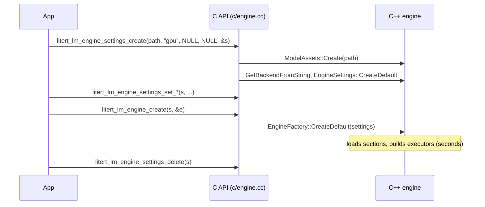
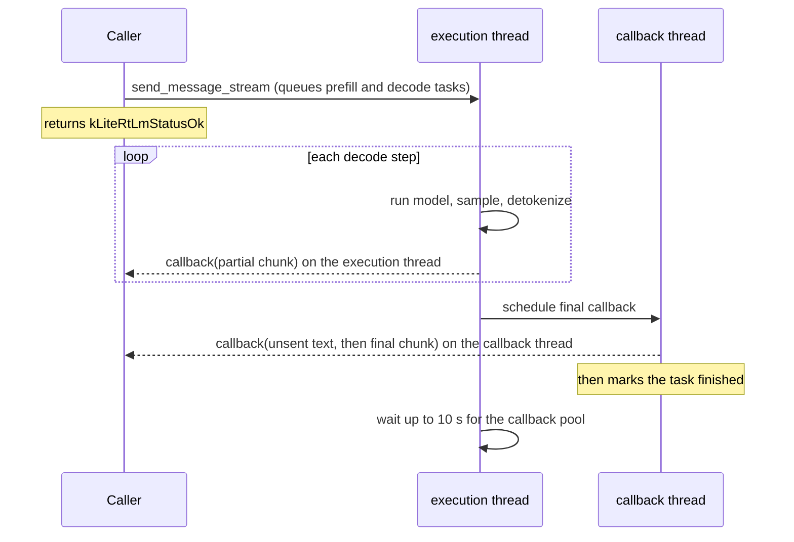

# LiteRT-LM C API

> **Scope:** the C API in `c/` that every non-C++ binding (Swift, Kotlin JNI, Python, JS) sits on: its conventions (status codes, out-parameters, ownership, threads, callbacks, JSON strings), the life of each object, the API by area with the semantics that matter, error reporting, version macros, our two additions (telemetry, build info), and what changed from C API 0.2 (v0.18.0, what Agello ships) to 1.0.0 (the documented build). **Out of scope:** what the engine does behind each call ([engine-and-sessions.md](engine-and-sessions.md)), the conversation layer's templates, channels, tools and constraints ([conversation.md](conversation.md)), the Swift wrapper ([swift-api.md](swift-api.md)), every function signature ([`generated/c-api-inventory.md`](../generated/c-api-inventory.md)), how the framework is built and versioned ([build-and-release.md](build-and-release.md), [versions.md](../versions.md)).
> **Pinned to:** LiteRT-LM `7b872544` (agello-next); the shipped headers at `85b1a776` (v0.18.0).
> **Applies to:** all platforms; Apple specifics under [On Apple](#on-apple). **Last verified:** 2026-10-15

## Summary

The C API is a thin, flat layer over the C++ engine: opaque handle types, each a struct that owns
one C++ object, and 220 exported functions in our build. <!-- c:LM-CAPI-035 --> Since C API
1.0.0 every function that can fail returns a `LiteRtLmStatusCode` (the 17 canonical
`absl::StatusCode` values) and hands results back through `out_*` parameters; the message for the
last failure sits in thread-local storage. <!-- c:LM-CAPI-004 --> There are two ways to generate:
the low-level **session** API (prefill, decode, plain-text chunks) and the **conversation** API
(JSON messages in, JSON messages out, with templates, tools and constraints applied inside). Agello
only reaches the conversation, embedding and model-info parts, through the Swift wrapper.

What matters most for us:

- Agello ships C API **0.2.0** (v0.18.0: pointers and `int` returns, `litert_lm_get_last_error_code`);
  the documented build is **1.0.0** (status codes, `litert_lm_get_api_version`). The two are not
  source compatible, so the Swift wrapper and the binary move together.
- Streaming callbacks run on LiteRT-LM's own threads: chunks streamed during decoding on the single
  execution thread, the task's final callback on the single callback thread (in the conversation
  API it first delivers any text not yet sent, then the final chunk). Work done in a callback
  delays decoding, and anything in it that waits for the same session stalls the engine (the
  10-minute stall our Swift patch fixed).
- Deleting a session or conversation waits for its running tasks (up to 10 minutes) instead of
  cancelling them; cancelling leaves the session unusable.

## Concepts

### Handles and who owns them

Every object is an opaque pointer to a struct in `c/*_internal.h` that wraps one C++ object
(`LiteRtLmEngine` holds a `std::unique_ptr<litert::lm::Engine>`, `LiteRtLmSession` a
`std::unique_ptr<Engine::Session>`, `LiteRtLmEngineSettings` a
`std::unique_ptr<EngineSettings>`) [`c/engine_internal.h:64-74`](https://github.com/google-ai-edge/LiteRT-LM/blob/df6df5b84d5845b49889f631ed4cac80b4325dd3/c/engine_internal.h#L64-L74). Each `*_delete` is a plain `delete`, safe on
NULL. Handles are not reference counted and never reparented: the caller must destroy every session
and conversation before the engine that made them, and doing otherwise is undefined behavior
[`c/engine.h:1111-1120`](https://github.com/google-ai-edge/LiteRT-LM/blob/df6df5b84d5845b49889f631ed4cac80b4325dd3/c/engine.h#L1111-L1120). <!-- c:LM-CAPI-009 -->

| Object | Created by | Freed by | Owner and lifetime |
| --- | --- | --- | --- |
| `LiteRtLmEngineSettings` | `litert_lm_engine_settings_create`, `..._create_from_raw_file_descriptor` | `litert_lm_engine_settings_delete` | Caller. Can be deleted once the engine exists (the Swift wrapper does) |
| `LiteRtLmEngine` | `litert_lm_engine_create` | `litert_lm_engine_delete` | Caller. Must outlive its sessions and conversations |
| `LiteRtLmSessionConfig`, `LiteRtLmSamplerParams` | `litert_lm_session_config_create`, `litert_lm_sampler_params_create` | `..._delete` | Caller. Copied into the session or conversation config when set |
| `LiteRtLmSession` | `litert_lm_engine_create_session` | `litert_lm_session_delete` | Caller. Deleting waits for running tasks |
| `LiteRtLmConversationConfig`, `LiteRtLmThinkingConfig` | `litert_lm_conversation_config_create`, `litert_lm_thinking_config_create` | `..._delete` | Caller. Copied at `litert_lm_conversation_create` |
| `LiteRtLmConversation` | `litert_lm_conversation_create`, `litert_lm_conversation_clone` | `litert_lm_conversation_delete` | Caller. Owns its session; deleting waits for running tasks |
| `LiteRtLmConversationOptionalArgs` and the penalty configs | `..._create` | `..._delete` | Caller. Deep-copied into the optional args when set |
| `LiteRtLmInputData` | `litert_lm_input_data_create` | `litert_lm_input_data_delete` | Caller. The bytes are copied in |
| `LiteRtLmResponses`, `LiteRtLmJsonResponse`, `LiteRtLmBenchmarkInfo`, tokenize/detokenize results, token unions | the call that returns them | their `..._delete` | Caller. Strings and arrays read from them live as long as the object |
| `LiteRtLmStreamChunk` | the library, per callback | never | Library. Valid only during the callback |
| `LiteRtLmLoadedFile` | `litert_lm_loaded_file_create` | `litert_lm_loaded_file_delete` | Caller. Read-only view of a `.litertlm` file |
| `LiteRtLmEmbeddingEngineSettings`, `LiteRtLmEmbeddingEngine`, `LiteRtLmEmbeddingOptions` | `..._create` | `..._delete` | Caller |
| `LiteRtLmEmbeddingResponse` / `...Responses` | `..._compute_embedding` / `..._batch` | `..._delete` | Caller; a response read from a batch with `..._get_at` is borrowed from it |

### Status codes, out-parameters and the last error

The rules, as `c/error_reporter.h` states them for C API 1.0.0 [`c/error_reporter.h:79-97`](https://github.com/google-ai-edge/LiteRT-LM/blob/df6df5b84d5845b49889f631ed4cac80b4325dd3/c/error_reporter.h#L79-L97):

1. Every function that can fail returns a `LiteRtLmStatusCode`: `kLiteRtLmStatusOk` (0) on
   success, a positive code on failure. The only functions without a status are the NULL-safe
   `litert_lm_*_delete` destructors and the error-reporter functions.
2. Results come back through trailing `out_*` parameters. A NULL out-parameter is
   `kLiteRtLmStatusInvalidArgument`. On failure, pointer out-parameters are set to NULL; scalar
   ones (`int*`, `bool*`, `float*`, `size_t*`, enums) are left untouched.
3. A value that is legitimately absent is a success that writes NULL (an engine with no start
   token, a chunk with no text).
4. Every non-OK return also records the calling thread's last error message.

`LiteRtLmStatusCode` has 17 values, 0 to 16, numerically identical to `absl::StatusCode` and
`google.rpc.Code`; the values are frozen, and callers should treat unknown values as
`kLiteRtLmStatusUnknown` [`c/error_reporter.h:140-158`](https://github.com/google-ai-edge/LiteRT-LM/blob/df6df5b84d5845b49889f631ed4cac80b4325dd3/c/error_reporter.h#L140-L158) [`c/error_reporter.h:120-131`](https://github.com/google-ai-edge/LiteRT-LM/blob/df6df5b84d5845b49889f631ed4cac80b4325dd3/c/error_reporter.h#L120-L131). <!-- c:LM-CAPI-005 --> The one conversion point,
`ToLiteRtLmStatusCode`, folds any value outside 0 to 16 into `kLiteRtLmStatusUnknown`
[`c/error_reporter.cc:82-93`](https://github.com/google-ai-edge/LiteRT-LM/blob/df6df5b84d5845b49889f631ed4cac80b4325dd3/c/error_reporter.cc#L82-L93).

| Code | Name | Typical source in this API |
| --- | --- | --- |
| 0 | `kLiteRtLmStatusOk` | success |
| 1 | `kLiteRtLmStatusCancelled` | a C++ `CancelledError` (a cancelled task) |
| 3 | `kLiteRtLmStatusInvalidArgument` | NULL handles or out-parameters, unknown enum values, unparsable message JSON, unknown backend strings |
| 5 | `kLiteRtLmStatusNotFound` | absent values in model info and embedding options; no response text at an index |
| 8 | `kLiteRtLmStatusResourceExhausted` | a full KV cache, only when the C++ conversation option `return_error_on_max_tokens_reached` is set (not reachable from C or Swift; see [conversation.md](conversation.md)) <!-- c:LM-CNV-001 --> |
| 9 | `kLiteRtLmStatusFailedPrecondition` | audio LoRA ranks without an audio executor; engine work without an execution manager |
| 11 | `kLiteRtLmStatusOutOfRange` | a response or batch index past the end |
| 13 | `kLiteRtLmStatusInternal` | failed tasks, executor errors |

The other codes (2, 4, 6, 7, 10, 12, 14 to 16) pass through unchanged from whatever C++ status
produced them.

**The last error.** The message lives in a per-thread `std::string` (`static thread_local`); it is
written only when a call fails and is never cleared by a success, so a non-NULL message does not mean
the last call failed. `litert_lm_get_last_error_message` returns NULL when the string is empty, and
`litert_lm_clear_last_error` swaps the string with an empty one to release its buffer
[`c/error_reporter.cc:25-39`](https://github.com/google-ai-edge/LiteRT-LM/blob/df6df5b84d5845b49889f631ed4cac80b4325dd3/c/error_reporter.cc#L25-L39) [`c/error_reporter.cc:128-138`](https://github.com/google-ai-edge/LiteRT-LM/blob/df6df5b84d5845b49889f631ed4cac80b4325dd3/c/error_reporter.cc#L128-L138) [`c/error_reporter.h:34-55`](https://github.com/google-ai-edge/LiteRT-LM/blob/df6df5b84d5845b49889f631ed4cac80b4325dd3/c/error_reporter.h#L34-L55). <!-- c:LM-CAPI-007 --> The pointer stays valid until the
next failure or clear on the same thread, so read it right after the failing call, on the same
thread, and copy it if you keep it [`c/error_reporter.h:57-66`](https://github.com/google-ai-edge/LiteRT-LM/blob/df6df5b84d5845b49889f631ed4cac80b4325dd3/c/error_reporter.h#L57-L66).

The message format depends on where the failure started [`c/error_reporter.cc:95-122`](https://github.com/google-ai-edge/LiteRT-LM/blob/df6df5b84d5845b49889f631ed4cac80b4325dd3/c/error_reporter.cc#L95-L122) [`c/error_reporter_internal.h:64-70`](https://github.com/google-ai-edge/LiteRT-LM/blob/df6df5b84d5845b49889f631ed4cac80b4325dd3/c/error_reporter_internal.h#L64-L70):

- A failure that comes up from C++ is recorded with `absl::Status::ToString()`, so the text starts
  with the canonical code name: `INVALID_ARGUMENT: Unsupported backend: ...`.
- A failure the C layer detects itself (NULL arguments, unknown enum values) records only its
  message: `out_engine must not be NULL.`, `Unknown LiteRtLmSamplerType.`

### Strings and JSON

All strings are NUL-terminated UTF-8. The conversation API speaks JSON: messages, the system
message, initial messages, tools and extra context go in as JSON text, and replies come out as the
JSON dump of a `litert::lm::Message`. The message format itself (roles, content parts, channels,
`tool_calls`) belongs to the conversation layer: see [conversation.md](conversation.md). Strings
returned by the library are owned by the object they come from (a response, a chunk, a
conversation, a loaded file) and die with it; the only exceptions are our telemetry snapshot (heap,
freed by the caller) and our build info (static).

### Version macros

`c/engine.h` declares `LITERT_LM_C_API_VERSION_MAJOR 1`, `_MINOR 0`, `_PATCH 0`, kept equal to
`C_API_VERSION = "1.0.0"` in `version.bzl` (where the runtime itself is `VERSION = "0.19.0"`)
[`c/engine.h:48-51`](https://github.com/google-ai-edge/LiteRT-LM/blob/df6df5b84d5845b49889f631ed4cac80b4325dd3/c/engine.h#L48-L51) [`version.bzl:19-23`](https://github.com/google-ai-edge/LiteRT-LM/blob/df6df5b84d5845b49889f631ed4cac80b4325dd3/version.bzl#L19-L23). <!-- c:LM-CAPI-001 --> The C API version moves on its own semantic
versioning: major for ABI breaks, minor for additions, patch for fixes. The macros describe the
headers a caller compiled against; `litert_lm_get_api_version` returns the macros the *library* was
compiled with (it checks all three out-parameters before writing any). The header asks callers that
load the library at run time to compare the two, and to treat a library that doesn't export the
function at all as older than 1.0.0 and incompatible [`c/engine.h:57-79`](https://github.com/google-ai-edge/LiteRT-LM/blob/df6df5b84d5845b49889f631ed4cac80b4325dd3/c/engine.h#L57-L79) [`c/engine.cc:323-336`](https://github.com/google-ai-edge/LiteRT-LM/blob/df6df5b84d5845b49889f631ed4cac80b4325dd3/c/engine.cc#L323-L336). <!-- c:LM-CAPI-003 -->
Agello links the framework at build time through Swift Package Manager, so the headers and the
library always come from the same xcframework; the Swift wrapper never calls
`litert_lm_get_api_version`.

The shipped v0.18.0 tree says `VERSION = "0.18.0"` and `C_API_VERSION = "0.2.0"` and has no
version macros [`version.bzl:19-22`](https://github.com/google-ai-edge/LiteRT-LM/blob/b2f686e2ed4718fb84ec398a61dd59ca0f0aff27/version.bzl#L19-L22). <!-- c:LM-CAPI-002 -->

## How it works

### Engine settings and the engine



`litert_lm_engine_settings_create` opens the model assets, parses the backend strings and calls
`EngineSettings::CreateDefault` [`c/engine.cc:639-660`](https://github.com/google-ai-edge/LiteRT-LM/blob/df6df5b84d5845b49889f631ed4cac80b4325dd3/c/engine.cc#L639-L660) [`c/engine.cc:276-319`](https://github.com/google-ai-edge/LiteRT-LM/blob/df6df5b84d5845b49889f631ed4cac80b4325dd3/c/engine.cc#L276-L319). Backend strings
are matched case-insensitively against `cpu`, `gpu`, `npu`, `gpu_artisan`, `cpu_artisan` and
`google_tensor_artisan`; anything else is `InvalidArgument` [`runtime/executor/executor_settings_base.cc:75-94`](https://github.com/google-ai-edge/LiteRT-LM/blob/df6df5b84d5845b49889f631ed4cac80b4325dd3/runtime/executor/executor_settings_base.cc#L75-L94). A NULL main backend
becomes an empty string and fails the same way, while a NULL or empty vision or audio backend means
that executor is not configured. <!-- c:LM-CAPI-012 --> The file-descriptor variant takes ownership
of `fd` (wrapping it in a `ScopedFile` that closes it) unless `fd` is negative or `out_settings` is
NULL [`c/engine.cc:662-696`](https://github.com/google-ai-edge/LiteRT-LM/blob/df6df5b84d5845b49889f631ed4cac80b4325dd3/c/engine.cc#L662-L696).

The setters change the `EngineSettings` before creation. Several only make sense for one backend and
quietly do nothing for the others: `set_num_threads`, `set_prefill_chunk_size` and
`set_enable_ynnpack` edit the CPU backend config, and `set_gpu_decode_steps_per_sync`,
`set_gpu_wait_for_weight_uploads` and `set_use_ringbuffers_local_attention` edit
`GpuArtisanConfig`; when the main backend has another config type, they return
`kLiteRtLmStatusOk` and at most log a line [`c/engine.cc:712-728`](https://github.com/google-ai-edge/LiteRT-LM/blob/df6df5b84d5845b49889f631ed4cac80b4325dd3/c/engine.cc#L712-L728) [`c/engine.cc:853-870`](https://github.com/google-ai-edge/LiteRT-LM/blob/df6df5b84d5845b49889f631ed4cac80b4325dd3/c/engine.cc#L853-L870). So on Apple's `gpu`
backend (the LiteRT compiled-model executor, see [executors.md](executors.md)) the three artisan
setters have no effect. The full list of settings, defaults and what each changes on Apple is in
[configuration.md](../configuration.md).

`litert_lm_engine_create` hands the settings to `EngineFactory::CreateDefault`
[`c/engine.cc:1036-1057`](https://github.com/google-ai-edge/LiteRT-LM/blob/df6df5b84d5845b49889f631ed4cac80b4325dd3/c/engine.cc#L1036-L1057); the work behind it (section loading, executors, the tokenizer) is in
[engine-and-sessions.md](engine-and-sessions.md). It blocks for the whole load.

### Two ways to generate

| | Session API (`c/engine.h`) | Conversation API (`c/conversation.h`) |
| --- | --- | --- |
| Input | `LiteRtLmInputData[]`: text, image bytes, image end, audio bytes, audio end | one JSON message, plus optional extra context and per-turn optional args |
| Prompt template | applied by the session if `apply_prompt_template` is set | always: the conversation renders the template, history and tools |
| Output | `LiteRtLmResponses`: one text (and optional scores) per candidate; streaming gives plain text | a JSON `Message` (content, channels such as `thought`, `tool_calls`); streaming gives partial JSON messages |
| Extras | checkpoints, rewind to a step, text scoring, benchmark info | tools, constraints (regex, JSON schema), thinking config, clone, token count, rendering |
| Used by Agello | no | yes (through Swift) |

Both create a session underneath. When the engine has vision or audio executor settings,
`litert_lm_engine_create_session` switches the corresponding modality on in the session config
(`SetVisionModalityEnabled(true)`, `SetAudioModalityEnabled(true)`), whatever the caller passed
[`c/engine.cc:1071-1083`](https://github.com/google-ai-edge/LiteRT-LM/blob/df6df5b84d5845b49889f631ed4cac80b4325dd3/c/engine.cc#L1071-L1083). `litert_lm_conversation_create` does the same only when a conversation config
is passed: with a NULL config it takes `ConversationConfig::CreateDefault(engine)`, which doesn't set
them [`c/conversation.cc:430-431`](https://github.com/google-ai-edge/LiteRT-LM/blob/df6df5b84d5845b49889f631ed4cac80b4325dd3/c/conversation.cc#L430-L431) [`c/conversation.cc:487-501`](https://github.com/google-ai-edge/LiteRT-LM/blob/df6df5b84d5845b49889f631ed4cac80b4325dd3/c/conversation.cc#L487-L501) [`c/conversation.cc:544-554`](https://github.com/google-ai-edge/LiteRT-LM/blob/df6df5b84d5845b49889f631ed4cac80b4325dd3/c/conversation.cc#L544-L554) [`runtime/conversation/conversation.cc:133-136`](https://github.com/google-ai-edge/LiteRT-LM/blob/df6df5b84d5845b49889f631ed4cac80b4325dd3/runtime/conversation/conversation.cc#L133-L136).

### The session API

- **Inputs.** `litert_lm_input_data_create` copies `data` into the object (text as a UTF-8 string,
  images and audio as raw encoded bytes); the end markers carry nothing. Each session call copies
  the inputs again and skips NULL entries in the array [`c/engine.cc:232-270`](https://github.com/google-ai-edge/LiteRT-LM/blob/df6df5b84d5845b49889f631ed4cac80b4325dd3/c/engine.cc#L232-L270) [`c/engine.cc:103-121`](https://github.com/google-ai-edge/LiteRT-LM/blob/df6df5b84d5845b49889f631ed4cac80b4325dd3/c/engine.cc#L103-L121).
- **Blocking calls.** `litert_lm_session_run_prefill`, `..._run_decode`, `..._generate_content`
  and `..._run_text_scoring` return when the work is done. `run_prefill` rejects a NULL array or
  zero inputs; `generate_content` accepts an empty array.
- **Streaming calls.** `litert_lm_session_run_decode_async` and
  `litert_lm_session_generate_content_stream` return as soon as the work is queued; errors that
  prevent the start come back as a status, later ones through the callback [`c/engine.cc:1267-1291`](https://github.com/google-ai-edge/LiteRT-LM/blob/df6df5b84d5845b49889f631ed4cac80b4325dd3/c/engine.cc#L1267-L1291).
- **Sampler.** `litert_lm_sampler_params_create` starts with `top_k = 0`, `top_p = 0`,
  `temperature = 0`, `seed = 0`; `litert_lm_session_config_set_sampler_params` copies type, k, p,
  temperature and seed into the session's `SamplerParameters` [`c/engine.cc:361-377`](https://github.com/google-ai-edge/LiteRT-LM/blob/df6df5b84d5845b49889f631ed4cac80b4325dd3/c/engine.cc#L361-L377)
  [`c/engine.cc:449-469`](https://github.com/google-ai-edge/LiteRT-LM/blob/df6df5b84d5845b49889f631ed4cac80b4325dd3/c/engine.cc#L449-L469).
- **Checkpoints.** `save_checkpoint`, `rewind_to_checkpoint`, `rewind_to_step` map to the C++
  session; what a rewind does to the KV cache is in [engine-and-sessions.md](engine-and-sessions.md).

How session streams report the end of a task [`c/engine.cc:59-101`](https://github.com/google-ai-edge/LiteRT-LM/blob/df6df5b84d5845b49889f631ed4cac80b4325dd3/c/engine.cc#L59-L101): <!-- c:LM-CAPI-026 -->

| C++ task state | Chunk the callback gets |
| --- | --- |
| text produced (`kProcessing`) | one non-final chunk per candidate text, no error |
| `kDone` | final chunk, no text, no error |
| `kMaxNumTokensReached` | final chunk, no text, error `"Max number of tokens reached."` |
| `kCancelled` | final chunk, no text, error `"CANCELLED."` |
| failed (`StatusOr` not OK) | final chunk, no text, error = `status.ToString()` |

A session stream that stops at its token limit therefore looks like an error to a caller that only
checks the error field.

### The conversation API

**Creation.** `litert_lm_conversation_config_*` setters only store strings and flags; the parsing
happens in `litert_lm_conversation_create`, which builds a `ConversationConfig` with its builder:

1. The system message JSON becomes the content of a `{"role": "system"}` message; text that is not
   valid JSON is used as a plain string [`c/conversation.cc:431-444`](https://github.com/google-ai-edge/LiteRT-LM/blob/df6df5b84d5845b49889f631ed4cac80b4325dd3/c/conversation.cc#L431-L444). <!-- c:LM-CAPI-019 -->
2. Initial messages must be a JSON array and are appended after the system message; tools must be a
   JSON array; extra context must be an object. A value that fails these checks is logged with
   `ABSL_LOG(ERROR)` and dropped, and the conversation is still created [`c/conversation.cc:446-461`](https://github.com/google-ai-edge/LiteRT-LM/blob/df6df5b84d5845b49889f631ed4cac80b4325dd3/c/conversation.cc#L446-L461) [`c/conversation.cc:463-472`](https://github.com/google-ai-edge/LiteRT-LM/blob/df6df5b84d5845b49889f631ed4cac80b4325dd3/c/conversation.cc#L463-L472).
   <!-- c:LM-CAPI-020 -->
3. The session config is copied (or the default used), with modalities switched on as for
   `litert_lm_engine_create_session`.
4. Constrained decoding, the constraint provider (`kLiteRtLmConstraintProviderTypeLlGuidance` is the
   only one the C API names; it installs `LlGuidanceConfig`), channel filtering, tool-call
   streaming, a prompt template override and the thinking config are passed to the builder
   [`c/conversation.cc:506-510`](https://github.com/google-ai-edge/LiteRT-LM/blob/df6df5b84d5845b49889f631ed4cac80b4325dd3/c/conversation.cc#L506-L510).
5. Rewinding is switched off if, and only if, the main executor uses `GpuArtisanConfig` with
   auto-sized ring buffers [`c/conversation.cc:525-535`](https://github.com/google-ai-edge/LiteRT-LM/blob/df6df5b84d5845b49889f631ed4cac80b4325dd3/c/conversation.cc#L525-L535).
6. With a NULL config, `ConversationConfig::CreateDefault(engine)` is used instead, and the
   modalities are not switched on
   [`c/conversation.cc:544-554`](https://github.com/google-ai-edge/LiteRT-LM/blob/df6df5b84d5845b49889f631ed4cac80b4325dd3/c/conversation.cc#L544-L554).

Defaults the C layer leaves to the builder: channel content filtered from the KV cache (`true`),
constrained decoding off, tool-call streaming off with channel name `tool_call`, rewinding on
[`runtime/conversation/conversation.h:272-282`](https://github.com/google-ai-edge/LiteRT-LM/blob/df6df5b84d5845b49889f631ed4cac80b4325dd3/runtime/conversation/conversation.h#L272-L282). A thinking config made with `litert_lm_thinking_config_create` starts
enabled with an unlimited budget (`-1`) [`c/conversation.cc:273-279`](https://github.com/google-ai-edge/LiteRT-LM/blob/df6df5b84d5845b49889f631ed4cac80b4325dd3/c/conversation.cc#L273-L279).

**Sending.** `litert_lm_conversation_send_message` parses the message JSON (invalid JSON is
`InvalidArgument`), builds the per-turn `OptionalArgs`, calls `Conversation::SendMessage` and blocks
until the reply is complete; the reply is `Message::dump()` held by a `LiteRtLmJsonResponse`
[`c/conversation.cc:591-625`](https://github.com/google-ai-edge/LiteRT-LM/blob/df6df5b84d5845b49889f631ed4cac80b4325dd3/c/conversation.cc#L591-L625) [`c/conversation.h:496-497`](https://github.com/google-ai-edge/LiteRT-LM/blob/df6df5b84d5845b49889f631ed4cac80b4325dd3/c/conversation.h#L496-L497). <!-- c:LM-CAPI-024 --> `litert_lm_conversation_send_message_stream`
does the same with `SendMessageAsync` and returns once the work is queued [`c/conversation.cc:640-672`](https://github.com/google-ai-edge/LiteRT-LM/blob/df6df5b84d5845b49889f631ed4cac80b4325dd3/c/conversation.cc#L640-L672)
[`c/conversation.h:547-549`](https://github.com/google-ai-edge/LiteRT-LM/blob/df6df5b84d5845b49889f631ed4cac80b4325dd3/c/conversation.h#L547-L549). Its chunks differ from the session API's [`c/conversation.cc:44-71`](https://github.com/google-ai-edge/LiteRT-LM/blob/df6df5b84d5845b49889f631ed4cac80b4325dd3/c/conversation.cc#L44-L71): <!-- c:LM-CAPI-025 -->

| What the conversation reports | Chunk |
| --- | --- |
| a partial message | non-final chunk whose text is the JSON dump of that message |
| an empty message (end of stream marker) | final chunk, no text, no error |
| an error `Status` | final chunk, no text, error = `status.ToString()` |

Cancellation and the context limit reach the conversation callback as errors: a cancelled task
becomes `absl::CancelledError("Task cancelled")`, so the final chunk's error reads
`CANCELLED: Task cancelled` [`runtime/conversation/internal_callback_util.cc:302-308`](https://github.com/google-ai-edge/LiteRT-LM/blob/df6df5b84d5845b49889f631ed4cac80b4325dd3/runtime/conversation/internal_callback_util.cc#L302-L308). <!-- c:LM-CAPI-049 -->

**Per-turn optional args.** `LiteRtLmConversationOptionalArgs` carries a repetition penalty,
no-repeat n-gram and suppressed-token configs, a visual token budget, a maximum number of output
tokens, a thinking config and a constraint. The penalty configs are deep-copied, and passing NULL or
a config whose `enabled()` is false (the headers describe the created defaults as inactive) clears it
[`c/conversation.cc:324-338`](https://github.com/google-ai-edge/LiteRT-LM/blob/df6df5b84d5845b49889f631ed4cac80b4325dd3/c/conversation.cc#L324-L338). The constraint type maps to an llguidance argument (`kRegex` or `kJsonSchema`), and
the visual token budget is passed only when the session's model type is Gemma 4 [`c/conversation.cc:111-133`](https://github.com/google-ai-edge/LiteRT-LM/blob/df6df5b84d5845b49889f631ed4cac80b4325dd3/c/conversation.cc#L111-L133)
[`c/conversation.cc:73-85`](https://github.com/google-ai-edge/LiteRT-LM/blob/df6df5b84d5845b49889f631ed4cac80b4325dd3/c/conversation.cc#L73-L85). <!-- c:LM-CAPI-031 --> What each option does during decoding is in
[components.md](components.md) and [conversation.md](conversation.md).

**Other calls.**

- `litert_lm_conversation_render_message_to_string` and `..._render_preface_to_string` return a
  string stored in the conversation, valid until the next call of the same function or the
  conversation's deletion [`c/conversation.cc:693-701`](https://github.com/google-ai-edge/LiteRT-LM/blob/df6df5b84d5845b49889f631ed4cac80b4325dd3/c/conversation.cc#L693-L701) [`c/conversation_internal.h:45-56`](https://github.com/google-ai-edge/LiteRT-LM/blob/df6df5b84d5845b49889f631ed4cac80b4325dd3/c/conversation_internal.h#L45-L56).
- `litert_lm_conversation_get_token_count` reports the tokens in the conversation's KV cache
  (prefill plus decode) [`c/conversation.cc:766-780`](https://github.com/google-ai-edge/LiteRT-LM/blob/df6df5b84d5845b49889f631ed4cac80b4325dd3/c/conversation.cc#L766-L780). <!-- c:LM-CAPI-034 -->
- `litert_lm_conversation_clone` duplicates a conversation with its prefilled state (C++
  `Conversation::Clone`).
- `litert_lm_conversation_cancel_process` calls `Conversation::CancelProcess`, which cancels every
  task of the conversation's session. Upstream's own note on `SessionAdvanced::CancelProcess` says a
  session should not be reused after it: the state is "poisoned" and later operations may fail or
  misbehave [`c/conversation.cc:723-731`](https://github.com/google-ai-edge/LiteRT-LM/blob/df6df5b84d5845b49889f631ed4cac80b4325dd3/c/conversation.cc#L723-L731) [`runtime/conversation/conversation.cc:927`](https://github.com/google-ai-edge/LiteRT-LM/blob/df6df5b84d5845b49889f631ed4cac80b4325dd3/runtime/conversation/conversation.cc#L927) [`runtime/core/session_advanced.h:192-207`](https://github.com/google-ai-edge/LiteRT-LM/blob/df6df5b84d5845b49889f631ed4cac80b4325dd3/runtime/core/session_advanced.h#L192-L207) [`runtime/core/session_advanced.h:185-188`](https://github.com/google-ai-edge/LiteRT-LM/blob/b2f686e2ed4718fb84ec398a61dd59ca0f0aff27/runtime/core/session_advanced.h#L185-L188). <!-- c:LM-CAPI-030 -->
- `litert_lm_conversation_wait_until_done` runs and waits for the session's pending work. It is
  required after `send_message_stream` when the engine was created with single-threaded execution:
  in that mode nothing runs until a caller drives it, and the stream callback is invoked from inside
  this call [`c/conversation.h:632-649`](https://github.com/google-ai-edge/LiteRT-LM/blob/df6df5b84d5845b49889f631ed4cac80b4325dd3/c/conversation.h#L632-L649). <!-- c:LM-CAPI-029 -->

### A streamed chat turn, end to end

A minimal C 1.0.0 sequence (error handling shortened to one check):

```c
LiteRtLmEngineSettings* settings = NULL;
if (litert_lm_engine_settings_create(model_path, "gpu", NULL, NULL, &settings) != kLiteRtLmStatusOk) {
  const char* message = litert_lm_get_last_error_message();  /* same thread, right away */
  fprintf(stderr, "%s\n", message ? message : "");
  return;
}
litert_lm_engine_settings_set_max_num_tokens(settings, 8192);
litert_lm_engine_settings_set_cache_dir(settings, cache_dir);
LiteRtLmEngine* engine = NULL;
LiteRtLmStatusCode status = litert_lm_engine_create(settings, &engine);  /* blocks for the load */
litert_lm_engine_settings_delete(settings);

LiteRtLmConversationConfig* config = NULL;
litert_lm_conversation_config_create(&config);
litert_lm_conversation_config_set_system_message(config, "[{\"type\":\"text\",\"text\":\"Be brief.\"}]");
LiteRtLmConversation* conversation = NULL;
status = litert_lm_conversation_create(engine, config, &conversation);
litert_lm_conversation_config_delete(config);  /* the conversation copied what it needs */

/* on_chunk runs on LiteRT-LM's threads; copy text before returning, signal on the final chunk */
status = litert_lm_conversation_send_message_stream(
    conversation, "{\"role\":\"user\",\"content\":[{\"type\":\"text\",\"text\":\"Hi\"}]}",
    /*extra_context=*/NULL, /*optional_args=*/NULL, on_chunk, waiter);
/* ... wait for the final chunk on this thread (not inside on_chunk) ... */
litert_lm_conversation_delete(conversation);  /* before the engine */
litert_lm_engine_delete(engine);
```

Each partial chunk's text is a JSON message such as
`{"role":"assistant","content":[{"type":"text","text":"Hel"}]}`; the exact shape (and where
thinking and tool calls go) is in [conversation.md](conversation.md).

### Threads and callbacks

The callback type is `void (*)(void* callback_data, const LiteRtLmStreamChunk* chunk)`; the library
never frees `callback_data`. A chunk and the strings read from it exist only during the call: the C
layer builds the chunk on its stack around temporary strings [`c/engine.h:1710-1717`](https://github.com/google-ai-edge/LiteRT-LM/blob/df6df5b84d5845b49889f631ed4cac80b4325dd3/c/engine.h#L1710-L1717) [`c/engine.h:1651-1657`](https://github.com/google-ai-edge/LiteRT-LM/blob/df6df5b84d5845b49889f631ed4cac80b4325dd3/c/engine.h#L1651-L1657)
[`c/engine_internal.h:46-50`](https://github.com/google-ai-edge/LiteRT-LM/blob/df6df5b84d5845b49889f631ed4cac80b4325dd3/c/engine_internal.h#L46-L50) [`c/conversation.cc:44-71`](https://github.com/google-ai-edge/LiteRT-LM/blob/df6df5b84d5845b49889f631ed4cac80b4325dd3/c/conversation.cc#L44-L71). <!-- c:LM-CAPI-027 --> Copy what you need before returning.

The headers only say callbacks come "from a background thread" [`c/engine.h:1741-1743`](https://github.com/google-ai-edge/LiteRT-LM/blob/df6df5b84d5845b49889f631ed4cac80b4325dd3/c/engine.h#L1741-L1743). The engine decides
which. With single-threaded execution off (the default), the engine runs a
`ThreadedExecutionManager` with two thread pools of one thread each, `execution_thread_pool` and
`callback_thread_pool` [`runtime/engine/engine_settings.h:187`](https://github.com/google-ai-edge/LiteRT-LM/blob/df6df5b84d5845b49889f631ed4cac80b4325dd3/runtime/engine/engine_settings.h#L187) [`runtime/core/engine_advanced_impl.cc:663-679`](https://github.com/google-ai-edge/LiteRT-LM/blob/df6df5b84d5845b49889f631ed4cac80b4325dd3/runtime/core/engine_advanced_impl.cc#L663-L679) [`runtime/framework/resource_management/threaded_execution_manager.cc:87-92`](https://github.com/PowerBeef/agello-litert-lm/blob/7b872544fdbd81308f98b1e2acf8c5798a549df6/runtime/framework/resource_management/threaded_execution_manager.cc#L87-L92). Partial chunks are delivered
on the execution thread, inside `Tasks::Decode`, which receives the callback and calls it between
decode steps; the final callback is scheduled on the callback thread, and the execution thread then
waits up to 10 s for it before taking the next task. In the conversation API that final callback
first flushes any text not yet sent (`SendCompleteMessage`) as non-final chunks, so those arrive on
the callback thread too [`runtime/conversation/internal_callback_util.cc:95-149`](https://github.com/google-ai-edge/LiteRT-LM/blob/df6df5b84d5845b49889f631ed4cac80b4325dd3/runtime/conversation/internal_callback_util.cc#L95-L149) [`runtime/framework/resource_management/threaded_execution_manager.cc:402-403`](https://github.com/PowerBeef/agello-litert-lm/blob/7b872544fdbd81308f98b1e2acf8c5798a549df6/runtime/framework/resource_management/threaded_execution_manager.cc#L402-L403) [`runtime/framework/resource_management/threaded_execution_manager.cc:1111-1117`](https://github.com/PowerBeef/agello-litert-lm/blob/7b872544fdbd81308f98b1e2acf8c5798a549df6/runtime/framework/resource_management/threaded_execution_manager.cc#L1111-L1117)
[`runtime/core/tasks.cc:792-799`](https://github.com/PowerBeef/agello-litert-lm/blob/7b872544fdbd81308f98b1e2acf8c5798a549df6/runtime/core/tasks.cc#L792-L799) [`runtime/framework/resource_management/threaded_execution_manager.cc:526-538`](https://github.com/PowerBeef/agello-litert-lm/blob/7b872544fdbd81308f98b1e2acf8c5798a549df6/runtime/framework/resource_management/threaded_execution_manager.cc#L526-L538) [`runtime/framework/resource_management/threaded_execution_manager.cc:548-557`](https://github.com/PowerBeef/agello-litert-lm/blob/7b872544fdbd81308f98b1e2acf8c5798a549df6/runtime/framework/resource_management/threaded_execution_manager.cc#L548-L557). <!-- c:LM-CAPI-028 -->
v0.18.0 has the same two single-thread pools and the same 10-second wait [`runtime/framework/resource_management/threaded_execution_manager.cc:86-92`](https://github.com/google-ai-edge/LiteRT-LM/blob/b2f686e2ed4718fb84ec398a61dd59ca0f0aff27/runtime/framework/resource_management/threaded_execution_manager.cc#L86-L92)
[`runtime/framework/resource_management/threaded_execution_manager.cc:515-540`](https://github.com/google-ai-edge/LiteRT-LM/blob/b2f686e2ed4718fb84ec398a61dd59ca0f0aff27/runtime/framework/resource_management/threaded_execution_manager.cc#L515-L540).



Three consequences:

1. Time spent in a callback for a chunk streamed during decoding is time the decode loop does not run.
2. The task is marked finished only after the final callback returns. Anything inside the final
   callback that waits for the same session (deleting its conversation, a blocking send) waits for
   itself.
3. With single-threaded execution on, a `SerialExecutionManager` runs the work on the caller's
   thread inside `litert_lm_conversation_wait_until_done`.

**How many final chunks a send gets.** The conversation callback turns every error it receives into a
chunk with `is_final` true and the error text, and the end marker into a final chunk without error. It
keeps no state, so it passes on every terminal event the conversation layer produces
([`c/conversation.cc:44-71`](https://github.com/google-ai-edge/LiteRT-LM/blob/df6df5b84d5845b49889f631ed4cac80b4325dd3/c/conversation.cc#L44-L71);
v0.18.0: [`c/conversation.cc:43-70`](https://github.com/google-ai-edge/LiteRT-LM/blob/b2f686e2ed4718fb84ec398a61dd59ca0f0aff27/c/conversation.cc#L43-L70)).
<!-- c:X-GAP-014 --> Usually that is one: the end marker or one error. With tools declared, a tool-call
block the parser rejects produces two final error chunks for the same send, one when the block's end
fence streams and one when the whole reply is parsed at the end, and the stream keeps running in
between. <!-- c:X-GAP-015 --> A callback that frees `callback_data` on the first final chunk must
ignore later ones; the Swift wrapper doesn't
([swift-api.md](swift-api.md#error-chunks-and-the-retained-context)).

### Deleting while work runs

`SessionAdvanced`'s destructor calls `WaitUntilDone`, which waits up to `Engine::kDefaultTimeout`
(10 minutes) for the session's tasks to finish, and does not cancel them [`runtime/core/session_advanced.cc:484-489`](https://github.com/PowerBeef/agello-litert-lm/blob/7b872544fdbd81308f98b1e2acf8c5798a549df6/runtime/core/session_advanced.cc#L484-L489) [`runtime/core/session_advanced.h:224-232`](https://github.com/google-ai-edge/LiteRT-LM/blob/df6df5b84d5845b49889f631ed4cac80b4325dd3/runtime/core/session_advanced.h#L224-L232)
[`runtime/engine/engine.h:453`](https://github.com/google-ai-edge/LiteRT-LM/blob/df6df5b84d5845b49889f631ed4cac80b4325dd3/runtime/engine/engine.h#L453) [`runtime/core/session_advanced.cc:478-479`](https://github.com/google-ai-edge/LiteRT-LM/blob/b2f686e2ed4718fb84ec398a61dd59ca0f0aff27/runtime/core/session_advanced.cc#L478-L479). <!-- c:LM-CAPI-048 --> The wait ends when the session has no active
task, and a task leaves that set only in an end state (done, token limit, failed, cancelled) [`runtime/framework/resource_management/threaded_execution_manager.cc:831-848`](https://github.com/PowerBeef/agello-litert-lm/blob/7b872544fdbd81308f98b1e2acf8c5798a549df6/runtime/framework/resource_management/threaded_execution_manager.cc#L831-L848)
[`runtime/engine/io_types.cc:102-109`](https://github.com/google-ai-edge/LiteRT-LM/blob/df6df5b84d5845b49889f631ed4cac80b4325dd3/runtime/engine/io_types.cc#L102-L109). So `litert_lm_conversation_delete` or `litert_lm_session_delete` on a busy object
blocks the calling thread until the generation ends; called from inside that object's final stream
callback, it blocks until the 10-minute timeout. To stop quickly, cancel first and wait for the
final chunk, then delete.

### Embedding engine

`c/embedding_engine.h` mirrors the engine for embedding models (EmbeddingGemma, see
[models/embeddinggemma.md](../models/embeddinggemma.md)): settings (backends, threads, cache
directory, dispatch library directories, minimum and maximum input length, vision tokens per image,
activation type), options per call, and single or batch computation. Inputs longer than the longest
signature are handled by `LiteRtLmInputOverflowStrategy`: chunk and average, truncate, or error
[`c/embedding_engine.h:50-58`](https://github.com/google-ai-edge/LiteRT-LM/blob/df6df5b84d5845b49889f631ed4cac80b4325dd3/c/embedding_engine.h#L50-L58). The C++ defaults for options are: L2 normalization on, special tokens inserted,
overflow strategy *error*, no output-size truncation [`runtime/engine/embedding_engine.h:31-52`](https://github.com/google-ai-edge/LiteRT-LM/blob/df6df5b84d5845b49889f631ed4cac80b4325dd3/runtime/engine/embedding_engine.h#L31-L52). <!-- c:LM-CAPI-044 --> A
response taken from a batch with `litert_lm_embedding_responses_get_at` is borrowed and must not be
deleted [`c/embedding_engine.h:503-524`](https://github.com/google-ai-edge/LiteRT-LM/blob/df6df5b84d5845b49889f631ed4cac80b4325dd3/c/embedding_engine.h#L503-L524).

### Model info

`c/model_info.h` reads a `.litertlm` file without building an engine: the model type (LLM or
embedding), speculative-decoding, thinking and function-calling support, the default sampler,
input modalities, vision token budgets and signatures, context size and whether it is dynamic,
supported backends and NPU details per modality, embedding dimension and signatures, and the minimum
runtime version. Values the file doesn't define come back as `kLiteRtLmStatusNotFound` (1.0.0)
instead of the `-1` or `0` sentinels of 0.2. For example, the maximum context is the fixed size of a
static model or the largest settable size of a dynamic one, and `NotFound` when undefined
[`c/model_info.h:237-257`](https://github.com/google-ai-edge/LiteRT-LM/blob/df6df5b84d5845b49889f631ed4cac80b4325dd3/c/model_info.h#L237-L257). The file format behind these values is in [file-format.md](file-format.md).

### Experimental calls

`c/experimental.h` holds functions with no stability promise: updating the Metal residency set
setting of a live engine [`c/experimental.cc:33-49`](https://github.com/google-ai-edge/LiteRT-LM/blob/df6df5b84d5845b49889f631ed4cac80b4325dd3/c/experimental.cc#L33-L49), checking whether the library was compiled with the
debugger tracing backend (`LITERT_LM_DEBUGGER_ENABLED`, a compile-time define) [`c/experimental.cc:53-62`](https://github.com/google-ai-edge/LiteRT-LM/blob/df6df5b84d5845b49889f631ed4cac80b4325dd3/c/experimental.cc#L53-L62),
and reading a session's debug capture directory.

### Our additions: telemetry and build info

Two headers are ours and are not part of Google's C API version; they don't follow the status-code
convention. <!-- c:LM-CAPI-039 -->

- `c/telemetry.h` (ours: `4aed9274a4`): `litert_lm_telemetry_set_level` / `_get_level`
  (`int`), `_snapshot_json` (a `malloc`'d JSON string the caller frees with
  `litert_lm_telemetry_free_string`), `_reset`, and `_write_trace` (returns `false` on an I/O
  error) [`c/telemetry.h:30-55`](https://github.com/PowerBeef/agello-litert-lm/blob/7b872544fdbd81308f98b1e2acf8c5798a549df6/c/telemetry.h#L30-L55) [`c/telemetry.cc:33-40`](https://github.com/PowerBeef/agello-litert-lm/blob/7b872544fdbd81308f98b1e2acf8c5798a549df6/c/telemetry.cc#L33-L40). The level starts at 1 (counters and anomalies), or at the value of
  the `AGELLO_TELEMETRY` environment variable clamped to 0 to 4, read when the library loads; with
  `AGELLO_TELEMETRY_OUT=<path>` the process writes the snapshot to that path at exit, and the trace
  to `<path>.trace.json` at level 3 or more [`agello/telemetry/agello/agello_telemetry.cc:52-59`](https://github.com/PowerBeef/agello-litert-lm/blob/7b872544fdbd81308f98b1e2acf8c5798a549df6/agello/telemetry/agello/agello_telemetry.cc#L52-L59) [`agello/telemetry/agello/agello_telemetry.cc:755-772`](https://github.com/PowerBeef/agello-litert-lm/blob/7b872544fdbd81308f98b1e2acf8c5798a549df6/agello/telemetry/agello/agello_telemetry.cc#L755-L772). <!-- c:LM-CAPI-040 --> What
  the probes record is in [tools.md](../tools.md).
- `c/build_info.h` (ours: `c7c744ebc6`): `litert_lm_get_build_info` returns a static JSON object
  with five string fields, `build_id`, `litert_lm`, `litert`, `ml_drift` and `flags`, generated
  from Bazel's stable status when built with `--config=agello`; outside that config `build_id` is
  `"dev"` and the other fields read `"unknown"` [`c/build_info.h:29-33`](https://github.com/PowerBeef/agello-litert-lm/blob/7b872544fdbd81308f98b1e2acf8c5798a549df6/c/build_info.h#L29-L33) [`agello/make_build_info.sh:10-14`](https://github.com/PowerBeef/agello-litert-lm/blob/7b872544fdbd81308f98b1e2acf8c5798a549df6/agello/make_build_info.sh#L10-L14) [`.bazelrc:565-566`](https://github.com/PowerBeef/agello-litert-lm/blob/7b872544fdbd81308f98b1e2acf8c5798a549df6/.bazelrc#L565-L566).
  <!-- c:LM-CAPI-041 -->

### The API by area

The complete list of functions, enums and types, with signatures and Google's comments, is
generated in [`generated/c-api-inventory.md`](../generated/c-api-inventory.md). By header (our
build):

| Header | Functions | Covers |
| --- | --- | --- |
| `c/engine.h` | 111 | version, sampler params, session config, penalties, logging, input data, engine settings, engine, sessions, responses, benchmark info, stream chunks, tokenizer, start and stop tokens |
| `c/conversation.h` | 39 | conversation config, thinking config, optional args, conversation, JSON responses, rendering, cancel, wait, benchmark, token count |
| `c/embedding_engine.h` | 34 | embedding settings, options, responses, engine |
| `c/model_info.h` | 21 | loaded-file capability queries |
| `c/experimental.h` | 6 | residency set update, debugger info |
| `c/error_reporter.h` | 2 | last error message, clear |
| `c/telemetry.h` (ours) | 6 | telemetry level, snapshot, reset, trace |
| `c/build_info.h` (ours) | 1 | build info |

That is 220 functions in total, the number our iOS binary exports
([`generated/binaries.md`](../generated/binaries.md)).

## What changed from C API 0.2 (v0.18.0) to 1.0.0

Agello's shipped app calls Google's prebuilt v0.18.0 binary with C API 0.2.0; the documented build
has 1.0.0, Google's change, already present at our upstream base `df6df5b8`
(0.19.0-nightly.20261013); our commits add only the telemetry and build-info headers.

| | 0.2.0 (v0.18.0, shipped) | 1.0.0 (agello-next, documented) |
| --- | --- | --- |
| Constructors | return the handle, NULL on failure (`LiteRtLmEngine* litert_lm_engine_create(settings)`) [`c/engine.h:820-828`](https://github.com/google-ai-edge/LiteRT-LM/blob/b2f686e2ed4718fb84ec398a61dd59ca0f0aff27/c/engine.h#L820-L828) | return a status, handle in `out_*` |
| Setters | mostly `void`; a few `int` (`-1` on failure) | status for every setter |
| Stream starts | `int`: 0, `-1` for bad arguments, else the `absl` code [`c/conversation.h:439-443`](https://github.com/google-ai-edge/LiteRT-LM/blob/b2f686e2ed4718fb84ec398a61dd59ca0f0aff27/c/conversation.h#L439-L443) [`c/conversation.cc:586-617`](https://github.com/google-ai-edge/LiteRT-LM/blob/b2f686e2ed4718fb84ec398a61dd59ca0f0aff27/c/conversation.cc#L586-L617) | status |
| Counts and getters | values directly, negative or 0 for errors (`litert_lm_conversation_get_token_count` returns `int`) [`c/conversation.h:499-504`](https://github.com/google-ai-edge/LiteRT-LM/blob/b2f686e2ed4718fb84ec398a61dd59ca0f0aff27/c/conversation.h#L499-L504) | status, value in `out_*`; absent values are `NotFound` |
| Error code | `int litert_lm_get_last_error_code(void)` [`c/error_reporter.h:160-185`](https://github.com/google-ai-edge/LiteRT-LM/blob/b2f686e2ed4718fb84ec398a61dd59ca0f0aff27/c/error_reporter.h#L160-L185) | removed: the return value is the code |
| Error message | `litert_lm_get_last_error_message`, `litert_lm_clear_last_error` | same |
| Version | none | `LITERT_LM_C_API_VERSION_*`, `litert_lm_get_api_version` |
| Single-threaded streams | no `litert_lm_conversation_wait_until_done` | added |
| Functions exported by the iOS binary | 212 | 220 (with our 7) |

<!-- c:LM-CAPI-037 -->

Google's v0.18.0 binary exports 212 `litert_lm_*` functions and ours 220: only Google's exports
`litert_lm_get_last_error_code`, and only ours exports `litert_lm_conversation_wait_until_done`,
`litert_lm_get_api_version`, `litert_lm_get_build_info` and the six telemetry functions
([`generated/binaries.md`](../generated/binaries.md)). <!-- c:LM-CAPI-036 -->

The 1.0.0 header marks `litert_lm_conversation_wait_until_done` "Added in version 0.2.0", but the
v0.18.0 headers, which are C API 0.2.0, don't declare it and Google's v0.18.0 binary doesn't export
it [`c/conversation.h:632-649`](https://github.com/google-ai-edge/LiteRT-LM/blob/df6df5b84d5845b49889f631ed4cac80b4325dd3/c/conversation.h#L632-L649) [`version.bzl:19-22`](https://github.com/google-ai-edge/LiteRT-LM/blob/b2f686e2ed4718fb84ec398a61dd59ca0f0aff27/version.bzl#L19-L22). <!-- c:LM-CAPI-038 --> For Agello it is new with 1.0.0. It landed on
upstream main in `e2952685` on 2026-09-25, a day after v0.18.0 was branched from main, while main's C
API still read 0.2.0 ([versions.md](../versions.md#upstream-changes-that-matter-to-agello)). <!-- c:LM-VER-007 -->

What this means for the Swift wrapper is in [swift-api.md](swift-api.md#shipped-wrapper-and-agello-next).

## On Apple

- **Header layout.** Under `#if defined(__APPLE__)` the headers include each other by bare name
  (`"engine.h"`, `"error_reporter.h"`), the layout of the framework's `Headers` folder; other
  platforms use `"c/..."` paths [`c/engine.h:22-28`](https://github.com/google-ai-edge/LiteRT-LM/blob/df6df5b84d5845b49889f631ed4cac80b4325dd3/c/engine.h#L22-L28). Symbols are exported with
  `__attribute__((visibility("default")))` outside Windows [`c/api_export.h:32-40`](https://github.com/google-ai-edge/LiteRT-LM/blob/df6df5b84d5845b49889f631ed4cac80b4325dd3/c/api_export.h#L32-L40). <!-- c:LM-CAPI-046 -->
- **Metal residency set.** `litert_lm_engine_settings_set_gpu_enable_metal_residency_set` writes
  `AdvancedSettings::gpu_enable_metal_residency_set`, which is `false` by default; the header says it
  only acts on the GPU backend on macOS and iOS, through `MTLResidencySet`, and is ignored elsewhere.
  `litert_lm_experimental_engine_update_gpu_enable_metal_residency_set` changes it on a live engine
  [`c/engine.cc:1022-1034`](https://github.com/google-ai-edge/LiteRT-LM/blob/df6df5b84d5845b49889f631ed4cac80b4325dd3/c/engine.cc#L1022-L1034) [`runtime/executor/llm_executor_settings.h:214`](https://github.com/google-ai-edge/LiteRT-LM/blob/df6df5b84d5845b49889f631ed4cac80b4325dd3/runtime/executor/llm_executor_settings.h#L214) [`c/experimental.cc:33-49`](https://github.com/google-ai-edge/LiteRT-LM/blob/df6df5b84d5845b49889f631ed4cac80b4325dd3/c/experimental.cc#L33-L49). <!-- c:LM-CAPI-015 --> What the
  executor and ML Drift do with it is in [executors.md](executors.md) and
  [ml-drift/metal-backend.md](../ml-drift/metal-backend.md). Agello doesn't set it.
- **Artisan settings.** The artisan-only setters (decode steps per sync, waiting for weight uploads,
  local-attention ring buffers) do nothing with the `gpu` backend Agello uses; see above.
- **Caches.** `litert_lm_engine_settings_set_cache_dir` sets the same directory for the main,
  vision and audio executors; the value `":nocache"` turns off both GPU cache files, program and weight
  [`runtime/executor/executor_settings_base.cc:328`](https://github.com/google-ai-edge/LiteRT-LM/blob/df6df5b84d5845b49889f631ed4cac80b4325dd3/runtime/executor/executor_settings_base.cc#L328) <!-- c:RT-DLG-044 -->, and the XNNPACK cache on the CPU path. <!-- c:RT-CPU-009 --> On iOS the directory must be inside the app's container. Agello passes
  `kv-<maxNumTokens>` per context size with Google's binary and one `kv-all-<build id>` folder for every
  size with ours. <!-- c:X-CFG-008 --> Cache contents are described in
  [litert/ml-drift-delegate.md](../litert/ml-drift-delegate.md).
- **Linking.** On iOS the C API comes in one framework (`CLiteRTLM.framework`, Google's or ours)
  that the app links at build time; there is no `dlopen`, so the run-time version check the header
  describes is not needed.

## Settings

The C setters are listed with their defaults and effects in [configuration.md](../configuration.md)
(layer "C"). The ones that matter most on Apple: `set_max_num_tokens` (the allocated context),
`set_cache_dir`, `set_activation_data_type`, `set_enable_speculative_decoding` (engine) and
`litert_lm_session_config_set_enable_speculative_decoding` (per session, loads the MTP drafter
lazily when the engine didn't), `set_max_vision_tokens_per_image`, `set_parallel_file_section_loading`
(default `true`), `set_single_threaded_execution` (default `false`), and the residency set.

## Limits and failure modes

| Symptom | Cause | What to do |
| --- | --- | --- |
| `litert_lm_get_last_error_message()` returns an old message after a success | success never clears the message | check the return status first |
| No error message although the call failed | the message was read on another thread, or after another failure | read it on the calling thread, right after the call |
| A session stream's last chunk carries `"Max number of tokens reached."` | the session API reports the token limit as an error string | treat it as the end of the reply |
| A conversation's tools or initial messages are silently missing | the JSON wasn't an array (or object for extra context); only a log line records it | validate before setting |
| Deleting a conversation blocks for a long time | the session destructor waits for running tasks, up to 10 minutes | cancel, wait for the final chunk, then delete |
| The engine stalls for 10 minutes after a stream | the conversation was deleted inside its own final callback | never release the last reference inside a callback |
| Decode slows down with a heavy callback | chunks streamed during decoding run on the execution thread | do little in the callback; hand work to another thread |
| Two final chunks for one send | a tool-call block the parser rejects is reported twice | ignore chunks after the first final one |
| A conversation misbehaves after a cancel | a cancelled session is not reusable | create a new conversation |
| `set_num_threads`, artisan setters have no effect | the main backend's config is of another type; the call still returns OK | check the backend |
| Using a session or conversation after `litert_lm_engine_delete` | undefined behavior | delete children first |

## Where in the code

| Concept | Symbol | Citation |
| --- | --- | --- |
| Status codes | `LiteRtLmStatusCode` | [`c/error_reporter.h:140-158`](https://github.com/google-ai-edge/LiteRT-LM/blob/df6df5b84d5845b49889f631ed4cac80b4325dd3/c/error_reporter.h#L140-L158) |
| Return-shape rules | error_reporter.h comment | [`c/error_reporter.h:79-97`](https://github.com/google-ai-edge/LiteRT-LM/blob/df6df5b84d5845b49889f631ed4cac80b4325dd3/c/error_reporter.h#L79-L97) |
| Thread-local error | `GetThreadLocalError`, `SetLastError` | [`c/error_reporter.cc:25-39`](https://github.com/google-ai-edge/LiteRT-LM/blob/df6df5b84d5845b49889f631ed4cac80b4325dd3/c/error_reporter.cc#L25-L39), [`c/error_reporter.cc:95-122`](https://github.com/google-ai-edge/LiteRT-LM/blob/df6df5b84d5845b49889f631ed4cac80b4325dd3/c/error_reporter.cc#L95-L122) |
| Version macros | `LITERT_LM_C_API_VERSION_*` | [`c/engine.h:48-51`](https://github.com/google-ai-edge/LiteRT-LM/blob/df6df5b84d5845b49889f631ed4cac80b4325dd3/c/engine.h#L48-L51) |
| Library version | `litert_lm_get_api_version` | [`c/engine.cc:323-336`](https://github.com/google-ai-edge/LiteRT-LM/blob/df6df5b84d5845b49889f631ed4cac80b4325dd3/c/engine.cc#L323-L336) |
| Handle structs | `LiteRtLmEngine`, `LiteRtLmSession`, ... | [`c/engine_internal.h:64-74`](https://github.com/google-ai-edge/LiteRT-LM/blob/df6df5b84d5845b49889f631ed4cac80b4325dd3/c/engine_internal.h#L64-L74) |
| Ownership rule | engine.h comment | [`c/engine.h:1111-1120`](https://github.com/google-ai-edge/LiteRT-LM/blob/df6df5b84d5845b49889f631ed4cac80b4325dd3/c/engine.h#L1111-L1120) |
| Backend strings | `GetBackendFromString` | [`runtime/executor/executor_settings_base.cc:75-94`](https://github.com/google-ai-edge/LiteRT-LM/blob/df6df5b84d5845b49889f631ed4cac80b4325dd3/runtime/executor/executor_settings_base.cc#L75-L94) |
| Session stream chunks | `CreateCallback` | [`c/engine.cc:59-101`](https://github.com/google-ai-edge/LiteRT-LM/blob/df6df5b84d5845b49889f631ed4cac80b4325dd3/c/engine.cc#L59-L101) |
| Conversation stream chunks | `CreateConversationCallback` | [`c/conversation.cc:44-71`](https://github.com/google-ai-edge/LiteRT-LM/blob/df6df5b84d5845b49889f631ed4cac80b4325dd3/c/conversation.cc#L44-L71) |
| Conversation creation | `litert_lm_conversation_create` | [`c/conversation.cc:431-444`](https://github.com/google-ai-edge/LiteRT-LM/blob/df6df5b84d5845b49889f631ed4cac80b4325dd3/c/conversation.cc#L431-L444), [`c/conversation.cc:487-501`](https://github.com/google-ai-edge/LiteRT-LM/blob/df6df5b84d5845b49889f631ed4cac80b4325dd3/c/conversation.cc#L487-L501), [`c/conversation.cc:525-535`](https://github.com/google-ai-edge/LiteRT-LM/blob/df6df5b84d5845b49889f631ed4cac80b4325dd3/c/conversation.cc#L525-L535) |
| Thread pools | `ThreadedExecutionManager` constructor | [`runtime/framework/resource_management/threaded_execution_manager.cc:87-92`](https://github.com/PowerBeef/agello-litert-lm/blob/7b872544fdbd81308f98b1e2acf8c5798a549df6/runtime/framework/resource_management/threaded_execution_manager.cc#L87-L92) |
| Final callback | `ThreadedExecutionManager::FinishTask` | [`runtime/framework/resource_management/threaded_execution_manager.cc:526-538`](https://github.com/PowerBeef/agello-litert-lm/blob/7b872544fdbd81308f98b1e2acf8c5798a549df6/runtime/framework/resource_management/threaded_execution_manager.cc#L526-L538), [`runtime/framework/resource_management/threaded_execution_manager.cc:548-557`](https://github.com/PowerBeef/agello-litert-lm/blob/7b872544fdbd81308f98b1e2acf8c5798a549df6/runtime/framework/resource_management/threaded_execution_manager.cc#L548-L557) |
| Destructor wait | `SessionAdvanced::~SessionAdvanced` | [`runtime/core/session_advanced.cc:484-489`](https://github.com/PowerBeef/agello-litert-lm/blob/7b872544fdbd81308f98b1e2acf8c5798a549df6/runtime/core/session_advanced.cc#L484-L489) |
| Telemetry C API (ours) | `litert_lm_telemetry_*` | [`c/telemetry.h:30-55`](https://github.com/PowerBeef/agello-litert-lm/blob/7b872544fdbd81308f98b1e2acf8c5798a549df6/c/telemetry.h#L30-L55) |
| Build info (ours) | `litert_lm_get_build_info` | [`c/build_info.h:29-33`](https://github.com/PowerBeef/agello-litert-lm/blob/7b872544fdbd81308f98b1e2acf8c5798a549df6/c/build_info.h#L29-L33) |

## Open questions

- Thread safety of concurrent calls on one handle (two threads sending on the same conversation, or
  reading a response while deleting it) is not documented in the headers and not checked here.
- **One final chunk per send.** Traced through `internal_callback_util.cc` and `c/conversation.cc`:
  every path sends one terminal chunk except an unparsable tool call, which sends two
  ([Threads and callbacks](#threads-and-callbacks)). The execution manager's error paths below the
  conversation layer were not traced chunk by chunk.
