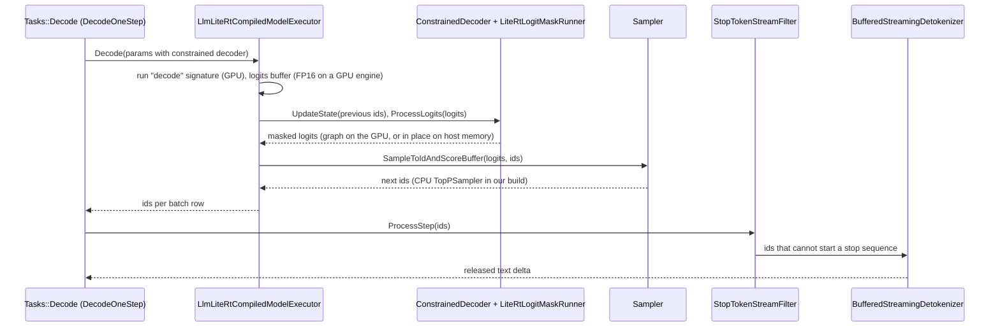
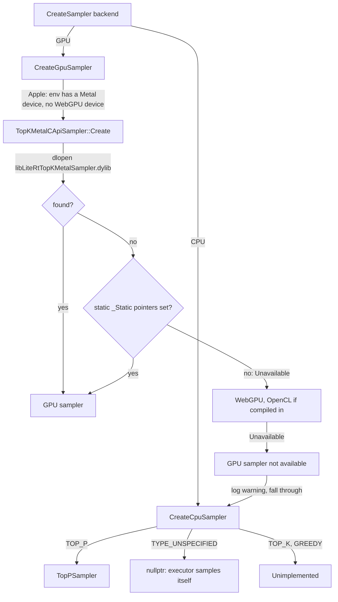

# LiteRT-LM: components (tokenizers, samplers, logit masks, constraints, resources)

> **Scope:** the building blocks the engine and executors call for every turn: tokenizers and the
> streaming detokenizer; samplers (the CPU `TopPSampler`, our greedy FP16 path, the closed Metal
> TopK sampler and its fallback); logit masks and the LiteRT mask runner; stop tokens; constraint
> internals (composite, thinking budget, repetition penalty, no-repeat n-gram, suppressed tokens);
> model resources (`ModelResourcesLitertLm`); LoRA; embedding lookups (text, multimodal,
> end-of-media); the image and audio preprocessors.
> **Out of scope:** the `.litertlm` container, the loader and section selection
> ([file-format.md](file-format.md)); when the decode loop calls these components and what ends a
> decode ([engine-and-sessions.md](engine-and-sessions.md)); executors, MTP and the vision and audio
> encoders ([executors.md](executors.md)); JSON response formats, llguidance and tool-call
> constraints, channels ([conversation.md](conversation.md)); the tokenizer's vocabulary and special
> tokens as a model property ([../models/tokenizer-and-chat-format.md](../models/tokenizer-and-chat-format.md)).
> **Pinned to:** LiteRT-LM `7b872544` (agello-next: Google's `df6df5b8` plus our commits), LiteRT
> `362759838` (one citation). Shipped comparison: the v0.18.0 source at `b2f686e2` with the wrapper
> at `85b1a776`, and Google's prebuilt v0.18.0 `CLiteRTLM.xcframework`.
> **Applies to:** all platforms; Apple specifics in [On Apple](#on-apple). **Last verified:** 2026-10-15

## Summary

Every generated token passes through the same chain: the executor produces a row of logits, a
constrained decoder may mask them, a sampler picks an ID, a stop-token filter holds back IDs that
could start a stop sequence, and a streaming detokenizer releases text only once it can no longer
change. All of it runs on the CPU in our build except the masking of device logits, which runs as a
small LiteRT graph on the GPU.

What matters for Agello:

- Google's v0.18.0 binary links a closed Metal TopK sampler (39 defined symbols) <!-- c:LM-CMP-022 -->
  and is expected to sample on the GPU (no run records it); our source build has no Metal sampler and
  falls back to the CPU `TopPSampler`, which reads the logits back every step.
- The decode logits are FP16 in both builds on a GPU engine, because the *configured* sampler backend
  is GPU; our build's CPU sampler reads those halves, and for greedy picks (all of MTP) compares them
  as integers without converting (ours: `fdd5bac7`).
- Text LoRA is rejected by the session layer in both builds; only audio LoRA loads.
- Text embeddings, per-layer embeddings and the end-of-image/audio embeddings are computed on the
  CPU on Apple, one small model run per token.

## Concepts

| Term | Meaning |
| --- | --- |
| `Tokenizer` | Interface in `support/tokenizer/`: text to IDs, IDs to text, one token to its ID, vocabulary size. Two implementations: `SentencePieceTokenizer` and `HuggingFaceTokenizer`. |
| `BufferedStreamingDetokenizer` | Turns the growing list of generated IDs into text deltas that are safe to show (whole UTF-8 characters, stable text). |
| `Sampler` | Picks token IDs from a logits tensor: `SampleToIdAndScoreBuffer`, `UpdateConfig`, and optional "handles input" hooks for samplers that also launch the next decode. |
| `TopPSampler` | The open CPU sampler: top-k, then top-p, then a weighted draw; `k = 1` is a greedy argmax. |
| TopK Metal sampler | Closed library exposing `LiteRtTopKMetalSampler_*` C functions; loaded by `dlopen` or through static function pointers. |
| `LogitMask` | Immutable change to a logits row: `BitmapLogitMask` (allowed tokens, hard), `SparseLogitMask` (per-token weight and bias, soft), `CompositeLogitMask`. |
| `LiteRtLogitMaskRunner` | Applies masks to a logits `TensorBuffer`: in place on host memory, or with a lazily compiled LiteRT graph on the accelerator. |
| `Constraint` | A state machine over tokens: `Start`, `ComputeNext(state, token)`, `ComputeMask(state)`, `IsEnded`. |
| `ConstrainedDecoder` | Holds one constraint state per batch row, computes masks and applies them through the mask runner. |
| `StopTokenDetector` | Tracks partial matches of stop-token sequences per batch row. |
| `ModelResources` | Lazy owner of everything loaded from a model file: TFLite models per `ModelType`, tokenizer, metadata protos. |
| `EmbeddingLookupManager` | Fills embedding tensors for prefill and decode from the embedder model, multimodal embeddings and end-of-media embeddings. |

Invariants worth keeping in mind:

- A token ID below zero is a placeholder, never a vocabulary entry: −1 marks an image embedding slot,
  −2 an audio slot, −3 and −4 the end of an image and of an audio clip. [`runtime/executor/llm_executor_io_types.h:218-221`](https://github.com/google-ai-edge/LiteRT-LM/blob/df6df5b84d5845b49889f631ed4cac80b4325dd3/runtime/executor/llm_executor_io_types.h#L218-L221)
  [`runtime/executor/llm_executor_io_types.h:279-282`](https://github.com/google-ai-edge/LiteRT-LM/blob/df6df5b84d5845b49889f631ed4cac80b4325dd3/runtime/executor/llm_executor_io_types.h#L279-L282)
- Masks never raise a disallowed logit: FP32 masks write −∞, FP16 masks write the most negative
  finite half (−65,504), and soft (sparse) adjustments skip logits that a hard mask already removed.
  <!-- c:LM-CMP-043 -->

## How it works

### One decode step

The executor side of this (signatures, pending tokens, MTP) is on
[executors.md](executors.md); the loop that repeats it and decides when to stop is on
[engine-and-sessions.md](engine-and-sessions.md). This page covers the boxes M, S, F and D.

### Tokenizers

The interface is small: `TextToTokenIds`, `TokenToId` (a raw lookup, `NotFound` if absent),
`TokenIdsToText(ids, skip_special_tokens)`, `GetTokens` and `GetVocabSize`; `TokenizerType` is
`kSentencePiece` or `kHuggingFace`. [`support/tokenizer/tokenizer.h:49-84`](https://github.com/google-ai-edge/LiteRT-LM/blob/df6df5b84d5845b49889f631ed4cac80b4325dd3/support/tokenizer/tokenizer.h#L49-L84) [`support/tokenizer/tokenizer.h:34-38`](https://github.com/google-ai-edge/LiteRT-LM/blob/df6df5b84d5845b49889f631ed4cac80b4325dd3/support/tokenizer/tokenizer.h#L34-L38)

`ModelResourcesLitertLm::GetTokenizer` returns `Unimplemented` at once if neither tokenizer library
is compiled in. Otherwise it uses the SentencePiece section if it is present and its library compiled
in, else the Hugging Face (`HF_Tokenizer_Zlib`) section under the same conditions. If no section could
be used, it returns `Unimplemented` when a section was found but its library was compiled out, and
`NotFound` when neither section exists. [`runtime/components/model_resources_litert_lm.cc:178-212`](https://github.com/google-ai-edge/LiteRT-LM/blob/df6df5b84d5845b49889f631ed4cac80b4325dd3/runtime/components/model_resources_litert_lm.cc#L178-L212) The loader finds the SentencePiece section by data type
and model type, and for the main model (`tf_lite_prefill_decode`) also accepts a section without a
`model_type` item, which is how every Gemma file stores it. The Hugging Face section is a zlib
stream that the loader decompresses into a new buffer. [`runtime/util/litert_lm_loader.cc:430-438`](https://github.com/google-ai-edge/LiteRT-LM/blob/df6df5b84d5845b49889f631ed4cac80b4325dd3/runtime/util/litert_lm_loader.cc#L430-L438) [`runtime/util/litert_lm_loader.cc:446-471`](https://github.com/google-ai-edge/LiteRT-LM/blob/df6df5b84d5845b49889f631ed4cac80b4325dd3/runtime/util/litert_lm_loader.cc#L446-L471)

Both libraries are linked by default: `//build_config:enable_huggingface_tokenizer` defaults to true,
`model_resources` depends on both tokenizer targets unless a disable flag or define is set, and
`--config=agello` sets neither. [`build_config/BUILD:115-117`](https://github.com/google-ai-edge/LiteRT-LM/blob/df6df5b84d5845b49889f631ed4cac80b4325dd3/build_config/BUILD#L115-L117) [`runtime/components/BUILD:338-343`](https://github.com/PowerBeef/agello-litert-lm/blob/7b872544fdbd81308f98b1e2acf8c5798a549df6/runtime/components/BUILD#L338-L343) [`.bazelrc:556-566`](https://github.com/PowerBeef/agello-litert-lm/blob/7b872544fdbd81308f98b1e2acf8c5798a549df6/.bazelrc#L556-L566) <!-- c:LM-CMP-004 -->

| | `SentencePieceTokenizer` | `HuggingFaceTokenizer` |
| --- | --- | --- |
| Library | Google's SentencePiece, loaded from the serialized `ModelProto` in the section [`support/tokenizer/sentencepiece_tokenizer.cc:44-51`](https://github.com/google-ai-edge/LiteRT-LM/blob/df6df5b84d5845b49889f631ed4cac80b4325dd3/support/tokenizer/sentencepiece_tokenizer.cc#L44-L51) | `tokenizers_cpp` (Rust `tokenizers` behind a C API) [`support/tokenizer/huggingface_tokenizer.cc:32`](https://github.com/google-ai-edge/LiteRT-LM/blob/df6df5b84d5845b49889f631ed4cac80b4325dd3/support/tokenizer/huggingface_tokenizer.cc#L32) [`support/tokenizer/huggingface_tokenizer.cc:47-53`](https://github.com/google-ai-edge/LiteRT-LM/blob/df6df5b84d5845b49889f631ed4cac80b4325dd3/support/tokenizer/huggingface_tokenizer.cc#L47-L53) |
| Encode | `processor_->Encode(text)` | `tokenizers_encode` with `add_special_tokens = 0` [`support/tokenizer/huggingface_tokenizer.cc:56-68`](https://github.com/google-ai-edge/LiteRT-LM/blob/df6df5b84d5845b49889f631ed4cac80b4325dd3/support/tokenizer/huggingface_tokenizer.cc#L56-L68) |
| `TokenToId` | `NotFound` when SentencePiece returns the unknown-token ID [`support/tokenizer/sentencepiece_tokenizer.cc:75-81`](https://github.com/google-ai-edge/LiteRT-LM/blob/df6df5b84d5845b49889f631ed4cac80b4325dd3/support/tokenizer/sentencepiece_tokenizer.cc#L75-L81) | `NotFound` when the C API leaves the ID at −1 |
| Decode | Rejects `skip_special_tokens = true`; `NotFound` for an ID outside the vocabulary; a single control token (BOS, EOS) decodes to its piece [`support/tokenizer/sentencepiece_tokenizer.cc:84-110`](https://github.com/google-ai-edge/LiteRT-LM/blob/df6df5b84d5845b49889f631ed4cac80b4325dd3/support/tokenizer/sentencepiece_tokenizer.cc#L84-L110) | Passes `skip_special_tokens` through |
| Vocabulary size | `GetPieceSize()` [`support/tokenizer/sentencepiece_tokenizer.cc:121-123`](https://github.com/google-ai-edge/LiteRT-LM/blob/df6df5b84d5845b49889f631ed4cac80b4325dd3/support/tokenizer/sentencepiece_tokenizer.cc#L121-L123) | `tokenizers_get_vocab_size` |
| Section in Gemma 4 files | yes (`SP_Tokenizer`) | none |

All five Gemma 4 files we document (E4B ours and Google's, E2B, both `-gpu` files) and the
EmbeddingGemma file carry an `SP_Tokenizer` section with no items and no `HF_Tokenizer_Zlib` section;
in E4B it is section 1, 4,689,013 bytes. <!-- c:LM-CMP-005 -->

`Tasks::Decode` reads the vocabulary size from `GetVocabSize()` once per decode turn (ours:
`5e946049`); before, it built the list of every token string (262,144 for Gemma) to count it.
[`runtime/core/tasks.cc:689-691`](https://github.com/PowerBeef/agello-litert-lm/blob/7b872544fdbd81308f98b1e2acf8c5798a549df6/runtime/core/tasks.cc#L689-L691) <!-- c:LM-CMP-012 -->

### The streaming detokenizer

SentencePiece decodes per sequence, not per token: one token can be half of a UTF-8 character, and
the text of earlier tokens can change once a later one arrives. `BufferedStreamingDetokenizer`
handles this per output head:

1. If the step brings new IDs for the head, append them to its accumulated IDs and decode them all;
   with no new IDs, reuse the previous decode. [`support/tokenizer/buffered_streaming_detokenizer.cc:104-158`](https://github.com/google-ai-edge/LiteRT-LM/blob/df6df5b84d5845b49889f631ed4cac80b4325dd3/support/tokenizer/buffered_streaming_detokenizer.cc#L104-L158)
2. Trim trailing U+FFFD replacement characters from this decode and the previous one.
   [`support/tokenizer/buffered_streaming_detokenizer.cc:85-91`](https://github.com/google-ai-edge/LiteRT-LM/blob/df6df5b84d5845b49889f631ed4cac80b4325dd3/support/tokenizer/buffered_streaming_detokenizer.cc#L85-L91)
3. Release the part of the longest common prefix of the two decodes that wasn't released yet. The
   prefix is cut back to the start of a multi-byte UTF-8 character if it ends inside one; orphaned
   continuation bytes and invalid lead bytes aren't held. [`support/tokenizer/buffered_streaming_detokenizer.cc:45-82`](https://github.com/google-ai-edge/LiteRT-LM/blob/df6df5b84d5845b49889f631ed4cac80b4325dd3/support/tokenizer/buffered_streaming_detokenizer.cc#L45-L82)
4. While the previous decode was empty, release nothing: the output lags one step. [`support/tokenizer/buffered_streaming_detokenizer.cc:131-145`](https://github.com/google-ai-edge/LiteRT-LM/blob/df6df5b84d5845b49889f631ed4cac80b4325dd3/support/tokenizer/buffered_streaming_detokenizer.cc#L131-L145)
5. Once more than `lookback_tokens` (default 8) released tokens accumulate, drop the older ones and
   re-decode the window so later decodes stay cheap. [`support/tokenizer/buffered_streaming_detokenizer.h:48-49`](https://github.com/google-ai-edge/LiteRT-LM/blob/df6df5b84d5845b49889f631ed4cac80b4325dd3/support/tokenizer/buffered_streaming_detokenizer.h#L48-L49) [`support/tokenizer/buffered_streaming_detokenizer.cc:160-185`](https://github.com/google-ai-edge/LiteRT-LM/blob/df6df5b84d5845b49889f631ed4cac80b4325dd3/support/tokenizer/buffered_streaming_detokenizer.cc#L160-L185)

`Flush()` releases whatever is withheld when the decode ends. The task keeps one detokenizer per
decode turn and feeds it only what the stop-token filter lets through. [`runtime/core/tasks.cc:534`](https://github.com/PowerBeef/agello-litert-lm/blob/7b872544fdbd81308f98b1e2acf8c5798a549df6/runtime/core/tasks.cc#L534)
[`runtime/core/tasks.cc:330-335`](https://github.com/PowerBeef/agello-litert-lm/blob/7b872544fdbd81308f98b1e2acf8c5798a549df6/runtime/core/tasks.cc#L330-L335)

### Stop tokens

Stop sequences come from the session: if the `SessionConfig` sets none, `MaybeUpdateAndValidate`
copies every `stop_tokens` entry of `LlmMetadata` that has token IDs. [`runtime/engine/engine_settings.cc:759-769`](https://github.com/google-ai-edge/LiteRT-LM/blob/df6df5b84d5845b49889f631ed4cac80b4325dd3/runtime/engine/engine_settings.cc#L759-L769) Stop tokens the
file gives as strings are converted at engine creation: `TokenToId` first, `TextToTokenIds` if that
fails. [`runtime/engine/engine_settings.cc:295-309`](https://github.com/google-ai-edge/LiteRT-LM/blob/df6df5b84d5845b49889f631ed4cac80b4325dd3/runtime/engine/engine_settings.cc#L295-L309)

The Gemma 4 LLM files (E4B ours and Google's, E2B, the two `-gpu` files) list stop token IDs 1, 50
and 106 and start token ID 2; the official generation config lists the same end IDs
(`eos_token_id` [1, 106, 50]). <!-- c:LM-CMP-016 -->

`StopTokenDetector` keeps, for every batch row and every stop sequence, how many tokens of the
sequence have matched. A matching token advances the count; any other token resets it to 1 if it is
the sequence's first token, else to 0. It doesn't fall back to a shorter partial match the way a
string matcher (KMP) would, which can only matter for multi-token stop sequences whose prefix repeats;
Gemma 4's are single tokens. [`runtime/components/stop_token_detector.cc:105-140`](https://github.com/google-ai-edge/LiteRT-LM/blob/df6df5b84d5845b49889f631ed4cac80b4325dd3/runtime/components/stop_token_detector.cc#L105-L140) Adding an empty sequence is an error; adding one twice is
ignored. [`runtime/components/stop_token_detector.cc:54-78`](https://github.com/google-ai-edge/LiteRT-LM/blob/df6df5b84d5845b49889f631ed4cac80b4325dd3/runtime/components/stop_token_detector.cc#L54-L78)

`StopTokenStreamFilter` (in `tasks.cc`) sits between the sampler and the detokenizer. Tokens that
could still be the start of a stop sequence stay in a buffer; when a sequence completes, its tokens
are dropped and the row stops; when the partial match breaks, the buffered tokens go to the
detokenizer. So a stop sequence is never shown as text. [`runtime/core/tasks.cc:130-190`](https://github.com/PowerBeef/agello-litert-lm/blob/7b872544fdbd81308f98b1e2acf8c5798a549df6/runtime/core/tasks.cc#L130-L190)

### Samplers

`CreateSampler(backend, ...)` builds the sampler the executor uses for the main decode. [`runtime/components/sampler_factory.cc:752-798`](https://github.com/PowerBeef/agello-litert-lm/blob/7b872544fdbd81308f98b1e2acf8c5798a549df6/runtime/components/sampler_factory.cc#L752-L798)

**GPU samplers.** `CreateGpuSampler` reads the LiteRT environment's options: a `kMetalDevice` option
selects the Metal path, a `kWebGpuDevice` option the WebGPU one. On Apple (`#if defined(__APPLE__)`)
it tries the Metal TopK sampler only when the environment has a Metal device and no WebGPU device.
[`runtime/components/sampler_factory.cc:647-658`](https://github.com/PowerBeef/agello-litert-lm/blob/7b872544fdbd81308f98b1e2acf8c5798a549df6/runtime/components/sampler_factory.cc#L647-L658) [`runtime/components/sampler_factory.cc:703-720`](https://github.com/PowerBeef/agello-litert-lm/blob/7b872544fdbd81308f98b1e2acf8c5798a549df6/runtime/components/sampler_factory.cc#L703-L720) <!-- c:LM-CMP-019 --> `TopKMetalCApiSampler::Create` first loads
`libLiteRtTopKMetalSampler.dylib` with `dlopen` (lazy, local) and looks up its seven
`LiteRtTopKMetalSampler_*` functions; if the library can't be loaded it uses the statically linked
function pointers `LiteRtTopKMetalSampler_*_Static`, which are `nullptr` unless a closed library sets
them, and returns `Unavailable` otherwise. [`runtime/components/sampler_factory.cc:546-581`](https://github.com/PowerBeef/agello-litert-lm/blob/7b872544fdbd81308f98b1e2acf8c5798a549df6/runtime/components/sampler_factory.cc#L546-L581) [`runtime/components/sampler_factory.cc:314-323`](https://github.com/PowerBeef/agello-litert-lm/blob/7b872544fdbd81308f98b1e2acf8c5798a549df6/runtime/components/sampler_factory.cc#L314-L323) [`runtime/components/sampler_factory.cc:131-136`](https://github.com/PowerBeef/agello-litert-lm/blob/7b872544fdbd81308f98b1e2acf8c5798a549df6/runtime/components/sampler_factory.cc#L131-L136)
[`runtime/components/sampler_factory.cc:601-612`](https://github.com/PowerBeef/agello-litert-lm/blob/7b872544fdbd81308f98b1e2acf8c5798a549df6/runtime/components/sampler_factory.cc#L601-L612) <!-- c:LM-CMP-020 --> Only `Unavailable` falls back to the CPU; any other error
from the TopK Metal sampler is returned to the caller. [`runtime/components/sampler_factory.cc:747`](https://github.com/PowerBeef/agello-litert-lm/blob/7b872544fdbd81308f98b1e2acf8c5798a549df6/runtime/components/sampler_factory.cc#L747)

What each build contains:

| | Documented build (agello-next) | What Agello ships (Google's v0.18.0 binary) |
| --- | --- | --- |
| Source of the Metal sampler | none: `//runtime/components:default_static_gpu_samplers` has empty `deps` in every branch [`runtime/components/BUILD:240-259`](https://github.com/PowerBeef/agello-litert-lm/blob/7b872544fdbd81308f98b1e2acf8c5798a549df6/runtime/components/BUILD#L240-L259) | the same empty target in the v0.18.0 source [`runtime/components/BUILD:248-254`](https://github.com/google-ai-edge/LiteRT-LM/blob/b2f686e2ed4718fb84ec398a61dd59ca0f0aff27/runtime/components/BUILD#L248-L254); Google's binary links the closed sampler in |
| TopK Metal sampler symbols in the iOS arm64 slice (defined / in strings) | 7 / 25 | 39 / 25 |
| Sampler at run time | CPU `TopPSampler` (fallback, warning logged) | the Metal sampler (expected from the symbols; not observed in a run) |

<!-- c:LM-CMP-021 --> <!-- c:LM-CMP-022 --> The symbol counts are from
[`generated/binaries.md`](../generated/binaries.md): our 7 defined matches are the open wrapper code
(`TopKMetalCApiSampler`), not an implementation. An engine run of our build on an Apple M6 records the
fact `sampler = cpu (GPU sampler unavailable)`, the counters `sampler_cpu` 1 and `sampler_gpu` 0, and
one `sampler_fallback_to_cpu` anomaly ([`generated/engine-run.md`](../generated/engine-run.md)).
<!-- c:LM-CMP-023 --> The repository also carries `metal_exported_symbols.lds` and
`LiteRtTopKMetalSamplerInfo.plist`, which no BUILD target at the pin references. Google's prebuilt
`libLiteRtTopKMetalSampler.dylib` files for iOS and macOS sit under `prebuilt/`; the documented build
doesn't link them.

**CPU sampler.** `CreateCpuSampler` implements only `TOP_P` (a `TopPSampler`); `TYPE_UNSPECIFIED`
returns no sampler (the executor then samples by itself), and `TOP_K` and `GREEDY` return
`Unimplemented`. [`runtime/components/sampler_factory.cc:624-641`](https://github.com/PowerBeef/agello-litert-lm/blob/7b872544fdbd81308f98b1e2acf8c5798a549df6/runtime/components/sampler_factory.cc#L624-L641) The Swift wrapper always creates `kLiteRtLmSamplerTypeTopP` params,
so it never reaches the unimplemented types; the C API does map `kLiteRtLmSamplerTypeTopK` and
`kLiteRtLmSamplerTypeGreedy` to the proto's `TOP_K` and `GREEDY`. [`swift/Engine.swift:248`](https://github.com/google-ai-edge/LiteRT-LM/blob/df6df5b84d5845b49889f631ed4cac80b4325dd3/swift/Engine.swift#L248) [`c/engine.cc:347-359`](https://github.com/google-ai-edge/LiteRT-LM/blob/df6df5b84d5845b49889f631ed4cac80b4325dd3/c/engine.cc#L347-L359)
The proto notes that the GPU path ignores the type and always combines top-k and top-p.
[`runtime/proto/sampler_params.proto:35-37`](https://github.com/google-ai-edge/LiteRT-LM/blob/df6df5b84d5845b49889f631ed4cac80b4325dd3/runtime/proto/sampler_params.proto#L35-L37)

`TopPSampler::Create` rejects `k <= 0`, `p` outside [0, 1], non-positive batch or sequence sizes and a
negative temperature. [`runtime/components/top_p_cpu_sampler.cc:168-190`](https://github.com/PowerBeef/agello-litert-lm/blob/7b872544fdbd81308f98b1e2acf8c5798a549df6/runtime/components/top_p_cpu_sampler.cc#L168-L190) Sampling (`TopKTopPSampling` in `sampling_cpu_util.cc`):

1. Top-k: `k = 1` uses a tiled argmax (`MaxElement`); `k <= 1024` a min-heap; larger `k` a
   partition (`nth_element`). [`runtime/components/sampling_cpu_util.cc:107-114`](https://github.com/google-ai-edge/LiteRT-LM/blob/df6df5b84d5845b49889f631ed4cac80b4325dd3/runtime/components/sampling_cpu_util.cc#L107-L114)
2. Softmax over the k candidates at the given temperature.
3. `k = 1`: return the argmax with score 1; `p` and the temperature (once validated) don't affect it.
   [`runtime/components/sampling_cpu_util.cc:309-316`](https://github.com/google-ai-edge/LiteRT-LM/blob/df6df5b84d5845b49889f631ed4cac80b4325dd3/runtime/components/sampling_cpu_util.cc#L309-L316)
4. Otherwise sort the candidates by probability, keep the smallest prefix whose cumulative probability
   reaches `p`, and sample one of them in proportion to its probability: a uniform draw over the kept
   cumulative mass, with the sampler's `std::default_random_engine` (seeded by `seed`). If that mass
   is zero, return the most probable token.
   [`runtime/components/sampling_cpu_util.cc:337-385`](https://github.com/google-ai-edge/LiteRT-LM/blob/df6df5b84d5845b49889f631ed4cac80b4325dd3/runtime/components/sampling_cpu_util.cc#L337-L385)

<!-- c:LM-CMP-027 -->

**Which parameters apply.** If a file's `LlmMetadata` has no `sampler_params`, engine creation fills
in `TOP_P`, k 1, p 0.95, temperature 1, seed 0 for the CPU and GPU backends (and leaves the type
unspecified for NPU and GPU_ARTISAN): a greedy default. [`runtime/engine/engine_settings.cc:417-442`](https://github.com/google-ai-edge/LiteRT-LM/blob/df6df5b84d5845b49889f631ed4cac80b4325dd3/runtime/engine/engine_settings.cc#L417-L442) The E4B and E2B files
have no `sampler_params`; the two `-gpu` files have `TOP_P`, k 64, p 0.95, temperature 1.
<!-- c:LM-CMP-036 --> A session uses the file's parameters only when its own type is unspecified
[`runtime/engine/engine_settings.cc:725-730`](https://github.com/google-ai-edge/LiteRT-LM/blob/df6df5b84d5845b49889f631ed4cac80b4325dd3/runtime/engine/engine_settings.cc#L725-L730), and an executor that still sees an unspecified type uses `TOP_P` with k 1,
p 0, temperature 1. [`runtime/executor/llm_litert_compiled_model_executor.cc:1728-1734`](https://github.com/PowerBeef/agello-litert-lm/blob/7b872544fdbd81308f98b1e2acf8c5798a549df6/runtime/executor/llm_litert_compiled_model_executor.cc#L1728-L1734) MTP's drafter and verifier always sample greedily
(`CreateGreedySampler`: `TOP_P`, k 1, p 0, temperature 1, seed 0) through the same `CreateSampler`, so
they fall back to the CPU the same way. [`runtime/executor/llm_litert_mtp_drafter.cc:79-91`](https://github.com/PowerBeef/agello-litert-lm/blob/7b872544fdbd81308f98b1e2acf8c5798a549df6/runtime/executor/llm_litert_mtp_drafter.cc#L79-L91) [`runtime/executor/llm_litert_mtp_drafter.cc:401-411`](https://github.com/PowerBeef/agello-litert-lm/blob/7b872544fdbd81308f98b1e2acf8c5798a549df6/runtime/executor/llm_litert_mtp_drafter.cc#L401-L411) <!-- c:LM-CMP-034 -->

### FP16 logits and the greedy half path

Two decisions combine, and they are made by different pieces of code:

1. **The logits buffer type.** When the executor builds the `decode` signature's output buffers, it
   gives the logits output an FP16 buffer if the model runs at FP16 precision (FP16 activations on the
   GPU backend; FP16 is the default activation type) and `GetSamplerBackend` returns GPU; otherwise
   it uses the compiled model's own output buffer. v0.18.0 has the same rule. [`runtime/executor/llm_litert_compiled_model_executor.cc:2127-2142`](https://github.com/PowerBeef/agello-litert-lm/blob/7b872544fdbd81308f98b1e2acf8c5798a549df6/runtime/executor/llm_litert_compiled_model_executor.cc#L2127-L2142)
   [`runtime/executor/llm_litert_compiled_model_executor.cc:2213-2229`](https://github.com/PowerBeef/agello-litert-lm/blob/7b872544fdbd81308f98b1e2acf8c5798a549df6/runtime/executor/llm_litert_compiled_model_executor.cc#L2213-L2229) [`runtime/executor/llm_litert_compiled_model_executor.cc:1982-1998`](https://github.com/google-ai-edge/LiteRT-LM/blob/b2f686e2ed4718fb84ec398a61dd59ca0f0aff27/runtime/executor/llm_litert_compiled_model_executor.cc#L1982-L1998) <!-- c:LM-CMP-028 -->
2. **The configured sampler backend.** `GetSamplerBackend` returns the executor setting, and when that
   is unspecified, the main backend (CPU for NPU). It doesn't check whether a GPU sampler library
   exists. When it is GPU and the GPU config's `external_tensor_mode` is off (the default), the GPU
   compilation options also mark `logits` as an external tensor. [`runtime/executor/llm_executor_settings_utils.cc:52-68`](https://github.com/PowerBeef/agello-litert-lm/blob/7b872544fdbd81308f98b1e2acf8c5798a549df6/runtime/executor/llm_executor_settings_utils.cc#L52-L68) [`runtime/executor/llm_executor_settings_utils.cc:166-195`](https://github.com/PowerBeef/agello-litert-lm/blob/7b872544fdbd81308f98b1e2acf8c5798a549df6/runtime/executor/llm_executor_settings_utils.cc#L166-L195) [`runtime/executor/llm_executor_settings.h:119`](https://github.com/google-ai-edge/LiteRT-LM/blob/df6df5b84d5845b49889f631ed4cac80b4325dd3/runtime/executor/llm_executor_settings.h#L119) <!-- c:LM-CMP-029 -->

So on a GPU engine whose sampler backend is left unspecified, the decode logits are FP16 whether or not the closed TopK Metal sampler loads. In our build it doesn't, and
the CPU `TopPSampler` receives FP16 logits. The C API's engine settings leave the executor's sampler
backend unspecified: `EngineSettings::CreateDefault` is called without one, and
`LlmExecutorSettings` sets it only when given. [`c/engine.cc:307-308`](https://github.com/google-ai-edge/LiteRT-LM/blob/df6df5b84d5845b49889f631ed4cac80b4325dd3/c/engine.cc#L307-L308) [`runtime/executor/llm_executor_settings.cc:206-208`](https://github.com/google-ai-edge/LiteRT-LM/blob/df6df5b84d5845b49889f631ed4cac80b4325dd3/runtime/executor/llm_executor_settings.cc#L206-L208) [`runtime/executor/llm_executor_settings.h:461`](https://github.com/google-ai-edge/LiteRT-LM/blob/df6df5b84d5845b49889f631ed4cac80b4325dd3/runtime/executor/llm_executor_settings.h#L461)

| | v0.18.0 `TopPSampler` | agello-next `TopPSampler` (ours: `fdd5bac7`) |
| --- | --- | --- |
| FP16 read | into a new `std::vector<uint16_t>` per call | into the member `logits_f16_`, reused [`runtime/components/top_p_cpu_sampler.h:93-96`](https://github.com/PowerBeef/agello-litert-lm/blob/7b872544fdbd81308f98b1e2acf8c5798a549df6/runtime/components/top_p_cpu_sampler.h#L93-L96) |
| `k = 1` | converts all halves to floats, then argmax [`runtime/components/top_p_cpu_sampler.cc:194-202`](https://github.com/google-ai-edge/LiteRT-LM/blob/b2f686e2ed4718fb84ec398a61dd59ca0f0aff27/runtime/components/top_p_cpu_sampler.cc#L194-L202) | first maximum over the halves, compared as integers; no conversion [`runtime/components/top_p_cpu_sampler.cc:217-253`](https://github.com/PowerBeef/agello-litert-lm/blob/7b872544fdbd81308f98b1e2acf8c5798a549df6/runtime/components/top_p_cpu_sampler.cc#L217-L253) |
| `k > 1` | converts, then top-k/top-p | converts, then top-k/top-p |

<!-- c:LM-CMP-030 --> `GreedyHalf` maps each half to a 16-bit key that orders like its value (flip all
bits of negatives, set the sign bit of positives), takes the first maximum, returns −1 if that maximum
is a NaN so the float path handles it, and among +0 and −0 returns the first, as the float comparison
would. [`runtime/components/top_p_cpu_sampler.cc:144-163`](https://github.com/PowerBeef/agello-litert-lm/blob/7b872544fdbd81308f98b1e2acf8c5798a549df6/runtime/components/top_p_cpu_sampler.cc#L144-L163) The greedy path writes a score of 0 (the log of probability 1) when scores are
requested. Telemetry probes on the logits run on both paths (ours). [`runtime/components/top_p_cpu_sampler.cc:259-263`](https://github.com/PowerBeef/agello-litert-lm/blob/7b872544fdbd81308f98b1e2acf8c5798a549df6/runtime/components/top_p_cpu_sampler.cc#L259-L263)

The readings show it: in the `t6-plain` records (Apple M6, E4B, 8K KV cache, MTP off, 256 decode
steps per run) the span `host.read 524288 B (direct)` occurs 256 times per run, one per step, and
524,288 bytes is 262,144 vocabulary entries × 2 bytes. <!-- c:LM-CMP-031 -->

### Sampling cost on the CPU

Both figures in Agello's notes are the mean of the same telemetry span, `sample`, which wraps the
executor's call to `SampleToIdAndScoreBuffer` and so includes reading the logits from the GPU buffer.
[`runtime/executor/llm_litert_compiled_model_executor.cc:1836-1860`](https://github.com/PowerBeef/agello-litert-lm/blob/7b872544fdbd81308f98b1e2acf8c5798a549df6/runtime/executor/llm_litert_compiled_model_executor.cc#L1836-L1860) agello-bench asks for greedy sampling (`SamplerConfig(topK: 1, topP: 1,
temperature: 0)`). [`tools/agello-bench/Sources/BenchKit/Bench.swift:114`](https://github.com/PowerBeef/agello-litert-lm/blob/85b1a77695bc90fc8b34a1f455bbe5b2c7fdceff/tools/agello-bench/Sources/BenchKit/Bench.swift#L114) They measured different builds:

| Record | Build | Prompt / decoded | `sample` span | What it includes |
| --- | --- | --- | --- | --- |
| `results/mac/2026-10-14/bench/tele-t2k.jsonl`, label `N2` | runtime SHA-256 `15cbde6f…`, before direct reads (no `(direct)` host read spans) | 2,049 / 128, MTP off | mean 497 µs over 128 calls, p50 459 µs | logits read without the direct path (TELEMETRY.md attributes the cost to ML Drift's layout conversion), FP16 → FP32 conversion, argmax |
| `results/mac/2026-10-15/bench/t6-plain.jsonl`, label `t6` | `f057206e0b1e` (LiteRT `97e06d36`), the same binary as `p6-p6post` | 722 / 256, MTP off | mean 44.75 µs and 44.54 µs over 256 calls, p50 20.5 µs, p99 524 µs | direct 512 KiB read (mean 6.3 µs), integer argmax over halves; 8 of 256 calls also run the level-2 logits probe |

<!-- c:LM-CMP-039 --> <!-- c:LM-CMP-040 --> So "0.50 ms" (TELEMETRY.md) and "0.044 ms" (T7) don't
contradict each other: both are greedy CPU picks on an M6 at telemetry level 2, before and after T5's
direct reads and P6's integer argmax. Neither measures top-k/top-p sampling with k > 1, which still
converts 262,144 halves and runs the top-k and softmax steps; no record in `docs/agello/results/`
measures that. <!-- c:LM-CMP-041 -->

### Logit masks

| Type | Representation | Applied as |
| --- | --- | --- |
| `BitmapLogitMask` | `ceil(vocab / 64)` 64-bit words, bit set = allowed | disallowed logits set to −∞ (FP32) or `half::min()` (FP16); logits past `vocab_size` disallowed too |
| `SparseLogitMask` | entries `{token_id, weight, bias, sign_dependent_weight}` | `z' = z·w + b`; with a sign-dependent weight, negative logits are divided by `w` instead; entries on already-disallowed logits are skipped |
| `CompositeLogitMask` | a list of masks | bitmaps fused with a bitwise AND in one pass, then custom masks, then sparse masks |

[`runtime/components/constrained_decoding/logit_mask.h:30-35`](https://github.com/PowerBeef/agello-litert-lm/blob/7b872544fdbd81308f98b1e2acf8c5798a549df6/runtime/components/constrained_decoding/logit_mask.h#L30-L35) [`runtime/components/constrained_decoding/logit_mask.h:55-102`](https://github.com/PowerBeef/agello-litert-lm/blob/7b872544fdbd81308f98b1e2acf8c5798a549df6/runtime/components/constrained_decoding/logit_mask.h#L55-L102) [`runtime/components/constrained_decoding/logit_mask.cc:36-83`](https://github.com/PowerBeef/agello-litert-lm/blob/7b872544fdbd81308f98b1e2acf8c5798a549df6/runtime/components/constrained_decoding/logit_mask.cc#L36-L83) [`runtime/components/constrained_decoding/logit_mask.h:107-127`](https://github.com/PowerBeef/agello-litert-lm/blob/7b872544fdbd81308f98b1e2acf8c5798a549df6/runtime/components/constrained_decoding/logit_mask.h#L107-L127) [`runtime/components/constrained_decoding/logit_mask.cc:87-118`](https://github.com/PowerBeef/agello-litert-lm/blob/7b872544fdbd81308f98b1e2acf8c5798a549df6/runtime/components/constrained_decoding/logit_mask.cc#L87-L118)
[`runtime/components/constrained_decoding/logit_mask.h:144-149`](https://github.com/PowerBeef/agello-litert-lm/blob/7b872544fdbd81308f98b1e2acf8c5798a549df6/runtime/components/constrained_decoding/logit_mask.h#L144-L149) <!-- c:LM-CMP-042 --> `half::min()` is `from_bits(0xfbff)`, −65,504
[`tflite/types/half.h:149`](https://github.com/google-ai-edge/LiteRT/blob/ca21dc99de51c76bdcc572afeea1dd937d3c9e5c/tflite/types/half.h#L149); the mask runner's graph path uses −∞ for FP32 and −65,504 for FP16 for the same
reason. [`runtime/components/constrained_decoding/litert_logit_mask_runner.cc:62-68`](https://github.com/PowerBeef/agello-litert-lm/blob/7b872544fdbd81308f98b1e2acf8c5798a549df6/runtime/components/constrained_decoding/litert_logit_mask_runner.cc#L62-L68)

**The mask runner.** `ConstrainedDecoder` computes one mask per batch row and hands them to a
`LiteRtLogitMaskRunner`. [`runtime/components/constrained_decoding/constrained_decoder.cc:75-98`](https://github.com/google-ai-edge/LiteRT-LM/blob/df6df5b84d5845b49889f631ed4cac80b4325dd3/runtime/components/constrained_decoding/constrained_decoder.cc#L75-L98) The runner picks a path on every call [`runtime/components/constrained_decoding/litert_logit_mask_runner.h:35-51`](https://github.com/google-ai-edge/LiteRT-LM/blob/df6df5b84d5845b49889f631ed4cac80b4325dd3/runtime/components/constrained_decoding/litert_logit_mask_runner.h#L35-L51):

1. **Host memory:** the logits buffer is a `kHostMemory` buffer → masks are applied in place on the
   CPU. [`runtime/components/constrained_decoding/litert_logit_mask_runner.cc:960-974`](https://github.com/PowerBeef/agello-litert-lm/blob/7b872544fdbd81308f98b1e2acf8c5798a549df6/runtime/components/constrained_decoding/litert_logit_mask_runner.cc#L960-L974)
2. **Accelerator:** the runner was created for an accelerator other than `kNone` → the masks are
   unpacked into vocab-sized staging tensors (`bias`, `weight`, optionally `weight_neg`), the cheapest
   of seven graph variants is chosen (`logits + bias`, `logits * weight`, sign-dependent forms), and
   that graph, compiled lazily on first use, runs on the accelerator over the logits buffer.
   [`runtime/components/constrained_decoding/litert_logit_mask_runner.cc:974-1028`](https://github.com/PowerBeef/agello-litert-lm/blob/7b872544fdbd81308f98b1e2acf8c5798a549df6/runtime/components/constrained_decoding/litert_logit_mask_runner.cc#L974-L1028) [`runtime/components/constrained_decoding/litert_logit_mask_runner.h:97-114`](https://github.com/google-ai-edge/LiteRT-LM/blob/df6df5b84d5845b49889f631ed4cac80b4325dd3/runtime/components/constrained_decoding/litert_logit_mask_runner.h#L97-L114) On a GPU accelerator the runner marks `logits` and
   `masked_logits` as external tensors (so the GPU layout matches the decode model's logits and
   binds without a copy) and keeps the staging inputs packed. [`runtime/components/constrained_decoding/litert_logit_mask_runner.cc:287-316`](https://github.com/PowerBeef/agello-litert-lm/blob/7b872544fdbd81308f98b1e2acf8c5798a549df6/runtime/components/constrained_decoding/litert_logit_mask_runner.cc#L287-L316)
3. **Fallback:** a custom mask or a composite nested in a composite can't be expressed as a graph →
   read the logits to the host, mask, write them back. [`runtime/components/constrained_decoding/litert_logit_mask_runner.cc:1036-1052`](https://github.com/PowerBeef/agello-litert-lm/blob/7b872544fdbd81308f98b1e2acf8c5798a549df6/runtime/components/constrained_decoding/litert_logit_mask_runner.cc#L1036-L1052)

<!-- c:LM-CMP-047 --> Masks made by `CreateAllAllowed` carry a flag, and the runner treats one that
covers the logits' whole vocabulary like no mask; if every row's mask is then empty it returns without
touching the logits (ours: `ef197a04`). A thinking budget produces exactly such a mask while the model
thinks within its budget. [`runtime/components/constrained_decoding/logit_mask.cc:308-319`](https://github.com/PowerBeef/agello-litert-lm/blob/7b872544fdbd81308f98b1e2acf8c5798a549df6/runtime/components/constrained_decoding/logit_mask.cc#L308-L319) [`runtime/components/constrained_decoding/litert_logit_mask_runner.cc:930-949`](https://github.com/PowerBeef/agello-litert-lm/blob/7b872544fdbd81308f98b1e2acf8c5798a549df6/runtime/components/constrained_decoding/litert_logit_mask_runner.cc#L930-L949) <!-- c:LM-CMP-046 -->

Which runner the decode gets: `DecodeOneStep::Create` builds the `ConstrainedDecoder` with the
executor's LiteRT environment and `GetHwAcceleratorForBackend(backend)` (`kGpu` for the GPU backend,
`kCpu` for the CPU backend), and with a host-only runner when there is no environment or no
accelerator. [`runtime/core/tasks.cc:270-289`](https://github.com/PowerBeef/agello-litert-lm/blob/7b872544fdbd81308f98b1e2acf8c5798a549df6/runtime/core/tasks.cc#L270-L289) [`runtime/executor/executor_settings_base.cc:63-73`](https://github.com/google-ai-edge/LiteRT-LM/blob/df6df5b84d5845b49889f631ed4cac80b4325dd3/runtime/executor/executor_settings_base.cc#L63-L73) [`runtime/components/constrained_decoding/constrained_decoder.cc:40-53`](https://github.com/google-ai-edge/LiteRT-LM/blob/df6df5b84d5845b49889f631ed4cac80b4325dd3/runtime/components/constrained_decoding/constrained_decoder.cc#L40-L53) The executor updates the constraint
with the previous step's IDs only when the previous run was a decode, then masks the fresh logits.
[`runtime/executor/llm_litert_compiled_model_executor.cc:1540-1556`](https://github.com/PowerBeef/agello-litert-lm/blob/7b872544fdbd81308f98b1e2acf8c5798a549df6/runtime/executor/llm_litert_compiled_model_executor.cc#L1540-L1556) MTP creates its own two runners (drafter and verifier) for the same accelerator.
[`runtime/executor/llm_litert_mtp_drafter.cc:430-434`](https://github.com/PowerBeef/agello-litert-lm/blob/7b872544fdbd81308f98b1e2acf8c5798a549df6/runtime/executor/llm_litert_mtp_drafter.cc#L430-L434)

In v0.18.0 there is no mask runner: `ConstrainedDecoder::ProcessLogits` masks host logits in place
and, for any other buffer, copies the logits to a host vector, masks them and writes them back.
[`runtime/components/constrained_decoding/constrained_decoder.cc:31-73`](https://github.com/google-ai-edge/LiteRT-LM/blob/b2f686e2ed4718fb84ec398a61dd59ca0f0aff27/runtime/components/constrained_decoding/constrained_decoder.cc#L31-L73) <!-- c:LM-CMP-049 -->

### Constraints

`Constraint` is a pure state machine: states are immutable values passed in and returned.
[`runtime/components/constrained_decoding/constraint.h:31-65`](https://github.com/google-ai-edge/LiteRT-LM/blob/df6df5b84d5845b49889f631ed4cac80b4325dd3/runtime/components/constrained_decoding/constraint.h#L31-L65) `ConstrainedDecoder::UpdateState` advances each row's state with the sampled
token and restarts the constraint when it reports `IsEnded`. [`runtime/components/constrained_decoding/constrained_decoder.cc:108-122`](https://github.com/google-ai-edge/LiteRT-LM/blob/df6df5b84d5845b49889f631ed4cac80b4325dd3/runtime/components/constrained_decoding/constrained_decoder.cc#L108-L122)

**Composite.** `DecodeOneStep::Create` builds one `CompositeConstraint` per decode turn, in this order:
repetition penalty, no-repeat n-gram and suppressed tokens (each only if enabled, owned by the
composite), then the caller's constraint (unowned): a JSON response format, a tool-call constraint
or a thinking budget wrapping one of them. A composite with no members means no constrained decoder
at all. [`runtime/core/tasks.cc:248-268`](https://github.com/PowerBeef/agello-litert-lm/blob/7b872544fdbd81308f98b1e2acf8c5798a549df6/runtime/core/tasks.cc#L248-L268) <!-- c:LM-CMP-054 --> The composite requires every member to have the same
vocabulary size, reports `IsEnded` as soon as any member ends, and returns a `CompositeLogitMask` of
the members' masks. [`runtime/components/constrained_decoding/composite_constraint.cc:147-161`](https://github.com/google-ai-edge/LiteRT-LM/blob/df6df5b84d5845b49889f631ed4cac80b4325dd3/runtime/components/constrained_decoding/composite_constraint.cc#L147-L161) [`runtime/components/constrained_decoding/composite_constraint.cc:179-190`](https://github.com/google-ai-edge/LiteRT-LM/blob/df6df5b84d5845b49889f631ed4cac80b4325dd3/runtime/components/constrained_decoding/composite_constraint.cc#L179-L190) [`runtime/components/constrained_decoding/composite_constraint.cc:219-240`](https://github.com/google-ai-edge/LiteRT-LM/blob/df6df5b84d5845b49889f631ed4cac80b4325dd3/runtime/components/constrained_decoding/composite_constraint.cc#L219-L240) Because `UpdateState` restarts the
whole composite when it ends, a member that ends (a finished JSON object) also resets the others'
state, such as the repetition penalty's token counts.

**Thinking budget.** When thinking is enabled for a turn, `Conversation` sets the budget from
`ThinkingConfig`, the start IDs from the first channel's `start` string (empty when that channel is
already open in the prompt) and the end IDs from its `end` string; otherwise the budget is 0.
[`runtime/conversation/conversation.cc:360-387`](https://github.com/google-ai-edge/LiteRT-LM/blob/df6df5b84d5845b49889f631ed4cac80b4325dd3/runtime/conversation/conversation.cc#L360-L387) `Tasks::Decode` wraps the caller's constraint in a `ThinkingBudgetConstraint`
whenever the budget isn't 0 and end IDs exist; −1 means no limit but still suspends the inner
constraint while the model thinks. [`runtime/core/tasks.cc:693-705`](https://github.com/PowerBeef/agello-litert-lm/blob/7b872544fdbd81308f98b1e2acf8c5798a549df6/runtime/core/tasks.cc#L693-L705) <!-- c:LM-CMP-057 --> Its masks
[`runtime/components/constrained_decoding/thinking_budget_constraint.h:28-46`](https://github.com/google-ai-edge/LiteRT-LM/blob/df6df5b84d5845b49889f631ed4cac80b4325dd3/runtime/components/constrained_decoding/thinking_budget_constraint.h#L28-L46) [`runtime/components/constrained_decoding/thinking_budget_constraint.cc:186-233`](https://github.com/google-ai-edge/LiteRT-LM/blob/df6df5b84d5845b49889f631ed4cac80b4325dd3/runtime/components/constrained_decoding/thinking_budget_constraint.cc#L186-L233):

| State | Mask |
| --- | --- |
| Step 0, start not yet matched | the inner constraint's mask plus the first start token (all allowed if there is no inner constraint) |
| Inside the start sequence | only the next start token |
| Thinking, within budget | all allowed (skipped by the runner, see above) |
| Budget reached (`thinking_token_count >= budget`) | only the next end token, one at a time [`runtime/components/constrained_decoding/thinking_budget_constraint.cc:330-336`](https://github.com/google-ai-edge/LiteRT-LM/blob/df6df5b84d5845b49889f631ed4cac80b4325dd3/runtime/components/constrained_decoding/thinking_budget_constraint.cc#L330-L336) |
| After the end sequence | the inner constraint's mask, or all allowed |

A model that writes the end sequence by itself also leaves the thinking phase. [`runtime/components/constrained_decoding/thinking_budget_constraint.cc:310-328`](https://github.com/google-ai-edge/LiteRT-LM/blob/df6df5b84d5845b49889f631ed4cac80b4325dd3/runtime/components/constrained_decoding/thinking_budget_constraint.cc#L310-L328) The
wrapper reports `IsEnded` only in the content phase and only if the inner constraint ended.
[`runtime/components/constrained_decoding/thinking_budget_constraint.cc:110-125`](https://github.com/google-ai-edge/LiteRT-LM/blob/df6df5b84d5845b49889f631ed4cac80b4325dd3/runtime/components/constrained_decoding/thinking_budget_constraint.cc#L110-L125)

**Repetition penalty.** `RepetitionPenaltyConfig(repetition_penalty, presence_penalty,
frequency_penalty, window_size)` clamps the penalty to at least 1 and the window to at least 0; it is
enabled when the penalty exceeds 1 or either other value isn't 0. [`runtime/components/constrained_decoding/repetition_penalty_config.h:54-59`](https://github.com/google-ai-edge/LiteRT-LM/blob/df6df5b84d5845b49889f631ed4cac80b4325dd3/runtime/components/constrained_decoding/repetition_penalty_config.h#L54-L59) [`runtime/components/constrained_decoding/repetition_penalty_config.h:73-76`](https://github.com/google-ai-edge/LiteRT-LM/blob/df6df5b84d5845b49889f631ed4cac80b4325dd3/runtime/components/constrained_decoding/repetition_penalty_config.h#L73-L76) The
state counts tokens generated in the turn (in a ring buffer of `window_size` tokens; 0 means the whole
turn). [`runtime/components/constrained_decoding/repetition_penalty_constraint.cc:66-100`](https://github.com/google-ai-edge/LiteRT-LM/blob/df6df5b84d5845b49889f631ed4cac80b4325dd3/runtime/components/constrained_decoding/repetition_penalty_constraint.cc#L66-L100) The mask is sparse: for each counted token, weight `1 / penalty` applied
sign-dependently (positive logits shrink, negative ones grow away from zero, Hugging Face style) and
bias `−(presence + count × frequency)` (OpenAI style). [`runtime/components/constrained_decoding/repetition_penalty_constraint.cc:103-129`](https://github.com/google-ai-edge/LiteRT-LM/blob/df6df5b84d5845b49889f631ed4cac80b4325dd3/runtime/components/constrained_decoding/repetition_penalty_constraint.cc#L103-L129) [`runtime/components/constrained_decoding/repetition_penalty_constraint.cc:30-45`](https://github.com/google-ai-edge/LiteRT-LM/blob/df6df5b84d5845b49889f631ed4cac80b4325dd3/runtime/components/constrained_decoding/repetition_penalty_constraint.cc#L30-L45) <!-- c:LM-CMP-061 -->

**No-repeat n-gram.** `NoRepeatNgramConfig(n, window_size)` bans any token that would repeat an
n-gram already generated; the window is raised to `n` if smaller (0 = unbounded). [`runtime/components/constrained_decoding/no_repeat_ngram_config.h:42-48`](https://github.com/google-ai-edge/LiteRT-LM/blob/df6df5b84d5845b49889f631ed4cac80b4325dd3/runtime/components/constrained_decoding/no_repeat_ngram_config.h#L42-L48) The
mask allows everything until `n` tokens exist, then a bitmap disallowing the tokens that followed the
current `n − 1` prefix earlier (prefixes hashed and checked for collisions). [`runtime/components/constrained_decoding/no_repeat_ngram_constraint.cc:134-141`](https://github.com/google-ai-edge/LiteRT-LM/blob/df6df5b84d5845b49889f631ed4cac80b4325dd3/runtime/components/constrained_decoding/no_repeat_ngram_constraint.cc#L134-L141)

**Suppressed tokens.** A fixed bitmap of disallowed IDs, built once. [`runtime/components/constrained_decoding/suppress_tokens_constraint.cc:31-46`](https://github.com/google-ai-edge/LiteRT-LM/blob/df6df5b84d5845b49889f631ed4cac80b4325dd3/runtime/components/constrained_decoding/suppress_tokens_constraint.cc#L31-L46) A session takes
them from `LlmMetadata.suppress_tokens` when the file has any [`runtime/engine/engine_settings.cc:788-793`](https://github.com/google-ai-edge/LiteRT-LM/blob/df6df5b84d5845b49889f631ed4cac80b4325dd3/runtime/engine/engine_settings.cc#L788-L793); none of the Gemma 4
files does.

These three come from the per-message decode configuration (`Conversation::CreateDecodeConfig`), see
[conversation.md](conversation.md); JSON and tool-call constraints (llguidance, the closed FST
provider) are on the same page.

### Model resources

The legacy `ModelType` enum names every model a file can hold (`kUnknown` as a placeholder, then
`kTfLitePrefillDecode`, `kTfLiteEmbedder`, `kTfLitePerLayerEmbedder`, `kTfLiteAux`, audio and vision
encoders and adapters, end-of-audio and end-of-vision, `kArtisanTextDecoder`, `kTfLiteMtpDrafter`,
`kTfLiteMtpAux`, `kTfLiteTextEncoder`); it is marked deprecated in favor of the capability-scoped
proto enums (`LlmMetadata::TfLiteModelType`, ...).
[`runtime/components/model_resources.h:62-86`](https://github.com/google-ai-edge/LiteRT-LM/blob/df6df5b84d5845b49889f631ed4cac80b4325dd3/runtime/components/model_resources.h#L62-L86) `ModelResources` creates each model the first time it is asked for and keeps it; it
is not thread-safe. [`runtime/components/model_resources.h:238-246`](https://github.com/google-ai-edge/LiteRT-LM/blob/df6df5b84d5845b49889f631ed4cac80b4325dd3/runtime/components/model_resources.h#L238-L246)

`ModelResourcesLitertLm` sits on a `LitertLmLoader` ([file-format.md](file-format.md)).
`GetTFLiteModel(type)` caches by the lowercase model-type string. With file-backed loading enabled it
first tries `Model::CreateFromFd` over the section's range of a duplicated file descriptor. It uses
`Model::CreateFromBuffer` over the loader's mapped section buffer when file-backed loading is off,
when no descriptor or section location is available, or when `CreateFromFd` returns
`Unimplemented`. [`runtime/components/model_resources_litert_lm.cc:59-79`](https://github.com/google-ai-edge/LiteRT-LM/blob/df6df5b84d5845b49889f631ed4cac80b4325dd3/runtime/components/model_resources_litert_lm.cc#L59-L79) [`runtime/components/model_resources_litert_lm.cc:99-139`](https://github.com/google-ai-edge/LiteRT-LM/blob/df6df5b84d5845b49889f631ed4cac80b4325dd3/runtime/components/model_resources_litert_lm.cc#L99-L139) The engine enables file-backed loading only
for the NPU backend without magic-number configuration, because replacing magic numbers rewrites the
model flatbuffer in place; a GPU engine (Agello's) always builds models from the mapped buffers.
[`runtime/core/engine_advanced_impl.cc:423-426`](https://github.com/google-ai-edge/LiteRT-LM/blob/df6df5b84d5845b49889f631ed4cac80b4325dd3/runtime/core/engine_advanced_impl.cc#L423-L426) [`runtime/executor/litert_compiled_model_executor_utils.cc:131-164`](https://github.com/google-ai-edge/LiteRT-LM/blob/df6df5b84d5845b49889f631ed4cac80b4325dd3/runtime/executor/litert_compiled_model_executor_utils.cc#L131-L164) <!-- c:LM-CMP-069 --> The metadata protos are parsed on first
use. [`runtime/components/model_resources_litert_lm.cc:228-239`](https://github.com/google-ai-edge/LiteRT-LM/blob/df6df5b84d5845b49889f631ed4cac80b4325dd3/runtime/components/model_resources_litert_lm.cc#L228-L239)

### LoRA

LoRA weights live in a `.tflite` flatbuffer (`FlatBufferLoraData`), and `LoraManager` loads them into
tensor buffers per LoRA ID for a compiled model's signature; GPU models exported with runtime batched
matmul LoRA also take a `lora_param_tensor` input. [`runtime/util/lora_data.cc:63`](https://github.com/google-ai-edge/LiteRT-LM/blob/df6df5b84d5845b49889f631ed4cac80b4325dd3/runtime/util/lora_data.cc#L63) [`runtime/components/lora_manager.h:39-51`](https://github.com/google-ai-edge/LiteRT-LM/blob/df6df5b84d5845b49889f631ed4cac80b4325dd3/runtime/components/lora_manager.h#L39-L51) [`runtime/components/lora.cc:59`](https://github.com/google-ai-edge/LiteRT-LM/blob/df6df5b84d5845b49889f631ed4cac80b4325dd3/runtime/components/lora.cc#L59) The C
API's `litert_lm_session_config_set_lora_path` opens the file and stores it in the session config.
[`c/engine.cc:475-494`](https://github.com/google-ai-edge/LiteRT-LM/blob/df6df5b84d5845b49889f631ed4cac80b4325dd3/c/engine.cc#L475-L494) But `ResourceManager::CreateContextHandler` returns `InvalidArgument("Lora is not
supported.")` for a session whose text LoRA isn't already loaded, and nothing loads one, in both the
documented build and v0.18.0. Only audio LoRA reaches an executor (the audio encoder's
`LoraManager`). [`runtime/framework/resource_management/resource_manager.cc:603-619`](https://github.com/PowerBeef/agello-litert-lm/blob/7b872544fdbd81308f98b1e2acf8c5798a549df6/runtime/framework/resource_management/resource_manager.cc#L603-L619) [`runtime/framework/resource_management/resource_manager.cc:579`](https://github.com/google-ai-edge/LiteRT-LM/blob/b2f686e2ed4718fb84ec398a61dd59ca0f0aff27/runtime/framework/resource_management/resource_manager.cc#L579) [`runtime/executor/audio_litert_compiled_model_executor.cc:165-174`](https://github.com/google-ai-edge/LiteRT-LM/blob/df6df5b84d5845b49889f631ed4cac80b4325dd3/runtime/executor/audio_litert_compiled_model_executor.cc#L165-L174) <!-- c:LM-CMP-071 -->

### Embedding lookups

Gemma 4 E-models take embeddings, not token IDs, as the main graph's input, so the executor computes
them on the host before every prefill chunk and decode step ([executors.md](executors.md)).

`EmbeddingLookupText` compiles the embedder section with `HwAccelerators::kCpu` (on Android, NPU
then CPU) and runs it once per token: write the ID to the 4-byte input, `Run`, copy the output.
[`runtime/components/embedding_lookup/embedding_lookup_text.cc:292-298`](https://github.com/google-ai-edge/LiteRT-LM/blob/df6df5b84d5845b49889f631ed4cac80b4325dd3/runtime/components/embedding_lookup/embedding_lookup_text.cc#L292-L298) [`runtime/components/embedding_lookup/embedding_lookup_text.cc:59-91`](https://github.com/google-ai-edge/LiteRT-LM/blob/df6df5b84d5845b49889f631ed4cac80b4325dd3/runtime/components/embedding_lookup/embedding_lookup_text.cc#L59-L91) <!-- c:LM-CMP-074 --> The output must be FP32; the floats per token are
the product of the output dimensions after the first two. The embedding of token 0 is computed at
initialization and used for negative IDs and for padding rows past the last token. [`runtime/components/embedding_lookup/embedding_lookup_text.cc:391-395`](https://github.com/google-ai-edge/LiteRT-LM/blob/df6df5b84d5845b49889f631ed4cac80b4325dd3/runtime/components/embedding_lookup/embedding_lookup_text.cc#L391-L395)
[`runtime/components/embedding_lookup/embedding_lookup_text.cc:407-412`](https://github.com/google-ai-edge/LiteRT-LM/blob/df6df5b84d5845b49889f631ed4cac80b4325dd3/runtime/components/embedding_lookup/embedding_lookup_text.cc#L407-L412) [`runtime/components/embedding_lookup/embedding_lookup_text.cc:247-255`](https://github.com/google-ai-edge/LiteRT-LM/blob/df6df5b84d5845b49889f631ed4cac80b4325dd3/runtime/components/embedding_lookup/embedding_lookup_text.cc#L247-L255)

E4B's embedder signature takes `INT32[1, 1]` and returns `FLOAT32[1, 1, 2560]`; its end-of-image and
end-of-audio sections are graphs with no inputs and no ops (`eoi`, `eoa`), one `FLOAT32[1, 1, 2560]`
constant output each. <!-- c:LM-CMP-081 -->

`EmbeddingLookupManager` combines three kinds of lookup [`runtime/executor/litert_compiled_model_executor_utils.cc:1243-1261`](https://github.com/google-ai-edge/LiteRT-LM/blob/df6df5b84d5845b49889f631ed4cac80b4325dd3/runtime/executor/litert_compiled_model_executor_utils.cc#L1243-L1261):

| Lookup | Source | When |
| --- | --- | --- |
| Text | the embedder section (or the per-layer embedder for the second manager) | every token ID ≥ 0 |
| Multimodal | the vision or projected audio embeddings; `UpdateMultiModalEmbeddings` adds one lookup for each kind the executor inputs carry (`InvalidArgument` if the manager doesn't fully support multimodal input) [`runtime/components/embedding_lookup/embedding_lookup_manager.cc:110-146`](https://github.com/google-ai-edge/LiteRT-LM/blob/df6df5b84d5845b49889f631ed4cac80b4325dd3/runtime/components/embedding_lookup/embedding_lookup_manager.cc#L110-L146) | each −1 (image) or −2 (audio) slot takes the next floats-per-token values from the lookup's read-locked buffer, in order [`runtime/components/embedding_lookup/embedding_lookup_multi_modal.cc:148-162`](https://github.com/google-ai-edge/LiteRT-LM/blob/df6df5b84d5845b49889f631ed4cac80b4325dd3/runtime/components/embedding_lookup/embedding_lookup_multi_modal.cc#L148-L162) |
| End of media | the `tf_lite_end_of_vision` / `tf_lite_end_of_audio` sections, keyed by −3 / −4 | the cached output |

The span/tensor form of `LookupPrefill` writes the text embeddings first and then, when the manager
fully supports multimodal input, lets each multimodal and end-of-media lookup overwrite its slots;
otherwise those slots get the text table's default embedding.
[`runtime/components/embedding_lookup/embedding_lookup_manager.cc:222-259`](https://github.com/google-ai-edge/LiteRT-LM/blob/df6df5b84d5845b49889f631ed4cac80b4325dd3/runtime/components/embedding_lookup/embedding_lookup_manager.cc#L222-L259) Decode accepts only IDs ≥ 0 ("Multimodal embeddings are not supported during
decode"). [`runtime/components/embedding_lookup/embedding_lookup_manager.cc:166-169`](https://github.com/google-ai-edge/LiteRT-LM/blob/df6df5b84d5845b49889f631ed4cac80b4325dd3/runtime/components/embedding_lookup/embedding_lookup_manager.cc#L166-L169) The per-layer embedder's manager is created without multimodal support, so
its placeholder rows get token 0's embedding. [`runtime/executor/litert_compiled_model_executor_utils.cc:1296-1311`](https://github.com/google-ai-edge/LiteRT-LM/blob/df6df5b84d5845b49889f631ed4cac80b4325dd3/runtime/executor/litert_compiled_model_executor_utils.cc#L1296-L1311) An end-of-media model must have no inputs;
it is compiled for the CPU and run once at initialization, and its output is cached. [`runtime/components/embedding_lookup/embedding_lookup_end_of_multi_modal.cc:165-171`](https://github.com/google-ai-edge/LiteRT-LM/blob/df6df5b84d5845b49889f631ed4cac80b4325dd3/runtime/components/embedding_lookup/embedding_lookup_end_of_multi_modal.cc#L165-L171)
[`runtime/components/embedding_lookup/embedding_lookup_end_of_multi_modal.cc:195-199`](https://github.com/google-ai-edge/LiteRT-LM/blob/df6df5b84d5845b49889f631ed4cac80b4325dd3/runtime/components/embedding_lookup/embedding_lookup_end_of_multi_modal.cc#L195-L199) [`runtime/components/embedding_lookup/embedding_lookup_end_of_multi_modal.cc:235-241`](https://github.com/google-ai-edge/LiteRT-LM/blob/df6df5b84d5845b49889f631ed4cac80b4325dd3/runtime/components/embedding_lookup/embedding_lookup_end_of_multi_modal.cc#L235-L241)

### Preprocessors

The Gemma 4 data processor decodes images and audio before the encoders run (the call sites are on
[conversation.md](conversation.md)).

- **Images:** `//support/preprocessor:image_preprocessor_impl`, the alias that `runtime/core` links
  next to the header-only `:image_preprocessor`, resolves to `:stb_image_preprocessor` unless the
  build sets `--define enable_skia_image_preprocessor=true`; `--config=agello` doesn't. [`support/preprocessor/BUILD:214-221`](https://github.com/google-ai-edge/LiteRT-LM/blob/df6df5b84d5845b49889f631ed4cac80b4325dd3/support/preprocessor/BUILD#L214-L221)
  [`support/preprocessor/BUILD:351-356`](https://github.com/google-ai-edge/LiteRT-LM/blob/df6df5b84d5845b49889f631ed4cac80b4325dd3/support/preprocessor/BUILD#L351-L356) [`.bazelrc:556-566`](https://github.com/PowerBeef/agello-litert-lm/blob/7b872544fdbd81308f98b1e2acf8c5798a549df6/.bazelrc#L556-L566) It decodes with `stbi_load_from_memory` [`support/preprocessor/stb_image_preprocessor.cc:258-259`](https://github.com/google-ai-edge/LiteRT-LM/blob/df6df5b84d5845b49889f631ed4cac80b4325dd3/support/preprocessor/stb_image_preprocessor.cc#L258-L259), resizes with
  `stbir_resize` keeping the aspect ratio so the image fits `max_num_patches` patches [`support/preprocessor/stb_image_preprocessor.cc:51-60`](https://github.com/google-ai-edge/LiteRT-LM/blob/df6df5b84d5845b49889f631ed4cac80b4325dd3/support/preprocessor/stb_image_preprocessor.cc#L51-L60),
  rescales to [0, 1], optionally normalizes, and patchifies with the patch size and limit from the
  file's metadata (Gemma 4: 16 × 16 patches, at most 2,520). [`runtime/conversation/model_data_processor/gemma4_data_processor.cc:132-139`](https://github.com/PowerBeef/agello-litert-lm/blob/7b872544fdbd81308f98b1e2acf8c5798a549df6/runtime/conversation/model_data_processor/gemma4_data_processor.cc#L132-L139)
- **Audio:** `AudioPreprocessorMiniAudio::DecodeAudio` decodes audio bytes with miniaudio's
  `ma_decoder` (its header lists WAV, FLAC and MP3) to float PCM at the requested sample rate, and
  returns `InvalidArgument` ("Only mono audio is supported.") unless the requested output channel
  count is 1. [`support/preprocessor/audio_preprocessor_miniaudio.cc:42-52`](https://github.com/google-ai-edge/LiteRT-LM/blob/df6df5b84d5845b49889f631ed4cac80b4325dd3/support/preprocessor/audio_preprocessor_miniaudio.cc#L42-L52) [`support/preprocessor/audio_preprocessor_miniaudio.h:46-53`](https://github.com/google-ai-edge/LiteRT-LM/blob/df6df5b84d5845b49889f631ed4cac80b4325dd3/support/preprocessor/audio_preprocessor_miniaudio.h#L46-L53)
  `:audio_preprocessor_miniaudio` depends on `@miniaudio//:miniaudio_objc` on iOS and macOS (plain
  `@miniaudio` elsewhere). [`support/preprocessor/BUILD:89-120`](https://github.com/google-ai-edge/LiteRT-LM/blob/df6df5b84d5845b49889f631ed4cac80b4325dd3/support/preprocessor/BUILD#L89-L120) The Gemma 4 configuration
  is 16 kHz mono, 320-sample frames with a 160-sample hop, a 512-point FFT and 128 mel bins from 0 to
  8,000 Hz (640 and 640 when mel extraction is skipped). [`support/preprocessor/audio_preprocessor.h:65-89`](https://github.com/google-ai-edge/LiteRT-LM/blob/df6df5b84d5845b49889f631ed4cac80b4325dd3/support/preprocessor/audio_preprocessor.h#L65-L89) [`runtime/conversation/model_data_processor/gemma4_data_processor.cc:55-61`](https://github.com/PowerBeef/agello-litert-lm/blob/7b872544fdbd81308f98b1e2acf8c5798a549df6/runtime/conversation/model_data_processor/gemma4_data_processor.cc#L55-L61)

<!-- c:LM-CMP-082 -->

## On Apple

| Component | What runs on iOS and macOS | Why |
| --- | --- | --- |
| Main sampler, documented build | CPU `TopPSampler` after a failed GPU sampler lookup | no Metal sampler in the build ([Samplers](#samplers)) |
| Main sampler, shipped binary | Google's closed Metal TopK sampler | linked into Google's v0.18.0 `CLiteRTLM` |
| Decode logits | FP16 GPU buffer, read back every step in our build | configured sampler backend GPU ([FP16 logits](#fp16-logits-and-the-greedy-half-path)) |
| Logit masks | LiteRT graph on the GPU accelerator (documented build); host copy and write-back (v0.18.0) | mask runner created with `kGpu` |
| Embeddings, per-layer embeddings, end-of-media | CPU, through LiteRT's CPU path ([../litert/cpu-xnnpack.md](../litert/cpu-xnnpack.md) says which kernels) | `HwAccelerators::kCpu` outside Android |
| Tokenizer, detokenizer, stop filter, constraint state | CPU | plain C++ |
| Image decode, audio decode | stb, miniaudio (`miniaudio_objc`) | Bazel `select` on the OS |

On a GPU engine on Apple, the constrained decoder's mask runner is created for `kGpu`, and the decode
logits buffer is the first type in the compiled model's buffer requirements rather than host memory,
so masks (other than all-allowed ones) run as LiteRT graphs on the GPU accelerator: Metal through ML
Drift on Apple ([../litert/ml-drift-delegate.md](../litert/ml-drift-delegate.md)). [`runtime/executor/llm_litert_compiled_model_executor.cc:237-247`](https://github.com/PowerBeef/agello-litert-lm/blob/7b872544fdbd81308f98b1e2acf8c5798a549df6/runtime/executor/llm_litert_compiled_model_executor.cc#L237-L247)
<!-- c:LM-CMP-048 --> Which Metal buffer type that is, and how ML Drift lays out the external logits
tensor, belongs to [../litert/runtime.md](../litert/runtime.md).

## Settings

Rows for [../configuration.md](../configuration.md):

| Setting | Layer | Default | Effect here |
| --- | --- | --- | --- |
| `SamplerConfig(topK:topP:temperature:seed:)` | Swift | none (file or engine default) | always sent as `kLiteRtLmSamplerTypeTopP` |
| `SamplerParameters.type` | proto / `SessionConfig` | `TYPE_UNSPECIFIED` | CPU: only `TOP_P` works; GPU: ignored |
| `SamplerParameters.backend`, executor sampler backend | proto / `LlmExecutorSettings` | unspecified = main backend | GPU on a GPU engine: FP16 logits and an attempt to load the TopK Metal sampler |
| `compute_exact_log_probs` | proto | false | full-vocabulary log-softmax for scores; disables the greedy half path when scores are requested |
| `RepetitionPenaltyConfig`, `NoRepeatNgramConfig`, `SuppressTokensConfig` | `DecodeConfig` | disabled | composite constraint members |
| `ThinkingConfig.thinking_token_budget` | `ConversationConfig` / message | n/a (thinking off: 0) | thinking budget wrapper; −1 unlimited |
| `litert_lm_session_config_set_lora_path` / Swift `loraPath` | C / Swift | unset | fails conversation creation ("Lora is not supported.") |
| `enable_huggingface_tokenizer`, `enable_sentencepiece_tokenizer`, `DISABLE_*_TOKENIZER` | Bazel | enabled | compile a tokenizer out |
| `enable_skia_image_preprocessor` | Bazel define | false (stb) | image codec |

## Limits and failure modes

- **No GPU sampler in our build.** Every step reads 512 KiB of FP16 logits back to the CPU. Since T5
  (direct reads) and P6 (integer argmax) this costs about 45 µs per greedy step on the M6
  ([Sampling cost](#sampling-cost-on-the-cpu)); top-k/top-p sampling without MTP isn't measured.
- **`TOP_K` and `GREEDY` on the CPU.** `CreateCpuSampler` returns `Unimplemented` for them; callers
  must express greedy as `TOP_P` with k 1. [`runtime/components/sampler_factory.cc:624-641`](https://github.com/PowerBeef/agello-litert-lm/blob/7b872544fdbd81308f98b1e2acf8c5798a549df6/runtime/components/sampler_factory.cc#L624-L641) <!-- c:LM-CMP-024 -->
- **Text LoRA** fails at conversation creation in both builds ([LoRA](#lora)).
- **Composite restart.** One member ending restarts every member's state ([Constraints](#constraints)).
- **No-repeat n-gram with `window_size` 0** keeps the whole turn's tokens in the state, and each step
  copies the state, so the per-step cost grows with the turn. [`runtime/components/constrained_decoding/no_repeat_ngram_constraint.cc:63`](https://github.com/google-ai-edge/LiteRT-LM/blob/df6df5b84d5845b49889f631ed4cac80b4325dd3/runtime/components/constrained_decoding/no_repeat_ngram_constraint.cc#L63) [`runtime/components/constrained_decoding/no_repeat_ngram_constraint.cc:109-113`](https://github.com/google-ai-edge/LiteRT-LM/blob/df6df5b84d5845b49889f631ed4cac80b4325dd3/runtime/components/constrained_decoding/no_repeat_ngram_constraint.cc#L109-L113)
- **FP16 masks** use −65,504, not −∞: a fully masked row still has a finite maximum, and an argmax over
  it returns some token rather than failing. [`tflite/types/half.h:149`](https://github.com/google-ai-edge/LiteRT/blob/ca21dc99de51c76bdcc572afeea1dd937d3c9e5c/tflite/types/half.h#L149)
- **Multimodal at decode time** is an error by design; images and audio must be in the prefill.
  [`runtime/components/embedding_lookup/embedding_lookup_manager.cc:166-169`](https://github.com/google-ai-edge/LiteRT-LM/blob/df6df5b84d5845b49889f631ed4cac80b4325dd3/runtime/components/embedding_lookup/embedding_lookup_manager.cc#L166-L169) [`runtime/components/embedding_lookup/embedding_lookup_multi_modal.cc:39-46`](https://github.com/google-ai-edge/LiteRT-LM/blob/df6df5b84d5845b49889f631ed4cac80b4325dd3/runtime/components/embedding_lookup/embedding_lookup_multi_modal.cc#L39-L46)
- **Stop sequences with a repeating prefix** can be missed by `StopTokenDetector` ([Stop
  tokens](#stop-tokens)); Gemma 4 uses single-token stops.

## Where in the code

| Concept | Symbol | Citation |
| --- | --- | --- |
| Tokenizer interface | `litert::support::Tokenizer` | [`support/tokenizer/tokenizer.h:49-84`](https://github.com/google-ai-edge/LiteRT-LM/blob/df6df5b84d5845b49889f631ed4cac80b4325dd3/support/tokenizer/tokenizer.h#L49-L84) |
| Tokenizer choice | `ModelResourcesLitertLm::GetTokenizer` | [`runtime/components/model_resources_litert_lm.cc:178-212`](https://github.com/google-ai-edge/LiteRT-LM/blob/df6df5b84d5845b49889f631ed4cac80b4325dd3/runtime/components/model_resources_litert_lm.cc#L178-L212) |
| Streaming detokenizer | `BufferedStreamingDetokenizer::ProcessStep` | [`support/tokenizer/buffered_streaming_detokenizer.cc:104-158`](https://github.com/google-ai-edge/LiteRT-LM/blob/df6df5b84d5845b49889f631ed4cac80b4325dd3/support/tokenizer/buffered_streaming_detokenizer.cc#L104-L158) |
| Stop filter | `StopTokenStreamFilter` | [`runtime/core/tasks.cc:130-190`](https://github.com/PowerBeef/agello-litert-lm/blob/7b872544fdbd81308f98b1e2acf8c5798a549df6/runtime/core/tasks.cc#L130-L190) |
| Stop matching | `StopTokenDetector::ProcessTokens` | [`runtime/components/stop_token_detector.cc:105-140`](https://github.com/google-ai-edge/LiteRT-LM/blob/df6df5b84d5845b49889f631ed4cac80b4325dd3/runtime/components/stop_token_detector.cc#L105-L140) |
| Sampler factory | `CreateSampler`, `CreateGpuSampler` | [`runtime/components/sampler_factory.cc:752-798`](https://github.com/PowerBeef/agello-litert-lm/blob/7b872544fdbd81308f98b1e2acf8c5798a549df6/runtime/components/sampler_factory.cc#L752-L798) [`runtime/components/sampler_factory.cc:703-720`](https://github.com/PowerBeef/agello-litert-lm/blob/7b872544fdbd81308f98b1e2acf8c5798a549df6/runtime/components/sampler_factory.cc#L703-L720) |
| Metal sampler loading | `TopKMetalCApiSampler::Create` | [`runtime/components/sampler_factory.cc:546-581`](https://github.com/PowerBeef/agello-litert-lm/blob/7b872544fdbd81308f98b1e2acf8c5798a549df6/runtime/components/sampler_factory.cc#L546-L581) |
| CPU sampler | `TopPSampler::SampleToIdAndScoreBuffer` | [`runtime/components/top_p_cpu_sampler.cc:217-253`](https://github.com/PowerBeef/agello-litert-lm/blob/7b872544fdbd81308f98b1e2acf8c5798a549df6/runtime/components/top_p_cpu_sampler.cc#L217-L253) |
| Greedy half argmax (ours) | `GreedyHalf` | [`runtime/components/top_p_cpu_sampler.cc:144-163`](https://github.com/PowerBeef/agello-litert-lm/blob/7b872544fdbd81308f98b1e2acf8c5798a549df6/runtime/components/top_p_cpu_sampler.cc#L144-L163) |
| FP16 logits decision | `LlmLiteRtCompiledModelExecutorStatic::Create` | [`runtime/executor/llm_litert_compiled_model_executor.cc:2213-2229`](https://github.com/PowerBeef/agello-litert-lm/blob/7b872544fdbd81308f98b1e2acf8c5798a549df6/runtime/executor/llm_litert_compiled_model_executor.cc#L2213-L2229) |
| Sampler backend | `GetSamplerBackend` | [`runtime/executor/llm_executor_settings_utils.cc:52-68`](https://github.com/PowerBeef/agello-litert-lm/blob/7b872544fdbd81308f98b1e2acf8c5798a549df6/runtime/executor/llm_executor_settings_utils.cc#L52-L68) |
| Logit masks | `BitmapLogitMask`, `SparseLogitMask`, `CompositeLogitMask` | [`runtime/components/constrained_decoding/logit_mask.cc:36-83`](https://github.com/PowerBeef/agello-litert-lm/blob/7b872544fdbd81308f98b1e2acf8c5798a549df6/runtime/components/constrained_decoding/logit_mask.cc#L36-L83) |
| Mask runner | `LiteRtLogitMaskRunner::ApplySlices` | [`runtime/components/constrained_decoding/litert_logit_mask_runner.cc:960-974`](https://github.com/PowerBeef/agello-litert-lm/blob/7b872544fdbd81308f98b1e2acf8c5798a549df6/runtime/components/constrained_decoding/litert_logit_mask_runner.cc#L960-L974) |
| Constrained decoder | `ConstrainedDecoder` | [`runtime/components/constrained_decoding/constrained_decoder.cc:75-98`](https://github.com/google-ai-edge/LiteRT-LM/blob/df6df5b84d5845b49889f631ed4cac80b4325dd3/runtime/components/constrained_decoding/constrained_decoder.cc#L75-L98) |
| Composite | `CompositeConstraint` | [`runtime/components/constrained_decoding/composite_constraint.cc:219-240`](https://github.com/google-ai-edge/LiteRT-LM/blob/df6df5b84d5845b49889f631ed4cac80b4325dd3/runtime/components/constrained_decoding/composite_constraint.cc#L219-L240) |
| Thinking budget | `ThinkingBudgetConstraint` | [`runtime/components/constrained_decoding/thinking_budget_constraint.cc:186-233`](https://github.com/google-ai-edge/LiteRT-LM/blob/df6df5b84d5845b49889f631ed4cac80b4325dd3/runtime/components/constrained_decoding/thinking_budget_constraint.cc#L186-L233) |
| Repetition penalty | `RepetitionPenaltyConstraint` | [`runtime/components/constrained_decoding/repetition_penalty_constraint.cc:103-129`](https://github.com/google-ai-edge/LiteRT-LM/blob/df6df5b84d5845b49889f631ed4cac80b4325dd3/runtime/components/constrained_decoding/repetition_penalty_constraint.cc#L103-L129) |
| Model resources | `ModelResourcesLitertLm::GetTFLiteModel` | [`runtime/components/model_resources_litert_lm.cc:99-139`](https://github.com/google-ai-edge/LiteRT-LM/blob/df6df5b84d5845b49889f631ed4cac80b4325dd3/runtime/components/model_resources_litert_lm.cc#L99-L139) |
| LoRA rejection | `ResourceManager::CreateContextHandler` | [`runtime/framework/resource_management/resource_manager.cc:603-619`](https://github.com/PowerBeef/agello-litert-lm/blob/7b872544fdbd81308f98b1e2acf8c5798a549df6/runtime/framework/resource_management/resource_manager.cc#L603-L619) |
| Text embeddings | `EmbeddingLookupText::LookupInternal` | [`runtime/components/embedding_lookup/embedding_lookup_text.cc:59-91`](https://github.com/google-ai-edge/LiteRT-LM/blob/df6df5b84d5845b49889f631ed4cac80b4325dd3/runtime/components/embedding_lookup/embedding_lookup_text.cc#L59-L91) |
| Embedding managers | `InitializeEmbeddingLookups` | [`runtime/executor/litert_compiled_model_executor_utils.cc:1243-1261`](https://github.com/google-ai-edge/LiteRT-LM/blob/df6df5b84d5845b49889f631ed4cac80b4325dd3/runtime/executor/litert_compiled_model_executor_utils.cc#L1243-L1261) |
| Audio preprocessing config | `AudioPreprocessorConfig::CreateDefaultGemma4Config` | [`support/preprocessor/audio_preprocessor.h:65-89`](https://github.com/google-ai-edge/LiteRT-LM/blob/df6df5b84d5845b49889f631ed4cac80b4325dd3/support/preprocessor/audio_preprocessor.h#L65-L89) |

## Open questions

- Not verified: that Google's v0.18.0 binary actually selects the Metal sampler at run time on an
  iPhone (the symbols say it is linked; no run of the shipped binary records a sampler fact).
- Not measured: the CPU cost of top-k/top-p sampling with k > 1 (Agello's chat presets without MTP);
  T7 sets 3% of a step as the threshold to revisit a GPU sampler.
- Not verified: the Metal buffer type of the FP16 decode logits and whether the mask graph binds it
  without a copy on ML Drift; the runner's comments describe the WebGPU case.
- The CPU sampler's handling of a fully masked FP16 row (every logit −65,504) isn't tested here.
