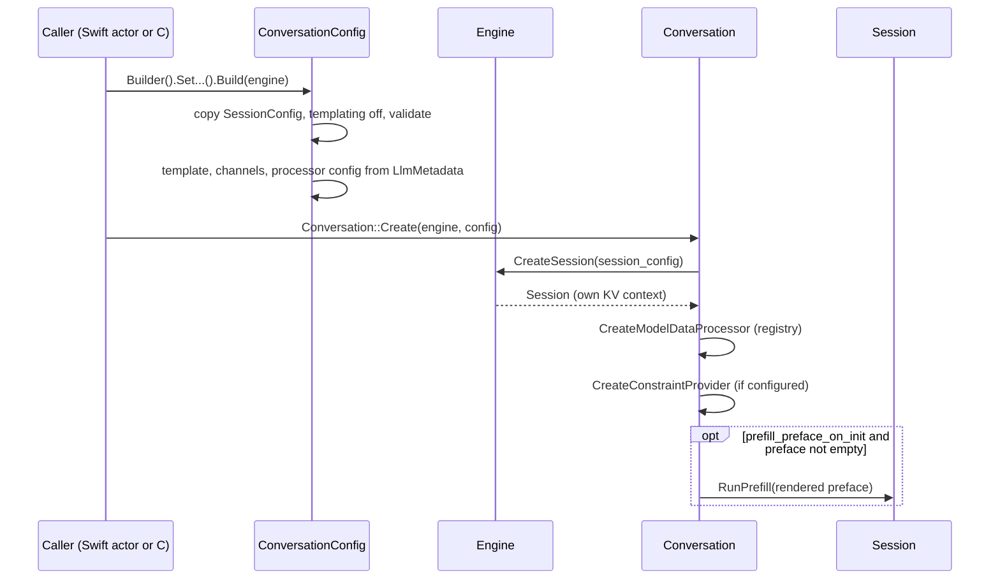
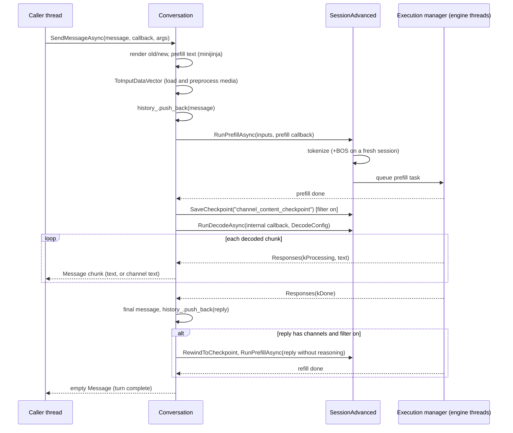
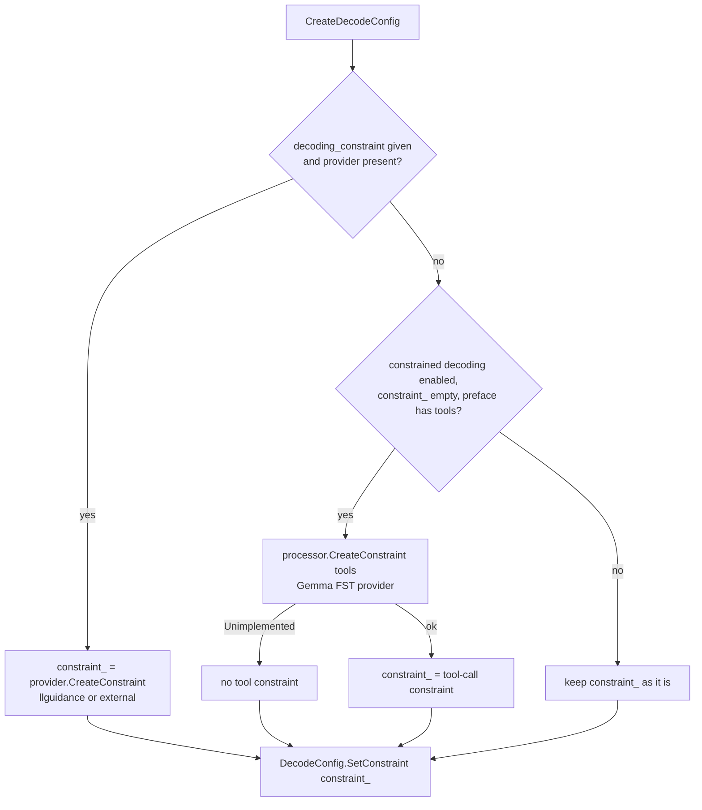

# LiteRT-LM: the Conversation layer

> **Scope:** `litert::lm::Conversation` and `ConversationConfig` in `runtime/conversation/`: messages,
> prompt templates (minijinja), model data processors (Gemma 4 in depth), channels and thinking
> (including how reasoning is removed from the KV cache), tool calling, constraints (llguidance,
> external, the closed FST provider), history, rewind and cancellation.
> **Out of scope:** sessions, execution managers and checkpoints below the session API
> ([engine-and-sessions.md](engine-and-sessions.md)); executors, pending tokens and MTP
> ([executors.md](executors.md)); samplers, tokenizers, logit masks and constraint internals
> ([components.md](components.md)); the C and Swift APIs, including the Swift automatic tool loop
> ([c-api.md](c-api.md), [swift-api.md](swift-api.md)); the Gemma 4 chat format as a model property
> ([../models/tokenizer-and-chat-format.md](../models/tokenizer-and-chat-format.md)).
> **Pinned to:** LiteRT-LM `7b872544` (agello-next; Google's `df6df5b8` plus our commits). Shipped
> comparison: the v0.18.0 source at `b2f686e2` and the wrapper at `85b1a776`.
> **Applies to:** all platforms (the layer is portable C++ and Rust); Apple specifics in
> [On Apple](#on-apple). **Last verified:** 2026-10-15

## Summary

`Conversation` turns JSON chat messages into text the model reads and the model's text back into
messages. It owns the chat history, one `Engine::Session` (and so one KV cache), a Jinja prompt
template and a model-specific `ModelDataProcessor`. For Gemma 4 E2B/E4B every turn after the first
prefills only the difference between two template renders, so earlier turns stay in the KV cache and
are never re-read. When a reply contains reasoning (the `thought` channel), agello-next rewinds the
session to just after the user turn and prefills the reply again without the reasoning, before it
reports the turn as done; the shipped v0.18.0 does the same lazily at the next user message.
JSON response formats from the C and Swift APIs go through the open llguidance provider in both
builds; the closed Gemma FST provider,
present in Google's v0.18.0 binary and absent from ours, only builds tool-call constraints, which
Agello doesn't use.

## Concepts

### Messages

A `Message` is an `nlohmann::ordered_json` object. The layer reads these fields:

| Field | Meaning |
| --- | --- |
| `role` | `system`, `developer`, `user`, `assistant` (the Gemma 4 template renders it as `model`), `tool` |
| `content` | a string, one part object, or an array of parts; normalized to an array |
| `content[].type` | `text` (`text`), `image` / `audio` (`path` or base64 `blob`), `tool_response` |
| `tool_calls` | on assistant messages: `[{"type": "function", "function": {"name", "arguments"}}]` |
| `channels` | on replies: `{channel_name: text}` extracted from the output (`thought` for Gemma 4) |
| `reasoning_content` | on replies: the text of reasoning channels, joined with newlines |

`Message`, `JsonPreface` and `Channel` are defined in
[`runtime/conversation/io_types.h:26-64`](https://github.com/google-ai-edge/LiteRT-LM/blob/df6df5b84d5845b49889f631ed4cac80b4325dd3/runtime/conversation/io_types.h#L26-L64). `NormalizeMessageContent` wraps string and
object contents into an array of parts, and leaves a message without `content` (an assistant tool
call) as it is ([`runtime/conversation/model_data_processor/data_utils.cc:66-84`](https://github.com/google-ai-edge/LiteRT-LM/blob/df6df5b84d5845b49889f631ed4cac80b4325dd3/runtime/conversation/model_data_processor/data_utils.cc#L66-L84)). Media
parts are loaded from `path` (memory-mapped) or `blob` (base64 decoded into memory)
([`runtime/conversation/model_data_processor/data_utils.cc:37-64`](https://github.com/google-ai-edge/LiteRT-LM/blob/df6df5b84d5845b49889f631ed4cac80b4325dd3/runtime/conversation/model_data_processor/data_utils.cc#L37-L64)); the template never sees
the blob, because `ApplyTemplate` strips `blob` fields first
([`runtime/conversation/conversation.cc:1149-1153`](https://github.com/google-ai-edge/LiteRT-LM/blob/df6df5b84d5845b49889f631ed4cac80b4325dd3/runtime/conversation/conversation.cc#L1149-L1153),
[`runtime/conversation/prompt_utils.cc:34-50`](https://github.com/google-ai-edge/LiteRT-LM/blob/df6df5b84d5845b49889f631ed4cac80b4325dd3/runtime/conversation/prompt_utils.cc#L34-L50)).

### Preface and history

The **preface** (`JsonPreface`) is what a conversation starts with: `messages` (system prompt,
earlier turns, few-shot examples), `tools` and `extra_context`. It is fixed at creation. The
**history** (`history_`) holds only what was sent with `SendMessage`/`SendMessageAsync` and the
completed replies ([`runtime/conversation/conversation.cc:580-593`](https://github.com/google-ai-edge/LiteRT-LM/blob/df6df5b84d5845b49889f631ed4cac80b4325dd3/runtime/conversation/conversation.cc#L580-L593),
[`runtime/conversation/conversation.cc:733-735`](https://github.com/google-ai-edge/LiteRT-LM/blob/df6df5b84d5845b49889f631ed4cac80b4325dd3/runtime/conversation/conversation.cc#L733-L735)); `GetHistory()` never returns preface
messages. The distinction matters for Agello, which recreates a conversation from saved chat history:
the C API puts the system message and every message given with
`litert_lm_conversation_config_set_messages` into the preface
([`c/conversation.cc:431-461`](https://github.com/google-ai-edge/LiteRT-LM/blob/df6df5b84d5845b49889f631ed4cac80b4325dd3/c/conversation.cc#L431-L461)), and the first message sent then prefills all of them (see
[What is prefilled](#what-is-prefilled-for-a-turn)). <!-- c:LM-CNV-022 -->

### Channels

A `Channel` is a named span of model output between a `start` and an `end` string. The Gemma 4
E2B/E4B files declare one: `thought`, from `<|channel>thought\n` to `<channel|>`. A channel is a
reasoning channel when `is_reasoning_channel` is set or its name is `thought`
([`runtime/conversation/channel_util.cc:96-112`](https://github.com/google-ai-edge/LiteRT-LM/blob/df6df5b84d5845b49889f631ed4cac80b4325dd3/runtime/conversation/channel_util.cc#L96-L112)). Channel text is streamed and stored
separately from the answer, and can be removed from the KV cache
([Channels and thinking](#channels-and-thinking)).

### ConversationConfig

Built with `ConversationConfig::Builder` (`CreateDefault(engine)` is `Builder().Build(engine)`).
Defaults at the pin ([`runtime/conversation/conversation.h:267-282`](https://github.com/google-ai-edge/LiteRT-LM/blob/df6df5b84d5845b49889f631ed4cac80b4325dd3/runtime/conversation/conversation.h#L267-L282),
[`runtime/conversation/conversation.cc:133-136`](https://github.com/google-ai-edge/LiteRT-LM/blob/df6df5b84d5845b49889f631ed4cac80b4325dd3/runtime/conversation/conversation.cc#L133-L136)): <!-- c:LM-CNV-001 -->

| Builder setter | Default | Effect |
| --- | --- | --- |
| `SetSessionConfig` | `SessionConfig::CreateDefault()` | sampler, stop tokens, modalities, MTP for this conversation's session |
| `SetPreface` | empty `JsonPreface` | system/initial messages, tools, extra context |
| `SetOverwritePromptTemplate` | none: the file's `jinja_prompt_template` | Jinja template |
| `SetOverwriteProcessorConfig` | none: derived from `llm_model_type` | model data processor config |
| `SetEnableConstrainedDecoding` | `false` | tool-call constraints from the preface's tools |
| `SetConstraintProviderConfig` | none | `LlGuidanceConfig` or `ExternalConstraintConfig` provider for per-message constraints |
| `SetPrefillPrefaceOnInit` | `false` | prefill the preface at creation instead of with the first message |
| `SetChannels` | none: the file's channels | channel definitions |
| `SetFilterChannelContentFromKvCache` | `true` | remove channel text (reasoning) from the KV cache after each reply |
| `SetReturnErrorOnParseFailure` | `true` | an unparsable tool call fails the reply |
| `SetReturnErrorOnMaxTokensReached` | `false` | a full KV cache ends the reply normally instead of with an error |
| `SetThinkingConfig` | none | `ThinkingConfig(enable_thinking, thinking_token_budget)` |
| `SetStreamToolCalls` | `false`, channel `"tool_call"` | also stream tool-call text as it is generated |
| `SetEnableRewinding` | `true` | channel filter uses step rewinds (else saved contexts) |

`CreateInternal` adjusts and validates the inputs:

1. It copies the `SessionConfig`, turns off session-level prompt templating
   (`SetApplyPromptTemplateInSession(false)`) and validates it against the engine
   ([`runtime/conversation/conversation.cc:154-157`](https://github.com/google-ai-edge/LiteRT-LM/blob/df6df5b84d5845b49889f631ed4cac80b4325dd3/runtime/conversation/conversation.cc#L154-L157)). Templates are the Conversation's job;
   the session only adds the BOS token (see [Rendering](#rendering-with-minijinja)).
2. It picks the template: the overwrite, else the metadata's `jinja_prompt_template`, else a Jinja
   template generated from the older `prompt_templates` metadata, else an error
   ([`runtime/conversation/conversation.cc:159-179`](https://github.com/google-ai-edge/LiteRT-LM/blob/df6df5b84d5845b49889f631ed4cac80b4325dd3/runtime/conversation/conversation.cc#L159-L179)).
3. It takes channels from the overwrite or from `LlmMetadata.channels`, rejecting empty names
   ([`runtime/conversation/conversation.cc:181-199`](https://github.com/google-ai-edge/LiteRT-LM/blob/df6df5b84d5845b49889f631ed4cac80b4325dd3/runtime/conversation/conversation.cc#L181-L199)).
4. It derives the processor config from the session's `llm_model_type`
   ([`runtime/conversation/conversation.cc:201-210`](https://github.com/google-ai-edge/LiteRT-LM/blob/df6df5b84d5845b49889f631ed4cac80b4325dd3/runtime/conversation/conversation.cc#L201-L210)); `kGemma4` maps to
   `CreateGemma4DataProcessorConfig`
   ([`runtime/conversation/model_data_processor/model_data_processor_factory.cc:659-685`](https://github.com/google-ai-edge/LiteRT-LM/blob/df6df5b84d5845b49889f631ed4cac80b4325dd3/runtime/conversation/model_data_processor/model_data_processor_factory.cc#L659-L685)).

### OptionalArgs

Per-message settings ([`runtime/conversation/conversation.h:386-467`](https://github.com/google-ai-edge/LiteRT-LM/blob/df6df5b84d5845b49889f631ed4cac80b4325dd3/runtime/conversation/conversation.h#L386-L467)):

| Field | Effect | Through the C API |
| --- | --- | --- |
| `has_pending_message` | prefill without decoding (single-turn templates only) | no |
| `repetition_penalty_config`, `no_repeat_ngram_config`, `suppress_tokens_config` | decode-time constraints ([components.md](components.md)) | yes |
| `decoding_constraint` | a per-message constraint for the conversation's provider | regex and JSON schema only |
| `args` | processor arguments; for Gemma 4 the `visual_token_budget` | yes (budget) |
| `max_output_tokens` | decode limit; thinking and answer tokens both count | yes |
| `task_group_id` | registers task controllers for `CancelGroup` | no |
| `extra_context` | template variables, merged over the preface's | yes (the `extra_context` argument) |
| `thinking_config` | overrides the conversation's `ThinkingConfig` | yes |

`ThinkingConfig()` means thinking on with an unlimited budget (`-1`); `ResolveThinkingConfig` prefers
the message's, then the conversation's ([`runtime/conversation/thinking_config.h:21-36`](https://github.com/google-ai-edge/LiteRT-LM/blob/df6df5b84d5845b49889f631ed4cac80b4325dd3/runtime/conversation/thinking_config.h#L21-L36),
[`runtime/conversation/conversation.cc:92-101`](https://github.com/google-ai-edge/LiteRT-LM/blob/df6df5b84d5845b49889f631ed4cac80b4325dd3/runtime/conversation/conversation.cc#L92-L101)).

### Prompt templates and processors

- **`PromptTemplate`** wraps a minijinja template compiled through a Rust FFI. Its only capability
  flag, `supports_single_turn`, is true when the source contains `is_appending_to_prefill`
  ([`runtime/components/prompt_template.cc:85-92`](https://github.com/google-ai-edge/LiteRT-LM/blob/df6df5b84d5845b49889f631ed4cac80b4325dd3/runtime/components/prompt_template.cc#L85-L92),
  [`runtime/components/rust/minijinja_template.rs:69-73`](https://github.com/google-ai-edge/LiteRT-LM/blob/df6df5b84d5845b49889f631ed4cac80b4325dd3/runtime/components/rust/minijinja_template.rs#L69-L73)).
- **`ModelDataProcessor`** converts between messages and the session's `InputData`:
  `ToInputDataVector` (rendered text plus messages to text, image and audio inputs), `ToMessage`
  (output text to a message, with tool-call parsing), `MessageToTemplateInput`, `FormatTools`,
  `CreateConstraint` (tool-call constraints), `CodeFenceStart/End` and `CloneState`
  ([`runtime/conversation/model_data_processor/model_data_processor.h:60-134`](https://github.com/google-ai-edge/LiteRT-LM/blob/df6df5b84d5845b49889f631ed4cac80b4325dd3/runtime/conversation/model_data_processor/model_data_processor.h#L60-L134)).

## How it works

### Creating a conversation

Each `Conversation` gets its own `Engine::Session`
([`runtime/conversation/conversation.cc:417-436`](https://github.com/google-ai-edge/LiteRT-LM/blob/df6df5b84d5845b49889f631ed4cac80b4325dd3/runtime/conversation/conversation.cc#L417-L436)); what two sessions on one engine share
and how the engine switches between their KV contexts is in
[engine-and-sessions.md](engine-and-sessions.md). The processor comes from
`ModelDataProcessorRegistry`, keyed by the `DataProcessorConfig` variant; built-in processors register
once, Gemma 4's only when compiled with `ENABLE_GEMMA4_DATA_PROCESSOR`, and an unregistered family
fails with `Unimplemented`
([`runtime/conversation/model_data_processor/model_data_processor.h:267-280`](https://github.com/google-ai-edge/LiteRT-LM/blob/df6df5b84d5845b49889f631ed4cac80b4325dd3/runtime/conversation/model_data_processor/model_data_processor.h#L267-L280),
[`runtime/conversation/model_data_processor/model_data_processor_factory.cc:75-106`](https://github.com/google-ai-edge/LiteRT-LM/blob/df6df5b84d5845b49889f631ed4cac80b4325dd3/runtime/conversation/model_data_processor/model_data_processor_factory.cc#L75-L106)).
With `prefill_preface_on_init`, the preface is rendered alone and prefilled before `Create` returns
([`runtime/conversation/conversation.cc:437-478`](https://github.com/google-ai-edge/LiteRT-LM/blob/df6df5b84d5845b49889f631ed4cac80b4325dd3/runtime/conversation/conversation.cc#L437-L478)); neither the C API nor the Swift wrapper
sets it, so for them the preface is prefilled with the first message.

### What is prefilled for a turn

Gemma 4's template is a whole-conversation template: it can only render a full message list.
After the first message, `Conversation` therefore renders twice and prefills the difference.

The template in the E2B/E4B files has no `is_appending_to_prefill`, so `supports_single_turn` is false
and `Conversation` renders each message through `GetSingleTurnTextFromFullHistory`: one full render
for the first message (empty history, `prefill_preface_on_init` false), and two full renders plus a
prefix difference for later messages
([`runtime/conversation/conversation.cc:318-332`](https://github.com/google-ai-edge/LiteRT-LM/blob/df6df5b84d5845b49889f631ed4cac80b4325dd3/runtime/conversation/conversation.cc#L318-L332);
[template text](../generated/models/e4b-ours.md)). <!-- c:LM-CNV-018 --> That also means
`has_pending_message=true` (prefill several messages, decode once) is rejected with `InvalidArgument`
for these models ([`runtime/conversation/conversation.cc:318-327`](https://github.com/google-ai-edge/LiteRT-LM/blob/df6df5b84d5845b49889f631ed4cac80b4325dd3/runtime/conversation/conversation.cc#L318-L327)).

**First message** (history empty, `prefill_preface_on_init` false). This path applies only to
templates without single-turn support, such as the one in the E2B/E4B files. The prefill text is one full
render of the preface (system message, initial messages, tools, extra context, plus
`enable_thinking` and the message's `extra_context`) and the new message(s), with
`add_generation_prompt = true` ([`runtime/conversation/conversation.cc:280-290`](https://github.com/google-ai-edge/LiteRT-LM/blob/df6df5b84d5845b49889f631ed4cac80b4325dd3/runtime/conversation/conversation.cc#L280-L290)).
<!-- c:LM-CNV-020 --> The preface messages are also passed to `ToInputDataVector`, so images in them
are loaded ([`runtime/conversation/conversation.cc:623-634`](https://github.com/google-ai-edge/LiteRT-LM/blob/df6df5b84d5845b49889f631ed4cac80b4325dd3/runtime/conversation/conversation.cc#L623-L634)).

**Every later message:**

1. `old` = render(preface + history), `add_generation_prompt = false`.
2. `new` = render(preface + history + new message(s)), `add_generation_prompt = true`.
3. If `new` doesn't start with `old`, the send fails with `InternalError` ("The new rendered template
   string does not start with the previous rendered template string").
4. The prefill text is `new` minus `old`.

([`runtime/conversation/conversation.cc:292-315`](https://github.com/google-ai-edge/LiteRT-LM/blob/df6df5b84d5845b49889f631ed4cac80b4325dd3/runtime/conversation/conversation.cc#L292-L315)) <!-- c:LM-CNV-021 --> Only that
difference reaches the session; the earlier turns are already in the KV cache. Both renders use the
same `enable_thinking` and `extra_context` (the message's `extra_context` is merged over the
preface's; [`runtime/conversation/conversation.cc:255-269`](https://github.com/google-ai-edge/LiteRT-LM/blob/df6df5b84d5845b49889f631ed4cac80b4325dd3/runtime/conversation/conversation.cc#L255-L269)). Google describes the same
mechanism in `docs/api/cpp/conversation.md` ("History").

For Gemma 4 E2B/E4B and a plain text exchange the pieces are (strings from the file's template):

| Render | Ends with |
| --- | --- |
| `old` after one exchange | `<\|turn>user\nHi<turn\|>\n<\|turn>model\nHello<turn\|>\n` |
| `new` with the next user message | `...<turn\|>\n<\|turn>user\nHow are you?<turn\|>\n<\|turn>model\n` |
| prefill text | `<\|turn>user\nHow are you?<turn\|>\n<\|turn>model\n` |

The difference is computed on strings; whether the KV cache holds exactly `old` depends on how the
previous reply ended (see [Limits](#limits-and-failure-modes)).

So, for Agello: a send on a conversation it keeps prefills one user turn plus `<|turn>model\n`; a
send on a conversation it has just recreated from saved history (a reseed) prefills the whole saved
history with the system turn, because the C API made that history the preface.

### Rendering with minijinja

`PromptTemplate::Apply` serializes the input (messages, tools, `add_generation_prompt`,
`extra_context`, `now`, `bos_token`, `eos_token`) to JSON and calls the Rust renderer
([`runtime/components/prompt_template.cc:129-148`](https://github.com/google-ai-edge/LiteRT-LM/blob/df6df5b84d5845b49889f631ed4cac80b4325dd3/runtime/components/prompt_template.cc#L129-L148)). Details that change output:

- Before parsing, Python string idioms common in Hugging Face templates (`.startswith`, `.split`,
  `.strip`, `.items`, ...) are rewritten into minijinja tests and filters with regexes, and
  `` markers are dropped ([`runtime/components/prompt_template.cc:41-75`](https://github.com/google-ai-edge/LiteRT-LM/blob/df6df5b84d5845b49889f631ed4cac80b4325dd3/runtime/components/prompt_template.cc#L41-L75)).
- The environment keeps trailing newlines, trims blocks, and adds `strftime_now`, `raise_exception`,
  `tojson` (with `", "` and `": "` separators), `lstrip`, `rstrip` and the `none` test
  ([`runtime/components/rust/minijinja_template.rs:177-192`](https://github.com/google-ai-edge/LiteRT-LM/blob/df6df5b84d5845b49889f631ed4cac80b4325dd3/runtime/components/rust/minijinja_template.rs#L177-L192)).
- Every `extra_context` key becomes a top-level template variable, which is how `enable_thinking`
  reaches the template; each render re-creates the environment and re-parses the template source
  ([`runtime/components/rust/minijinja_template.rs:231-255`](https://github.com/google-ai-edge/LiteRT-LM/blob/df6df5b84d5845b49889f631ed4cac80b4325dd3/runtime/components/rust/minijinja_template.rs#L231-L255)).
- `bos_token` is an empty string ([`runtime/components/prompt_template.h:94-98`](https://github.com/google-ai-edge/LiteRT-LM/blob/df6df5b84d5845b49889f631ed4cac80b4325dd3/runtime/components/prompt_template.h#L94-L98)), so
  `{{ bos_token }}` renders nothing. The session prepends the start token (ID 2 in the Gemma 4 files)
  on the first prefill of a fresh session instead
  ([`runtime/core/session_utils.cc:98-102`](https://github.com/google-ai-edge/LiteRT-LM/blob/df6df5b84d5845b49889f631ed4cac80b4325dd3/runtime/core/session_utils.cc#L98-L102), [`runtime/core/session_advanced.cc:120`](https://github.com/PowerBeef/agello-litert-lm/blob/7b872544fdbd81308f98b1e2acf8c5798a549df6/runtime/core/session_advanced.cc#L120)).

### The Gemma 4 template in the E2B and E4B files

Agello's E4B file, Google's E4B (`2eee7ac3`) and Google's E2B (`b3ca0d2f`) carry the same
`jinja_prompt_template`, start token 2, stop tokens 1, 50 and 106, and one channel, `thought`, from
`<|channel>thought\n` to `<channel|>`
([e4b-ours](../generated/models/e4b-ours.md), [e4b-google](../generated/models/e4b-google.md),
[e2b-google](../generated/models/e2b-google.md), section 0). <!-- c:LM-CNV-017 --> What the template
does:

- **System turn.** Opened with `<|turn>system\n` when thinking is on, tools are given or the first
  message is `system`/`developer`. With `enable_thinking` true it starts with `<|think|>`; tool
  declarations follow the system text as `<|tool>declaration:NAME{...}<tool|>`.
- **Turns.** Each message renders as `<|turn>ROLE\n...<turn|>\n`, with `assistant` renamed `model`.
  Tool calls render as `<|tool_call>call:NAME{key:value,...}<tool_call|>` with strings quoted by
  `<|"|>`; a `tool` message renders as `<|tool_response>response:NAME{...}<tool_response|>` without a
  turn header.
- **Generation prompt.** `<|turn>model\n`, omitted right after a tool response so the model continues
  its turn. <!-- c:LM-CNV-025 -->
- **Reasoning.** Model text passes through a `strip_thinking` macro that removes every
  `<|channel>...<channel|>` span and trims, so earlier reasoning is never rendered back into the
  prompt. <!-- c:LM-CNV-026 -->

This template is not the one Google publishes on Hugging Face today. `chat_template.jinja` in
`google/gemma-4-E4B-it` at `ee0ef602` is headed "Google Gemma 4 Canonical Chat Template", published
2026-07-09, "Fixed tool-calling loops, turn closures, and thinking content-ordering"
([hf template](../generated/hf/google__gemma-4-E4B-it/chat_template.jinja)). Among the differences:
it writes `<|think|>\n` where the file writes `<|think|>`, renders `reasoning_content` back as a
thought channel for the current turn, and resolves tool responses by `tool_call_id`.
<!-- c:LM-CNV-027 --> The runtime uses the file's template unless the caller overrides it
(`chatTemplate` in Swift, `litert_lm_conversation_config_set_prompt_template` in C). The `-gpu`
files carry a third variant that opens `<|channel>thought\n` after a tool response when thinking is
on ([e4b-gpu](../generated/models/e4b-gpu.md)). The chat format as a model property is covered in
[../models/tokenizer-and-chat-format.md](../models/tokenizer-and-chat-format.md).

### Model data processors and multimodal input

`Gemma4DataProcessorConfig` defaults ([`runtime/conversation/model_data_processor/gemma4_data_processor_config.h:24-82`](https://github.com/google-ai-edge/LiteRT-LM/blob/df6df5b84d5845b49889f631ed4cac80b4325dd3/runtime/conversation/model_data_processor/gemma4_data_processor_config.h#L24-L82)),
overridden by any metadata field that differs from the proto default
([`runtime/conversation/model_data_processor/model_data_processor_factory.cc:235-260`](https://github.com/google-ai-edge/LiteRT-LM/blob/df6df5b84d5845b49889f631ed4cac80b4325dd3/runtime/conversation/model_data_processor/model_data_processor_factory.cc#L235-L260)):
<!-- c:LM-CNV-031 -->

| Field | Default | In the E2B/E4B files |
| --- | --- | --- |
| `boi_token` / `eoi_token` | `<\|image>` / `<image\|>` | same |
| `boa_token` / `eoa_token` | `<\|audio>` / `<audio\|>` | same |
| `patch_width` x `patch_height` | 16 x 16 | same |
| `max_num_patches` | 2520 | 2520 |
| `pooling_kernel_size` | 3 | default |
| `merge_patches` | false (12B only) | default |
| `code_fence_start` / `code_fence_end` | `<\|tool_call>` / `<tool_call\|>` | same |
| `open_quote` / `close_quote` | `<\|"\|>` | same |
| `function_response_start` | `<\|tool_response>` | same |
| `syntax_type` | `fc` | default |
| `constraint_mode` | `kTextAndOr` | default |

The Gemma 4 processor doesn't override `MessageToTemplateInput` or `FormatTools`: tool declarations
and tool calls reach the template as JSON and the template formats them
([`runtime/conversation/model_data_processor/gemma4_data_processor.h:45-116`](https://github.com/google-ai-edge/LiteRT-LM/blob/df6df5b84d5845b49889f631ed4cac80b4325dd3/runtime/conversation/model_data_processor/gemma4_data_processor.h#L45-L116)).

`ToInputDataVectorImpl` hands the rendered text to `ProcessMultimodalPrompt`
([`runtime/conversation/model_data_processor/gemma4_data_processor.cc:110-144`](https://github.com/PowerBeef/agello-litert-lm/blob/7b872544fdbd81308f98b1e2acf8c5798a549df6/runtime/conversation/model_data_processor/gemma4_data_processor.cc#L110-L144)), which:

1. Collects the image and audio parts of the messages being prefilled, in order.
2. Splits the text at `<|image|>`, `<start_of_image>`, `<|audio|>` and `<start_of_audio>`.
3. Replaces each image placeholder with `InputText(text so far + "<|image>")`, the preprocessed
   `InputImage` and `InputImageEnd`; each audio placeholder likewise with `<|audio>`, `InputAudio` and
   `InputAudioEnd` ([`runtime/conversation/model_data_processor/multimodal_processor_helper.cc:115-188`](https://github.com/google-ai-edge/LiteRT-LM/blob/df6df5b84d5845b49889f631ed4cac80b4325dd3/runtime/conversation/model_data_processor/multimodal_processor_helper.cc#L115-L188)).
4. Appends the rest of the text ([`runtime/conversation/model_data_processor/multimodal_processor_helper.cc:200-203`](https://github.com/google-ai-edge/LiteRT-LM/blob/df6df5b84d5845b49889f631ed4cac80b4325dd3/runtime/conversation/model_data_processor/multimodal_processor_helper.cc#L200-L203))
   and fails if there are more or fewer media parts than placeholders
   ([`runtime/conversation/model_data_processor/multimodal_processor_helper.cc:190-198`](https://github.com/google-ai-edge/LiteRT-LM/blob/df6df5b84d5845b49889f631ed4cac80b4325dd3/runtime/conversation/model_data_processor/multimodal_processor_helper.cc#L190-L198)).

The image budget: with a `visual_token_budget`, `max_num_patches` becomes budget x
`pooling_kernel_size`² ([`runtime/conversation/model_data_processor/multimodal_processor_helper.cc:91-103`](https://github.com/google-ai-edge/LiteRT-LM/blob/df6df5b84d5845b49889f631ed4cac80b4325dd3/runtime/conversation/model_data_processor/multimodal_processor_helper.cc#L91-L103)).
Without one, the file's 2520 patches at the default 3 x 3 pooling mean 280 tokens per image.
<!-- c:LM-CNV-034 --> `SendMessageAsync` rejects a budget that is not positive or exceeds the engine's
max vision tokens per image ([`runtime/conversation/conversation.cc:560-565`](https://github.com/google-ai-edge/LiteRT-LM/blob/df6df5b84d5845b49889f631ed4cac80b4325dd3/runtime/conversation/conversation.cc#L560-L565)). The token
counts the model itself supports are on [../models/gemma4-e4b.md](../models/gemma4-e4b.md); the
preprocessors and the vision and audio executors are on [components.md](components.md) and
[executors.md](executors.md).

`ToMessageImpl` parses tool calls only when the preface has tools; otherwise the whole text becomes one
text part ([`runtime/conversation/model_data_processor/data_utils.cc:86-108`](https://github.com/google-ai-edge/LiteRT-LM/blob/df6df5b84d5845b49889f631ed4cac80b4325dd3/runtime/conversation/model_data_processor/data_utils.cc#L86-L108)).

### Sending a message

Rendering, media preprocessing and (inside `RunPrefillAsync`) tokenization run on the thread that
calls `SendMessageAsync` ([`runtime/conversation/conversation.cc:572-575`](https://github.com/google-ai-edge/LiteRT-LM/blob/df6df5b84d5845b49889f631ed4cac80b4325dd3/runtime/conversation/conversation.cc#L572-L575),
[`runtime/conversation/conversation.cc:651-654`](https://github.com/google-ai-edge/LiteRT-LM/blob/df6df5b84d5845b49889f631ed4cac80b4325dd3/runtime/conversation/conversation.cc#L651-L654),
[`runtime/core/session_advanced.cc:117-143`](https://github.com/PowerBeef/agello-litert-lm/blob/7b872544fdbd81308f98b1e2acf8c5798a549df6/runtime/core/session_advanced.cc#L117-L143)). The prefill callback starts decode with the
`DecodeConfig` from `CreateDecodeConfig`; a prefill error or a non-`Done` end state skips decode
([`runtime/conversation/conversation.cc:799-861`](https://github.com/google-ai-edge/LiteRT-LM/blob/df6df5b84d5845b49889f631ed4cac80b4325dd3/runtime/conversation/conversation.cc#L799-L861)). Which thread runs the tasks and delivers
the callbacks is on [engine-and-sessions.md](engine-and-sessions.md). `SendMessage` is the same call
followed by `WaitUntilDone` and a wait for the completion sentinel; it returns the last history entry
([`runtime/conversation/conversation.cc:499-554`](https://github.com/google-ai-edge/LiteRT-LM/blob/df6df5b84d5845b49889f631ed4cac80b4325dd3/runtime/conversation/conversation.cc#L499-L554)).

**The internal callback** (`CreateInternalCallback`) parses the stream:

- Plain text goes out through `ToMessage` as soon as it can't be the start of a delimiter; a trailing
  partial match of any channel start is held for the next chunk
  ([`runtime/conversation/internal_callback_util.cc:395-419`](https://github.com/google-ai-edge/LiteRT-LM/blob/df6df5b84d5845b49889f631ed4cac80b4325dd3/runtime/conversation/internal_callback_util.cc#L395-L419)).
- Named-channel text streams as `{"role": "assistant", "channels": {"thought": ...},
  "reasoning_content": ...}`, again holding back a partial end delimiter
  ([`runtime/conversation/internal_callback_util.cc:76-91`](https://github.com/google-ai-edge/LiteRT-LM/blob/df6df5b84d5845b49889f631ed4cac80b4325dd3/runtime/conversation/internal_callback_util.cc#L76-L91),
  [`runtime/conversation/internal_callback_util.cc:212-232`](https://github.com/google-ai-edge/LiteRT-LM/blob/df6df5b84d5845b49889f631ed4cac80b4325dd3/runtime/conversation/internal_callback_util.cc#L212-L232)).
- A tool-call block is a channel with an empty name: buffered with its fences and emitted through
  `ToMessage` only when the end fence arrives; with `stream_tool_calls` its inner text also streams on
  the `tool_call` channel ([`runtime/conversation/internal_callback_util.cc:154-169`](https://github.com/google-ai-edge/LiteRT-LM/blob/df6df5b84d5845b49889f631ed4cac80b4325dd3/runtime/conversation/internal_callback_util.cc#L154-L169),
  [`runtime/conversation/internal_callback_util.cc:439-462`](https://github.com/google-ai-edge/LiteRT-LM/blob/df6df5b84d5845b49889f631ed4cac80b4325dd3/runtime/conversation/internal_callback_util.cc#L439-L462),
  [`runtime/conversation/internal_callback_util.cc:476-489`](https://github.com/google-ai-edge/LiteRT-LM/blob/df6df5b84d5845b49889f631ed4cac80b4325dd3/runtime/conversation/internal_callback_util.cc#L476-L489)).
- At `kDone`, `SendCompleteMessage` flushes, extracts the channel spans from the whole text (an
  unterminated span runs to the end), builds the final message, stores the spans under `channels` and
  `reasoning_content`, runs `complete_message_callback` (which appends the reply to history) and then
  sends the empty `Message` that means "done"
  ([`runtime/conversation/internal_callback_util.cc:95-149`](https://github.com/google-ai-edge/LiteRT-LM/blob/df6df5b84d5845b49889f631ed4cac80b4325dd3/runtime/conversation/internal_callback_util.cc#L95-L149),
  [`runtime/conversation/channel_util.cc:54-91`](https://github.com/google-ai-edge/LiteRT-LM/blob/df6df5b84d5845b49889f631ed4cac80b4325dd3/runtime/conversation/channel_util.cc#L54-L91),
  [`runtime/conversation/channel_util.cc:114-139`](https://github.com/google-ai-edge/LiteRT-LM/blob/df6df5b84d5845b49889f631ed4cac80b4325dd3/runtime/conversation/channel_util.cc#L114-L139)).

### Channels and thinking

**Turning thinking on.** A resolved `ThinkingConfig` with `enable_thinking` does two things:

1. The template gets `enable_thinking = true`, which for Gemma 4 opens the system turn with
   `<|think|>`.
2. `CreateDecodeConfig` sets the thinking token budget and tokenizes the first channel's start and end
   strings into thinking start/end token IDs (no start IDs if the rendered prompt already opened the
   channel). Without thinking, the budget is 0
   ([`runtime/conversation/conversation.cc:360-388`](https://github.com/google-ai-edge/LiteRT-LM/blob/df6df5b84d5845b49889f631ed4cac80b4325dd3/runtime/conversation/conversation.cc#L360-L388)). Decode then wraps any other
   constraint in a `ThinkingBudgetConstraint` whenever the budget is non-zero, `-1` included
   ([`runtime/core/tasks.cc:693-706`](https://github.com/PowerBeef/agello-litert-lm/blob/7b872544fdbd81308f98b1e2acf8c5798a549df6/runtime/core/tasks.cc#L693-L706)); how the budget ends the thought is on
   [components.md](components.md).

**Removing reasoning from the KV cache (agello-next).** The model writes its reasoning into the KV
cache as it generates it, but the template never renders it back (`strip_thinking`). Left alone, the
cache would hold text that the next render's `old` string doesn't contain, and the reasoning would
take context room. With `filter_channel_content_from_kv_cache` (default true):

1. **Checkpoint.** After the user turn's prefill, which ends with the generation prompt
   `<|turn>model\n`, and before decode, the prefill callback saves the session checkpoint
   `channel_content_checkpoint` and records `checkpoint_message_index_ = history.size()` and
   `checkpoint_after_user_prefill_ = true`
   ([`runtime/conversation/conversation.cc:825-838`](https://github.com/google-ai-edge/LiteRT-LM/blob/df6df5b84d5845b49889f631ed4cac80b4325dd3/runtime/conversation/conversation.cc#L825-L838)). <!-- c:LM-CNV-050 --> (Templates
   whose generation prompt opens a channel, such as Qwen 3's `<think>\n`, checkpoint before the user
   prefill instead so the open tag goes too;
   [`runtime/conversation/conversation.cc:606-621`](https://github.com/google-ai-edge/LiteRT-LM/blob/df6df5b84d5845b49889f631ed4cac80b4325dd3/runtime/conversation/conversation.cc#L606-L621). The Gemma 4 E2B/E4B template never
   does.)
2. **Decode** runs; the reply streams to the caller with its reasoning on the `thought` channel.
3. **Rewind and refill.** If the final message has `channels`, `complete_message_callback` sets
   `defer_completion`, rewinds to the checkpoint and computes the refill as
   render(history up to the checkpoint + reply, `add_generation_prompt = false`) minus
   render(history up to the checkpoint), then prefills it. The second render has
   `add_generation_prompt = true` when the checkpoint was saved after the user prefill, as for
   Gemma 4, and false when it was saved before it
   ([`runtime/conversation/conversation.cc:728-787`](https://github.com/google-ai-edge/LiteRT-LM/blob/df6df5b84d5845b49889f631ed4cac80b4325dd3/runtime/conversation/conversation.cc#L728-L787),
   [`runtime/conversation/conversation.cc:1114-1147`](https://github.com/google-ai-edge/LiteRT-LM/blob/df6df5b84d5845b49889f631ed4cac80b4325dd3/runtime/conversation/conversation.cc#L1114-L1147)).
4. **Completion.** The caller's "done" sentinel is held back until the refill prefill finishes
   ([`runtime/conversation/conversation.cc:702-723`](https://github.com/google-ai-edge/LiteRT-LM/blob/df6df5b84d5845b49889f631ed4cac80b4325dd3/runtime/conversation/conversation.cc#L702-L723)). <!-- c:LM-CNV-052 -->

For a Gemma 4 reply `<|channel>thought\n...<channel|>Hello`, the cache goes from
`...<|turn>model\n<|channel>thought\n...<channel|>Hello` to `...<|turn>model\n` (rewind) to
`...<|turn>model\nHello<turn|>\n` (refill): exactly what the next `old` render contains.

The rewind is cheap: `RewindToCheckpoint` restores the saved step, session state and task
dependencies and drops later checkpoints, and the executor's `SetCurrentStep` only moves
`current_step` back (in agello-next it also marks the MTP drafter unprimed; v0.18.0 has no such
step). No KV data is copied; the refill overwrites the abandoned positions
([`runtime/core/session_advanced.cc:518-543`](https://github.com/PowerBeef/agello-litert-lm/blob/7b872544fdbd81308f98b1e2acf8c5798a549df6/runtime/core/session_advanced.cc#L518-L543),
[`runtime/executor/llm_litert_compiled_model_executor.cc:1885-1915`](https://github.com/PowerBeef/agello-litert-lm/blob/7b872544fdbd81308f98b1e2acf8c5798a549df6/runtime/executor/llm_litert_compiled_model_executor.cc#L1885-L1915);
v0.18.0: [`runtime/executor/llm_litert_compiled_model_executor.cc:1666-1694`](https://github.com/google-ai-edge/LiteRT-LM/blob/b2f686e2ed4718fb84ec398a61dd59ca0f0aff27/runtime/executor/llm_litert_compiled_model_executor.cc#L1666-L1694)). <!-- c:LM-CNV-055 -->
The cost is the refill prefill (the answer's tokens plus `<turn|>\n`), paid before the turn reports
done. When rewinding is disabled (the C API does that only for GPU artisan executors with autosized
ring buffers), the filter uses `SaveContext`/`RestoreContext`, which store and restore a
`ProcessedContext` ([`c/conversation.cc:525-535`](https://github.com/google-ai-edge/LiteRT-LM/blob/df6df5b84d5845b49889f631ed4cac80b4325dd3/c/conversation.cc#L525-L535),
[`runtime/core/session_advanced.cc:545-590`](https://github.com/PowerBeef/agello-litert-lm/blob/7b872544fdbd81308f98b1e2acf8c5798a549df6/runtime/core/session_advanced.cc#L545-L590)).

This eager form comes from upstream commit `97e6dc7d` (2026-10-07), "Eagerly filter channel content
from KV cache after decode", which is in agello-next's base and not in v0.18.0.
<!-- c:LM-CNV-053 -->

**Removing reasoning in the shipped v0.18.0.** The v0.18.0 source does it lazily: it saves the
checkpoint before each user message's prefill, the reply only sets
`channel_content_since_last_user_message_`, and the next user message rewinds to that checkpoint,
refills the previous user message and the reply without reasoning, saves a new checkpoint and then
prefills the new message ([`runtime/conversation/conversation.cc:617-635`](https://github.com/google-ai-edge/LiteRT-LM/blob/b2f686e2ed4718fb84ec398a61dd59ca0f0aff27/runtime/conversation/conversation.cc#L617-L635),
[`runtime/conversation/conversation.cc:705-718`](https://github.com/google-ai-edge/LiteRT-LM/blob/b2f686e2ed4718fb84ec398a61dd59ca0f0aff27/runtime/conversation/conversation.cc#L705-L718),
[`runtime/conversation/conversation.cc:1066-1100`](https://github.com/google-ai-edge/LiteRT-LM/blob/b2f686e2ed4718fb84ec398a61dd59ca0f0aff27/runtime/conversation/conversation.cc#L1066-L1100)). <!-- c:LM-CNV-054 -->
Differences that matter: in v0.18.0 the reasoning stays in the cache between turns, the next turn's
time to first token includes the refill (and re-prefills the previous user message, media included),
and the reasoning takes context room until the next user message.

| | agello-next (`7b872544`) | shipped v0.18.0 |
| --- | --- | --- |
| Checkpoint | after the user prefill (incl. `<\|turn>model\n`) | before the user prefill |
| When | right after the reply, before "done" | at the next user message |
| Refilled | the reply | the previous user message and the reply |
| Reasoning in the KV cache between turns | no | yes |

**Settings.** The Swift wrapper passes the flag to C only if
`ExperimentalFlags.filterChannelContentFromKvCache` is non-nil; it is nil by default, so the C++
default (true) applies ([`swift/Engine.swift:354-360`](https://github.com/google-ai-edge/LiteRT-LM/blob/df6df5b84d5845b49889f631ed4cac80b4325dd3/swift/Engine.swift#L354-L360),
[`swift/ExperimentalFlags.swift:175-187`](https://github.com/google-ai-edge/LiteRT-LM/blob/df6df5b84d5845b49889f631ed4cac80b4325dd3/swift/ExperimentalFlags.swift#L175-L187), [`c/conversation.cc:512-515`](https://github.com/google-ai-edge/LiteRT-LM/blob/df6df5b84d5845b49889f631ed4cac80b4325dd3/c/conversation.cc#L512-L515)).
<!-- c:LM-CNV-057 -->

### Tool calling

The pieces for Gemma 4:

1. **Declarations.** Swift `Tool`s become a JSON tools list ([swift-api.md](swift-api.md)); the C API
   puts it in `JsonPreface.tools`; the template writes `<|tool>declaration:...<tool|>` entries into
   the system turn.
2. **Generation.** The model writes `<|tool_call>call:NAME{...}<tool_call|>`; the internal callback
   buffers the block until the end fence.
3. **Parsing.** `ParseTextAndToolCalls` splits text from fenced blocks and parses each block with the
   FC grammar (ANTLR, run in Rust): `call:NAME{key:value,...}`, values being numbers, booleans, null,
   objects, arrays or strings between `<|"|>`, `<escape>` or `<ctrl46>` delimiters. Each call becomes
   `{"type": "function", "function": {...}}` in `tool_calls`
   ([`runtime/components/tool_use/parser_utils.cc:109-156`](https://github.com/google-ai-edge/LiteRT-LM/blob/df6df5b84d5845b49889f631ed4cac80b4325dd3/runtime/components/tool_use/parser_utils.cc#L109-L156),
   [`runtime/components/tool_use/fc_parser_utils.cc:33-48`](https://github.com/google-ai-edge/LiteRT-LM/blob/df6df5b84d5845b49889f631ed4cac80b4325dd3/runtime/components/tool_use/fc_parser_utils.cc#L33-L48),
   [`runtime/components/tool_use/antlr/AntlrFcParser.g4:23-29`](https://github.com/google-ai-edge/LiteRT-LM/blob/df6df5b84d5845b49889f631ed4cac80b4325dd3/runtime/components/tool_use/antlr/AntlrFcParser.g4#L23-L29),
   [`runtime/components/tool_use/antlr/AntlrFcLexer.g4:26-41`](https://github.com/google-ai-edge/LiteRT-LM/blob/df6df5b84d5845b49889f631ed4cac80b4325dd3/runtime/components/tool_use/antlr/AntlrFcLexer.g4#L26-L41)). <!-- c:LM-CNV-060 -->
4. **Failure.** With `return_error_on_parse_failure` (default true) an unparsable block fails the
   reply with `InvalidArgument`; otherwise the block stays as a text part with an `error` field
   ([`runtime/components/tool_use/parser_utils.cc:138-151`](https://github.com/google-ai-edge/LiteRT-LM/blob/df6df5b84d5845b49889f631ed4cac80b4325dd3/runtime/components/tool_use/parser_utils.cc#L138-L151)).
5. **Responses.** The caller sends a `tool` message; the template renders it as
   `<|tool_response>...<tool_response|>` and adds no generation prompt, so the model continues.

The Swift wrapper's automatic loop runs up to 25 model calls per `sendMessage`
([`swift/Conversation.swift:44`](https://github.com/PowerBeef/agello-litert-lm/blob/7b872544fdbd81308f98b1e2acf8c5798a549df6/swift/Conversation.swift#L44), [`swift/Conversation.swift:142-168`](https://github.com/PowerBeef/agello-litert-lm/blob/7b872544fdbd81308f98b1e2acf8c5798a549df6/swift/Conversation.swift#L142-L168)); that
loop, and our patch that answers failing tool calls with an error response (ours: `f3408e06`), are on
[swift-api.md](swift-api.md). The parsers are linked unless `//build_config:disable_tool_use_parser`
is set; `--config=agello` doesn't set it
([`runtime/components/tool_use/BUILD:218-242`](https://github.com/google-ai-edge/LiteRT-LM/blob/df6df5b84d5845b49889f631ed4cac80b4325dd3/runtime/components/tool_use/BUILD#L218-L242), [`.bazelrc:553-566`](https://github.com/PowerBeef/agello-litert-lm/blob/7b872544fdbd81308f98b1e2acf8c5798a549df6/.bazelrc#L553-L566)).

Tool calls are not constrained in our build: a tool-call constraint needs the FST provider
([Constraints](#constraints)).

### What the KV cache holds at a turn boundary

The render difference assumes that the cache holds the previous render. Traced in the code (agello-next,
and the same in the v0.18.0 source), it holds something slightly different wherever no refill
rewrites the reply. Nothing here was observed in a token dump ([Open questions](#open-questions)).

**The stop token stays pending.** With the executor's own sampler (the default; the C++ runtime, the
C API and the Swift wrapper never set `UseExternalSampler`, and only the web package passes a caller's
`useExternalSampler` through), each decode step or MTP round keeps its last token as the *pending*
token: counted in `current_step`, not yet in the KV cache. When that token is a stop token, `Tasks`
drops it from the text and ends the loop, so a reply's `<turn|>` (106) is left pending when it is the
last token of its step or round
([`runtime/executor/llm_litert_compiled_model_executor.cc:1472-1493`](https://github.com/PowerBeef/agello-litert-lm/blob/7b872544fdbd81308f98b1e2acf8c5798a549df6/runtime/executor/llm_litert_compiled_model_executor.cc#L1472-L1493),
[`runtime/core/tasks.cc:352-362`](https://github.com/PowerBeef/agello-litert-lm/blob/7b872544fdbd81308f98b1e2acf8c5798a549df6/runtime/core/tasks.cc#L352-L362),
[`runtime/core/tasks.cc:801-806`](https://github.com/PowerBeef/agello-litert-lm/blob/7b872544fdbd81308f98b1e2acf8c5798a549df6/runtime/core/tasks.cc#L801-L806),
[`runtime/engine/engine_settings.h:277-280`](https://github.com/google-ai-edge/LiteRT-LM/blob/df6df5b84d5845b49889f631ed4cac80b4325dd3/runtime/engine/engine_settings.h#L277-L280);
v0.18.0: [`runtime/executor/llm_litert_compiled_model_executor.cc:1320-1341`](https://github.com/google-ai-edge/LiteRT-LM/blob/b2f686e2ed4718fb84ec398a61dd59ca0f0aff27/runtime/executor/llm_litert_compiled_model_executor.cc#L1320-L1341)). <!-- c:X-GAP-001 -->
The next prefill writes the pending token first, at its own position, then the new difference. When
`<turn|>` is pending (the last token of its decode step or MTP round), a user message's difference starts with `<|turn>user\n`, because the old render already ended with
`<turn|>\n` (claim LM-CNV-021), so the `\n` (107) that the template puts after `<turn|>` is never
written ([`runtime/executor/llm_litert_compiled_model_executor.cc:637-689`](https://github.com/PowerBeef/agello-litert-lm/blob/7b872544fdbd81308f98b1e2acf8c5798a549df6/runtime/executor/llm_litert_compiled_model_executor.cc#L637-L689);
v0.18.0: [`runtime/executor/llm_litert_compiled_model_executor.cc:574-600`](https://github.com/google-ai-edge/LiteRT-LM/blob/b2f686e2ed4718fb84ec398a61dd59ca0f0aff27/runtime/executor/llm_litert_compiled_model_executor.cc#L574-L600);
[template text](../generated/models/e4b-ours.md)). <!-- c:X-GAP-002 -->

**It is written without its embedding.** Decode creates the pending token as an id only. The executor
looks up embeddings for a prefill's last token and, at the next decode, for the token about to be
decoded, but not for a pending token that a prefill consumes; `FillInputBufferWithToken` writes a token
without embedding as its `int32` id in the first 4 bytes of the row and zeros after it. The Gemma 4
prefill signatures take embeddings and per-layer embeddings, not token ids, so the stop token's
position gets that id-and-zeros row in both inputs, and its KV entry is not computed from `<turn|>`
([`runtime/executor/llm_litert_compiled_model_executor.cc:804-857`](https://github.com/PowerBeef/agello-litert-lm/blob/7b872544fdbd81308f98b1e2acf8c5798a549df6/runtime/executor/llm_litert_compiled_model_executor.cc#L804-L857),
[`runtime/executor/llm_litert_compiled_model_executor.cc:988-1023`](https://github.com/PowerBeef/agello-litert-lm/blob/7b872544fdbd81308f98b1e2acf8c5798a549df6/runtime/executor/llm_litert_compiled_model_executor.cc#L988-L1023),
[`runtime/executor/llm_litert_compiled_model_executor.cc:469-507`](https://github.com/PowerBeef/agello-litert-lm/blob/7b872544fdbd81308f98b1e2acf8c5798a549df6/runtime/executor/llm_litert_compiled_model_executor.cc#L469-L507);
v0.18.0: [`runtime/executor/llm_litert_compiled_model_executor.cc:413-451`](https://github.com/google-ai-edge/LiteRT-LM/blob/b2f686e2ed4718fb84ec398a61dd59ca0f0aff27/runtime/executor/llm_litert_compiled_model_executor.cc#L413-L451)). <!-- c:X-GAP-003 -->

**After a reply with reasoning (agello-next, filter on)** the refill writes the render's tokens, ending
`<turn|>` with the final `\n` pending and its embedding looked up, so the next difference continues the
render exactly (claim LM-CNV-052). One position differs: after the rewind, the refill's
`RollBackProcessedTokens` re-pends the `\n` that ended `<|turn>model\n` as an id-only token, so that
position is rewritten from an id-and-zeros row
([`runtime/executor/llm_litert_compiled_model_executor.cc:509-539`](https://github.com/PowerBeef/agello-litert-lm/blob/7b872544fdbd81308f98b1e2acf8c5798a549df6/runtime/executor/llm_litert_compiled_model_executor.cc#L509-L539),
[`runtime/executor/llm_litert_compiled_model_executor.cc:1885-1915`](https://github.com/PowerBeef/agello-litert-lm/blob/7b872544fdbd81308f98b1e2acf8c5798a549df6/runtime/executor/llm_litert_compiled_model_executor.cc#L1885-L1915),
[`runtime/executor/llm_executor_processed_tokens.cc:92-132`](https://github.com/google-ai-edge/LiteRT-LM/blob/df6df5b84d5845b49889f631ed4cac80b4325dd3/runtime/executor/llm_executor_processed_tokens.cc#L92-L132)). <!-- c:X-GAP-004 -->

**With MTP**, a round can emit the stop token before its last token. `DecodeOneStep::Run` then moves
`current_step` back by `sequence_length - step`, which drops the tokens after the stop token and the
stop token too; the next prefill re-pends the token before it (rewriting that position from an
id-and-zeros row), so neither `<turn|>` nor `\n` is in the cache at that boundary
([`runtime/core/tasks.cc:352-362`](https://github.com/PowerBeef/agello-litert-lm/blob/7b872544fdbd81308f98b1e2acf8c5798a549df6/runtime/core/tasks.cc#L352-L362);
v0.18.0: [`runtime/core/tasks.cc:333-343`](https://github.com/google-ai-edge/LiteRT-LM/blob/b2f686e2ed4718fb84ec398a61dd59ca0f0aff27/runtime/core/tasks.cc#L333-L343)). <!-- c:X-GAP-005 --> When the
stop token is the round's last token, the plain case above applies.

Gemma 4 E2B/E4B, file template ("slot" = a position written from an id-and-zeros row):

| Boundary | The render has | The KV cache holds |
| --- | --- | --- |
| Reply without reasoning, then a user message | `Hello<turn\|>\n<\|turn>user\n` | `Hello`, the `<turn\|>` slot, `<\|turn>user\n` |
| Same, MTP stopped before the round's last token | `Hello<turn\|>\n<\|turn>user\n` | `Hell`, `o` as a slot, `<\|turn>user\n` |
| Reply that is only a tool call, without reasoning (stop on 50 or 106 as the last token of its step or round), then the tool response | `<tool_call\|><turn\|>\n<\|tool_response>response:...` | `<tool_call\|>`, the stop token's slot, `<\|tool_response>response:...` |
| Answer generated after a tool response, without reasoning | `<tool_response\|><\|turn>model\n18 °C...<turn\|>\n` | `<tool_response\|>18 °C...`, then the stop token pending |
| Reply with reasoning (agello-next, filter on) | `<\|turn>model\nHello<turn\|>\n` | `<\|turn>model`, `\n` as a slot, `Hello<turn\|>`, `\n` pending |

The tool rows hold for a reply with no text besides the call whose stop token was the last of its
decode step or MTP round. They follow from the template: a tool message has no turn header and no generation prompt
follows it, so its difference starts with `<|tool_response>`, and the answer is generated right after
`<tool_response|>`, while later renders put `<|turn>model\n` before it (claims MOD-TOK-049,
MOD-TOK-050) ([`runtime/conversation/conversation.cc:292-315`](https://github.com/google-ai-edge/LiteRT-LM/blob/df6df5b84d5845b49889f631ed4cac80b4325dd3/runtime/conversation/conversation.cc#L292-L315)). <!-- c:X-GAP-006 -->

**Token counts.** `GetTokenCount` returns the executor's `current_step`, which counts the pending token
([`runtime/conversation/conversation.cc:889-891`](https://github.com/google-ai-edge/LiteRT-LM/blob/df6df5b84d5845b49889f631ed4cac80b4325dd3/runtime/conversation/conversation.cc#L889-L891),
[`runtime/executor/llm_litert_compiled_model_executor.h:124-126`](https://github.com/PowerBeef/agello-litert-lm/blob/7b872544fdbd81308f98b1e2acf8c5798a549df6/runtime/executor/llm_litert_compiled_model_executor.h#L124-L126),
[`runtime/executor/llm_executor_processed_tokens.cc:31-33`](https://github.com/google-ai-edge/LiteRT-LM/blob/df6df5b84d5845b49889f631ed4cac80b4325dd3/runtime/executor/llm_executor_processed_tokens.cc#L31-L33)).
Against the token count of the render of the same history (taking the model's tokens to be the
render's encoding of its text), it is 1 lower per reply without reasoning (tool-call replies
included), 2 lower instead when MTP stopped before a round's last token, a further 3 lower for each
answer generated right after a tool response without reasoning, and equal after a reasoning refill.
<!-- c:X-GAP-007 --> An estimate computed from renders therefore runs a little high, the safe side for
a context budget.

### Constraints

**Providers.** `ConstraintProviderConfig` is `std::variant<ExternalConstraintConfig,
LlGuidanceConfig, FstConfig>`. `FstConfig` is a placeholder with a deleted constructor, and
`CreateConstraintProvider` builds only the external and llguidance providers
([`runtime/components/constrained_decoding/constraint_provider_config.h:26-30`](https://github.com/google-ai-edge/LiteRT-LM/blob/df6df5b84d5845b49889f631ed4cac80b4325dd3/runtime/components/constrained_decoding/constraint_provider_config.h#L26-L30),
[`runtime/components/constrained_decoding/fst_constraint_config.h:21-29`](https://github.com/google-ai-edge/LiteRT-LM/blob/df6df5b84d5845b49889f631ed4cac80b4325dd3/runtime/components/constrained_decoding/fst_constraint_config.h#L21-L29),
[`runtime/components/constrained_decoding/constraint_provider_factory.cc:32-62`](https://github.com/google-ai-edge/LiteRT-LM/blob/df6df5b84d5845b49889f631ed4cac80b4325dd3/runtime/components/constrained_decoding/constraint_provider_factory.cc#L32-L62)).
<!-- c:LM-CNV-065 --> The closed Gemma FST provider is not a `ConstraintProvider`: model data
processors call it directly, through a C interface, to build tool-call constraints.

| Path | Built by | Used for | In our build | In Google's v0.18.0 binary |
| --- | --- | --- | --- | --- |
| llguidance | `LlgConstraintProvider` (open, Rust) | per-message regex, JSON schema, Lark | yes | yes |
| External | `ExternalConstraintProvider` | a caller's own `Constraint` (C++ only) | yes | yes |
| Gemma FST | `LiteRtLmGemmaModelConstraintProvider` (closed, prebuilt) | tool calls from the preface's tools | no | yes |

**llguidance.** The provider builds an llguidance tokenizer from every vocabulary token and creates
regex, JSON-schema, Lark or llguidance-internal constraints
([`runtime/components/constrained_decoding/llg_constraint_provider.cc:42-58`](https://github.com/google-ai-edge/LiteRT-LM/blob/df6df5b84d5845b49889f631ed4cac80b4325dd3/runtime/components/constrained_decoding/llg_constraint_provider.cc#L42-L58),
[`runtime/components/constrained_decoding/llg_constraint_provider.cc:142-165`](https://github.com/google-ai-edge/LiteRT-LM/blob/df6df5b84d5845b49889f631ed4cac80b4325dd3/runtime/components/constrained_decoding/llg_constraint_provider.cc#L142-L165)). Its EOS
token, unless set, is the first single-token stop sequence of the session; the C API never sets it,
so for the Gemma 4 files (stop tokens 1, 50, 106 in that order) it is token 1
([`runtime/components/constrained_decoding/constraint_provider_factory.cc:43-57`](https://github.com/google-ai-edge/LiteRT-LM/blob/df6df5b84d5845b49889f631ed4cac80b4325dd3/runtime/components/constrained_decoding/constraint_provider_factory.cc#L43-L57),
[`runtime/engine/engine_settings.cc:760-769`](https://github.com/google-ai-edge/LiteRT-LM/blob/df6df5b84d5845b49889f631ed4cac80b4325dd3/runtime/engine/engine_settings.cc#L760-L769)). <!-- c:LM-CNV-066 --> The C API maps
regex and JSON-schema constraints to an `LlGuidanceConstraintArg` in
`OptionalArgs.decoding_constraint` (no Lark or external constraints through C)
([`c/conversation.cc:119-133`](https://github.com/google-ai-edge/LiteRT-LM/blob/df6df5b84d5845b49889f631ed4cac80b4325dd3/c/conversation.cc#L119-L133),
[`c/conversation.cc:141-157`](https://github.com/google-ai-edge/LiteRT-LM/blob/df6df5b84d5845b49889f631ed4cac80b4325dd3/c/conversation.cc#L141-L157),
[`c/conversation.cc:506-510`](https://github.com/google-ai-edge/LiteRT-LM/blob/df6df5b84d5845b49889f631ed4cac80b4325dd3/c/conversation.cc#L506-L510)).
`litert_lm_conversation_config_set_constraint_provider` accepts only
`kLiteRtLmConstraintProviderTypeLlGuidance` in agello-next (others return `InvalidArgument`;
[`c/conversation.cc:235-250`](https://github.com/google-ai-edge/LiteRT-LM/blob/df6df5b84d5845b49889f631ed4cac80b4325dd3/c/conversation.cc#L235-L250)); in v0.18.0 it stores any value and
conversation creation acts only on llguidance
([`c/conversation.cc:204-214`](https://github.com/google-ai-edge/LiteRT-LM/blob/b2f686e2ed4718fb84ec398a61dd59ca0f0aff27/c/conversation.cc#L204-L214)). <!-- c:LM-CNV-068 --> Swift
`ConversationConfig(enableResponseFormat: true)` selects that provider and enables constrained
decoding; `ResponseFormat` offers `.json(schema:)` and `.regex(pattern:)`
([`swift/Engine.swift:330-346`](https://github.com/google-ai-edge/LiteRT-LM/blob/df6df5b84d5845b49889f631ed4cac80b4325dd3/swift/Engine.swift#L330-L346), [`swift/ResponseFormat.swift:20-71`](https://github.com/google-ai-edge/LiteRT-LM/blob/df6df5b84d5845b49889f631ed4cac80b4325dd3/swift/ResponseFormat.swift#L20-L71)).
<!-- c:LM-CNV-069 --> The mask computation and the logit-mask runner are on
[components.md](components.md).

**Which constraint a decode gets** (`CreateDecodeConfig`,
[`runtime/conversation/conversation.cc:389-408`](https://github.com/google-ai-edge/LiteRT-LM/blob/df6df5b84d5845b49889f631ed4cac80b4325dd3/runtime/conversation/conversation.cc#L389-L408)): <!-- c:LM-CNV-070 -->

**Our build.** Apple builds use `--config=agello`, which defines
`LITERT_LM_FST_CONSTRAINTS_DISABLED=1` (ours: `43f0f5c3`). That selects
`//build_config:disable_fst_constraints`, so the Gemma 3, Gemma 4 and FunctionGemma processors compile
with the define and without `gemma_model_constraint_provider_lib`
([`.bazelrc:553-556`](https://github.com/PowerBeef/agello-litert-lm/blob/7b872544fdbd81308f98b1e2acf8c5798a549df6/.bazelrc#L553-L556), [`build_config/BUILD:219-243`](https://github.com/google-ai-edge/LiteRT-LM/blob/df6df5b84d5845b49889f631ed4cac80b4325dd3/build_config/BUILD#L219-L243),
[`runtime/conversation/model_data_processor/BUILD:685-692`](https://github.com/google-ai-edge/LiteRT-LM/blob/df6df5b84d5845b49889f631ed4cac80b4325dd3/runtime/conversation/model_data_processor/BUILD#L685-L692),
[`runtime/conversation/model_data_processor/BUILD:721-726`](https://github.com/google-ai-edge/LiteRT-LM/blob/df6df5b84d5845b49889f631ed4cac80b4325dd3/runtime/conversation/model_data_processor/BUILD#L721-L726)). <!-- c:LM-CNV-072 --> With
the define, `Gemma4DataProcessor::Create` succeeds even when constrained decoding is on, and
`CreateConstraint` returns `Unimplemented`, which `CreateDecodeConfig` skips (ours: `d1488ce7`)
([`runtime/conversation/model_data_processor/gemma4_data_processor.cc:62-68`](https://github.com/PowerBeef/agello-litert-lm/blob/7b872544fdbd81308f98b1e2acf8c5798a549df6/runtime/conversation/model_data_processor/gemma4_data_processor.cc#L62-L68),
[`runtime/conversation/model_data_processor/gemma4_data_processor.cc:160-163`](https://github.com/PowerBeef/agello-litert-lm/blob/7b872544fdbd81308f98b1e2acf8c5798a549df6/runtime/conversation/model_data_processor/gemma4_data_processor.cc#L160-L163)).
<!-- c:LM-CNV-073 --> Before `d1488ce7`, and in the v0.18.0 source, the define made `Create` fail with
`FailedPrecondition` ("Constrained decoding was disabled at build time.") whenever constrained
decoding was enabled; since the Swift wrapper enables it for every response format, JSON output
failed although it never needed the FST provider
([`runtime/conversation/model_data_processor/gemma4_data_processor.cc:62-66`](https://github.com/google-ai-edge/LiteRT-LM/blob/b2f686e2ed4718fb84ec398a61dd59ca0f0aff27/runtime/conversation/model_data_processor/gemma4_data_processor.cc#L62-L66)).
<!-- c:LM-CNV-074 -->

**Google's v0.18.0 binary** is built with the provider: it defines 17 symbols of it, ours none, and
both define llguidance ([binaries.md](../generated/binaries.md)). <!-- c:LM-CNV-076 --> In that
build, enabling constrained decoding makes `Gemma4DataProcessor::Create` create the closed provider
from the serialized SentencePiece model and the stop-token sequences
([`runtime/conversation/model_data_processor/gemma4_data_processor.cc:69-106`](https://github.com/google-ai-edge/LiteRT-LM/blob/b2f686e2ed4718fb84ec398a61dd59ca0f0aff27/runtime/conversation/model_data_processor/gemma4_data_processor.cc#L69-L106)).

**Answer: a JSON response format.** In both builds it takes the llguidance path. Swift's
`enableResponseFormat` sets the llguidance provider in the shipped wrapper and at the pin
([`swift/Engine.swift:265-268`](https://github.com/google-ai-edge/LiteRT-LM/blob/b2f686e2ed4718fb84ec398a61dd59ca0f0aff27/swift/Engine.swift#L265-L268), [`swift/Engine.swift:330-339`](https://github.com/google-ai-edge/LiteRT-LM/blob/df6df5b84d5845b49889f631ed4cac80b4325dd3/swift/Engine.swift#L330-L339)); the C
API turns the format into an `LlGuidanceConstraintArg`
([`c/conversation.cc:457-460`](https://github.com/google-ai-edge/LiteRT-LM/blob/b2f686e2ed4718fb84ec398a61dd59ca0f0aff27/c/conversation.cc#L457-L460)); `CreateDecodeConfig` builds the constraint through
that provider ([`runtime/conversation/conversation.cc:389-405`](https://github.com/google-ai-edge/LiteRT-LM/blob/df6df5b84d5845b49889f631ed4cac80b4325dd3/runtime/conversation/conversation.cc#L389-L405)). The FST provider builds
constraints only for tool calls from the preface's tools, though in builds that include it (Google's
v0.18.0 binary) `Gemma4DataProcessor::Create` still creates it whenever constrained decoding is
enabled ([`runtime/conversation/model_data_processor/gemma4_data_processor.cc:70-107`](https://github.com/google-ai-edge/LiteRT-LM/blob/b2f686e2ed4718fb84ec398a61dd59ca0f0aff27/runtime/conversation/model_data_processor/gemma4_data_processor.cc#L70-L107)).
Agello's conversations never combine constrained decoding with tools. <!-- c:LM-CNV-078 -->

## On Apple

Nothing in this layer depends on the platform: it is C++ (`runtime/conversation`) plus Rust
(minijinja, llguidance, the ANTLR tool-call parsers), compiled into `CLiteRTLM` for iOS and macOS.
The Apple-specific facts are about what gets linked and what Agello sets:

- **No FST provider in our xcframework.** `agello/build-xcframework.sh` builds with
  `--config=agello` ([`agello/build-xcframework.sh:9-10`](https://github.com/PowerBeef/agello-litert-lm/blob/7b872544fdbd81308f98b1e2acf8c5798a549df6/agello/build-xcframework.sh#L9-L10)), which drops the Gemma constraint
  provider (above). <!-- c:LM-CNV-072 --> In the open-source BUILD (v0.18.0 and agello-next) the
  provider, closed source, is a prebuilt `libGemmaModelConstraintProvider.dylib` for `ios_arm64`,
  `ios_sim_arm64` and `macos_arm64` (`.so` on Android and Linux, `.dll` on Windows), linked through
  `gemma_model_constraint_provider_shared_lib`
  ([`runtime/components/constrained_decoding/BUILD:252-263`](https://github.com/google-ai-edge/LiteRT-LM/blob/df6df5b84d5845b49889f631ed4cac80b4325dd3/runtime/components/constrained_decoding/BUILD#L252-L263)).
  Our `--config=agello` build leaves it out, and Google's prebuilt v0.18.0 `CLiteRTLM` defines its
  symbols inside the framework without linking a separate dylib
  ([binaries.md](../generated/binaries.md)). <!-- c:LM-CNV-075 -->
- **Google's binary has it** inside the framework (17 defined symbols in the iOS arm64 slice;
  [binaries.md](../generated/binaries.md)). <!-- c:LM-CNV-076 -->
- **Agello turns the channel filter on** explicitly, so reasoning never stays in a chat's KV cache
  (Agello `Agello/Inference/ChatEngine.swift` lines 141-147 at `93122b6`). <!-- c:LM-CNV-058 -->
  Its comment there ("at the next message the runtime rewinds and refills") describes the shipped
  v0.18.0 behavior; with agello-next the refill happens at the end of each reply.
- **Agello's JSON helpers** each run on a new conversation with `enableResponseFormat: true` and
  speculative decoding off; its chat conversations don't enable constrained decoding (Agello
  `ChatEngine.swift` lines 323-335 and 488-499 at `93122b6`). The sticky constraint described in
  [Limits](#limits-and-failure-modes) therefore can't reach a chat.
- **Template rendering and media preprocessing run on the calling thread** inside the C call (in
  Swift, whatever task calls `sendMessage` or `sendMessageStream`), not on the engine's threads.

## Settings

Rows for [../configuration.md](../configuration.md). Defaults are agello-next's.

| Name | Layer | Default | Effect |
| --- | --- | --- | --- |
| `SetFilterChannelContentFromKvCache` / `litert_lm_conversation_config_set_filter_channel_content_from_kv_cache` / `ExperimentalFlags.filterChannelContentFromKvCache` | C++ / C / Swift | true / unset / nil | remove reasoning from the KV cache after each reply |
| `SetEnableConstrainedDecoding` / `..._set_enable_constrained_decoding` / `enableResponseFormat`, `ExperimentalFlags.enableConversationConstrainedDecoding` | C++ / C / Swift | false | tool-call constraints (needs the FST provider); Swift's `enableResponseFormat` also selects llguidance |
| `SetConstraintProviderConfig` / `..._set_constraint_provider` | C++ / C | none | provider for per-message constraints |
| `decoding_constraint` / `litert_lm_conversation_optional_args_set_constraint` / `responseFormat` | C++ / C / Swift | none | a per-message regex or JSON-schema constraint |
| `SetThinkingConfig`, `OptionalArgs.thinking_config` / `ThinkingConfig` | C++ / C / Swift | none | `<\|think\|>` in the system turn, thinking budget |
| `SetOverwritePromptTemplate` / `..._set_prompt_template` / `chatTemplate` | C++ / C / Swift | the file's template | replaces the Jinja template |
| `SetStreamToolCalls` / `enableToolCallStreaming` + `ExperimentalFlags.enableConversationToolCallStreaming` | C++ / Swift | false, `"tool_call"` | stream tool-call text |
| `SetReturnErrorOnParseFailure` | C++ | true | unparsable tool call fails the reply |
| `SetReturnErrorOnMaxTokensReached` | C++ | false | full KV cache ends the reply normally |
| `SetPrefillPrefaceOnInit` | C++ | false | prefill the preface at creation |
| `SetEnableRewinding` | C++ (C forces false for artisan ring buffers) | true | step rewinds vs saved contexts |
| `visual_token_budget` | C++ / C / Swift (`visualTokenBudget`) | file's `max_num_patches` / 9 | image resolution in tokens |
| `LITERT_LM_FST_CONSTRAINTS_DISABLED` / `//build_config:enable_fst_constraints` | Bazel define / flag | not set / true | drop the closed FST provider (`--config=agello` sets it) |

## Limits and failure modes

- **A response-format constraint sticks.** `Conversation` stores the constraint it creates in
  `constraint_` and never clears it; every later decode gets it again, so a JSON schema passed with
  one message also constrains later messages of the same conversation that pass none
  ([`runtime/conversation/conversation.cc:389-407`](https://github.com/google-ai-edge/LiteRT-LM/blob/df6df5b84d5845b49889f631ed4cac80b4325dd3/runtime/conversation/conversation.cc#L389-L407),
  [`runtime/conversation/conversation.h:815-817`](https://github.com/google-ai-edge/LiteRT-LM/blob/df6df5b84d5845b49889f631ed4cac80b4325dd3/runtime/conversation/conversation.h#L815-L817)). <!-- c:LM-CNV-071 --> `Clone` doesn't
  copy it. Use one conversation per constrained request, as Agello does.
- **Cancellation leaves the KV cache dirty.** On a cancelled task, `cancel_callback` pops the
  messages the send added and clears the channel checkpoint, but doesn't rewind the session: the
  cancelled turn's tokens stay in the cache while the history no longer mentions them
  ([`runtime/conversation/conversation.cc:595-604`](https://github.com/google-ai-edge/LiteRT-LM/blob/df6df5b84d5845b49889f631ed4cac80b4325dd3/runtime/conversation/conversation.cc#L595-L604),
  [`runtime/conversation/internal_callback_util.cc:292-309`](https://github.com/google-ai-edge/LiteRT-LM/blob/df6df5b84d5845b49889f631ed4cac80b4325dd3/runtime/conversation/internal_callback_util.cc#L292-L309)). <!-- c:LM-CNV-081 -->
  `CancelProcess` cancels every task of the session, and both `Conversation` and `SessionAdvanced`
  document that reuse afterwards is not supported ("poisoned")
  ([`runtime/conversation/conversation.h:654-660`](https://github.com/google-ai-edge/LiteRT-LM/blob/df6df5b84d5845b49889f631ed4cac80b4325dd3/runtime/conversation/conversation.h#L654-L660),
  [`runtime/core/session_advanced.h:194-211`](https://github.com/google-ai-edge/LiteRT-LM/blob/df6df5b84d5845b49889f631ed4cac80b4325dd3/runtime/core/session_advanced.h#L194-L211)). <!-- c:LM-CNV-082 --> Agello recreates the
  conversation from saved history after a cancel (its CLAUDE.md, "One live conversation per
  engine"). `CancelGroup` needs a `task_group_id`, which the C
  API can't pass ([`runtime/conversation/conversation.cc:929-940`](https://github.com/google-ai-edge/LiteRT-LM/blob/df6df5b84d5845b49889f631ed4cac80b4325dd3/runtime/conversation/conversation.cc#L929-L940),
  [`c/conversation.cc:87-139`](https://github.com/google-ai-edge/LiteRT-LM/blob/df6df5b84d5845b49889f631ed4cac80b4325dd3/c/conversation.cc#L87-L139)).
- **The diff assumes the KV cache holds the last render.** Without reasoning, nothing re-renders the
  reply: the cache holds the reply as generated, ended by the stop token (whether that token is
  written to the cache at the next prefill is an executor matter: [executors.md](executors.md)),
  while the next `old` render ends with `<turn|>\n`. With reasoning and the filter on, the refill
  makes the cache's tokens match the render (one position is written from an id-and-zeros row). Traced in
  [What the KV cache holds at a turn boundary](#what-the-kv-cache-holds-at-a-turn-boundary).
- **Template prefix mismatch** fails the send with `InternalError` ("does not start with the previous
  rendered template string") when a template renders history differently depending on what follows
  ([`runtime/conversation/conversation.cc:308-313`](https://github.com/google-ai-edge/LiteRT-LM/blob/df6df5b84d5845b49889f631ed4cac80b4325dd3/runtime/conversation/conversation.cc#L308-L313)).
- **Per-message thinking toggles don't reach the system turn.** Both renders use the message's
  `enable_thinking`, so the difference never contains the system turn: whatever the first prefill
  wrote there (`<|think|>` or nothing) stays for the conversation's life
  ([`runtime/conversation/conversation.cc:255-261`](https://github.com/google-ai-edge/LiteRT-LM/blob/df6df5b84d5845b49889f631ed4cac80b4325dd3/runtime/conversation/conversation.cc#L255-L261)). Agello sets thinking per conversation.
- **Full KV cache.** With `return_error_on_max_tokens_reached` false (default), a reply cut by the
  context limit completes normally and enters the history; with true, the turn is removed and the
  caller gets `ResourceExhausted` ([`runtime/conversation/internal_callback_util.cc:319-343`](https://github.com/google-ai-edge/LiteRT-LM/blob/df6df5b84d5845b49889f631ed4cac80b4325dd3/runtime/conversation/internal_callback_util.cc#L319-L343)).
  An unterminated thought then fills the whole `channels.thought` and the answer is empty.
- **Unparsable tool calls** fail the whole reply by default (above).
- **Media count mismatch**: more or fewer images or audio parts than placeholders fails with
  `InvalidArgument`.
- **`has_pending_message`** is rejected for Gemma 4 E2B/E4B files (no single-turn support).
- **No tool-call constraints in our build**: `enableConversationConstrainedDecoding` with tools has no
  effect (silently, `Unimplemented` is skipped); with Google's binary it builds an FST constraint.
- **Re-parsing per render.** Each `Apply` re-creates the minijinja environment and re-parses the
  whole Gemma 4 template, and later turns render the whole history twice; the
  cost grows with history length and runs on the caller's thread. Not measured.

## Where in the code

| Concept | Symbol | Citation |
| --- | --- | --- |
| Config and builder | `ConversationConfig::Builder`, `CreateInternal` | [`runtime/conversation/conversation.h:142-283`](https://github.com/google-ai-edge/LiteRT-LM/blob/df6df5b84d5845b49889f631ed4cac80b4325dd3/runtime/conversation/conversation.h#L142-L283), [`runtime/conversation/conversation.cc:138-219`](https://github.com/google-ai-edge/LiteRT-LM/blob/df6df5b84d5845b49889f631ed4cac80b4325dd3/runtime/conversation/conversation.cc#L138-L219) |
| Per-message args | `OptionalArgs` | [`runtime/conversation/conversation.h:386-467`](https://github.com/google-ai-edge/LiteRT-LM/blob/df6df5b84d5845b49889f631ed4cac80b4325dd3/runtime/conversation/conversation.h#L386-L467) |
| Creation | `Conversation::Create` | [`runtime/conversation/conversation.cc:411-488`](https://github.com/google-ai-edge/LiteRT-LM/blob/df6df5b84d5845b49889f631ed4cac80b4325dd3/runtime/conversation/conversation.cc#L411-L488) |
| Prefill text (full history) | `GetSingleTurnTextFromFullHistory` | [`runtime/conversation/conversation.cc:249-316`](https://github.com/google-ai-edge/LiteRT-LM/blob/df6df5b84d5845b49889f631ed4cac80b4325dd3/runtime/conversation/conversation.cc#L249-L316) |
| Prefill text (single-turn templates) | `RenderSingleTurnTemplate` | [`runtime/conversation/prompt_utils.cc:82-181`](https://github.com/google-ai-edge/LiteRT-LM/blob/df6df5b84d5845b49889f631ed4cac80b4325dd3/runtime/conversation/prompt_utils.cc#L82-L181) |
| Send | `SendMessageAsync` | [`runtime/conversation/conversation.cc:556-864`](https://github.com/google-ai-edge/LiteRT-LM/blob/df6df5b84d5845b49889f631ed4cac80b4325dd3/runtime/conversation/conversation.cc#L556-L864) |
| Decode config, constraints, thinking | `CreateDecodeConfig` | [`runtime/conversation/conversation.cc:334-409`](https://github.com/google-ai-edge/LiteRT-LM/blob/df6df5b84d5845b49889f631ed4cac80b4325dd3/runtime/conversation/conversation.cc#L334-L409) |
| Stream parsing | `CreateInternalCallback`, `SendCompleteMessage` | [`runtime/conversation/internal_callback_util.cc:95-149`](https://github.com/google-ai-edge/LiteRT-LM/blob/df6df5b84d5845b49889f631ed4cac80b4325dd3/runtime/conversation/internal_callback_util.cc#L95-L149), [`runtime/conversation/internal_callback_util.cc:248-498`](https://github.com/google-ai-edge/LiteRT-LM/blob/df6df5b84d5845b49889f631ed4cac80b4325dd3/runtime/conversation/internal_callback_util.cc#L248-L498) |
| Channels | `ExtractChannelContent`, `GetOpenChannelName` | [`runtime/conversation/channel_util.cc:38-171`](https://github.com/google-ai-edge/LiteRT-LM/blob/df6df5b84d5845b49889f631ed4cac80b4325dd3/runtime/conversation/channel_util.cc#L38-L171) |
| Rewind and refill | `RewindAndGetInputDataVector`, `GetPrefillTextForMessages` | [`runtime/conversation/conversation.cc:1007-1147`](https://github.com/google-ai-edge/LiteRT-LM/blob/df6df5b84d5845b49889f631ed4cac80b4325dd3/runtime/conversation/conversation.cc#L1007-L1147) |
| Template engine | `PromptTemplate`, `MinijinjaTemplate` | [`runtime/components/prompt_template.cc:85-148`](https://github.com/google-ai-edge/LiteRT-LM/blob/df6df5b84d5845b49889f631ed4cac80b4325dd3/runtime/components/prompt_template.cc#L85-L148), [`runtime/components/rust/minijinja_template.rs:177-259`](https://github.com/google-ai-edge/LiteRT-LM/blob/df6df5b84d5845b49889f631ed4cac80b4325dd3/runtime/components/rust/minijinja_template.rs#L177-L259) |
| Processor interface and registry | `ModelDataProcessor`, `ModelDataProcessorRegistry` | [`runtime/conversation/model_data_processor/model_data_processor.h:60-299`](https://github.com/google-ai-edge/LiteRT-LM/blob/df6df5b84d5845b49889f631ed4cac80b4325dd3/runtime/conversation/model_data_processor/model_data_processor.h#L60-L299) |
| Gemma 4 processor | `Gemma4DataProcessor` | [`runtime/conversation/model_data_processor/gemma4_data_processor.cc:49-216`](https://github.com/PowerBeef/agello-litert-lm/blob/7b872544fdbd81308f98b1e2acf8c5798a549df6/runtime/conversation/model_data_processor/gemma4_data_processor.cc#L49-L216) |
| Multimodal assembly | `ProcessMultimodalPrompt` | [`runtime/conversation/model_data_processor/multimodal_processor_helper.cc:40-206`](https://github.com/google-ai-edge/LiteRT-LM/blob/df6df5b84d5845b49889f631ed4cac80b4325dd3/runtime/conversation/model_data_processor/multimodal_processor_helper.cc#L40-L206) |
| Tool-call parsing | `ParseTextAndToolCalls`, `ParseFcExpression` | [`runtime/components/tool_use/parser_utils.cc:88-167`](https://github.com/google-ai-edge/LiteRT-LM/blob/df6df5b84d5845b49889f631ed4cac80b4325dd3/runtime/components/tool_use/parser_utils.cc#L88-L167) |
| Constraint providers | `CreateConstraintProvider`, `LlgConstraintProvider` | [`runtime/components/constrained_decoding/constraint_provider_factory.cc:32-62`](https://github.com/google-ai-edge/LiteRT-LM/blob/df6df5b84d5845b49889f631ed4cac80b4325dd3/runtime/components/constrained_decoding/constraint_provider_factory.cc#L32-L62) |
| FST build switch | `disable_fst_constraints` | [`build_config/BUILD:219-243`](https://github.com/google-ai-edge/LiteRT-LM/blob/df6df5b84d5845b49889f631ed4cac80b4325dd3/build_config/BUILD#L219-L243) |
| C API mapping | `litert_lm_conversation_create`, `CreateOptionalArgs` | [`c/conversation.cc:87-139`](https://github.com/google-ai-edge/LiteRT-LM/blob/df6df5b84d5845b49889f631ed4cac80b4325dd3/c/conversation.cc#L87-L139), [`c/conversation.cc:420-560`](https://github.com/google-ai-edge/LiteRT-LM/blob/df6df5b84d5845b49889f631ed4cac80b4325dd3/c/conversation.cc#L420-L560) |
| Shipped lazy filter | `RewindAndGetInputDataVector` (v0.18.0) | [`runtime/conversation/conversation.cc:1066-1100`](https://github.com/google-ai-edge/LiteRT-LM/blob/b2f686e2ed4718fb84ec398a61dd59ca0f0aff27/runtime/conversation/conversation.cc#L1066-L1100) |

Other entry points: `GetTokenCount` returns the session's current step and `CountTokens` measures a
prospective message without changing anything
([`runtime/conversation/conversation.cc:889-917`](https://github.com/google-ai-edge/LiteRT-LM/blob/df6df5b84d5845b49889f631ed4cac80b4325dd3/runtime/conversation/conversation.cc#L889-L917)); `Clone` copies the session, history
and processor state but not `constraint_` or the channel checkpoint
([`runtime/conversation/conversation.cc:942-972`](https://github.com/google-ai-edge/LiteRT-LM/blob/df6df5b84d5845b49889f631ed4cac80b4325dd3/runtime/conversation/conversation.cc#L942-L972)); `RunTextScoring` scores on a cloned
session ([`runtime/conversation/conversation.cc:866-887`](https://github.com/google-ai-edge/LiteRT-LM/blob/df6df5b84d5845b49889f631ed4cac80b4325dd3/runtime/conversation/conversation.cc#L866-L887)).

## Open questions

- **Turn boundaries: traced, not observed.** The code trace is in
  [What the KV cache holds at a turn boundary](#what-the-kv-cache-holds-at-a-turn-boundary). A token
  dump of a real chat (two turns and a tool call, with and without MTP) would confirm it. Whether the
  id-and-zeros rows and the missing `\n` and `<|turn>model\n` change replies was not measured. The
  v0.18.0 lazy filter (rewind before the previous user message) wasn't traced for the same effect.
- **Effect of the older template.** Whether Gemma 4 E2B/E4B answer differently with the Hugging Face
  template (`<|think|>\n`, reasoning kept within a tool-calling turn) than with the file's was not
  measured.
- **Rendering cost** of the double full-history render per turn at long histories was not measured.
- **MTP with constraints.** Traced: the drafter's llguidance states share one mutable matcher, so
  verification masks and the state after a rejection are wrong at the pin and in the v0.18.0 source
  ([../troubleshooting.md](../troubleshooting.md#json-constrained-replies-break-with-mtp-on)). Agello's
  rule of no MTP for JSON helpers still applies to agello-next.
