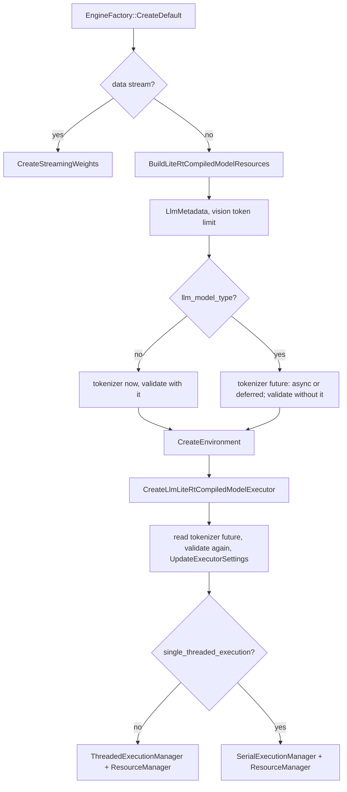
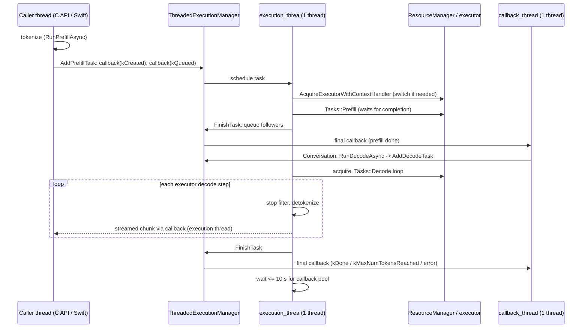
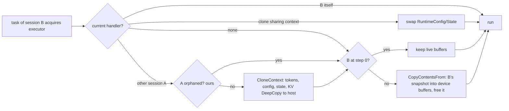

# LiteRT-LM engine and sessions

> **Scope:** `Engine`, `EngineFactory`, `EngineSettings` and the load sequence in
> `EngineAdvancedImpl::Create`; `SessionAdvanced`, `AudioSessionAdvanced` and `SessionConfig`; the
> execution managers (threads, task lifecycle, callbacks, cancellation, timeouts); the
> `ResourceManager` (locked executor, context handlers, context switches, KV snapshots, clones);
> checkpoints and rewind; `PrefixCache` and `CachedSession`; `Tasks::Prefill`, `Decode`, `Score`
> and `DecodeOneStep`; benchmark info; our T0, T2 and T3 commits in these files.
> **Out of scope:** executor internals (signatures, chunking, KV layouts, MTP) in
> [executors.md](executors.md); messages, templates, channels and tools in
> [conversation.md](conversation.md); samplers, stop-token detector, detokenizer and constraint
> internals in [components.md](components.md); the C and Swift layers in [c-api.md](c-api.md) and
> [swift-api.md](swift-api.md); Metal buffer handling in
> [../litert/ml-drift-delegate.md](../litert/ml-drift-delegate.md).
> **Pinned to:** LiteRT-LM `7b872544` (`agello-next`); what Agello ships: the v0.18.0 source at
> `85b1a776` (runtime files unchanged from Google's `b2f686e2`).
> **Applies to:** all platforms, with an "On Apple" section. **Last verified:** 2026-10-15

## Summary

An `Engine` owns everything that is loaded once: model resources, the tokenizer, the LiteRT
environment and one execution manager, which owns the single `LlmExecutor` (one KV cache) through a
`ResourceManager`. A session (`SessionAdvanced`) is a lightweight handle: an ID, a context handler
and a chain of tasks. Every prefill, decode and scoring task of every session runs on one execution
thread, one task at a time, and takes the executor's mutex for its whole run. When a task belongs to
a different session than the last one, the resource manager snapshots the outgoing session's KV
cache (into host memory on Metal) and restores the incoming one: that is the cost of two
conversations on one engine. Streamed chunks are delivered on the execution thread between decode
steps; final callbacks on a separate callback thread. Cancelling a session poisons its task chain
until it is rewound. Our commits make the Metal snapshots a raw byte copy in pages of their own,
skip snapshots nobody will restore, and trim per-step host work.

## Concepts

| Term | What it is |
| --- | --- |
| `Engine` / `EngineT<SessionT>` | The interface: `CreateSession`, `WaitUntilDone`, tokenizer, settings, environment ([`runtime/engine/engine.h:452-453`](https://github.com/google-ai-edge/LiteRT-LM/blob/df6df5b84d5845b49889f631ed4cac80b4325dd3/runtime/engine/engine.h#L452-L453)). `EngineAdvancedImpl` is the only implementation registered in the open source. |
| `EngineFactory` | A singleton registry from `EngineType` to a creator, plus a per-backend preference list ([`runtime/engine/engine_factory.h:190-212`](https://github.com/google-ai-edge/LiteRT-LM/blob/df6df5b84d5845b49889f631ed4cac80b4325dd3/runtime/engine/engine_factory.h#L190-L212)). |
| `EngineSettings` | Load-time settings: the main `LlmExecutorSettings`, optional vision and audio executor settings, benchmark parameters, the file's `LlmMetadata`, `parallel_file_section_loading_`, `single_threaded_execution_`, `max_vision_tokens_per_image_`. |
| `SessionConfig` | Per-session settings: sampler parameters, stop and start tokens, candidates, sampler backend, prompt templates, model type, suppress tokens, LoRA files, `max_output_tokens`, speculative decoding ([`runtime/engine/engine_settings.h:331-395`](https://github.com/google-ai-edge/LiteRT-LM/blob/df6df5b84d5845b49889f631ed4cac80b4325dd3/runtime/engine/engine_settings.h#L331-L395)). |
| `SessionAdvanced` | The `SessionInterface` implementation: a `SessionId`, a weak pointer to the execution manager, the shared `SessionInfo`, a state (`kFresh`, `kPrefilled`, `kDecoded`), the IDs of its last tasks, and a checkpoint map ([`runtime/core/session_advanced.h:243-255`](https://github.com/google-ai-edge/LiteRT-LM/blob/df6df5b84d5845b49889f631ed4cac80b4325dd3/runtime/core/session_advanced.h#L243-L255)). |
| `ExecutionManager` | Schedules tasks with dependencies. `ThreadedExecutionManager` (default) or `SerialExecutionManager`. Holds `SessionInfo` and `TaskInfo` tables ([`runtime/framework/resource_management/execution_manager.h:57-65`](https://github.com/google-ai-edge/LiteRT-LM/blob/df6df5b84d5845b49889f631ed4cac80b4325dd3/runtime/framework/resource_management/execution_manager.h#L57-L65), [`runtime/framework/resource_management/execution_manager.h:79-87`](https://github.com/google-ai-edge/LiteRT-LM/blob/df6df5b84d5845b49889f631ed4cac80b4325dd3/runtime/framework/resource_management/execution_manager.h#L79-L87)). |
| Task | A closure plus state, dependencies, followers, a `cancelled` flag and a callback. IDs and session IDs come from atomic counters. |
| `TaskState` | `kCreated`, `kQueued`, `kProcessing`, then an end state: `kDone`, `kMaxNumTokensReached`, `kFailed`, `kDependentTaskFailed`, `kCancelled`, `kDependentTaskCancelled`; `kLastCallbackQueued` is internal ([`runtime/engine/io_types.h:67-89`](https://github.com/google-ai-edge/LiteRT-LM/blob/df6df5b84d5845b49889f631ed4cac80b4325dd3/runtime/engine/io_types.h#L67-L89), [`runtime/engine/io_types.cc:102-109`](https://github.com/google-ai-edge/LiteRT-LM/blob/df6df5b84d5845b49889f631ed4cac80b4325dd3/runtime/engine/io_types.cc#L102-L109)). |
| `ResourceManager` | Owns the `LlmExecutor` (and lazily the vision and audio executors) behind mutexes; hands out `LockedLlmExecutor` wrappers and switches contexts. |
| `ContextHandler` | A session's view of the executor: a shared pointer to a `SharedProcessedContext`, plus its own `RuntimeConfig` and `RuntimeState` while it is not loaded in the executor. |
| `SharedProcessedContext` | Holds a `ProcessedContext` (token history, LoRA ID and, for the compiled-model executor, a KV state snapshot) and the list of handlers sharing it (clones) ([`runtime/framework/resource_management/context_handler/context_handler.h:150-217`](https://github.com/PowerBeef/agello-litert-lm/blob/7b872544fdbd81308f98b1e2acf8c5798a549df6/runtime/framework/resource_management/context_handler/context_handler.h#L150-L217)). |
| `RuntimeConfig` / `RuntimeState` | Sampler parameters, output heads, tokens per decode / current step, random generator, `ran_decode` ([`runtime/executor/llm_executor_io_types.h:76-87`](https://github.com/google-ai-edge/LiteRT-LM/blob/df6df5b84d5845b49889f631ed4cac80b4325dd3/runtime/executor/llm_executor_io_types.h#L76-L87)). |
| Context switch | Loading another session's context into the executor: snapshot out, restore in. |
| Checkpoint / saved context | A named step in a session; a saved context also keeps a `ProcessedContext`. |
| `PrefixCache`, `CachedSession` | A token-and-media prefix matcher and a session wrapper that reuses the longest common prefix. |
| `Tasks::*` | Free functions that drive the executor for one task: `Prefill`, `Decode`, `Score`. `DecodeOneStep` wraps one executor decode step with constraints, stop filtering and detokenization. |

## How it works

### Creating an engine

The C API creates engines with `EngineFactory::CreateDefault(settings)` and no prompt hint
([`c/engine.cc:1045-1046`](https://github.com/google-ai-edge/LiteRT-LM/blob/df6df5b84d5845b49889f631ed4cac80b4325dd3/c/engine.cc#L1045-L1046)). `CreateDefault` walks the preference list for the settings' backend and creates the
first registered type ([`runtime/engine/engine_factory.h:88-100`](https://github.com/google-ai-edge/LiteRT-LM/blob/df6df5b84d5845b49889f631ed4cac80b4325dd3/runtime/engine/engine_factory.h#L88-L100)). At `7b872544` the only registration in the
repository is `kAdvancedLiteRTCompiledModel` ([`runtime/core/engine_advanced_impl.cc:1103-1108`](https://github.com/google-ai-edge/LiteRT-LM/blob/df6df5b84d5845b49889f631ed4cac80b4325dd3/runtime/core/engine_advanced_impl.cc#L1103-L1108)), and `//runtime/core:engine_impl` is an
alias of `:engine_advanced_impl` ([`runtime/core/BUILD:191-195`](https://github.com/PowerBeef/agello-litert-lm/blob/7b872544fdbd81308f98b1e2acf8c5798a549df6/runtime/core/BUILD#L191-L195)). So CPU and GPU always get
`EngineAdvancedImpl`, and `GPU_ARTISAN`, whose preferences are the two legacy TFLite engines, fails
with a `NotFound` error listing the registered types ([`runtime/engine/engine_factory.h:102-129`](https://github.com/google-ai-edge/LiteRT-LM/blob/df6df5b84d5845b49889f631ed4cac80b4325dd3/runtime/engine/engine_factory.h#L102-L129)). <!-- c:LM-ENG-002 -->
`EngineSettings::CreateDefault` switches a `GPU` request to `GPU_ARTISAN` when the file has an
artisan text decoder section, as the `-gpu` variants do ([`runtime/engine/engine_settings.cc:225-232`](https://github.com/google-ai-edge/LiteRT-LM/blob/df6df5b84d5845b49889f631ed4cac80b4325dd3/runtime/engine/engine_settings.cc#L225-L232)); see
[../models/gemma4-e4b.md](../models/gemma4-e4b.md) for those files.

`EngineAdvancedImpl::Create` then runs these steps on the creating thread:

1. Files given as a data stream take `CreateStreamingWeights` instead ([`runtime/core/engine_advanced_impl.cc:405-411`](https://github.com/google-ai-edge/LiteRT-LM/blob/df6df5b84d5845b49889f631ed4cac80b4325dd3/runtime/core/engine_advanced_impl.cc#L405-L411)):
   sections are read in order, models compiled as their weights arrive. Agello passes a path, so
   this page follows the regular path.
2. Model resources: `BuildLiteRtCompiledModelResources`. File-backed loading is used only on the
   NPU backend: always when `configure_magic_numbers` is off, and otherwise for ahead-of-time NPU
   models whose `TF_LITE_AUX` section is non-empty (`enable_file_backed_for_aot_npu`)
   ([`runtime/core/engine_advanced_impl.cc:405-439`](https://github.com/google-ai-edge/LiteRT-LM/blob/df6df5b84d5845b49889f631ed4cac80b4325dd3/runtime/core/engine_advanced_impl.cc#L405-L439), [`runtime/executor/litert_compiled_model_executor_utils.cc:152-164`](https://github.com/google-ai-edge/LiteRT-LM/blob/df6df5b84d5845b49889f631ed4cac80b4325dd3/runtime/executor/litert_compiled_model_executor_utils.cc#L152-L164)); how sections are mapped is in [file-format.md](file-format.md).
3. `LlmMetadata` from the file, then the vision token limit ([`runtime/core/engine_advanced_impl.cc:457-494`](https://github.com/google-ai-edge/LiteRT-LM/blob/df6df5b84d5845b49889f631ed4cac80b4325dd3/runtime/core/engine_advanced_impl.cc#L457-L494)).
4. The tokenizer. For a file whose metadata has an `llm_model_type` (Gemma 4 files do), the
   tokenizer is built through a `std::future`: `std::launch::async` when
   `GetParallelFileSectionLoading()` is true (the default), so a second thread builds it while this
   one creates the environment and the executor; `std::launch::deferred` otherwise, so it is built
   here when the future is read ([`runtime/core/engine_advanced_impl.cc:536-549`](https://github.com/google-ai-edge/LiteRT-LM/blob/df6df5b84d5845b49889f631ed4cac80b4325dd3/runtime/core/engine_advanced_impl.cc#L536-L549), [`runtime/engine/engine_settings.h:182-187`](https://github.com/google-ai-edge/LiteRT-LM/blob/df6df5b84d5845b49889f631ed4cac80b4325dd3/runtime/engine/engine_settings.h#L182-L187)). Older files without a
   model type load the tokenizer first, synchronously ([`runtime/core/engine_advanced_impl.cc:516-535`](https://github.com/google-ai-edge/LiteRT-LM/blob/df6df5b84d5845b49889f631ed4cac80b4325dd3/runtime/core/engine_advanced_impl.cc#L516-L535)). <!-- c:LM-ENG-005 -->
   Despite its name, `parallel_file_section_loading` changes nothing else in `runtime/` at this pin;
   `EngineSettings`' `operator<<` only prints it.
5. `EngineSettings::MaybeUpdateAndValidate` without the tokenizer (next section).
6. The LiteRT environment: `CreateEnvironment` passes magic-number options for CPU and GPU (unless
   `configure_magic_numbers` is off), NPU library directories and the minimum log severity
   ([`runtime/util/litert_util.cc:134-174`](https://github.com/google-ai-edge/LiteRT-LM/blob/df6df5b84d5845b49889f631ed4cac80b4325dd3/runtime/util/litert_util.cc#L134-L174), [`runtime/core/engine_advanced_impl.cc:572-578`](https://github.com/google-ai-edge/LiteRT-LM/blob/df6df5b84d5845b49889f631ed4cac80b4325dd3/runtime/core/engine_advanced_impl.cc#L572-L578)). What the options do is in [executors.md](executors.md) and
   [../litert/runtime.md](../litert/runtime.md).
7. The executor: `CreateLlmLiteRtCompiledModelExecutor` for every backend (the backend switch has
   only a `default` case) ([`runtime/core/engine_advanced_impl.cc:591-595`](https://github.com/google-ai-edge/LiteRT-LM/blob/df6df5b84d5845b49889f631ed4cac80b4325dd3/runtime/core/engine_advanced_impl.cc#L591-L595)).
   The executor compiles the model here ([executors.md](executors.md)).
8. For files with a model type, the tokenizer future is read, settings are validated again with the tokenizer (stop-token
   strings become IDs), and the executor gets the final settings ([`runtime/core/engine_advanced_impl.cc:635-656`](https://github.com/google-ai-edge/LiteRT-LM/blob/df6df5b84d5845b49889f631ed4cac80b4325dd3/runtime/core/engine_advanced_impl.cc#L635-L656)).
9. The execution manager: `ThreadedExecutionManager` unless `SetSingleThreadedExecution(true)`,
   which selects `SerialExecutionManager` ([`runtime/core/engine_advanced_impl.cc:662-679`](https://github.com/google-ai-edge/LiteRT-LM/blob/df6df5b84d5845b49889f631ed4cac80b4325dd3/runtime/core/engine_advanced_impl.cc#L662-L679)).

The engine destructor waits up to `Engine::kDefaultTimeout` for the execution manager, logs an error
if sessions are still alive, then destroys the execution manager (and with it the executor), the
environment, the tokenizer and the model resources, in that order ([`runtime/core/engine_advanced_impl.cc:239-254`](https://github.com/google-ai-edge/LiteRT-LM/blob/df6df5b84d5845b49889f631ed4cac80b4325dd3/runtime/core/engine_advanced_impl.cc#L239-L254)).

### Settings resolved at load

`EngineSettings::MaybeUpdateAndValidate` copies the file's `LlmMetadata` into the settings and fills
what the caller left unset:

- **Stop and start tokens.** Token strings are converted to IDs once the tokenizer exists
  ([`runtime/engine/engine_settings.cc:294-309`](https://github.com/google-ai-edge/LiteRT-LM/blob/df6df5b84d5845b49889f631ed4cac80b4325dd3/runtime/engine/engine_settings.cc#L294-L309)). Our E4B file (`e4b-ours`) carries IDs directly: start token 2, stop
  tokens 1, 50 and 106, model type `gemma4`, and no `max_num_tokens` or `sampler_params`
  ([../generated/models/e4b-ours.md](../generated/models/e4b-ours.md), Section 0). <!-- c:LM-ENG-007 -->
- **`max_num_tokens`** (the allocated context). If the caller left it at 0, it becomes the file's
  `max_num_tokens` when present, else `((prompt_tokens + 1023) / 4096 + 1) × 4096`, which is 4096
  with the C API's empty prompt hint; only on non-Apple builds is a GPU file value above 4096 clamped
  that way ([`runtime/engine/engine_settings.cc:346-361`](https://github.com/google-ai-edge/LiteRT-LM/blob/df6df5b84d5845b49889f631ed4cac80b4325dd3/runtime/engine/engine_settings.cc#L346-L361)). <!-- c:LM-ENG-008 --> The executor may still adjust it from
  the model's magic numbers ([executors.md](executors.md)). Agello always sets it.
- **Sampler defaults.** With no `sampler_params` in the file, CPU and GPU get `TOP_P` with k = 1,
  p = 0.95, temperature 1.0, seed 0 ([`runtime/engine/engine_settings.cc:417-436`](https://github.com/google-ai-edge/LiteRT-LM/blob/df6df5b84d5845b49889f631ed4cac80b4325dd3/runtime/engine/engine_settings.cc#L417-L436)); a session whose sampler type is
  `TYPE_UNSPECIFIED` (the `SessionConfig::CreateDefault` value) copies them
  ([`runtime/engine/engine_settings.cc:698-707`](https://github.com/google-ai-edge/LiteRT-LM/blob/df6df5b84d5845b49889f631ed4cac80b4325dd3/runtime/engine/engine_settings.cc#L698-L707), [`runtime/engine/engine_settings.cc:721-729`](https://github.com/google-ai-edge/LiteRT-LM/blob/df6df5b84d5845b49889f631ed4cac80b4325dd3/runtime/engine/engine_settings.cc#L721-L729)). <!-- c:LM-ENG-010 -->
- **Gemma 4.** Delegate clustering is disabled ([`runtime/engine/engine_settings.cc:507-511`](https://github.com/google-ai-edge/LiteRT-LM/blob/df6df5b84d5845b49889f631ed4cac80b4325dd3/runtime/engine/engine_settings.cc#L507-L511)); quantized FC/conv source ops
  are allowed for well-known model types.
- **Vision tokens per image.** Without a caller value, the limit is the metadata's
  `max_num_patches / pooling_kernel_size²`, with a pooling kernel of 3 for `gemma4` when the field is
  unset ([`runtime/core/engine_advanced_impl.cc:90-113`](https://github.com/google-ai-edge/LiteRT-LM/blob/df6df5b84d5845b49889f631ed4cac80b4325dd3/runtime/core/engine_advanced_impl.cc#L90-L113)). For `e4b-ours` (2,520 patches, no pooling field) that is
  2,520 / 9 = 280, stored as `max_vision_tokens_per_image` when vision is enabled
  ([`runtime/core/engine_advanced_impl.cc:457-494`](https://github.com/google-ai-edge/LiteRT-LM/blob/df6df5b84d5845b49889f631ed4cac80b4325dd3/runtime/core/engine_advanced_impl.cc#L457-L494)). <!-- c:LM-ENG-014 --> How the vision signatures are chosen from it is in
  [executors.md](executors.md).
- **Cache directory.** Empty, `:nocache` and `:memory` pass; anything else must be a writable
  directory ([`runtime/engine/engine_settings.cc:147-156`](https://github.com/google-ai-edge/LiteRT-LM/blob/df6df5b84d5845b49889f631ed4cac80b4325dd3/runtime/engine/engine_settings.cc#L147-L156)).
- **Benchmark.** Benchmark parameters set `AdvancedSettings::is_benchmark` ([`runtime/engine/engine_settings.cc:512-515`](https://github.com/google-ai-edge/LiteRT-LM/blob/df6df5b84d5845b49889f631ed4cac80b4325dd3/runtime/engine/engine_settings.cc#L512-L515)).

### Sessions

`CreateSession` validates a copy of the `SessionConfig` against the engine settings and builds an
`AudioSessionAdvanced` if `EnableAudioSessionAdvanced()` is set, else a `SessionAdvanced`
([`runtime/core/engine_advanced_impl.cc:287-310`](https://github.com/google-ai-edge/LiteRT-LM/blob/df6df5b84d5845b49889f631ed4cac80b4325dd3/runtime/core/engine_advanced_impl.cc#L287-L310)). `SessionConfig::MaybeUpdateAndValidate` takes the stop tokens from the
metadata when the config has none and fails if there are still none ([`runtime/engine/engine_settings.cc:759-769`](https://github.com/google-ai-edge/LiteRT-LM/blob/df6df5b84d5845b49889f631ed4cac80b4325dd3/runtime/engine/engine_settings.cc#L759-L769),
[`runtime/engine/engine_settings.cc:796-802`](https://github.com/google-ai-edge/LiteRT-LM/blob/df6df5b84d5845b49889f631ed4cac80b4325dd3/runtime/engine/engine_settings.cc#L796-L802)); an unspecified sampler backend becomes GPU for a GPU engine and CPU
otherwise ([`runtime/engine/engine_settings.cc:809-818`](https://github.com/google-ai-edge/LiteRT-LM/blob/df6df5b84d5845b49889f631ed4cac80b4325dd3/runtime/engine/engine_settings.cc#L809-L818)).

`SessionConfig::max_output_tokens` defaults to `std::numeric_limits<int>::max()` and limits decode
steps per request, thinking tokens included; `LlmExecutorSettings::max_num_tokens` limits everything
held in the KV cache over the session's life ([`runtime/engine/engine_settings.h:385-390`](https://github.com/google-ai-edge/LiteRT-LM/blob/df6df5b84d5845b49889f631ed4cac80b4325dd3/runtime/engine/engine_settings.h#L385-L390)). <!-- c:LM-ENG-021 -->

Registering a session (`RegisterNewSession`, [`runtime/framework/resource_management/threaded_execution_manager.cc:134-193`](https://github.com/PowerBeef/agello-litert-lm/blob/7b872544fdbd81308f98b1e2acf8c5798a549df6/runtime/framework/resource_management/threaded_execution_manager.cc#L134-L193)) creates:

- a `ContextHandler` from `ResourceManager::CreateContextHandler`, whose `RuntimeConfig` carries the
  session's sampler parameters and output heads ([`runtime/framework/resource_management/resource_manager.cc:652-665`](https://github.com/PowerBeef/agello-litert-lm/blob/7b872544fdbd81308f98b1e2acf8c5798a549df6/runtime/framework/resource_management/resource_manager.cc#L652-L665));
- a session-level sampler only when `UseExternalSampler()` (CPU only); neither the C API nor
  `Conversation` sets it, so every Agello session uses the executor's internal sampler
  ([`runtime/engine/engine_settings.h:374-377`](https://github.com/google-ai-edge/LiteRT-LM/blob/df6df5b84d5845b49889f631ed4cac80b4325dd3/runtime/engine/engine_settings.h#L374-L377));
- a `StopTokenDetector` with the session's stop sequences;
- the vision or audio executor, loaded on the first session that enables that modality.

A session never runs work itself. Each call adds a task that depends on the previous call's task
(`last_task_ids_`), so a session's work runs in submission order:

- `RunPrefillAsync` applies the prompt templates (`ApplyPromptTemplates`, when templates are applied
  in the session) and tokenizes (`PreprocessContents`) on the calling thread, then queues a prefill task and moves the state to `kPrefilled`
  ([`runtime/core/session_advanced.cc:96-150`](https://github.com/PowerBeef/agello-litert-lm/blob/7b872544fdbd81308f98b1e2acf8c5798a549df6/runtime/core/session_advanced.cc#L96-L150)). `Conversation` turns template application in the session off
  ([`runtime/conversation/conversation.cc:154-155`](https://github.com/google-ai-edge/LiteRT-LM/blob/df6df5b84d5845b49889f631ed4cac80b4325dd3/runtime/conversation/conversation.cc#L154-L155)), so on its path no turn template is added there: the first turn only gets
  the BOS string prepended (when a start token is set), and the contents are tokenized on the
  caller's thread.
- `RunDecodeAsync` requires `kPrefilled`, adds a "last chunk" prefill when templates are applied in
  the session, and queues a decode task with the decode config's limits, falling back to the
  session's suppress tokens and `max_output_tokens` ([`runtime/core/session_advanced.cc:275-298`](https://github.com/PowerBeef/agello-litert-lm/blob/7b872544fdbd81308f98b1e2acf8c5798a549df6/runtime/core/session_advanced.cc#L275-L298),
  [`runtime/core/session_advanced.cc:301-314`](https://github.com/PowerBeef/agello-litert-lm/blob/7b872544fdbd81308f98b1e2acf8c5798a549df6/runtime/core/session_advanced.cc#L301-L314)).
- `RunPrefill`, `RunDecode` and `RunTextScoring` are the async calls plus a wait of
  `Engine::kDefaultTimeout` ([`runtime/core/session_advanced.cc:84-94`](https://github.com/PowerBeef/agello-litert-lm/blob/7b872544fdbd81308f98b1e2acf8c5798a549df6/runtime/core/session_advanced.cc#L84-L94), [`runtime/core/session_advanced.cc:248-252`](https://github.com/PowerBeef/agello-litert-lm/blob/7b872544fdbd81308f98b1e2acf8c5798a549df6/runtime/core/session_advanced.cc#L248-L252)). `RunDecode` accumulates the
  streamed chunks into one `Responses` ([`runtime/core/session_advanced.cc:194-246`](https://github.com/PowerBeef/agello-litert-lm/blob/7b872544fdbd81308f98b1e2acf8c5798a549df6/runtime/core/session_advanced.cc#L194-L246)).
- `GenerateContentStream` (deprecated) chains a decode from the prefill's callback
  ([`runtime/core/session_advanced.cc:385-413`](https://github.com/PowerBeef/agello-litert-lm/blob/7b872544fdbd81308f98b1e2acf8c5798a549df6/runtime/core/session_advanced.cc#L385-L413)).

The destructor waits for the session's tasks with `WaitUntilDone()` (up to
`Engine::kDefaultTimeout`) without cancelling them, then releases the session
([`runtime/core/session_advanced.cc:484-504`](https://github.com/PowerBeef/agello-litert-lm/blob/7b872544fdbd81308f98b1e2acf8c5798a549df6/runtime/core/session_advanced.cc#L484-L504), [`runtime/core/session_advanced.h:224-232`](https://github.com/google-ai-edge/LiteRT-LM/blob/df6df5b84d5845b49889f631ed4cac80b4325dd3/runtime/core/session_advanced.h#L224-L232)). Destroying a session in the middle of a generation therefore
blocks the destroying thread until that generation ends or ten minutes pass. <!-- c:LM-ENG-027 -->
Our telemetry around that wait reports it when it exceeds one second (ours: `4aed9274`).

`AudioSessionAdvanced` adds synchronous `EncodeAudio`, `ResetAudio` and `FlushAudio`, which run on the
calling thread through the execution manager, and a `RunPrefill` that takes encoded audio and slices
it to its valid tokens ([`runtime/core/audio_session_advanced.cc:187-196`](https://github.com/google-ai-edge/LiteRT-LM/blob/df6df5b84d5845b49889f631ed4cac80b4325dd3/runtime/core/audio_session_advanced.cc#L187-L196), [`runtime/core/audio_session_advanced.cc:263-274`](https://github.com/google-ai-edge/LiteRT-LM/blob/df6df5b84d5845b49889f631ed4cac80b4325dd3/runtime/core/audio_session_advanced.cc#L263-L274)). Agello's sessions are plain
`SessionAdvanced`: neither the C API nor `Conversation` enables it.

### Execution managers and threads

`ThreadedExecutionManager` creates two thread pools of at most one thread each:
`execution_thread_pool`, which runs every task of every session, and `callback_thread_pool`, which
runs final callbacks ([`runtime/framework/resource_management/threaded_execution_manager.cc:87-92`](https://github.com/PowerBeef/agello-litert-lm/blob/7b872544fdbd81308f98b1e2acf8c5798a549df6/runtime/framework/resource_management/threaded_execution_manager.cc#L87-L92)). <!-- c:LM-ENG-030 --> A pool starts its worker on the first
`Schedule`, and the worker takes tasks first in, first out ([`runtime/framework/threadpool.cc:87-119`](https://github.com/google-ai-edge/LiteRT-LM/blob/df6df5b84d5845b49889f631ed4cac80b4325dd3/runtime/framework/threadpool.cc#L87-L119),
[`runtime/framework/threadpool.cc:155-187`](https://github.com/google-ai-edge/LiteRT-LM/blob/df6df5b84d5845b49889f631ed4cac80b4325dd3/runtime/framework/threadpool.cc#L155-L187)). `SerialExecutionManager` has no threads: tasks wait in a ready queue and
run on the caller's thread inside `WaitUntilDone`, `WaitUntilSessionDone` or `WaitUntilAllDone`, and
the class is documented as not thread-safe ([`runtime/framework/resource_management/serial_execution_manager.cc:124-146`](https://github.com/google-ai-edge/LiteRT-LM/blob/df6df5b84d5845b49889f631ed4cac80b4325dd3/runtime/framework/resource_management/serial_execution_manager.cc#L124-L146), [`runtime/framework/resource_management/serial_execution_manager.h:54-56`](https://github.com/google-ai-edge/LiteRT-LM/blob/df6df5b84d5845b49889f631ed4cac80b4325dd3/runtime/framework/resource_management/serial_execution_manager.h#L54-L56)). The settings
comment points it at WebAssembly without threads; the default is the threaded manager
([`runtime/engine/engine_settings.h:144-150`](https://github.com/google-ai-edge/LiteRT-LM/blob/df6df5b84d5845b49889f631ed4cac80b4325dd3/runtime/engine/engine_settings.h#L144-L150), [`runtime/engine/engine_settings.h:182-187`](https://github.com/google-ai-edge/LiteRT-LM/blob/df6df5b84d5845b49889f631ed4cac80b4325dd3/runtime/engine/engine_settings.h#L182-L187)).

### Task lifecycle

Every task follows the same path through `ThreadedExecutionManager`:

1. **Create** (`CreateTask`, caller's thread, under the manager mutex). Each dependency is checked:
   one that already ended `kFailed` or `kDependentTaskFailed` makes the new task
   `kDependentTaskFailed`; `kCancelled` or `kDependentTaskCancelled` makes it
   `kDependentTaskCancelled`; `kMaxNumTokensReached` makes it `kMaxNumTokensReached`; dependencies in
   `kDone` or `kLastCallbackQueued` are dropped; unfinished ones get the task as a follower. A task
   born in an end state never runs ([`runtime/framework/resource_management/threaded_execution_manager.cc:289-349`](https://github.com/PowerBeef/agello-litert-lm/blob/7b872544fdbd81308f98b1e2acf8c5798a549df6/runtime/framework/resource_management/threaded_execution_manager.cc#L289-L349)). <!-- c:LM-ENG-033 --> The callback is
   called at once with the task's state ([`runtime/framework/resource_management/threaded_execution_manager.cc:358-368`](https://github.com/PowerBeef/agello-litert-lm/blob/7b872544fdbd81308f98b1e2acf8c5798a549df6/runtime/framework/resource_management/threaded_execution_manager.cc#L358-L368)).
2. **Queue** (`QueueTask`) when no dependency is pending: the closure goes to the execution pool and
   the callback hears `kQueued` ([`runtime/framework/resource_management/threaded_execution_manager.cc:389-412`](https://github.com/PowerBeef/agello-litert-lm/blob/7b872544fdbd81308f98b1e2acf8c5798a549df6/runtime/framework/resource_management/threaded_execution_manager.cc#L389-L412)).
3. **Start** (`StartTask`, run first inside each task on the execution thread): a task already
   `kCancelled` gets null session info; for a `kQueued` task the callback hears `kProcessing`, the
   state becomes `kProcessing` and the callback is moved out of the table; a task in any other state
   gets a `FailedPrecondition` error through its callback ([`runtime/framework/resource_management/threaded_execution_manager.cc:418-450`](https://github.com/PowerBeef/agello-litert-lm/blob/7b872544fdbd81308f98b1e2acf8c5798a549df6/runtime/framework/resource_management/threaded_execution_manager.cc#L418-L450)).
4. **Run** (execution thread): check the cancel flag, acquire the executor with the session's
   context handler (this may switch contexts), check the flag again, do the work (`Tasks::Prefill`,
   `Tasks::Decode` or `Tasks::Score`), release the executor ([`runtime/framework/resource_management/threaded_execution_manager.cc:964-997`](https://github.com/PowerBeef/agello-litert-lm/blob/7b872544fdbd81308f98b1e2acf8c5798a549df6/runtime/framework/resource_management/threaded_execution_manager.cc#L964-L997), [`runtime/framework/resource_management/threaded_execution_manager.cc:1111-1130`](https://github.com/PowerBeef/agello-litert-lm/blob/7b872544fdbd81308f98b1e2acf8c5798a549df6/runtime/framework/resource_management/threaded_execution_manager.cc#L1111-L1130)).
   Image and audio encoders run here too, inside the prefill task ([`runtime/framework/resource_management/threaded_execution_manager.cc:656-691`](https://github.com/PowerBeef/agello-litert-lm/blob/7b872544fdbd81308f98b1e2acf8c5798a549df6/runtime/framework/resource_management/threaded_execution_manager.cc#L656-L691)).
5. **Finish** (`FinishTask`, execution thread). Under the mutex, followers are queued when the task
   ended `kDone` or `kMaxNumTokensReached`, or marked `kDependentTaskCancelled` or
   `kDependentTaskFailed` when it was cancelled or failed ([`runtime/framework/resource_management/threaded_execution_manager.cc:473-522`](https://github.com/PowerBeef/agello-litert-lm/blob/7b872544fdbd81308f98b1e2acf8c5798a549df6/runtime/framework/resource_management/threaded_execution_manager.cc#L473-L522)). The final callback
   is scheduled on the callback pool and the task becomes `kLastCallbackQueued`; the callback thread
   sets the end state after the callback returns ([`runtime/framework/resource_management/threaded_execution_manager.cc:524-545`](https://github.com/PowerBeef/agello-litert-lm/blob/7b872544fdbd81308f98b1e2acf8c5798a549df6/runtime/framework/resource_management/threaded_execution_manager.cc#L524-L545)). Outside the mutex, the
   execution thread then waits up to 10 seconds for the callback pool to drain before it takes the
   next task ([`runtime/framework/resource_management/threaded_execution_manager.cc:548-559`](https://github.com/PowerBeef/agello-litert-lm/blob/7b872544fdbd81308f98b1e2acf8c5798a549df6/runtime/framework/resource_management/threaded_execution_manager.cc#L548-L559)). <!-- c:LM-ENG-038 -->

### Which thread calls back

On the threaded manager, the streamed chunks of a decode (`Responses` with `kProcessing` and text)
are delivered by `Tasks::Decode` itself, on the execution thread, between decode steps; the final
`Responses` (`kDone`, `kMaxNumTokensReached`, `kCancelled` or an error) is delivered on the callback
thread; `kCreated` is delivered on the thread that adds the task; `kQueued` on that thread when the
task has no pending dependencies, and otherwise on the execution thread when its last dependency
finishes; and the `kProcessing` state notification on the execution thread ([`runtime/core/tasks.cc:792-807`](https://github.com/PowerBeef/agello-litert-lm/blob/7b872544fdbd81308f98b1e2acf8c5798a549df6/runtime/core/tasks.cc#L792-L807), [`runtime/framework/resource_management/threaded_execution_manager.cc:1111-1130`](https://github.com/PowerBeef/agello-litert-lm/blob/7b872544fdbd81308f98b1e2acf8c5798a549df6/runtime/framework/resource_management/threaded_execution_manager.cc#L1111-L1130), [`runtime/framework/resource_management/threaded_execution_manager.cc:524-545`](https://github.com/PowerBeef/agello-litert-lm/blob/7b872544fdbd81308f98b1e2acf8c5798a549df6/runtime/framework/resource_management/threaded_execution_manager.cc#L524-L545),
[`runtime/framework/resource_management/threaded_execution_manager.cc:358-368`](https://github.com/PowerBeef/agello-litert-lm/blob/7b872544fdbd81308f98b1e2acf8c5798a549df6/runtime/framework/resource_management/threaded_execution_manager.cc#L358-L368)). <!-- c:LM-ENG-039 --> The execution manager always hands `Tasks::Decode` a
callback (a no-op if the caller gave none), so threaded decodes always stream and their final
`Responses` carries no text ([`runtime/framework/resource_management/threaded_execution_manager.cc:1016-1018`](https://github.com/PowerBeef/agello-litert-lm/blob/7b872544fdbd81308f98b1e2acf8c5798a549df6/runtime/framework/resource_management/threaded_execution_manager.cc#L1016-L1018), [`runtime/core/tasks.cc:629-631`](https://github.com/PowerBeef/agello-litert-lm/blob/7b872544fdbd81308f98b1e2acf8c5798a549df6/runtime/core/tasks.cc#L629-L631)).

`Conversation` starts its decode from inside the prefill task's final callback
([`runtime/conversation/conversation.cc:838-845`](https://github.com/google-ai-edge/LiteRT-LM/blob/df6df5b84d5845b49889f631ed4cac80b4325dd3/runtime/conversation/conversation.cc#L838-L845)), so on Agello's path the decode task is added on the callback thread
while the execution thread waits in `FinishTask`. The C API's stream callback calls the user's C
function directly, on whichever of these threads delivered the message ([`c/conversation.cc:45-55`](https://github.com/google-ai-edge/LiteRT-LM/blob/df6df5b84d5845b49889f631ed4cac80b4325dd3/c/conversation.cc#L45-L55)); what the
Swift wrapper does with each chunk is in [swift-api.md](swift-api.md).

### Cancellation

`SessionAdvanced::CancelProcess`, which `Conversation::CancelProcess` calls ([`runtime/conversation/conversation.cc:927`](https://github.com/google-ai-edge/LiteRT-LM/blob/df6df5b84d5845b49889f631ed4cac80b4325dd3/runtime/conversation/conversation.cc#L927)), sets
the `cancelled` flag of every active task of the session (`CancelAllTasksInSession`); a task
controller's `Cancel()` sets only its own task's flag ([`runtime/core/session_advanced.h:192-211`](https://github.com/google-ai-edge/LiteRT-LM/blob/df6df5b84d5845b49889f631ed4cac80b4325dd3/runtime/core/session_advanced.h#L192-L211), [`runtime/framework/resource_management/threaded_execution_manager.cc:231-242`](https://github.com/PowerBeef/agello-litert-lm/blob/7b872544fdbd81308f98b1e2acf8c5798a549df6/runtime/framework/resource_management/threaded_execution_manager.cc#L231-L242),
[`runtime/core/session_advanced.h:70-73`](https://github.com/google-ai-edge/LiteRT-LM/blob/df6df5b84d5845b49889f631ed4cac80b4325dd3/runtime/core/session_advanced.h#L70-L73)). A task checks its flag before and after acquiring the executor and, for a
prefill, after encoding its inputs and after the prefill ([`runtime/framework/resource_management/threaded_execution_manager.cc:887-902`](https://github.com/PowerBeef/agello-litert-lm/blob/7b872544fdbd81308f98b1e2acf8c5798a549df6/runtime/framework/resource_management/threaded_execution_manager.cc#L887-L902), [`runtime/framework/resource_management/threaded_execution_manager.cc:964-997`](https://github.com/PowerBeef/agello-litert-lm/blob/7b872544fdbd81308f98b1e2acf8c5798a549df6/runtime/framework/resource_management/threaded_execution_manager.cc#L964-L997));
`Tasks::Decode` checks it before each decode step ([`runtime/core/tasks.cc:716-745`](https://github.com/PowerBeef/agello-litert-lm/blob/7b872544fdbd81308f98b1e2acf8c5798a549df6/runtime/core/tasks.cc#L716-L745)). <!-- c:LM-ENG-044 -->

The flag is also handed to the executor in `ExecutorDecodeParams` ([`runtime/core/tasks.cc:509-529`](https://github.com/PowerBeef/agello-litert-lm/blob/7b872544fdbd81308f98b1e2acf8c5798a549df6/runtime/core/tasks.cc#L509-L529)), but at this
pin only the fake test executor reads it: a cancel takes effect between executor decode steps (one
step can be a whole MTP draft-and-verify round) and never interrupts a running prefill.
<!-- c:LM-ENG-045 --> With an external sampler, a cancelled decode first prefills the last sampled
token so the executor's state stays consistent ([`runtime/core/tasks.cc:716-745`](https://github.com/PowerBeef/agello-litert-lm/blob/7b872544fdbd81308f98b1e2acf8c5798a549df6/runtime/core/tasks.cc#L716-L745)).

Cancelling poisons the session. The cancelled decode stays in the task table until the session is
released, in state `kCancelled` once its final callback has returned (`kLastCallbackQueued` before
that), and a task the session then chains to it is born `kDependentTaskCancelled` and never runs ([`runtime/framework/resource_management/threaded_execution_manager.cc:289-349`](https://github.com/PowerBeef/agello-litert-lm/blob/7b872544fdbd81308f98b1e2acf8c5798a549df6/runtime/framework/resource_management/threaded_execution_manager.cc#L289-L349)); Google's own test expects exactly
that after `CancelProcess` ([`runtime/core/session_advanced_test.cc:1993-2012`](https://github.com/google-ai-edge/LiteRT-LM/blob/df6df5b84d5845b49889f631ed4cac80b4325dd3/runtime/core/session_advanced_test.cc#L1993-L2012)), and the interface comment says reusing a cancelled
session is not supported ([`runtime/engine/engine.h:263-271`](https://github.com/google-ai-edge/LiteRT-LM/blob/df6df5b84d5845b49889f631ed4cac80b4325dd3/runtime/engine/engine.h#L263-L271)). <!-- c:LM-ENG-034 --> Only a rewind cuts the chain:
`RewindToStep` clears `last_task_ids_`, `RewindToCheckpoint` and `RestoreContext` restore the IDs
saved with the checkpoint ([`runtime/core/session_advanced.cc:601-624`](https://github.com/PowerBeef/agello-litert-lm/blob/7b872544fdbd81308f98b1e2acf8c5798a549df6/runtime/core/session_advanced.cc#L601-L624), [`runtime/core/session_advanced.cc:518-545`](https://github.com/PowerBeef/agello-litert-lm/blob/7b872544fdbd81308f98b1e2acf8c5798a549df6/runtime/core/session_advanced.cc#L518-L545)). A task created while the
cancelled one is still `kLastCallbackQueued` drops the dependency and runs, so the outcome depends on
timing. Agello treats a cancelled conversation as unusable and reseeds a new one, which is the safe
reading of this code ([conversation.md](conversation.md) covers `Conversation`'s own history
rollback).

### Timeouts

| Where | Timeout | Effect when it expires |
| --- | --- | --- |
| `Engine::kDefaultTimeout` ([`runtime/engine/engine.h:452-453`](https://github.com/google-ai-edge/LiteRT-LM/blob/df6df5b84d5845b49889f631ed4cac80b4325dd3/runtime/engine/engine.h#L452-L453)) | 10 minutes | the constant behind the rows below <!-- c:LM-ENG-018 --> |
| `SessionAdvanced::RunPrefill`, `RunDecode`, `RunTextScoring`, `WaitUntilDone()`; `CachedSession::RunPrefill` | `kDefaultTimeout` | `DeadlineExceeded` from the wait; the task keeps running |
| `~SessionAdvanced` ([`runtime/core/session_advanced.cc:484-504`](https://github.com/PowerBeef/agello-litert-lm/blob/7b872544fdbd81308f98b1e2acf8c5798a549df6/runtime/core/session_advanced.cc#L484-L504)) | `kDefaultTimeout` | error ignored, session released anyway |
| `~EngineAdvancedImpl`, `~ThreadedExecutionManager` ([`runtime/core/engine_advanced_impl.cc:239-254`](https://github.com/google-ai-edge/LiteRT-LM/blob/df6df5b84d5845b49889f631ed4cac80b4325dd3/runtime/core/engine_advanced_impl.cc#L239-L254), [`runtime/framework/resource_management/threaded_execution_manager.cc:95-96`](https://github.com/PowerBeef/agello-litert-lm/blob/7b872544fdbd81308f98b1e2acf8c5798a549df6/runtime/framework/resource_management/threaded_execution_manager.cc#L95-L96)) | `kDefaultTimeout` | logged, destruction continues |
| `FinishTask` waiting for the callback pool ([`runtime/framework/resource_management/threaded_execution_manager.cc:548-559`](https://github.com/PowerBeef/agello-litert-lm/blob/7b872544fdbd81308f98b1e2acf8c5798a549df6/runtime/framework/resource_management/threaded_execution_manager.cc#L548-L559)) | 10 seconds | logged by `FinishTaskAndLogErrors`; the execution thread moves on |
| `~SerialExecutionManager` ([`runtime/framework/resource_management/serial_execution_manager.cc:97-99`](https://github.com/google-ai-edge/LiteRT-LM/blob/df6df5b84d5845b49889f631ed4cac80b4325dd3/runtime/framework/resource_management/serial_execution_manager.cc#L97-L99)) | none (infinite) | |
| `AdvancedTaskController::WaitUntilDone(timeout)`, `Engine::WaitUntilDone(timeout)` | caller's | `DeadlineExceeded` |

`WaitUntilDone` and `WaitUntilSessionDone` wait on a condition of the manager mutex
(`AwaitWithTimeout`) and return `DeadlineExceeded` with the task or session ID
([`runtime/framework/resource_management/threaded_execution_manager.cc:813-829`](https://github.com/PowerBeef/agello-litert-lm/blob/7b872544fdbd81308f98b1e2acf8c5798a549df6/runtime/framework/resource_management/threaded_execution_manager.cc#L813-L829), [`runtime/framework/resource_management/threaded_execution_manager.cc:831-848`](https://github.com/PowerBeef/agello-litert-lm/blob/7b872544fdbd81308f98b1e2acf8c5798a549df6/runtime/framework/resource_management/threaded_execution_manager.cc#L831-L848)). <!-- c:LM-ENG-041 --> Nothing in this layer bounds how long a
single prefill or decode step may take; a task stuck in `kProcessing` (as before our fix in
`9f619cf9`, below) makes every session wait run into the ten-minute limit.

### The resource manager

`ResourceManager` owns the engine's one `LlmExecutor` behind `executor_mutex_`. `AcquireExecutor` and
`AcquireExecutorWithContextHandler` return a `LockedLlmExecutor` that holds the mutex until it is
destroyed ([`runtime/framework/resource_management/resource_manager.cc:730-742`](https://github.com/PowerBeef/agello-litert-lm/blob/7b872544fdbd81308f98b1e2acf8c5798a549df6/runtime/framework/resource_management/resource_manager.cc#L730-L742), [`runtime/framework/resource_management/resource_manager.cc:229-238`](https://github.com/PowerBeef/agello-litert-lm/blob/7b872544fdbd81308f98b1e2acf8c5798a549df6/runtime/framework/resource_management/resource_manager.cc#L229-L238)); a task holds it from acquisition to just before
`FinishTask` ([`runtime/framework/resource_management/threaded_execution_manager.cc:964-997`](https://github.com/PowerBeef/agello-litert-lm/blob/7b872544fdbd81308f98b1e2acf8c5798a549df6/runtime/framework/resource_management/threaded_execution_manager.cc#L964-L997)). Every executor operation of every session is therefore serialized,
including those that callers make outside tasks. <!-- c:LM-ENG-047 -->

A `ContextHandler` registers itself in its `SharedProcessedContext`'s handler list when built and
removes itself when destroyed ([`runtime/framework/resource_management/context_handler/context_handler.cc:86-114`](https://github.com/google-ai-edge/LiteRT-LM/blob/df6df5b84d5845b49889f631ed4cac80b4325dd3/runtime/framework/resource_management/context_handler/context_handler.cc#L86-L114)). While a handler is loaded, the executor owns its
config, state and processed context, and the handler holds none. When the last session is released,
`ReleaseSession` calls `ResetCurrentHandler`, which only resets the executor's step to 0 and forgets
the handler: the KV buffers stay allocated ([`runtime/framework/resource_management/threaded_execution_manager.cc:195-223`](https://github.com/PowerBeef/agello-litert-lm/blob/7b872544fdbd81308f98b1e2acf8c5798a549df6/runtime/framework/resource_management/threaded_execution_manager.cc#L195-L223), [`runtime/framework/resource_management/resource_manager.cc:964-970`](https://github.com/PowerBeef/agello-litert-lm/blob/7b872544fdbd81308f98b1e2acf8c5798a549df6/runtime/framework/resource_management/resource_manager.cc#L964-L970)). A session with a
scoped LoRA file that isn't already registered fails with "Lora is not supported."
([`runtime/framework/resource_management/resource_manager.cc:605-620`](https://github.com/PowerBeef/agello-litert-lm/blob/7b872544fdbd81308f98b1e2acf8c5798a549df6/runtime/framework/resource_management/resource_manager.cc#L605-L620)).

### Context switches: what is copied, and where

`AcquireExecutorWithContextHandler` has three cases:

1. **Same handler** as the current one: nothing to do ([`runtime/framework/resource_management/resource_manager.cc:750-761`](https://github.com/PowerBeef/agello-litert-lm/blob/7b872544fdbd81308f98b1e2acf8c5798a549df6/runtime/framework/resource_management/resource_manager.cc#L750-L761)).
2. **Same processed context** (a clone that hasn't diverged): only `RuntimeConfig` and `RuntimeState`
   are swapped; no KV is copied ([`runtime/framework/resource_management/resource_manager.cc:763-784`](https://github.com/PowerBeef/agello-litert-lm/blob/7b872544fdbd81308f98b1e2acf8c5798a549df6/runtime/framework/resource_management/resource_manager.cc#L763-L784)).
3. **Different context**: the current context is snapshotted with `CloneContext` and parked in the
   current handler's `SharedProcessedContext`, except when there is no current handler or (ours:
   `ed998d80`) the current handler is held only by the manager and shares its processed context with
   no other handler; then the new handler's context is moved out and loaded with `RestoreContext` ([`runtime/framework/resource_management/resource_manager.cc:785-833`](https://github.com/PowerBeef/agello-litert-lm/blob/7b872544fdbd81308f98b1e2acf8c5798a549df6/runtime/framework/resource_management/resource_manager.cc#L785-L833)). <!-- c:LM-ENG-048 -->

`CloneContext` copies the token history (`ProcessedTokens`), the `RuntimeConfig` and
`RuntimeState`, and a deep copy of the active KV state, `LitertState::DeepCopy` of `state_` (or
`decode_state_` when there are several output heads) ([`runtime/executor/llm_litert_compiled_model_executor.cc:1671-1686`](https://github.com/PowerBeef/agello-litert-lm/blob/7b872544fdbd81308f98b1e2acf8c5798a549df6/runtime/executor/llm_litert_compiled_model_executor.cc#L1671-L1686), [`runtime/executor/llm_litert_compiled_model_executor.cc:1602-1616`](https://github.com/PowerBeef/agello-litert-lm/blob/7b872544fdbd81308f98b1e2acf8c5798a549df6/runtime/executor/llm_litert_compiled_model_executor.cc#L1602-L1616)).
<!-- c:LM-ENG-049 --> The KV part is the expensive one, and where it goes depends on the buffers:

- **Lock path** (Google's, both builds). `CopyTensorBuffer` puts a snapshot of a Metal buffer in a
  new host-memory tensor buffer, a workaround for a Metal allocation leak, and copies through
  `TensorBufferScopedLock` on both sides ([`runtime/util/tensor_buffer_util.cc:69-87`](https://github.com/PowerBeef/agello-litert-lm/blob/7b872544fdbd81308f98b1e2acf8c5798a549df6/runtime/util/tensor_buffer_util.cc#L69-L87); v0.18.0: [`runtime/util/tensor_buffer_util.cc:53-62`](https://github.com/google-ai-edge/LiteRT-LM/blob/b2f686e2ed4718fb84ec398a61dd59ca0f0aff27/runtime/util/tensor_buffer_util.cc#L53-L62)). The lock
  converts ML Drift's GPU layout to row order on the way out (see
  [../litert/ml-drift-delegate.md](../litert/ml-drift-delegate.md)). <!-- c:LM-ENG-050 -->
- **Raw path** (ours: `aec81cb7`). When every state buffer of both banks is a Metal buffer with an
  `MTLBuffer` of its own in shared storage, whose length is the tensor's packed size within 64 KiB
  (`RawMetalStorage`), `DeepCopy` copies `MTLBuffer.contents` byte for byte into host memory, in the
  GPU's layout, without a lock; otherwise it falls back to the lock path ([`runtime/executor/litert/state.cc:305-320`](https://github.com/PowerBeef/agello-litert-lm/blob/7b872544fdbd81308f98b1e2acf8c5798a549df6/runtime/executor/litert/state.cc#L305-L320),
  [`runtime/executor/litert/state.cc:278-301`](https://github.com/PowerBeef/agello-litert-lm/blob/7b872544fdbd81308f98b1e2acf8c5798a549df6/runtime/executor/litert/state.cc#L278-L301), [`runtime/util/tensor_buffer_util.cc:48-60`](https://github.com/PowerBeef/agello-litert-lm/blob/7b872544fdbd81308f98b1e2acf8c5798a549df6/runtime/util/tensor_buffer_util.cc#L48-L60), [`runtime/util/metal_raw_buffer.mm:27-34`](https://github.com/PowerBeef/agello-litert-lm/blob/7b872544fdbd81308f98b1e2acf8c5798a549df6/runtime/util/metal_raw_buffer.mm#L27-L34)). <!-- c:LM-ENG-051 --> The host memory is an anonymous
  page-aligned `mmap` whose first page records the length, released with `munmap` through the
  tensor buffer's deallocator (ours: `585203d3`), so a freed snapshot leaves the process footprint
  instead of staying in `malloc`'s cache ([`runtime/util/metal_raw_buffer.mm:36-50`](https://github.com/PowerBeef/agello-litert-lm/blob/7b872544fdbd81308f98b1e2acf8c5798a549df6/runtime/util/metal_raw_buffer.mm#L36-L50)). <!-- c:LM-ENG-052 -->

Restoring is the mirror image. `RestoreContext` keeps the live buffers when the incoming context is
at step 0. Otherwise, when the live state is in device memory and the snapshot in host memory (the
Metal case), `RestoreState` copies the snapshot into the existing device buffers with
`LitertState::CopyContentsFrom`, byte for byte into the `MTLBuffer` for a raw snapshot (ours) and
through locks otherwise, and the snapshot is freed when `RestoreState` returns; a snapshot in the
same kind of memory as the live state (the CPU case) is swapped in as the live state
([`runtime/executor/llm_litert_compiled_model_executor.cc:1688-1705`](https://github.com/PowerBeef/agello-litert-lm/blob/7b872544fdbd81308f98b1e2acf8c5798a549df6/runtime/executor/llm_litert_compiled_model_executor.cc#L1688-L1705), [`runtime/executor/llm_litert_compiled_model_executor.cc:1618-1649`](https://github.com/PowerBeef/agello-litert-lm/blob/7b872544fdbd81308f98b1e2acf8c5798a549df6/runtime/executor/llm_litert_compiled_model_executor.cc#L1618-L1649), [`runtime/executor/litert/state.cc:383-403`](https://github.com/PowerBeef/agello-litert-lm/blob/7b872544fdbd81308f98b1e2acf8c5798a549df6/runtime/executor/litert/state.cc#L383-L403)). <!-- c:LM-ENG-054 --> The copy
into device buffers is Google's change `76594366` (2026-10-12, in `0.19.0-nightly.20261012` and
later). v0.18.0, which Agello ships, instead swaps the host snapshot in as the live state
([`runtime/executor/llm_litert_compiled_model_executor.cc:1434-1445`](https://github.com/google-ai-edge/LiteRT-LM/blob/b2f686e2ed4718fb84ec398a61dd59ca0f0aff27/runtime/executor/llm_litert_compiled_model_executor.cc#L1434-L1445)); per the comment that replaced it, the GPU delegate keeps using the device
buffers it had bound, which hold the other session's cache ([`runtime/executor/llm_litert_compiled_model_executor.cc:1618-1649`](https://github.com/PowerBeef/agello-litert-lm/blob/7b872544fdbd81308f98b1e2acf8c5798a549df6/runtime/executor/llm_litert_compiled_model_executor.cc#L1618-L1649)). The snapshot
side is the same in both ([`runtime/framework/resource_management/resource_manager.cc:733-753`](https://github.com/google-ai-edge/LiteRT-LM/blob/b2f686e2ed4718fb84ec398a61dd59ca0f0aff27/runtime/framework/resource_management/resource_manager.cc#L733-L753)). <!-- c:LM-ENG-055 -->

A switch runs on whichever thread acquires the executor: the execution thread for prefill, decode
and scoring tasks, and the calling thread for `GetCurrentStep`, `SetCurrentStep`, `SaveContext` and
`RestoreContext`, which back `Conversation::GetTokenCount`, checkpoints and rewinds, and for the
audio helpers `EncodeAudio`, `ResetAudio` and `FlushAudio` ([`runtime/framework/resource_management/threaded_execution_manager.cc:1325-1344`](https://github.com/PowerBeef/agello-litert-lm/blob/7b872544fdbd81308f98b1e2acf8c5798a549df6/runtime/framework/resource_management/threaded_execution_manager.cc#L1325-L1344), [`runtime/framework/resource_management/threaded_execution_manager.cc:1346-1361`](https://github.com/PowerBeef/agello-litert-lm/blob/7b872544fdbd81308f98b1e2acf8c5798a549df6/runtime/framework/resource_management/threaded_execution_manager.cc#L1346-L1361), [`runtime/core/session_advanced.cc:506-516`](https://github.com/PowerBeef/agello-litert-lm/blob/7b872544fdbd81308f98b1e2acf8c5798a549df6/runtime/core/session_advanced.cc#L506-L516)). <!-- c:LM-ENG-058 --> The copies are CPU
`memcpy`s in both directions; on Apple's unified memory the "device" buffers are the same physical
memory, but the snapshot is a second allocation.

At the moment of a switch toward a session that holds a snapshot, three caches can exist at once:
the live device buffers, the outgoing session's new snapshot (unless there is no current handler or,
ours: `ed998d80`, the outgoing handler is orphaned; see below), and the incoming host snapshot, which
`RestoreState` copies into the live device buffers (the Metal case) and frees when it returns ([`runtime/framework/resource_management/resource_manager.cc:785-833`](https://github.com/PowerBeef/agello-litert-lm/blob/7b872544fdbd81308f98b1e2acf8c5798a549df6/runtime/framework/resource_management/resource_manager.cc#L785-L833), [`runtime/executor/llm_litert_compiled_model_executor.cc:1618-1649`](https://github.com/PowerBeef/agello-litert-lm/blob/7b872544fdbd81308f98b1e2acf8c5798a549df6/runtime/executor/llm_litert_compiled_model_executor.cc#L1618-L1649)). <!-- c:LM-ENG-059 -->
After a helper conversation is deleted, its handler stayed current, held only by the manager, and
the next switch snapshotted it anyway. We skip the snapshot of a handler whose only owner is the
manager and whose processed context no other handler shares (ours: `ed998d80`)
([`runtime/framework/resource_management/resource_manager.cc:797-803`](https://github.com/PowerBeef/agello-litert-lm/blob/7b872544fdbd81308f98b1e2acf8c5798a549df6/runtime/framework/resource_management/resource_manager.cc#L797-L803), [`runtime/framework/resource_management/context_handler/context_handler.h:172-176`](https://github.com/PowerBeef/agello-litert-lm/blob/7b872544fdbd81308f98b1e2acf8c5798a549df6/runtime/framework/resource_management/context_handler/context_handler.h#L172-L176)). <!-- c:LM-ENG-056 --> On agello-bench's `helper-turn` case
(Apple M6, E4B with 512-token rotary blocks, 16K window, MTP on), the keep case counted 3 context
switches and 3 KV copies before that commit and 3 and 2 after, and the peak footprint over the
no-helper control fell from +944 MB to +472 MB
([pre](../../results/mac/2026-10-15/bench/t3-check-pre.jsonl),
[post](../../results/mac/2026-10-15/bench/t3-check-post.jsonl)). <!-- c:LM-ENG-060 -->

### Two conversations on one engine

Each `Conversation` owns a `SessionAdvanced`, so two conversations are two sessions of one
execution manager. They share one execution thread and one executor: a task of one session waits in
the queue behind every task already queued by the other, a decode task runs all its steps to a stop
condition before the next queued task starts, and the sessions alternate on the executor only at
task boundaries, each alternation being a context switch ([`runtime/framework/resource_management/threaded_execution_manager.cc:87-92`](https://github.com/PowerBeef/agello-litert-lm/blob/7b872544fdbd81308f98b1e2acf8c5798a549df6/runtime/framework/resource_management/threaded_execution_manager.cc#L87-L92), [`runtime/framework/threadpool.cc:155-187`](https://github.com/google-ai-edge/LiteRT-LM/blob/df6df5b84d5845b49889f631ed4cac80b4325dd3/runtime/framework/threadpool.cc#L155-L187),
[`runtime/framework/resource_management/threaded_execution_manager.cc:1032-1131`](https://github.com/PowerBeef/agello-litert-lm/blob/7b872544fdbd81308f98b1e2acf8c5798a549df6/runtime/framework/resource_management/threaded_execution_manager.cc#L1032-L1131), [`runtime/framework/resource_management/resource_manager.cc:785-833`](https://github.com/PowerBeef/agello-litert-lm/blob/7b872544fdbd81308f98b1e2acf8c5798a549df6/runtime/framework/resource_management/resource_manager.cc#L785-L833)). <!-- c:LM-ENG-061 --> A helper prompt sent while the chat
streams a reply starts only after the reply ends.

They don't share sampler settings the way a reader would expect. The compiled-model executor
creates its internal sampler once, on the first `SampleLogits` (or `InitializeSampler`), from the
sampler parameters of the context loaded at that moment; `InitializeSampler` returns early once the
sampler exists, `RestoreContext` and `UpdateRuntimeConfig` don't reset it, and nothing in the
runtime calls `Sampler::UpdateConfig` ([`runtime/executor/llm_litert_compiled_model_executor.cc:1707-1741`](https://github.com/PowerBeef/agello-litert-lm/blob/7b872544fdbd81308f98b1e2acf8c5798a549df6/runtime/executor/llm_litert_compiled_model_executor.cc#L1707-L1741), [`runtime/executor/llm_litert_compiled_model_executor.cc:1836-1861`](https://github.com/PowerBeef/agello-litert-lm/blob/7b872544fdbd81308f98b1e2acf8c5798a549df6/runtime/executor/llm_litert_compiled_model_executor.cc#L1836-L1861),
[`runtime/executor/llm_litert_compiled_model_executor.cc:1688-1705`](https://github.com/PowerBeef/agello-litert-lm/blob/7b872544fdbd81308f98b1e2acf8c5798a549df6/runtime/executor/llm_litert_compiled_model_executor.cc#L1688-L1705), [`runtime/components/sampler.h:49-52`](https://github.com/google-ai-edge/LiteRT-LM/blob/df6df5b84d5845b49889f631ed4cac80b4325dd3/runtime/components/sampler.h#L49-L52)). On the internal-sampler path (every `Conversation`
and C API session), every step that goes through this sampler (plain decode steps, and MTP's
priming steps) therefore samples with the parameters of the session that sampled first, for every
session of the engine; tokens that MTP drafts and verifies come from the drafter's own greedy
samplers instead. v0.18.0 has the same early return ([`runtime/executor/llm_litert_compiled_model_executor.cc:1502-1506`](https://github.com/google-ai-edge/LiteRT-LM/blob/b2f686e2ed4718fb84ec398a61dd59ca0f0aff27/runtime/executor/llm_litert_compiled_model_executor.cc#L1502-L1506)). <!-- c:LM-ENG-062 -->
With MTP on, the drafter and verifier use greedy samplers of their own regardless
([`runtime/executor/llm_litert_mtp_drafter.cc:79-90`](https://github.com/PowerBeef/agello-litert-lm/blob/7b872544fdbd81308f98b1e2acf8c5798a549df6/runtime/executor/llm_litert_mtp_drafter.cc#L79-L90), [`runtime/executor/llm_litert_mtp_drafter.cc:401-411`](https://github.com/PowerBeef/agello-litert-lm/blob/7b872544fdbd81308f98b1e2acf8c5798a549df6/runtime/executor/llm_litert_mtp_drafter.cc#L401-L411); [executors.md](executors.md)). Stop tokens, constraints, `max_output_tokens` and
the KV contents stay per session.

### The kept conversation after a helper (C11)

This resolves contradiction C11 (T3 says the kept conversation's KV copy lives until the next
message; VALIDATION and Agello `6d389e6` say it is freed when the helper ends). Both describe
real behavior at different Agello versions; the runtime rule is one.

With agello-next's resource manager, the snapshot a kept session gets when a helper's first task
takes the executor lives in the kept session's `SharedProcessedContext` until the kept session's
handler next acquires the executor: its next prefill, decode or scoring task, or a
`GetCurrentStep`, `SetCurrentStep`, `SaveContext` or `RestoreContext` call. That acquisition copies
the snapshot back into the device buffers and frees it, and skips snapshotting the helper if the
helper's session has been released (ours: `ed998d80`) ([`runtime/framework/resource_management/resource_manager.cc:785-833`](https://github.com/PowerBeef/agello-litert-lm/blob/7b872544fdbd81308f98b1e2acf8c5798a549df6/runtime/framework/resource_management/resource_manager.cc#L785-L833), [`runtime/framework/resource_management/resource_manager.cc:797-803`](https://github.com/PowerBeef/agello-litert-lm/blob/7b872544fdbd81308f98b1e2acf8c5798a549df6/runtime/framework/resource_management/resource_manager.cc#L797-L803),
[`runtime/executor/llm_litert_compiled_model_executor.cc:1618-1649`](https://github.com/PowerBeef/agello-litert-lm/blob/7b872544fdbd81308f98b1e2acf8c5798a549df6/runtime/executor/llm_litert_compiled_model_executor.cc#L1618-L1649), [`runtime/framework/resource_management/threaded_execution_manager.cc:1325-1344`](https://github.com/PowerBeef/agello-litert-lm/blob/7b872544fdbd81308f98b1e2acf8c5798a549df6/runtime/framework/resource_management/threaded_execution_manager.cc#L1325-L1344)). <!-- c:LM-ENG-064 -->

- Before Agello `6d389e6`, nothing touched the chat between a helper and the next message, so the
  copy stayed until that message (T3's statement, corrected in its own P3.4 note).
- Since `6d389e6`, when the helper kept the chat's conversation, `endHelper` drops the helper and
  then calls `getTokenCount()` on the kept conversation. That goes `litert_lm_conversation_get_token_count` → `Conversation::GetTokenCount` →
  `SessionAdvanced::GetCurrentStep` → `ThreadedExecutionManager::GetCurrentStep` →
  `AcquireExecutorWithContextHandler`, so the restore and the free happen on the caller's thread right
  after the helper ([`swift/Conversation.swift:647-653`](https://github.com/PowerBeef/agello-litert-lm/blob/7b872544fdbd81308f98b1e2acf8c5798a549df6/swift/Conversation.swift#L647-L653), [`c/conversation.cc:773-779`](https://github.com/google-ai-edge/LiteRT-LM/blob/df6df5b84d5845b49889f631ed4cac80b4325dd3/c/conversation.cc#L773-L779), [`runtime/conversation/conversation.cc:889-891`](https://github.com/google-ai-edge/LiteRT-LM/blob/df6df5b84d5845b49889f631ed4cac80b4325dd3/runtime/conversation/conversation.cc#L889-L891), [`runtime/framework/resource_management/threaded_execution_manager.cc:1325-1344`](https://github.com/PowerBeef/agello-litert-lm/blob/7b872544fdbd81308f98b1e2acf8c5798a549df6/runtime/framework/resource_management/threaded_execution_manager.cc#L1325-L1344)).
  <!-- c:LM-ENG-065 --> If the helper's session were still alive at that moment, the switch would
  snapshot the helper instead (which is why Agello scopes the dictation helper's conversation).
- On the iPhone 17 Pro, calibration peaks with our runtime went from 4.02–4.13 GB to 3.59 GB at a 16K
  window and from 5.88–5.93 GB to 4.93 GB at 32K with that change. The "after" run also used a newer
  runtime build (`11beef01e805` instead of `2e54fbdb9ca9`, LiteRT-LM `12a0a818` instead of
  `67d00f36`), which also moved the LiteRT and ML Drift pins, so the Agello change is not the only
  difference; Google's v0.18.0 measured 3.33 and
  5.06 GB ([before](../../results/iphone/2026-10-15/agello/calibrate-cooled-ours1.json),
  [before, run 2](../../results/iphone/2026-10-15/agello/calibrate-cooled-ours2.json),
  [after](../../results/iphone/2026-10-15/agello/calibrate-restore-after-helper.json),
  [Google](../../results/iphone/2026-10-15/agello/calibrate-cooled-google.json)). <!-- c:LM-ENG-066 -->

What Agello ships today runs Google's v0.18.0 binary, where the restore swaps a host snapshot in as
the live state (above), so Agello doesn't keep conversations across helpers there
([../memory.md](../memory.md) has the sizes of one copy).

### Clones, checkpoints, rewind and saved contexts

**Clones.** `Clone`/`CloneAsync` register a new session and add a clone task that depends on the
original's last tasks ([`runtime/core/session_advanced.cc:455-482`](https://github.com/PowerBeef/agello-litert-lm/blob/7b872544fdbd81308f98b1e2acf8c5798a549df6/runtime/core/session_advanced.cc#L455-L482)). The task gives the clone a handler that shares the
original's `SharedProcessedContext` with copies of its `RuntimeConfig` and `RuntimeState`, a new
sampler if the original had one, and a new stop-token detector ([`runtime/framework/resource_management/threaded_execution_manager.cc:1179-1230`](https://github.com/PowerBeef/agello-litert-lm/blob/7b872544fdbd81308f98b1e2acf8c5798a549df6/runtime/framework/resource_management/threaded_execution_manager.cc#L1179-L1230),
[`runtime/framework/resource_management/resource_manager.cc:685-728`](https://github.com/PowerBeef/agello-litert-lm/blob/7b872544fdbd81308f98b1e2acf8c5798a549df6/runtime/framework/resource_management/resource_manager.cc#L685-L728)). No KV is copied then. The copy happens when one of them prefills past the
shared prefix. When the executor's processed-token count differs from the step to prefill from,
`LockedLlmExecutor::Prefill` removes the leading input tokens that match the processed history
(`RemoveMatchingTokens`; skipped with `GPU_ARTISAN` autosized ringbuffers) and returns after setting
the step if nothing is left. If the step still falls short of the processed tokens and differs from
the longest handler's step in its `SharedProcessedContext`, it first saves the executor's processed
context for the other handlers and gives the current handler a new `SharedProcessedContext`
(`SaveProcessedContextAndSeparateLoadedHandler`), then sets the step and prefills
([`runtime/framework/resource_management/resource_manager.cc:264-311`](https://github.com/PowerBeef/agello-litert-lm/blob/7b872544fdbd81308f98b1e2acf8c5798a549df6/runtime/framework/resource_management/resource_manager.cc#L264-L311), [`runtime/framework/resource_management/resource_manager.cc:342-365`](https://github.com/PowerBeef/agello-litert-lm/blob/7b872544fdbd81308f98b1e2acf8c5798a549df6/runtime/framework/resource_management/resource_manager.cc#L342-L365), [`runtime/framework/resource_management/resource_manager.cc:101-126`](https://github.com/PowerBeef/agello-litert-lm/blob/7b872544fdbd81308f98b1e2acf8c5798a549df6/runtime/framework/resource_management/resource_manager.cc#L101-L126)).

**Checkpoints and rewind.** `SaveCheckpoint` records the current step, state and last task IDs under
a label, overwriting an existing one ([`runtime/core/session_advanced.cc:506-516`](https://github.com/PowerBeef/agello-litert-lm/blob/7b872544fdbd81308f98b1e2acf8c5798a549df6/runtime/core/session_advanced.cc#L506-L516), [`runtime/core/session_advanced.h:301-310`](https://github.com/google-ai-edge/LiteRT-LM/blob/df6df5b84d5845b49889f631ed4cac80b4325dd3/runtime/core/session_advanced.h#L301-L310)).
`RewindToCheckpoint` and `RewindToStep` move the executor's step back through
`ThreadedExecutionManager::SetCurrentStep`, which refuses a target past the current step, and the
executor only changes `current_step` (and marks the MTP drafter as needing a re-prime): no KV data is
copied or cleared, and later steps overwrite
the stale entries ([`runtime/core/session_advanced.cc:518-545`](https://github.com/PowerBeef/agello-litert-lm/blob/7b872544fdbd81308f98b1e2acf8c5798a549df6/runtime/core/session_advanced.cc#L518-L545), [`runtime/framework/resource_management/threaded_execution_manager.cc:1325-1344`](https://github.com/PowerBeef/agello-litert-lm/blob/7b872544fdbd81308f98b1e2acf8c5798a549df6/runtime/framework/resource_management/threaded_execution_manager.cc#L1325-L1344), [`runtime/executor/llm_litert_compiled_model_executor.cc:1885-1921`](https://github.com/PowerBeef/agello-litert-lm/blob/7b872544fdbd81308f98b1e2acf8c5798a549df6/runtime/executor/llm_litert_compiled_model_executor.cc#L1885-L1921)). <!-- c:LM-ENG-069 --> A
rewind still acquires the executor with the session's handler, so it switches contexts if another
session ran last. Checkpoints past the target are erased.

**Saved contexts.** `SaveContext` also stores the executor's `SaveContext()` result with the
checkpoint; `RestoreContext` consumes it (single use), sets the step and hands it back to the
executor ([`runtime/core/session_advanced.cc:547-560`](https://github.com/PowerBeef/agello-litert-lm/blob/7b872544fdbd81308f98b1e2acf8c5798a549df6/runtime/core/session_advanced.cc#L547-L560), [`runtime/core/session_advanced.cc:562-599`](https://github.com/PowerBeef/agello-litert-lm/blob/7b872544fdbd81308f98b1e2acf8c5798a549df6/runtime/core/session_advanced.cc#L562-L599)). `Conversation` uses a checkpoint (or a saved
context when rewinding is disabled) to strip thinking from the KV cache; see
[conversation.md](conversation.md).

### Prefix cache and CachedSession

`CachedSession` wraps a session and expects the full prompt on every prefill. It converts the input
to cache elements (a token ID per text token, a hash plus token count per image or audio input),
finds the longest common prefix with what it has prefilled (`PrefixCache::FindLongestCommonPrefix`,
[`runtime/core/prefix_cache.cc:36-49`](https://github.com/google-ai-edge/LiteRT-LM/blob/df6df5b84d5845b49889f631ed4cac80b4325dd3/runtime/core/prefix_cache.cc#L36-L49)), rewinds the session to the matched token count if needed, and prefills the rest
([`runtime/core/cached_session.cc:389-407`](https://github.com/google-ai-edge/LiteRT-LM/blob/df6df5b84d5845b49889f631ed4cac80b4325dd3/runtime/core/cached_session.cc#L389-L407)); decoded tokens are appended on `kDone` or `kMaxNumTokensReached`
([`runtime/core/cached_session.cc:459-486`](https://github.com/google-ai-edge/LiteRT-LM/blob/df6df5b84d5845b49889f631ed4cac80b4325dd3/runtime/core/cached_session.cc#L459-L486)). At this pin `CachedSession` and `PrefixCache` are referenced only by their own
files, tests and build targets: `Conversation`, the C API and Swift don't use them, so Agello gets no
prefix reuse from them ([`runtime/core/cached_session.h:50-66`](https://github.com/google-ai-edge/LiteRT-LM/blob/df6df5b84d5845b49889f631ed4cac80b4325dd3/runtime/core/cached_session.h#L50-L66)). <!-- c:LM-ENG-073 -->

### Tasks::Prefill, Decode and Score

**Prefill.** `Tasks::Prefill` rejects an input whose own token count is at least `max_num_tokens`
("Input token ids are too long"); it compares that input alone, not the current step plus the
input ([`runtime/core/tasks.cc:564-576`](https://github.com/PowerBeef/agello-litert-lm/blob/7b872544fdbd81308f98b1e2acf8c5798a549df6/runtime/core/tasks.cc#L564-L576)). <!-- c:LM-ENG-075 --> If the executor's settings can't be read, the
limit falls back to `kDefaultMaxNumTokens` = 4096 ([`runtime/core/tasks.cc:82-93`](https://github.com/PowerBeef/agello-litert-lm/blob/7b872544fdbd81308f98b1e2acf8c5798a549df6/runtime/core/tasks.cc#L82-L93)). <!-- c:LM-ENG-080 --> The
prefill task calls it with `wait_for_completion = true` and then, unless the task was cancelled,
records the token at the executor's last step (current step minus 1) as
`session_info->last_prefill_token_id` ([`runtime/framework/resource_management/threaded_execution_manager.cc:964-997`](https://github.com/PowerBeef/agello-litert-lm/blob/7b872544fdbd81308f98b1e2acf8c5798a549df6/runtime/framework/resource_management/threaded_execution_manager.cc#L964-L997)). Whether a prefill that doesn't fit the
remaining KV fails, and how it is chunked, is the executor's business ([executors.md](executors.md)).

**Decode.** `Tasks::Decode` sets up, then loops:

1. If thinking is enabled (a budget set and non-zero; −1 means unlimited) and thinking end tokens are
   known, the user's constraint is wrapped in a `ThinkingBudgetConstraint`, built with the vocabulary
   size from `tokenizer.GetVocabSize()` (ours: `5e946049`; it was `GetTokens().size()`, which builds
   a string per token on every decode) ([`runtime/core/tasks.cc:688-707`](https://github.com/PowerBeef/agello-litert-lm/blob/7b872544fdbd81308f98b1e2acf8c5798a549df6/runtime/core/tasks.cc#L688-L707), [`support/tokenizer/sentencepiece_tokenizer.cc:113-123`](https://github.com/google-ai-edge/LiteRT-LM/blob/df6df5b84d5845b49889f631ed4cac80b4325dd3/support/tokenizer/sentencepiece_tokenizer.cc#L113-L123)). <!-- c:LM-ENG-082 -->
2. `DecodeOneStep::Create` combines the enabled repetition-penalty, no-repeat n-gram and
   suppress-tokens constraints with the request's constraint into a `CompositeConstraint`; when it is
   not empty, it creates a `ConstrainedDecoder` on the backend's accelerator (`kGpu` for GPU, `kCpu`
   for CPU) if the executor has a LiteRT environment, and on the host otherwise (no environment, or
   any other backend, which maps to `kNone`) ([`runtime/core/tasks.cc:248-288`](https://github.com/PowerBeef/agello-litert-lm/blob/7b872544fdbd81308f98b1e2acf8c5798a549df6/runtime/core/tasks.cc#L248-L288), [`runtime/executor/executor_settings_base.cc:63-73`](https://github.com/google-ai-edge/LiteRT-LM/blob/df6df5b84d5845b49889f631ed4cac80b4325dd3/runtime/executor/executor_settings_base.cc#L63-L73);
   [components.md](components.md)).
3. Each iteration checks the cancel flag, then runs one step. Internal sampling (Agello's case)
   calls `executor.Decode(params)` with the cancel flag, the speculative-decoding choice and the
   constrained decoder, and gets token IDs back; external sampling calls `DecodeLogits`, applies
   constraints and samples itself ([`runtime/core/tasks.cc:509-529`](https://github.com/PowerBeef/agello-litert-lm/blob/7b872544fdbd81308f98b1e2acf8c5798a549df6/runtime/core/tasks.cc#L509-L529), [`runtime/core/tasks.cc:465-508`](https://github.com/PowerBeef/agello-litert-lm/blob/7b872544fdbd81308f98b1e2acf8c5798a549df6/runtime/core/tasks.cc#L465-L508)).
4. The step's tokens go through `StopTokenStreamFilter`, which holds back tokens that may start a
   stop sequence and never feeds a stop sequence to the detokenizer, then through the
   `BufferedStreamingDetokenizer`; if every candidate stopped part-way through a multi-token step,
   the executor's current step is moved back by `sequence_length - step`, from the token that
   completed the stop through the end of that step ([`runtime/core/tasks.cc:130-191`](https://github.com/PowerBeef/agello-litert-lm/blob/7b872544fdbd81308f98b1e2acf8c5798a549df6/runtime/core/tasks.cc#L130-L191), [`runtime/core/tasks.cc:305-365`](https://github.com/PowerBeef/agello-litert-lm/blob/7b872544fdbd81308f98b1e2acf8c5798a549df6/runtime/core/tasks.cc#L305-L365)).
5. If any candidate released text, the callback gets one `Responses` with that step's text and token
   IDs, moved rather than copied; a step that releases no text (part of a UTF-8 or BPE sequence, or a
   possible stop sequence) produces no callback ([`runtime/core/tasks.cc:305-365`](https://github.com/PowerBeef/agello-litert-lm/blob/7b872544fdbd81308f98b1e2acf8c5798a549df6/runtime/core/tasks.cc#L305-L365), [`runtime/core/tasks.cc:792-807`](https://github.com/PowerBeef/agello-litert-lm/blob/7b872544fdbd81308f98b1e2acf8c5798a549df6/runtime/core/tasks.cc#L792-L807)).
   <!-- c:LM-ENG-085 -->
6. `ShouldStop` decides whether to continue (next section).

After the loop, the detokenizer is flushed and any remaining text sent ([`runtime/core/tasks.cc:809-828`](https://github.com/PowerBeef/agello-litert-lm/blob/7b872544fdbd81308f98b1e2acf8c5798a549df6/runtime/core/tasks.cc#L809-L828)). In one
recorded run (2,049-token prompt, 17 tokens generated with MTP in 4 rounds), the session layer made
4 streamed callbacks, scheduled 2 tasks, and counted 1 context switch with 0 KV copies: the first
acquisition, from no handler, copies nothing
([../generated/engine-run.md](../generated/engine-run.md), counters). <!-- c:LM-ENG-086 -->

**Score.** `Tasks::Score` tokenizes each target, rejects targets as long as `max_num_tokens`, and
runs one `DecodeLogits` per target token, summing log-likelihoods; the threaded manager passes a
temperature hard-coded to 1.0 ([`runtime/core/tasks.cc:904-937`](https://github.com/PowerBeef/agello-litert-lm/blob/7b872544fdbd81308f98b1e2acf8c5798a549df6/runtime/core/tasks.cc#L904-L937), [`runtime/framework/resource_management/threaded_execution_manager.cc:1304-1310`](https://github.com/PowerBeef/agello-litert-lm/blob/7b872544fdbd81308f98b1e2acf8c5798a549df6/runtime/framework/resource_management/threaded_execution_manager.cc#L1304-L1310)).

### What ends a decode

`ShouldStop` runs after every executor step ([`runtime/core/tasks.cc:95-117`](https://github.com/PowerBeef/agello-litert-lm/blob/7b872544fdbd81308f98b1e2acf8c5798a549df6/runtime/core/tasks.cc#L95-L117)), with the cancel check before
each step ([`runtime/core/tasks.cc:716-745`](https://github.com/PowerBeef/agello-litert-lm/blob/7b872544fdbd81308f98b1e2acf8c5798a549df6/runtime/core/tasks.cc#L716-L745)):

| Condition | Test | Task end state |
| --- | --- | --- |
| Stop sequence | every candidate matched one (ignored when benchmark `num_decode_tokens` > 0) | `kDone` |
| Benchmark length | decoded steps ≥ `num_decode_tokens` | `kDone` |
| KV full | executor `current_step` ≥ `max_num_tokens` | `kMaxNumTokensReached` |
| Output limit | decoded steps ≥ `max_output_tokens` | `kDone` |
| Cancel | `cancelled` flag before a step | `kCancelled` |
| Error | a step returns an error status | `kFailed` |

<!-- c:LM-ENG-077 --> After the loop, `Tasks::Decode` returns `kMaxNumTokensReached` when the
executor's step is at or past `max_num_tokens`, `kDone` otherwise ([`runtime/core/tasks.cc:879-901`](https://github.com/PowerBeef/agello-litert-lm/blob/7b872544fdbd81308f98b1e2acf8c5798a549df6/runtime/core/tasks.cc#L879-L901)); the C API turns
the first into a final chunk with the message "Max number of tokens reached."
([`c/engine.cc:78-84`](https://github.com/google-ai-edge/LiteRT-LM/blob/df6df5b84d5845b49889f631ed4cac80b4325dd3/c/engine.cc#L78-L84)). <!-- c:LM-ENG-078 --> Decoded steps are counted as the executor's step
advance, checked after each step, so a step that returns several tokens (MTP) is not cut at the
limit by this layer ([`runtime/core/tasks.cc:792-807`](https://github.com/PowerBeef/agello-litert-lm/blob/7b872544fdbd81308f98b1e2acf8c5798a549df6/runtime/core/tasks.cc#L792-L807)). A KV-full end also blocks the session: a task chained to it
and created after its final callback has returned (when its end state is recorded) is born
`kMaxNumTokensReached`, unless another dependency failed or was cancelled, and never runs ([`runtime/framework/resource_management/threaded_execution_manager.cc:289-349`](https://github.com/PowerBeef/agello-litert-lm/blob/7b872544fdbd81308f98b1e2acf8c5798a549df6/runtime/framework/resource_management/threaded_execution_manager.cc#L289-L349),
[`runtime/core/tasks.cc:879-901`](https://github.com/PowerBeef/agello-litert-lm/blob/7b872544fdbd81308f98b1e2acf8c5798a549df6/runtime/core/tasks.cc#L879-L901)). <!-- c:LM-ENG-035 -->

### Benchmark info

With benchmark parameters in `EngineSettings` (`num_prefill_tokens`, `num_decode_tokens`,
[`runtime/proto/engine.proto:20-29`](https://github.com/google-ai-edge/LiteRT-LM/blob/df6df5b84d5845b49889f631ed4cac80b4325dd3/runtime/proto/engine.proto#L20-L29)), the engine and each session keep a `BenchmarkInfo`: init phases (model assets,
LLM metadata, executor, tokenizer, session, conversation, total), prefill and decode turns, marks
and executor stats ([`runtime/engine/io_types.h:205-213`](https://github.com/google-ai-edge/LiteRT-LM/blob/df6df5b84d5845b49889f631ed4cac80b4325dd3/runtime/engine/io_types.h#L205-L213), [`runtime/core/engine_advanced_impl.cc:278-285`](https://github.com/google-ai-edge/LiteRT-LM/blob/df6df5b84d5845b49889f631ed4cac80b4325dd3/runtime/core/engine_advanced_impl.cc#L278-L285)). Time to first token is the first
prefill turn's duration plus the first decode turn's duration divided by its token count;
initialization is excluded ([`runtime/engine/io_types.cc:357-367`](https://github.com/google-ai-edge/LiteRT-LM/blob/df6df5b84d5845b49889f631ed4cac80b4325dd3/runtime/engine/io_types.cc#L357-L367)). <!-- c:LM-ENG-089 --> Benchmark mode also changes what it
measures: `is_benchmark` is set, prefill always waits for completion, the first decode turn resets
the executor-wide stats (other sessions' too), and, with our `645aaf65`, only benchmark mode keeps
the active (busy) GPU wait, so Agello's `enableBenchmark` makes every GPU wait active, in both builds
([the chain](../litert/ml-drift-delegate.md#gpubackendmetal-and-its-litert-glue);
[`runtime/engine/engine_settings.cc:512-515`](https://github.com/google-ai-edge/LiteRT-LM/blob/df6df5b84d5845b49889f631ed4cac80b4325dd3/runtime/engine/engine_settings.cc#L512-L515), [`runtime/core/tasks.cc:587-593`](https://github.com/PowerBeef/agello-litert-lm/blob/7b872544fdbd81308f98b1e2acf8c5798a549df6/runtime/core/tasks.cc#L587-L593), [`runtime/core/tasks.cc:633-649`](https://github.com/PowerBeef/agello-litert-lm/blob/7b872544fdbd81308f98b1e2acf8c5798a549df6/runtime/core/tasks.cc#L633-L649), [`runtime/executor/llm_executor_settings_utils.cc:220-235`](https://github.com/PowerBeef/agello-litert-lm/blob/7b872544fdbd81308f98b1e2acf8c5798a549df6/runtime/executor/llm_executor_settings_utils.cc#L220-L235)).
<!-- c:LM-ENG-090 --> Numbers taken in benchmark mode are therefore not the app's numbers.

In a benchmark run with `num_decode_tokens` > 0, `Tasks::Decode` ignores stop tokens and decodes
until the executor's step has advanced at least `num_decode_tokens` since the decode began (a
multi-token step can overshoot), unless the KV-cache or `max_output_tokens` limit comes first or the
task is cancelled ([`runtime/core/tasks.cc:633-648`](https://github.com/PowerBeef/agello-litert-lm/blob/7b872544fdbd81308f98b1e2acf8c5798a549df6/runtime/core/tasks.cc#L633-L648), [`runtime/core/tasks.cc:95-117`](https://github.com/PowerBeef/agello-litert-lm/blob/7b872544fdbd81308f98b1e2acf8c5798a549df6/runtime/core/tasks.cc#L95-L117), [`runtime/executor/llm_litert_compiled_model_executor.cc:1385-1432`](https://github.com/PowerBeef/agello-litert-lm/blob/7b872544fdbd81308f98b1e2acf8c5798a549df6/runtime/executor/llm_litert_compiled_model_executor.cc#L1385-L1432)).

## On Apple

- **Threads.** Workers are POSIX threads: the build uses `worker_thread_std_thread.cc` only on
  Windows or with `--define litert_lm_std_thread=true`, and `pthread_create` gets default attributes
  ([`runtime/framework/BUILD:39-48`](https://github.com/google-ai-edge/LiteRT-LM/blob/df6df5b84d5845b49889f631ed4cac80b4325dd3/runtime/framework/BUILD#L39-L48), [`runtime/framework/worker_thread_pthread.cc:76-85`](https://github.com/google-ai-edge/LiteRT-LM/blob/df6df5b84d5845b49889f631ed4cac80b4325dd3/runtime/framework/worker_thread_pthread.cc#L76-L85)). The name is the pool prefix plus `/0`, cut to 15
  characters: `execution_threa` and `callback_thread` in a backtrace. Nice level and CPU affinity
  are Linux-only (an error is logged if set elsewhere), and no QoS class is set
  ([`runtime/framework/worker_thread_pthread.cc:47-54`](https://github.com/google-ai-edge/LiteRT-LM/blob/df6df5b84d5845b49889f631ed4cac80b4325dd3/runtime/framework/worker_thread_pthread.cc#L47-L54), [`runtime/framework/worker_thread_pthread.cc:138-151`](https://github.com/google-ai-edge/LiteRT-LM/blob/df6df5b84d5845b49889f631ed4cac80b4325dd3/runtime/framework/worker_thread_pthread.cc#L138-L151)). <!-- c:LM-ENG-032 -->
- **Context length.** `max_num_tokens` from a file is not clamped to 4096 on Apple
  (`#if !defined(__APPLE__)` in [`runtime/engine/engine_settings.cc:346-361`](https://github.com/google-ai-edge/LiteRT-LM/blob/df6df5b84d5845b49889f631ed4cac80b4325dd3/runtime/engine/engine_settings.cc#L346-L361)).
- **Snapshots.** On Metal, KV snapshots always live in host memory (lock path) or in anonymous pages
  (raw path). The raw path is compiled in only for iOS and macOS (ours: `aec81cb7`, `585203d3`):
  `metal_raw_buffer` selects the
  Objective-C++ file for `@platforms//os:ios` and `@platforms//os:macos` and a stub elsewhere whose
  `GetMetalRawBuffer` returns nothing and `AllocateSnapshotMemory` a null pointer ([`runtime/util/BUILD:387-409`](https://github.com/PowerBeef/agello-litert-lm/blob/7b872544fdbd81308f98b1e2acf8c5798a549df6/runtime/util/BUILD#L387-L409), [`runtime/util/metal_raw_buffer_stub.cc:21-25`](https://github.com/PowerBeef/agello-litert-lm/blob/7b872544fdbd81308f98b1e2acf8c5798a549df6/runtime/util/metal_raw_buffer_stub.cc#L21-L25)). <!-- c:LM-ENG-053 --> It needs
  `MTLStorageModeShared` buffers, which is what LiteRT allocates on Apple GPUs
  ([../litert/ml-drift-delegate.md](../litert/ml-drift-delegate.md)).
- **Residency sets.** `Engine::UpdateGpuEnableMetalResidencySet` updates the executor's settings
  through the resource manager, and the executor passes the flag (`EnableMetalResidencySet`) to the
  GPU run options of its main prefill and decode runs, in `GetRunOptions`, only under
  `#if defined(__APPLE__)` ([`runtime/engine/engine.h:425-443`](https://github.com/google-ai-edge/LiteRT-LM/blob/df6df5b84d5845b49889f631ed4cac80b4325dd3/runtime/engine/engine.h#L425-L443), [`runtime/framework/resource_management/resource_manager.cc:972-982`](https://github.com/PowerBeef/agello-litert-lm/blob/7b872544fdbd81308f98b1e2acf8c5798a549df6/runtime/framework/resource_management/resource_manager.cc#L972-L982), [`runtime/executor/llm_litert_compiled_model_executor.cc:1863-1871`](https://github.com/PowerBeef/agello-litert-lm/blob/7b872544fdbd81308f98b1e2acf8c5798a549df6/runtime/executor/llm_litert_compiled_model_executor.cc#L1863-L1871),
  [`runtime/executor/llm_litert_compiled_model_executor.cc:1873-1883`](https://github.com/PowerBeef/agello-litert-lm/blob/7b872544fdbd81308f98b1e2acf8c5798a549df6/runtime/executor/llm_litert_compiled_model_executor.cc#L1873-L1883)). <!-- c:LM-ENG-093 -->
- **Synchronous prefill.** Prefill on Metal buffers runs synchronously
  ([executors.md](executors.md)), so the prefill task holds the execution thread for the whole
  prompt.

| Point | Documented build (`7b872544`) | What Agello ships (v0.18.0) |
| --- | --- | --- |
| Restore after a switch | copied into device buffers | host snapshot swapped in as live state |
| Snapshot of a deleted session | skipped (ours) | taken |
| Snapshot copy | raw bytes, own pages (ours) | through locks, `malloc`'d host buffer |
| Internal sampler fixed at first use | yes | yes |
| Execution model, threads, timeouts | as above | same classes and constants |

## Settings

The rows live in [../configuration.md](../configuration.md). The knobs that change this page's
behavior:

| Knob | Layer | Default | Effect here |
| --- | --- | --- | --- |
| `parallel_file_section_loading` | `EngineSettings`, C setter | true | tokenizer built on a second thread during load |
| `single_threaded_execution` | `EngineSettings`, C setter | false | `SerialExecutionManager`: no threads, tasks run inside waits |
| `max_num_tokens` | `LlmExecutorSettings` (Swift `EngineConfig.maxNumTokens`) | file value, else 4096 | KV capacity; KV-full stop |
| `max_vision_tokens_per_image` | `EngineSettings`, C setter | from metadata (280 for E4B) | vision signature choice |
| `BenchmarkParams` | `EngineSettings`, C `enable_benchmark` | off | benchmark info and its side effects |
| `max_output_tokens` | `SessionConfig`, `DecodeConfig`, Swift `maxOutputTokens` | `INT_MAX` | output-limit stop |
| sampler parameters | `SessionConfig` | file, else TOP_P k=1 | used only by the first session to sample (above) |
| `use_external_sampler` | `SessionConfig` (C++ only) | false | session-level sampler, scores |
| `apply_prompt_template_in_session` | `SessionConfig` | true (`Conversation` sets false) | templating in `RunPrefillAsync` |
| `enable_audio_session_advanced` | `SessionConfig` (C++ only) | false | `AudioSessionAdvanced` |
| `gpu_enable_metal_residency_set` | `AdvancedSettings`, runtime update | | Metal residency sets (Apple only) |
| `--define litert_lm_std_thread=true` | Bazel | unset | `std::thread` workers |

## Limits and failure modes

- **A cancelled session stays cancelled.** A task chained to the cancelled one after its final
  callback has returned is `kDependentTaskCancelled` (above). Rewind or replace the session.
- **KV full blocks the session the same way** (`kMaxNumTokensReached`), and the decode that hit it
  ends without an error status; the C API reports it in the final chunk.
- **Destroying a busy session blocks.** `~SessionAdvanced` waits up to ten minutes; cancel first.
- **A slow final callback stalls everything.** The execution thread waits up to 10 s for each final
  callback before the next task of any session; a callback that blocks longer lets the next task run
  while the callback pool is still busy.
- **Streaming callbacks run on the execution thread.** Time spent in them is decode time for every
  session.
- **Helpers wait behind replies.** One execution thread: there is no preemption between sessions.
- **Sampler parameters are per engine in practice** (above).
- **Prefill length check is per input**, not cumulative; overflow of the remaining KV is detected
  further down ([executors.md](executors.md)).
- **Raw snapshots and GPU completion.** The raw path reads and writes `MTLBuffer.contents` without the
  tensor-buffer lock, so it relies on the GPU work that wrote the cache being complete when the
  switch happens (open question below).
- **`GPU_ARTISAN` files don't load** in the open-source build (no legacy engine registered).

## Our changes in this area

From [../generated/patch-log.md](../generated/patch-log.md):

| Commit | Track | Files here | Exactly what changes |
| --- | --- | --- | --- |
| `4aed9274` | T0 | `session_advanced.cc`, `tasks.cc`, `resource_manager.cc`, `threaded_execution_manager.cc` | Telemetry spans and counters (template, tokenize, prefill and decode turns, decode steps, detokenize, stream callbacks, stop reasons, context switches, KV copies); no behavior change ([`runtime/core/tasks.cc:842-854`](https://github.com/PowerBeef/agello-litert-lm/blob/7b872544fdbd81308f98b1e2acf8c5798a549df6/runtime/core/tasks.cc#L842-L854)) |
| `9f619cf9` | T0 | `threaded_execution_manager.cc` | Queue-wait, callback-wait and session-wait telemetry ([`runtime/framework/resource_management/threaded_execution_manager.cc:389-400`](https://github.com/PowerBeef/agello-litert-lm/blob/7b872544fdbd81308f98b1e2acf8c5798a549df6/runtime/framework/resource_management/threaded_execution_manager.cc#L389-L400)); fix: a decode task whose sampler ID buffer can't be created now finishes with the error instead of only calling back, which left it `kProcessing` and made session waits run into the ten-minute timeout ([`runtime/framework/resource_management/threaded_execution_manager.cc:1083-1098`](https://github.com/PowerBeef/agello-litert-lm/blob/7b872544fdbd81308f98b1e2acf8c5798a549df6/runtime/framework/resource_management/threaded_execution_manager.cc#L1083-L1098)) <!-- c:LM-ENG-094 --> |
| `5e946049` | T2 | `tasks.cc` | Vocabulary size from `GetVocabSize()` ([`runtime/core/tasks.cc:688-707`](https://github.com/PowerBeef/agello-litert-lm/blob/7b872544fdbd81308f98b1e2acf8c5798a549df6/runtime/core/tasks.cc#L688-L707)) |
| `e43f9a8d` | T2 | executor | A plain decode step no longer copies the token history for the attention-mask fill and reuses the sampled-ID buffer for the next step of the same shape ([`runtime/executor/llm_litert_compiled_model_executor.cc:1135-1150`](https://github.com/PowerBeef/agello-litert-lm/blob/7b872544fdbd81308f98b1e2acf8c5798a549df6/runtime/executor/llm_litert_compiled_model_executor.cc#L1135-L1150), [`runtime/executor/llm_litert_compiled_model_executor.cc:1588-1600`](https://github.com/PowerBeef/agello-litert-lm/blob/7b872544fdbd81308f98b1e2acf8c5798a549df6/runtime/executor/llm_litert_compiled_model_executor.cc#L1588-L1600)) <!-- c:LM-ENG-095 --> |
| `ef197a04` | T2 | constraint mask runner | A bitmap mask made "all allowed" that covers the logits' vocabulary is skipped like no mask, so a thinking budget within its budget costs no mask pass ([`runtime/components/constrained_decoding/litert_logit_mask_runner.cc:930-949`](https://github.com/PowerBeef/agello-litert-lm/blob/7b872544fdbd81308f98b1e2acf8c5798a549df6/runtime/components/constrained_decoding/litert_logit_mask_runner.cc#L930-L949)) <!-- c:LM-ENG-096 --> |
| `aec81cb7` | T3 | `state.cc`, `tensor_buffer_util.*`, `metal_raw_buffer.*` | Raw Metal snapshots and byte restores (above) |
| `ed998d80` | T3 | `resource_manager.cc`, `context_handler.h` | Skip the snapshot of an orphaned handler; `HandlerCount()`; a test (above) |
| `585203d3` | T3 | `state.cc`, `metal_raw_buffer.*` | Snapshots in anonymous pages, unmapped on free (above) |

`645aaf65` (passive Metal waits outside benchmark mode) is in the executor settings and documented in
[executors.md](executors.md); it shows up here only through benchmark mode.

## Where in the code

| Concept | Symbol | Citation |
| --- | --- | --- |
| Engine interface, timeout | `EngineT`, `kDefaultTimeout` | [`runtime/engine/engine.h:452-453`](https://github.com/google-ai-edge/LiteRT-LM/blob/df6df5b84d5845b49889f631ed4cac80b4325dd3/runtime/engine/engine.h#L452-L453) |
| Engine registry | `EngineFactory` | [`runtime/engine/engine_factory.h:190-212`](https://github.com/google-ai-edge/LiteRT-LM/blob/df6df5b84d5845b49889f631ed4cac80b4325dd3/runtime/engine/engine_factory.h#L190-L212) |
| Load sequence | `EngineAdvancedImpl::Create` | [`runtime/core/engine_advanced_impl.cc:536-549`](https://github.com/google-ai-edge/LiteRT-LM/blob/df6df5b84d5845b49889f631ed4cac80b4325dd3/runtime/core/engine_advanced_impl.cc#L536-L549) |
| Settings resolution | `EngineSettings::MaybeUpdateAndValidate` | [`runtime/engine/engine_settings.cc:346-361`](https://github.com/google-ai-edge/LiteRT-LM/blob/df6df5b84d5845b49889f631ed4cac80b4325dd3/runtime/engine/engine_settings.cc#L346-L361) |
| Session settings | `SessionConfig::MaybeUpdateAndValidate` | [`runtime/engine/engine_settings.cc:796-802`](https://github.com/google-ai-edge/LiteRT-LM/blob/df6df5b84d5845b49889f631ed4cac80b4325dd3/runtime/engine/engine_settings.cc#L796-L802) |
| Session calls | `SessionAdvanced::RunPrefillAsync`, `RunDecodeAsync` | [`runtime/core/session_advanced.cc:96-150`](https://github.com/PowerBeef/agello-litert-lm/blob/7b872544fdbd81308f98b1e2acf8c5798a549df6/runtime/core/session_advanced.cc#L96-L150) |
| Checkpoints | `SessionAdvanced::SaveCheckpoint` and friends | [`runtime/core/session_advanced.cc:506-516`](https://github.com/PowerBeef/agello-litert-lm/blob/7b872544fdbd81308f98b1e2acf8c5798a549df6/runtime/core/session_advanced.cc#L506-L516) |
| Threads | `ThreadedExecutionManager` pools | [`runtime/framework/resource_management/threaded_execution_manager.cc:87-92`](https://github.com/PowerBeef/agello-litert-lm/blob/7b872544fdbd81308f98b1e2acf8c5798a549df6/runtime/framework/resource_management/threaded_execution_manager.cc#L87-L92) |
| Task creation | `ThreadedExecutionManager::CreateTask` | [`runtime/framework/resource_management/threaded_execution_manager.cc:289-349`](https://github.com/PowerBeef/agello-litert-lm/blob/7b872544fdbd81308f98b1e2acf8c5798a549df6/runtime/framework/resource_management/threaded_execution_manager.cc#L289-L349) |
| Task completion | `ThreadedExecutionManager::FinishTask` | [`runtime/framework/resource_management/threaded_execution_manager.cc:524-545`](https://github.com/PowerBeef/agello-litert-lm/blob/7b872544fdbd81308f98b1e2acf8c5798a549df6/runtime/framework/resource_management/threaded_execution_manager.cc#L524-L545) |
| Executor lock and switch | `ResourceManager::AcquireExecutorWithContextHandler` | [`runtime/framework/resource_management/resource_manager.cc:785-833`](https://github.com/PowerBeef/agello-litert-lm/blob/7b872544fdbd81308f98b1e2acf8c5798a549df6/runtime/framework/resource_management/resource_manager.cc#L785-L833) |
| Clone copy-on-write | `LockedLlmExecutor::Prefill` | [`runtime/framework/resource_management/resource_manager.cc:342-365`](https://github.com/PowerBeef/agello-litert-lm/blob/7b872544fdbd81308f98b1e2acf8c5798a549df6/runtime/framework/resource_management/resource_manager.cc#L342-L365) |
| Context snapshot | `LlmLiteRtCompiledModelExecutorBase::CloneContext` | [`runtime/executor/llm_litert_compiled_model_executor.cc:1671-1686`](https://github.com/PowerBeef/agello-litert-lm/blob/7b872544fdbd81308f98b1e2acf8c5798a549df6/runtime/executor/llm_litert_compiled_model_executor.cc#L1671-L1686) |
| Restore | `LlmLiteRtCompiledModelExecutorBase::RestoreState` | [`runtime/executor/llm_litert_compiled_model_executor.cc:1618-1649`](https://github.com/PowerBeef/agello-litert-lm/blob/7b872544fdbd81308f98b1e2acf8c5798a549df6/runtime/executor/llm_litert_compiled_model_executor.cc#L1618-L1649) |
| Raw snapshot (ours) | `LitertState::DeepCopy`, `RawMetalSnapshot` | [`runtime/executor/litert/state.cc:278-301`](https://github.com/PowerBeef/agello-litert-lm/blob/7b872544fdbd81308f98b1e2acf8c5798a549df6/runtime/executor/litert/state.cc#L278-L301) |
| Decode loop | `Tasks::Decode` | [`runtime/core/tasks.cc:716-745`](https://github.com/PowerBeef/agello-litert-lm/blob/7b872544fdbd81308f98b1e2acf8c5798a549df6/runtime/core/tasks.cc#L716-L745) |
| One step | `DecodeOneStep::Run` | [`runtime/core/tasks.cc:305-365`](https://github.com/PowerBeef/agello-litert-lm/blob/7b872544fdbd81308f98b1e2acf8c5798a549df6/runtime/core/tasks.cc#L305-L365) |
| Stop conditions | `ShouldStop` | [`runtime/core/tasks.cc:95-117`](https://github.com/PowerBeef/agello-litert-lm/blob/7b872544fdbd81308f98b1e2acf8c5798a549df6/runtime/core/tasks.cc#L95-L117) |
| Prefix reuse | `CachedSession::RunPrefillAsync` | [`runtime/core/cached_session.cc:389-407`](https://github.com/google-ai-edge/LiteRT-LM/blob/df6df5b84d5845b49889f631ed4cac80b4325dd3/runtime/core/cached_session.cc#L389-L407) |
| Benchmark | `BenchmarkInfo::GetTimeToFirstToken` | [`runtime/engine/io_types.cc:357-367`](https://github.com/google-ai-edge/LiteRT-LM/blob/df6df5b84d5845b49889f631ed4cac80b4325dd3/runtime/engine/io_types.cc#L357-L367) |

## Open questions

- **Agello's sampler settings (not verified by a run).** Agello's `validate` sends a one-token
  message on a default conversation right after loading, which would make the default parameters
  (TOP_P, k = 1) the engine's sampler for every later session per LM-ENG-062, so the chat's
  temperature and top-k would not apply on non-MTP steps. A probe comparing replies at temperature 0
  and 1 on a fresh engine would settle it; see [conversation.md](conversation.md).
- **Raw snapshots and pending GPU work.** The raw path copies `MTLBuffer.contents` without waiting on
  the tensor buffer's events. A context switch happens between tasks, after the previous task's
  results were read on the CPU, which suggests the GPU work is done; not proven for every path (for
  example a task that failed mid-step).
- **Snapshots proportional to the filled length.** A switch copies the whole allocated cache, not
  the filled part; T3 lists this as open.
- **Callbacks longer than 10 s.** After the 10 s wait expires, the next task runs while the previous
  final callback is still running; whether anything relies on their order was not checked.
