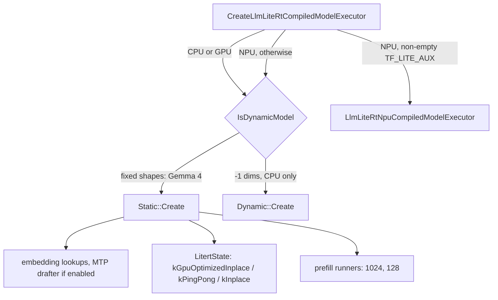
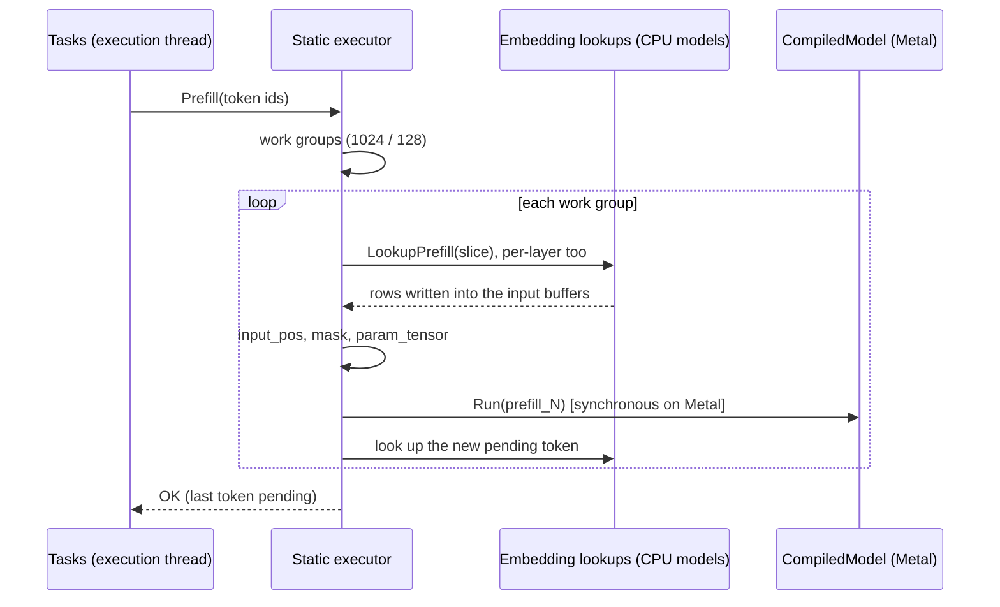

# Executors

> **Scope:** LiteRT-LM's executors in `runtime/executor/`: the `LlmExecutor` interfaces, the compiled-model executors (static, dynamic; the NPU executor mapped only), signatures and prompt chunking, magic numbers, the inputs each run needs and who fills them, the KV state (`LitertState`, our raw Metal snapshots), the sampling hand-off, MTP speculative decoding, and the vision, audio and embedding executors. **Out of scope:** engine creation, sessions, execution managers, the resource manager and the decode loop in `Tasks` ([engine-and-sessions.md](engine-and-sessions.md)); samplers, embedding lookup internals and constraints ([components.md](components.md)); the container and its sections ([file-format.md](file-format.md)); `CompiledModel`, tensor buffers and the Metal accelerator ([../litert/runtime.md](../litert/runtime.md), [../litert/ml-drift-delegate.md](../litert/ml-drift-delegate.md)); the CPU path ([../litert/cpu-xnnpack.md](../litert/cpu-xnnpack.md)); the model graphs ([../models/gemma4-e4b.md](../models/gemma4-e4b.md), [../models/gemma4-e2b.md](../models/gemma4-e2b.md), [../models/embeddinggemma.md](../models/embeddinggemma.md)).
> **Pinned to:** LiteRT-LM `7b872544` (`agello-next`; Google's `0.19.0-nightly.20261013` `df6df5b8` plus our commits). Differences from what Agello ships (the v0.18.0 wrapper at `85b1a776` with Google's prebuilt v0.18.0 binary) are called out where they matter.
> **Applies to:** all platforms, with an "On Apple" section for iOS and macOS. **Last verified:** 2026-10-15

## Summary

An executor turns token ids into KV-cache updates and logits. For Gemma 4 on the GPU that is `LlmLiteRtCompiledModelExecutorStatic`: it owns one LiteRT `CompiledModel` holding the `prefill_1024`, `prefill_128`, `decode` and `verify` signatures, a `LitertState` holding the KV caches, two CPU embedding lookups (token embeddings and per-layer embeddings), the sampler, and, when speculative decoding is on, an `LlmLiteRtMtpDrafter`.

What matters for Agello:

- The model files export every context-sized dimension as the prime 32003; at load it becomes `maxNumTokens`, or 32,000 when `maxNumTokens` is 32,003 or more. Left unset, the engine picks 4,096 for E4B first. That is the allocated context.
- Prompts are split across the 1024- and 128-token prefill signatures by a "cautious greedy" rule; on Metal every prefill run is synchronous.
- Every token costs CPU work: two embedding lookups run as CPU models, the inputs are copied into GPU buffers, and in our build sampling runs on the CPU because the closed Metal sampler isn't linked.
- MTP drafts 3 tokens per round for E4B and E2B; the verifier accepts the longest prefix that matches its own greedy picks, so every token an MTP round emits is chosen greedily whatever the sampler settings; only priming steps use the session's sampler.
- Session switches snapshot the KV caches; on Metal our build copies the raw bytes of each shared `MTLBuffer` (ours: `aec81cb7`, `585203d3`).

## Concepts

| Term | Meaning |
| --- | --- |
| Executor | The object that runs a model's graphs for one engine (`LlmExecutor`, an alias of `LlmExecutorBase`). One per engine, shared by its sessions; the resource manager swaps per-session state in and out ([engine-and-sessions.md](engine-and-sessions.md)). |
| Signature | A named entry point of a `.tflite` graph (`prefill_1024`, `decode`, `verify`, `mtp_drafter`, `vision_140`, `encoder_1x512`, ...). The executor binds buffers by the signature's input and output names. |
| Magic number | A prime greater than 10 that the exporter writes for a dimension the runtime should choose at load (32003 for the context). LiteRT rewrites it in the flatbuffer before compilation. |
| Export window | The magic number as written in the file (32003). |
| Allocated context | The size the KV caches and masks get at load: the target that replaces the magic number, then `maxNumTokens` is clamped to it. |
| Filled length | How many positions of the KV cache hold tokens: the executor's `current_step` minus the pending token, which isn't in the cache yet. |
| Pending token | The last token of every prefill and decode call, kept unprocessed so that the next call starts with it. Its embeddings are looked up ahead of time. |
| Step | A position in the sequence. `RuntimeState::current_step` counts positions including the pending token. |
| Work group | One prefill run: a prefill signature and the number of prompt tokens it carries. |
| `LitertState` | The KV caches of one context: one bank of buffers (in place) or two (ping-pong). |
| `param_tensor` | An `INT32[1, 1, 1, 7]` input of the Gemma 4 graphs written by the executor each run with the start and end positions of the update. |
| PLE | Per-layer embeddings: the E models' second embedding table, one vector of 256 per layer per token. |
| Drafter, verifier | MTP's small `mtp_drafter` model, and the main model's `verify` signature that checks the drafts. |
| Internal / external sampling | Whether the executor samples (`Decode()`) or returns logits for the session to sample (`DecodeLogits()`). |

### Per-context data

The executor's mutable state lives in an `LlmContext`: a `ProcessedContext` (the `ProcessedTokens` history, the optional LoRA id and, once saved, the KV `StateInterface`), a `RuntimeConfig` (sampler parameters, number of output heads) and a `RuntimeState` (`current_step`, `ran_decode`, the random generator). `CloneContext` copies all three and deep-copies the KV state; `RestoreContext` swaps them back in [`runtime/executor/llm_litert_compiled_model_executor.cc:1602-1616`](https://github.com/PowerBeef/agello-litert-lm/blob/7b872544fdbd81308f98b1e2acf8c5798a549df6/runtime/executor/llm_litert_compiled_model_executor.cc#L1602-L1616) [`runtime/executor/llm_litert_compiled_model_executor.cc:1688-1705`](https://github.com/PowerBeef/agello-litert-lm/blob/7b872544fdbd81308f98b1e2acf8c5798a549df6/runtime/executor/llm_litert_compiled_model_executor.cc#L1688-L1705). The resource manager uses these to switch sessions ([engine-and-sessions.md](engine-and-sessions.md)).

### Input and output names

`GetModelSignaturesFromInputOutputNames` maps tensor names to roles: tokens (`token_ids`, `tokens`), positions (`positions`, `input_pos`), global mask (`attn_mask`, `mask`), local mask (`local_mask`, `attn_mask_local`, `local_attn_mask`), `embeddings`, `per_layer_embeddings`, `param_tensor`, and `logits` [`runtime/executor/litert_compiled_model_executor_utils.cc:84-106`](https://github.com/google-ai-edge/LiteRT-LM/blob/df6df5b84d5845b49889f631ed4cac80b4325dd3/runtime/executor/litert_compiled_model_executor_utils.cc#L84-L106). With `strict` it requires tokens or embeddings, positions and logits [`runtime/executor/litert_compiled_model_executor_utils.cc:331-386`](https://github.com/google-ai-edge/LiteRT-LM/blob/df6df5b84d5845b49889f631ed4cac80b4325dd3/runtime/executor/litert_compiled_model_executor_utils.cc#L331-L386). The Gemma 4 files use `embeddings`, `per_layer_embeddings`, `input_pos`, `mask` and `param_tensor`, with no token input and no local mask ([../generated/models/e4b-ours.md](../generated/models/e4b-ours.md)), which decides most of the branches below.

## How it works

### The executor interfaces

There are two families of interfaces in `runtime/executor/`:

- **`LlmExecutorBase`** (aliased as `LlmExecutor` [`runtime/executor/llm_executor.h:22`](https://github.com/google-ai-edge/LiteRT-LM/blob/df6df5b84d5845b49889f631ed4cac80b4325dd3/runtime/executor/llm_executor.h#L22)): the one everything uses. `Prefill(inputs[, params])` [`runtime/executor/llm_executor_base.h:46-58`](https://github.com/google-ai-edge/LiteRT-LM/blob/df6df5b84d5845b49889f631ed4cac80b4325dd3/runtime/executor/llm_executor_base.h#L46-L58); `Decode()` and `Decode(params)` return sampled ids per candidate; `DecodeLogits(inputs)` returns logits without sampling [`runtime/executor/llm_executor_base.h:60-96`](https://github.com/google-ai-edge/LiteRT-LM/blob/df6df5b84d5845b49889f631ed4cac80b4325dd3/runtime/executor/llm_executor_base.h#L60-L96); context management (`CreateNewContext`, `CloneContext`, `RestoreContext`, `SaveContext`) [`runtime/executor/llm_executor_base.h:194-232`](https://github.com/google-ai-edge/LiteRT-LM/blob/df6df5b84d5845b49889f631ed4cac80b4325dd3/runtime/executor/llm_executor_base.h#L194-L232); step control (`GetCurrentStep`, `SetCurrentStep`, `Reset`); `GetVocabSize`, profiling and `GetExecutorStats`. Most methods default to `UnimplementedError`.
- **`LlmExecutorBaseInterface`** with `LlmExecutorExternalSamplerInterface::Step` and `LlmExecutorInternalSamplerInterface::SampleTokens(num_steps, ...)` [`runtime/executor/llm_executor_interface.h:31-56`](https://github.com/google-ai-edge/LiteRT-LM/blob/df6df5b84d5845b49889f631ed4cac80b4325dd3/runtime/executor/llm_executor_interface.h#L31-L56) [`runtime/executor/llm_executor_interface.h:58-66`](https://github.com/google-ai-edge/LiteRT-LM/blob/df6df5b84d5845b49889f631ed4cac80b4325dd3/runtime/executor/llm_executor_interface.h#L58-L66) [`runtime/executor/llm_executor_interface.h:68-78`](https://github.com/google-ai-edge/LiteRT-LM/blob/df6df5b84d5845b49889f631ed4cac80b4325dd3/runtime/executor/llm_executor_interface.h#L68-L78): a newer contract that passes the KV cache (`StateInterface&`) explicitly and declares the executor stateless. At the pin nothing implements or uses it outside its header and its Bazel target [`runtime/executor/BUILD:1379-1383`](https://github.com/PowerBeef/agello-litert-lm/blob/7b872544fdbd81308f98b1e2acf8c5798a549df6/runtime/executor/BUILD#L1379-L1383).

Implementations of `LlmExecutor` at the pin: `LlmLiteRtCompiledModelExecutorBase` with its `Static` and `Dynamic` subclasses [`runtime/executor/llm_litert_compiled_model_executor.h:56-60`](https://github.com/PowerBeef/agello-litert-lm/blob/7b872544fdbd81308f98b1e2acf8c5798a549df6/runtime/executor/llm_litert_compiled_model_executor.h#L56-L60) [`runtime/executor/llm_litert_compiled_model_executor.h:496-499`](https://github.com/PowerBeef/agello-litert-lm/blob/7b872544fdbd81308f98b1e2acf8c5798a549df6/runtime/executor/llm_litert_compiled_model_executor.h#L496-L499) [`runtime/executor/llm_litert_compiled_model_executor.h:570-575`](https://github.com/PowerBeef/agello-litert-lm/blob/7b872544fdbd81308f98b1e2acf8c5798a549df6/runtime/executor/llm_litert_compiled_model_executor.h#L570-L575), `LlmLiteRtNpuCompiledModelExecutor`, and `FakeLlmExecutor` for tests. The comment on the base class still says "GPU executor"; it serves the CPU too.

Calls are synchronous: `Tasks` calls `executor.Decode(params)` (internal sampling) or `executor.DecodeLogits(inputs)` (external sampling) on the thread that runs the task and gets the result back [`runtime/core/tasks.cc:509-523`](https://github.com/PowerBeef/agello-litert-lm/blob/7b872544fdbd81308f98b1e2acf8c5798a549df6/runtime/core/tasks.cc#L509-L523) [`runtime/core/tasks.cc:465-485`](https://github.com/PowerBeef/agello-litert-lm/blob/7b872544fdbd81308f98b1e2acf8c5798a549df6/runtime/core/tasks.cc#L465-L485). Under `ThreadedExecutionManager` (the default) that is the single execution thread; with `single_threaded_execution`, `SerialExecutionManager` runs tasks on the thread that waits for them [`runtime/framework/resource_management/threaded_execution_manager.cc:1111-1116`](https://github.com/PowerBeef/agello-litert-lm/blob/7b872544fdbd81308f98b1e2acf8c5798a549df6/runtime/framework/resource_management/threaded_execution_manager.cc#L1111-L1116) [`runtime/framework/resource_management/serial_execution_manager.cc:424-442`](https://github.com/google-ai-edge/LiteRT-LM/blob/df6df5b84d5845b49889f631ed4cac80b4325dd3/runtime/framework/resource_management/serial_execution_manager.cc#L424-L442) [`runtime/core/engine_advanced_impl.cc:663-680`](https://github.com/google-ai-edge/LiteRT-LM/blob/df6df5b84d5845b49889f631ed4cac80b4325dd3/runtime/core/engine_advanced_impl.cc#L663-L680). The executor takes no locks of its own; how the execution manager orders calls is in [engine-and-sessions.md](engine-and-sessions.md).

`UpdatePreGraphRunCallback` and `UpdatePostGraphRunCallback` let a caller inspect or modify the buffer maps around each signature run [`runtime/executor/llm_litert_compiled_model_executor.h:204-215`](https://github.com/PowerBeef/agello-litert-lm/blob/7b872544fdbd81308f98b1e2acf8c5798a549df6/runtime/executor/llm_litert_compiled_model_executor.h#L204-L215).

### Creating an executor

`CreateLlmLiteRtCompiledModelExecutor` switches on the backend: CPU and GPU go to `CreateCpuOrGpuLlmLiteRtCompiledModelExecutor`, NPU to the NPU path [`runtime/executor/llm_litert_compiled_model_executor_factory.cc:314-331`](https://github.com/google-ai-edge/LiteRT-LM/blob/df6df5b84d5845b49889f631ed4cac80b4325dd3/runtime/executor/llm_litert_compiled_model_executor_factory.cc#L314-L331). The CPU/GPU path picks `LlmLiteRtCompiledModelExecutorDynamic` or `...Static` with `IsDynamicModel`: when the file has an `ExecutorMetadata` section, the model is dynamic only if a state buffer with a sequence axis is dynamic on that axis (there is no fallback); without metadata, it checks the KV-cache inputs and positions of the first signature whose key starts with `prefill` [`runtime/executor/llm_litert_compiled_model_executor_factory.cc:82-117`](https://github.com/google-ai-edge/LiteRT-LM/blob/df6df5b84d5845b49889f631ed4cac80b4325dd3/runtime/executor/llm_litert_compiled_model_executor_factory.cc#L82-L117) [`runtime/executor/llm_litert_compiled_model_executor_factory.cc:209-223`](https://github.com/google-ai-edge/LiteRT-LM/blob/df6df5b84d5845b49889f631ed4cac80b4325dd3/runtime/executor/llm_litert_compiled_model_executor_factory.cc#L209-L223) [`runtime/executor/llm_litert_compiled_model_executor_factory.cc:231-249`](https://github.com/google-ai-edge/LiteRT-LM/blob/df6df5b84d5845b49889f631ed4cac80b4325dd3/runtime/executor/llm_litert_compiled_model_executor_factory.cc#L231-L249). The Gemma 4 files have fixed shapes and no `ExecutorMetadata` section, so they get the static executor ([../generated/models/e4b-ours.md](../generated/models/e4b-ours.md), sections 0-11).

`LlmLiteRtCompiledModelExecutorStatic::Create` (resources form) then:

1. Builds compilation options for the backend with `CreateCompilationOptions` (FP16 activations unless settings say otherwise [`runtime/executor/llm_litert_compiled_model_executor.cc:2084-2089`](https://github.com/PowerBeef/agello-litert-lm/blob/7b872544fdbd81308f98b1e2acf8c5798a549df6/runtime/executor/llm_litert_compiled_model_executor.cc#L2084-L2089); GPU options below under "On Apple"), sets external-weight options and calls `CompiledModel::Create` on the `tf_lite_prefill_decode` section.
2. `InitializeAuxiliaryExecutorComponents` reads the executor metadata if present, creates the two embedding lookups from the `tf_lite_embedder` and `tf_lite_per_layer_embedder` sections (with the end-of-image and end-of-audio models), and creates the MTP drafter now if the engine's `enable_speculative_decoding` is set [`runtime/executor/llm_litert_compiled_model_executor.cc:320-352`](https://github.com/PowerBeef/agello-litert-lm/blob/7b872544fdbd81308f98b1e2acf8c5798a549df6/runtime/executor/llm_litert_compiled_model_executor.cc#L320-L352).
3. Picks the prefill signature used to size the state: the first key starting with `prefill`, filtered by `selected_signatures`; when signatures are selected they must include `decode` [`runtime/executor/llm_litert_compiled_model_executor.cc:2144-2160`](https://github.com/PowerBeef/agello-litert-lm/blob/7b872544fdbd81308f98b1e2acf8c5798a549df6/runtime/executor/llm_litert_compiled_model_executor.cc#L2144-L2160).
4. Chooses the KV allocation policy: `kInplace` on the CPU; on the GPU, `kGpuOptimizedInplace` when the decode signature has a `param_tensor` input and `kPingPong` otherwise [`runtime/executor/llm_litert_compiled_model_executor.cc:2169-2177`](https://github.com/PowerBeef/agello-litert-lm/blob/7b872544fdbd81308f98b1e2acf8c5798a549df6/runtime/executor/llm_litert_compiled_model_executor.cc#L2169-L2177).
5. Creates the `LitertState`, then clamps `maxNumTokens` to the state's number of entries [`runtime/executor/llm_litert_compiled_model_executor.cc:2179-2188`](https://github.com/PowerBeef/agello-litert-lm/blob/7b872544fdbd81308f98b1e2acf8c5798a549df6/runtime/executor/llm_litert_compiled_model_executor.cc#L2179-L2188) [`runtime/executor/llm_litert_compiled_model_executor.cc:99-114`](https://github.com/PowerBeef/agello-litert-lm/blob/7b872544fdbd81308f98b1e2acf8c5798a549df6/runtime/executor/llm_litert_compiled_model_executor.cc#L99-L114).
6. Creates the decode input and output buffers, skipping KV tensors (owned by the state) and LoRA inputs [`runtime/executor/llm_litert_compiled_model_executor.cc:2190-2204`](https://github.com/PowerBeef/agello-litert-lm/blob/7b872544fdbd81308f98b1e2acf8c5798a549df6/runtime/executor/llm_litert_compiled_model_executor.cc#L2190-L2204). The `logits` buffer is FP16 when the GPU runs FP16 and the sampler backend resolves to GPU [`runtime/executor/llm_litert_compiled_model_executor.cc:2213-2229`](https://github.com/PowerBeef/agello-litert-lm/blob/7b872544fdbd81308f98b1e2acf8c5798a549df6/runtime/executor/llm_litert_compiled_model_executor.cc#L2213-L2229).
7. Creates a second, decode-only state when the logits batch is larger than 1 (several output candidates); MTP requires a batch of 1 [`runtime/executor/llm_litert_compiled_model_executor.cc:2265-2280`](https://github.com/PowerBeef/agello-litert-lm/blob/7b872544fdbd81308f98b1e2acf8c5798a549df6/runtime/executor/llm_litert_compiled_model_executor.cc#L2265-L2280).
8. Builds the prefill runner set: every `prefill*` signature keyed by its sequence length, largest first [`runtime/executor/llm_litert_compiled_model_executor.cc:2282-2287`](https://github.com/PowerBeef/agello-litert-lm/blob/7b872544fdbd81308f98b1e2acf8c5798a549df6/runtime/executor/llm_litert_compiled_model_executor.cc#L2282-L2287) [`runtime/executor/litert_compiled_model_executor_utils.cc:452-483`](https://github.com/google-ai-edge/LiteRT-LM/blob/df6df5b84d5845b49889f631ed4cac80b4325dd3/runtime/executor/litert_compiled_model_executor_utils.cc#L452-L483) [`runtime/executor/litert_compiled_model_executor_utils.h:51-52`](https://github.com/google-ai-edge/LiteRT-LM/blob/df6df5b84d5845b49889f631ed4cac80b4325dd3/runtime/executor/litert_compiled_model_executor_utils.h#L51-L52).



The engine may also compile the models itself (the streaming path) and pass the compiled main and drafter models to the second `Create` overload; the auxiliary components are then created the same way [`runtime/core/engine_advanced_impl.cc:1040-1060`](https://github.com/google-ai-edge/LiteRT-LM/blob/df6df5b84d5845b49889f631ed4cac80b4325dd3/runtime/core/engine_advanced_impl.cc#L1040-L1060). In that path the drafter's weights are skipped when the engine-level flag is off [`runtime/core/engine_advanced_impl.cc:937-946`](https://github.com/google-ai-edge/LiteRT-LM/blob/df6df5b84d5845b49889f631ed4cac80b4325dd3/runtime/core/engine_advanced_impl.cc#L937-L946).

**Dynamic executor.** `LlmLiteRtCompiledModelExecutorDynamic` is for files whose KV caches and sequence length are dynamic. It runs on the CPU only [`runtime/executor/llm_litert_compiled_model_executor.cc:2491-2503`](https://github.com/PowerBeef/agello-litert-lm/blob/7b872544fdbd81308f98b1e2acf8c5798a549df6/runtime/executor/llm_litert_compiled_model_executor.cc#L2491-L2503), compiles in FP32 [`runtime/executor/llm_litert_compiled_model_executor.cc:2461-2464`](https://github.com/PowerBeef/agello-litert-lm/blob/7b872544fdbd81308f98b1e2acf8c5798a549df6/runtime/executor/llm_litert_compiled_model_executor.cc#L2461-L2464), uses the in-place policy [`runtime/executor/llm_litert_compiled_model_executor.cc:2527-2531`](https://github.com/PowerBeef/agello-litert-lm/blob/7b872544fdbd81308f98b1e2acf8c5798a549df6/runtime/executor/llm_litert_compiled_model_executor.cc#L2527-L2531), splits prompts into chunks of `CpuConfig::prefill_chunk_size` (no chunking at -1) [`runtime/executor/llm_litert_compiled_model_executor.cc:2347-2358`](https://github.com/PowerBeef/agello-litert-lm/blob/7b872544fdbd81308f98b1e2acf8c5798a549df6/runtime/executor/llm_litert_compiled_model_executor.cc#L2347-L2358), grows the KV cache to fit each prefill [`runtime/executor/llm_litert_compiled_model_executor.cc:2391-2407`](https://github.com/PowerBeef/agello-litert-lm/blob/7b872544fdbd81308f98b1e2acf8c5798a549df6/runtime/executor/llm_litert_compiled_model_executor.cc#L2391-L2407) and by `kv_increment_size` entries when decode reaches the end [`runtime/executor/llm_litert_compiled_model_executor.cc:2427-2443`](https://github.com/PowerBeef/agello-litert-lm/blob/7b872544fdbd81308f98b1e2acf8c5798a549df6/runtime/executor/llm_litert_compiled_model_executor.cc#L2427-L2443). `LitertState::Resize` allocates new buffers and copies the old contents across [`runtime/executor/litert/state.cc:436-477`](https://github.com/PowerBeef/agello-litert-lm/blob/7b872544fdbd81308f98b1e2acf8c5798a549df6/runtime/executor/litert/state.cc#L436-L477). None of the Gemma 4 files Agello uses take this path.

**NPU executor (mapped).** `LlmLiteRtNpuCompiledModelExecutor` serves files packaged with a non-empty `TF_LITE_AUX` section for Qualcomm and Google Tensor NPUs; otherwise an NPU request goes to the CPU/GPU executor with `use_generic_litert_compiler_plugin` set, LiteRT's generic compiler plugin [`runtime/executor/llm_litert_compiled_model_executor_factory.cc:288-310`](https://github.com/google-ai-edge/LiteRT-LM/blob/df6df5b84d5845b49889f631ed4cac80b4325dd3/runtime/executor/llm_litert_compiled_model_executor_factory.cc#L288-L310) [`runtime/executor/llm_litert_compiled_model_executor_factory.cc:192-205`](https://github.com/google-ai-edge/LiteRT-LM/blob/df6df5b84d5845b49889f631ed4cac80b4325dd3/runtime/executor/llm_litert_compiled_model_executor_factory.cc#L192-L205); builds with `LITERT_DISABLE_NPU` reject NPU. It has its own KV cache, mask, RoPE and embedder helpers under `runtime/executor/npu/`. It is compiled out on iOS: `//build_config:disable_npu_backend` matches `@platforms//os:ios` and defines `LITERT_DISABLE_NPU` for the factory [`build_config/BUILD:323-332`](https://github.com/google-ai-edge/LiteRT-LM/blob/df6df5b84d5845b49889f631ed4cac80b4325dd3/build_config/BUILD#L323-L332) [`runtime/executor/BUILD:455-459`](https://github.com/PowerBeef/agello-litert-lm/blob/7b872544fdbd81308f98b1e2acf8c5798a549df6/runtime/executor/BUILD#L455-L459) [`runtime/executor/llm_litert_compiled_model_executor_factory.cc:48-50`](https://github.com/google-ai-edge/LiteRT-LM/blob/df6df5b84d5845b49889f631ed4cac80b4325dd3/runtime/executor/llm_litert_compiled_model_executor_factory.cc#L48-L50). <!-- c:LM-EXE-001 --> See [other-platforms.md](../other-platforms.md).

### Signatures in the Gemma 4 files

| Signature | E4B inputs (export) | E4B outputs | Used by |
| --- | --- | --- | --- |
| `prefill_1024` | `embeddings [1,1024,2560]`, `per_layer_embeddings [1,1024,42,256]`, `input_pos [1024]`, `mask BOOL[1,1,1024,32003]`, `param_tensor INT32[1,1,1,7]`, 48 KV caches | the 48 KV caches | prefill work groups |
| `prefill_128` | the same with 128 rows | the 48 KV caches | prefill work groups |
| `decode` | `embeddings [1,1,2560]`, `per_layer_embeddings [1,1,42,256]`, `input_pos [1]`, `mask [1,1,1,32003]`, `param_tensor`, KV | `logits [1,1,262144]`, `activations [1,1,2560]`, KV | plain decode; MTP priming |
| `verify` | the decode inputs with 4 rows | `logits [1,4,262144]`, `activations [1,4,2560]`, KV | MTP verification |
| `mtp_drafter` (own section) | `activations [1,1,5120]`, `input_pos [1]`, `mask [1,1,1,32003]`, `param_tensor`, `kv_cache_k/v_22`, `kv_cache_k/v_23` | `logits [1,1,262144]`, `projected_activations [1,1,2560]` | MTP drafting |

Source: [../generated/models/e4b-ours.md](../generated/models/e4b-ours.md) (section 10, signatures `decode`, `prefill_1024`, `prefill_128`, `verify`; section 11). The 48 KV caches are `kv_cache_k_0..23` and `kv_cache_v_0..23`, INT8, two KV heads, head size 256 (512 for caches 5, 11, 17, 23); E2B has 15 caches of one head, 1,536-wide embeddings and 35 per-layer rows, the same four signatures, and a drafter that reads caches 13 and 14 ([../generated/models/e2b-google.md](../generated/models/e2b-google.md)). The model pages describe the graphs.

The engine log of a real run on this Mac lists `decode`, `prefill_1024` and `verify` with subgraph indices 0, 1 and 3 ([../generated/engine-run.md](../generated/engine-run.md), "Engine log"). `prefill_128` (subgraph 2) is not missing: the generator keeps the first occurrence of each message with digits normalized, so its line is folded into `prefill_1024`'s.

### Magic numbers and the allocated context

At environment creation, for CPU and GPU (and NPU through the generic plugin), `CreateEnvironment` asks `MagicNumberConfigsHelper` for LiteRT environment options unless `configure_magic_numbers` is false [`runtime/util/litert_util.cc:151-159`](https://github.com/google-ai-edge/LiteRT-LM/blob/df6df5b84d5845b49889f631ed4cac80b4325dd3/runtime/util/litert_util.cc#L151-L159). The helper:

1. Scans the `tf_lite_prefill_decode` model. A dimension is a magic number when it is a prime greater than 10 [`runtime/executor/magic_number_configs_helper.cc:79-94`](https://github.com/google-ai-edge/LiteRT-LM/blob/df6df5b84d5845b49889f631ed4cac80b4325dd3/runtime/executor/magic_number_configs_helper.cc#L79-L94). It reads the last dimension of every prefill and decode input whose name contains `mask` (the context), the last dimension of prefill inputs containing `pos` (prefill lengths), and the first dimension of decode outputs containing `logits` (output candidates) [`runtime/executor/magic_number_configs_helper.cc:114-158`](https://github.com/google-ai-edge/LiteRT-LM/blob/df6df5b84d5845b49889f631ed4cac80b4325dd3/runtime/executor/magic_number_configs_helper.cc#L114-L158).
2. Context: target = `maxNumTokens` if it is positive and smaller than the magic number, otherwise the largest multiple of 256 below the magic number [`runtime/executor/magic_number_configs_helper.cc:259-271`](https://github.com/google-ai-edge/LiteRT-LM/blob/df6df5b84d5845b49889f631ed4cac80b4325dd3/runtime/executor/magic_number_configs_helper.cc#L259-L271) [`runtime/executor/magic_number_configs_helper.cc:243-257`](https://github.com/google-ai-edge/LiteRT-LM/blob/df6df5b84d5845b49889f631ed4cac80b4325dd3/runtime/executor/magic_number_configs_helper.cc#L243-L257) [`runtime/executor/magic_number_configs_helper.cc:307-314`](https://github.com/google-ai-edge/LiteRT-LM/blob/df6df5b84d5845b49889f631ed4cac80b4325dd3/runtime/executor/magic_number_configs_helper.cc#L307-L314). The config has no signature prefix, so it applies to every model compiled in that environment.
3. Prefill lengths: matched in order against `AdvancedSettings::prefill_batch_sizes`, with defaults, and capped at the context target [`runtime/executor/magic_number_configs_helper.cc:345-390`](https://github.com/google-ai-edge/LiteRT-LM/blob/df6df5b84d5845b49889f631ed4cac80b4325dd3/runtime/executor/magic_number_configs_helper.cc#L345-L390).
4. Passes the configs to LiteRT as `kMagicNumberConfigs` (and `kMagicNumberVerifications` when `verify_magic_numbers` is set) [`runtime/executor/magic_number_configs_helper.cc:413-424`](https://github.com/google-ai-edge/LiteRT-LM/blob/df6df5b84d5845b49889f631ed4cac80b4325dd3/runtime/executor/magic_number_configs_helper.cc#L413-L424). LiteRT rewrites the tensors ([../litert/runtime.md](../litert/runtime.md)).

For E4B and E2B the only magic number is the context, 32003: the prefill lengths 1024 and 128 and the logits batch 1 are not primes, so `prefill_batch_sizes` has no effect on these files. <!-- c:LM-EXE-002 --> The resulting context target is:

| `maxNumTokens` when the environment is created | Allocated context (E4B, E2B) |
| --- | --- |
| 1 to 32,002 | that value |
| 32,003 or more (for example 32,768) | 32,000 |
| 0 | 32,000 (the helper's own default; through the engine 0 never gets here, see below) |

<!-- c:LM-EXE-003 --> The engine run shows the rewrite at work: one config, `magic_number=32003, target_number=8192`, applied to 577 tensors of `decode`, 426 of `prefill_1024`, 581 of `verify` and 57 of the drafter's `mtp_drafter` ([../generated/engine-run.md](../generated/engine-run.md), "Engine log"). <!-- c:LM-EXE-004 --> An unset `maxNumTokens` is replaced before the environment exists: `MaybeUpdateAndValidate` uses the file's `LlmMetadata.max_num_tokens` when set, and otherwise the smallest multiple of 4,096 above the prompt hint's token count plus 1,024 [`runtime/engine/engine_settings.cc:329-340`](https://github.com/google-ai-edge/LiteRT-LM/blob/df6df5b84d5845b49889f631ed4cac80b4325dd3/runtime/engine/engine_settings.cc#L329-L340) [`runtime/engine/engine_settings.cc:342-361`](https://github.com/google-ai-edge/LiteRT-LM/blob/df6df5b84d5845b49889f631ed4cac80b4325dd3/runtime/engine/engine_settings.cc#L342-L361). The E4B file's metadata has no `max_num_tokens` ([../generated/models/e4b-ours.md](../generated/models/e4b-ours.md), "Metadata"), so with no prompt hint an unset `maxNumTokens` gives a 4,096-token context. <!-- c:LM-EXE-005 --> Engine creation is described in [engine-and-sessions.md](engine-and-sessions.md).

After compilation the static executor takes the context from the state: with no executor metadata, `LitertState` reads it from the last dimension of the prefill signature's mask input [`runtime/executor/litert/state.cc:649-673`](https://github.com/PowerBeef/agello-litert-lm/blob/7b872544fdbd81308f98b1e2acf8c5798a549df6/runtime/executor/litert/state.cc#L649-L673), and `ClampMaxNumTokens` lowers `maxNumTokens` to it [`runtime/executor/llm_litert_compiled_model_executor.cc:99-114`](https://github.com/PowerBeef/agello-litert-lm/blob/7b872544fdbd81308f98b1e2acf8c5798a549df6/runtime/executor/llm_litert_compiled_model_executor.cc#L99-L114). With executor metadata it is the smallest sequence size of the global caches [`runtime/executor/litert/state.cc:830-844`](https://github.com/PowerBeef/agello-litert-lm/blob/7b872544fdbd81308f98b1e2acf8c5798a549df6/runtime/executor/litert/state.cc#L830-L844).

At 28,672 bytes per token for E4B's 24 caches (two heads of 256 or 512 INT8 values for K and again for V), an allocated context of 32,000 holds 917,504,000 bytes of KV and one of 32,768 would hold 939,524,096. <!-- c:LM-EXE-006 --> This is the arithmetic behind the 918 MB and 940 MB figures in older notes; [../memory.md](../memory.md) owns the memory budget.

### Inputs and who fills them

| Input (Gemma 4) | Filled by | On which device | When |
| --- | --- | --- | --- |
| `embeddings` | `EmbeddingLookupManager` runs the `tf_lite_embedder` model per token and writes the rows into the input buffer [`runtime/executor/llm_litert_compiled_model_executor.cc:714-737`](https://github.com/PowerBeef/agello-litert-lm/blob/7b872544fdbd81308f98b1e2acf8c5798a549df6/runtime/executor/llm_litert_compiled_model_executor.cc#L714-L737) | CPU model; written into the GPU buffer through a lock | every prefill token; the pending token at the end of a call [`runtime/executor/llm_litert_compiled_model_executor.cc:804-857`](https://github.com/PowerBeef/agello-litert-lm/blob/7b872544fdbd81308f98b1e2acf8c5798a549df6/runtime/executor/llm_litert_compiled_model_executor.cc#L804-L857); the token to decode [`runtime/executor/llm_litert_compiled_model_executor.cc:988-1020`](https://github.com/PowerBeef/agello-litert-lm/blob/7b872544fdbd81308f98b1e2acf8c5798a549df6/runtime/executor/llm_litert_compiled_model_executor.cc#L988-L1020) |
| `per_layer_embeddings` | the per-layer embedding lookup (`tf_lite_per_layer_embedder`) [`runtime/executor/llm_litert_compiled_model_executor.cc:739-766`](https://github.com/PowerBeef/agello-litert-lm/blob/7b872544fdbd81308f98b1e2acf8c5798a549df6/runtime/executor/llm_litert_compiled_model_executor.cc#L739-L766) | CPU model, same | same |
| Multimodal rows | vision or audio embeddings from the encoders, copied in place of the placeholder ids -1 (image) and -2 (audio) [`runtime/components/embedding_lookup/embedding_lookup_manager.cc:110-127`](https://github.com/google-ai-edge/LiteRT-LM/blob/df6df5b84d5845b49889f631ed4cac80b4325dd3/runtime/components/embedding_lookup/embedding_lookup_manager.cc#L110-L127) | host memory | prefill of a turn with media |
| `input_pos` | the executor: consecutive positions from `current_step` [`runtime/executor/llm_litert_compiled_model_executor.cc:654-684`](https://github.com/PowerBeef/agello-litert-lm/blob/7b872544fdbd81308f98b1e2acf8c5798a549df6/runtime/executor/llm_litert_compiled_model_executor.cc#L654-L684); for decode, `current_step - 1` [`runtime/executor/llm_litert_compiled_model_executor.cc:1090-1116`](https://github.com/PowerBeef/agello-litert-lm/blob/7b872544fdbd81308f98b1e2acf8c5798a549df6/runtime/executor/llm_litert_compiled_model_executor.cc#L1090-L1116) | CPU writes into the GPU buffer | every run |
| `mask` | the executor: `InitializeAttentionMask` then `FillAttentionMask` [`runtime/executor/llm_litert_compiled_model_executor.cc:768-794`](https://github.com/PowerBeef/agello-litert-lm/blob/7b872544fdbd81308f98b1e2acf8c5798a549df6/runtime/executor/llm_litert_compiled_model_executor.cc#L768-L794) [`runtime/executor/llm_litert_compiled_model_executor.cc:1135-1163`](https://github.com/PowerBeef/agello-litert-lm/blob/7b872544fdbd81308f98b1e2acf8c5798a549df6/runtime/executor/llm_litert_compiled_model_executor.cc#L1135-L1163), unless skipped (below) | CPU | every prefill run and plain decode step |
| `param_tensor` | the executor: `FillSingleBufferCacheParamTensor` [`runtime/executor/llm_litert_compiled_model_executor.cc:795-801`](https://github.com/PowerBeef/agello-litert-lm/blob/7b872544fdbd81308f98b1e2acf8c5798a549df6/runtime/executor/llm_litert_compiled_model_executor.cc#L795-L801) [`runtime/executor/llm_litert_compiled_model_executor.cc:1164-1171`](https://github.com/PowerBeef/agello-litert-lm/blob/7b872544fdbd81308f98b1e2acf8c5798a549df6/runtime/executor/llm_litert_compiled_model_executor.cc#L1164-L1171) | CPU | every run |
| KV caches | `LitertState` binds its buffers [`runtime/executor/llm_litert_compiled_model_executor.cc:875-894`](https://github.com/PowerBeef/agello-litert-lm/blob/7b872544fdbd81308f98b1e2acf8c5798a549df6/runtime/executor/llm_litert_compiled_model_executor.cc#L875-L894) | GPU buffers, updated by the graph | every run |

For a model with a tokens input, `PrefillInternal` writes the slice's token ids instead (padding the rest) and does no lookup; otherwise it looks up embeddings and per-layer embeddings with the CPU `EmbeddingLookupManager`, or copies embeddings passed in the inputs when there is no lookup [`runtime/executor/llm_litert_compiled_model_executor.cc:690-714`](https://github.com/PowerBeef/agello-litert-lm/blob/7b872544fdbd81308f98b1e2acf8c5798a549df6/runtime/executor/llm_litert_compiled_model_executor.cc#L690-L714). The Gemma 4 files take the embedding path.

Prefill uses one set of input buffers per prefill signature, created on first use and reused [`runtime/executor/llm_litert_compiled_model_executor.cc:2029-2063`](https://github.com/PowerBeef/agello-litert-lm/blob/7b872544fdbd81308f98b1e2acf8c5798a549df6/runtime/executor/llm_litert_compiled_model_executor.cc#L2029-L2063); decode uses one set created at load. `FillInputBufferWithToken` writes either a token id or the token's embedding vector into each row and zeroes the rest of the row [`runtime/executor/llm_litert_compiled_model_executor.cc:469-507`](https://github.com/PowerBeef/agello-litert-lm/blob/7b872544fdbd81308f98b1e2acf8c5798a549df6/runtime/executor/llm_litert_compiled_model_executor.cc#L469-L507).

#### `param_tensor`

`param_tensor` is `INT32[1, 1, 1, 7]` in every Gemma 4 signature that touches the KV caches. Before each run the executor zeroes it and writes three values: the start position of the update, its end (start + number of tokens), and the end again; the other four stay 0 [`runtime/executor/litert_compiled_model_executor_utils.cc:678-697`](https://github.com/google-ai-edge/LiteRT-LM/blob/df6df5b84d5845b49889f631ed4cac80b4325dd3/runtime/executor/litert_compiled_model_executor_utils.cc#L678-L697). <!-- c:LM-EXE-007 --> The code's comment says the first two drive the cache-update kernel (`add_values_to_cache`) and the third tells the runtime batched matmul where the valid keys end; a prefill run passes its whole slice length, a decode run 1, the verifier 4 and each drafter run 1 [`runtime/executor/llm_litert_compiled_model_executor.cc:795-801`](https://github.com/PowerBeef/agello-litert-lm/blob/7b872544fdbd81308f98b1e2acf8c5798a549df6/runtime/executor/llm_litert_compiled_model_executor.cc#L795-L801) [`runtime/executor/llm_litert_compiled_model_executor.cc:1164-1171`](https://github.com/PowerBeef/agello-litert-lm/blob/7b872544fdbd81308f98b1e2acf8c5798a549df6/runtime/executor/llm_litert_compiled_model_executor.cc#L1164-L1171) [`runtime/executor/llm_litert_mtp_drafter.cc:576-648`](https://github.com/PowerBeef/agello-litert-lm/blob/7b872544fdbd81308f98b1e2acf8c5798a549df6/runtime/executor/llm_litert_mtp_drafter.cc#L576-L648) [`runtime/executor/llm_litert_mtp_drafter.cc:449-491`](https://github.com/PowerBeef/agello-litert-lm/blob/7b872544fdbd81308f98b1e2acf8c5798a549df6/runtime/executor/llm_litert_mtp_drafter.cc#L449-L491). With `param_tensor` present the GPU path uses one KV buffer per cache updated in place (`kGpuOptimizedInplace`) [`runtime/executor/llm_litert_compiled_model_executor.cc:2169-2177`](https://github.com/PowerBeef/agello-litert-lm/blob/7b872544fdbd81308f98b1e2acf8c5798a549df6/runtime/executor/llm_litert_compiled_model_executor.cc#L2169-L2177), and the GPU compilation options mark `param_tensor` as a host-written external tensor stored as a linear buffer [`runtime/executor/llm_executor_settings_utils.cc:166-202`](https://github.com/PowerBeef/agello-litert-lm/blob/7b872544fdbd81308f98b1e2acf8c5798a549df6/runtime/executor/llm_executor_settings_utils.cc#L166-L202). How the kernels consume it, including our sliding-window changes, is in [../ml-drift/kernels.md](../ml-drift/kernels.md).

#### The attention mask

`InitializeAttentionMask` fills the whole mask with "masked" (false for BOOL, -45824 for FP16, -45824 or -0.7 x `FLT_MAX` for FP32 depending on precision), and `FillAttentionMask` then opens, for each query row, the causal range (limited to the sliding window when configured); with the `VISION_BIDIRECTIONAL` mask type, image-token rows also open the following image tokens [`runtime/executor/litert_compiled_model_executor_utils.cc:639-676`](https://github.com/google-ai-edge/LiteRT-LM/blob/df6df5b84d5845b49889f631ed4cac80b4325dd3/runtime/executor/litert_compiled_model_executor_utils.cc#L639-L676) [`runtime/executor/litert_compiled_model_executor_utils.cc:792-852`](https://github.com/google-ai-edge/LiteRT-LM/blob/df6df5b84d5845b49889f631ed4cac80b4325dd3/runtime/executor/litert_compiled_model_executor_utils.cc#L792-L852) [`runtime/executor/litert_compiled_model_executor_utils.cc:862-900`](https://github.com/google-ai-edge/LiteRT-LM/blob/df6df5b84d5845b49889f631ed4cac80b4325dd3/runtime/executor/litert_compiled_model_executor_utils.cc#L862-L900). The mask types and the sliding window come from the file's executor metadata; without metadata both are causal and there is no window [`runtime/executor/litert_compiled_model_executor_utils.cc:699-725`](https://github.com/google-ai-edge/LiteRT-LM/blob/df6df5b84d5845b49889f631ed4cac80b4325dd3/runtime/executor/litert_compiled_model_executor_utils.cc#L699-L725) [`runtime/executor/litert_compiled_model_executor_utils.h:201-204`](https://github.com/google-ai-edge/LiteRT-LM/blob/df6df5b84d5845b49889f631ed4cac80b4325dd3/runtime/executor/litert_compiled_model_executor_utils.h#L201-L204). The E4B and E2B files have no `ExecutorMetadata` section, so the executor fills causal rows for every query, image placeholders included; the vision-bidirectional branch only runs when a file's metadata asks for it [`runtime/executor/litert_compiled_model_executor_utils.cc:854-917`](https://github.com/google-ai-edge/LiteRT-LM/blob/df6df5b84d5845b49889f631ed4cac80b4325dd3/runtime/executor/litert_compiled_model_executor_utils.cc#L854-L917). <!-- c:LM-EXE-008 --> The sliding window of the local layers is computed inside the graph from `input_pos` ([../generated/models/e4b-ours.md](../generated/models/e4b-ours.md), "Attention per layer").

The executor skips the CPU mask entirely when all of these hold: GPU backend, `param_tensor` present, a causal global mask, and the mask buffer was allocated in host memory because the GPU graph doesn't read it (every attention node pruned it) [`runtime/executor/litert_compiled_model_executor_utils.cc:752-790`](https://github.com/google-ai-edge/LiteRT-LM/blob/df6df5b84d5845b49889f631ed4cac80b4325dd3/runtime/executor/litert_compiled_model_executor_utils.cc#L752-L790) [`runtime/executor/llm_litert_compiled_model_executor.cc:615-631`](https://github.com/PowerBeef/agello-litert-lm/blob/7b872544fdbd81308f98b1e2acf8c5798a549df6/runtime/executor/llm_litert_compiled_model_executor.cc#L615-L631). In the engine run on this Mac, `mask_fills` = 4 = `runs_prefill` + `runs_decode`, so E4B's mask was still filled on every prefill and plain decode run ([../generated/engine-run.md](../generated/engine-run.md), counters). <!-- c:LM-EXE-009 --> At an 8,192 allocated context a decode mask is 8,192 bytes and a `prefill_1024` mask 8,388,608 bytes.

### Prefill and prompt chunking

`Static::Prefill` (one call per new chunk of a turn's tokens; [engine-and-sessions.md](engine-and-sessions.md) says what a turn sends):

1. `PrepareFirstPrefillAfterDecode` clears the MTP-primed flag and, after a multi-candidate decode, keeps candidate 0 [`runtime/executor/llm_litert_compiled_model_executor.cc:541-572`](https://github.com/PowerBeef/agello-litert-lm/blob/7b872544fdbd81308f98b1e2acf8c5798a549df6/runtime/executor/llm_litert_compiled_model_executor.cc#L541-L572).
2. Registers any vision or audio embeddings with the embedding lookup [`runtime/executor/llm_litert_compiled_model_executor.cc:2012-2014`](https://github.com/PowerBeef/agello-litert-lm/blob/7b872544fdbd81308f98b1e2acf8c5798a549df6/runtime/executor/llm_litert_compiled_model_executor.cc#L2012-L2014).
3. Computes the remaining capacity (`state entries - current_step`) and asks `GetOptimizedPrefillWorkGroups` for work groups; greedy chunking on the CPU, "cautious greedy" otherwise [`runtime/executor/llm_litert_compiled_model_executor.cc:2016-2028`](https://github.com/PowerBeef/agello-litert-lm/blob/7b872544fdbd81308f98b1e2acf8c5798a549df6/runtime/executor/llm_litert_compiled_model_executor.cc#L2016-L2028).
4. For each work group, creates that signature's buffers once, chooses synchronous or asynchronous execution, and calls `PrefillInternal` on the slice [`runtime/executor/llm_litert_compiled_model_executor.cc:2029-2063`](https://github.com/PowerBeef/agello-litert-lm/blob/7b872544fdbd81308f98b1e2acf8c5798a549df6/runtime/executor/llm_litert_compiled_model_executor.cc#L2029-L2063).

`GetOptimizedPrefillWorkGroups` drops signatures larger than the remaining capacity, then walks the signatures from the largest: it takes as many full chunks as fit, and for the remainder either lets the smaller signatures take it, or (when the remainder is at least half the current size) covers it with one more run of the current, larger signature, padded [`runtime/executor/litert_compiled_model_executor_utils.cc:511-521`](https://github.com/google-ai-edge/LiteRT-LM/blob/df6df5b84d5845b49889f631ed4cac80b4325dd3/runtime/executor/litert_compiled_model_executor_utils.cc#L511-L521) [`runtime/executor/litert_compiled_model_executor_utils.cc:551-636`](https://github.com/google-ai-edge/LiteRT-LM/blob/df6df5b84d5845b49889f631ed4cac80b4325dd3/runtime/executor/litert_compiled_model_executor_utils.cc#L551-L636). When the next size is at least half of the current one and the remainder fits in it, the smaller one takes it. On the CPU the remainder always cascades to the smaller sizes. If tokens remain that no signature can hold, the prefill fails with "Prefill input length exceeds available state entries" [`runtime/executor/litert_compiled_model_executor_utils.cc:551-636`](https://github.com/google-ai-edge/LiteRT-LM/blob/df6df5b84d5845b49889f631ed4cac80b4325dd3/runtime/executor/litert_compiled_model_executor_utils.cc#L551-L636). The code's own examples are in its comment [`runtime/executor/litert_compiled_model_executor_utils.cc:523-549`](https://github.com/google-ai-edge/LiteRT-LM/blob/df6df5b84d5845b49889f631ed4cac80b4325dd3/runtime/executor/litert_compiled_model_executor_utils.cc#L523-L549).

For E4B (`prefill_1024`, `prefill_128`) this gives:

| Prompt tokens | GPU work groups (signature: tokens) | Runs | CPU work groups |
| --- | --- | --- | --- |
| 130 | 128: 128; 128: 2 | 2 | same |
| 700 | 1024: 700 | 1 | 128 x 5, 128: 60 |
| 1,500 | 1024: 1024; 128 x 3; 128: 92 | 5 | same |
| 1,600 | 1024: 1024; 1024: 576 | 2 | 1024; 128 x 4; 128: 64 |
| 2,049 | 1024 x 2; 128: 1 | 3 | same |

<!-- c:LM-EXE-010 --> So a prompt longer than 1,024 tokens runs as full `prefill_1024` chunks, then its remainder: in one more padded `prefill_1024` run when it is 512 tokens or more, otherwise in `prefill_128` runs. The 2,049-token prompt of the engine run took 3 prefill runs (`runs_prefill` = 3) ([../generated/engine-run.md](../generated/engine-run.md)). <!-- c:LM-EXE-011 -->

`PrefillInternal` holds one token back. In each slice, the pending token from the previous call (if any) goes first, then all slice tokens but the last; the last becomes the new pending token, with its embeddings looked up now so that media rows stay in order [`runtime/executor/llm_litert_compiled_model_executor.cc:632-651`](https://github.com/PowerBeef/agello-litert-lm/blob/7b872544fdbd81308f98b1e2acf8c5798a549df6/runtime/executor/llm_litert_compiled_model_executor.cc#L632-L651) [`runtime/executor/llm_litert_compiled_model_executor.cc:654-684`](https://github.com/PowerBeef/agello-litert-lm/blob/7b872544fdbd81308f98b1e2acf8c5798a549df6/runtime/executor/llm_litert_compiled_model_executor.cc#L654-L684) [`runtime/executor/llm_litert_compiled_model_executor.cc:804-857`](https://github.com/PowerBeef/agello-litert-lm/blob/7b872544fdbd81308f98b1e2acf8c5798a549df6/runtime/executor/llm_litert_compiled_model_executor.cc#L804-L857). A slice of n tokens therefore fills n positions when a token was pending and n - 1 otherwise; a slice holding only the pending token's successor still runs once to process the pending token. Unused rows of the input get the pad token (token path) or the token-0 embedding (embedding path) [`runtime/executor/llm_litert_compiled_model_executor.cc:690-713`](https://github.com/PowerBeef/agello-litert-lm/blob/7b872544fdbd81308f98b1e2acf8c5798a549df6/runtime/executor/llm_litert_compiled_model_executor.cc#L690-L713) [`runtime/components/embedding_lookup/embedding_lookup_text.cc:407-412`](https://github.com/google-ai-edge/LiteRT-LM/blob/df6df5b84d5845b49889f631ed4cac80b4325dd3/runtime/components/embedding_lookup/embedding_lookup_text.cc#L407-L412).

On Metal every prefill run is synchronous: the static executor checks once whether any prefill input buffer is Metal memory and, if so, never runs prefill asynchronously (TODO b/494284915) [`runtime/executor/llm_litert_compiled_model_executor.cc:2047-2055`](https://github.com/PowerBeef/agello-litert-lm/blob/7b872544fdbd81308f98b1e2acf8c5798a549df6/runtime/executor/llm_litert_compiled_model_executor.cc#L2047-L2055). <!-- c:LM-EXE-012 --> Elsewhere all runs but the last are asynchronous, and the last too unless the caller asked to wait. Each run duplicates the buffer handles into fresh maps, adds the state's KV buffers, and calls `CompiledModel::Run` or `RunAsync` [`runtime/executor/llm_litert_compiled_model_executor.cc:909-919`](https://github.com/PowerBeef/agello-litert-lm/blob/7b872544fdbd81308f98b1e2acf8c5798a549df6/runtime/executor/llm_litert_compiled_model_executor.cc#L909-L919).

A pending token left by decode (the last token of a step or round, often a stop token) is an id only: embeddings are looked up for a prefill's last token and for the token about to be decoded, not for a pending token that the next prefill consumes, so the next prefill fills its row through `FillInputBufferWithToken`'s id path, the id in the first 4 bytes and zeros after it. <!-- c:X-GAP-003 --> The same holds for a token that `RollBackProcessedTokens` re-pends after a step change. <!-- c:X-GAP-004 --> What this leaves in the KV cache at a chat's turn boundaries is on [conversation.md](conversation.md#what-the-kv-cache-holds-at-a-turn-boundary).



### A decode step

`Decode(params)` without MTP [`runtime/executor/llm_litert_compiled_model_executor.cc:1335-1355`](https://github.com/PowerBeef/agello-litert-lm/blob/7b872544fdbd81308f98b1e2acf8c5798a549df6/runtime/executor/llm_litert_compiled_model_executor.cc#L1335-L1355):

1. `DecodeLogitsImpl` duplicates the logits buffer, runs `PrepareFirstDecode` (broadcasts the KV state when the session asks for several output candidates), and gets the token to decode: the pending token, or an id passed in; if it has no embeddings yet they are looked up now on the CPU [`runtime/executor/llm_litert_compiled_model_executor.cc:1526-1569`](https://github.com/PowerBeef/agello-litert-lm/blob/7b872544fdbd81308f98b1e2acf8c5798a549df6/runtime/executor/llm_litert_compiled_model_executor.cc#L1526-L1569) [`runtime/executor/llm_litert_compiled_model_executor.cc:1253-1279`](https://github.com/PowerBeef/agello-litert-lm/blob/7b872544fdbd81308f98b1e2acf8c5798a549df6/runtime/executor/llm_litert_compiled_model_executor.cc#L1253-L1279) [`runtime/executor/llm_litert_compiled_model_executor.cc:988-1020`](https://github.com/PowerBeef/agello-litert-lm/blob/7b872544fdbd81308f98b1e2acf8c5798a549df6/runtime/executor/llm_litert_compiled_model_executor.cc#L988-L1020).
2. `DecodeInternal` writes the embeddings and per-layer embeddings into the decode inputs, sets `input_pos` to `current_step - 1`, fills the mask (unless skipped) and `param_tensor` [`runtime/executor/llm_litert_compiled_model_executor.cc:1067-1088`](https://github.com/PowerBeef/agello-litert-lm/blob/7b872544fdbd81308f98b1e2acf8c5798a549df6/runtime/executor/llm_litert_compiled_model_executor.cc#L1067-L1088) [`runtime/executor/llm_litert_compiled_model_executor.cc:1090-1116`](https://github.com/PowerBeef/agello-litert-lm/blob/7b872544fdbd81308f98b1e2acf8c5798a549df6/runtime/executor/llm_litert_compiled_model_executor.cc#L1090-L1116) [`runtime/executor/llm_litert_compiled_model_executor.cc:1135-1163`](https://github.com/PowerBeef/agello-litert-lm/blob/7b872544fdbd81308f98b1e2acf8c5798a549df6/runtime/executor/llm_litert_compiled_model_executor.cc#L1135-L1163) [`runtime/executor/llm_litert_compiled_model_executor.cc:1164-1171`](https://github.com/PowerBeef/agello-litert-lm/blob/7b872544fdbd81308f98b1e2acf8c5798a549df6/runtime/executor/llm_litert_compiled_model_executor.cc#L1164-L1171).
3. `BindTensorsAndRunDecode` adds the state's buffers and calls `RunAsync("decode")` [`runtime/executor/llm_litert_compiled_model_executor.cc:1205-1231`](https://github.com/PowerBeef/agello-litert-lm/blob/7b872544fdbd81308f98b1e2acf8c5798a549df6/runtime/executor/llm_litert_compiled_model_executor.cc#L1205-L1231). Whether that returns before the GPU finishes depends on the accelerator; the engine run recorded `gpu_async = unavailable: no post-dispatch event` ([../generated/engine-run.md](../generated/engine-run.md); see [../litert/ml-drift-delegate.md](../litert/ml-drift-delegate.md)).
4. Constraints, if any, mask the logits [`runtime/executor/llm_litert_compiled_model_executor.cc:1526-1569`](https://github.com/PowerBeef/agello-litert-lm/blob/7b872544fdbd81308f98b1e2acf8c5798a549df6/runtime/executor/llm_litert_compiled_model_executor.cc#L1526-L1569).
5. `SampleLogits` initializes the sampler on first use and samples into the ids buffer, which is read back [`runtime/executor/llm_litert_compiled_model_executor.cc:1836-1862`](https://github.com/PowerBeef/agello-litert-lm/blob/7b872544fdbd81308f98b1e2acf8c5798a549df6/runtime/executor/llm_litert_compiled_model_executor.cc#L1836-L1862) [`runtime/executor/llm_litert_compiled_model_executor.cc:1335-1355`](https://github.com/PowerBeef/agello-litert-lm/blob/7b872544fdbd81308f98b1e2acf8c5798a549df6/runtime/executor/llm_litert_compiled_model_executor.cc#L1335-L1355).
6. Negative sampled ids become 0 (or an error with `error_on_invalid_sampled_token_id`) [`runtime/executor/llm_litert_compiled_model_executor.cc:1444-1470`](https://github.com/PowerBeef/agello-litert-lm/blob/7b872544fdbd81308f98b1e2acf8c5798a549df6/runtime/executor/llm_litert_compiled_model_executor.cc#L1444-L1470); the last id becomes the new pending token [`runtime/executor/llm_litert_compiled_model_executor.cc:1472-1496`](https://github.com/PowerBeef/agello-litert-lm/blob/7b872544fdbd81308f98b1e2acf8c5798a549df6/runtime/executor/llm_litert_compiled_model_executor.cc#L1472-L1496).

Two of our T2 changes are in this path (ours: `e43f9a8d`): the decode mask no longer copies the whole token history each step, since a decode query is a sampled token and never an image placeholder [`runtime/executor/llm_litert_compiled_model_executor.cc:1146-1154`](https://github.com/PowerBeef/agello-litert-lm/blob/7b872544fdbd81308f98b1e2acf8c5798a549df6/runtime/executor/llm_litert_compiled_model_executor.cc#L1146-L1154), and the ids buffer is kept and reused while its shape doesn't change [`runtime/executor/llm_litert_compiled_model_executor.cc:1588-1600`](https://github.com/PowerBeef/agello-litert-lm/blob/7b872544fdbd81308f98b1e2acf8c5798a549df6/runtime/executor/llm_litert_compiled_model_executor.cc#L1588-L1600) [`runtime/executor/llm_litert_compiled_model_executor.h:489-493`](https://github.com/PowerBeef/agello-litert-lm/blob/7b872544fdbd81308f98b1e2acf8c5798a549df6/runtime/executor/llm_litert_compiled_model_executor.h#L489-L493). <!-- c:LM-EXE-013 -->

### What runs on the CPU for every token

For E4B on the GPU in our build, each plain decode step does this on the CPU, on the execution thread:

| Work | Size for E4B | Where |
| --- | --- | --- |
| Run the embedder model for the token | 1 token in, 2,560 floats (10,240 bytes) out | `EmbeddingLookupText::LookupInternal` [`runtime/components/embedding_lookup/embedding_lookup_text.cc:59-90`](https://github.com/google-ai-edge/LiteRT-LM/blob/df6df5b84d5845b49889f631ed4cac80b4325dd3/runtime/components/embedding_lookup/embedding_lookup_text.cc#L59-L90) |
| Run the per-layer embedder model | 42 x 256 floats (43,008 bytes) out | same, second manager [`runtime/executor/llm_litert_compiled_model_executor.cc:988-1020`](https://github.com/PowerBeef/agello-litert-lm/blob/7b872544fdbd81308f98b1e2acf8c5798a549df6/runtime/executor/llm_litert_compiled_model_executor.cc#L988-L1020) |
| Copy both into the decode inputs (GPU buffers) | 53,248 bytes | `FillInputBufferWithToken` [`runtime/executor/llm_litert_compiled_model_executor.cc:1067-1088`](https://github.com/PowerBeef/agello-litert-lm/blob/7b872544fdbd81308f98b1e2acf8c5798a549df6/runtime/executor/llm_litert_compiled_model_executor.cc#L1067-L1088) |
| Write `input_pos`, `param_tensor`; reset and fill the mask | 4 + 28 bytes; mask = allocated context (8,192 bytes at 8K) | [`runtime/executor/llm_litert_compiled_model_executor.cc:1090-1116`](https://github.com/PowerBeef/agello-litert-lm/blob/7b872544fdbd81308f98b1e2acf8c5798a549df6/runtime/executor/llm_litert_compiled_model_executor.cc#L1090-L1116) [`runtime/executor/llm_litert_compiled_model_executor.cc:1164-1171`](https://github.com/PowerBeef/agello-litert-lm/blob/7b872544fdbd81308f98b1e2acf8c5798a549df6/runtime/executor/llm_litert_compiled_model_executor.cc#L1164-L1171) [`runtime/executor/llm_litert_compiled_model_executor.cc:1135-1163`](https://github.com/PowerBeef/agello-litert-lm/blob/7b872544fdbd81308f98b1e2acf8c5798a549df6/runtime/executor/llm_litert_compiled_model_executor.cc#L1135-L1163) |
| Sample (CPU `TopPSampler`, the TopK Metal sampler being absent in our build) | reads 262,144 logits (FP16, 524,288 bytes) | [`runtime/executor/llm_litert_compiled_model_executor.cc:1836-1862`](https://github.com/PowerBeef/agello-litert-lm/blob/7b872544fdbd81308f98b1e2acf8c5798a549df6/runtime/executor/llm_litert_compiled_model_executor.cc#L1836-L1862) [`runtime/components/sampler_factory.cc:759-794`](https://github.com/PowerBeef/agello-litert-lm/blob/7b872544fdbd81308f98b1e2acf8c5798a549df6/runtime/components/sampler_factory.cc#L759-L794) |
| Read back the sampled id, detokenize, stop checks, stream | small | executor, then `Tasks` ([engine-and-sessions.md](engine-and-sessions.md)) |

<!-- c:LM-EXE-014 --> The embedding models are compiled with `HwAccelerators::kCpu` on every platform but Android (where the NPU is tried too), and each lookup of a text token (id >= 0) runs that model on one token id, so on iOS and macOS every text-token lookup is a CPU model run; negative ids and prefill padding get a copied default vector instead [`runtime/components/embedding_lookup/embedding_lookup_text.cc:292-298`](https://github.com/google-ai-edge/LiteRT-LM/blob/df6df5b84d5845b49889f631ed4cac80b4325dd3/runtime/components/embedding_lookup/embedding_lookup_text.cc#L292-L298) [`runtime/components/embedding_lookup/embedding_lookup_text.cc:59-76`](https://github.com/google-ai-edge/LiteRT-LM/blob/df6df5b84d5845b49889f631ed4cac80b4325dd3/runtime/components/embedding_lookup/embedding_lookup_text.cc#L59-L76); [../litert/cpu-xnnpack.md](../litert/cpu-xnnpack.md) covers the CPU path. <!-- c:LM-EXE-015 --> The code doesn't say why lookups stay on the CPU; the tables are large (167.8 MB of INT2 for E4B's embedder; the per-layer section is 836.8 MB) and a step needs one row of each ([../generated/models/e4b-ours.md](../generated/models/e4b-ours.md)).

With MTP each round adds: per draft step, one more embedder run, a concatenation copy and a CPU greedy pick over the drafter's logits; per verification, embedder runs (and per-layer runs when present) for the input token plus the drafted tokens (`num_draft_steps + 1`, taken from the `verify` signature's `input_pos` length: 4 for the Gemma 4 E2B and E4B files), mask fills with that many rows and a greedy pick over that many logit rows (4 x 262,144 logits for E4B) [`runtime/executor/llm_litert_mtp_drafter.cc:340-350`](https://github.com/PowerBeef/agello-litert-lm/blob/7b872544fdbd81308f98b1e2acf8c5798a549df6/runtime/executor/llm_litert_mtp_drafter.cc#L340-L350) [`runtime/executor/llm_litert_mtp_drafter.cc:513-572`](https://github.com/PowerBeef/agello-litert-lm/blob/7b872544fdbd81308f98b1e2acf8c5798a549df6/runtime/executor/llm_litert_mtp_drafter.cc#L513-L572) [`runtime/executor/llm_litert_mtp_drafter.cc:576-648`](https://github.com/PowerBeef/agello-litert-lm/blob/7b872544fdbd81308f98b1e2acf8c5798a549df6/runtime/executor/llm_litert_mtp_drafter.cc#L576-L648) [`runtime/executor/llm_litert_mtp_drafter.cc:663-709`](https://github.com/PowerBeef/agello-litert-lm/blob/7b872544fdbd81308f98b1e2acf8c5798a549df6/runtime/executor/llm_litert_mtp_drafter.cc#L663-L709).

The engine run's counters agree: 2,049 prompt tokens and 17 generated tokens made `embedding_lookups` = 4,098 = 2 x (1,023 + 1,023) for the two full prefill slices plus 2 x 3 for the three MTP rounds that looked up a pending token ([../generated/engine-run.md](../generated/engine-run.md)). <!-- c:LM-EXE-016 --> The pending tokens' own lookups are timed but not counted.

### Threads and devices

| Step | Thread | Device |
| --- | --- | --- |
| `Prefill`, `Decode`, `DecodeLogits` | the caller's: the execution manager's thread ([engine-and-sessions.md](engine-and-sessions.md)) | CPU |
| Embedding and per-layer lookups | same thread; each lookup is a synchronous `CompiledModel::Run` [`runtime/components/embedding_lookup/embedding_lookup_text.cc:59-90`](https://github.com/google-ai-edge/LiteRT-LM/blob/df6df5b84d5845b49889f631ed4cac80b4325dd3/runtime/components/embedding_lookup/embedding_lookup_text.cc#L59-L90) | CPU (XNNPACK) |
| Input, mask and `param_tensor` writes | same thread, through tensor-buffer locks | CPU writing GPU-visible buffers |
| `prefill_*`, `decode`, `verify`, `mtp_drafter` runs | submitted from the same thread [`runtime/executor/llm_litert_compiled_model_executor.cc:909-919`](https://github.com/PowerBeef/agello-litert-lm/blob/7b872544fdbd81308f98b1e2acf8c5798a549df6/runtime/executor/llm_litert_compiled_model_executor.cc#L909-L919) [`runtime/executor/llm_litert_compiled_model_executor.cc:1205-1231`](https://github.com/PowerBeef/agello-litert-lm/blob/7b872544fdbd81308f98b1e2acf8c5798a549df6/runtime/executor/llm_litert_compiled_model_executor.cc#L1205-L1231) [`runtime/executor/llm_litert_mtp_drafter.cc:663-709`](https://github.com/PowerBeef/agello-litert-lm/blob/7b872544fdbd81308f98b1e2acf8c5798a549df6/runtime/executor/llm_litert_mtp_drafter.cc#L663-L709) | GPU (Metal command buffers; [../ml-drift/metal-backend.md](../ml-drift/metal-backend.md)) |
| Sampling, constraint masks | same thread [`runtime/executor/llm_litert_compiled_model_executor.cc:1836-1862`](https://github.com/PowerBeef/agello-litert-lm/blob/7b872544fdbd81308f98b1e2acf8c5798a549df6/runtime/executor/llm_litert_compiled_model_executor.cc#L1836-L1862) | CPU in our build |
| Vision and audio encoders | the thread that calls `Encode` ([engine-and-sessions.md](engine-and-sessions.md)) | CPU in Agello (see below) |

### KV state

`LitertState` implements `StateInterface` for LiteRT buffers. Its allocation policies [`runtime/executor/litert/state.h:37-50`](https://github.com/PowerBeef/agello-litert-lm/blob/7b872544fdbd81308f98b1e2acf8c5798a549df6/runtime/executor/litert/state.h#L37-L50):

| Policy | Banks | Chosen for | Behavior |
| --- | --- | --- | --- |
| `kInplace` | 1 | CPU (static and dynamic) | the same buffers are inputs and outputs |
| `kPingPong` | 2 | GPU without `param_tensor` | `GetStateBuffers` swaps input and output banks on every call; 2x memory; can't be resized |
| `kGpuOptimizedInplace` | 1 | GPU with `param_tensor` (as the Gemma 4 E4B and E2B files have) | buffers created as GPU output buffers; KV inputs are not bound, except local caches in prefill and linear-attention state |

<!-- c:LM-EXE-017 --> Sources: [`runtime/executor/llm_litert_compiled_model_executor.cc:2169-2177`](https://github.com/PowerBeef/agello-litert-lm/blob/7b872544fdbd81308f98b1e2acf8c5798a549df6/runtime/executor/llm_litert_compiled_model_executor.cc#L2169-L2177) [`runtime/executor/litert/state.cc:479-522`](https://github.com/PowerBeef/agello-litert-lm/blob/7b872544fdbd81308f98b1e2acf8c5798a549df6/runtime/executor/litert/state.cc#L479-L522) [`runtime/executor/litert/state.cc:608-647`](https://github.com/PowerBeef/agello-litert-lm/blob/7b872544fdbd81308f98b1e2acf8c5798a549df6/runtime/executor/litert/state.cc#L608-L647). In `kGpuOptimizedInplace` the input skip depends on the buffer's type, which only executor metadata provides; the Gemma 4 files have none, so all 48 E4B caches are bound as outputs only [`runtime/executor/litert/state.cc:479-522`](https://github.com/PowerBeef/agello-litert-lm/blob/7b872544fdbd81308f98b1e2acf8c5798a549df6/runtime/executor/litert/state.cc#L479-L522). With `clear_kv_cache_before_prefill` (default true) the first bank is zeroed once, when it is allocated, not before every prefill [`runtime/executor/litert/state.cc:608-647`](https://github.com/PowerBeef/agello-litert-lm/blob/7b872544fdbd81308f98b1e2acf8c5798a549df6/runtime/executor/litert/state.cc#L608-L647) [`runtime/executor/llm_executor_settings.h:194-201`](https://github.com/google-ai-edge/LiteRT-LM/blob/df6df5b84d5845b49889f631ed4cac80b4325dd3/runtime/executor/llm_executor_settings.h#L194-L201).

`Reset()` and `SetCurrentStep()` only move `current_step`; the KV contents stay and are overwritten as positions are reused [`runtime/executor/llm_litert_compiled_model_executor.cc:1885-1915`](https://github.com/PowerBeef/agello-litert-lm/blob/7b872544fdbd81308f98b1e2acf8c5798a549df6/runtime/executor/llm_litert_compiled_model_executor.cc#L1885-L1915). The `DeleteTokensFromKvCache` helpers (a "streaming LLM" eviction) are declared [`runtime/executor/llm_litert_compiled_model_cache_utils.h:37-70`](https://github.com/google-ai-edge/LiteRT-LM/blob/df6df5b84d5845b49889f631ed4cac80b4325dd3/runtime/executor/llm_litert_compiled_model_cache_utils.h#L37-L70) but no non-test code calls them at the pin, so a full cache is never trimmed by the executor; what happens at the end of the cache is the session's job ([engine-and-sessions.md](engine-and-sessions.md)).

**Clone, restore and raw snapshots.** `CloneState` deep-copies the active state with `LitertState::DeepCopy`; `RestoreState` either swaps the copy in or, when the live state is on the GPU and the copy is in host memory, copies it back into the live buffers with `CopyContentsFrom` [`runtime/executor/llm_litert_compiled_model_executor.cc:1602-1616`](https://github.com/PowerBeef/agello-litert-lm/blob/7b872544fdbd81308f98b1e2acf8c5798a549df6/runtime/executor/llm_litert_compiled_model_executor.cc#L1602-L1616) [`runtime/executor/llm_litert_compiled_model_executor.cc:1618-1649`](https://github.com/PowerBeef/agello-litert-lm/blob/7b872544fdbd81308f98b1e2acf8c5798a549df6/runtime/executor/llm_litert_compiled_model_executor.cc#L1618-L1649). In our build (ours: `aec81cb7`, `585203d3`), `DeepCopy` takes a raw snapshot when every state buffer is a Metal buffer with a shared `MTLBuffer` of its own: the bytes are copied as they are, in the GPU's layout, into page-aligned host memory, and `CopyContentsFrom` restores them byte for byte, failing with "Raw snapshot restored into another buffer kind" when a live buffer isn't raw-capable; the Metal helper is built only for iOS and macOS, with a stub elsewhere [`runtime/executor/litert/state.cc:305-354`](https://github.com/PowerBeef/agello-litert-lm/blob/7b872544fdbd81308f98b1e2acf8c5798a549df6/runtime/executor/litert/state.cc#L305-L354) [`runtime/executor/litert/state.cc:372-418`](https://github.com/PowerBeef/agello-litert-lm/blob/7b872544fdbd81308f98b1e2acf8c5798a549df6/runtime/executor/litert/state.cc#L372-L418) [`runtime/util/BUILD:387-409`](https://github.com/PowerBeef/agello-litert-lm/blob/7b872544fdbd81308f98b1e2acf8c5798a549df6/runtime/util/BUILD#L387-L409). <!-- c:LM-EXE-018 --> What each path copies, where the memory lives and who triggers a snapshot: [engine-and-sessions.md](engine-and-sessions.md#context-switches-what-is-copied-and-where).

`SelectAndCopyFrom` and `BroadcastAndCopyFrom` move one candidate's cache in and out of the multi-candidate decode state with plain `memcpy` through locks, and refuse ping-pong states [`runtime/executor/litert/state.cc:234-251`](https://github.com/PowerBeef/agello-litert-lm/blob/7b872544fdbd81308f98b1e2acf8c5798a549df6/runtime/executor/litert/state.cc#L234-L251).

### Several output candidates and LoRA

When the decode `logits` output has a batch larger than 1 (several output candidates, `AdvancedSettings::num_output_candidates`), the static executor keeps a second, decode-only `LitertState` of that batch [`runtime/executor/llm_litert_compiled_model_executor.cc:2265-2280`](https://github.com/PowerBeef/agello-litert-lm/blob/7b872544fdbd81308f98b1e2acf8c5798a549df6/runtime/executor/llm_litert_compiled_model_executor.cc#L2265-L2280). When the session asks for more than one output candidate (`output_heads` > 1), the first decode step broadcasts the prefill state into it, and the first prefill after decoding copies candidate 0 back [`runtime/executor/llm_litert_compiled_model_executor.cc:1261-1272`](https://github.com/PowerBeef/agello-litert-lm/blob/7b872544fdbd81308f98b1e2acf8c5798a549df6/runtime/executor/llm_litert_compiled_model_executor.cc#L1261-L1272) [`runtime/executor/llm_litert_compiled_model_executor.cc:541-572`](https://github.com/PowerBeef/agello-litert-lm/blob/7b872544fdbd81308f98b1e2acf8c5798a549df6/runtime/executor/llm_litert_compiled_model_executor.cc#L541-L572) [`runtime/executor/litert/state.cc:234-251`](https://github.com/PowerBeef/agello-litert-lm/blob/7b872544fdbd81308f98b1e2acf8c5798a549df6/runtime/executor/litert/state.cc#L234-L251). MTP refuses this setup [`runtime/executor/llm_litert_compiled_model_executor.cc:2265-2280`](https://github.com/PowerBeef/agello-litert-lm/blob/7b872544fdbd81308f98b1e2acf8c5798a549df6/runtime/executor/llm_litert_compiled_model_executor.cc#L2265-L2280). All the Gemma 4 files export a logits batch of 1, so Agello never takes this path ([../generated/models/e4b-ours.md](../generated/models/e4b-ours.md)).

LoRA inputs of the decode signature are left to the LoRA manager rather than given executor-owned buffers [`runtime/executor/llm_litert_compiled_model_executor.cc:2192-2196`](https://github.com/PowerBeef/agello-litert-lm/blob/7b872544fdbd81308f98b1e2acf8c5798a549df6/runtime/executor/llm_litert_compiled_model_executor.cc#L2192-L2196); Agello loads no adapters.

### Sampling hand-off

There are two places sampling can happen:

- **Internal** (the default): `Tasks` calls `executor.Decode(params)` and gets ids [`runtime/core/tasks.cc:509-523`](https://github.com/PowerBeef/agello-litert-lm/blob/7b872544fdbd81308f98b1e2acf8c5798a549df6/runtime/core/tasks.cc#L509-L523). The executor's sampler is created lazily by `InitializeSampler` from the session's `RuntimeConfig` sampler parameters (greedy TOP_P with k = 1 when none are set) and the sampler backend [`runtime/executor/llm_litert_compiled_model_executor.cc:1715-1741`](https://github.com/PowerBeef/agello-litert-lm/blob/7b872544fdbd81308f98b1e2acf8c5798a549df6/runtime/executor/llm_litert_compiled_model_executor.cc#L1715-L1741) [`runtime/executor/llm_litert_compiled_model_executor.cc:1728-1734`](https://github.com/PowerBeef/agello-litert-lm/blob/7b872544fdbd81308f98b1e2acf8c5798a549df6/runtime/executor/llm_litert_compiled_model_executor.cc#L1728-L1734).
- **External**: when `SessionConfig::UseExternalSampler()` is true (false by default) the execution manager creates a CPU sampler for the session (other backends are rejected) and `Tasks` calls `executor.DecodeLogits()` and samples itself [`runtime/engine/engine_settings.h:277-280`](https://github.com/google-ai-edge/LiteRT-LM/blob/df6df5b84d5845b49889f631ed4cac80b4325dd3/runtime/engine/engine_settings.h#L277-L280) [`runtime/framework/resource_management/threaded_execution_manager.cc:139-155`](https://github.com/PowerBeef/agello-litert-lm/blob/7b872544fdbd81308f98b1e2acf8c5798a549df6/runtime/framework/resource_management/threaded_execution_manager.cc#L139-L155) [`runtime/core/tasks.cc:465-485`](https://github.com/PowerBeef/agello-litert-lm/blob/7b872544fdbd81308f98b1e2acf8c5798a549df6/runtime/core/tasks.cc#L465-L485).

The sampler backend is `LlmExecutorSettings::sampler_backend`; unspecified means the main backend, except NPU which means CPU [`runtime/executor/llm_executor_settings_utils.cc:52-68`](https://github.com/PowerBeef/agello-litert-lm/blob/7b872544fdbd81308f98b1e2acf8c5798a549df6/runtime/executor/llm_executor_settings_utils.cc#L52-L68). A GPU sampler is one of the closed TopK libraries (Metal on Apple when the environment has a Metal device, WebGPU, OpenCL); when none can be created, `CreateSampler` falls back to the CPU `TopPSampler`, logs a warning, and (ours) records a `sampler_fallback_to_cpu` anomaly [`runtime/components/sampler_factory.cc:702-717`](https://github.com/PowerBeef/agello-litert-lm/blob/7b872544fdbd81308f98b1e2acf8c5798a549df6/runtime/components/sampler_factory.cc#L702-L717) [`runtime/components/sampler_factory.cc:759-794`](https://github.com/PowerBeef/agello-litert-lm/blob/7b872544fdbd81308f98b1e2acf8c5798a549df6/runtime/components/sampler_factory.cc#L759-L794) [`runtime/components/sampler_factory.cc:624-640`](https://github.com/PowerBeef/agello-litert-lm/blob/7b872544fdbd81308f98b1e2acf8c5798a549df6/runtime/components/sampler_factory.cc#L624-L640). Our build doesn't link the closed Metal sampler, and the engine run recorded `sampler = cpu (GPU sampler unavailable)` ([../generated/engine-run.md](../generated/engine-run.md); [../generated/binaries.md](../generated/binaries.md), "TopK Metal sampler"). <!-- c:LM-EXE-019 -->

The logits buffer type is fixed at load, before the sampler exists: FP16 when the backend is GPU, the activations are FP16 and the sampler backend resolves to GPU, FP32 otherwise [`runtime/executor/llm_litert_compiled_model_executor.cc:2213-2229`](https://github.com/PowerBeef/agello-litert-lm/blob/7b872544fdbd81308f98b1e2acf8c5798a549df6/runtime/executor/llm_litert_compiled_model_executor.cc#L2213-L2229) [`runtime/executor/llm_litert_compiled_model_executor.cc:2140-2142`](https://github.com/PowerBeef/agello-litert-lm/blob/7b872544fdbd81308f98b1e2acf8c5798a549df6/runtime/executor/llm_litert_compiled_model_executor.cc#L2140-L2142). With default settings on Apple that means FP16 logits even though the CPU sampler ends up reading them, which is why our FP16 greedy path in the CPU sampler matters ([components.md](components.md)). <!-- c:LM-EXE-020 -->

**Sampler handles input.** A GPU sampler that can handle input writes the next step's token, position, mask and parameters on the GPU and launches the next decode itself (`BindTensorsAndRunDecodeStatic`), with the executor swapping current and previous input tensors [`runtime/executor/llm_litert_compiled_model_executor.cc:1797-1810`](https://github.com/PowerBeef/agello-litert-lm/blob/7b872544fdbd81308f98b1e2acf8c5798a549df6/runtime/executor/llm_litert_compiled_model_executor.cc#L1797-L1810) [`runtime/executor/llm_litert_compiled_model_executor.h:429-437`](https://github.com/PowerBeef/agello-litert-lm/blob/7b872544fdbd81308f98b1e2acf8c5798a549df6/runtime/executor/llm_litert_compiled_model_executor.h#L429-L437). The executor enables it only when the setting allows it, the sampler can do it, the model has a token input with embeddings computed in the graph, and there is no local mask [`runtime/executor/llm_litert_compiled_model_executor.cc:1743-1755`](https://github.com/PowerBeef/agello-litert-lm/blob/7b872544fdbd81308f98b1e2acf8c5798a549df6/runtime/executor/llm_litert_compiled_model_executor.cc#L1743-L1755). The Gemma 4 files take embeddings, not tokens, so this path is never used for them, on any backend. <!-- c:LM-EXE-021 -->

### MTP speculative decoding

**Loading.** The drafter is created at load when the engine's `AdvancedSettings::enable_speculative_decoding` is true [`runtime/executor/llm_litert_compiled_model_executor.cc:320-352`](https://github.com/PowerBeef/agello-litert-lm/blob/7b872544fdbd81308f98b1e2acf8c5798a549df6/runtime/executor/llm_litert_compiled_model_executor.cc#L320-L352); otherwise, when a session asks for speculative decoding, `EnsureMtpDrafterLoaded` creates it on that session's first decode, which needs the model resources, a single output head and the embedding lookup [`runtime/executor/llm_litert_compiled_model_executor.cc:1281-1306`](https://github.com/PowerBeef/agello-litert-lm/blob/7b872544fdbd81308f98b1e2acf8c5798a549df6/runtime/executor/llm_litert_compiled_model_executor.cc#L1281-L1306). `LlmLiteRtMtpDrafter::Create` compiles the `tf_lite_mtp_drafter` section with the main executor's options plus `kv_cache_` and `param_tensor` marked external and stored as linear buffers, under its own cache suffix [`runtime/executor/llm_litert_mtp_drafter.cc:227-252`](https://github.com/PowerBeef/agello-litert-lm/blob/7b872544fdbd81308f98b1e2acf8c5798a549df6/runtime/executor/llm_litert_mtp_drafter.cc#L227-L252) [`runtime/executor/llm_litert_mtp_drafter.cc:187-209`](https://github.com/PowerBeef/agello-litert-lm/blob/7b872544fdbd81308f98b1e2acf8c5798a549df6/runtime/executor/llm_litert_mtp_drafter.cc#L187-L209). It binds the drafter's `kv_cache_*` inputs to the main model's buffers at run time (it has no KV cache of its own) [`runtime/executor/llm_litert_mtp_drafter.cc:276-287`](https://github.com/PowerBeef/agello-litert-lm/blob/7b872544fdbd81308f98b1e2acf8c5798a549df6/runtime/executor/llm_litert_mtp_drafter.cc#L276-L287), creates the verifier's buffers from the main model's `verify` signature, and creates two greedy samplers (TOP_P, k = 1) on the main backend [`runtime/executor/llm_litert_mtp_drafter.cc:401-411`](https://github.com/PowerBeef/agello-litert-lm/blob/7b872544fdbd81308f98b1e2acf8c5798a549df6/runtime/executor/llm_litert_mtp_drafter.cc#L401-L411) [`runtime/executor/llm_litert_mtp_drafter.cc:79-91`](https://github.com/PowerBeef/agello-litert-lm/blob/7b872544fdbd81308f98b1e2acf8c5798a549df6/runtime/executor/llm_litert_mtp_drafter.cc#L79-L91).

**How many tokens.** The number of draft steps is the `verify` signature's `input_pos` length minus one [`runtime/executor/llm_litert_mtp_drafter.cc:344-348`](https://github.com/PowerBeef/agello-litert-lm/blob/7b872544fdbd81308f98b1e2acf8c5798a549df6/runtime/executor/llm_litert_mtp_drafter.cc#L344-L348): 4 - 1 = 3 for E4B and for E2B ([../generated/models/e4b-ours.md](../generated/models/e4b-ours.md), signature `verify`; [../generated/models/e2b-google.md](../generated/models/e2b-google.md)). <!-- c:LM-EXE-022 -->

**When MTP runs.** For each `Decode()` call, MTP is on if the session's `enable_speculative_decoding` says so, or, when the session leaves it unset, whenever a drafter is loaded [`runtime/executor/llm_litert_compiled_model_executor.cc:1317-1332`](https://github.com/PowerBeef/agello-litert-lm/blob/7b872544fdbd81308f98b1e2acf8c5798a549df6/runtime/executor/llm_litert_compiled_model_executor.cc#L1317-L1332). Each call that runs MTP is one round:

1. **Priming** (first round after a prefill, a plain step, a restore or a step change: `mtp_primed_` is false [`runtime/executor/llm_litert_compiled_model_executor.h:482-487`](https://github.com/PowerBeef/agello-litert-lm/blob/7b872544fdbd81308f98b1e2acf8c5798a549df6/runtime/executor/llm_litert_compiled_model_executor.h#L482-L487)): one plain decode step, sampled with the session's sampler; its token and the decode output `activations` start the round [`runtime/executor/llm_litert_compiled_model_executor.cc:1391-1432`](https://github.com/PowerBeef/agello-litert-lm/blob/7b872544fdbd81308f98b1e2acf8c5798a549df6/runtime/executor/llm_litert_compiled_model_executor.cc#L1391-L1432).
2. **Drafting** (`RunDraftingLoop`): before the loop, the drafter's `input_pos`, mask and `param_tensor` are set once, for the position just before the token being extended [`runtime/executor/llm_litert_mtp_drafter.cc:711-721`](https://github.com/PowerBeef/agello-litert-lm/blob/7b872544fdbd81308f98b1e2acf8c5798a549df6/runtime/executor/llm_litert_mtp_drafter.cc#L711-L721) [`runtime/executor/llm_litert_mtp_drafter.cc:449-491`](https://github.com/PowerBeef/agello-litert-lm/blob/7b872544fdbd81308f98b1e2acf8c5798a549df6/runtime/executor/llm_litert_mtp_drafter.cc#L449-L491). Each of the 3 steps looks up the last token's embedding on the CPU, concatenates it with the previous activations (the decode or verifier activations at the first step, then the drafter's `projected_activations`) into the 5,120-wide `activations` input, runs the drafter asynchronously, applies the constraint mask if any, and picks the draft greedily [`runtime/executor/llm_litert_mtp_drafter.cc:513-572`](https://github.com/PowerBeef/agello-litert-lm/blob/7b872544fdbd81308f98b1e2acf8c5798a549df6/runtime/executor/llm_litert_mtp_drafter.cc#L513-L572) [`runtime/executor/llm_litert_mtp_drafter.cc:125-145`](https://github.com/PowerBeef/agello-litert-lm/blob/7b872544fdbd81308f98b1e2acf8c5798a549df6/runtime/executor/llm_litert_mtp_drafter.cc#L125-L145).
3. **Verification** (`PrepareVerifierInputBuffers`, `RunVerification`): the token being extended and the 3 drafts go through `verify` at positions p..p+3, with embeddings and per-layer embeddings looked up for all 4, a 4-row mask, and `param_tensor` = (p, p+4, p+4); the verifier writes their KV entries, and its 4 logit rows are masked by the constraint states and sampled greedily [`runtime/executor/llm_litert_mtp_drafter.cc:576-648`](https://github.com/PowerBeef/agello-litert-lm/blob/7b872544fdbd81308f98b1e2acf8c5798a549df6/runtime/executor/llm_litert_mtp_drafter.cc#L576-L648) [`runtime/executor/llm_litert_mtp_drafter.cc:663-709`](https://github.com/PowerBeef/agello-litert-lm/blob/7b872544fdbd81308f98b1e2acf8c5798a549df6/runtime/executor/llm_litert_mtp_drafter.cc#L663-L709).
4. **Acceptance**: the number of accepted drafts is the longest prefix on which the drafts equal the verifier's picks; the verifier's pick right after that prefix is the bonus token [`runtime/executor/llm_litert_mtp_drafter.h:49-63`](https://github.com/google-ai-edge/LiteRT-LM/blob/df6df5b84d5845b49889f631ed4cac80b4325dd3/runtime/executor/llm_litert_mtp_drafter.h#L49-L63) [`runtime/executor/llm_litert_mtp_drafter.cc:761-766`](https://github.com/PowerBeef/agello-litert-lm/blob/7b872544fdbd81308f98b1e2acf8c5798a549df6/runtime/executor/llm_litert_mtp_drafter.cc#L761-L766). The round emits the accepted drafts plus the bonus (1 to 4 tokens; a priming round also returns the priming token first) [`runtime/executor/llm_litert_mtp_drafter.cc:791-808`](https://github.com/PowerBeef/agello-litert-lm/blob/7b872544fdbd81308f98b1e2acf8c5798a549df6/runtime/executor/llm_litert_mtp_drafter.cc#L791-L808) [`runtime/executor/llm_litert_compiled_model_executor.cc:1391-1432`](https://github.com/PowerBeef/agello-litert-lm/blob/7b872544fdbd81308f98b1e2acf8c5798a549df6/runtime/executor/llm_litert_compiled_model_executor.cc#L1391-L1432), `current_step` advances by that count, and the last emitted token becomes pending [`runtime/executor/llm_litert_compiled_model_executor.cc:1361-1390`](https://github.com/PowerBeef/agello-litert-lm/blob/7b872544fdbd81308f98b1e2acf8c5798a549df6/runtime/executor/llm_litert_compiled_model_executor.cc#L1361-L1390) [`runtime/executor/llm_litert_compiled_model_executor.cc:1472-1496`](https://github.com/PowerBeef/agello-litert-lm/blob/7b872544fdbd81308f98b1e2acf8c5798a549df6/runtime/executor/llm_litert_compiled_model_executor.cc#L1472-L1496). KV entries written for rejected drafts lie beyond the new step and are overwritten by the next round.

<!-- c:LM-EXE-023 --> Because the verifier's sampler is greedy, every token an MTP round emits is the argmax of the main model's verify logits (after any constraint mask), whatever the session's temperature, top-k or top-p; only the priming plain decode step (the first decode after a prefill, or after any step that was not a committed MTP round) uses the session's sampler. <!-- c:LM-EXE-024 --> Nothing in the session layer turns MTP off for non-greedy sampling at the pin.

**What Google says.** gemma.ai's LiteRT-LM page claims MTP speeds decoding up to 2.2x on mobile GPUs
and 1.5x on mobile CPUs "with no quality loss", naming no device, file or date, and recommends it for
every task on GPU backends. <!-- c:X-GAI-003 --> Its MTP page says the drafter guarantees "the exact
same quality as standard autoregressive generation" (shown with Transformers and greedy decoding),
while its MTP visual guide says "similar quality". <!-- c:X-GAI-006 --> In LiteRT-LM every token a
round emits is the verifier's greedy pick, as above, whatever the session's sampler settings, so that
comparison can only hold against greedy decoding.

```mermaid
sequenceDiagram
  participant X as Executor
  participant E as Embedding lookup (CPU)
  participant D as mtp_drafter (GPU)
  participant V as verify (GPU)
  Note over X: priming round only: plain decode -> token t, activations
  loop 3 draft steps
    X->>E: embedding(last token)
    X->>D: [embedding | activations], input_pos = p-1
    D-->>X: logits -> greedy draft, projected_activations
  end
  X->>E: embeddings + per-layer for t, d1, d2, d3
  X->>V: positions p..p+3, param_tensor (p, p+4, p+4)
  V-->>X: 4 logit rows -> greedy picks v0..v3
  Note over X: accept longest prefix d_i == v_(i-1); emit accepted + bonus
```

**Statistics.** `MtpRoundStats` holds drafted (3), accepted, emitted (accepted + 1) tokens and the drafting and verification times [`runtime/executor/llm_litert_mtp_drafter.h:65-72`](https://github.com/google-ai-edge/LiteRT-LM/blob/df6df5b84d5845b49889f631ed4cac80b4325dd3/runtime/executor/llm_litert_mtp_drafter.h#L65-L72); the executor accumulates them per round, apart from the priming step, which counts as a plain step [`runtime/executor/llm_litert_compiled_model_executor.cc:1433-1441`](https://github.com/PowerBeef/agello-litert-lm/blob/7b872544fdbd81308f98b1e2acf8c5798a549df6/runtime/executor/llm_litert_compiled_model_executor.cc#L1433-L1441). In the engine run, 4 rounds drafted 12 tokens and accepted all 12, with 12 drafter runs, 4 verify runs and 1 plain decode (the priming step): 1 + 4 x 4 = 17 generated tokens ([../generated/engine-run.md](../generated/engine-run.md), counters `mtp_*`, `runs_*`, `tokens_decoded`). <!-- c:LM-EXE-025 --> One short benchmark case isn't an acceptance rate; see [../models/gemma4-e4b.md](../models/gemma4-e4b.md) and Agello's results for measured speed-ups.

**What ships.** In v0.18.0 the executor treats any round after a decode as primed (`ran_decode`), with no flag invalidated by plain steps, restores or step changes [`runtime/executor/llm_litert_compiled_model_executor.cc:1243-1252`](https://github.com/google-ai-edge/LiteRT-LM/blob/b2f686e2ed4718fb84ec398a61dd59ca0f0aff27/runtime/executor/llm_litert_compiled_model_executor.cc#L1243-L1252); the acceptance loop is the same prefix comparison [`runtime/executor/llm_litert_mtp_drafter.cc:824-830`](https://github.com/google-ai-edge/LiteRT-LM/blob/b2f686e2ed4718fb84ec398a61dd59ca0f0aff27/runtime/executor/llm_litert_mtp_drafter.cc#L824-L830). <!-- c:LM-EXE-026 -->

**Constraints across rounds.** The drafter keeps its own constraint state and never advances `ConstrainedDecoder` during a round; priming starts it from a fresh `Start()` plus the priming token. <!-- c:X-GAP-022 --> But llguidance states derived from one `Start()` share one mutable matcher <!-- c:X-GAP-019 -->, so the drafts committed while drafting leave verifier rows 0 to 2 masked for the position after the third draft <!-- c:X-GAP-020 -->, and after a rejection the verified state still holds the rejected drafts <!-- c:X-GAP-021 -->. Details and consequences: [../troubleshooting.md](../troubleshooting.md#json-constrained-replies-break-with-mtp-on).

**Near the end of the cache.** Nothing on this path compares the verify positions with the allocated context, so a round whose four verify positions p..p+3 reach N, which can happen in the last rounds before the decode loop stops or in a priming round right after a prefill that filled the cache, addresses positions past it. <!-- c:X-GAP-010 --> What that writes is on [../troubleshooting.md](../troubleshooting.md#mtp-near-the-end-of-the-cache).

### Vision executor

`VisionLiteRtCompiledModelExecutor` runs two models per image: the encoder (`tf_lite_vision_encoder`) and the adapter (`tf_lite_vision_adapter`) [`runtime/executor/vision_litert_compiled_model_executor.cc:713-723`](https://github.com/google-ai-edge/LiteRT-LM/blob/df6df5b84d5845b49889f631ed4cac80b4325dd3/runtime/executor/vision_litert_compiled_model_executor.cc#L713-L723) [`runtime/executor/vision_litert_compiled_model_executor.cc:844-850`](https://github.com/google-ai-edge/LiteRT-LM/blob/df6df5b84d5845b49889f631ed4cac80b4325dd3/runtime/executor/vision_litert_compiled_model_executor.cc#L844-L850). For the multi-signature Gemma 4 encoder it picks the smallest `vision_*` signature whose token count is at least the patch count divided by `patch_num_shrink_factor` [`runtime/executor/vision_litert_compiled_model_executor.cc:143-199`](https://github.com/google-ai-edge/LiteRT-LM/blob/df6df5b84d5845b49889f631ed4cac80b4325dd3/runtime/executor/vision_litert_compiled_model_executor.cc#L143-L199); the factor is the first encoder signature's input patches over the first adapter signature's output tokens, 1,260 / 140 = 9 for E4B's `vision_140` [`runtime/executor/vision/vision_executor_utils.cc:54-64`](https://github.com/google-ai-edge/LiteRT-LM/blob/df6df5b84d5845b49889f631ed4cac80b4325dd3/runtime/executor/vision/vision_executor_utils.cc#L54-L64) [`runtime/executor/vision/vision_executor_utils.cc:130-142`](https://github.com/google-ai-edge/LiteRT-LM/blob/df6df5b84d5845b49889f631ed4cac80b4325dd3/runtime/executor/vision/vision_executor_utils.cc#L130-L142). <!-- c:LM-EXE-027 --> When the encoder has a separate adapter, `Encode` counts valid tokens from the encoder's `mask` output (or, without a mask output, derives the count from the image size and `patch_num_shrink_factor`) [`runtime/executor/vision_litert_compiled_model_executor.cc:727-762`](https://github.com/google-ai-edge/LiteRT-LM/blob/df6df5b84d5845b49889f631ed4cac80b4325dd3/runtime/executor/vision_litert_compiled_model_executor.cc#L727-L762) [`runtime/executor/vision_litert_compiled_model_executor.cc:763-775`](https://github.com/google-ai-edge/LiteRT-LM/blob/df6df5b84d5845b49889f631ed4cac80b4325dd3/runtime/executor/vision_litert_compiled_model_executor.cc#L763-L775), writes that many feature rows into the adapter signature of the same size, runs the adapter, and returns its output rows (`[1, n, 2560]` for E4B) in a new host buffer [`runtime/executor/vision_litert_compiled_model_executor.cc:864-875`](https://github.com/google-ai-edge/LiteRT-LM/blob/df6df5b84d5845b49889f631ed4cac80b4325dd3/runtime/executor/vision_litert_compiled_model_executor.cc#L864-L875). The LLM executor's prefill registers those rows with the embedding lookup (`UpdateMultiModalEmbeddings`), which writes them in place of the -1 placeholders [`runtime/executor/llm_litert_compiled_model_executor.cc:2012-2014`](https://github.com/PowerBeef/agello-litert-lm/blob/7b872544fdbd81308f98b1e2acf8c5798a549df6/runtime/executor/llm_litert_compiled_model_executor.cc#L2012-L2014) [`runtime/components/embedding_lookup/embedding_lookup_manager.cc:110-127`](https://github.com/google-ai-edge/LiteRT-LM/blob/df6df5b84d5845b49889f631ed4cac80b4325dd3/runtime/components/embedding_lookup/embedding_lookup_manager.cc#L110-L127); the end-of-image row comes from the `tf_lite_end_of_vision` model [`runtime/executor/litert_compiled_model_executor_utils.cc:1243-1324`](https://github.com/google-ai-edge/LiteRT-LM/blob/df6df5b84d5845b49889f631ed4cac80b4325dd3/runtime/executor/litert_compiled_model_executor_utils.cc#L1243-L1324).

The encoder runs on the backend the engine settings give it (CPU through XNNPACK, or GPU) [`runtime/executor/vision_litert_compiled_model_executor.cc:230-261`](https://github.com/google-ai-edge/LiteRT-LM/blob/df6df5b84d5845b49889f631ed4cac80b4325dd3/runtime/executor/vision_litert_compiled_model_executor.cc#L230-L261). The adapter always runs on the CPU: `EngineSettings::CreateDefault` hard-codes `adapter_backend = CPU` with the comment "Vision adapter can only run on CPU" [`runtime/engine/engine_settings.cc:238-254`](https://github.com/google-ai-edge/LiteRT-LM/blob/df6df5b84d5845b49889f631ed4cac80b4325dd3/runtime/engine/engine_settings.cc#L238-L254), and the E4B and E2B files mark the adapter section `backend_constraint=cpu` ([../generated/models/e4b-ours.md](../generated/models/e4b-ours.md), section 8). The engine validates only the constraints of the main, vision-encoder and audio-encoder sections, not the adapters' [`runtime/core/engine_advanced_impl.cc:553-559`](https://github.com/google-ai-edge/LiteRT-LM/blob/df6df5b84d5845b49889f631ed4cac80b4325dd3/runtime/core/engine_advanced_impl.cc#L553-L559) [`runtime/engine/engine_settings.cc:530-549`](https://github.com/google-ai-edge/LiteRT-LM/blob/df6df5b84d5845b49889f631ed4cac80b4325dd3/runtime/engine/engine_settings.cc#L530-L549). <!-- c:LM-EXE-028 --> Its GPU branch, if it were chosen, sets GPU cache options but never sets the hardware accelerators [`runtime/executor/vision_litert_compiled_model_executor.cc:349-376`](https://github.com/google-ai-edge/LiteRT-LM/blob/df6df5b84d5845b49889f631ed4cac80b4325dd3/runtime/executor/vision_litert_compiled_model_executor.cc#L349-L376). Neither the code nor the file says why the adapter must run on the CPU; it is a 15-op graph with 7.9 MB of FP32 weights for E4B.

Agello passes `.cpu()` as the vision backend when vision is enabled and as the audio backend when audio is enabled (nil otherwise), so in the app the vision encoder (not only the adapter) and the audio encoder run on the CPU whenever they are used (Agello `Agello/Inference/ChatEngine.swift`, `makeEngine`). <!-- c:LM-EXE-029 -->

### Audio executor

`AudioLiteRtCompiledModelExecutor` runs the audio encoder (`tf_lite_audio_encoder_hw`, a Conformer) and the optional adapter [`runtime/executor/audio_litert_compiled_model_executor.cc:705-734`](https://github.com/google-ai-edge/LiteRT-LM/blob/df6df5b84d5845b49889f631ed4cac80b4325dd3/runtime/executor/audio_litert_compiled_model_executor.cc#L705-L734). A model whose encoder has `prev` state inputs, or has no adapter, is treated as streaming [`runtime/executor/audio/audio_executor_utils.cc:42-54`](https://github.com/google-ai-edge/LiteRT-LM/blob/df6df5b84d5845b49889f631ed4cac80b4325dd3/runtime/executor/audio/audio_executor_utils.cc#L42-L54); E4B's encoder (inputs `mask [1,1,816]`, `src_inputs [1,1,816,128]`) has an adapter and no state inputs, so it is static, with a shrink factor of 816 / 204 = 4: the mask's 816 elements over the adapter's 204 output rows [`runtime/executor/audio/audio_executor_utils.cc:71-121`](https://github.com/google-ai-edge/LiteRT-LM/blob/df6df5b84d5845b49889f631ed4cac80b4325dd3/runtime/executor/audio/audio_executor_utils.cc#L71-L121) [`runtime/executor/audio/audio_executor_utils.cc:140-150`](https://github.com/google-ai-edge/LiteRT-LM/blob/df6df5b84d5845b49889f631ed4cac80b4325dd3/runtime/executor/audio/audio_executor_utils.cc#L140-L150). <!-- c:LM-EXE-030 --> Longer audio is cut into windows of the encoder's sequence length (816 frames, no overlap for a static encoder), each giving up to 204 rows [`runtime/executor/audio_litert_compiled_model_executor.cc:1098-1137`](https://github.com/google-ai-edge/LiteRT-LM/blob/df6df5b84d5845b49889f631ed4cac80b4325dd3/runtime/executor/audio_litert_compiled_model_executor.cc#L1098-L1137).

The adapter backend is hard-coded to CPU like the vision adapter [`runtime/engine/engine_settings.cc:238-254`](https://github.com/google-ai-edge/LiteRT-LM/blob/df6df5b84d5845b49889f631ed4cac80b4325dd3/runtime/engine/engine_settings.cc#L238-L254). The encoder's backend comes from the engine settings, and here the file's constraint is enforced: E4B and E2B mark `tf_lite_audio_encoder_hw` `backend_constraint=cpu`, and `ValidateBackendConstraint` rejects any other audio backend with "Audio backend constraint mismatch" [`runtime/engine/engine_settings.cc:81-112`](https://github.com/google-ai-edge/LiteRT-LM/blob/df6df5b84d5845b49889f631ed4cac80b4325dd3/runtime/engine/engine_settings.cc#L81-L112) [`runtime/engine/engine_settings.cc:530-549`](https://github.com/google-ai-edge/LiteRT-LM/blob/df6df5b84d5845b49889f631ed4cac80b4325dd3/runtime/engine/engine_settings.cc#L530-L549). <!-- c:LM-EXE-031 --> Agello passes `.cpu()` for audio when audio is enabled. The front end (spectrogram) is in [components.md](components.md).

### Embedding executor

`EmbeddingLiteRtCompiledModelExecutor` serves EmbeddingGemma. It has two stages: token and per-layer embedding lookups through its own `EmbeddingLookupManager` instances, built with the same `InitializeEmbeddingLookups` helper the LLM executor uses (so the lookups run on the CPU) [`runtime/executor/embedding_litert_compiled_model_executor.cc:326-329`](https://github.com/google-ai-edge/LiteRT-LM/blob/df6df5b84d5845b49889f631ed4cac80b4325dd3/runtime/executor/embedding_litert_compiled_model_executor.cc#L326-L329), then a text encoder model run on the configured backend (CPU with XNNPACK and a weight cache, GPU, or NPU where compiled in) [`runtime/executor/embedding_litert_compiled_model_executor.cc:183-216`](https://github.com/google-ai-edge/LiteRT-LM/blob/df6df5b84d5845b49889f631ed4cac80b4325dd3/runtime/executor/embedding_litert_compiled_model_executor.cc#L183-L216). It maps every `encoder*` signature by sequence length [`runtime/executor/embedding_litert_compiled_model_executor.cc:111-170`](https://github.com/google-ai-edge/LiteRT-LM/blob/df6df5b84d5845b49889f631ed4cac80b4325dd3/runtime/executor/embedding_litert_compiled_model_executor.cc#L111-L170) and, per input, uses the smallest signature at least as long as the tokens [`runtime/executor/embedding_litert_compiled_model_executor.cc:383-389`](https://github.com/google-ai-edge/LiteRT-LM/blob/df6df5b84d5845b49889f631ed4cac80b4325dd3/runtime/executor/embedding_litert_compiled_model_executor.cc#L383-L389), writing a FLOAT32 `input_mask` of 1.0 for real tokens and 0.0 for padding [`runtime/executor/embedding_litert_compiled_model_executor.cc:437-452`](https://github.com/google-ai-edge/LiteRT-LM/blob/df6df5b84d5845b49889f631ed4cac80b4325dd3/runtime/executor/embedding_litert_compiled_model_executor.cc#L437-L452).

For `embeddinggemma-2-text-270m` the signatures are `encoder_1x128`, `1x256`, `1x512`, `1x1024`, `1x2048` and `1x8192`, taking `embeddings [1, n, 512]` and returning `encodings [1, 768]` ([../generated/models/embeddinggemma.md](../generated/models/embeddinggemma.md)). <!-- c:LM-EXE-032 --> Inputs longer than the largest signature follow `InputOverflowStrategy`: `kError` (the default in `ComputeEmbeddingOptions`), `kTruncate` (optionally keeping EOS ids at the end) or `kChunkAndAverage` [`runtime/executor/embedding/embedding_executor_base.h:31-47`](https://github.com/google-ai-edge/LiteRT-LM/blob/df6df5b84d5845b49889f631ed4cac80b4325dd3/runtime/executor/embedding/embedding_executor_base.h#L31-L47) [`runtime/executor/embedding_litert_compiled_model_executor.cc:520-548`](https://github.com/google-ai-edge/LiteRT-LM/blob/df6df5b84d5845b49889f631ed4cac80b4325dd3/runtime/executor/embedding_litert_compiled_model_executor.cc#L520-L548). <!-- c:LM-EXE-033 --> The engine and Swift API that call it: [engine-and-sessions.md](engine-and-sessions.md), [swift-api.md](swift-api.md). Agello's embedder tries the GPU, then the CPU (Agello `Agello/Knowledge/Embedding.swift`); see [../models/embeddinggemma.md](../models/embeddinggemma.md).

### Differences in what Agello ships

Agello ships the v0.18.0 Swift wrapper with Google's prebuilt v0.18.0 binary, whose open executor sources are the v0.18.0 tree at `85b1a776`. Against the documented build:

| Behavior | v0.18.0 (shipped) | agello-next (documented) |
| --- | --- | --- |
| Decode mask | reset and refilled each step from a full copy of the token history [`runtime/executor/llm_litert_compiled_model_executor.cc:1024-1050`](https://github.com/google-ai-edge/LiteRT-LM/blob/b2f686e2ed4718fb84ec398a61dd59ca0f0aff27/runtime/executor/llm_litert_compiled_model_executor.cc#L1024-L1050) | no history copy (ours: `e43f9a8d`); skipped entirely when the GPU graph prunes the mask (upstream) [`runtime/executor/llm_litert_compiled_model_executor.cc:1146-1154`](https://github.com/PowerBeef/agello-litert-lm/blob/7b872544fdbd81308f98b1e2acf8c5798a549df6/runtime/executor/llm_litert_compiled_model_executor.cc#L1146-L1154) [`runtime/executor/litert_compiled_model_executor_utils.cc:752-790`](https://github.com/google-ai-edge/LiteRT-LM/blob/df6df5b84d5845b49889f631ed4cac80b4325dd3/runtime/executor/litert_compiled_model_executor_utils.cc#L752-L790) |
| Sampled-ids buffer | a new buffer each step [`runtime/executor/llm_litert_compiled_model_executor.cc:1221-1224`](https://github.com/google-ai-edge/LiteRT-LM/blob/b2f686e2ed4718fb84ec398a61dd59ca0f0aff27/runtime/executor/llm_litert_compiled_model_executor.cc#L1221-L1224) | one buffer reused (ours: `e43f9a8d`) [`runtime/executor/llm_litert_compiled_model_executor.cc:1588-1600`](https://github.com/PowerBeef/agello-litert-lm/blob/7b872544fdbd81308f98b1e2acf8c5798a549df6/runtime/executor/llm_litert_compiled_model_executor.cc#L1588-L1600) |
| KV snapshots | `CopyTensorBuffer` through a lock, into host memory [`runtime/executor/litert/state.cc:255-262`](https://github.com/google-ai-edge/LiteRT-LM/blob/b2f686e2ed4718fb84ec398a61dd59ca0f0aff27/runtime/executor/litert/state.cc#L255-L262) | raw `MTLBuffer` copies on Apple (ours) [`runtime/executor/litert/state.cc:305-354`](https://github.com/PowerBeef/agello-litert-lm/blob/7b872544fdbd81308f98b1e2acf8c5798a549df6/runtime/executor/litert/state.cc#L305-L354) |
| GPU wait outside benchmark mode | the delegate's default [`runtime/executor/llm_executor_settings_utils.cc:213-219`](https://github.com/google-ai-edge/LiteRT-LM/blob/b2f686e2ed4718fb84ec398a61dd59ca0f0aff27/runtime/executor/llm_executor_settings_utils.cc#L213-L219) | passive (ours: `645aaf65`) [`runtime/executor/llm_executor_settings_utils.cc:220-235`](https://github.com/PowerBeef/agello-litert-lm/blob/7b872544fdbd81308f98b1e2acf8c5798a549df6/runtime/executor/llm_executor_settings_utils.cc#L220-L235) |
| MTP priming | after any decode (`ran_decode`) [`runtime/executor/llm_litert_compiled_model_executor.cc:1243-1252`](https://github.com/google-ai-edge/LiteRT-LM/blob/b2f686e2ed4718fb84ec398a61dd59ca0f0aff27/runtime/executor/llm_litert_compiled_model_executor.cc#L1243-L1252) | only after a completed MTP round (`mtp_primed_`, upstream) [`runtime/executor/llm_litert_compiled_model_executor.h:482-487`](https://github.com/PowerBeef/agello-litert-lm/blob/7b872544fdbd81308f98b1e2acf8c5798a549df6/runtime/executor/llm_litert_compiled_model_executor.h#L482-L487) |
| GPU sampler | the closed Metal TopK sampler is in the binary ([../generated/binaries.md](../generated/binaries.md)) | not linked; CPU sampling |

<!-- c:LM-EXE-035 --> Signatures, chunking, magic numbers, the KV policies, MTP's draft count and greedy verification, and the CPU embedding lookups are the same in both.

## On Apple

| What | Condition | Effect |
| --- | --- | --- |
| Texture weights off, residency sets per setting | `#if defined(__APPLE__)` in `CreateCompilationOptions` [`runtime/executor/llm_executor_settings_utils.cc:91-103`](https://github.com/PowerBeef/agello-litert-lm/blob/7b872544fdbd81308f98b1e2acf8c5798a549df6/runtime/executor/llm_executor_settings_utils.cc#L91-L103) | weights in buffers; `MTLResidencySet` only when `gpu_enable_metal_residency_set` (default false) [`runtime/executor/llm_executor_settings.h:212-217`](https://github.com/google-ai-edge/LiteRT-LM/blob/df6df5b84d5845b49889f631ed4cac80b4325dd3/runtime/executor/llm_executor_settings.h#L212-L217) |
| Residency set per run | `#if defined(__APPLE__)` in `GetRunOptions` [`runtime/executor/llm_litert_compiled_model_executor.cc:1874-1883`](https://github.com/PowerBeef/agello-litert-lm/blob/7b872544fdbd81308f98b1e2acf8c5798a549df6/runtime/executor/llm_litert_compiled_model_executor.cc#L1874-L1883) | the run options of every main-model prefill and decode run repeat the residency-set choice [`runtime/executor/llm_litert_compiled_model_executor.cc:905-916`](https://github.com/PowerBeef/agello-litert-lm/blob/7b872544fdbd81308f98b1e2acf8c5798a549df6/runtime/executor/llm_litert_compiled_model_executor.cc#L905-L916) [`runtime/executor/llm_litert_compiled_model_executor.cc:1220-1232`](https://github.com/PowerBeef/agello-litert-lm/blob/7b872544fdbd81308f98b1e2acf8c5798a549df6/runtime/executor/llm_litert_compiled_model_executor.cc#L1220-L1232); the MTP drafter and verify runs pass no run options |
| Synchronous prefill | any prefill input buffer is Metal memory [`runtime/executor/llm_litert_compiled_model_executor.cc:2047-2055`](https://github.com/PowerBeef/agello-litert-lm/blob/7b872544fdbd81308f98b1e2acf8c5798a549df6/runtime/executor/llm_litert_compiled_model_executor.cc#L2047-L2055) | prefill runs never overlap |
| GPU waits sleep (ours: `645aaf65`) | not benchmark mode [`runtime/executor/llm_executor_settings_utils.cc:220-235`](https://github.com/PowerBeef/agello-litert-lm/blob/7b872544fdbd81308f98b1e2acf8c5798a549df6/runtime/executor/llm_executor_settings_utils.cc#L220-L235) | the delegate is told to wait passively; benchmark mode keeps the active wait. v0.18.0 only sets the active wait in benchmark mode and leaves the default otherwise [`runtime/executor/llm_executor_settings_utils.cc:213-219`](https://github.com/google-ai-edge/LiteRT-LM/blob/b2f686e2ed4718fb84ec398a61dd59ca0f0aff27/runtime/executor/llm_executor_settings_utils.cc#L213-L219) |
| No GPU sampler | our build: closed Metal sampler not linked | CPU `TopPSampler`; FP16 logits read on the CPU |
| Raw KV snapshots (ours) | `select()` on `@platforms//os:ios` and `macos` builds `metal_raw_buffer.mm` [`runtime/util/BUILD:387-409`](https://github.com/PowerBeef/agello-litert-lm/blob/7b872544fdbd81308f98b1e2acf8c5798a549df6/runtime/util/BUILD#L387-L409) | session switches copy `MTLBuffer` bytes as they are |
| NPU executor | compiled out on iOS [`build_config/BUILD:323-332`](https://github.com/google-ai-edge/LiteRT-LM/blob/df6df5b84d5845b49889f631ed4cac80b4325dd3/build_config/BUILD#L323-L332); on macOS compiled but no NPU accelerator is found (engine log line `NPU accelerator could not be loaded`, [../generated/engine-run.md](../generated/engine-run.md)) | never used |
| Host writes into Metal buffers | every input write goes through a tensor-buffer lock ([../litert/runtime.md](../litert/runtime.md)) | in one agello-bench run of E4B (`e4b-ours`) on an Apple M6 (speed case `t2k`: 2,049 prompt tokens, 17 generated, 8K window, MTP on, benchmark mode), Metal tensor-buffer read locks copied 15,419,392 bytes in 29 copies and write unlocks 259,257,252 bytes in 94 copies, with 30 host shadow allocations (`host_lock_copy_bytes`, `host_unlock_copy_bytes`, [../generated/engine-run.md](../generated/engine-run.md); counters in [`ml_drift_delegate/delegate/buffer_handler_metal.mm:566-597`](https://github.com/PowerBeef/LiteRT/blob/362759838e34e1525f1cc27daddaf663a193c059/ml_drift_delegate/delegate/buffer_handler_metal.mm#L566-L597)); the copy mechanism is in [../litert/ml-drift-delegate.md](../litert/ml-drift-delegate.md) |

<!-- c:LM-EXE-034 -->

**Benchmark mode in Agello.** Agello's `enableBenchmark` makes every GPU wait active, in both builds, so our passive wait (`645aaf65`) doesn't apply to engines configured as Agello configures them today. <!-- c:LM-EXE-038 --> The chain from the Swift flag to the wait is on [../litert/ml-drift-delegate.md](../litert/ml-drift-delegate.md#gpubackendmetal-and-its-litert-glue).

The GPU options common to all GPU backends: with external-tensor mode off (the default), `CreateCompilationOptions` adds `kv_cache_`, `param_tensor`, `w_prime` and `lora_` (and `logits` for a GPU sampler) to the external-tensor patterns and marks `kv_cache_c_`, `param_tensor`, `w_prime`, `lora_` and, when the model has a `param_tensor`, `kv_cache_` for buffer storage; it also sets the hint that prefill and decode go entirely to one delegate [`runtime/executor/llm_executor_settings_utils.cc:166-202`](https://github.com/PowerBeef/agello-litert-lm/blob/7b872544fdbd81308f98b1e2acf8c5798a549df6/runtime/executor/llm_executor_settings_utils.cc#L166-L202), and two steps of command-buffer preparation (a WebGPU/Vulkan optimization) [`runtime/executor/llm_executor_settings_utils.cc:250-256`](https://github.com/PowerBeef/agello-litert-lm/blob/7b872544fdbd81308f98b1e2acf8c5798a549df6/runtime/executor/llm_executor_settings_utils.cc#L250-L256). What ML Drift does with them: [../litert/ml-drift-delegate.md](../litert/ml-drift-delegate.md).

What Agello ships today runs Google's prebuilt v0.18.0 binary, which contains the closed Metal TopK sampler and the GPU artisan executor ([../generated/binaries.md](../generated/binaries.md)); with the default sampler backend the shipped app may therefore sample on the GPU, which our build can't. Whether it does on a given device is not verified here.

## Settings

The rows live in [../configuration.md](../configuration.md); the ones that change executor behavior:

| Setting | Default | Effect |
| --- | --- | --- |
| `maxNumTokens` (`litert_lm_engine_settings_set_max_num_tokens` [`c/engine.cc:702-710`](https://github.com/google-ai-edge/LiteRT-LM/blob/df6df5b84d5845b49889f631ed4cac80b4325dd3/c/engine.cc#L702-L710)) | 0 | context target for the magic number; clamped to the state |
| `AdvancedSettings::enable_speculative_decoding` (engine; C setter [`c/engine.cc:840-851`](https://github.com/google-ai-edge/LiteRT-LM/blob/df6df5b84d5845b49889f631ed4cac80b4325dd3/c/engine.cc#L840-L851)) and `SessionConfig` `enable_speculative_decoding` [`c/engine.cc:440-447`](https://github.com/google-ai-edge/LiteRT-LM/blob/df6df5b84d5845b49889f631ed4cac80b4325dd3/c/engine.cc#L440-L447) | false / unset | load the drafter at engine creation; per session, use MTP |
| `configure_magic_numbers`, `verify_magic_numbers`, `prefill_batch_sizes` | true, false, empty [`runtime/executor/llm_executor_settings.h:168-192`](https://github.com/google-ai-edge/LiteRT-LM/blob/df6df5b84d5845b49889f631ed4cac80b4325dd3/runtime/executor/llm_executor_settings.h#L168-L192) | magic-number rewriting |
| `clear_kv_cache_before_prefill` | true [`runtime/executor/llm_executor_settings.h:194-201`](https://github.com/google-ai-edge/LiteRT-LM/blob/df6df5b84d5845b49889f631ed4cac80b4325dd3/runtime/executor/llm_executor_settings.h#L194-L201) | zero the KV bank at allocation |
| `gpu_enable_metal_residency_set` (C setter [`c/engine.cc:1022-1034`](https://github.com/google-ai-edge/LiteRT-LM/blob/df6df5b84d5845b49889f631ed4cac80b4325dd3/c/engine.cc#L1022-L1034)) | false [`runtime/executor/llm_executor_settings.h:212-217`](https://github.com/google-ai-edge/LiteRT-LM/blob/df6df5b84d5845b49889f631ed4cac80b4325dd3/runtime/executor/llm_executor_settings.h#L212-L217) | residency sets on Apple |
| `is_benchmark` | false [`runtime/executor/llm_executor_settings.h:212-217`](https://github.com/google-ai-edge/LiteRT-LM/blob/df6df5b84d5845b49889f631ed4cac80b4325dd3/runtime/executor/llm_executor_settings.h#L212-L217) | active GPU wait, waits for weight conversion [`runtime/executor/llm_executor_settings_utils.cc:220-235`](https://github.com/PowerBeef/agello-litert-lm/blob/7b872544fdbd81308f98b1e2acf8c5798a549df6/runtime/executor/llm_executor_settings_utils.cc#L220-L235) |
| `sampler_handles_input` | true [`runtime/executor/llm_executor_settings.h:262-264`](https://github.com/google-ai-edge/LiteRT-LM/blob/df6df5b84d5845b49889f631ed4cac80b4325dd3/runtime/executor/llm_executor_settings.h#L262-L264) | allow the GPU sampler to drive decode inputs |
| `error_on_invalid_sampled_token_id` | false [`runtime/executor/llm_executor_settings.h:305-311`](https://github.com/google-ai-edge/LiteRT-LM/blob/df6df5b84d5845b49889f631ed4cac80b4325dd3/runtime/executor/llm_executor_settings.h#L305-L311) | error instead of replacing negative ids by 0 |
| `sampler_backend` | UNSPECIFIED [`runtime/executor/llm_executor_settings.h:443-461`](https://github.com/google-ai-edge/LiteRT-LM/blob/df6df5b84d5845b49889f631ed4cac80b4325dd3/runtime/executor/llm_executor_settings.h#L443-L461) | main backend (CPU for NPU) |
| `CpuConfig` `kv_increment_size`, `prefill_chunk_size`, `number_of_threads` | 16, -1, 4 [`runtime/executor/llm_executor_settings.h:123-140`](https://github.com/google-ai-edge/LiteRT-LM/blob/df6df5b84d5845b49889f631ed4cac80b4325dd3/runtime/executor/llm_executor_settings.h#L123-L140) [`runtime/executor/llm_executor_settings.cc:172-208`](https://github.com/google-ai-edge/LiteRT-LM/blob/df6df5b84d5845b49889f631ed4cac80b4325dd3/runtime/executor/llm_executor_settings.cc#L172-L208) | dynamic executor and CPU threads; the C setter for the chunk size only logs a warning unless the backend is CPU [`c/engine.cc:988-1003`](https://github.com/google-ai-edge/LiteRT-LM/blob/df6df5b84d5845b49889f631ed4cac80b4325dd3/c/engine.cc#L988-L1003) |
| `GpuConfig` `max_top_k`, `external_tensor_mode` | 64, false [`runtime/executor/llm_executor_settings.h:109-120`](https://github.com/google-ai-edge/LiteRT-LM/blob/df6df5b84d5845b49889f631ed4cac80b4325dd3/runtime/executor/llm_executor_settings.h#L109-L120) | GPU sampler limit; tensor layout mode |
| `SessionConfig::UseExternalSampler()` | false [`runtime/engine/engine_settings.h:277-280`](https://github.com/google-ai-edge/LiteRT-LM/blob/df6df5b84d5845b49889f631ed4cac80b4325dd3/runtime/engine/engine_settings.h#L277-L280) | external CPU sampling |
| `InputOverflowStrategy` (embeddings) | `kError` [`runtime/executor/embedding/embedding_executor_base.h:31-47`](https://github.com/google-ai-edge/LiteRT-LM/blob/df6df5b84d5845b49889f631ed4cac80b4325dd3/runtime/executor/embedding/embedding_executor_base.h#L31-L47) | long embedding inputs |

## Limits and failure modes

- **Prompt larger than the remaining cache.** `GetOptimizedPrefillWorkGroups` returns `FailedPrecondition` ("Chosen prefill work group size exceeds available state entries" or "Prefill input length exceeds available state entries") [`runtime/executor/litert_compiled_model_executor_utils.cc:511-521`](https://github.com/google-ai-edge/LiteRT-LM/blob/df6df5b84d5845b49889f631ed4cac80b4325dd3/runtime/executor/litert_compiled_model_executor_utils.cc#L511-L521) [`runtime/executor/litert_compiled_model_executor_utils.cc:551-636`](https://github.com/google-ai-edge/LiteRT-LM/blob/df6df5b84d5845b49889f631ed4cac80b4325dd3/runtime/executor/litert_compiled_model_executor_utils.cc#L551-L636). The session layer is expected to check before ([engine-and-sessions.md](engine-and-sessions.md)).
- **Context larger than the export.** Asking for `maxNumTokens` of 32,003 or more silently gives 32,000 positions on E4B and E2B [`runtime/executor/magic_number_configs_helper.cc:259-271`](https://github.com/google-ai-edge/LiteRT-LM/blob/df6df5b84d5845b49889f631ed4cac80b4325dd3/runtime/executor/magic_number_configs_helper.cc#L259-L271); the warning is only in the log.
- **Negative sampled ids** (overflowed logits) become token 0 with a warning, unless `error_on_invalid_sampled_token_id` [`runtime/executor/llm_litert_compiled_model_executor.cc:1444-1470`](https://github.com/PowerBeef/agello-litert-lm/blob/7b872544fdbd81308f98b1e2acf8c5798a549df6/runtime/executor/llm_litert_compiled_model_executor.cc#L1444-L1470). Ours: also a telemetry anomaly.
- **MTP state.** A failed round leaves `mtp_primed_` false, so the next call re-primes [`runtime/executor/llm_litert_compiled_model_executor.cc:1317-1332`](https://github.com/PowerBeef/agello-litert-lm/blob/7b872544fdbd81308f98b1e2acf8c5798a549df6/runtime/executor/llm_litert_compiled_model_executor.cc#L1317-L1332). MTP needs one output head [`runtime/executor/llm_litert_compiled_model_executor.cc:2265-2280`](https://github.com/PowerBeef/agello-litert-lm/blob/7b872544fdbd81308f98b1e2acf8c5798a549df6/runtime/executor/llm_litert_compiled_model_executor.cc#L2265-L2280) [`runtime/executor/llm_litert_compiled_model_executor.cc:1281-1306`](https://github.com/PowerBeef/agello-litert-lm/blob/7b872544fdbd81308f98b1e2acf8c5798a549df6/runtime/executor/llm_litert_compiled_model_executor.cc#L1281-L1306).
- **MTP and sampling.** With MTP on, every token an MTP round emits is greedy; temperature and top-k/top-p affect only the priming steps (see above).
- **Multimodal tokens in decode** are rejected: "Multimodal embeddings are not supported during decode" [`runtime/components/embedding_lookup/embedding_lookup_manager.cc:156-172`](https://github.com/google-ai-edge/LiteRT-LM/blob/df6df5b84d5845b49889f631ed4cac80b4325dd3/runtime/components/embedding_lookup/embedding_lookup_manager.cc#L156-L172).
- **Raw snapshot mismatch.** Restoring a raw snapshot into a buffer that isn't a raw-capable Metal buffer fails ("Raw snapshot restored into another buffer kind") [`runtime/executor/litert/state.cc:372-418`](https://github.com/PowerBeef/agello-litert-lm/blob/7b872544fdbd81308f98b1e2acf8c5798a549df6/runtime/executor/litert/state.cc#L372-L418).
- **Vision signature too small.** If no `vision_*` signature holds the image's tokens, `Encode` fails and suggests a smaller `max_num_tokens` [`runtime/executor/vision_litert_compiled_model_executor.cc:143-199`](https://github.com/google-ai-edge/LiteRT-LM/blob/df6df5b84d5845b49889f631ed4cac80b4325dd3/runtime/executor/vision_litert_compiled_model_executor.cc#L143-L199).
- **Audio on the GPU** fails validation for the Gemma 4 files (constraint `cpu`) [`runtime/engine/engine_settings.cc:81-112`](https://github.com/google-ai-edge/LiteRT-LM/blob/df6df5b84d5845b49889f631ed4cac80b4325dd3/runtime/engine/engine_settings.cc#L81-L112).
- **Embedding input too long** fails by default (`kError`) [`runtime/executor/embedding_litert_compiled_model_executor.cc:520-548`](https://github.com/google-ai-edge/LiteRT-LM/blob/df6df5b84d5845b49889f631ed4cac80b4325dd3/runtime/executor/embedding_litert_compiled_model_executor.cc#L520-L548).
- **Benchmark mode spins the CPU.** An engine created with benchmark parameters (Agello's `ExperimentalFlags.enableBenchmark`) waits for the GPU actively in both builds [`runtime/executor/llm_executor_settings_utils.cc:220-235`](https://github.com/PowerBeef/agello-litert-lm/blob/7b872544fdbd81308f98b1e2acf8c5798a549df6/runtime/executor/llm_executor_settings_utils.cc#L220-L235) [`runtime/engine/engine_settings.cc:512-515`](https://github.com/google-ai-edge/LiteRT-LM/blob/df6df5b84d5845b49889f631ed4cac80b4325dd3/runtime/engine/engine_settings.cc#L512-L515).

## Where in the code

| Concept | Symbol | Citation |
| --- | --- | --- |
| Executor base API | `LlmExecutorBase` | [`runtime/executor/llm_executor_base.h:60-96`](https://github.com/google-ai-edge/LiteRT-LM/blob/df6df5b84d5845b49889f631ed4cac80b4325dd3/runtime/executor/llm_executor_base.h#L60-L96) |
| Unused stateless interfaces | `LlmExecutorBaseInterface` | [`runtime/executor/llm_executor_interface.h:31-56`](https://github.com/google-ai-edge/LiteRT-LM/blob/df6df5b84d5845b49889f631ed4cac80b4325dd3/runtime/executor/llm_executor_interface.h#L31-L56) |
| Factory | `CreateLlmLiteRtCompiledModelExecutor`, `IsDynamicModel` | [`runtime/executor/llm_litert_compiled_model_executor_factory.cc:314-331`](https://github.com/google-ai-edge/LiteRT-LM/blob/df6df5b84d5845b49889f631ed4cac80b4325dd3/runtime/executor/llm_litert_compiled_model_executor_factory.cc#L314-L331) [`runtime/executor/llm_litert_compiled_model_executor_factory.cc:209-223`](https://github.com/google-ai-edge/LiteRT-LM/blob/df6df5b84d5845b49889f631ed4cac80b4325dd3/runtime/executor/llm_litert_compiled_model_executor_factory.cc#L209-L223) |
| Static executor creation | `LlmLiteRtCompiledModelExecutorStatic::Create` | [`runtime/executor/llm_litert_compiled_model_executor.cc:2169-2177`](https://github.com/PowerBeef/agello-litert-lm/blob/7b872544fdbd81308f98b1e2acf8c5798a549df6/runtime/executor/llm_litert_compiled_model_executor.cc#L2169-L2177) |
| Prefill chunking | `GetOptimizedPrefillWorkGroups` | [`runtime/executor/litert_compiled_model_executor_utils.cc:551-636`](https://github.com/google-ai-edge/LiteRT-LM/blob/df6df5b84d5845b49889f631ed4cac80b4325dd3/runtime/executor/litert_compiled_model_executor_utils.cc#L551-L636) |
| Prefill run | `PrefillInternal`, `BindTensorsAndRunPrefill` | [`runtime/executor/llm_litert_compiled_model_executor.cc:804-857`](https://github.com/PowerBeef/agello-litert-lm/blob/7b872544fdbd81308f98b1e2acf8c5798a549df6/runtime/executor/llm_litert_compiled_model_executor.cc#L804-L857) [`runtime/executor/llm_litert_compiled_model_executor.cc:909-919`](https://github.com/PowerBeef/agello-litert-lm/blob/7b872544fdbd81308f98b1e2acf8c5798a549df6/runtime/executor/llm_litert_compiled_model_executor.cc#L909-L919) |
| Decode step | `Decode`, `DecodeLogitsImpl`, `DecodeInternal` | [`runtime/executor/llm_litert_compiled_model_executor.cc:1335-1355`](https://github.com/PowerBeef/agello-litert-lm/blob/7b872544fdbd81308f98b1e2acf8c5798a549df6/runtime/executor/llm_litert_compiled_model_executor.cc#L1335-L1355) [`runtime/executor/llm_litert_compiled_model_executor.cc:1526-1569`](https://github.com/PowerBeef/agello-litert-lm/blob/7b872544fdbd81308f98b1e2acf8c5798a549df6/runtime/executor/llm_litert_compiled_model_executor.cc#L1526-L1569) [`runtime/executor/llm_litert_compiled_model_executor.cc:1205-1231`](https://github.com/PowerBeef/agello-litert-lm/blob/7b872544fdbd81308f98b1e2acf8c5798a549df6/runtime/executor/llm_litert_compiled_model_executor.cc#L1205-L1231) |
| Magic numbers | `MagicNumberConfigsHelper::GetLiteRtEnvOptions` | [`runtime/executor/magic_number_configs_helper.cc:307-314`](https://github.com/google-ai-edge/LiteRT-LM/blob/df6df5b84d5845b49889f631ed4cac80b4325dd3/runtime/executor/magic_number_configs_helper.cc#L307-L314) |
| Masks | `InitializeAttentionMask`, `FillAttentionMask`, `ShouldSkipGlobalCausalAttentionMask` | [`runtime/executor/litert_compiled_model_executor_utils.cc:639-676`](https://github.com/google-ai-edge/LiteRT-LM/blob/df6df5b84d5845b49889f631ed4cac80b4325dd3/runtime/executor/litert_compiled_model_executor_utils.cc#L639-L676) [`runtime/executor/litert_compiled_model_executor_utils.cc:752-790`](https://github.com/google-ai-edge/LiteRT-LM/blob/df6df5b84d5845b49889f631ed4cac80b4325dd3/runtime/executor/litert_compiled_model_executor_utils.cc#L752-L790) |
| `param_tensor` | `FillSingleBufferCacheParamTensor` | [`runtime/executor/litert_compiled_model_executor_utils.cc:678-697`](https://github.com/google-ai-edge/LiteRT-LM/blob/df6df5b84d5845b49889f631ed4cac80b4325dd3/runtime/executor/litert_compiled_model_executor_utils.cc#L678-L697) |
| KV state | `LitertState`, `GetStateBuffers`, `DeepCopy`, `CopyContentsFrom` | [`runtime/executor/litert/state.cc:479-522`](https://github.com/PowerBeef/agello-litert-lm/blob/7b872544fdbd81308f98b1e2acf8c5798a549df6/runtime/executor/litert/state.cc#L479-L522) [`runtime/executor/litert/state.cc:305-354`](https://github.com/PowerBeef/agello-litert-lm/blob/7b872544fdbd81308f98b1e2acf8c5798a549df6/runtime/executor/litert/state.cc#L305-L354) [`runtime/executor/litert/state.cc:372-418`](https://github.com/PowerBeef/agello-litert-lm/blob/7b872544fdbd81308f98b1e2acf8c5798a549df6/runtime/executor/litert/state.cc#L372-L418) |
| Raw Metal storage (ours) | `GetMetalRawBuffer`, `RawMetalStorage`, `AllocateSnapshotMemory` | [`runtime/util/metal_raw_buffer.mm:27-34`](https://github.com/PowerBeef/agello-litert-lm/blob/7b872544fdbd81308f98b1e2acf8c5798a549df6/runtime/util/metal_raw_buffer.mm#L27-L34) [`runtime/util/tensor_buffer_util.cc:48-60`](https://github.com/PowerBeef/agello-litert-lm/blob/7b872544fdbd81308f98b1e2acf8c5798a549df6/runtime/util/tensor_buffer_util.cc#L48-L60) [`runtime/util/metal_raw_buffer.mm:36-50`](https://github.com/PowerBeef/agello-litert-lm/blob/7b872544fdbd81308f98b1e2acf8c5798a549df6/runtime/util/metal_raw_buffer.mm#L36-L50) |
| Sampler choice | `GetSamplerBackend`, `InitializeSampler`, `CreateSampler` | [`runtime/executor/llm_executor_settings_utils.cc:52-68`](https://github.com/PowerBeef/agello-litert-lm/blob/7b872544fdbd81308f98b1e2acf8c5798a549df6/runtime/executor/llm_executor_settings_utils.cc#L52-L68) [`runtime/executor/llm_litert_compiled_model_executor.cc:1715-1741`](https://github.com/PowerBeef/agello-litert-lm/blob/7b872544fdbd81308f98b1e2acf8c5798a549df6/runtime/executor/llm_litert_compiled_model_executor.cc#L1715-L1741) [`runtime/components/sampler_factory.cc:759-794`](https://github.com/PowerBeef/agello-litert-lm/blob/7b872544fdbd81308f98b1e2acf8c5798a549df6/runtime/components/sampler_factory.cc#L759-L794) |
| MTP | `LlmLiteRtMtpDrafter::Draft`, `CountAcceptedPrefix` | [`runtime/executor/llm_litert_mtp_drafter.cc:761-766`](https://github.com/PowerBeef/agello-litert-lm/blob/7b872544fdbd81308f98b1e2acf8c5798a549df6/runtime/executor/llm_litert_mtp_drafter.cc#L761-L766) [`runtime/executor/llm_litert_mtp_drafter.h:49-63`](https://github.com/google-ai-edge/LiteRT-LM/blob/df6df5b84d5845b49889f631ed4cac80b4325dd3/runtime/executor/llm_litert_mtp_drafter.h#L49-L63) |
| Vision | `VisionLiteRtCompiledModelExecutor::Encode`, `GetVitSignatureIndex` | [`runtime/executor/vision_litert_compiled_model_executor.cc:713-723`](https://github.com/google-ai-edge/LiteRT-LM/blob/df6df5b84d5845b49889f631ed4cac80b4325dd3/runtime/executor/vision_litert_compiled_model_executor.cc#L713-L723) [`runtime/executor/vision_litert_compiled_model_executor.cc:143-199`](https://github.com/google-ai-edge/LiteRT-LM/blob/df6df5b84d5845b49889f631ed4cac80b4325dd3/runtime/executor/vision_litert_compiled_model_executor.cc#L143-L199) |
| Audio | `AudioLiteRtCompiledModelExecutor::Create` | [`runtime/executor/audio_litert_compiled_model_executor.cc:705-734`](https://github.com/google-ai-edge/LiteRT-LM/blob/df6df5b84d5845b49889f631ed4cac80b4325dd3/runtime/executor/audio_litert_compiled_model_executor.cc#L705-L734) |
| Embeddings | `EmbeddingLiteRtCompiledModelExecutor::RunEncoderForTokens` | [`runtime/executor/embedding_litert_compiled_model_executor.cc:383-389`](https://github.com/google-ai-edge/LiteRT-LM/blob/df6df5b84d5845b49889f631ed4cac80b4325dd3/runtime/executor/embedding_litert_compiled_model_executor.cc#L383-L389) |
| Executor settings | `AdvancedSettings`, `CpuConfig`, `GpuConfig` | [`runtime/executor/llm_executor_settings.h:288-289`](https://github.com/google-ai-edge/LiteRT-LM/blob/df6df5b84d5845b49889f631ed4cac80b4325dd3/runtime/executor/llm_executor_settings.h#L288-L289) [`runtime/executor/llm_executor_settings.h:123-140`](https://github.com/google-ai-edge/LiteRT-LM/blob/df6df5b84d5845b49889f631ed4cac80b4325dd3/runtime/executor/llm_executor_settings.h#L123-L140) [`runtime/executor/llm_executor_settings.h:109-120`](https://github.com/google-ai-edge/LiteRT-LM/blob/df6df5b84d5845b49889f631ed4cac80b4325dd3/runtime/executor/llm_executor_settings.h#L109-L120) |

## Open questions

- Which of `param_tensor`'s seven values the Metal kernels read beyond the first three, and how our bounded attention uses them: left to [../ml-drift/kernels.md](../ml-drift/kernels.md) and [../litert/ml-drift-delegate.md](../litert/ml-drift-delegate.md). The ML Drift sample's `LlmRuntimeParams` names four values with different meanings (token offset, active tokens, aligned active tokens, ring offset), so the sample isn't a guide to what the delegate's kernels expect.
- Why the vision adapter and the audio encoder are constrained to the CPU. The code and the files only state the constraint; no reason (unsupported ops on GPU delegates, precision, size) is documented. Not verified.
- Whether the shipped v0.18.0 binary actually samples on the GPU on an iPhone (the closed Metal sampler is in the binary); no run of the shipped app with telemetry is in the results.
- E2B and E4B leave `use_bidirectional_attention` unset in their configs (MOD-FAM-058), so the causal rows LiteRT-LM fills match the trained models (LM-EXE-008). The 12B, 26B-A4B and 31B configs set it to `vision`, so their files would need executor metadata with `VISION_BIDIRECTIONAL` masks.
- Acceptance rates of MTP on real chats: one benchmark case accepted 12 of 12 drafts; Agello's results files were not analyzed for this page.
