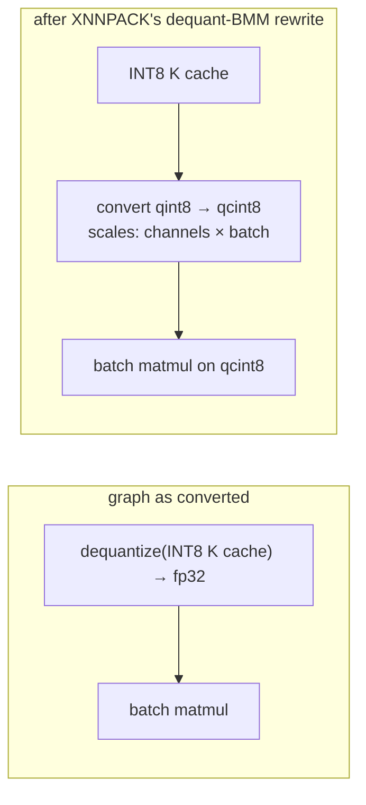

# LiteRT on the CPU: XNNPACK, KleidiAI and our XNNPACK patch

> **Scope:** when LiteRT-LM runs LiteRT models on the CPU, the CPU options it sets, how a CPU compiled model splits work between the XNNPACK delegate and TFLite's own kernels, threads, the XNNPACK weight cache, KleidiAI, and our XNNPACK patch for the INT8 KV caches. **Out of scope:** the runtime machinery shared with the GPU path ([runtime.md](runtime.md)); the executors that call these models ([../litert-lm/executors.md](../litert-lm/executors.md)); the embedding tables as model content ([../models/gemma4-e4b.md](../models/gemma4-e4b.md)).
> **Pinned to:** LiteRT `362759838`, LiteRT-LM `7b872544`, XNNPACK `d89ef666` (TensorFlow's pin, with our patch); shipped wrapper `85b1a776` where noted.
> **Applies to:** all platforms, with an Apple section. **Last verified:** 2026-10-15

## Summary

LiteRT's CPU accelerator is the XNNPACK delegate ("CpuAccelerator"). It takes the ops XNNPACK supports and leaves the rest to TFLite's builtin kernels. LiteRT-LM uses the CPU in three ways:

1. **Always**, whatever the backend: the text embedder, the per-layer embedder and the end-of-image/end-of-audio embeddings are CPU compiled models on every platform but Android, and the two embedders run once per token.
2. **For multimodal glue**: the vision and audio adapters default to the CPU, and the audio encoder of Gemma 4 files is constrained to the CPU. Agello also passes `.cpu()` as the vision backend, so its vision encoder runs on the CPU.
3. **For the whole language model** when the engine's backend is CPU: in Agello, when the user picks CPU or when every GPU attempt fails.

XNNPACK in our build comes from TensorFlow's pin `d89ef666` with one patch, which carries upstream XNNPACK's fix `c72e2a4a` for a scale buffer that cost Gemma 4 E4B 5.5 GB on the CPU path (ours: `51f099fb`, `b8f807ec`). KleidiAI's Arm micro-kernels are linked into both our iOS binary and Google's.

## Concepts

| Term | What it is |
| --- | --- |
| `CpuAccelerator` | LiteRT's XNNPACK accelerator. Its delegate is `TfLiteXNNPackDelegate`; it supports the CPU hardware set and is responsible for JIT compilation ([`litert/runtime/accelerators/xnnpack/xnnpack_accelerator.cc:145-175`](https://github.com/google-ai-edge/LiteRT/blob/ca21dc99de51c76bdcc572afeea1dd937d3c9e5c/litert/runtime/accelerators/xnnpack/xnnpack_accelerator.cc#L145-L175), [`litert/runtime/accelerators/xnnpack/xnnpack_accelerator.cc:123-135`](https://github.com/google-ai-edge/LiteRT/blob/ca21dc99de51c76bdcc572afeea1dd937d3c9e5c/litert/runtime/accelerators/xnnpack/xnnpack_accelerator.cc#L123-L135)) |
| Kernel mode | `delegate` (default: XNNPACK), `reference` or `builtin` (TFLite kernels only, no delegate) ([`litert/c/options/litert_cpu_options.h:28-40`](https://github.com/google-ai-edge/LiteRT/blob/ca21dc99de51c76bdcc572afeea1dd937d3c9e5c/litert/c/options/litert_cpu_options.h#L28-L40)) |
| YNNPACK | A second CPU delegate that, when linked and enabled, runs before XNNPACK; only builds with `litert_enable_ynnpack` link it ([`litert/runtime/accelerators/cpu_registry.cc:44-83`](https://github.com/google-ai-edge/LiteRT/blob/ca21dc99de51c76bdcc572afeea1dd937d3c9e5c/litert/runtime/accelerators/cpu_registry.cc#L44-L83), [`litert/runtime/accelerators/BUILD:72-103`](https://github.com/google-ai-edge/LiteRT/blob/ca21dc99de51c76bdcc572afeea1dd937d3c9e5c/litert/runtime/accelerators/BUILD#L72-L103)) |
| Builtin kernels | TFLite's reference and optimized op implementations, used for every op no delegate took |
| XNNPACK weight cache | A file (or `:memory`) where XNNPACK stores repacked weights so later loads skip packing ([`tflite/delegates/xnnpack/weight_cache.h:48-65`](https://github.com/google-ai-edge/LiteRT/blob/ca21dc99de51c76bdcc572afeea1dd937d3c9e5c/tflite/delegates/xnnpack/weight_cache.h#L48-L65)) |
| KleidiAI | Arm's micro-kernel library that XNNPACK can call for matrix multiplications on Arm64 |
| Dequant-BMM rewrite | XNNPACK's subgraph optimization that turns `dequantize(INT8) → batch matmul` into `convert(qint8 → per-channel qint8) → batch matmul` |
| Delegate clustering | TFLite's reordering of execution to reduce switches between delegated and undelegated nodes ([`tflite/interpreter_options.h:75-88`](https://github.com/google-ai-edge/LiteRT/blob/ca21dc99de51c76bdcc572afeea1dd937d3c9e5c/tflite/interpreter_options.h#L75-L88)) |

## How it works

### When LiteRT-LM runs on the CPU

| Model (E4B section) | Signature, ops | Hardware LiteRT-LM requests | Why | Agello |
| --- | --- | --- | --- | --- |
| `tf_lite_embedder` | `embedder`, 8 ops (one INT2 `EMBEDDING_LOOKUP`, 167.8 MB) | CPU (NPU + CPU on Android) | Hard-coded in `EmbeddingLookupText::Initialize` ([`runtime/components/embedding_lookup/embedding_lookup_text.cc:292-298`](https://github.com/google-ai-edge/LiteRT-LM/blob/df6df5b84d5845b49889f631ed4cac80b4325dd3/runtime/components/embedding_lookup/embedding_lookup_text.cc#L292-L298)) | Always |
| `tf_lite_per_layer_embedder` | `per_layer_embedder`, 49 ops | CPU | Same class ([`runtime/executor/litert_compiled_model_executor_utils.cc:1270-1321`](https://github.com/google-ai-edge/LiteRT-LM/blob/df6df5b84d5845b49889f631ed4cac80b4325dd3/runtime/executor/litert_compiled_model_executor_utils.cc#L1270-L1321)) | Always |
| `tf_lite_end_of_vision`, `tf_lite_end_of_audio` | `eoi`, `eoa`, 0 ops (a constant output) | CPU | Hard-coded in `EndOfMultiModalEmbedding` ([`runtime/components/embedding_lookup/embedding_lookup_end_of_multi_modal.cc:165-172`](https://github.com/google-ai-edge/LiteRT-LM/blob/df6df5b84d5845b49889f631ed4cac80b4325dd3/runtime/components/embedding_lookup/embedding_lookup_end_of_multi_modal.cc#L165-L172)) | When vision or audio is on |
| `tf_lite_vision_adapter` | `vision_adapter_70/140/280`, 15 ops | CPU by default; section says `backend_constraint=cpu` | The default engine settings pass CPU as the adapter backend ("Vision adapter can only run on CPU") ([`runtime/engine/engine_settings.cc:238-254`](https://github.com/google-ai-edge/LiteRT-LM/blob/df6df5b84d5845b49889f631ed4cac80b4325dd3/runtime/engine/engine_settings.cc#L238-L254)) | When vision is on |
| `tf_lite_audio_adapter` | `audio_adapter`, 11 ops | CPU by default; `backend_constraint=cpu` | Same ([`runtime/engine/engine_settings.cc:238-254`](https://github.com/google-ai-edge/LiteRT-LM/blob/df6df5b84d5845b49889f631ed4cac80b4325dd3/runtime/engine/engine_settings.cc#L238-L254)) | When audio is on |
| `tf_lite_audio_encoder_hw` | `serving_default`, 2,182 ops | Must be CPU: `backend_constraint=cpu` | Engine creation rejects any other audio backend ([`runtime/engine/engine_settings.cc:81-112`](https://github.com/google-ai-edge/LiteRT-LM/blob/df6df5b84d5845b49889f631ed4cac80b4325dd3/runtime/engine/engine_settings.cc#L81-L112)) | Agello passes `.cpu()` |
| `tf_lite_vision_encoder` | `vision_70/140/280`, 1,477 ops each | The vision backend | Caller's choice | Agello passes `.cpu()` |
| `tf_lite_prefill_decode`, `tf_lite_mtp_drafter` | main graph, drafter | The engine backend | Caller's choice | GPU first, CPU as a fallback |

Engine creation checks the `backend_constraint` of only three sections, the prefill/decode graph, the vision encoder and the audio encoder, and fails with "<modality> backend constraint mismatch" (`Main`, `Vision` or `Audio`) when the constraint does not list that executor's backend; the adapter sections' constraints are not checked ([`runtime/engine/engine_settings.cc:81-112`](https://github.com/google-ai-edge/LiteRT-LM/blob/df6df5b84d5845b49889f631ed4cac80b4325dd3/runtime/engine/engine_settings.cc#L81-L112), [`runtime/engine/engine_settings.cc:529-548`](https://github.com/google-ai-edge/LiteRT-LM/blob/df6df5b84d5845b49889f631ed4cac80b4325dd3/runtime/engine/engine_settings.cc#L529-L548), [`runtime/core/engine_advanced_impl.cc:551-563`](https://github.com/google-ai-edge/LiteRT-LM/blob/df6df5b84d5845b49889f631ed4cac80b4325dd3/runtime/core/engine_advanced_impl.cc#L551-L563)).

The sections, op counts and constraints come from [../generated/models/e4b-ours.md](../generated/models/e4b-ours.md); the per-layer embedder's op count, which the table generator could not parse, comes from the engine log in [../generated/engine-run.md](../generated/engine-run.md).

The embedders are on the CPU on every non-Android platform because `EmbeddingLookupText::Initialize` and `EndOfMultiModalEmbedding::Initialize` set the hardware set to `kCpu` in the `#else` branch of `#if defined(__ANDROID__)` ([`runtime/components/embedding_lookup/embedding_lookup_text.cc:292-298`](https://github.com/google-ai-edge/LiteRT-LM/blob/df6df5b84d5845b49889f631ed4cac80b4325dd3/runtime/components/embedding_lookup/embedding_lookup_text.cc#L292-L298), [`runtime/components/embedding_lookup/embedding_lookup_end_of_multi_modal.cc:165-172`](https://github.com/google-ai-edge/LiteRT-LM/blob/df6df5b84d5845b49889f631ed4cac80b4325dd3/runtime/components/embedding_lookup/embedding_lookup_end_of_multi_modal.cc#L165-L172)). <!-- c:RT-CPU-001 --> The embedder and per-layer embedder are created this way for every LiteRT compiled-model executor, through `EmbeddingLookupManager` ([`runtime/executor/litert_compiled_model_executor_utils.cc:1270-1321`](https://github.com/google-ai-edge/LiteRT-LM/blob/df6df5b84d5845b49889f631ed4cac80b4325dd3/runtime/executor/litert_compiled_model_executor_utils.cc#L1270-L1321), [`runtime/components/embedding_lookup/embedding_lookup_manager.cc:302-317`](https://github.com/google-ai-edge/LiteRT-LM/blob/df6df5b84d5845b49889f631ed4cac80b4325dd3/runtime/components/embedding_lookup/embedding_lookup_manager.cc#L302-L317)). If a caller sets a vision adapter backend other than the CPU, engine creation logs "Vision adapter backend is not CPU, which may cause precision loss." ([`runtime/core/engine_advanced_impl.cc:618-621`](https://github.com/google-ai-edge/LiteRT-LM/blob/df6df5b84d5845b49889f631ed4cac80b4325dd3/runtime/core/engine_advanced_impl.cc#L618-L621)).

Agello's engine configuration passes `.cpu()` for both the vision and the audio backend, and the GPU or the CPU for the main backend (Agello `ChatEngine.swift`, see [Agello sources](#agello-sources)). <!-- c:RT-CPU-002 --> Its engine attempts are: the preferred backend with multimodal input, then without, then the CPU the same way when the preference is the GPU (Agello `InferencePlanner.swift`). EmbeddingGemma follows the same pattern: GPU first, CPU if that fails (Agello `Embedding.swift`).

**Per-token cost.** An embedding lookup is one `CompiledModel::Run` of a one-token model: for a non-negative token id, `LookupInternal` writes the id into the input buffer, runs the model, and copies the output out; a negative id copies the default embedding vector without a run. The `TensorBuffer` form of `LookupPrefill` calls it once for each token of the prompt chunk, then fills any remaining output rows with the default embedding ([`runtime/components/embedding_lookup/embedding_lookup_text.cc:59-91`](https://github.com/google-ai-edge/LiteRT-LM/blob/df6df5b84d5845b49889f631ed4cac80b4325dd3/runtime/components/embedding_lookup/embedding_lookup_text.cc#L59-L91), [`runtime/components/embedding_lookup/embedding_lookup_text.cc:240-245`](https://github.com/google-ai-edge/LiteRT-LM/blob/df6df5b84d5845b49889f631ed4cac80b4325dd3/runtime/components/embedding_lookup/embedding_lookup_text.cc#L240-L245), [`runtime/components/embedding_lookup/embedding_lookup_text.cc:248-255`](https://github.com/google-ai-edge/LiteRT-LM/blob/df6df5b84d5845b49889f631ed4cac80b4325dd3/runtime/components/embedding_lookup/embedding_lookup_text.cc#L248-L255)). <!-- c:RT-CPU-003 --> In the E4B engine run on this Mac, a 2,049-token prompt counted 4,098 embedding lookups: 2 tables × 2,049 prompt tokens ([../generated/engine-run.md](../generated/engine-run.md), counters). <!-- c:RT-CPU-004 --> Those runs use the defaults of a CPU model that sets no CPU options: one interpreter thread and no XNNPACK thread pool (see [Threads](#threads)).

### What runs where inside a CPU model

`CompiledModel::Create` applies the CPU accelerator like any other ([runtime.md](runtime.md#creating-a-compiled-model)). Its `CreateDelegate` returns no delegate at all when the kernel mode is `reference` or `builtin`, and otherwise creates the XNNPACK delegate with the parsed XNNPACK options, adding TFLite's "fully delegated to a single delegate" hint when asked and YNNPACK is off ([`litert/runtime/accelerators/xnnpack/xnnpack_accelerator.cc:95-98`](https://github.com/google-ai-edge/LiteRT/blob/ca21dc99de51c76bdcc572afeea1dd937d3c9e5c/litert/runtime/accelerators/xnnpack/xnnpack_accelerator.cc#L95-L98), [`litert/runtime/accelerators/xnnpack/xnnpack_accelerator.cc:57-119`](https://github.com/google-ai-edge/LiteRT/blob/ca21dc99de51c76bdcc572afeea1dd937d3c9e5c/litert/runtime/accelerators/xnnpack/xnnpack_accelerator.cc#L57-L119)). XNNPACK then claims the nodes its `VisitNode` switch accepts; the TFLite interpreter runs the rest with its builtin kernels.

The embedder's `EMBEDDING_LOOKUP`, `GREATER_EQUAL`, `LESS`, `LOGICAL_AND` and `SELECT_V2` have no case in that switch, so they run on TFLite's kernels ([`tflite/delegates/xnnpack/xnnpack_delegate.cc:3198-3492`](https://github.com/google-ai-edge/LiteRT/blob/ca21dc99de51c76bdcc572afeea1dd937d3c9e5c/tflite/delegates/xnnpack/xnnpack_delegate.cc#L3198-L3492)). <!-- c:RT-CPU-005 --> TFLite's `EMBEDDING_LOOKUP` accepts INT2 and INT4 tables with per-channel scales and dequantizes the looked-up row to float (its "hybrid" path) ([`tflite/kernels/embedding_lookup.cc:62-82`](https://github.com/google-ai-edge/LiteRT/blob/ca21dc99de51c76bdcc572afeea1dd937d3c9e5c/tflite/kernels/embedding_lookup.cc#L62-L82)). The iPhone probe run confirms the split: of the 57 nodes in CPU models, XNNPACK took 3 and 54 stayed on builtin kernels ([runtime.md](runtime.md#delegation-metrics), `probes-ours.json`).

The same comparison for every op in the E4B file's TFLite graphs ([../generated/models/e4b-ours.md](../generated/models/e4b-ours.md) op lists against the `VisitNode` cases, [`tflite/delegates/xnnpack/xnnpack_delegate.cc:3198-3492`](https://github.com/google-ai-edge/LiteRT/blob/ca21dc99de51c76bdcc572afeea1dd937d3c9e5c/tflite/delegates/xnnpack/xnnpack_delegate.cc#L3198-L3492)):

| Ops | XNNPACK has a case | Where they appear |
| --- | --- | --- |
| `FULLY_CONNECTED`, `BATCH_MATMUL`, `CONV_2D`, `DEPTHWISE_CONV_2D`, `DEQUANTIZE`, `QUANTIZE`, `ADD`, `SUB`, `MUL`, `DIV`, `SOFTMAX`, `GELU`, `LOGISTIC`, `TANH`, `RSQRT`, `SUM`, `REDUCE_MAX`, `SIN`, `COS`, `RESHAPE`, `TRANSPOSE`, `SLICE`, `CONCATENATION`, `PAD` | yes (delegated when types and shapes are supported) | Main graph, drafter, vision and audio encoders, adapters |
| `CAST`, `SELECT`, `SELECT_V2`, `EQUAL`, `NOT_EQUAL`, `LESS`, `GREATER_EQUAL`, `LOGICAL_AND`, `LOGICAL_OR`, `LOGICAL_NOT`, `REDUCE_ALL`, `ONE_HOT`, `FLOOR_MOD`, `SIGN`, `TILE`, `UNPACK`, `EMBEDDING_LOOKUP` | no: always TFLite builtin kernels | Masks and position logic in every graph; the embedders |
| `odml.rms_norm`, `odml.runtime_bmm`, `odml.cache_update` composites | inlined on LiteRT-LM's CPU path (see below), so their decompositions are what XNNPACK sees | Main graph, drafter, vision encoder |

Each "no" op is a node no XNNPACK partition can include, so the graph splits into several XNNPACK partitions with builtin kernels between them. With delegate clustering off (Gemma 4, below), TFLite does not reorder nodes to reduce those switches.

`CheckCpuTensors` treats XNNPACK and YNNPACK delegate nodes as CPU nodes, so their inputs and outputs get host-memory buffer requirements, and host buffers bound to them are used in place ([`litert/runtime/compiled_model.cc:1442-1482`](https://github.com/PowerBeef/LiteRT/blob/362759838e34e1525f1cc27daddaf663a193c059/litert/runtime/compiled_model.cc#L1442-L1482), [`litert/runtime/compiled_model.cc:2063-2120`](https://github.com/PowerBeef/LiteRT/blob/362759838e34e1525f1cc27daddaf663a193c059/litert/runtime/compiled_model.cc#L2063-L2120)).

**The main graph on the CPU.** With the CPU backend, the same `tf_lite_prefill_decode` section that the GPU runs as composites (`odml.rms_norm`, `odml.runtime_bmm`, `odml.cache_update`) is compiled with StableHLO composite inlining, because LiteRT-LM's CPU path creates runtime options ([runtime.md](runtime.md#creating-a-compiled-model), [`runtime/executor/llm_executor_settings_utils.cc:285-311`](https://github.com/PowerBeef/agello-litert-lm/blob/7b872544fdbd81308f98b1e2acf8c5798a549df6/runtime/executor/llm_executor_settings_utils.cc#L285-L311)). The composites' decompositions, including batch matmuls over the dequantized INT8 KV caches, become ordinary nodes for XNNPACK to claim, which is where the dequant-BMM rewrite below applies.

### The CPU options LiteRT-LM sets

| Compiled model | Threads | XNNPACK flags | Weight cache | Runtime options |
| --- | --- | --- | --- | --- |
| Main graph, CPU backend | `CpuConfig::number_of_threads`, default 4 | defaults + dynamic fully connected + latest operators | `<cache dir or model dir>/<model>_<mtime>_<size><suffix>.xnnpack_cache` | zero-point compression on; delegate clustering off for Gemma 4 |
| Vision encoder and adapter on CPU | 4 | same | same scheme, with `.vision_encoder` or `.vision_adapter` before `.xnnpack_cache` | none |
| Audio encoder and adapter on CPU | `AudioExecutorSettings` threads, default 4 | same | per module | none |
| Embedders and end-of-media embeddings | none set: interpreter 1, XNNPACK 0 | XNNPACK defaults | none | none |

Sources: the CPU case of `CreateCompilationOptions` ([`runtime/executor/llm_executor_settings_utils.cc:285-311`](https://github.com/PowerBeef/agello-litert-lm/blob/7b872544fdbd81308f98b1e2acf8c5798a549df6/runtime/executor/llm_executor_settings_utils.cc#L285-L311)), `SetCpuOptions` ([`runtime/executor/litert_compiled_model_executor_utils.cc:999-1007`](https://github.com/google-ai-edge/LiteRT-LM/blob/df6df5b84d5845b49889f631ed4cac80b4325dd3/runtime/executor/litert_compiled_model_executor_utils.cc#L999-L1007)), `SetCpuCacheOptions` ([`runtime/executor/litert_compiled_model_executor_utils.cc:1043-1071`](https://github.com/google-ai-edge/LiteRT-LM/blob/df6df5b84d5845b49889f631ed4cac80b4325dd3/runtime/executor/litert_compiled_model_executor_utils.cc#L1043-L1071)), `CpuConfig` ([`runtime/executor/llm_executor_settings.h:123-141`](https://github.com/google-ai-edge/LiteRT-LM/blob/df6df5b84d5845b49889f631ed4cac80b4325dd3/runtime/executor/llm_executor_settings.h#L123-L141)), the vision executor's 4 threads ([`runtime/executor/vision_litert_compiled_model_executor.cc:99-103`](https://github.com/google-ai-edge/LiteRT-LM/blob/df6df5b84d5845b49889f631ed4cac80b4325dd3/runtime/executor/vision_litert_compiled_model_executor.cc#L99-L103), [`runtime/executor/vision_litert_compiled_model_executor.cc:340-361`](https://github.com/google-ai-edge/LiteRT-LM/blob/df6df5b84d5845b49889f631ed4cac80b4325dd3/runtime/executor/vision_litert_compiled_model_executor.cc#L340-L361)), the audio executor ([`runtime/executor/audio_litert_compiled_model_executor.cc:103-107`](https://github.com/google-ai-edge/LiteRT-LM/blob/df6df5b84d5845b49889f631ed4cac80b4325dd3/runtime/executor/audio_litert_compiled_model_executor.cc#L103-L107), [`runtime/executor/audio/audio_executor_settings.h:173`](https://github.com/google-ai-edge/LiteRT-LM/blob/df6df5b84d5845b49889f631ed4cac80b4325dd3/runtime/executor/audio/audio_executor_settings.h#L173)), the embedders ([`runtime/components/embedding_lookup/embedding_lookup_text.cc:292-298`](https://github.com/google-ai-edge/LiteRT-LM/blob/df6df5b84d5845b49889f631ed4cac80b4325dd3/runtime/components/embedding_lookup/embedding_lookup_text.cc#L292-L298)).

For the main graph on the CPU, LiteRT-LM sets the thread count from `CpuConfig::number_of_threads` (default 4), XNNPACK's default flags plus `DYNAMIC_FULLY_CONNECTED` and `ENABLE_LATEST_OPERATORS`, YNNPACK from the config (default off), the XNNPACK weight-cache path, zero-point compression, and the delegate-clustering setting ([`runtime/executor/llm_executor_settings_utils.cc:285-311`](https://github.com/PowerBeef/agello-litert-lm/blob/7b872544fdbd81308f98b1e2acf8c5798a549df6/runtime/executor/llm_executor_settings_utils.cc#L285-L311), [`runtime/executor/litert_compiled_model_executor_utils.cc:999-1007`](https://github.com/google-ai-edge/LiteRT-LM/blob/df6df5b84d5845b49889f631ed4cac80b4325dd3/runtime/executor/litert_compiled_model_executor_utils.cc#L999-L1007), [`runtime/executor/llm_executor_settings.h:123-141`](https://github.com/google-ai-edge/LiteRT-LM/blob/df6df5b84d5845b49889f631ed4cac80b4325dd3/runtime/executor/llm_executor_settings.h#L123-L141)). <!-- c:RT-CPU-006 --> The two flags enable XNNPACK for fully connected ops whose weights are not constants, and XNNPACK operators and features not yet on by default ([`tflite/delegates/xnnpack/xnnpack_delegate.h:35-47`](https://github.com/google-ai-edge/LiteRT/blob/ca21dc99de51c76bdcc572afeea1dd937d3c9e5c/tflite/delegates/xnnpack/xnnpack_delegate.h#L35-L47)). For Gemma 4 files `EngineSettings` turns delegate clustering off, which tells TFLite not to reorder execution to reduce the switches between delegated and undelegated nodes ([`runtime/engine/engine_settings.cc:507-515`](https://github.com/google-ai-edge/LiteRT-LM/blob/df6df5b84d5845b49889f631ed4cac80b4325dd3/runtime/engine/engine_settings.cc#L507-L515), [`tflite/interpreter_options.h:75-88`](https://github.com/google-ai-edge/LiteRT/blob/ca21dc99de51c76bdcc572afeea1dd937d3c9e5c/tflite/interpreter_options.h#L75-L88)).

The Swift `Engine` never passes a CPU thread count: `Backend.cpu(threadCount:)` becomes the string `"cpu"`, and only `EmbeddingEngine` forwards `threadCount` to the C API, so Agello's CPU engine uses the default of 4 threads in both the shipped and the documented wrapper ([`swift/Config.swift:20-24`](https://github.com/google-ai-edge/LiteRT-LM/blob/df6df5b84d5845b49889f631ed4cac80b4325dd3/swift/Config.swift#L20-L24), [`swift/Engine.swift:73-83`](https://github.com/google-ai-edge/LiteRT-LM/blob/df6df5b84d5845b49889f631ed4cac80b4325dd3/swift/Engine.swift#L73-L83), [`c/engine.cc:712-722`](https://github.com/google-ai-edge/LiteRT-LM/blob/df6df5b84d5845b49889f631ed4cac80b4325dd3/c/engine.cc#L712-L722)). <!-- c:RT-CPU-007 -->

### Threads

The XNNPACK delegate creates its own `pthreadpool` only when `num_threads` is greater than 1; with 0 or 1 it runs on the calling thread ([`tflite/delegates/xnnpack/xnnpack_delegate.cc:655-680`](https://github.com/google-ai-edge/LiteRT/blob/ca21dc99de51c76bdcc572afeea1dd937d3c9e5c/tflite/delegates/xnnpack/xnnpack_delegate.cc#L655-L680)). <!-- c:RT-CPU-008 --> `TfLiteXNNPackDelegateOptionsDefault` leaves `num_threads` at 0 ([`tflite/delegates/xnnpack/xnnpack_delegate.cc:7891-7918`](https://github.com/google-ai-edge/LiteRT/blob/ca21dc99de51c76bdcc572afeea1dd937d3c9e5c/tflite/delegates/xnnpack/xnnpack_delegate.cc#L7891-L7918)). The interpreter's own thread count, for builtin kernels that use threads, is the CPU options' `num_threads` or 1 ([runtime.md](runtime.md#creating-a-compiled-model)). So the embedders run single-threaded on the thread that runs the executor, the main CPU graph uses a 4-thread pool, and every CPU compiled model with 4 threads has its own pool (LiteRT creates each delegate without a shared thread pool, [`litert/runtime/accelerators/xnnpack/xnnpack_accelerator.cc:57-119`](https://github.com/google-ai-edge/LiteRT/blob/ca21dc99de51c76bdcc572afeea1dd937d3c9e5c/litert/runtime/accelerators/xnnpack/xnnpack_accelerator.cc#L57-L119)).

| Model | XNNPACK pool | Interpreter threads |
| --- | --- | --- |
| Main graph on CPU | 4 threads | 4 |
| Vision encoder, vision adapter (CPU) | 4 threads each | 4 |
| Audio encoder and adapter (CPU) | 4 threads each (default) | 4 |
| Embedders, end-of-media embeddings | none (caller's thread) | 1 |

### The XNNPACK weight cache

XNNPACK repacks weights into its kernels' layouts at load. With a weight cache it writes the packed buffers to a file the first time (deduplicating identical buffers, for example across signatures) and maps them on later loads; the file starts with a header whose `kVersion` is 4 and that a reader rejects on mismatch, and the path `:memory` keeps the cache in memory instead ([`tflite/delegates/xnnpack/weight_cache.h:48-65`](https://github.com/google-ai-edge/LiteRT/blob/ca21dc99de51c76bdcc572afeea1dd937d3c9e5c/tflite/delegates/xnnpack/weight_cache.h#L48-L65), [`tflite/delegates/xnnpack/xnnpack_delegate.cc:687-741`](https://github.com/google-ai-edge/LiteRT/blob/ca21dc99de51c76bdcc572afeea1dd937d3c9e5c/tflite/delegates/xnnpack/xnnpack_delegate.cc#L687-L741)). XNNPACK's own documentation warns that a cache file must not be shared between models or CPU architectures and that it cannot detect a changed model ([XNNPACK delegate README](https://github.com/google-ai-edge/LiteRT/blob/ca21dc99de51c76bdcc572afeea1dd937d3c9e5c/tflite/delegates/xnnpack/README.md)).

LiteRT-LM's `GetWeightCacheFile` returns no cache when the cache directory is `:nocache` or the weight cache is disabled, and returns the caller's scoped cache file when one is set. Otherwise it names the file after the model: `<model path>_<mtime>_<size><suffix>` beside the model, or `<cache dir>/<model file name>_<mtime>_<size><suffix>` when a cache directory is set, where the suffix ends in `.xnnpack_cache` and the `_<mtime>_<size>` part is dropped if the file's metadata can't be read ([`runtime/executor/executor_settings_base.cc:325-367`](https://github.com/google-ai-edge/LiteRT-LM/blob/df6df5b84d5845b49889f631ed4cac80b4325dd3/runtime/executor/executor_settings_base.cc#L325-L367), [`runtime/executor/executor_settings_base.h:186-195`](https://github.com/google-ai-edge/LiteRT-LM/blob/df6df5b84d5845b49889f631ed4cac80b4325dd3/runtime/executor/executor_settings_base.h#L186-L195), [`runtime/util/file_util.cc:99-146`](https://github.com/google-ai-edge/LiteRT-LM/blob/df6df5b84d5845b49889f631ed4cac80b4325dd3/runtime/util/file_util.cc#L99-L146)). <!-- c:RT-CPU-009 --> When asked to check and clean, and the expected file does not exist yet, LiteRT-LM first deletes the files in the cache directory (or the model's directory) whose names start with the model's name plus the suffix, or start with the model's name and end with the suffix, so caches for older copies of the model do not pile up ([`runtime/util/file_util.cc:212-248`](https://github.com/google-ai-edge/LiteRT-LM/blob/df6df5b84d5845b49889f631ed4cac80b4325dd3/runtime/util/file_util.cc#L212-L248)). The CPU options carry the path, or a file descriptor when the caller supplies a scoped cache file, to XNNPACK through the TOML payload ([`runtime/executor/litert_compiled_model_executor_utils.cc:1043-1071`](https://github.com/google-ai-edge/LiteRT-LM/blob/df6df5b84d5845b49889f631ed4cac80b4325dd3/runtime/executor/litert_compiled_model_executor_utils.cc#L1043-L1071), [`litert/runtime/litert_cpu_options.cc:88-108`](https://github.com/google-ai-edge/LiteRT/blob/ca21dc99de51c76bdcc572afeea1dd937d3c9e5c/litert/runtime/litert_cpu_options.cc#L88-L108)). Agello passes its own cache folder: per context size with Google's binary, one folder for every size with ours (Agello `ChatEngine.swift`). <!-- c:X-CFG-008 -->

### KleidiAI

At our XNNPACK pin, KleidiAI is enabled by default on Arm64 targets, which include `ios_arm64` and `macos_arm64` (`darwin_arm64`): `kleidiai_enabled_by_default` requires `aarch64` and the `i8mm` kernels, which are themselves on by default for `aarch64`; only `--define xnn_enable_kleidiai=false` (or `xnn_enable_arm_i8mm=false`) turns it off, and neither LiteRT-LM's nor LiteRT's `.bazelrc` sets them (XNNPACK at `d89ef666`: [`BUILD.bazel`](https://raw.githubusercontent.com/google/XNNPACK/d89ef6669a14db203b3b7935b1b3862cb63fb6df/BUILD.bazel) lines 1617–1630 and 2070–2087, [`build_config/BUILD.bazel`](https://raw.githubusercontent.com/google/XNNPACK/d89ef6669a14db203b3b7935b1b3862cb63fb6df/build_config/BUILD.bazel) lines 333–345). <!-- c:RT-CPU-010 --> Both iOS arm64 binaries contain it: 638 defined KleidiAI symbols in Google's v0.18.0 and 637 in ours ([../generated/binaries.md](../generated/binaries.md)). <!-- c:RT-CPU-011 --> Which KleidiAI kernels run on a given iPhone depends on the CPU features XNNPACK detects at run time; that was not traced.

### Our XNNPACK patch

**What goes wrong without it.** On the CPU, XNNPACK's dequant-BMM rewrite replaces `dequantize(INT8 tensor) → batch matmul` with `convert(qint8 → qcint8) → batch matmul`, and leaves the per-channel scale array of the new value to be filled when the convert is reshaped (XNNPACK at `d89ef666`: [`src/subgraph.c`](https://raw.githubusercontent.com/google/XNNPACK/d89ef6669a14db203b3b7935b1b3862cb63fb6df/src/subgraph.c) lines 4327–4436, called from line 4772). At TensorFlow's pin, that reshape sizes the array as `channels × batch_size` floats, where `batch_size` is the product of every dimension but the last (XNNPACK at `d89ef666`: [`src/subgraph/unary.c`](https://raw.githubusercontent.com/google/XNNPACK/d89ef6669a14db203b3b7935b1b3862cb63fb6df/src/subgraph/unary.c) lines 123 and 190–219; [`src/tensor.c`](https://raw.githubusercontent.com/google/XNNPACK/d89ef6669a14db203b3b7935b1b3862cb63fb6df/src/tensor.c) lines 682–705). <!-- c:RT-CPU-012 --> Gemma 4's KV caches are INT8 and feed batch matmuls (each K cache in the E4B file is `INT8[1, 2, 32003, 256]` or `[1, 2, 32003, 512]` before the context size is filled in, [../generated/models/e4b-ours.md](../generated/models/e4b-ours.md)).

For a K cache read as the transposed operand, the channel dimension is the sequence length T, so the array is T × 4 bytes × (1 × 2 × T): at T = 8,192 that is 536,870,912 bytes (512 MiB) for one cache. With the fix the batch is the product of the dimensions before the last two, 1 × 2, and the array is 8,192 × 4 × 2 = 65,536 bytes. <!-- c:RT-CPU-013 --> Over all of E4B's converts, the WORKSPACE comment records 5.5 GB on the CPU at an 8K window ([`WORKSPACE:275-290`](https://github.com/PowerBeef/agello-litert-lm/blob/7b872544fdbd81308f98b1e2acf8c5798a549df6/WORKSPACE#L275-L290)). <!-- c:RT-CPU-014 --> That figure was measured with `malloc_history` and has no raw file in `docs/agello/results/`; the iPhone results below are the evidence on file.

**The fix.** Upstream XNNPACK changed the sizing in `c72e2a4a` ("Simplify batch size calculation for channelwise quantization in unary operators", authored 2026-09-22 19:37 −0700, so 2026-09-23 UTC): the scale array is now `channels × xnn_shape_multiply_batch_dims(shape, 2)`, one scale per channel for each batch of the matmul's B operand ([commit](https://github.com/google/XNNPACK/commit/c72e2a4ae0efb7c648f73835e9a0133e7bf21a23)). <!-- c:RT-CPU-015 --> Our fork's WORKSPACE declares XNNPACK itself at TensorFlow's pin `d89ef666` (same sha256), before `tf_workspace2`, so TensorFlow's own declaration is skipped, and applies `agello/patches/xnnpack_qs8_qc8_scales.patch`, which is upstream's diff (ours: `51f099fb` first, replaced by upstream's diff in `b8f807ec`) ([`WORKSPACE:275-290`](https://github.com/PowerBeef/agello-litert-lm/blob/7b872544fdbd81308f98b1e2acf8c5798a549df6/WORKSPACE#L275-L290), [`agello/patches/xnnpack_qs8_qc8_scales.patch:1-30`](https://github.com/PowerBeef/agello-litert-lm/blob/7b872544fdbd81308f98b1e2acf8c5798a549df6/agello/patches/xnnpack_qs8_qc8_scales.patch#L1-L30), [`agello/patches/BUILD:1-2`](https://github.com/PowerBeef/agello-litert-lm/blob/7b872544fdbd81308f98b1e2acf8c5798a549df6/agello/patches/BUILD#L1-L2)). <!-- c:RT-CPU-016 --> The comment says to drop it when TensorFlow's pin includes `c72e2a4a`.

**Evidence.** In the overnight iPhone 17 Pro run before the fix (build `2e54fbdb9ca9`), probe 6's results contain only the four GPU cases and the run records one relaunch (`probes-ours.json`). After the fix (build `ab729fd0b59d`, LiteRT-LM `b8f807ec`), probe 6 alone passed all five cases including `cpu_full`, with a correct reply, a 3.67 GB footprint and 4.92 GB still available (`probe06-ours-xnnpack-fix.json`). <!-- c:RT-CPU-017 -->

The rewrite only exists inside XNNPACK, so the patch matters only where the main graph runs on the CPU (the CPU backend, including Agello's fallback). The embedders have no batch matmul, and the GPU path never hands the main graph to XNNPACK ([runtime.md](runtime.md#creating-a-compiled-model)).

### Memory on the CPU path

Three things decide what the CPU side costs in memory:

| Item | Mechanism | Consequence |
| --- | --- | --- |
| Embedding tables (167.8 MB INT2 text table; 836.8 MB per-layer section) | TFLite's hybrid `EMBEDDING_LOOKUP` reads only the looked-up row, `col_size` values at offset `idx × col_size`, unpacking INT2 or INT4 and applying that row's scale ([`tflite/kernels/embedding_lookup.cc:307-394`](https://github.com/google-ai-edge/LiteRT/blob/ca21dc99de51c76bdcc572afeea1dd937d3c9e5c/tflite/kernels/embedding_lookup.cc#L307-L394)) | The table is read in place from LiteRT-LM's private file mapping ([runtime.md](runtime.md#loading-a-model)); only the pages of rows actually used need to be resident (inference from the code path; residency was not measured per table) |
| XNNPACK packed weights | Repacked at load, or mapped from the weight cache file | A cache hit maps packed weights instead of allocating them; a miss allocates and writes them |
| XNNPACK workspace and scale arrays | Allocated at reshape | Where the unpatched scale arrays reached 5.5 GB ([Our XNNPACK patch](#our-xnnpack-patch)) |

The probe 6 run after the fix had a GPU engine and a CPU engine in turn and recorded a 3.67 GB footprint with 4.92 GB still available on the iPhone 17 Pro (`probe06-ours-xnnpack-fix.json`); [../memory.md](../memory.md) puts these numbers next to the GPU path's.

### Diagnostics

| What you see | What it means | Where |
| --- | --- | --- |
| "XNNPACK CPU accelerator registered." | The CPU accelerator is in the environment (every environment in our build) | [`litert/runtime/accelerators/cpu_registry.cc:44-83`](https://github.com/google-ai-edge/LiteRT/blob/ca21dc99de51c76bdcc572afeea1dd937d3c9e5c/litert/runtime/accelerators/cpu_registry.cc#L44-L83) |
| "Created TensorFlow Lite XNNPACK delegate for CPU." (once per process) | A CPU compiled model created an XNNPACK delegate | [`tflite/delegates/xnnpack/xnnpack_delegate.cc:681-682`](https://github.com/google-ai-edge/LiteRT/blob/ca21dc99de51c76bdcc572afeea1dd937d3c9e5c/tflite/delegates/xnnpack/xnnpack_delegate.cc#L681-L682) |
| "XNNPack weight cache could neither be loaded from or saved to ..." | The cache path is not readable and writable; packing happens on every load | [`tflite/delegates/xnnpack/xnnpack_delegate.cc:687-741`](https://github.com/google-ai-edge/LiteRT/blob/ca21dc99de51c76bdcc572afeea1dd937d3c9e5c/tflite/delegates/xnnpack/xnnpack_delegate.cc#L687-L741) |
| Telemetry `graph_nodes_cpu_delegate`, `graph_nodes_undelegated` | Nodes XNNPACK took, nodes left to builtin kernels, summed over compiled models (ours) | [`litert/runtime/compiled_model.cc:1161-1183`](https://github.com/PowerBeef/LiteRT/blob/362759838e34e1525f1cc27daddaf663a193c059/litert/runtime/compiled_model.cc#L1161-L1183) |
| Telemetry `embedding_lookups` | Tokens looked up in the embedding tables (ours) | [../generated/engine-run.md](../generated/engine-run.md) |

## On Apple

- XNNPACK is the only CPU delegate in `--config=agello` builds: YNNPACK needs `litert_enable_ynnpack`, which LiteRT-LM's `.bazelrc` sets only for `linux_arm64` ([`litert/runtime/accelerators/BUILD:72-103`](https://github.com/google-ai-edge/LiteRT/blob/ca21dc99de51c76bdcc572afeea1dd937d3c9e5c/litert/runtime/accelerators/BUILD#L72-L103), [`.bazelrc:266-268`](https://github.com/PowerBeef/agello-litert-lm/blob/7b872544fdbd81308f98b1e2acf8c5798a549df6/.bazelrc#L266-L268)). Asking for YNNPACK (`ExperimentalFlags.enableYnnpack`) in such a build makes CPU compilation fail ([runtime.md](runtime.md#limits-and-failure-modes)).
- `CpuAccelerator` registers last, after "GPU Metal", and the engine log shows "XNNPACK CPU accelerator registered." ([../generated/engine-run.md](../generated/engine-run.md)).
- Host buffers for CPU models are 64-byte aligned with 16 bytes of XNNPACK padding ([runtime.md](runtime.md#tensor-buffers)).
- Agello on iPhone: the embedders and the vision and audio parts always run on the CPU; the language model runs on the CPU only in the fallback or by choice.
- The shipped build (Google's v0.18.0 binary) runs the same LiteRT-LM v0.18.0 code for these choices; the XNNPACK revision inside it is not pinned here.

## Settings

| Setting | Layer | Default | Agello |
| --- | --- | --- | --- |
| Backend `.cpu()` | Swift `EngineConfig` | none | Fallback after GPU attempts; vision and audio always |
| `threadCount` in `.cpu(threadCount:)` | Swift | nil | Ignored by `Engine` (honored by `EmbeddingEngine`) |
| `litert_lm_engine_settings_set_num_threads` | C | 4 (`CpuConfig`) | Not called |
| `ExperimentalFlags.enableYnnpack` / `litert_lm_engine_settings_set_enable_ynnpack` | Swift / C | unset | Not set; fails in our build if true |
| `cacheDir` / `:nocache` | Swift / `EngineSettings` | model folder | Agello's cache folder: per context size with Google's binary, one folder for every size with ours (X-CFG-008) |
| CPU kernel mode | LiteRT CPU option | delegate (XNNPACK) | Not set |
| `num_threads`, XNNPACK flags, weight-cache path or fd | LiteRT CPU option | 0 threads, default flags | Set by LiteRT-LM as above |
| `xnn_enable_kleidiai` | Bazel define (XNNPACK) | on for Arm64 | Not set |

## Limits and failure modes

| Symptom | Cause | Where |
| --- | --- | --- |
| CPU engine at 5.5 GB per the WORKSPACE comment (RT-CPU-014; no raw record) or killed by iOS while loading | Unpatched XNNPACK's scale arrays for the INT8 KV caches; fixed by our patch | [`WORKSPACE:275-290`](https://github.com/PowerBeef/agello-litert-lm/blob/7b872544fdbd81308f98b1e2acf8c5798a549df6/WORKSPACE#L275-L290) |
| Engine creation error "Audio backend constraint mismatch" | An audio backend other than CPU for a file whose audio encoder says `backend_constraint=cpu` | [`runtime/engine/engine_settings.cc:81-112`](https://github.com/google-ai-edge/LiteRT-LM/blob/df6df5b84d5845b49889f631ed4cac80b4325dd3/runtime/engine/engine_settings.cc#L81-L112) |
| "enable_ynnpack was requested, but the YNNPACK accelerator is not registered or linked." | YNNPACK enabled in a build without it | [`litert/runtime/compiled_model.cc:289-335`](https://github.com/PowerBeef/LiteRT/blob/362759838e34e1525f1cc27daddaf663a193c059/litert/runtime/compiled_model.cc#L289-L335) |
| CPU engine uses 4 threads whatever `threadCount` says | The Swift `Engine` does not forward it | [`swift/Engine.swift:73-83`](https://github.com/google-ai-edge/LiteRT-LM/blob/df6df5b84d5845b49889f631ed4cac80b4325dd3/swift/Engine.swift#L73-L83) |
| Stale XNNPACK cache after replacing a model | The key is the file's modification time and size, not its content | [`runtime/util/file_util.cc:99-146`](https://github.com/google-ai-edge/LiteRT-LM/blob/df6df5b84d5845b49889f631ed4cac80b4325dd3/runtime/util/file_util.cc#L99-L146) |
| Embedding lookups add per-token latency on long prompts | One single-threaded model run per token per table | [`runtime/components/embedding_lookup/embedding_lookup_text.cc:240-245`](https://github.com/google-ai-edge/LiteRT-LM/blob/df6df5b84d5845b49889f631ed4cac80b4325dd3/runtime/components/embedding_lookup/embedding_lookup_text.cc#L240-L245) |
| "XNNPack weight cache could neither be loaded from or saved to ..." | The cache folder is not writable; XNNPACK logs and runs without a cache | [`tflite/delegates/xnnpack/xnnpack_delegate.cc:687-741`](https://github.com/google-ai-edge/LiteRT/blob/ca21dc99de51c76bdcc572afeea1dd937d3c9e5c/tflite/delegates/xnnpack/xnnpack_delegate.cc#L687-L741) |

## Where in the code

| Concept | Symbol | Citation |
| --- | --- | --- |
| CPU accelerator | `CpuAccelerator::CreateDelegate` | [`litert/runtime/accelerators/xnnpack/xnnpack_accelerator.cc:57-119`](https://github.com/google-ai-edge/LiteRT/blob/ca21dc99de51c76bdcc572afeea1dd937d3c9e5c/litert/runtime/accelerators/xnnpack/xnnpack_accelerator.cc#L57-L119) |
| CPU registry | `RegisterCpuAccelerator` | [`litert/runtime/accelerators/cpu_registry.cc:44-83`](https://github.com/google-ai-edge/LiteRT/blob/ca21dc99de51c76bdcc572afeea1dd937d3c9e5c/litert/runtime/accelerators/cpu_registry.cc#L44-L83) |
| CPU options | `LiteRtCpuOptionsT` | [`litert/runtime/litert_cpu_options.h:42-54`](https://github.com/google-ai-edge/LiteRT/blob/ca21dc99de51c76bdcc572afeea1dd937d3c9e5c/litert/runtime/litert_cpu_options.h#L42-L54) |
| XNNPACK op support | `VisitNode` | [`tflite/delegates/xnnpack/xnnpack_delegate.cc:3198-3492`](https://github.com/google-ai-edge/LiteRT/blob/ca21dc99de51c76bdcc572afeea1dd937d3c9e5c/tflite/delegates/xnnpack/xnnpack_delegate.cc#L3198-L3492) |
| XNNPACK threads | `Delegate` constructor | [`tflite/delegates/xnnpack/xnnpack_delegate.cc:655-680`](https://github.com/google-ai-edge/LiteRT/blob/ca21dc99de51c76bdcc572afeea1dd937d3c9e5c/tflite/delegates/xnnpack/xnnpack_delegate.cc#L655-L680) |
| XNNPACK weight cache | `MMapWeightCacheProvider` setup | [`tflite/delegates/xnnpack/xnnpack_delegate.cc:687-741`](https://github.com/google-ai-edge/LiteRT/blob/ca21dc99de51c76bdcc572afeea1dd937d3c9e5c/tflite/delegates/xnnpack/xnnpack_delegate.cc#L687-L741) |
| LiteRT-LM CPU options | `SetCpuOptions` | [`runtime/executor/litert_compiled_model_executor_utils.cc:999-1007`](https://github.com/google-ai-edge/LiteRT-LM/blob/df6df5b84d5845b49889f631ed4cac80b4325dd3/runtime/executor/litert_compiled_model_executor_utils.cc#L999-L1007) |
| LiteRT-LM CPU path | `CreateCompilationOptions`, `Backend::CPU` | [`runtime/executor/llm_executor_settings_utils.cc:285-311`](https://github.com/PowerBeef/agello-litert-lm/blob/7b872544fdbd81308f98b1e2acf8c5798a549df6/runtime/executor/llm_executor_settings_utils.cc#L285-L311) |
| Cache naming | `GetWeightCacheFile` | [`runtime/executor/executor_settings_base.cc:325-367`](https://github.com/google-ai-edge/LiteRT-LM/blob/df6df5b84d5845b49889f631ed4cac80b4325dd3/runtime/executor/executor_settings_base.cc#L325-L367) |
| Embedders on the CPU | `EmbeddingLookupText::Initialize` | [`runtime/components/embedding_lookup/embedding_lookup_text.cc:292-298`](https://github.com/google-ai-edge/LiteRT-LM/blob/df6df5b84d5845b49889f631ed4cac80b4325dd3/runtime/components/embedding_lookup/embedding_lookup_text.cc#L292-L298) |
| Per-token lookup | `EmbeddingLookupText::LookupInternal` | [`runtime/components/embedding_lookup/embedding_lookup_text.cc:59-91`](https://github.com/google-ai-edge/LiteRT-LM/blob/df6df5b84d5845b49889f631ed4cac80b4325dd3/runtime/components/embedding_lookup/embedding_lookup_text.cc#L59-L91) |
| Our XNNPACK pin and patch | `http_archive(name = "XNNPACK")` | [`WORKSPACE:275-290`](https://github.com/PowerBeef/agello-litert-lm/blob/7b872544fdbd81308f98b1e2acf8c5798a549df6/WORKSPACE#L275-L290) |

### Agello sources

The Agello lines cited on this page, at Agello commit `93122b6`: `Agello/Inference/ChatEngine.swift` lines 274–281 (engine configuration: `.cpu()` for vision and audio, `cacheDir`), `Agello/Inference/InferencePlanner.swift` lines 271–292 (engine attempts), `Agello/Knowledge/Embedding.swift` lines 78–83 (EmbeddingGemma, GPU then CPU).

## Open questions

- **KleidiAI at run time.** Which KleidiAI kernels XNNPACK selects on A17 Pro and A19 Pro CPUs, and whether the XCFramework's iOS slice is built with the `ios_arm64` configuration that turns KleidiAI on (the symbol counts say the code is linked either way).
- **Why Google's binaries were unaffected.** Agello's notes say Google's binaries include the upstream XNNPACK fix; which XNNPACK revision Google's v0.18.0 binary uses is not recorded here.
- **The Mac before-and-after numbers** (6.49–9.61 GB unpatched, 0.94–2.09 GB patched, E4B at 8K) are in the commit messages of `51f099fb` and `b8f807ec` and in `docs/agello/VALIDATION.md`, without raw files in `docs/agello/results/`.
- **Vision encoder precision on the CPU.** The vision encoder section prefers FP16 activations; what activation type it gets with Agello's CPU vision backend was not traced.
- **The K cache's operand layout.** The 512 MiB figure assumes the K cache reaches XNNPACK as a `[1, 2, T, 256]` operand read with `transpose_b`; the exact operand shapes after composite inlining were not dumped.
