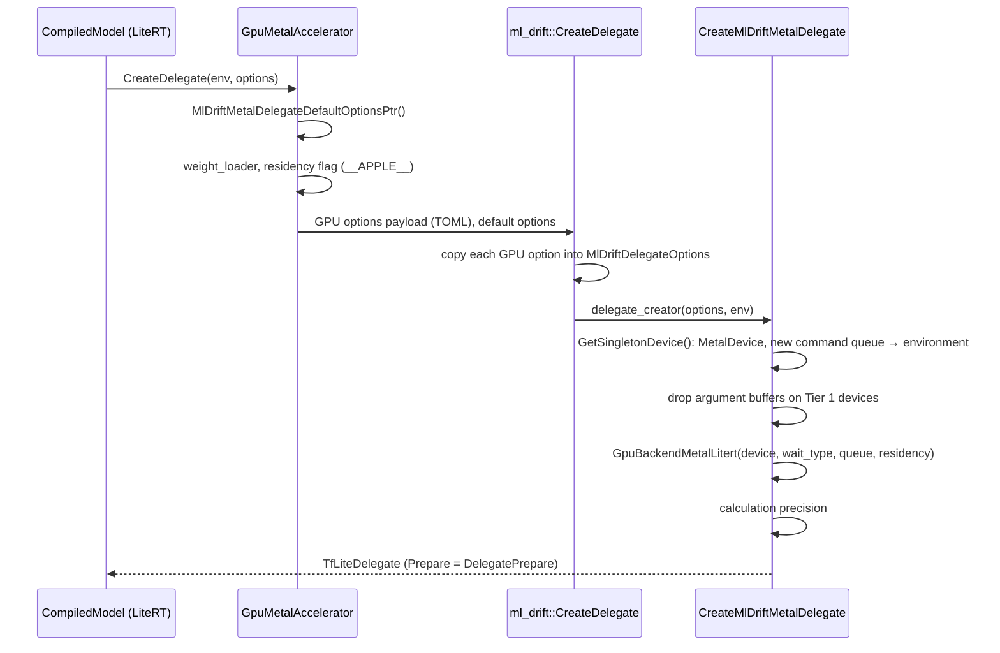
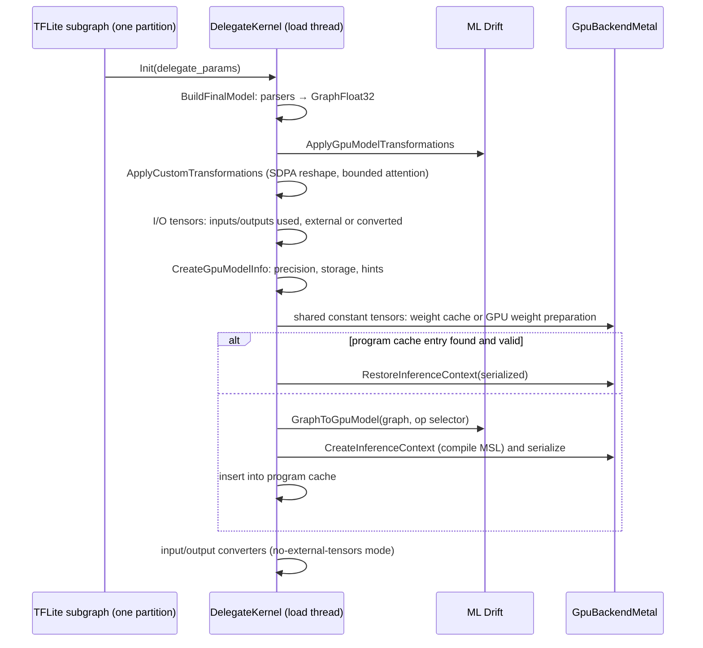

# The ML Drift delegate in LiteRT

> **Scope:** the ML Drift GPU delegate as LiteRT runs it on Apple GPUs: the Metal accelerator,
> delegate creation from GPU options, partitioning (which nodes run on the GPU), `DelegateKernel`
> initialization (TFLite → `GraphFloat32`, the `odml.*` composites, custom transformations including
> our bounded attention and its window, the op selector), the program cache and the weight cache,
> `GpuBackendMetal` and its LiteRT glue (dispatch, waits, residency sets, argument buffers), the
> Metal buffer handler (our direct copies), KV cache copies, and the steps of each run.
> **Out of scope:** ML Drift's IR, general graph transformations, kernel selection and the Metal
> `InferenceContext` ([ml-drift/architecture.md](../ml-drift/architecture.md),
> [ml-drift/kernels.md](../ml-drift/kernels.md), [ml-drift/metal-backend.md](../ml-drift/metal-backend.md));
> LiteRT's environment, `CompiledModel`, accelerator registry and tensor buffers
> ([runtime.md](runtime.md)); the CPU path ([cpu-xnnpack.md](cpu-xnnpack.md)); how LiteRT-LM's
> executor fills inputs and keeps KV state ([../litert-lm/executors.md](../litert-lm/executors.md)).
> **Pinned to:** LiteRT `362759838`, ML Drift `15fa9e2`, LiteRT-LM `7b872544` (for the options it sets).
> **Applies to:** Apple (iOS, macOS); shared code is noted where it also runs elsewhere.
> **Last verified:** 2026-10-15

## Summary

The delegate's code lives in the LiteRT repository, not in ML Drift: `ml_drift_delegate/`
(delegate, composites, caches, Metal backend, buffer handler) and
`litert/runtime/accelerators/gpu/` (the accelerator that creates it). ML Drift (`@ml_drift`)
supplies the GPU graph IR, the kernels and the Metal `InferenceContext` the delegate drives.

- On Apple, LiteRT-LM asks only for the GPU accelerator, and the delegate claims at most one
  partition per subgraph. A node the delegate can't run doesn't fall back to the CPU: the
  compiled model fails to build. For Gemma 4 the whole `decode`, `prefill_*`, `verify` and
  `mtp_drafter` graphs run on the GPU.
- Each delegated subgraph becomes one `DelegateKernel`: TFLite nodes → `GraphFloat32` (with the
  `odml.cache_update`, `odml.runtime_bmm`, `odml.rms_norm` composites lowered by the delegate's
  parsers) → ML Drift's transformations → the delegate's own (ours: attention bounded to the
  filled KV length, local layers to their window) → a `GpuModel` → a Metal `InferenceContext`.
- Two caches on disk: compiled programs keyed by model token, options and tensor sizes (one entry
  per context size), and GPU-format weights keyed per subgraph (ours: by content, so every context
  size shares one copy). On Apple the weights are served from the memory-mapped cache file.
- Our other changes here: direct host copies for linear Metal buffers, passive waits that commit
  command buffers as they're encoded, and cache keys that separate simulated GPUs.
- What Agello ships (Google's prebuilt v0.18.0 binary) contains Google's own build of this
  delegate, without any of our changes.

## Concepts

| Term | What it is |
| --- | --- |
| GPU Metal accelerator | `LiteRtAcceleratorImpl` in `ml_drift_metal_accelerator.cc`, named `GPU Metal`: LiteRT's plug-in that creates the delegate and registers the Metal buffer handlers |
| `MlDriftDelegateOptions` | The delegate's options struct (`delegate_options.h`), filled from LiteRT's GPU options (a TOML payload) |
| `MlDriftDelegateData` | Per-delegate state shared by all of its kernels: options, the backend, shared weight tensors, the weight cache ([`ml_drift_delegate/delegate/delegate_data.h:41-101`](https://github.com/google-ai-edge/LiteRT/blob/ca21dc99de51c76bdcc572afeea1dd937d3c9e5c/ml_drift_delegate/delegate/delegate_data.h#L41-L101)) |
| `DelegateKernel` / `DelegateKernelLiteRt` | One per delegated partition (one per subgraph here): builds the GPU graph at `Init`, runs it at `Invoke` |
| `GpuBackendMetal` / `GpuBackendMetalLitert` | The Metal backend: device, command queue, command buffers, waits, residency set; the `Litert` subclass talks to LiteRT tensor buffers and events |
| Partition | A connected set of TFLite nodes the delegate replaces with one kernel node, `LITERT_METAL` |
| Composite | A StableHLO composite op (`odml.rms_norm`, `odml.cache_update`, `odml.runtime_bmm`, `odml.rope`, ...) that the delegate lowers itself instead of running its decomposition subgraph |
| Custom transformation | A `GraphFloat32` rewrite the delegate applies after ML Drift's (`ApplyCustomTransformations`) |
| Op selector | `LiteRtOpSelector`: turns delegate-specific graph nodes into GPU operations, and hands every other node to ML Drift's selector |
| External tensor | A GPU tensor bound directly to a LiteRT tensor buffer (no conversion). In no-external-tensors mode (LiteRT-LM's default) only names matching the external tensor patterns are external; other inputs and outputs go through converters |
| `param_tensor` | The `INT32[1, 1, 1, 7]` runtime parameters of the Gemma graphs: first position, end position, end position again ([`runtime/executor/litert_compiled_model_executor_utils.cc:678-697`](https://github.com/google-ai-edge/LiteRT-LM/blob/df6df5b84d5845b49889f631ed4cac80b4325dd3/runtime/executor/litert_compiled_model_executor_utils.cc#L678-L697)) |
| Program cache | `<model_token>_mldrift_program_cache.bin`: serialized `InferenceContext`s (kernels, work groups, graph) |
| Weight cache | `<model_token>_mldrift_weight_cache.bin`: weights already rearranged into ML Drift's GPU layouts |
| Model token | The cache namespace LiteRT-LM passes: `<model file name>_<mtime seconds>_<size bytes>` plus a suffix for secondary models ([`runtime/executor/llm_executor_settings_utils.cc:126-164`](https://github.com/PowerBeef/agello-litert-lm/blob/7b872544fdbd81308f98b1e2acf8c5798a549df6/runtime/executor/llm_executor_settings_utils.cc#L126-L164)) |

Invariants worth knowing:

1. One `MetalDevice` per process, reference-counted across delegates; each delegate creation
   makes a new command queue and offers it to the LiteRT environment ([`ml_drift_delegate/delegate/delegate_metal.mm:79-120`](https://github.com/google-ai-edge/LiteRT/blob/ca21dc99de51c76bdcc572afeea1dd937d3c9e5c/ml_drift_delegate/delegate/delegate_metal.mm#L79-L120)).
2. The delegate claims at most one partition per subgraph ([`ml_drift_delegate/delegate/delegate_metal.mm:240-249`](https://github.com/google-ai-edge/LiteRT/blob/ca21dc99de51c76bdcc572afeea1dd937d3c9e5c/ml_drift_delegate/delegate/delegate_metal.mm#L240-L249)).
3. Every `DelegateKernel` of a delegate shares that delegate's backend, memory manager, shared
   weight tensors and weight cache ([`ml_drift_delegate/delegate/delegate_data.h:41-101`](https://github.com/google-ai-edge/LiteRT/blob/ca21dc99de51c76bdcc572afeea1dd937d3c9e5c/ml_drift_delegate/delegate/delegate_data.h#L41-L101)).
4. A cache entry is only valid for the options that built it: both cache keys fold the options in.

## How it works

### Linking and registration

LiteRT-LM links the accelerator statically on iOS and macOS (ours: `43f0f5c3`): the
`apple_static_gpu_accelerator` target selects `ml_drift_metal_accelerator` on `@platforms//os:ios`
and `@platforms//os:macos` ([`runtime/executor/BUILD:263-279`](https://github.com/PowerBeef/agello-litert-lm/blob/7b872544fdbd81308f98b1e2acf8c5798a549df6/runtime/executor/BUILD#L263-L279)). <!-- c:RT-DLG-001 --> The static variant of
`litert_accelerator_library` defines `LITERT_USE_STATIC_LINKED_GPU_ACCELERATOR` and is
`alwayslink` ([`litert/build_common/litert_build_defs.bzl:690-700`](https://github.com/google-ai-edge/LiteRT/blob/ca21dc99de51c76bdcc572afeea1dd937d3c9e5c/litert/build_common/litert_build_defs.bzl#L690-L700)), and with that define a static initializer stores
`&LiteRtAcceleratorImpl` in `LiteRtStaticLinkedAcceleratorGpuDef` ([`litert/runtime/accelerators/gpu/ml_drift_metal_accelerator.cc:167-182`](https://github.com/google-ai-edge/LiteRT/blob/ca21dc99de51c76bdcc572afeea1dd937d3c9e5c/litert/runtime/accelerators/gpu/ml_drift_metal_accelerator.cc#L167-L182)); the engine log
then shows "Statically linked GPU accelerator registered" and "RegisterAccelerator: ... name=GPU Metal"
([engine-run.md](../generated/engine-run.md)). Registration itself belongs to
[runtime.md](runtime.md).

The accelerator reports the name `GPU Metal` ([`litert/runtime/accelerators/gpu/ml_drift_metal_accelerator.cc:45-52`](https://github.com/google-ai-edge/LiteRT/blob/ca21dc99de51c76bdcc572afeea1dd937d3c9e5c/litert/runtime/accelerators/gpu/ml_drift_metal_accelerator.cc#L45-L52)), says the delegate does its own JIT
compilation ([`litert/runtime/accelerators/gpu/ml_drift_metal_accelerator.cc:79-86`](https://github.com/google-ai-edge/LiteRT/blob/ca21dc99de51c76bdcc572afeea1dd937d3c9e5c/litert/runtime/accelerators/gpu/ml_drift_metal_accelerator.cc#L79-L86)), and registers buffer handlers for five buffer types: `MetalBuffer`,
`MetalBufferFp16`, `MetalTexture`, `MetalTextureFp16` and `MetalBufferPacked` ([`litert/runtime/accelerators/gpu/ml_drift_metal_accelerator.cc:129-165`](https://github.com/google-ai-edge/LiteRT/blob/ca21dc99de51c76bdcc572afeea1dd937d3c9e5c/litert/runtime/accelerators/gpu/ml_drift_metal_accelerator.cc#L129-L165)).
<!-- c:RT-DLG-002 -->

### Creating the delegate from GPU options



`GpuMetalAccelerator::CreateDelegate` starts from `MlDriftMetalDelegateDefaultOptionsPtr()`,
copies the `weight_loader` from the LiteRT options (turning on constant-tensor sharing when there is
one), and under `#if defined(__APPLE__)` reads the residency-set flag from the GPU options
([`litert/runtime/accelerators/gpu/ml_drift_metal_accelerator.cc:88-122`](https://github.com/google-ai-edge/LiteRT/blob/ca21dc99de51c76bdcc572afeea1dd937d3c9e5c/litert/runtime/accelerators/gpu/ml_drift_metal_accelerator.cc#L88-L122)). `ml_drift::CreateDelegate` then copies each GPU option into the delegate options
when a GPU options payload exists, sets `runtime_context`, and calls the Metal creator
([`litert/runtime/accelerators/gpu/ml_drift_delegate_create.cc:294-308`](https://github.com/google-ai-edge/LiteRT/blob/ca21dc99de51c76bdcc572afeea1dd937d3c9e5c/litert/runtime/accelerators/gpu/ml_drift_delegate_create.cc#L294-L308)). The payload is LiteRT's GPU options serialized as TOML and parsed again here
([`litert/runtime/accelerators/gpu/ml_drift_delegate_create.cc:55-75`](https://github.com/google-ai-edge/LiteRT/blob/ca21dc99de51c76bdcc572afeea1dd937d3c9e5c/litert/runtime/accelerators/gpu/ml_drift_delegate_create.cc#L55-L75)).

The defaults the Metal delegate starts from ([`ml_drift_delegate/delegate/delegate_metal.mm:288-299`](https://github.com/google-ai-edge/LiteRT/blob/ca21dc99de51c76bdcc572afeea1dd937d3c9e5c/ml_drift_delegate/delegate/delegate_metal.mm#L288-L299)) and what LiteRT-LM's GPU executor
then sets ([`runtime/executor/llm_executor_settings_utils.cc:91-103`](https://github.com/PowerBeef/agello-litert-lm/blob/7b872544fdbd81308f98b1e2acf8c5798a549df6/runtime/executor/llm_executor_settings_utils.cc#L91-L103), [`runtime/executor/litert_compiled_model_executor_utils.cc:1009-1041`](https://github.com/google-ai-edge/LiteRT-LM/blob/df6df5b84d5845b49889f631ed4cac80b4325dd3/runtime/executor/litert_compiled_model_executor_utils.cc#L1009-L1041), [`runtime/executor/llm_executor_settings_utils.cc:166-202`](https://github.com/PowerBeef/agello-litert-lm/blob/7b872544fdbd81308f98b1e2acf8c5798a549df6/runtime/executor/llm_executor_settings_utils.cc#L166-L202), [`runtime/executor/llm_executor_settings_utils.cc:204-219`](https://github.com/PowerBeef/agello-litert-lm/blob/7b872544fdbd81308f98b1e2acf8c5798a549df6/runtime/executor/llm_executor_settings_utils.cc#L204-L219), [`runtime/executor/llm_executor_settings_utils.cc:220-235`](https://github.com/PowerBeef/agello-litert-lm/blob/7b872544fdbd81308f98b1e2acf8c5798a549df6/runtime/executor/llm_executor_settings_utils.cc#L220-L235)):

| Delegate option | Metal default | LiteRT-LM sets (LLM executor, Apple) | Effect on Metal |
| --- | --- | --- | --- |
| `precision` | `kDefault` | `kFp32` if the activation type is FP32, else `kFp16` | Calculation precision (table below) |
| `enable_fast_tuning` | true | not set | `ModelHints::kFastTuning` |
| `serialize_program_cache` | true | true if a program cache file is available | Program cache on |
| `madvise_original_shared_tensors` | true | `gpu_madvise_original_shared_tensors` (default true) | Original weight pages are `madvise`d after upload |
| `wait_type` | `kGpuDelegateWaitTypeActive` | `kActive` in benchmark mode, else `kPassive` (ours: `645aaf65`) | How the CPU waits for the GPU |
| `enable_infinite_float_capping` | false | true | Caps ±inf in softmax inputs and padding |
| `prefer_texture_weights` | false | false under `__APPLE__` | Weights in buffers |
| `use_metal_argument_buffers` | false | true under `__APPLE__` | Argument buffers (dropped on Tier 1) |
| `enable_metal_residency_set` | false | `gpu_enable_metal_residency_set` (default false) | Residency set requested or not |
| `enable_constant_tensors_sharing` | false | `share_constant_tensors` (default true) | Weights shared across subgraphs; weight cache path |
| `convert_weights_on_gpu` | false | `convert_weights_on_gpu` (default true) | Weights rearranged on the GPU |
| `allow_src_quantized_fc_conv_ops` | false | true unless set to false | 8-bit activation convolutions allowed |
| `litert_external_tensors_mode` | false | `GpuConfig.external_tensor_mode` (default false) | No-external-tensors mode |
| `hint_fully_delegated_to_single_delegate` | false | true | TFLite delegate flag |
| `use_ir_model` | false | not set | GraphFloat32 pipeline |

<!-- c:RT-DLG-003 --> <!-- c:RT-DLG-004 -->

The precision mapping ([`litert/runtime/accelerators/gpu/ml_drift_delegate_create.cc:39-51`](https://github.com/google-ai-edge/LiteRT/blob/ca21dc99de51c76bdcc572afeea1dd937d3c9e5c/litert/runtime/accelerators/gpu/ml_drift_delegate_create.cc#L39-L51), [`ml_drift_delegate/delegate/delegate_metal.mm:369-385`](https://github.com/google-ai-edge/LiteRT/blob/ca21dc99de51c76bdcc572afeea1dd937d3c9e5c/ml_drift_delegate/delegate/delegate_metal.mm#L369-L385)):

| LiteRT precision | Delegate precision | Calculation precision on Metal |
| --- | --- | --- |
| Default | `kDefault` | `kF16` if the GPU supports round-to-nearest, else `kF32F16` |
| FP16 | `kFp16` | `kF16` |
| FP32 | `kFp32` | `kF32` |
| FP16 with FP32 accumulation | `kFp16`, `use_f32_accum_for_fp16` | `kF32F16` |

<!-- c:RT-DLG-005 -->

`CreateMlDriftMetalDelegate` gets the process-wide `MetalDevice`, creates a command queue on it
and passes device, queue and a destroy callback to `gpu_environment_create`
([`ml_drift_delegate/delegate/delegate_metal.mm:79-120`](https://github.com/google-ai-edge/LiteRT/blob/ca21dc99de51c76bdcc572afeea1dd937d3c9e5c/ml_drift_delegate/delegate/delegate_metal.mm#L79-L120)); it then reads the command queue back from the environment and builds one
`GpuBackendMetalLitert` with it ([`ml_drift_delegate/delegate/delegate_metal.mm:358-367`](https://github.com/google-ai-edge/LiteRT/blob/ca21dc99de51c76bdcc572afeea1dd937d3c9e5c/ml_drift_delegate/delegate/delegate_metal.mm#L358-L367)). If the device reports
`MTLArgumentBuffersTier1`, it turns `use_metal_argument_buffers` off ([`ml_drift_delegate/delegate/delegate_metal.mm:344-352`](https://github.com/google-ai-edge/LiteRT/blob/ca21dc99de51c76bdcc572afeea1dd937d3c9e5c/ml_drift_delegate/delegate/delegate_metal.mm#L344-L352)).
<!-- c:RT-DLG-006 --> The delegate's `Prepare` callback is `DelegatePrepare`.

### Partitioning: which nodes run on the GPU

`DelegatePrepare` runs once per subgraph that LiteRT hands to the delegate. On the default
GraphFloat32 path it calls `GetOpsToReplace` with `allow_quant_ops = true`,
`max_delegated_partitions = 1`, no excluded ops and a `CustomOperationParserFactory`
([`ml_drift_delegate/delegate/delegate_metal.mm:240-249`](https://github.com/google-ai-edge/LiteRT/blob/ca21dc99de51c76bdcc572afeea1dd937d3c9e5c/ml_drift_delegate/delegate/delegate_metal.mm#L240-L249)); the nodes it returns are replaced by one kernel node registered as
`LITERT_METAL` ([`ml_drift_delegate/delegate/delegate_metal.mm:252-265`](https://github.com/google-ai-edge/LiteRT/blob/ca21dc99de51c76bdcc572afeea1dd937d3c9e5c/ml_drift_delegate/delegate/delegate_metal.mm#L252-L265)). <!-- c:RT-DLG-009 -->

A node is supported when three checks pass ([`ml_drift_delegate/tflite/model_builder.cc:7326-7425`](https://github.com/google-ai-edge/LiteRT/blob/ca21dc99de51c76bdcc572afeea1dd937d3c9e5c/ml_drift_delegate/tflite/model_builder.cc#L7326-L7425), [`ml_drift_delegate/tflite/model_builder.cc:6888-6918`](https://github.com/google-ai-edge/LiteRT/blob/ca21dc99de51c76bdcc572afeea1dd937d3c9e5c/ml_drift_delegate/tflite/model_builder.cc#L6888-L6918)):

1. Its parser exists and its `IsSupported` accepts it. `NewOperationParser` picks the parser from
   the builtin code; for a StableHLO composite it matches `odml.group_norm`, `odml.rms_norm`,
   `custom_call.rotary_positional_embedding` and `odml.scaled_dot_product_attention` itself and
   asks the composite parser factory for any other name ([`ml_drift_delegate/tflite/model_builder.cc:7227-7268`](https://github.com/google-ai-edge/LiteRT/blob/ca21dc99de51c76bdcc572afeea1dd937d3c9e5c/ml_drift_delegate/tflite/model_builder.cc#L7227-L7268)).
2. None of its input or output tensors has 5 or more dimensions.
3. Its non-constant (arena or non-CPU) inputs and outputs have allowed types: FP32 and FP16; BOOL
   inputs when `allow_bool_tensors` is set; INT2, INT4, INT8 and UINT8 when quantized ops are
   allowed; plus per-op extras (INT32 inputs for embedding lookup and int-capable composites,
   integer inputs for comparisons).

`FP16GraphPartitionHelper` then groups supported nodes into partitions and the delegate keeps the
largest one; when unsupported nodes leave some nodes outside the chosen partition, it logs
"Following operations are not supported by GPU delegate" with how many operations will run on the
GPU and how many on the CPU ([`ml_drift_delegate/tflite/model_builder.cc:7427-7462`](https://github.com/google-ai-edge/LiteRT/blob/ca21dc99de51c76bdcc572afeea1dd937d3c9e5c/ml_drift_delegate/tflite/model_builder.cc#L7427-L7462)). <!-- c:RT-DLG-010 -->

What happens to nodes the delegate leaves is LiteRT's decision ([runtime.md](runtime.md)).
`CompiledModel` applies registered accelerators in registration order, skipping an accelerator
that does its own JIT compilation when its hardware wasn't requested ([`litert/runtime/compiled_model.cc:1044-1061`](https://github.com/PowerBeef/LiteRT/blob/362759838e34e1525f1cc27daddaf663a193c059/litert/runtime/compiled_model.cc#L1044-L1061)); XNNPACK
reports itself as JIT-responsible outside the web ([`litert/runtime/accelerators/xnnpack/xnnpack_accelerator.cc:123-134`](https://github.com/google-ai-edge/LiteRT/blob/ca21dc99de51c76bdcc572afeea1dd937d3c9e5c/litert/runtime/accelerators/xnnpack/xnnpack_accelerator.cc#L123-L134)). LiteRT-LM's GPU executor
requests `HwAccelerators::kGpu` only ([`runtime/executor/llm_executor_settings_utils.cc:265`](https://github.com/PowerBeef/agello-litert-lm/blob/7b872544fdbd81308f98b1e2acf8c5798a549df6/runtime/executor/llm_executor_settings_utils.cc#L265)), so XNNPACK isn't applied, and if any node is
still undelegated afterwards `CompiledModel` fails with "Some ops are not accelerated. Add
kLiteRtHwAcceleratorCpu ..." ([`litert/runtime/compiled_model.cc:1190-1196`](https://github.com/PowerBeef/LiteRT/blob/362759838e34e1525f1cc27daddaf663a193c059/litert/runtime/compiled_model.cc#L1190-L1196)). <!-- c:RT-DLG-011 -->

> **What decides GPU or CPU per op.** For the LLM graphs on Apple: nothing at run time. An op runs
> on the GPU if its parser supports it and its tensor types are allowed; the delegate takes the
> largest supported partition; with only the GPU requested, anything outside it makes the model
> fail to compile rather than run on the CPU. Which *sections* run on the CPU (the embedders, the
> vision and audio encoders in Agello's configuration) is decided earlier by LiteRT-LM, which
> creates separate compiled models with CPU options for them
> ([../litert-lm/executors.md](../litert-lm/executors.md)).

Two graph details keep Gemma's composites whole. When the delegate supports a StableHLO
composite, `BuildModelEnforceIO` marks the composite's decomposition subgraph as
delegation-skippable, so LiteRT doesn't delegate it separately ([`ml_drift_delegate/tflite/model_builder.cc:7604-7618`](https://github.com/google-ai-edge/LiteRT/blob/ca21dc99de51c76bdcc572afeea1dd937d3c9e5c/ml_drift_delegate/tflite/model_builder.cc#L7604-L7618)); and an FP16
`DEQUANTIZE` whose input is a read-only constant is skipped, since the weight is consumed
directly ([`ml_drift_delegate/tflite/model_builder.cc:7584-7592`](https://github.com/google-ai-edge/LiteRT/blob/ca21dc99de51c76bdcc572afeea1dd937d3c9e5c/ml_drift_delegate/tflite/model_builder.cc#L7584-L7592)). <!-- c:RT-DLG-012 --> E4B's file has 1,340 subgraphs, most of them
composite decompositions (engine log: `num_subgraphs=1340`,
[engine-run.md](../generated/engine-run.md)). <!-- c:RT-DLG-013 -->

Evidence that Gemma 4 is fully delegated on Apple: the GPU graphs ML Drift built for E4B contain
the ops one might expect to fall off, `sin`, `cos`, `cast`, `logical_and`, `greater_equal` and
`less`, in `decode`, `prefill_*`, `verify` and `mtp_drafter`
([kernels-by-family.md](../generated/kernels-by-family.md)), and Agello's model compiles with
only the GPU requested. <!-- c:RT-DLG-014 -->

### DelegateKernel initialization

`Init` creates a `DelegateKernelLiteRt`, whose `Create` runs `Initialize`, then the tensor
converters in no-external-tensors mode, and stores the LiteRT buffer context ([`ml_drift_delegate/delegate/delegate_metal.mm:122-130`](https://github.com/google-ai-edge/LiteRT/blob/ca21dc99de51c76bdcc572afeea1dd937d3c9e5c/ml_drift_delegate/delegate/delegate_metal.mm#L122-L130),
[`ml_drift_delegate/delegate/delegate_kernel_litert.cc:134-156`](https://github.com/PowerBeef/LiteRT/blob/362759838e34e1525f1cc27daddaf663a193c059/ml_drift_delegate/delegate/delegate_kernel_litert.cc#L134-L156)). `Initialize` selects the pipeline at run time: `InitializeIrModel` when
`use_ir_model` is set, else `InitializeGraphFloat32` ([`ml_drift_delegate/delegate/delegate_kernel.cc:237-243`](https://github.com/PowerBeef/LiteRT/blob/362759838e34e1525f1cc27daddaf663a193c059/ml_drift_delegate/delegate/delegate_kernel.cc#L237-L243)). `use_ir_model` is false in
our builds: no `--define=litert_gpu_use_ir_model=...` is set (so `LITERT_GPU_USE_IR_MODEL` is
undefined and the getter returns NotFound when the option isn't set), and LiteRT-LM never sets
the option ([`litert/c/options/BUILD:232-252`](https://github.com/google-ai-edge/LiteRT/blob/ca21dc99de51c76bdcc572afeea1dd937d3c9e5c/litert/c/options/BUILD#L232-L252), [`litert/c/options/litert_gpu_options.cc:1267-1283`](https://github.com/google-ai-edge/LiteRT/blob/ca21dc99de51c76bdcc572afeea1dd937d3c9e5c/litert/c/options/litert_gpu_options.cc#L1267-L1283), [`litert/runtime/accelerators/gpu/ml_drift_delegate_create.cc:113-117`](https://github.com/google-ai-edge/LiteRT/blob/ca21dc99de51c76bdcc572afeea1dd937d3c9e5c/litert/runtime/accelerators/gpu/ml_drift_delegate_create.cc#L113-L117)). <!-- c:RT-DLG-015 -->



The GraphFloat32 pipeline, step by step ([`ml_drift_delegate/delegate/delegate_kernel.cc:282-294`](https://github.com/PowerBeef/LiteRT/blob/362759838e34e1525f1cc27daddaf663a193c059/ml_drift_delegate/delegate/delegate_kernel.cc#L282-L294), [`ml_drift_delegate/delegate/delegate_kernel.cc:326-349`](https://github.com/PowerBeef/LiteRT/blob/362759838e34e1525f1cc27daddaf663a193c059/ml_drift_delegate/delegate/delegate_kernel.cc#L326-L349)):

1. `BuildFinalModel` runs every node's parser into a `GraphFloat32` and then
   `ApplyGpuModelTransformations`, ML Drift's own passes ([`ml_drift_delegate/tflite/model_builder.cc:7661-7675`](https://github.com/google-ai-edge/LiteRT/blob/ca21dc99de51c76bdcc572afeea1dd937d3c9e5c/ml_drift_delegate/tflite/model_builder.cc#L7661-L7675);
   [ml-drift/architecture.md](../ml-drift/architecture.md)). The custom parser factory is given
   the device's `GpuInfo` here (in `DelegatePrepare` it has none).
2. `ApplyCustomTransformations` runs the delegate's passes (below).
3. The kernel records the graph's used inputs and outputs; constant inputs are skipped.
4. `CreateGpuModelInfo` gets the calculation precision, the storage type (buffers when
   `use_buffer_storage_type`, else ML Drift's fastest for the device), the argument-buffer flag
   (`#ifdef __APPLE__`), and hints: `kAllowSpecialKernels` always, `kFastTuning` when
   `enable_fast_tuning`, `kDisallow8bitConvs` when `allow_src_quantized_fc_conv_ops` is off.
5. With constant-tensor sharing on, the weights are set up as shared external tensors (see
   [the weight cache](#weight-cache)).
6. External I/O tensors are registered with LiteRT (buffer requirements), then the inference
   context is restored from the program cache or built ([program cache](#program-cache)).

#### Inputs and outputs: external or converted

`ProcessTensor` decides per I/O tensor ([`ml_drift_delegate/delegate/delegate_kernel_litert.cc:422-472`](https://github.com/PowerBeef/LiteRT/blob/362759838e34e1525f1cc27daddaf663a193c059/ml_drift_delegate/delegate/delegate_kernel_litert.cc#L422-L472)). In no-external-tensors mode, a tensor
whose name matches none of the external tensor patterns registers a requirement for a
`MetalBufferPacked` buffer of the TFLite tensor's byte size, and each run converts it with ML
Drift's buffer-to-tensor or tensor-to-buffer converter ([`ml_drift_delegate/delegate/gpu_backend_metal_litert.mm:106-134`](https://github.com/PowerBeef/LiteRT/blob/362759838e34e1525f1cc27daddaf663a193c059/ml_drift_delegate/delegate/gpu_backend_metal_litert.mm#L106-L134), [`ml_drift_delegate/delegate/delegate_kernel_litert.cc:253-288`](https://github.com/PowerBeef/LiteRT/blob/362759838e34e1525f1cc27daddaf663a193c059/ml_drift_delegate/delegate/delegate_kernel_litert.cc#L253-L288),
[`ml_drift_delegate/delegate/delegate_kernel_litert.cc:290-324`](https://github.com/PowerBeef/LiteRT/blob/362759838e34e1525f1cc27daddaf663a193c059/ml_drift_delegate/delegate/delegate_kernel_litert.cc#L290-L324)). A tensor that matches (a substring match, [`ml_drift_delegate/delegate/delegate_kernel_litert.h:114-127`](https://github.com/google-ai-edge/LiteRT/blob/ca21dc99de51c76bdcc572afeea1dd937d3c9e5c/ml_drift_delegate/delegate/delegate_kernel_litert.h#L114-L127)) becomes an external
tensor: the GPU tensor is bound straight to the LiteRT buffer, which is a `MetalBuffer` or
`MetalTexture` (FP16 variants for FP16 data) with 16-byte strides ([`ml_drift_delegate/delegate/gpu_backend_metal_litert.mm:106-134`](https://github.com/PowerBeef/LiteRT/blob/362759838e34e1525f1cc27daddaf663a193c059/ml_drift_delegate/delegate/gpu_backend_metal_litert.mm#L106-L134)); names matching a
buffer-storage pattern get `kBuffer` storage ([`ml_drift_delegate/delegate/delegate_kernel_litert.h:157-172`](https://github.com/google-ai-edge/LiteRT/blob/ca21dc99de51c76bdcc572afeea1dd937d3c9e5c/ml_drift_delegate/delegate/delegate_kernel_litert.h#L157-L172)). <!-- c:RT-DLG-017 -->

LiteRT-LM's patterns for the LLM graphs ([`runtime/executor/llm_executor_settings_utils.cc:166-202`](https://github.com/PowerBeef/agello-litert-lm/blob/7b872544fdbd81308f98b1e2acf8c5798a549df6/runtime/executor/llm_executor_settings_utils.cc#L166-L202)):

| Pattern | External | Buffer storage | Why |
| --- | --- | --- | --- |
| `kv_cache_` | yes | yes when the model has an INT32 param tensor | KV caches stay in the GPU layout, no BHWC conversion |
| `kv_cache_c_` | — | yes | |
| `param_tensor` | yes | yes | Written by the host, read as a linear buffer |
| `logits` | when the sampler backend is GPU (only in no-external-tensors mode, the default) | — | The closed TopK Metal sampler (Google's binary) reads PHWC4 logits |
| `w_prime`, `lora_` | yes | yes | LoRA weights |

Everything else (the `embeddings` and `per_layer_embeddings` inputs, the `mask`, the
`activations` output) goes through the converters. <!-- c:RT-DLG-018 --> `GetSamplerBackend`
returns the main backend when the sampler backend is unspecified (the CPU for an NPU backend), and
`CreateCompilationOptions` adds the `logits` pattern when that resolves to the GPU and external
tensor mode is off, the `GpuConfig` default ([`runtime/executor/llm_executor_settings_utils.cc:52-68`](https://github.com/PowerBeef/agello-litert-lm/blob/7b872544fdbd81308f98b1e2acf8c5798a549df6/runtime/executor/llm_executor_settings_utils.cc#L52-L68),
[`runtime/executor/llm_executor_settings_utils.cc:166-191`](https://github.com/PowerBeef/agello-litert-lm/blob/7b872544fdbd81308f98b1e2acf8c5798a549df6/runtime/executor/llm_executor_settings_utils.cc#L166-L191)). So on the GPU backend `logits` is
external even when the closed TopK Metal sampler later turns out to be unavailable (it isn't in our build) and sampling falls back to the
CPU, as in the M6 engine run ([engine-run.md](../generated/engine-run.md): `sampler = cpu (GPU
sampler unavailable)`). <!-- c:RT-DLG-019 --> The CPU then reads the logits through a Metal buffer
lock ([below](#the-metal-buffer-handler)).

### Composites in the Gemma graphs

Besides the four composites `NewOperationParser` handles itself ([partitioning](#partitioning-which-nodes-run-on-the-gpu)),
`CustomOperationParserFactory::Create` handles `odml.cache_update`, `odml.runtime_bmm`,
`odml.sdpa_transposed`, `moe`, `odml.rope`, `odml.swiglu`, the fused QKV-norm-RoPE and
short-convolution types and `gated_delta_update`; any other name gets an "unimplemented" parser,
which fails the support check ([`ml_drift_delegate/delegate/composite/custom_parsers.cc:34-64`](https://github.com/google-ai-edge/LiteRT/blob/ca21dc99de51c76bdcc572afeea1dd937d3c9e5c/ml_drift_delegate/delegate/composite/custom_parsers.cc#L34-L64), [`ml_drift_delegate/delegate/composite/custom_parsers.cc:66-78`](https://github.com/google-ai-edge/LiteRT/blob/ca21dc99de51c76bdcc572afeea1dd937d3c9e5c/ml_drift_delegate/delegate/composite/custom_parsers.cc#L66-L78)).

The Gemma graphs use `odml.rms_norm`, `odml.cache_update` and `odml.runtime_bmm`, and
EmbeddingGemma also `odml.rope`; the per-graph counts are on
[ml-drift/kernels.md](../ml-drift/kernels.md#attention-the-runtime-batched-matmul). <!-- c:RT-DLG-022 --> <!-- c:RT-DLG-021 -->

| Composite | Parser | GPU node | Built by |
| --- | --- | --- | --- |
| `odml.rms_norm` | `CompositeRmsNormParser` ([`ml_drift_delegate/tflite/model_builder.cc:6719-6726`](https://github.com/google-ai-edge/LiteRT/blob/ca21dc99de51c76bdcc572afeea1dd937d3c9e5c/ml_drift_delegate/tflite/model_builder.cc#L6719-L6726)) | `rms_norm` with the scale tensor and epsilon | ML Drift's selector |
| `odml.cache_update` | `AddValuesToCacheOperationParser` | `add_values_to_cache` | `CreateAddValuesToCacheFromNode` ([`ml_drift_delegate/delegate/composite/litert_op_selector.cc:150-170`](https://github.com/PowerBeef/LiteRT/blob/362759838e34e1525f1cc27daddaf663a193c059/ml_drift_delegate/delegate/composite/litert_op_selector.cc#L150-L170)) |
| `odml.runtime_bmm` | `RuntimeBatchedMatMulOperationParser` | `runtime_batched_matmul` | `BuildRuntimeBatchedMatMulGpuGraph` ([`ml_drift_delegate/delegate/composite/litert_op_selector.cc:191-204`](https://github.com/PowerBeef/LiteRT/blob/362759838e34e1525f1cc27daddaf663a193c059/ml_drift_delegate/delegate/composite/litert_op_selector.cc#L191-L204)) |
| `odml.rope` | `RopeOperationParser` | ML Drift `kRope` | `CreateRoPEFromNode` ([`ml_drift_delegate/delegate/composite/litert_op_selector.cc:238-242`](https://github.com/PowerBeef/LiteRT/blob/362759838e34e1525f1cc27daddaf663a193c059/ml_drift_delegate/delegate/composite/litert_op_selector.cc#L238-L242)) |

#### `odml.cache_update`: writing new keys and values in place

The parser reads only the first three inputs (new K, new V, the runtime parameters), although
the composite may carry seven for its CPU decomposition ([`ml_drift_delegate/delegate/composite/add_values_to_cache_parser.cc:77-84`](https://github.com/google-ai-edge/LiteRT/blob/ca21dc99de51c76bdcc572afeea1dd937d3c9e5c/ml_drift_delegate/delegate/composite/add_values_to_cache_parser.cc#L77-L84)). For quantized caches
(INT8, UINT8, INT4, UINT4, INT2) it points both outputs back at the original TFLite tensors and
types them `kUint8`, so ML Drift allocates a plain byte buffer with no dequantize in between; the
GPU cache holds one byte per element even for sub-byte types ([`ml_drift_delegate/delegate/composite/add_values_to_cache_parser.cc:109-119`](https://github.com/google-ai-edge/LiteRT/blob/ca21dc99de51c76bdcc572afeea1dd937d3c9e5c/ml_drift_delegate/delegate/composite/add_values_to_cache_parser.cc#L109-L119)). Attributes:
`kv_cache_batch_size`, `cache_size`, `head_size`, optional `scale_k`, `scale_v` and
`is_ring_buffer` ([`ml_drift_delegate/delegate/composite/add_values_to_cache_parser.cc:126-138`](https://github.com/google-ai-edge/LiteRT/blob/ca21dc99de51c76bdcc572afeea1dd937d3c9e5c/ml_drift_delegate/delegate/composite/add_values_to_cache_parser.cc#L126-L138)). <!-- c:RT-DLG-023 -->

The kernel writes token `X` of the update at position `params[0] + X` and stops at `cache_size`
or at `params[1]` (a ring buffer instead wraps modulo `cache_size`) ([`ml_drift_delegate/delegate/composite/add_values_to_cache_kernel.cc:125-142`](https://github.com/google-ai-edge/LiteRT/blob/ca21dc99de51c76bdcc572afeea1dd937d3c9e5c/ml_drift_delegate/delegate/composite/add_values_to_cache_kernel.cc#L125-L142)). LiteRT-LM fills
`param_tensor` as `{start, start + n, start + n}` for `n` new tokens ([`runtime/executor/litert_compiled_model_executor_utils.cc:678-697`](https://github.com/google-ai-edge/LiteRT-LM/blob/df6df5b84d5845b49889f631ed4cac80b4325dd3/runtime/executor/litert_compiled_model_executor_utils.cc#L678-L697)).
<!-- c:RT-DLG-024 --> Because the K and V caches are external tensors (pattern `kv_cache_`),
these writes land in the LiteRT buffers LiteRT-LM owns; no copy follows. `cache_size` is the
file's 32003 placeholder, which LiteRT rewrites at load: `odml.cache_update` is the composite
whose attributes `magic_number_utils.cc` updates ([`litert/runtime/magic_number_utils.cc:49-51`](https://github.com/google-ai-edge/LiteRT/blob/ca21dc99de51c76bdcc572afeea1dd937d3c9e5c/litert/runtime/magic_number_utils.cc#L49-L51)).

#### `odml.runtime_bmm`: attention products bounded by the parameters

The parser turns each attention product into a fully connected product over the KV cache (FC form)
or ML Drift's `BatchedMatMul` (BMM form), bounded by the runtime parameters; the forms, the INT8
scales and the kernels are on [ml-drift/kernels.md](../ml-drift/kernels.md#attention-the-runtime-batched-matmul). <!-- c:RT-DLG-026 -->

### Custom transformations

After ML Drift's transformations, `ApplyCustomTransformations` runs, in order: the QKV-norm-RoPE
fusion if `enable_qkv_norm_rope_fusion`, the short-convolution fusion if
`enable_short_conv_step_fusion`, `FuseSdpaTransposedReshape` always, and (ours) the bounded
attention pass unless `AGELLO_BOUNDED_ATTENTION=0` ([`ml_drift_delegate/delegate/composite/custom_transformations.cc:33-56`](https://github.com/PowerBeef/LiteRT/blob/362759838e34e1525f1cc27daddaf663a193c059/ml_drift_delegate/delegate/composite/custom_transformations.cc#L33-L56)). <!-- c:RT-DLG-028 -->

- **QKV-norm-RoPE and short-convolution fusions:** both default to false ([`ml_drift_delegate/delegate/delegate_options.h:323-336`](https://github.com/google-ai-edge/LiteRT/blob/ca21dc99de51c76bdcc572afeea1dd937d3c9e5c/ml_drift_delegate/delegate/delegate_options.h#L323-L336)), and
  nothing in LiteRT or LiteRT-LM at the pins sets them, so they never run in our builds.
- **`FuseSdpaTransposedReshape`:** folds the reshape (or transpose and reshape) after a
  single-token `odml.sdpa_transposed` node into the node's output ([`ml_drift_delegate/delegate/composite/fuse_sdpa_transposed_reshape.h:27-30`](https://github.com/google-ai-edge/LiteRT/blob/ca21dc99de51c76bdcc572afeea1dd937d3c9e5c/ml_drift_delegate/delegate/composite/fuse_sdpa_transposed_reshape.h#L27-L30)). The Gemma 4
  E4B (ours and Google's) and E2B `.litertlm` files whose graphs were read contain no
  `odml.sdpa_transposed` composite ([models/e4b-ours.md](../generated/models/e4b-ours.md),
  [models/e2b-google.md](../generated/models/e2b-google.md)), so it changes nothing for them.
  <!-- c:RT-DLG-030 -->
- **The IrModel pipeline** runs only the short-convolution fusion and `FuseSdpaTransposedReshape`
  ([`ml_drift_delegate/delegate/composite/custom_transformations.cc:58-66`](https://github.com/PowerBeef/LiteRT/blob/362759838e34e1525f1cc27daddaf663a193c059/ml_drift_delegate/delegate/composite/custom_transformations.cc#L58-L66)): the bounded attention pass exists on the GraphFloat32 path only.
  <!-- c:RT-DLG-031 -->

#### Bounded attention (ours: `ede28c64`, `31386317`)

Gemma 4's exported attention ends in
`runtime_bmm(Q, K) → SELECT_V2(mask, scores, c) [→ MAXIMUM → MINIMUM] → SOFTMAX → runtime_bmm(P, V)`.
The two products already stop at the filled length (`params[2]`), but upstream the select and the
softmax run over the whole KV capacity ([`ml_drift_delegate/delegate/composite/bounded_attention.h:15-32`](https://github.com/PowerBeef/LiteRT/blob/362759838e34e1525f1cc27daddaf663a193c059/ml_drift_delegate/delegate/composite/bounded_attention.h#L15-L32)). `FuseBoundedAttentionSoftmax` finds every
`SOFTMAX` whose surroundings match that shape (`MatchTail`: channel softmax, single-use values,
a constant scalar fill, a BOOL mask, the QK product's destination bound and the PV product's source
bound on the same parameter entry, [`ml_drift_delegate/delegate/composite/bounded_attention.cc:132-217`](https://github.com/PowerBeef/LiteRT/blob/362759838e34e1525f1cc27daddaf663a193c059/ml_drift_delegate/delegate/composite/bounded_attention.cc#L132-L217)) and rewrites it ([`ml_drift_delegate/delegate/composite/bounded_attention.cc:219-289`](https://github.com/PowerBeef/LiteRT/blob/362759838e34e1525f1cc27daddaf663a193c059/ml_drift_delegate/delegate/composite/bounded_attention.cc#L219-L289)):

1. The select becomes `agello_bounded_mask`, an elementwise op with the logits first
   (`out = mask ? clamp(logits) : mask_value`), with the capping nodes folded in. Because the
   logits come first, ML Drift merges it into the QK product's epilogue, which only writes the
   filled part ([`ml_drift_delegate/delegate/composite/bounded_attention_kernel.cc:44-71`](https://github.com/PowerBeef/LiteRT/blob/362759838e34e1525f1cc27daddaf663a193c059/ml_drift_delegate/delegate/composite/bounded_attention_kernel.cc#L44-L71)).
2. The `MAXIMUM`/`MINIMUM` capping nodes are deleted.
3. The softmax becomes `agello_bounded_softmax_reduce`: per row, the sum's inverse and the max in
   a 4-channel tensor, bounded by the same parameter entry, through ML Drift's
   `SoftmaxRuntimeCheckDesc` ([`ml_drift_delegate/delegate/composite/bounded_attention_kernel.cc:75-92`](https://github.com/PowerBeef/LiteRT/blob/362759838e34e1525f1cc27daddaf663a193c059/ml_drift_delegate/delegate/composite/bounded_attention_kernel.cc#L75-L92)).
4. The PV product reads the masked logits directly and the reduction as its `src_exp` input,
   computing the probabilities itself within its own bound.

<!-- c:RT-DLG-032 --> Keys past the filled length are masked, so whatever a kernel rounds a
bound up to reads masked logits that contribute zero ([`ml_drift_delegate/delegate/composite/bounded_attention.h:15-32`](https://github.com/PowerBeef/LiteRT/blob/362759838e34e1525f1cc27daddaf663a193c059/ml_drift_delegate/delegate/composite/bounded_attention.h#L15-L32)). The mask value defaults to
−10000 and becomes the low clamp when the tail had capping ([`ml_drift_delegate/delegate/composite/bounded_attention.h:43-60`](https://github.com/PowerBeef/LiteRT/blob/362759838e34e1525f1cc27daddaf663a193c059/ml_drift_delegate/delegate/composite/bounded_attention.h#L43-L60)).

**The window.** `FindSlidingWindow` looks at every
`LOGICAL_AND(GREATER_EQUAL(p, keys), LESS(p, keys + W))` whose `keys` and `keys + W` are INT32
constants (other `LOGICAL_AND` nodes are skipped) and returns `W` only if all of them have the same
positive difference `W`, else no window ([`ml_drift_delegate/delegate/composite/bounded_attention.cc:72-108`](https://github.com/PowerBeef/LiteRT/blob/362759838e34e1525f1cc27daddaf663a193c059/ml_drift_delegate/delegate/composite/bounded_attention.cc#L72-L108)); `FuseBoundedAttentionSoftmax`
uses it only when `BoundedWindowEnabled()` ([`ml_drift_delegate/delegate/composite/bounded_attention.cc:309-312`](https://github.com/PowerBeef/LiteRT/blob/362759838e34e1525f1cc27daddaf663a193c059/ml_drift_delegate/delegate/composite/bounded_attention.cc#L309-L312)). For a tail whose
QK `runtime_bmm` has `is_global = false`, the rewrite sets `window_pos_index = 0`,
`window_size = W` and `dst_window` on the QK product, the same with `src_window` on the PV
product, and `window_pos_index`/`window_size` on the reduction; `params[0]` is the first new
token's position ([`ml_drift_delegate/delegate/composite/bounded_attention.cc:263-275`](https://github.com/PowerBeef/LiteRT/blob/362759838e34e1525f1cc27daddaf663a193c059/ml_drift_delegate/delegate/composite/bounded_attention.cc#L263-L275)). <!-- c:RT-DLG-034 --> ML Drift starts the window at
`max(0, params[0] − (W − 1))` rounded down to a multiple of 32 keys ([`ml_drift/common/task/gpu_operation.cc:1823-1828`](https://github.com/PowerBeef/ml-drift/blob/15fa9e2ba632145992299e3f04786dc1f575373c/ml_drift/common/task/gpu_operation.cc#L1823-L1828)).
<!-- c:RT-DLG-035 --> E4B's official config has 42 layers, 35 of them sliding-window
layers with `sliding_window` 512 ([hf-configs.md](../generated/hf-configs.md)), and the exported
`decode` graph marks 7 layers `global` and 35 `local`
([models/e4b-ours.md](../generated/models/e4b-ours.md), "Attention per layer").
<!-- c:RT-DLG-036 -->

**Where the window goes (C12).** The delegate passes the window in exactly two descriptors:
`ConvRuntimeCheckDesc` (`window_pos_index`, `window_size`, `dst_window`, `src_window`) for both
`runtime_bmm` products, whichever ML Drift kernel implements them ([`ml_drift_delegate/delegate/composite/runtime_batched_matmul_kernel.cc:45-53`](https://github.com/PowerBeef/LiteRT/blob/362759838e34e1525f1cc27daddaf663a193c059/ml_drift_delegate/delegate/composite/runtime_batched_matmul_kernel.cc#L45-L53)), and
`SoftmaxRuntimeCheckDesc` for the reduction ([`ml_drift_delegate/delegate/composite/bounded_attention_kernel.cc:75-92`](https://github.com/PowerBeef/LiteRT/blob/362759838e34e1525f1cc27daddaf663a193c059/ml_drift_delegate/delegate/composite/bounded_attention_kernel.cc#L75-L92)). It doesn't choose kernels. At ML
Drift `15fa9e2`, the code that reads the window is in the fully connected kernel
([`ml_drift/common/kernels/fully_connected.cc:707-716`](https://github.com/PowerBeef/ml-drift/blob/15fa9e2ba632145992299e3f04786dc1f575373c/ml_drift/common/kernels/fully_connected.cc#L707-L716)), `softmax` and `softmax1x1` ([`ml_drift/common/kernels/softmax.cc:196-200`](https://github.com/PowerBeef/ml-drift/blob/15fa9e2ba632145992299e3f04786dc1f575373c/ml_drift/common/kernels/softmax.cc#L196-L200), [`ml_drift/common/kernels/softmax1x1.cc:88-93`](https://github.com/PowerBeef/ml-drift/blob/15fa9e2ba632145992299e3f04786dc1f575373c/ml_drift/common/kernels/softmax1x1.cc#L88-L93)), `ConvAppleMPP`
([`ml_drift/common/kernels/conv_apple_mpp.cc:204-210`](https://github.com/PowerBeef/ml-drift/blob/15fa9e2ba632145992299e3f04786dc1f575373c/ml_drift/common/kernels/conv_apple_mpp.cc#L204-L210)) and `ConvWaveMatrix` ([`ml_drift/common/kernels/conv_wave_matrix.cc:576-595`](https://github.com/PowerBeef/ml-drift/blob/15fa9e2ba632145992299e3f04786dc1f575373c/ml_drift/common/kernels/conv_wave_matrix.cc#L576-L595)); a kernel that doesn't read it computes every key,
which stays correct because the keys below the window are masked ([`ml_drift/common/task/gpu_operation.h:414-427`](https://github.com/PowerBeef/ml-drift/blob/15fa9e2ba632145992299e3f04786dc1f575373c/ml_drift/common/task/gpu_operation.h#L414-L427)).
<!-- c:RT-DLG-037 --> So track T4's list (FC, softmax, ConvAppleMPP) describes ML Drift `2184a7f`;
`15fa9e2` (ours, the current pin) adds ConvWaveMatrix, the prefill convolution ML Drift picks on
Apple9 and below ([kernels-by-family.md](../generated/kernels-by-family.md)). The per-kernel detail
is [ml-drift/kernels.md](../ml-drift/kernels.md)'s.

**Switches and keys.** `AGELLO_BOUNDED_ATTENTION=0` disables the pass and
`AGELLO_BOUNDED_WINDOW=0` only the window; both are read once per process ([`ml_drift_delegate/delegate/composite/bounded_attention.cc:293-307`](https://github.com/PowerBeef/LiteRT/blob/362759838e34e1525f1cc27daddaf663a193c059/ml_drift_delegate/delegate/composite/bounded_attention.cc#L293-L307)) and both
enter the program cache key as `|agello-bounded-attention-2` or `...-2-nowindow`
([`ml_drift_delegate/delegate/delegate_kernel.cc:853-868`](https://github.com/PowerBeef/LiteRT/blob/362759838e34e1525f1cc27daddaf663a193c059/ml_drift_delegate/delegate/delegate_kernel.cc#L853-L868)). <!-- c:RT-DLG-038 --> The load log line "Bounded N attention softmaxes ...
local layers to a window of W" computes `W` independently of `AGELLO_BOUNDED_WINDOW`, so with the
window off it still prints a window ([`ml_drift_delegate/delegate/composite/custom_transformations.cc:33-56`](https://github.com/PowerBeef/LiteRT/blob/362759838e34e1525f1cc27daddaf663a193c059/ml_drift_delegate/delegate/composite/custom_transformations.cc#L33-L56), [`ml_drift_delegate/delegate/composite/bounded_attention.cc:309-329`](https://github.com/PowerBeef/LiteRT/blob/362759838e34e1525f1cc27daddaf663a193c059/ml_drift_delegate/delegate/composite/bounded_attention.cc#L309-L329)).

**Evidence it runs.** In the GPU graphs built for E4B, every attention softmax became a reduction:
`softmax (reduce)` appears 42 times in `decode` and `verify`, 23 times in each prefill graph and
4 times in `mtp_drafter`, next to as many PV products with `src softmax` (`fc1x1_int8_weights +
src softmax` in decode, `convolution(...) + src softmax` in prefill); the bounded masks are fused
into the QK products, leaving 2 standalone `agello_bounded_mask` nodes per graph
([kernels-by-family.md](../generated/kernels-by-family.md)). <!-- c:RT-DLG-040 -->

**Measured effect.** On the M6 Mac with E4B, a 2,049-token prompt at a 32,768-token window and MTP
off, the median prefill went from 1,135 to 2,726 tok/s with the pass on (same binary, ABAB, 6 runs
per arm). <!-- c:RT-DLG-041 -->

### The op selector

`LiteRtOpSelector::GPUOperationFromNode` builds GPU operations for the delegate's own node types
and hands everything else to ML Drift's `GPUOperationFromNode` ([`ml_drift_delegate/delegate/composite/litert_op_selector.cc:238-242`](https://github.com/PowerBeef/LiteRT/blob/362759838e34e1525f1cc27daddaf663a193c059/ml_drift_delegate/delegate/composite/litert_op_selector.cc#L238-L242)):

| Node type | Built by | Note |
| --- | --- | --- |
| `add_values_to_cache` | `CreateAddValuesToCacheFromNode` | The parameter input (index 2) is forced to buffer storage ([`ml_drift_delegate/delegate/composite/litert_op_selector.cc:150-170`](https://github.com/PowerBeef/LiteRT/blob/362759838e34e1525f1cc27daddaf663a193c059/ml_drift_delegate/delegate/composite/litert_op_selector.cc#L150-L170)) |
| `gated_delta_update` | `CreateGatedDeltaUpdateFromNode` | Not in Gemma |
| `agello_bounded_mask`, `agello_bounded_softmax_reduce` (ours) | `CreateBoundedMaskFromNode`, `CreateBoundedSoftmaxReduceFromNode` | Parameters forced to buffer storage ([`ml_drift_delegate/delegate/composite/litert_op_selector.cc:175-190`](https://github.com/PowerBeef/LiteRT/blob/362759838e34e1525f1cc27daddaf663a193c059/ml_drift_delegate/delegate/composite/litert_op_selector.cc#L175-L190)) |
| `runtime_batched_matmul` | `CreateRuntimeBatchedMatMulFromNode` | Last input (parameters) forced to buffer storage ([`ml_drift_delegate/delegate/composite/litert_op_selector.cc:191-204`](https://github.com/PowerBeef/LiteRT/blob/362759838e34e1525f1cc27daddaf663a193c059/ml_drift_delegate/delegate/composite/litert_op_selector.cc#L191-L204)) |
| `sdpa_transposed`, `moe_experts`, `swiglu`, `qkv_norm_rope`, `short_conv_step` | their builders | Not in Gemma |
| ML Drift `kRope` | `CreateRoPEFromNode` | EmbeddingGemma's `odml.rope` |
| anything else | ML Drift's `GPUOperationFromNode` | [ml-drift/architecture.md](../ml-drift/architecture.md) |

`ParamTensorToBuffer` forces buffer storage by adding a buffer-typed tensor and an explicit copy,
which ML Drift merges back into the producer when nothing else reads the parameters
([`ml_drift_delegate/delegate/composite/litert_op_selector.cc:110-143`](https://github.com/PowerBeef/LiteRT/blob/362759838e34e1525f1cc27daddaf663a193c059/ml_drift_delegate/delegate/composite/litert_op_selector.cc#L110-L143)). <!-- c:RT-DLG-042 -->

### Program cache

The program cache stores whole serialized `InferenceContext`s (the GPU graph, its kernels and their
work groups), so a warm load skips graph conversion, kernel selection and tuning; ML Drift still
creates the Metal pipelines from the restored tasks
([ml-drift/metal-backend.md](../ml-drift/metal-backend.md)).

**When it's used.** `ReadFromSerializedData` returns true only with a model token and either a
program cache file descriptor or a serialization directory, with `serialize_program_cache` on and
`cache_compiled_programs_only` off ([`ml_drift_delegate/delegate/delegate_kernel.cc:767-788`](https://github.com/PowerBeef/LiteRT/blob/362759838e34e1525f1cc27daddaf663a193c059/ml_drift_delegate/delegate/delegate_kernel.cc#L767-L788)). <!-- c:RT-DLG-043 --> LiteRT-LM turns
`serialize_program_cache` on whenever it has a program cache file, and sets the serialization
directory to the cache file's parent and the model token to its cache key ([`runtime/executor/litert_compiled_model_executor_utils.cc:1073-1131`](https://github.com/google-ai-edge/LiteRT-LM/blob/df6df5b84d5845b49889f631ed4cac80b4325dd3/runtime/executor/litert_compiled_model_executor_utils.cc#L1073-L1131)). The
file path comes from `GetProgramCacheFile`: `<cache_dir>/<model file name>_<mtime>_<size>` plus
the suffix, or the same next to the model when no cache directory is set, and no file at all when
the cache directory is `:nocache` ([`runtime/executor/executor_settings_base.cc:384-430`](https://github.com/google-ai-edge/LiteRT-LM/blob/df6df5b84d5845b49889f631ed4cac80b4325dd3/runtime/executor/executor_settings_base.cc#L384-L430)). The identifier is the file's modification time
in seconds and its size in bytes ([`runtime/util/file_util.cc:99-146`](https://github.com/google-ai-edge/LiteRT-LM/blob/df6df5b84d5845b49889f631ed4cac80b4325dd3/runtime/util/file_util.cc#L99-L146)). <!-- c:RT-DLG-044 --> The delegate itself
names the file `<model_token>_mldrift_program_cache.bin` in the serialization directory
([`ml_drift_delegate/delegate/serialization_program_cache/serialization_program_cache.cc:78-82`](https://github.com/google-ai-edge/LiteRT/blob/ca21dc99de51c76bdcc572afeea1dd937d3c9e5c/ml_drift_delegate/delegate/serialization_program_cache/serialization_program_cache.cc#L78-L82)).

**The key.** Each entry is keyed by `Serialization::GetFingerprint(model_token, options, context,
delegate_params)` ([`ml_drift_delegate/delegate/delegate_kernel.cc:882-909`](https://github.com/PowerBeef/LiteRT/blob/362759838e34e1525f1cc27daddaf663a193c059/ml_drift_delegate/delegate/delegate_kernel.cc#L882-L909)), which combines ([`tflite/delegates/serialization.cc:248-307`](https://github.com/google-ai-edge/LiteRT/blob/ca21dc99de51c76bdcc572afeea1dd937d3c9e5c/tflite/delegates/serialization.cc#L248-L307), [`ml_drift_delegate/delegate/delegate_kernel.cc:790-847`](https://github.com/PowerBeef/LiteRT/blob/362759838e34e1525f1cc27daddaf663a193c059/ml_drift_delegate/delegate/delegate_kernel.cc#L790-L847), [`ml_drift_delegate/delegate/delegate_kernel.cc:853-868`](https://github.com/PowerBeef/LiteRT/blob/362759838e34e1525f1cc27daddaf663a193c059/ml_drift_delegate/delegate/delegate_kernel.cc#L853-L868)):

1. the model token;
2. the options string: a packed struct of `precision`, `convert_weights_on_gpu`,
   `use_f32_accum_for_fp16`, `allow_src_quantized_fc_conv_ops`, `prefer_texture_weights`,
   `use_buffer_storage_type`, `enable_infinite_float_capping`, `enable_fast_tuning`,
   `use_ir_model`, `enable_constant_tensors_sharing`, `litert_external_tensors_mode` and, on Apple,
   `use_metal_argument_buffers`; then every external tensor pattern; then the backend name
   (`Metal`); then (ours) `|agello-simulated-gpu=<name>` when `AGELLO_SIMULATE_APPLE_GPU` is set
   and the bounded-attention marker;
3. the subgraph's tensor count and the byte sizes of its first 100 tensors;
4. the partition's node indices and the byte sizes of its input and output tensors.

<!-- c:RT-DLG-046 --> Items 3 and 4 include the KV caches, whose sizes follow the allocated
context, so each context size gets its own entry in the same file. <!-- c:RT-DLG-047 -->
The key doesn't include the GPU's name or family (only a simulated one) or which ML Drift or LiteRT
build wrote the entry. <!-- c:RT-DLG-048 --> Agello's `EngineCache` gives each runtime build
of ours its own folder for that reason.

**Lookup and restore.** On a hit the delegate maps the entry and calls
`RestoreInferenceContext`; if constant sharing is off and weights are converted on the GPU, it
first redoes that conversion ([`ml_drift_delegate/delegate/delegate_kernel.cc:911-954`](https://github.com/PowerBeef/LiteRT/blob/362759838e34e1525f1cc27daddaf663a193c059/ml_drift_delegate/delegate/delegate_kernel.cc#L911-L954)). `ValidateRestoredInferenceContext` then resolves
every non-external input and output id in the restored context; a missing id means the entry was
written for a different model, and the delegate discards it and rebuilds ([`ml_drift_delegate/delegate/delegate_kernel_litert.cc:668-697`](https://github.com/PowerBeef/LiteRT/blob/362759838e34e1525f1cc27daddaf663a193c059/ml_drift_delegate/delegate/delegate_kernel_litert.cc#L668-L697)). On a
miss (or a failed restore), it builds the context from the graph and inserts the new blob under the
same key ([`ml_drift_delegate/delegate/delegate_kernel.cc:956-968`](https://github.com/PowerBeef/LiteRT/blob/362759838e34e1525f1cc27daddaf663a193c059/ml_drift_delegate/delegate/delegate_kernel.cc#L956-L968)). <!-- c:RT-DLG-049 -->

**File format.** A flatbuffer of `(key, offset, size)` entries at offset 0, which must fit in
64 KiB, and blobs appended at offsets aligned to 65,536 bytes, the first at 65,536 ([`ml_drift_delegate/delegate/serialization_program_cache/serialization_program_cache.cc:42-49`](https://github.com/google-ai-edge/LiteRT/blob/ca21dc99de51c76bdcc572afeea1dd937d3c9e5c/ml_drift_delegate/delegate/serialization_program_cache/serialization_program_cache.cc#L42-L49),
[`ml_drift_delegate/delegate/serialization_program_cache/serialization_program_cache.cc:127-130`](https://github.com/google-ai-edge/LiteRT/blob/ca21dc99de51c76bdcc572afeea1dd937d3c9e5c/ml_drift_delegate/delegate/serialization_program_cache/serialization_program_cache.cc#L127-L130), [`ml_drift_delegate/delegate/serialization_program_cache/serialization_program_cache.cc:165-171`](https://github.com/google-ai-edge/LiteRT/blob/ca21dc99de51c76bdcc572afeea1dd937d3c9e5c/ml_drift_delegate/delegate/serialization_program_cache/serialization_program_cache.cc#L165-L171)). Re-inserting an existing key writes a new blob at the end and points
the entry at it; the old blob's space isn't reclaimed. <!-- c:RT-DLG-050 -->

### Weight cache

The weight cache stores weights already rearranged into ML Drift's GPU layouts (and the derived
per-channel tensors), so a warm load maps them instead of converting E4B's prefill and decode
weights again: 2,197.9 MB stored after the graph in the file's `tf_lite_prefill_decode` section
([models/e4b-ours.md](../generated/models/e4b-ours.md)). <!-- c:RT-DLG-059 -->

**When it's used.** Only on the constant-sharing path (`InitializeExternalSharedConstantTensors`),
with a weight cache file descriptor or a model token and serialization directory, and
`serialize_external_tensors` on ([`ml_drift_delegate/delegate/delegate_kernel.cc:1080-1107`](https://github.com/PowerBeef/LiteRT/blob/362759838e34e1525f1cc27daddaf663a193c059/ml_drift_delegate/delegate/delegate_kernel.cc#L1080-L1107)); LiteRT-LM sets `serialize_external_tensors` exactly
when it has a weight cache file ([`runtime/executor/litert_compiled_model_executor_utils.cc:1073-1131`](https://github.com/google-ai-edge/LiteRT-LM/blob/df6df5b84d5845b49889f631ed4cac80b4325dd3/runtime/executor/litert_compiled_model_executor_utils.cc#L1073-L1131)). There is one `SerializationWeightCache` per
delegate, shared by its subgraphs ([`ml_drift_delegate/delegate/delegate_data.h:41-101`](https://github.com/google-ai-edge/LiteRT/blob/ca21dc99de51c76bdcc572afeea1dd937d3c9e5c/ml_drift_delegate/delegate/delegate_data.h#L41-L101)), and one file,
`<model_token>_mldrift_weight_cache.bin` ([`ml_drift_delegate/delegate/serialization_weight_cache/serialization_weight_cache.cc:458-467`](https://github.com/PowerBeef/LiteRT/blob/362759838e34e1525f1cc27daddaf663a193c059/ml_drift_delegate/delegate/serialization_weight_cache/serialization_weight_cache.cc#L458-L467)), holding one section per subgraph keyed by a
64-bit identifier ([`ml_drift_delegate/delegate/serialization_weight_cache/serialization_weight_cache.cc:258-274`](https://github.com/PowerBeef/LiteRT/blob/362759838e34e1525f1cc27daddaf663a193c059/ml_drift_delegate/delegate/serialization_weight_cache/serialization_weight_cache.cc#L258-L274)), at most 100 sections ([`ml_drift_delegate/delegate/serialization_weight_cache/cache_builder.h:54`](https://github.com/google-ai-edge/LiteRT/blob/ca21dc99de51c76bdcc572afeea1dd937d3c9e5c/ml_drift_delegate/delegate/serialization_weight_cache/cache_builder.h#L54)). <!-- c:RT-DLG-051 -->

**Header checks.** `Load` rejects a file whose header `version` isn't `kVersion` (2) or whose
32-byte ML Drift build identifier differs from the running build's ([`ml_drift_delegate/delegate/serialization_weight_cache/cache_builder.h:65-77`](https://github.com/google-ai-edge/LiteRT/blob/ca21dc99de51c76bdcc572afeea1dd937d3c9e5c/ml_drift_delegate/delegate/serialization_weight_cache/cache_builder.h#L65-L77),
[`ml_drift_delegate/delegate/serialization_weight_cache/serialization_weight_cache.cc:218-229`](https://github.com/PowerBeef/LiteRT/blob/362759838e34e1525f1cc27daddaf663a193c059/ml_drift_delegate/delegate/serialization_weight_cache/serialization_weight_cache.cc#L218-L229)). <!-- c:RT-DLG-052 --> The build identifier is a hash of six ML Drift sources:
`weights_conversion.{h,cc}`, `weights_layout.{h,cc}` and `fully_connected.{h,cc}` ([`ml_drift_delegate/delegate/serialization_weight_cache/BUILD:106-123`](https://github.com/PowerBeef/LiteRT/blob/362759838e34e1525f1cc27daddaf663a193c059/ml_drift_delegate/delegate/serialization_weight_cache/BUILD#L106-L123)).
Our ML Drift commit `6ae7c681` changes `fully_connected.cc`, so our builds don't load weight caches
written by an upstream build of the same base, and the reverse. <!-- c:RT-DLG-053 -->
Google's notes in the same folder say `kVersion` was incremented to 3 ([`ml_drift_delegate/delegate/serialization_weight_cache/GEMINI.md:92-93`](https://github.com/google-ai-edge/LiteRT/blob/ca21dc99de51c76bdcc572afeea1dd937d3c9e5c/ml_drift_delegate/delegate/serialization_weight_cache/GEMINI.md#L92-L93)); the code at
the pin says 2 ([`ml_drift_delegate/delegate/serialization_weight_cache/cache_builder.h:66`](https://github.com/google-ai-edge/LiteRT/blob/ca21dc99de51c76bdcc572afeea1dd937d3c9e5c/ml_drift_delegate/delegate/serialization_weight_cache/cache_builder.h#L66)). <!-- c:RT-DLG-054 -->

**The subgraph key.** Upstream, `GenerateUniqueModelIdentifier` fingerprints the model token, a
custom key (`gpuv3_metal_data_` + the options: precision, texture weights, quantized ops, ordering,
alignment, batching, serialization) and the same tensor-size lists as the program cache
([`ml_drift_delegate/delegate/serialization_weight_cache/serialization_weight_cache.cc:481-529`](https://github.com/PowerBeef/LiteRT/blob/362759838e34e1525f1cc27daddaf663a193c059/ml_drift_delegate/delegate/serialization_weight_cache/serialization_weight_cache.cc#L481-L529)). Because those lists include the KV caches, every context size wrote its own copy of
the same weights into the file. Ours (`97e06d36`), `GenerateContentModelIdentifier`, keeps the model
token and options and replaces the size lists with each delegated node's index and builtin code and,
for each read-only (`kTfLiteMmapRo`) input, its index, byte size and type ([`ml_drift_delegate/delegate/serialization_weight_cache/serialization_weight_cache.cc:531-572`](https://github.com/PowerBeef/LiteRT/blob/362759838e34e1525f1cc27daddaf663a193c059/ml_drift_delegate/delegate/serialization_weight_cache/serialization_weight_cache.cc#L531-L572),
[`ml_drift_delegate/delegate/serialization_weight_cache/serialization_weight_cache.h:169-180`](https://github.com/PowerBeef/LiteRT/blob/362759838e34e1525f1cc27daddaf663a193c059/ml_drift_delegate/delegate/serialization_weight_cache/serialization_weight_cache.h#L169-L180)). The delegate uses it unless `AGELLO_SHARED_WEIGHT_CACHE=0`, and (ours:
`36275983`) appends the simulated GPU's name to the custom key ([`ml_drift_delegate/delegate/delegate_kernel.cc:110-125`](https://github.com/PowerBeef/LiteRT/blob/362759838e34e1525f1cc27daddaf663a193c059/ml_drift_delegate/delegate/delegate_kernel.cc#L110-L125), [`ml_drift_delegate/delegate/delegate_kernel.cc:1080-1107`](https://github.com/PowerBeef/LiteRT/blob/362759838e34e1525f1cc27daddaf663a193c059/ml_drift_delegate/delegate/delegate_kernel.cc#L1080-L1107)).
<!-- c:RT-DLG-055 --> Measured on 2026-10-15 on a Mac mini M6 with E4B (fp16-rope), loading
into one cache folder with allocated contexts (KV capacity) of 8,192, then 4,096, 16,384 and 8,192
tokens took 6.51, 1.41, 1.23 and 0.73 s with the content key and 4.30, 13.95, 3.63 and 0.74 s with
the upstream key (`AGELLO_SHARED_WEIGHT_CACHE=0`), which converted and wrote a new copy for each new
context size. The build was older than the pin: LiteRT `31386317` plus local changes, ML Drift
`2184a7f` ([t11-shared.jsonl](../../results/mac/2026-10-15/bench/t11-shared.jsonl),
[t11-perkv.jsonl](../../results/mac/2026-10-15/bench/t11-perkv.jsonl)). <!-- c:RT-DLG-056 -->

**Miss, build and the Apple path.** A load that fails for any reason but "unimplemented" starts a
build (truncating the file on the first build in the process, appending afterwards)
([`ml_drift_delegate/delegate/delegate_kernel.cc:1109-1154`](https://github.com/PowerBeef/LiteRT/blob/362759838e34e1525f1cc27daddaf663a193c059/ml_drift_delegate/delegate/delegate_kernel.cc#L1109-L1154)). With `convert_weights_on_gpu` and constant sharing on (LiteRT-LM's defaults) and
an Apple GPU, the weights are prepared on the GPU in batches ([`ml_drift_delegate/delegate/delegate_kernel.cc:513-520`](https://github.com/PowerBeef/LiteRT/blob/362759838e34e1525f1cc27daddaf663a193c059/ml_drift_delegate/delegate/delegate_kernel.cc#L513-L520), [`ml_drift_delegate/delegate/delegate_kernel.cc:445-456`](https://github.com/PowerBeef/LiteRT/blob/362759838e34e1525f1cc27daddaf663a193c059/ml_drift_delegate/delegate/delegate_kernel.cc#L445-L456);
ML Drift allows GPU preparation on Metal, [`ml_drift/common/gpu_model_builder.cc:4399-4420`](https://github.com/google-ai-edge/ml-drift/blob/1b18771f44c0be3d972847b31a80f6dc3d6964b5/ml_drift/common/gpu_model_builder.cc#L4399-L4420)). With a cache being built, each
prepared tensor is read back to the CPU, inserted into the cache, and its GPU memory released;
after the last batch the cache is flushed to disk, loaded again, and every tensor is re-created
from the file ([`ml_drift_delegate/delegate/delegate_kernel.cc:539-566`](https://github.com/PowerBeef/LiteRT/blob/362759838e34e1525f1cc27daddaf663a193c059/ml_drift_delegate/delegate/delegate_kernel.cc#L539-L566), [`ml_drift_delegate/delegate/delegate_kernel.cc:591-632`](https://github.com/PowerBeef/LiteRT/blob/362759838e34e1525f1cc27daddaf663a193c059/ml_drift_delegate/delegate/delegate_kernel.cc#L591-L632)). <!-- c:RT-DLG-057 --> The code's own
reason: on Apple, reading weights from clean, file-backed, memory-mapped pages is strongly
preferred. On a warm load, `TryRestoringSerializedTensor` takes the memory-mapped lookup under
`#if defined(__APPLE__)` ([`ml_drift_delegate/delegate/shared_memory_manager/shared_memory_manager.cc:506-530`](https://github.com/google-ai-edge/LiteRT/blob/ca21dc99de51c76bdcc572afeea1dd937d3c9e5c/ml_drift_delegate/delegate/shared_memory_manager/shared_memory_manager.cc#L506-L530)), and the Metal create function wraps a buffer-storage
tensor's mapped bytes in `newBufferWithBytesNoCopy` with shared storage, releasing the mapping
when Metal frees the buffer ([`ml_drift_delegate/delegate/shared_memory_manager/shared_memory_manager_metal.h:243-267`](https://github.com/google-ai-edge/LiteRT/blob/ca21dc99de51c76bdcc572afeea1dd937d3c9e5c/ml_drift_delegate/delegate/shared_memory_manager/shared_memory_manager_metal.h#L243-L267)). <!-- c:RT-DLG-058 --> So on Apple the
model's GPU weights are file-backed pages of the weight cache, not anonymous memory
([../memory.md](../memory.md)).

On that batched GPU preparation path (Apple or WebGPU, with `convert_weights_on_gpu` and constant
sharing), if a cache loaded from disk lacks some prepared tensors (it's read-only for the rest of the
run), those are left uncached and prepared on every load; the delegate logs a warning and (ours:
`5083cfaed`) reports a `weight_cache_rebuild` anomaly ([`ml_drift_delegate/delegate/delegate_kernel.cc:505-589`](https://github.com/PowerBeef/LiteRT/blob/362759838e34e1525f1cc27daddaf663a193c059/ml_drift_delegate/delegate/delegate_kernel.cc#L505-L589)). <!-- c:RT-DLG-060 -->

### What is cached on disk, keyed by what

| File (in the cache directory) | Contents | One entry per | Key | Invalidated by |
| --- | --- | --- | --- | --- |
| `<model>_<mtime>_<size>_mldrift_program_cache.bin` | Serialized `InferenceContext`s | delegated subgraph × context size × options | Model token, options string (+ simulated GPU, bounded-attention marker: ours), tensor counts and sizes | A new model token (file name changes); a validity failure overwrites one entry |
| `<model>_<mtime>_<size>_mldrift_weight_cache.bin` | GPU-format weights and per-channel tensors | delegated subgraph (ours: shared across context sizes) | Model token, weight options, prefix (+ simulated GPU: ours); content: nodes and constant inputs (ours), upstream: tensor sizes | Header version, ML Drift build identifier; a new model token |

The model token changes when the model file's modification time or size does; LiteRT-LM deletes
stale cache files for the same model name when the current one doesn't exist ([`runtime/executor/executor_settings_base.cc:384-430`](https://github.com/google-ai-edge/LiteRT-LM/blob/df6df5b84d5845b49889f631ed4cac80b4325dd3/runtime/executor/executor_settings_base.cc#L384-L430)). Both
files grow with each new configuration: the weight file by one copy per new key, the program file by
one entry per new context size. <!-- c:RT-DLG-062 -->

### GpuBackendMetal and its LiteRT glue

**Device and queue.** The delegate's backend is a `GpuBackendMetalLitert` built on the shared
`MetalDevice` and the environment's command queue ([`ml_drift_delegate/delegate/delegate_metal.mm:358-367`](https://github.com/google-ai-edge/LiteRT/blob/ca21dc99de51c76bdcc572afeea1dd937d3c9e5c/ml_drift_delegate/delegate/delegate_metal.mm#L358-L367)). When the last delegate goes
away, `DestroyMetalDevice` deletes the device ([`ml_drift_delegate/delegate/delegate_metal.mm:58-77`](https://github.com/google-ai-edge/LiteRT/blob/ca21dc99de51c76bdcc572afeea1dd937d3c9e5c/ml_drift_delegate/delegate/delegate_metal.mm#L58-L77)).

**Dispatch.** Unless the wait type is `DoNotWait`, `GpuInferenceContextMetal::Dispatch` commits any
pending command buffer, encodes the graph with `EncodeWithCommandQueue(queue, 256)` (each command
buffer gets up to 256 nodes and is committed as soon as it's encoded), and then opens a new command
buffer for the output conversions and the wait ([`ml_drift_delegate/delegate/gpu_backend_metal.mm:51-53`](https://github.com/PowerBeef/LiteRT/blob/362759838e34e1525f1cc27daddaf663a193c059/ml_drift_delegate/delegate/gpu_backend_metal.mm#L51-L53), [`ml_drift_delegate/delegate/gpu_backend_metal.mm:506-535`](https://github.com/PowerBeef/LiteRT/blob/362759838e34e1525f1cc27daddaf663a193c059/ml_drift_delegate/delegate/gpu_backend_metal.mm#L506-L535),
[`ml_drift/metal/inference_context.mm:767-801`](https://github.com/PowerBeef/ml-drift/blob/15fa9e2ba632145992299e3f04786dc1f575373c/ml_drift/metal/inference_context.mm#L767-L801)). `DoNotWait` encodes everything into one command buffer. Upstream did the
commit-as-encoded path only for active waits; ours (`77ed9cab`) extends it to passive waits, which
used to encode the whole graph into one buffer and leave the GPU idle while encoding.
<!-- c:RT-DLG-063 --> So a run commits `1 + ⌈nodes / 256⌉ + 1` command buffers: the one
holding the input conversions (opened by `PreConvert`, committed when `Dispatch` starts), the graph's,
and the one the wait commits after the output conversions ([`ml_drift_delegate/delegate/gpu_backend_metal.mm:551-571`](https://github.com/PowerBeef/LiteRT/blob/362759838e34e1525f1cc27daddaf663a193c059/ml_drift_delegate/delegate/gpu_backend_metal.mm#L551-L571)). E4B's `decode` graph has
1,726 GPU nodes, so a decode run is 9 command buffers; the engine run's 20 runs (1 decode, 12
drafter, 3 prefill, 4 verify) give 20 × 2 + 7 + 12 × 1 + 3 × 7 + 4 × 7 = 108, the
`command_buffers` count it recorded ([kernels-by-family.md](../generated/kernels-by-family.md),
[engine-run.md](../generated/engine-run.md)). <!-- c:RT-DLG-064 -->

**Waits.** `WaitForCompletion` commits the pending command buffer and then, for
`kGpuDelegateWaitTypeActive`, spins on a flag set by a completed handler (a 100-iteration empty
loop per check); for `kGpuDelegateWaitTypePassive`, calls `waitUntilCompleted`; for `DoNotWait`,
returns ([`ml_drift_delegate/delegate/gpu_backend_metal.mm:203-245`](https://github.com/PowerBeef/LiteRT/blob/362759838e34e1525f1cc27daddaf663a193c059/ml_drift_delegate/delegate/gpu_backend_metal.mm#L203-L245), [`ml_drift_delegate/delegate/delegate_options.h:46-56`](https://github.com/google-ai-edge/LiteRT/blob/ca21dc99de51c76bdcc572afeea1dd937d3c9e5c/ml_drift_delegate/delegate/delegate_options.h#L46-L56)). <!-- c:RT-DLG-065 --> Within a run, the wait happens in
`PostConvert(false)` after the output conversions: in no-external-tensors mode
`ConvertGpuMemoryToNonExternalOutputTensors` calls `PreConvert` and `PostConvert(false)` on every
`Invoke`, and `PostConvert(false)` calls `WaitForCompletion` when there is no post-dispatch event
(always, on Metal). So every `Invoke` waits there for the GPU unless the wait type is `DoNotWait`;
LiteRT-LM requests only active or passive waits ([`ml_drift_delegate/delegate/gpu_backend_metal.mm:203-245`](https://github.com/PowerBeef/LiteRT/blob/362759838e34e1525f1cc27daddaf663a193c059/ml_drift_delegate/delegate/gpu_backend_metal.mm#L203-L245), [`runtime/executor/llm_executor_settings_utils.cc:220-232`](https://github.com/PowerBeef/agello-litert-lm/blob/7b872544fdbd81308f98b1e2acf8c5798a549df6/runtime/executor/llm_executor_settings_utils.cc#L220-L232), [`ml_drift_delegate/delegate/gpu_backend_metal_litert.mm:253-275`](https://github.com/PowerBeef/LiteRT/blob/362759838e34e1525f1cc27daddaf663a193c059/ml_drift_delegate/delegate/gpu_backend_metal_litert.mm#L253-L275), [`ml_drift_delegate/delegate/delegate_kernel_litert.cc:290-324`](https://github.com/PowerBeef/LiteRT/blob/362759838e34e1525f1cc27daddaf663a193c059/ml_drift_delegate/delegate/delegate_kernel_litert.cc#L290-L324)). <!-- c:RT-DLG-066 --> `HandleOutputEvents` then finds nothing pending.

**Which wait Agello gets.** LiteRT-LM requests `kActive` in benchmark mode and (ours: `645aaf65`)
`kPassive` otherwise ([`runtime/executor/llm_executor_settings_utils.cc:220-235`](https://github.com/PowerBeef/agello-litert-lm/blob/7b872544fdbd81308f98b1e2acf8c5798a549df6/runtime/executor/llm_executor_settings_utils.cc#L220-L235)); upstream left the delegate's default, `kActive`, outside
benchmark mode. Benchmark mode is `AdvancedSettings.is_benchmark`, set when the engine settings
have benchmark parameters ([`runtime/engine/engine_settings.cc:512-515`](https://github.com/google-ai-edge/LiteRT-LM/blob/df6df5b84d5845b49889f631ed4cac80b4325dd3/runtime/engine/engine_settings.cc#L512-L515), [`runtime/engine/engine_settings.cc:606-608`](https://github.com/google-ai-edge/LiteRT-LM/blob/df6df5b84d5845b49889f631ed4cac80b4325dd3/runtime/engine/engine_settings.cc#L606-L608)), which `litert_lm_engine_settings_enable_benchmark`
creates ([`c/engine.cc:811-818`](https://github.com/google-ai-edge/LiteRT-LM/blob/df6df5b84d5845b49889f631ed4cac80b4325dd3/c/engine.cc#L811-L818)) and the Swift wrapper calls when `ExperimentalFlags.enableBenchmark` is true
([`swift/Engine.swift:151-155`](https://github.com/google-ai-edge/LiteRT-LM/blob/df6df5b84d5845b49889f631ed4cac80b4325dd3/swift/Engine.swift#L151-L155)). Agello sets `ExperimentalFlags.enableBenchmark = true` at every model load,
for its per-reply statistics, so its GPU waits busy-spin a CPU core in our build as in Google's
v0.18.0 code ([`runtime/executor/llm_executor_settings_utils.cc:213-215`](https://github.com/google-ai-edge/LiteRT-LM/blob/b2f686e2ed4718fb84ec398a61dd59ca0f0aff27/runtime/executor/llm_executor_settings_utils.cc#L213-L215)). <!-- c:RT-DLG-067 --> The engine run on the M6 shows the same
facts in benchmark mode: `gpu_wait_requested = active (benchmark mode)`,
`metal_wait = active (busy-wait)` ([engine-run.md](../generated/engine-run.md)).

**No asynchronous runs.** The Metal context has no pre-dispatch event, and its post-dispatch event
starts null and is only ever replaced when it already exists, so `GetPostDispatchEvent` never
returns one ([`ml_drift_delegate/delegate/gpu_backend_metal_litert.h:97`](https://github.com/google-ai-edge/LiteRT/blob/ca21dc99de51c76bdcc572afeea1dd937d3c9e5c/ml_drift_delegate/delegate/gpu_backend_metal_litert.h#L97), [`ml_drift_delegate/delegate/gpu_backend_metal_litert.mm:199-208`](https://github.com/PowerBeef/LiteRT/blob/362759838e34e1525f1cc27daddaf663a193c059/ml_drift_delegate/delegate/gpu_backend_metal_litert.mm#L199-L208), [`ml_drift_delegate/delegate/gpu_backend_metal_litert.mm:253-275`](https://github.com/PowerBeef/LiteRT/blob/362759838e34e1525f1cc27daddaf663a193c059/ml_drift_delegate/delegate/gpu_backend_metal_litert.mm#L253-L275)). When LiteRT asks for an asynchronous
run, `HandleOutputEvents` returns without attaching an event (ours: a `gpu_async` fact and an
`async_unavailable` anomaly) ([`ml_drift_delegate/delegate/delegate_kernel_litert.cc:514-547`](https://github.com/PowerBeef/LiteRT/blob/362759838e34e1525f1cc27daddaf663a193c059/ml_drift_delegate/delegate/delegate_kernel_litert.cc#L514-L547)); the run has already waited in `PostConvert`.
<!-- c:RT-DLG-068 --> The engine run records `gpu_async = unavailable: no post-dispatch event`
([engine-run.md](../generated/engine-run.md)).

**Residency sets.** On macOS 15 / iOS 18 and later, the LiteRT accelerator's `GpuBackendMetal` creates a residency set
labeled "LiteRT Model Residency Set" ([`ml_drift_delegate/delegate/gpu_backend_metal.mm:69-92`](https://github.com/PowerBeef/LiteRT/blob/362759838e34e1525f1cc27daddaf663a193c059/ml_drift_delegate/delegate/gpu_backend_metal.mm#L69-L92)). Constant tensors and external immutable tensors
are added when an inference context is created or restored ([`ml_drift_delegate/delegate/gpu_backend_metal.mm:653-681`](https://github.com/PowerBeef/LiteRT/blob/362759838e34e1525f1cc27daddaf663a193c059/ml_drift_delegate/delegate/gpu_backend_metal.mm#L653-L681)), and every tensor bound
at run time is added on `BindSpatialTensor` ([`ml_drift_delegate/delegate/gpu_backend_metal.mm:464-491`](https://github.com/PowerBeef/LiteRT/blob/362759838e34e1525f1cc27daddaf663a193c059/ml_drift_delegate/delegate/gpu_backend_metal.mm#L464-L491)). Only when residency is enabled is the
set attached to the command queue, residency requested, and a heartbeat thread started that requests
residency again every 100 ms ([`ml_drift_delegate/delegate/gpu_backend_metal.mm:69-92`](https://github.com/PowerBeef/LiteRT/blob/362759838e34e1525f1cc27daddaf663a193c059/ml_drift_delegate/delegate/gpu_backend_metal.mm#L69-L92), [`ml_drift_delegate/delegate/gpu_backend_metal.mm:683-704`](https://github.com/PowerBeef/LiteRT/blob/362759838e34e1525f1cc27daddaf663a193c059/ml_drift_delegate/delegate/gpu_backend_metal.mm#L683-L704)). Each `Invoke` applies the flag from the
run's GPU options whenever the run carries any ([`ml_drift_delegate/delegate/delegate_metal.mm:170-201`](https://github.com/google-ai-edge/LiteRT/blob/ca21dc99de51c76bdcc572afeea1dd937d3c9e5c/ml_drift_delegate/delegate/delegate_metal.mm#L170-L201)). LiteRT-LM passes
`gpu_enable_metal_residency_set` in the compilation options and, on Apple, attaches GPU options with
`EnableMetalResidencySet(gpu_enable_metal_residency_set)` to the main executor's prefill and decode
runs; the MTP drafter and verify runs pass no run options
([`runtime/executor/llm_litert_compiled_model_executor.cc:1874-1882`](https://github.com/PowerBeef/agello-litert-lm/blob/7b872544fdbd81308f98b1e2acf8c5798a549df6/runtime/executor/llm_litert_compiled_model_executor.cc#L1874-L1882),
[`runtime/executor/llm_litert_compiled_model_executor.cc:909-918`](https://github.com/PowerBeef/agello-litert-lm/blob/7b872544fdbd81308f98b1e2acf8c5798a549df6/runtime/executor/llm_litert_compiled_model_executor.cc#L909-L918),
[`runtime/executor/llm_litert_mtp_drafter.cc:533-540`](https://github.com/PowerBeef/agello-litert-lm/blob/7b872544fdbd81308f98b1e2acf8c5798a549df6/runtime/executor/llm_litert_mtp_drafter.cc#L533-L540),
[`runtime/executor/llm_litert_mtp_drafter.cc:666-674`](https://github.com/PowerBeef/agello-litert-lm/blob/7b872544fdbd81308f98b1e2acf8c5798a549df6/runtime/executor/llm_litert_mtp_drafter.cc#L666-L674)). `gpu_enable_metal_residency_set` defaults to false ([`runtime/executor/llm_executor_settings.h:208-217`](https://github.com/google-ai-edge/LiteRT-LM/blob/df6df5b84d5845b49889f631ed4cac80b4325dd3/runtime/executor/llm_executor_settings.h#L208-L217)) and
Agello doesn't set it, so in Agello the residency set is filled but never requested.
<!-- c:RT-DLG-069 -->

**Argument buffers.** LiteRT-LM asks for Metal argument buffers on Apple ([`runtime/executor/litert_compiled_model_executor_utils.cc:1009-1041`](https://github.com/google-ai-edge/LiteRT-LM/blob/df6df5b84d5845b49889f631ed4cac80b4325dd3/runtime/executor/litert_compiled_model_executor_utils.cc#L1009-L1041)); the
delegate drops them on Tier 1 devices ([`ml_drift_delegate/delegate/delegate_metal.mm:344-352`](https://github.com/google-ai-edge/LiteRT/blob/ca21dc99de51c76bdcc572afeea1dd937d3c9e5c/ml_drift_delegate/delegate/delegate_metal.mm#L344-L352)) and passes the flag to ML Drift as a model
hint ([`ml_drift_delegate/delegate/delegate_kernel.cc:326-349`](https://github.com/PowerBeef/LiteRT/blob/362759838e34e1525f1cc27daddaf663a193c059/ml_drift_delegate/delegate/delegate_kernel.cc#L326-L349)); it is part of the program cache key. How ML Drift encodes them is in
[ml-drift/metal-backend.md](../ml-drift/metal-backend.md).

**Telemetry (ours).** `GetInfo` records the GPU name and ML Drift's family as the `gpu` fact and
reports an error anomaly when ML Drift doesn't recognize the GPU (it then falls back to slow
kernels) ([`ml_drift_delegate/delegate/gpu_backend_metal.mm:167-182`](https://github.com/PowerBeef/LiteRT/blob/362759838e34e1525f1cc27daddaf663a193c059/ml_drift_delegate/delegate/gpu_backend_metal.mm#L167-L182)). The engine run on the M6 reports `ML Drift family Apple10`
([engine-run.md](../generated/engine-run.md)).

### The Metal buffer handler

LiteRT tensor buffers of the five Metal types are `MetalMemoryInfo` objects holding an ML Drift
`MetalSpatialTensor`: `LiteRtCreateMetalMemory` creates one from the tensor type and buffer type
([`ml_drift_delegate/delegate/buffer_handler_metal.mm:376-404`](https://github.com/PowerBeef/LiteRT/blob/362759838e34e1525f1cc27daddaf663a193c059/ml_drift_delegate/delegate/buffer_handler_metal.mm#L376-L404)), `LiteRtImportMetalMemory` wraps an existing `MTLBuffer` or `MTLTexture` without
owning it ([`ml_drift_delegate/delegate/buffer_handler_metal.mm:441-467`](https://github.com/PowerBeef/LiteRT/blob/362759838e34e1525f1cc27daddaf663a193c059/ml_drift_delegate/delegate/buffer_handler_metal.mm#L441-L467)).

**Locks copy.** The first lock allocates an aligned host shadow of `packed_bytes`
([`ml_drift_delegate/delegate/buffer_handler_metal.mm:568-582`](https://github.com/PowerBeef/LiteRT/blob/362759838e34e1525f1cc27daddaf663a193c059/ml_drift_delegate/delegate/buffer_handler_metal.mm#L568-L582)). A write-only lock returns the shadow without reading ([`ml_drift_delegate/delegate/buffer_handler_metal.mm:584-588`](https://github.com/PowerBeef/LiteRT/blob/362759838e34e1525f1cc27daddaf663a193c059/ml_drift_delegate/delegate/buffer_handler_metal.mm#L584-L588)); a read lock
copies the GPU tensor into it ([`ml_drift_delegate/delegate/buffer_handler_metal.mm:599-634`](https://github.com/PowerBeef/LiteRT/blob/362759838e34e1525f1cc27daddaf663a193c059/ml_drift_delegate/delegate/buffer_handler_metal.mm#L599-L634)), and a write unlock copies it back ([`ml_drift_delegate/delegate/buffer_handler_metal.mm:518-549`](https://github.com/PowerBeef/LiteRT/blob/362759838e34e1525f1cc27daddaf663a193c059/ml_drift_delegate/delegate/buffer_handler_metal.mm#L518-L549)). How
depends on the buffer:

| Buffer | Read lock | Write unlock |
| --- | --- | --- |
| `MetalBufferPacked` | `memcpy` from `contents` when the buffer is shared; else a blit into a temporary buffer and a wait ([`ml_drift_delegate/delegate/buffer_handler_metal.mm:275-284`](https://github.com/PowerBeef/LiteRT/blob/362759838e34e1525f1cc27daddaf663a193c059/ml_drift_delegate/delegate/buffer_handler_metal.mm#L275-L284)) | `memcpy` into `contents` when shared (or managed on macOS, with `didModifyRange`); else a blit ([`ml_drift_delegate/delegate/buffer_handler_metal.mm:316-337`](https://github.com/PowerBeef/LiteRT/blob/362759838e34e1525f1cc27daddaf663a193c059/ml_drift_delegate/delegate/buffer_handler_metal.mm#L316-L337)) |
| Linear buffer, host type = tensor type, shared storage (ours) | `ReadLinearBufferDirect` | `WriteLinearBufferDirect` |
| Anything else (textures, type conversions, private storage) | ML Drift `ToDescriptor` + `ConvertDataFromDescriptor` | `ConvertDataToDescriptor` + `UploadDescriptorData` |

<!-- c:RT-DLG-074 --> Locks don't wait for the GPU: they rely on the run having completed, which
`PostConvert` guarantees for runs of these delegates with the active or passive waits LiteRT-LM
requests.

**Direct copies (ours: `e17213ea`, `584f3461`).** A copy is direct when the tensor has buffer or
image-buffer storage, its data type is the host element type (FP16, FP32, INT8, UINT8, INT16,
UINT16, INT32 or UINT32), its `MTLBuffer` uses `MTLStorageModeShared`, and its BHWDC element count
times the element byte size equals the host byte size. A write to a `kLinear`-layout tensor also
requires `TensorDescriptor::GetElementSize()` (channels per slice) to be 4, which always holds for
buffer storage ([`ml_drift/common/task/tensor_desc.cc:501-507`](https://github.com/google-ai-edge/ml-drift/blob/1b18771f44c0be3d972847b31a80f6dc3d6964b5/ml_drift/common/task/tensor_desc.cc#L501-L507), [`ml_drift_delegate/delegate/buffer_handler_metal.mm:92-125`](https://github.com/PowerBeef/LiteRT/blob/362759838e34e1525f1cc27daddaf663a193c059/ml_drift_delegate/delegate/buffer_handler_metal.mm#L92-L125)). <!-- c:RT-DLG-076 --> The read copies each row in BHWDC order, the
order ML Drift's own download produces: one `memcpy` per row when a row's slices are contiguous, else
a transpose of 4-element groups in 32 × 32 tiles (the KV caches' case) ([`ml_drift_delegate/delegate/buffer_handler_metal.mm:127-203`](https://github.com/PowerBeef/LiteRT/blob/362759838e34e1525f1cc27daddaf663a193c059/ml_drift_delegate/delegate/buffer_handler_metal.mm#L127-L203), [`ml_drift_delegate/delegate/buffer_handler_metal.mm:171-196`](https://github.com/PowerBeef/LiteRT/blob/362759838e34e1525f1cc27daddaf663a193c059/ml_drift_delegate/delegate/buffer_handler_metal.mm#L171-L196)).
The write is the inverse, with the zero padding ML Drift's upload puts in a row's last slice, and
without ML Drift's upload path, which creates a new command queue each time ([`ml_drift_delegate/delegate/buffer_handler_metal.mm:205-251`](https://github.com/PowerBeef/LiteRT/blob/362759838e34e1525f1cc27daddaf663a193c059/ml_drift_delegate/delegate/buffer_handler_metal.mm#L205-L251)).
<!-- c:RT-DLG-077 --> `AGELLO_VERIFY_DIRECT_COPIES=1` also runs ML Drift's conversion after each
direct copy and reports an error anomaly if any byte differs ([`ml_drift_delegate/delegate/buffer_handler_metal.mm:253-261`](https://github.com/PowerBeef/LiteRT/blob/362759838e34e1525f1cc27daddaf663a193c059/ml_drift_delegate/delegate/buffer_handler_metal.mm#L253-L261)). Measured on 2026-10-14 on
a Mac mini M6 with E4B (fp16-rope; 2,049-token prompt, 8,192-token KV capacity, MTP on, ABAB, 6
runs per arm), the build with direct reads and writes (LiteRT `584f3461`) decoded at a median
150.2 tok/s against 132.3 tok/s for the build just before them (LiteRT `5083cfae`)
([direct-ab2-mtp.jsonl](../../results/mac/2026-10-14/bench/direct-ab2-mtp.jsonl)). <!-- c:RT-DLG-079 -->

Which tensors take which path in a Gemma run: the KV caches and `param_tensor` are external
`MetalBuffer`s (buffer storage), so their locks (session snapshots, the per-step parameter write)
use the direct path; `logits` is external when the sampler backend is GPU (in no-external-tensors
mode) and is then read through
the direct path by the CPU sampler; the converted inputs and outputs (`embeddings`, `mask`,
`activations`, ...) are `MetalBufferPacked`.

**KV cache copies.** The delegate never copies KV caches during a run: `odml.cache_update` writes
into them in place. Two helpers exist for callers:
`LiteRtClearMetalMemory` fills a buffer (or, for a texture, a temporary buffer copied into it) with
zeros by a blit and waits ([`ml_drift_delegate/delegate/buffer_handler_metal.mm:654-689`](https://github.com/PowerBeef/LiteRT/blob/362759838e34e1525f1cc27daddaf663a193c059/ml_drift_delegate/delegate/buffer_handler_metal.mm#L654-L689)), and `LiteRtCopyKvCacheMetal` copies one batch entry of a
KV buffer into another buffer ("reduce") or one buffer into every batch entry ("broadcast") with a
blit, committed and waited ([`ml_drift_delegate/delegate/buffer_handler_metal.mm:695-734`](https://github.com/PowerBeef/LiteRT/blob/362759838e34e1525f1cc27daddaf663a193c059/ml_drift_delegate/delegate/buffer_handler_metal.mm#L695-L734)). Its header says LiteRT-LM may load it with `dlsym`
([`ml_drift_delegate/delegate/kv_cache_metal.h:26-47`](https://github.com/google-ai-edge/LiteRT/blob/ca21dc99de51c76bdcc572afeea1dd937d3c9e5c/ml_drift_delegate/delegate/kv_cache_metal.h#L26-L47)), but nothing in LiteRT-LM at `7b872544` refers to it. <!-- c:RT-DLG-080 --> Session
snapshots of KV caches are LiteRT-LM's (ours: raw Metal snapshots, T3;
[../litert-lm/executors.md](../litert-lm/executors.md)).

### One run, step by step

`Invoke` runs on the thread that calls `CompiledModel::Run` (LiteRT-LM's execution thread,
[../litert-lm/engine-and-sessions.md](../litert-lm/engine-and-sessions.md)) inside an
`@autoreleasepool` ([`ml_drift_delegate/delegate/delegate_metal.mm:157-225`](https://github.com/google-ai-edge/LiteRT/blob/ca21dc99de51c76bdcc572afeea1dd937d3c9e5c/ml_drift_delegate/delegate/delegate_metal.mm#L157-L225)):

```mermaid
sequenceDiagram
  participant T as Run thread (CPU)
  participant Q as Metal queue (GPU)
  T->>T: DequantizeInputs (only if quantized I/O)
  T->>T: BindExternalTensorBuffers
  T->>T: UploadIntermediateCpuTensorsToGpuMemory (partitioned graphs only)
  T->>T: HandleInputEvents (none on Metal)
  T->>Q: ConvertNonExternalInputTensorsToGpuMemory: encode input converters
  T->>T: residency flag from run options
  T->>Q: Dispatch: graph in command buffers of ≤ 256 nodes, each committed when encoded
  T->>Q: ConvertGpuMemoryToNonExternalOutputTensors: encode output converters
  T->>Q: PostConvert: commit, then wait (spin or sleep)
  Q-->>T: completed
  T->>T: HandleOutputEvents (nothing pending; no event to attach)
  T->>T: Download / QuantizeOutputs (only if needed)
```

1. `DequantizeInputs` when the partition has quantized I/O tensors ([`ml_drift_delegate/delegate/delegate_metal.mm:162-168`](https://github.com/google-ai-edge/LiteRT/blob/ca21dc99de51c76bdcc572afeea1dd937d3c9e5c/ml_drift_delegate/delegate/delegate_metal.mm#L162-L168)).
2. `BindExternalTensorBuffers`: for every non-constant input and output, get its LiteRT buffer
   (allocating and registering one if the caller didn't), take the Metal tensor behind it, and bind
   it to the context if it's external; the wrapper is cached per GPU memory handle ([`ml_drift_delegate/delegate/delegate_kernel_litert.cc:195-251`](https://github.com/PowerBeef/LiteRT/blob/362759838e34e1525f1cc27daddaf663a193c059/ml_drift_delegate/delegate/delegate_kernel_litert.cc#L195-L251)).
3. `UploadIntermediateCpuTensorsToGpuMemory`: inputs that have CPU data (only in partitioned
   graphs) are copied in through a write lock ([`ml_drift_delegate/delegate/delegate_kernel_litert.cc:575-609`](https://github.com/PowerBeef/LiteRT/blob/362759838e34e1525f1cc27daddaf663a193c059/ml_drift_delegate/delegate/delegate_kernel_litert.cc#L575-L609)).
4. `HandleInputEvents`: waits on input buffers' events; the Metal context reports no pre-dispatch
   event ([`ml_drift_delegate/delegate/delegate_kernel_litert.cc:474-512`](https://github.com/PowerBeef/LiteRT/blob/362759838e34e1525f1cc27daddaf663a193c059/ml_drift_delegate/delegate/delegate_kernel_litert.cc#L474-L512)).
5. `ConvertNonExternalInputTensorsToGpuMemory`: opens a command buffer and compute encoder and
   encodes one converter per non-external input ([`ml_drift_delegate/delegate/delegate_kernel_litert.cc:253-288`](https://github.com/PowerBeef/LiteRT/blob/362759838e34e1525f1cc27daddaf663a193c059/ml_drift_delegate/delegate/delegate_kernel_litert.cc#L253-L288), [`ml_drift_delegate/delegate/gpu_backend_metal.mm:551-571`](https://github.com/PowerBeef/LiteRT/blob/362759838e34e1525f1cc27daddaf663a193c059/ml_drift_delegate/delegate/gpu_backend_metal.mm#L551-L571)).
6. Residency from the run options ([`ml_drift_delegate/delegate/delegate_metal.mm:170-201`](https://github.com/google-ai-edge/LiteRT/blob/ca21dc99de51c76bdcc572afeea1dd937d3c9e5c/ml_drift_delegate/delegate/delegate_metal.mm#L170-L201)).
7. `Dispatch`: waits for any pending weight conversion, records a profile if a TFLite profiler is
   active, encodes and commits the graph ([`ml_drift_delegate/delegate/delegate_kernel.cc:135-155`](https://github.com/PowerBeef/LiteRT/blob/362759838e34e1525f1cc27daddaf663a193c059/ml_drift_delegate/delegate/delegate_kernel.cc#L135-L155), [`ml_drift_delegate/delegate/gpu_backend_metal.mm:506-535`](https://github.com/PowerBeef/LiteRT/blob/362759838e34e1525f1cc27daddaf663a193c059/ml_drift_delegate/delegate/gpu_backend_metal.mm#L506-L535)).
8. `ConvertGpuMemoryToNonExternalOutputTensors`: encodes the output converters, then
   `PostConvert(false)` commits and waits ([`ml_drift_delegate/delegate/delegate_kernel_litert.cc:290-324`](https://github.com/PowerBeef/LiteRT/blob/362759838e34e1525f1cc27daddaf663a193c059/ml_drift_delegate/delegate/delegate_kernel_litert.cc#L290-L324), [`ml_drift_delegate/delegate/gpu_backend_metal_litert.mm:253-275`](https://github.com/PowerBeef/LiteRT/blob/362759838e34e1525f1cc27daddaf663a193c059/ml_drift_delegate/delegate/gpu_backend_metal_litert.mm#L253-L275)).
9. `HandleOutputEvents` ([`ml_drift_delegate/delegate/delegate_kernel_litert.cc:514-547`](https://github.com/PowerBeef/LiteRT/blob/362759838e34e1525f1cc27daddaf663a193c059/ml_drift_delegate/delegate/delegate_kernel_litert.cc#L514-L547)); in delegate benchmark mode (`litert_benchmark_mode`,
   which LiteRT-LM doesn't set) one more `WaitForCompletion` ([`ml_drift_delegate/delegate/delegate_metal.mm:209-217`](https://github.com/google-ai-edge/LiteRT/blob/ca21dc99de51c76bdcc572afeea1dd937d3c9e5c/ml_drift_delegate/delegate/delegate_metal.mm#L209-L217)).
10. `DownloadGpuMemoryToIntermediateCpuTensors` and `QuantizeOutputs` when needed ([`ml_drift_delegate/delegate/delegate_metal.mm:203-222`](https://github.com/google-ai-edge/LiteRT/blob/ca21dc99de51c76bdcc572afeea1dd937d3c9e5c/ml_drift_delegate/delegate/delegate_metal.mm#L203-L222),
    [`ml_drift_delegate/delegate/delegate_kernel_litert.cc:611-644`](https://github.com/PowerBeef/LiteRT/blob/362759838e34e1525f1cc27daddaf663a193c059/ml_drift_delegate/delegate/delegate_kernel_litert.cc#L611-L644)).

<!-- c:RT-DLG-081 --> A build with `LITERT_GPU_FORCE_COMPLETION` also waits after every
`Dispatch`, for tracing ([`ml_drift_delegate/delegate/delegate_kernel.cc:104-108`](https://github.com/PowerBeef/LiteRT/blob/362759838e34e1525f1cc27daddaf663a193c059/ml_drift_delegate/delegate/delegate_kernel.cc#L104-L108)).

## On Apple

| What | Condition that makes it active on iOS/macOS | Citation |
| --- | --- | --- |
| Metal accelerator linked statically into LiteRT-LM (ours) | Bazel `select` on `@platforms//os:ios` / `os:macos` | [`runtime/executor/BUILD:263-279`](https://github.com/PowerBeef/agello-litert-lm/blob/7b872544fdbd81308f98b1e2acf8c5798a549df6/runtime/executor/BUILD#L263-L279) |
| Metal delegate, backend, buffer handler | Objective-C++ Metal-only sources (`*_metal*.mm`) built into `ml_drift_metal_accelerator` | [`litert/runtime/accelerators/gpu/ml_drift_metal_accelerator.cc:88-122`](https://github.com/google-ai-edge/LiteRT/blob/ca21dc99de51c76bdcc572afeea1dd937d3c9e5c/litert/runtime/accelerators/gpu/ml_drift_metal_accelerator.cc#L88-L122) |
| Residency flag read at delegate creation | `#if defined(__APPLE__)` | [`litert/runtime/accelerators/gpu/ml_drift_metal_accelerator.cc:104-110`](https://github.com/google-ai-edge/LiteRT/blob/ca21dc99de51c76bdcc572afeea1dd937d3c9e5c/litert/runtime/accelerators/gpu/ml_drift_metal_accelerator.cc#L104-L110) |
| Residency set created and filled | `@available(macOS 15.0, iOS 18.0, *)` | [`ml_drift_delegate/delegate/gpu_backend_metal.mm:69-92`](https://github.com/PowerBeef/LiteRT/blob/362759838e34e1525f1cc27daddaf663a193c059/ml_drift_delegate/delegate/gpu_backend_metal.mm#L69-L92) |
| Argument buffers requested; texture weights off | `#if defined(__APPLE__)` in LiteRT-LM | [`runtime/executor/litert_compiled_model_executor_utils.cc:1009-1041`](https://github.com/google-ai-edge/LiteRT-LM/blob/df6df5b84d5845b49889f631ed4cac80b4325dd3/runtime/executor/litert_compiled_model_executor_utils.cc#L1009-L1041), [`runtime/executor/llm_executor_settings_utils.cc:91-103`](https://github.com/PowerBeef/agello-litert-lm/blob/7b872544fdbd81308f98b1e2acf8c5798a549df6/runtime/executor/llm_executor_settings_utils.cc#L91-L103) |
| Argument buffers dropped | `argumentBuffersSupport == MTLArgumentBuffersTier1` | [`ml_drift_delegate/delegate/delegate_metal.mm:344-352`](https://github.com/google-ai-edge/LiteRT/blob/ca21dc99de51c76bdcc572afeea1dd937d3c9e5c/ml_drift_delegate/delegate/delegate_metal.mm#L344-L352) |
| Batched GPU weight preparation, cache-first load | `gpu_info.IsApple()` | [`ml_drift_delegate/delegate/delegate_kernel.cc:513-520`](https://github.com/PowerBeef/LiteRT/blob/362759838e34e1525f1cc27daddaf663a193c059/ml_drift_delegate/delegate/delegate_kernel.cc#L513-L520) |
| Weights served from the mapped cache file, no copy | `#if defined(__APPLE__)` | [`ml_drift_delegate/delegate/shared_memory_manager/shared_memory_manager.cc:506-530`](https://github.com/google-ai-edge/LiteRT/blob/ca21dc99de51c76bdcc572afeea1dd937d3c9e5c/ml_drift_delegate/delegate/shared_memory_manager/shared_memory_manager.cc#L506-L530) |
| `didModifyRange` for managed buffers | `TARGET_OS_OSX` | [`ml_drift_delegate/delegate/buffer_handler_metal.mm:316-337`](https://github.com/PowerBeef/LiteRT/blob/362759838e34e1525f1cc27daddaf663a193c059/ml_drift_delegate/delegate/buffer_handler_metal.mm#L316-L337) |

On Apple GPUs the delegate's I/O buffers use `MTLStorageModeShared`, which is why the host copies
can be plain `memcpy`s ([../apple-platform.md](../apple-platform.md)).

**Documented build vs what Agello ships.** Agello today ships Google's prebuilt v0.18.0
`CLiteRTLM.xcframework`, which contains Google's Metal accelerator
([binaries.md](../generated/binaries.md): "ML Drift Metal accelerator", 12 defined symbols) built
before the delegate's source was open, so none of the changes marked "ours" on this page are in it:
no bounded attention, no window, no direct copies, no passive waits, upstream weight cache keys.
<!-- c:RT-DLG-083 --> Its LiteRT-LM v0.18.0 code requests active waits in benchmark mode just as
ours does ([`runtime/executor/llm_executor_settings_utils.cc:213-215`](https://github.com/google-ai-edge/LiteRT-LM/blob/b2f686e2ed4718fb84ec398a61dd59ca0f0aff27/runtime/executor/llm_executor_settings_utils.cc#L213-L215)).

## Settings

The rows live in [../configuration.md](../configuration.md). The ones that change this page's
behavior:

| Setting | Layer | Default | Effect |
| --- | --- | --- | --- |
| `ExperimentalFlags.enableBenchmark` / benchmark params | Swift / C / `EngineSettings` | off | Active (busy) GPU waits |
| `gpu_enable_metal_residency_set` | `AdvancedSettings`, C, Swift `ExperimentalFlags` | false | Residency set requested |
| `cache_dir` (`:nocache`) | `EngineSettings` | next to the model | Program and weight caches on or off |
| `cache_compiled_shaders_only` | `AdvancedSettings` | false | On Metal: disables the program cache (no backend program cache) |
| `share_constant_tensors`, `convert_weights_on_gpu` | `AdvancedSettings` | true, true | Shared weights, GPU preparation, weight cache |
| `allow_src_quantized_fc_conv_ops` | `AdvancedSettings` | unset (on) | `kDisallow8bitConvs` when off |
| `GpuConfig.external_tensor_mode` | executor settings | false | No-external-tensors mode |
| `AGELLO_BOUNDED_ATTENTION`, `AGELLO_BOUNDED_WINDOW` (ours) | environment | on | Bounded attention, window |
| `AGELLO_SHARED_WEIGHT_CACHE` (ours) | environment | on | Content weight cache key |
| `AGELLO_SIMULATE_APPLE_GPU` (ours) | environment | unset | Joins both cache keys ([ml-drift/architecture.md](../ml-drift/architecture.md) for the simulation) |
| `AGELLO_VERIFY_DIRECT_COPIES` (ours) | environment | off | Checks every direct copy |
| `--define=litert_gpu_use_ir_model=true` | Bazel | unset | IrModel pipeline default |

## Limits and failure modes

- **An unsupported op fails the load.** With only the GPU requested, a node the delegate doesn't
  take makes `CompiledModel` creation fail ("Some ops are not accelerated") instead of running on
  the CPU ([`litert/runtime/compiled_model.cc:1190-1196`](https://github.com/PowerBeef/LiteRT/blob/362759838e34e1525f1cc27daddaf663a193c059/litert/runtime/compiled_model.cc#L1190-L1196)). A model exported with a composite the delegate doesn't know (the factory
  returns an "unimplemented" parser) or a tensor type outside the allowed list hits this. The
  delegate's log line listing unsupported operations is the first thing to look for.
- **The IrModel pipeline silently drops our attention rewrite.** If a build or an option turns on
  `use_ir_model`, the bounded attention pass and its window don't run ([`ml_drift_delegate/delegate/composite/custom_transformations.cc:58-66`](https://github.com/PowerBeef/LiteRT/blob/362759838e34e1525f1cc27daddaf663a193c059/ml_drift_delegate/delegate/composite/custom_transformations.cc#L58-L66)); results stay
  correct but prefill at long contexts loses most of T4's gain.
- **The window needs uniform masks.** `FindSlidingWindow` gives up (no window, the rest of the
  rewrite still applies) when two sliding-window masks disagree on `W`, and a tail is left alone when
  anything in it differs from the expected shape ([`ml_drift_delegate/delegate/composite/bounded_attention.cc:72-108`](https://github.com/PowerBeef/LiteRT/blob/362759838e34e1525f1cc27daddaf663a193c059/ml_drift_delegate/delegate/composite/bounded_attention.cc#L72-L108), [`ml_drift_delegate/delegate/composite/bounded_attention.cc:132-217`](https://github.com/PowerBeef/LiteRT/blob/362759838e34e1525f1cc27daddaf663a193c059/ml_drift_delegate/delegate/composite/bounded_attention.cc#L132-L217)). Nothing reports a
  tail that wasn't rewritten except the count in the load log.
- **Misleading log with the window off.** With `AGELLO_BOUNDED_WINDOW=0` the load log still names
  a window, because `ApplyCustomTransformations` computes it for the message without checking the
  switch ([`ml_drift_delegate/delegate/composite/custom_transformations.cc:33-56`](https://github.com/PowerBeef/LiteRT/blob/362759838e34e1525f1cc27daddaf663a193c059/ml_drift_delegate/delegate/composite/custom_transformations.cc#L33-L56)).
- **Program cache entries can outlive the build or the GPU that wrote them.** The key has no build
  or GPU identity ([program cache](#program-cache)); restoring checks only that the I/O tensor ids
  resolve ([`ml_drift_delegate/delegate/delegate_kernel_litert.cc:668-697`](https://github.com/PowerBeef/LiteRT/blob/362759838e34e1525f1cc27daddaf663a193c059/ml_drift_delegate/delegate/delegate_kernel_litert.cc#L668-L697)). A cache folder carried to another device family, or reused by another
  build of LiteRT/ML Drift with the same options, can restore programs written for different kernels.
  Agello keeps one folder per runtime build of ours; whether a cross-family restore fails or runs is
  not verified (open question).
- **Cache files only grow.** A re-inserted program cache key appends a new blob without reclaiming
  the old one ([`ml_drift_delegate/delegate/serialization_program_cache/serialization_program_cache.cc:127-130`](https://github.com/google-ai-edge/LiteRT/blob/ca21dc99de51c76bdcc572afeea1dd937d3c9e5c/ml_drift_delegate/delegate/serialization_program_cache/serialization_program_cache.cc#L127-L130)); the weight cache appends a section per new subgraph key (up to 100,
  [`ml_drift_delegate/delegate/serialization_weight_cache/cache_builder.h:54`](https://github.com/google-ai-edge/LiteRT/blob/ca21dc99de51c76bdcc572afeea1dd937d3c9e5c/ml_drift_delegate/delegate/serialization_weight_cache/cache_builder.h#L54)). With the upstream weight key, each context size gets its own GPU-format copy of E4B's weights:
  in Agello's probe 14 on the Mac, each per-size folder measured 2.469-2.472 GB <!-- c:PRC-008 -->,
  program-cache entry included. With Google's binary, Agello's `EngineCache` keeps the current
  context size's folder and one other. <!-- c:X-MEM-014 -->
- **The weight cache's build identifier covers only the fully connected weight path.** A change to
  another ML Drift kernel's weight layout (a convolution's, for instance) doesn't change the
  identifier ([`ml_drift_delegate/delegate/serialization_weight_cache/BUILD:106-123`](https://github.com/PowerBeef/LiteRT/blob/362759838e34e1525f1cc27daddaf663a193c059/ml_drift_delegate/delegate/serialization_weight_cache/BUILD#L106-L123)), so a stale cache would load. Our ML Drift changes to
  `conv_apple_mpp.cc` and `conv_wave_matrix.cc` don't touch weight layouts.
- **`cache_compiled_shaders_only` turns the program cache off on Metal.** The delegate skips its
  own serialization when the option is on, expecting the backend to cache compiled programs
  ([`ml_drift_delegate/delegate/delegate_kernel.cc:767-788`](https://github.com/PowerBeef/LiteRT/blob/362759838e34e1525f1cc27daddaf663a193c059/ml_drift_delegate/delegate/delegate_kernel.cc#L767-L788)); only the OpenCL and WebGPU delegates read the option ([`ml_drift_delegate/delegate/delegate_opencl.cc:625`](https://github.com/google-ai-edge/LiteRT/blob/ca21dc99de51c76bdcc572afeea1dd937d3c9e5c/ml_drift_delegate/delegate/delegate_opencl.cc#L625),
  [`ml_drift_delegate/delegate/delegate_webgpu.cc:720`](https://github.com/google-ai-edge/LiteRT/blob/ca21dc99de51c76bdcc572afeea1dd937d3c9e5c/ml_drift_delegate/delegate/delegate_webgpu.cc#L720)), so Metal caches nothing.
  <!-- c:RT-DLG-084 -->
- **Busy waits.** In benchmark mode every GPU wait spins a CPU core for the GPU's whole run
  ([`ml_drift_delegate/delegate/gpu_backend_metal.mm:203-245`](https://github.com/PowerBeef/LiteRT/blob/362759838e34e1525f1cc27daddaf663a193c059/ml_drift_delegate/delegate/gpu_backend_metal.mm#L203-L245)); Agello turns benchmark mode on at every load. TELEMETRY.md has a reading of the
  CPU time this costs (a lead, not re-checked here).
- **No overlap between runs.** Without a post-dispatch event, and with the active or passive
  waits LiteRT-LM requests, every run completes before `Invoke` returns, so the host can't encode the next step while the GPU works ([no asynchronous runs](#gpubackendmetal-and-its-litert-glue)).
  In external-tensors mode (not LiteRT-LM's default) an asynchronous run would return with nothing
  waited for, and buffer locks don't synchronize ([`ml_drift_delegate/delegate/delegate_kernel_litert.cc:514-547`](https://github.com/PowerBeef/LiteRT/blob/362759838e34e1525f1cc27daddaf663a193c059/ml_drift_delegate/delegate/delegate_kernel_litert.cc#L514-L547), [`ml_drift_delegate/delegate/buffer_handler_metal.mm:599-634`](https://github.com/PowerBeef/LiteRT/blob/362759838e34e1525f1cc27daddaf663a193c059/ml_drift_delegate/delegate/buffer_handler_metal.mm#L599-L634)).
  <!-- c:RT-DLG-085 -->
- **Every lock of a non-packed buffer copies.** Even with direct copies, a read lock copies the
  whole tensor into the host shadow on unified memory ([`ml_drift_delegate/delegate/buffer_handler_metal.mm:599-634`](https://github.com/PowerBeef/LiteRT/blob/362759838e34e1525f1cc27daddaf663a193c059/ml_drift_delegate/delegate/buffer_handler_metal.mm#L599-L634)); session snapshots of large
  KV caches pay this per cache.
- **Per-run option parsing.** When a run carries GPU options (LiteRT-LM's prefill and decode runs do
  on Apple), `Invoke`
  parses their TOML payload on every run to read one flag ([`ml_drift_delegate/delegate/delegate_metal.mm:170-201`](https://github.com/google-ai-edge/LiteRT/blob/ca21dc99de51c76bdcc572afeea1dd937d3c9e5c/ml_drift_delegate/delegate/delegate_metal.mm#L170-L201), [`runtime/executor/llm_litert_compiled_model_executor.cc:1874-1882`](https://github.com/PowerBeef/agello-litert-lm/blob/7b872544fdbd81308f98b1e2acf8c5798a549df6/runtime/executor/llm_litert_compiled_model_executor.cc#L1874-L1882)).
- **Metal device lifetime.** The device is a process singleton with a reference count; a destroy
  callback for a different device pointer logs an error and returns without releasing
  ([`ml_drift_delegate/delegate/delegate_metal.mm:58-77`](https://github.com/google-ai-edge/LiteRT/blob/ca21dc99de51c76bdcc572afeea1dd937d3c9e5c/ml_drift_delegate/delegate/delegate_metal.mm#L58-L77)).

## Where in the code

| Concept | Symbol | Citation |
| --- | --- | --- |
| Accelerator definition and buffer handlers | `LiteRtAcceleratorImpl` | [`litert/runtime/accelerators/gpu/ml_drift_metal_accelerator.cc:129-165`](https://github.com/google-ai-edge/LiteRT/blob/ca21dc99de51c76bdcc572afeea1dd937d3c9e5c/litert/runtime/accelerators/gpu/ml_drift_metal_accelerator.cc#L129-L165) |
| Static registration | `StaticGpuAcceleratorInitializer` | [`litert/runtime/accelerators/gpu/ml_drift_metal_accelerator.cc:167-182`](https://github.com/google-ai-edge/LiteRT/blob/ca21dc99de51c76bdcc572afeea1dd937d3c9e5c/litert/runtime/accelerators/gpu/ml_drift_metal_accelerator.cc#L167-L182) |
| LiteRT-LM's static link (ours) | `apple_static_gpu_accelerator` | [`runtime/executor/BUILD:263-279`](https://github.com/PowerBeef/agello-litert-lm/blob/7b872544fdbd81308f98b1e2acf8c5798a549df6/runtime/executor/BUILD#L263-L279) |
| GPU options → delegate options | `litert::ml_drift::CreateDelegate` | [`litert/runtime/accelerators/gpu/ml_drift_delegate_create.cc:294-308`](https://github.com/google-ai-edge/LiteRT/blob/ca21dc99de51c76bdcc572afeea1dd937d3c9e5c/litert/runtime/accelerators/gpu/ml_drift_delegate_create.cc#L294-L308) |
| Metal defaults | `MlDriftMetalDelegateDefaultOptionsPtr` | [`ml_drift_delegate/delegate/delegate_metal.mm:288-299`](https://github.com/google-ai-edge/LiteRT/blob/ca21dc99de51c76bdcc572afeea1dd937d3c9e5c/ml_drift_delegate/delegate/delegate_metal.mm#L288-L299) |
| Delegate creation | `CreateMlDriftMetalDelegate` | [`ml_drift_delegate/delegate/delegate_metal.mm:358-367`](https://github.com/google-ai-edge/LiteRT/blob/ca21dc99de51c76bdcc572afeea1dd937d3c9e5c/ml_drift_delegate/delegate/delegate_metal.mm#L358-L367) |
| Partitioning | `DelegatePrepare`, `GetOpsToReplaceWithOptions` | [`ml_drift_delegate/delegate/delegate_metal.mm:227-268`](https://github.com/google-ai-edge/LiteRT/blob/ca21dc99de51c76bdcc572afeea1dd937d3c9e5c/ml_drift_delegate/delegate/delegate_metal.mm#L227-L268), [`ml_drift_delegate/tflite/model_builder.cc:7427-7455`](https://github.com/google-ai-edge/LiteRT/blob/ca21dc99de51c76bdcc572afeea1dd937d3c9e5c/ml_drift_delegate/tflite/model_builder.cc#L7427-L7455) |
| Composite parser dispatch | `NewOperationParser`, `CustomOperationParserFactory::Create` | [`ml_drift_delegate/tflite/model_builder.cc:7227-7268`](https://github.com/google-ai-edge/LiteRT/blob/ca21dc99de51c76bdcc572afeea1dd937d3c9e5c/ml_drift_delegate/tflite/model_builder.cc#L7227-L7268), [`ml_drift_delegate/delegate/composite/custom_parsers.cc:34-64`](https://github.com/google-ai-edge/LiteRT/blob/ca21dc99de51c76bdcc572afeea1dd937d3c9e5c/ml_drift_delegate/delegate/composite/custom_parsers.cc#L34-L64) |
| Kernel creation | `DelegateKernelLiteRt::Create` | [`ml_drift_delegate/delegate/delegate_kernel_litert.cc:134-156`](https://github.com/PowerBeef/LiteRT/blob/362759838e34e1525f1cc27daddaf663a193c059/ml_drift_delegate/delegate/delegate_kernel_litert.cc#L134-L156) |
| GraphFloat32 pipeline | `DelegateKernel::InitializeGraphFloat32` | [`ml_drift_delegate/delegate/delegate_kernel.cc:282-294`](https://github.com/PowerBeef/LiteRT/blob/362759838e34e1525f1cc27daddaf663a193c059/ml_drift_delegate/delegate/delegate_kernel.cc#L282-L294) |
| Custom transformations | `ApplyCustomTransformations` | [`ml_drift_delegate/delegate/composite/custom_transformations.cc:33-56`](https://github.com/PowerBeef/LiteRT/blob/362759838e34e1525f1cc27daddaf663a193c059/ml_drift_delegate/delegate/composite/custom_transformations.cc#L33-L56) |
| Bounded attention (ours) | `FuseBoundedAttentionSoftmax`, `FindSlidingWindow` | [`ml_drift_delegate/delegate/composite/bounded_attention.cc:309-329`](https://github.com/PowerBeef/LiteRT/blob/362759838e34e1525f1cc27daddaf663a193c059/ml_drift_delegate/delegate/composite/bounded_attention.cc#L309-L329), [`ml_drift_delegate/delegate/composite/bounded_attention.cc:72-108`](https://github.com/PowerBeef/LiteRT/blob/362759838e34e1525f1cc27daddaf663a193c059/ml_drift_delegate/delegate/composite/bounded_attention.cc#L72-L108) |
| Bounded attention GPU ops (ours) | `CreateBoundedMaskFromNode`, `CreateBoundedSoftmaxReduceFromNode` | [`ml_drift_delegate/delegate/composite/bounded_attention_kernel.cc:44-71`](https://github.com/PowerBeef/LiteRT/blob/362759838e34e1525f1cc27daddaf663a193c059/ml_drift_delegate/delegate/composite/bounded_attention_kernel.cc#L44-L71), [`ml_drift_delegate/delegate/composite/bounded_attention_kernel.cc:75-92`](https://github.com/PowerBeef/LiteRT/blob/362759838e34e1525f1cc27daddaf663a193c059/ml_drift_delegate/delegate/composite/bounded_attention_kernel.cc#L75-L92) |
| Attention products | `RuntimeBatchedMatMulOperationParser`, `BuildRuntimeBatchedMatMulGpuGraph` | [`ml_drift_delegate/delegate/composite/runtime_batched_matmul_parser.cc:159-191`](https://github.com/PowerBeef/LiteRT/blob/362759838e34e1525f1cc27daddaf663a193c059/ml_drift_delegate/delegate/composite/runtime_batched_matmul_parser.cc#L159-L191), [`ml_drift_delegate/delegate/composite/runtime_batched_matmul_kernel.cc:45-53`](https://github.com/PowerBeef/LiteRT/blob/362759838e34e1525f1cc27daddaf663a193c059/ml_drift_delegate/delegate/composite/runtime_batched_matmul_kernel.cc#L45-L53) |
| KV cache update | `AddValuesToCacheOperationParser` | [`ml_drift_delegate/delegate/composite/add_values_to_cache_parser.cc:109-119`](https://github.com/google-ai-edge/LiteRT/blob/ca21dc99de51c76bdcc572afeea1dd937d3c9e5c/ml_drift_delegate/delegate/composite/add_values_to_cache_parser.cc#L109-L119) |
| Op selector | `LiteRtOpSelector::GPUOperationFromNode` | [`ml_drift_delegate/delegate/composite/litert_op_selector.cc:191-204`](https://github.com/PowerBeef/LiteRT/blob/362759838e34e1525f1cc27daddaf663a193c059/ml_drift_delegate/delegate/composite/litert_op_selector.cc#L191-L204) |
| I/O tensor setup | `DelegateKernelLiteRt::ProcessTensor` | [`ml_drift_delegate/delegate/delegate_kernel_litert.cc:422-472`](https://github.com/PowerBeef/LiteRT/blob/362759838e34e1525f1cc27daddaf663a193c059/ml_drift_delegate/delegate/delegate_kernel_litert.cc#L422-L472) |
| Program cache key | `DelegateKernel::ComputeOptionsFingerprint`, `Serialization::GetFingerprint` | [`ml_drift_delegate/delegate/delegate_kernel.cc:790-847`](https://github.com/PowerBeef/LiteRT/blob/362759838e34e1525f1cc27daddaf663a193c059/ml_drift_delegate/delegate/delegate_kernel.cc#L790-L847), [`tflite/delegates/serialization.cc:248-307`](https://github.com/google-ai-edge/LiteRT/blob/ca21dc99de51c76bdcc572afeea1dd937d3c9e5c/tflite/delegates/serialization.cc#L248-L307) |
| Program cache file | `SerializationProgramCache::Insert` | [`ml_drift_delegate/delegate/serialization_program_cache/serialization_program_cache.cc:127-130`](https://github.com/google-ai-edge/LiteRT/blob/ca21dc99de51c76bdcc572afeea1dd937d3c9e5c/ml_drift_delegate/delegate/serialization_program_cache/serialization_program_cache.cc#L127-L130) |
| Weight cache key | `GenerateUniqueModelIdentifier`, `GenerateContentModelIdentifier` (ours) | [`ml_drift_delegate/delegate/serialization_weight_cache/serialization_weight_cache.cc:481-529`](https://github.com/PowerBeef/LiteRT/blob/362759838e34e1525f1cc27daddaf663a193c059/ml_drift_delegate/delegate/serialization_weight_cache/serialization_weight_cache.cc#L481-L529), [`ml_drift_delegate/delegate/serialization_weight_cache/serialization_weight_cache.cc:531-572`](https://github.com/PowerBeef/LiteRT/blob/362759838e34e1525f1cc27daddaf663a193c059/ml_drift_delegate/delegate/serialization_weight_cache/serialization_weight_cache.cc#L531-L572) |
| Weight cache load/build | `TryInitializingExternalTensorsSerialization` | [`ml_drift_delegate/delegate/delegate_kernel.cc:1109-1154`](https://github.com/PowerBeef/LiteRT/blob/362759838e34e1525f1cc27daddaf663a193c059/ml_drift_delegate/delegate/delegate_kernel.cc#L1109-L1154) |
| Apple weight path | `InitializeExternalSharedConstantTensors` | [`ml_drift_delegate/delegate/delegate_kernel.cc:513-520`](https://github.com/PowerBeef/LiteRT/blob/362759838e34e1525f1cc27daddaf663a193c059/ml_drift_delegate/delegate/delegate_kernel.cc#L513-L520), [`ml_drift_delegate/delegate/delegate_kernel.cc:591-632`](https://github.com/PowerBeef/LiteRT/blob/362759838e34e1525f1cc27daddaf663a193c059/ml_drift_delegate/delegate/delegate_kernel.cc#L591-L632) |
| Dispatch | `GpuInferenceContextMetal::Dispatch` | [`ml_drift_delegate/delegate/gpu_backend_metal.mm:506-535`](https://github.com/PowerBeef/LiteRT/blob/362759838e34e1525f1cc27daddaf663a193c059/ml_drift_delegate/delegate/gpu_backend_metal.mm#L506-L535) |
| Waits | `GpuBackendMetal::WaitForCompletion` | [`ml_drift_delegate/delegate/gpu_backend_metal.mm:203-245`](https://github.com/PowerBeef/LiteRT/blob/362759838e34e1525f1cc27daddaf663a193c059/ml_drift_delegate/delegate/gpu_backend_metal.mm#L203-L245) |
| Residency set | `GpuBackendMetal` constructor, `PopulateResidencySet` | [`ml_drift_delegate/delegate/gpu_backend_metal.mm:69-92`](https://github.com/PowerBeef/LiteRT/blob/362759838e34e1525f1cc27daddaf663a193c059/ml_drift_delegate/delegate/gpu_backend_metal.mm#L69-L92), [`ml_drift_delegate/delegate/gpu_backend_metal.mm:653-681`](https://github.com/PowerBeef/LiteRT/blob/362759838e34e1525f1cc27daddaf663a193c059/ml_drift_delegate/delegate/gpu_backend_metal.mm#L653-L681) |
| Buffer locks | `LiteRtLockMetalMemory`, `LiteRtUnlockMetalMemory` | [`ml_drift_delegate/delegate/buffer_handler_metal.mm:599-634`](https://github.com/PowerBeef/LiteRT/blob/362759838e34e1525f1cc27daddaf663a193c059/ml_drift_delegate/delegate/buffer_handler_metal.mm#L599-L634), [`ml_drift_delegate/delegate/buffer_handler_metal.mm:518-549`](https://github.com/PowerBeef/LiteRT/blob/362759838e34e1525f1cc27daddaf663a193c059/ml_drift_delegate/delegate/buffer_handler_metal.mm#L518-L549) |
| Direct copies (ours) | `CanCopyLinearBufferDirect`, `ReadLinearBufferDirect`, `WriteLinearBufferDirect` | [`ml_drift_delegate/delegate/buffer_handler_metal.mm:92-125`](https://github.com/PowerBeef/LiteRT/blob/362759838e34e1525f1cc27daddaf663a193c059/ml_drift_delegate/delegate/buffer_handler_metal.mm#L92-L125) |
| KV buffer copies | `LiteRtCopyKvCacheMetal` | [`ml_drift_delegate/delegate/buffer_handler_metal.mm:695-734`](https://github.com/PowerBeef/LiteRT/blob/362759838e34e1525f1cc27daddaf663a193c059/ml_drift_delegate/delegate/buffer_handler_metal.mm#L695-L734) |
| One run | `Invoke` (delegate_metal.mm) | [`ml_drift_delegate/delegate/delegate_metal.mm:157-225`](https://github.com/google-ai-edge/LiteRT/blob/ca21dc99de51c76bdcc572afeea1dd937d3c9e5c/ml_drift_delegate/delegate/delegate_metal.mm#L157-L225) |
| LiteRT-LM's GPU options | `CreateCompilationOptions` | [`runtime/executor/llm_executor_settings_utils.cc:166-202`](https://github.com/PowerBeef/agello-litert-lm/blob/7b872544fdbd81308f98b1e2acf8c5798a549df6/runtime/executor/llm_executor_settings_utils.cc#L166-L202) |

## Open questions

- **Cross-device program caches (not verified).** What happens when a program cache entry written
  on one Apple GPU family is restored on another: the key would match, and restore checks only
  tensor ids. A test would copy a cache folder between an Apple10 and an Apple9 device.
- **Load-time evidence at the pin.** [engine-run.md](../generated/engine-run.md)'s counters are
  reset when the measured case starts, after the load, so its cache and delegation counters read 0;
  no generated table shows delegation coverage or cache hits for this pin. TELEMETRY.md's reading
  (all GPU nodes in one partition per subgraph) comes from an earlier build.
- **Google's prebuilt delegate.** Which LiteRT commit Google's v0.18.0 binary was built from, and
  whether its Metal delegate already committed command buffers as encoded for active waits, can't be
  read from source.
