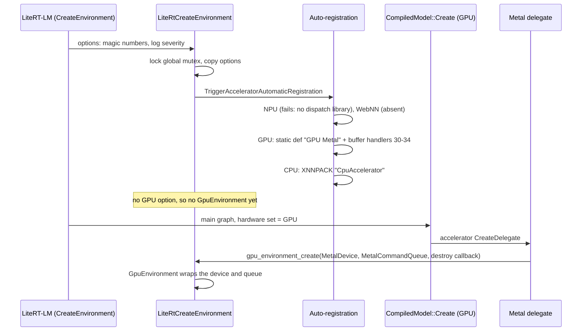
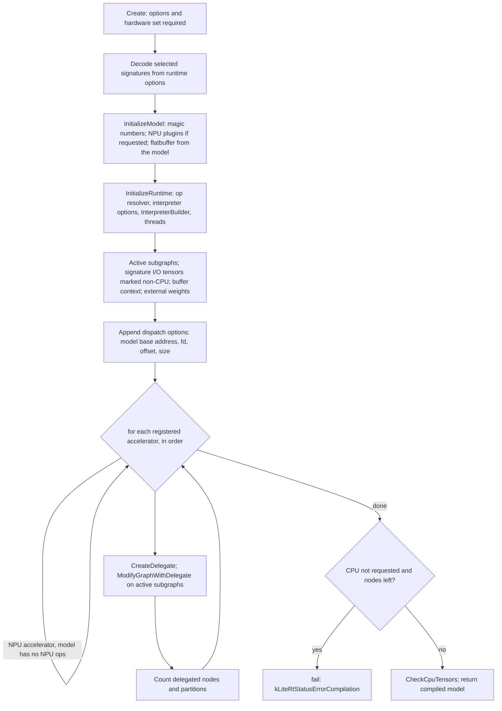
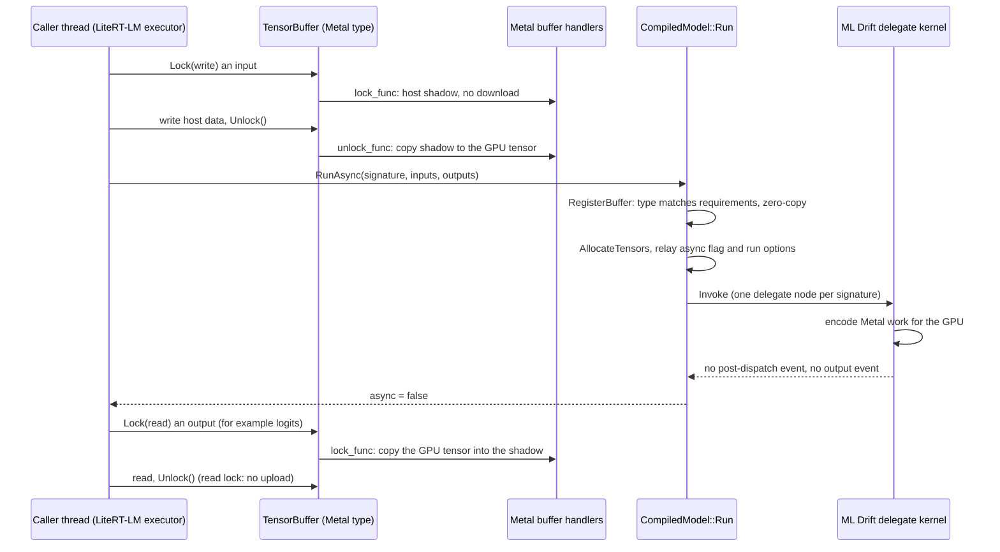

# LiteRT runtime: environment, compiled models, tensor buffers

> **Scope:** LiteRT's runtime as LiteRT-LM uses it: the `Environment` and its options, model loading, `CompiledModel` creation and runs, tensor buffers (including the Metal types), events, the CPU/GPU/runtime options, the accelerator registry and how our build links the Metal accelerator, delegation metrics, and the C and C++ API layers. **Out of scope:** what the ML Drift delegate does once LiteRT hands it a graph ([ml-drift-delegate.md](ml-drift-delegate.md)); the CPU path and XNNPACK ([cpu-xnnpack.md](cpu-xnnpack.md)); how LiteRT-LM's executors drive compiled models ([../litert-lm/executors.md](../litert-lm/executors.md)); ML Drift's Metal backend ([../ml-drift/metal-backend.md](../ml-drift/metal-backend.md)).
> **Pinned to:** LiteRT `362759838`, LiteRT-LM `7b872544` (callers), shipped wrapper `85b1a776` where noted.
> **Applies to:** all platforms, with an Apple section. **Last verified:** 2026-10-15

## Summary

LiteRT is the runtime under LiteRT-LM. LiteRT-LM creates one LiteRT `Environment` per engine, loads each `.litertlm` section as a LiteRT model, and compiles it into a `CompiledModel` for one hardware set: GPU for the main language-model graph, CPU for the embedding tables. A compiled model wraps a TFLite interpreter. Accelerators (the ML Drift "GPU Metal" accelerator, the XNNPACK "CpuAccelerator") are applied to its graph as TFLite delegates, in the order they registered, when their hardware is in the requested set. Inputs and outputs move through `TensorBuffer`s: host memory on the CPU, Metal buffers or textures on the GPU.

What matters for Agello:

- Our build links the Metal accelerator statically and it registers itself when the environment is created; nothing is loaded with `dlopen` (ours: `43f0f5c3`).
- The main graph is compiled for the GPU only. LiteRT does not fall back to the CPU for ops the GPU delegate rejects: creation fails instead.
- On Metal, every host read or write of a GPU buffer goes through a host copy, and asynchronous runs report themselves synchronous because the Metal backend publishes no completion event.
- `CompiledModel` creation is serialized process-wide, and the cancellation API that LiteRT's header declares is not implemented at the pin.

## Concepts

| Term | What it is | Where |
| --- | --- | --- |
| `LiteRtEnvironmentT` (`litert::Environment` in C++) | Holds the environment options (a tag → value map), the accelerator registry, the tensor-buffer handler registry and, once created, the `GpuEnvironment` | [`litert/core/environment.h:35-100`](https://github.com/google-ai-edge/LiteRT/blob/ca21dc99de51c76bdcc572afeea1dd937d3c9e5c/litert/core/environment.h#L35-L100) |
| Environment option | A `LiteRtEnvOption` = tag (`LiteRtEnvOptionTag`, 0–30) + `LiteRtAny` value. Examples: `kLiteRtEnvOptionTagMetalDevice` (10), `kLiteRtEnvOptionTagMagicNumberConfigs` (16), `kLiteRtEnvOptionTagAutoRegisterAccelerators` (24) | [`litert/c/litert_environment_options.h:30-81`](https://github.com/google-ai-edge/LiteRT/blob/ca21dc99de51c76bdcc572afeea1dd937d3c9e5c/litert/c/litert_environment_options.h#L30-L81) |
| `GpuEnvironment` | The GPU objects shared by every GPU compiled model in the environment: on Apple a Metal device and command queue | [`litert/runtime/gpu_environment.cc:398-430`](https://github.com/google-ai-edge/LiteRT/blob/ca21dc99de51c76bdcc572afeea1dd937d3c9e5c/litert/runtime/gpu_environment.cc#L398-L430) |
| `LiteRtModelT` (`litert::Model`) | A parsed TFLite flatbuffer: subgraphs, signatures, ops, tensors, plus the flatbuffer itself | [`litert/c/litert_model.cc:65-104`](https://github.com/google-ai-edge/LiteRT/blob/ca21dc99de51c76bdcc572afeea1dd937d3c9e5c/litert/c/litert_model.cc#L65-L104) |
| `LiteRtCompiledModelT` (`litert::CompiledModel`) | A model prepared for a hardware set: a TFLite `Interpreter`, the delegates applied to it, buffer requirements, delegation metrics | [`litert/runtime/compiled_model.cc:922-940`](https://github.com/PowerBeef/LiteRT/blob/362759838e34e1525f1cc27daddaf663a193c059/litert/runtime/compiled_model.cc#L922-L940) |
| Accelerator | A `LiteRtAcceleratorDef` (name, version, hardware set, `create_delegate`, buffer handlers) registered in the environment; at compile time it produces one TFLite delegate | [`litert/runtime/accelerators/gpu/ml_drift_metal_accelerator.cc:129-165`](https://github.com/google-ai-edge/LiteRT/blob/ca21dc99de51c76bdcc572afeea1dd937d3c9e5c/litert/runtime/accelerators/gpu/ml_drift_metal_accelerator.cc#L129-L165) |
| `TensorBuffer` (`LiteRtTensorBufferT`) | A reference-counted, lockable buffer of one `LiteRtTensorBufferType` (host memory, Metal buffer, ...), with an optional event | [`litert/runtime/tensor_buffer.h:298-315`](https://github.com/google-ai-edge/LiteRT/blob/ca21dc99de51c76bdcc572afeea1dd937d3c9e5c/litert/runtime/tensor_buffer.h#L298-L315) |
| `TensorBufferRequirements` | What a tensor accepts: supported buffer types (in order of preference), size, alignment, strides | [`litert/c/litert_tensor_buffer.cc:477-507`](https://github.com/google-ai-edge/LiteRT/blob/ca21dc99de51c76bdcc572afeea1dd937d3c9e5c/litert/c/litert_tensor_buffer.cc#L477-L507) |
| Custom tensor buffer handlers | The create/destroy/lock/unlock/clear/import functions an accelerator registers per buffer type; GPU buffers are "custom" buffers to the runtime | [`litert/runtime/tensor_buffer_registry.h:28-64`](https://github.com/google-ai-edge/LiteRT/blob/ca21dc99de51c76bdcc572afeea1dd937d3c9e5c/litert/runtime/tensor_buffer_registry.h#L28-L64) |
| `LiteRtEventT` | A completion signal attached to a buffer: sync fence, OpenCL event, EGL fence, or a custom event (Metal, WebGPU) | [`litert/runtime/event.h:26-48`](https://github.com/google-ai-edge/LiteRT/blob/ca21dc99de51c76bdcc572afeea1dd937d3c9e5c/litert/runtime/event.h#L26-L48) |
| `LiteRtOptionsT` | Compilation options: hardware set, a linked list of opaque option payloads (CPU, GPU, runtime, vendor), custom ops, external-weight settings, selected signatures | [`litert/core/options.h:54-96`](https://github.com/google-ai-edge/LiteRT/blob/ca21dc99de51c76bdcc572afeea1dd937d3c9e5c/litert/core/options.h#L54-L96) |
| `LiteRtExternalLiteRtBufferContextT` | The interpreter's external context through which delegates publish buffer requirements and receive registered buffers, the async flag and per-run options | [`litert/runtime/compiled_model.cc:550-554`](https://github.com/PowerBeef/LiteRT/blob/362759838e34e1525f1cc27daddaf663a193c059/litert/runtime/compiled_model.cc#L550-L554) |
| Magic number | A prime placeholder (32003 in Gemma 4 files) in tensor shapes that the runtime rewrites to a real size before compiling | [`litert/runtime/magic_number_utils.h:24-37`](https://github.com/google-ai-edge/LiteRT/blob/ca21dc99de51c76bdcc572afeea1dd937d3c9e5c/litert/runtime/magic_number_utils.h#L24-L37) |

## How it works

### The environment

`LiteRtCreateEnvironment` takes a process-wide mutex, applies the minimum log severity if that option is present, copies the options into a new `LiteRtEnvironmentT`, runs accelerator auto-registration, and creates a `GpuEnvironment` only if the options include one of twelve GPU tags (OpenCL, EGL, WebGPU, Metal device or queue, Vulkan) ([`litert/c/litert_environment.cc:48-53`](https://github.com/google-ai-edge/LiteRT/blob/ca21dc99de51c76bdcc572afeea1dd937d3c9e5c/litert/c/litert_environment.cc#L48-L53), [`litert/c/litert_environment.cc:70-72`](https://github.com/google-ai-edge/LiteRT/blob/ca21dc99de51c76bdcc572afeea1dd937d3c9e5c/litert/c/litert_environment.cc#L70-L72), [`litert/c/litert_environment.cc:74-105`](https://github.com/google-ai-edge/LiteRT/blob/ca21dc99de51c76bdcc572afeea1dd937d3c9e5c/litert/c/litert_environment.cc#L74-L105)).

Options are stored by tag. String values are copied into storage the environment owns; every other value (integers, pointers) is stored as given, so pointed-to data must outlive its use. Setting a tag twice without `overwrite` fails with `kLiteRtStatusErrorAlreadyExists` ([`litert/core/environment_options.cc:36-56`](https://github.com/google-ai-edge/LiteRT/blob/ca21dc99de51c76bdcc572afeea1dd937d3c9e5c/litert/core/environment_options.cc#L36-L56)). `LiteRtAddEnvironmentOptions` adds options later and forwards them to an existing `GpuEnvironment`, which only accepts the two destroy-callback tags ([`litert/c/litert_environment.cc:129-151`](https://github.com/google-ai-edge/LiteRT/blob/ca21dc99de51c76bdcc572afeea1dd937d3c9e5c/litert/c/litert_environment.cc#L129-L151), [`litert/runtime/gpu_environment.cc:460-479`](https://github.com/google-ai-edge/LiteRT/blob/ca21dc99de51c76bdcc572afeea1dd937d3c9e5c/litert/runtime/gpu_environment.cc#L460-L479)). A second `SetGpuEnvironment` fails with "GPU environment is already set." ([`litert/core/environment.cc:74-84`](https://github.com/google-ai-edge/LiteRT/blob/ca21dc99de51c76bdcc572afeea1dd937d3c9e5c/litert/core/environment.cc#L74-L84)).

What LiteRT-LM puts in the environment: magic-number configs and verifications (for CPU, GPU and the generic NPU path, unless the advanced setting `configure_magic_numbers` is off), the NPU dispatch and compiler-plugin directories (NPU only), and the minimum log severity ([`runtime/util/litert_util.cc:134-174`](https://github.com/google-ai-edge/LiteRT-LM/blob/df6df5b84d5845b49889f631ed4cac80b4325dd3/runtime/util/litert_util.cc#L134-L174)). There is no Metal device or command queue among them, so the environment starts without a `GpuEnvironment`. <!-- c:RT-RUN-008 -->

The option tags, and which ones our stack uses on Apple ([`litert/c/litert_environment_options.h:30-81`](https://github.com/google-ai-edge/LiteRT/blob/ca21dc99de51c76bdcc572afeea1dd937d3c9e5c/litert/c/litert_environment_options.h#L30-L81)):

| Tag (value) | What it carries | On Apple in our stack |
| --- | --- | --- |
| `CompilerPluginLibraryDir` (0), `DispatchLibraryDir` (1) | NPU compiler-plugin and dispatch-library folders | Set by LiteRT-LM only for an NPU backend |
| `OpenClDeviceId` … `OpenClCommandQueue` (2–5) | Caller-provided OpenCL objects | Not used (no OpenCL) |
| `EglDisplay`, `EglContext` (6–7) | OpenGL interop | Not used |
| `WebGpuDevice`, `WebGpuQueue` (8–9), `WebGpuInstance` (19), `WebGpuProcs` (20, deprecated), `WebGpuFlushCallback` (29) | WebGPU and Dawn objects | Not used |
| `MetalDevice`, `MetalCommandQueue` (10–11) | `id<MTLDevice>`, `id<MTLCommandQueue>` as pointers | Set by the Metal delegate |
| `VulkanEnvironment` (12) | Vulkan objects (experimental) | Not used |
| `CallbackOnGpuEnvDestroy`, `CallbackUserDataOnGpuEnvDestroy` (14–15) | Called when the `GpuEnvironment` is destroyed | Set by the Metal delegate (releases its device reference) |
| `MagicNumberConfigs`, `MagicNumberVerifications` (16–17) | Pointers to the structures in [Magic numbers](#magic-numbers) | Set by LiteRT-LM |
| `CompilerCacheDir` (18), `CompilerCacheMaxConfigsPerModel` (26), `CompilerCacheMaxTotalSize` (27) | NPU JIT compilation cache | Not used |
| `CustomTensorBufferHandlers_deprecated` (21) | Old way to register buffer handlers | Not used |
| `RuntimeLibraryDir` (22) | Folder for `dlopen` of GPU accelerators | Not used (static link) |
| `SystemRuntimeHandle` (23), `Context` (28), `SystemGpuAcceleratorHandle` (30) | Internal: a system runtime, Play services, a GPU accelerator passed by handle | Not used |
| `AutoRegisterAccelerators` (24) | Bitmask of accelerator kinds to register | Not set (all) |
| `MinLoggerSeverity` (25) | Log level, applied before anything else | Set by LiteRT-LM when it has a level |

On Apple the `GpuEnvironment` is created later, by the Metal delegate the first time a GPU model is compiled: it creates (or reuses) one process-wide ML Drift `MetalDevice`, makes a new `MTLCommandQueue`, and calls `gpu_environment_create` with the device, the queue and a destroy callback ([`ml_drift_delegate/delegate/delegate_metal.mm:94-118`](https://github.com/google-ai-edge/LiteRT/blob/ca21dc99de51c76bdcc572afeea1dd937d3c9e5c/ml_drift_delegate/delegate/delegate_metal.mm#L94-L118)). `GpuEnvironment` then wraps that device and queue instead of creating its own ([`litert/runtime/gpu_environment.cc:135-152`](https://github.com/google-ai-edge/LiteRT/blob/ca21dc99de51c76bdcc572afeea1dd937d3c9e5c/litert/runtime/gpu_environment.cc#L135-L152), [`litert/runtime/gpu_environment.cc:398-430`](https://github.com/google-ai-edge/LiteRT/blob/ca21dc99de51c76bdcc572afeea1dd937d3c9e5c/litert/runtime/gpu_environment.cc#L398-L430)). <!-- c:RT-RUN-009 --> The delegate side of this is on [ml-drift-delegate.md](ml-drift-delegate.md).

### The accelerator registry

Auto-registration reads `kLiteRtEnvOptionTagAutoRegisterAccelerators`; without it the set is CPU, GPU, NPU and WebNN. It registers in a fixed order: NPU, WebNN, GPU, CPU ([`litert/runtime/accelerators/auto_registration.cc:31-49`](https://github.com/google-ai-edge/LiteRT/blob/ca21dc99de51c76bdcc572afeea1dd937d3c9e5c/litert/runtime/accelerators/auto_registration.cc#L31-L49), [`litert/runtime/accelerators/auto_registration.cc:53-80`](https://github.com/google-ai-edge/LiteRT/blob/ca21dc99de51c76bdcc572afeea1dd937d3c9e5c/litert/runtime/accelerators/auto_registration.cc#L53-L80)). <!-- c:RT-RUN-001 --> `CompiledModel` walks the registry in that order and applies the delegate of each accelerator whose hardware is in the requested set (an accelerator that is not responsible for JIT compilation is applied regardless; the NPU accelerator only when the model has dispatch ops). With both the GPU and the CPU requested, the GPU delegate is therefore applied before XNNPACK's; LiteRT-LM's GPU executor requests only `kGpu`, so the XNNPACK delegate is not applied to that graph at all ([`litert/runtime/compiled_model.cc:1044-1071`](https://github.com/PowerBeef/LiteRT/blob/362759838e34e1525f1cc27daddaf663a193c059/litert/runtime/compiled_model.cc#L1044-L1071), [`runtime/executor/llm_executor_settings_utils.cc:265`](https://github.com/PowerBeef/agello-litert-lm/blob/7b872544fdbd81308f98b1e2acf8c5798a549df6/runtime/executor/llm_executor_settings_utils.cc#L265)). <!-- c:RT-RUN-002 -->

The GPU registry tries three sources, in order: an accelerator definition passed in `kLiteRtEnvOptionTagSystemGpuAcceleratorHandle`; the statically linked definition `LiteRtStaticLinkedAcceleratorGpuDef`; then `dlopen` of a list of library names under `kLiteRtEnvOptionTagRuntimeLibraryDir`, looking for `LiteRtAcceleratorImpl` and then `LiteRtRegisterGpuAccelerator` in each ([`litert/runtime/accelerators/gpu_registry.cc:89-118`](https://github.com/google-ai-edge/LiteRT/blob/ca21dc99de51c76bdcc572afeea1dd937d3c9e5c/litert/runtime/accelerators/gpu_registry.cc#L89-L118), [`litert/runtime/accelerators/gpu_registry.cc:120-162`](https://github.com/google-ai-edge/LiteRT/blob/ca21dc99de51c76bdcc572afeea1dd937d3c9e5c/litert/runtime/accelerators/gpu_registry.cc#L120-L162)). <!-- c:RT-RUN-003 --> On iOS the names are `libLiteRtGpuAccelerator.dylib`, `libLiteRtMetalAccelerator.dylib` and `LiteRtMetalAccelerator` (the executable inside a framework bundle), plus `libLiteRtWebGpuAccelerator.dylib` when WebGPU support is compiled in; macOS uses the same Metal names after the WebGPU and OpenCL ones ([`litert/runtime/accelerators/gpu_registry.cc:47-87`](https://github.com/google-ai-edge/LiteRT/blob/ca21dc99de51c76bdcc572afeea1dd937d3c9e5c/litert/runtime/accelerators/gpu_registry.cc#L47-L87)). If nothing registers, it logs "GPU accelerator could not be loaded and registered." and returns `kLiteRtStatusErrorUnsupported`, which auto-registration ignores.

Static linking works through a Bazel macro and a static initializer. `litert_accelerator_library` defines the `ml_drift_metal_accelerator` target with `LITERT_USE_STATIC_LINKED_GPU_ACCELERATOR` and `alwayslink = 1` ([`litert/build_common/litert_build_defs.bzl:660-700`](https://github.com/google-ai-edge/LiteRT/blob/ca21dc99de51c76bdcc572afeea1dd937d3c9e5c/litert/build_common/litert_build_defs.bzl#L660-L700)), and with that define the accelerator's source contains a global object whose constructor sets `LiteRtStaticLinkedAcceleratorGpuDef = &LiteRtAcceleratorImpl` ([`litert/runtime/accelerators/gpu/ml_drift_metal_accelerator.cc:167-182`](https://github.com/google-ai-edge/LiteRT/blob/ca21dc99de51c76bdcc572afeea1dd937d3c9e5c/litert/runtime/accelerators/gpu/ml_drift_metal_accelerator.cc#L167-L182)). <!-- c:RT-RUN-004 --> Any binary that links the target therefore registers the Metal accelerator in every environment it creates.

What our `--config=agello` build links: `//runtime/executor:default_static_gpu_accelerator` depends on `apple_static_gpu_accelerator`, which selects `@litert//litert/runtime/accelerators/gpu:ml_drift_metal_accelerator` and links Metal and Foundation on both iOS and macOS (ours: `43f0f5c3`); in upstream LiteRT-LM at `df6df5b8` the target's dependency list is empty (an internal placeholder) ([`runtime/executor/BUILD:253-279`](https://github.com/PowerBeef/agello-litert-lm/blob/7b872544fdbd81308f98b1e2acf8c5798a549df6/runtime/executor/BUILD#L253-L279), [`runtime/executor/BUILD:252-260` (upstream df6df5b8)](https://github.com/google-ai-edge/LiteRT-LM/blob/df6df5b84d5845b49889f631ed4cac80b4325dd3/runtime/executor/BUILD#L252-L260)). <!-- c:RT-RUN-005 --> The `--config=agello` lines themselves only set C++20, the FST-constraints define, `-undefined error` and build stamping ([`.bazelrc:553-566`](https://github.com/PowerBeef/agello-litert-lm/blob/7b872544fdbd81308f98b1e2acf8c5798a549df6/.bazelrc#L553-L566)); the `gpu_accelerator` flag whose comment says "macOS uses WebGPU" by default is not consulted by `default_static_gpu_accelerator` in our fork ([`runtime/executor/BUILD:179-194`](https://github.com/PowerBeef/agello-litert-lm/blob/7b872544fdbd81308f98b1e2acf8c5798a549df6/runtime/executor/BUILD#L179-L194)). How the XCFramework is assembled is on [../litert-lm/build-and-release.md](../litert-lm/build-and-release.md).

A real engine run on this Mac shows the result: NPU registration fails with `kLiteRtStatusErrorNotFound`, then "GPU Metal" registers ("Statically linked GPU accelerator registered."), then `CpuAccelerator` (XNNPACK) ([../generated/engine-run.md](../generated/engine-run.md), engine log). <!-- c:RT-RUN-006 --> The NPU attempt is cheap: without a statically linked dispatch API or a dispatch library directory, `LiteRtRegisterNpuAccelerator` returns `NotFound` before creating anything ([`litert/runtime/accelerators/npu_registry.cc:26-41`](https://github.com/google-ai-edge/LiteRT/blob/ca21dc99de51c76bdcc572afeea1dd937d3c9e5c/litert/runtime/accelerators/npu_registry.cc#L26-L41), [`litert/runtime/accelerators/dispatch/dispatch_accelerator.cc:147-160`](https://github.com/google-ai-edge/LiteRT/blob/ca21dc99de51c76bdcc572afeea1dd937d3c9e5c/litert/runtime/accelerators/dispatch/dispatch_accelerator.cc#L147-L160)).

`RegisterAcceleratorFromDef` rejects a definition whose ABI header is not compatible with 1.0 or that lacks one of the five required functions, registers the accelerator, then registers the definition's buffer handlers for each of its buffer types in the environment's tensor-buffer registry ([`litert/runtime/accelerators/registration_helper.cc:34-94`](https://github.com/google-ai-edge/LiteRT/blob/ca21dc99de51c76bdcc572afeea1dd937d3c9e5c/litert/runtime/accelerators/registration_helper.cc#L34-L94)). The registry reserves room for five accelerators and four shared libraries, and its members are declared so that accelerators are destroyed before the libraries that contain their code are closed ([`litert/runtime/accelerator_registry.h:33-43`](https://github.com/google-ai-edge/LiteRT/blob/ca21dc99de51c76bdcc572afeea1dd937d3c9e5c/litert/runtime/accelerator_registry.h#L33-L43), [`litert/runtime/accelerator_registry.h:91-103`](https://github.com/google-ai-edge/LiteRT/blob/ca21dc99de51c76bdcc572afeea1dd937d3c9e5c/litert/runtime/accelerator_registry.h#L91-L103)).

The Metal accelerator definition: name "GPU Metal", hardware set `kLiteRtHwAcceleratorGpu`, responsible for JIT compilation, and buffer handlers (`LiteRtCreateMetalMemory`, `LiteRtLockMetalMemory`, ...) for the five Metal buffer types 30–34, with `kLiteRtEnvOptionTagMetalDevice` and `kLiteRtEnvOptionTagMetalCommandQueue` as the device and queue tags ([`litert/runtime/accelerators/gpu/ml_drift_metal_accelerator.cc:45-52`](https://github.com/google-ai-edge/LiteRT/blob/ca21dc99de51c76bdcc572afeea1dd937d3c9e5c/litert/runtime/accelerators/gpu/ml_drift_metal_accelerator.cc#L45-L52), [`litert/runtime/accelerators/gpu/ml_drift_metal_accelerator.cc:79-86`](https://github.com/google-ai-edge/LiteRT/blob/ca21dc99de51c76bdcc572afeea1dd937d3c9e5c/litert/runtime/accelerators/gpu/ml_drift_metal_accelerator.cc#L79-L86), [`litert/runtime/accelerators/gpu/ml_drift_metal_accelerator.cc:129-165`](https://github.com/google-ai-edge/LiteRT/blob/ca21dc99de51c76bdcc572afeea1dd937d3c9e5c/litert/runtime/accelerators/gpu/ml_drift_metal_accelerator.cc#L129-L165)). <!-- c:RT-RUN-007 --> Its `CreateDelegate` builds ML Drift Metal delegate options, passes the weight loader (and turns on constant-tensor sharing when there is one) and, on Apple, the residency-set option from the GPU options ([`litert/runtime/accelerators/gpu/ml_drift_metal_accelerator.cc:88-122`](https://github.com/google-ai-edge/LiteRT/blob/ca21dc99de51c76bdcc572afeea1dd937d3c9e5c/litert/runtime/accelerators/gpu/ml_drift_metal_accelerator.cc#L88-L122)).

### Loading a model

The C API offers three loaders. `LiteRtCreateModelFromFile` maps a file; `LiteRtCreateModelFromFd` maps a byte range of an open file with a TFLite `MMAPAllocation`; `LiteRtCreateModelFromBuffer` wraps caller memory in a non-owning `tflite::MemoryAllocation`, so the caller must keep the memory alive ([`litert/c/litert_model.cc:65-104`](https://github.com/google-ai-edge/LiteRT/blob/ca21dc99de51c76bdcc572afeea1dd937d3c9e5c/litert/c/litert_model.cc#L65-L104), [`litert/core/util/flatbuffer_tools.cc:281-284`](https://github.com/google-ai-edge/LiteRT/blob/ca21dc99de51c76bdcc572afeea1dd937d3c9e5c/litert/core/util/flatbuffer_tools.cc#L281-L284)). The buffer path verifies the flatbuffer with the verifier's 2 GB default raised to `SIZE_MAX`, because models can carry weights beyond the flatbuffer ([`litert/core/util/flatbuffer_tools.cc:96-107`](https://github.com/google-ai-edge/LiteRT/blob/ca21dc99de51c76bdcc572afeea1dd937d3c9e5c/litert/core/util/flatbuffer_tools.cc#L96-L107), [`litert/core/util/flatbuffer_tools.cc:286-313`](https://github.com/google-ai-edge/LiteRT/blob/ca21dc99de51c76bdcc572afeea1dd937d3c9e5c/litert/core/util/flatbuffer_tools.cc#L286-L313)).

LiteRT-LM's language-model engine loads a section by file descriptor only for an NPU backend: when its advanced settings turn `configure_magic_numbers` off (the comment notes that "magic-number replacement mutates the model flatbuffer in place"), or when the model is an ahead-of-time compiled NPU model with a non-empty `TF_LITE_AUX` section. For the CPU and GPU backends, `ModelResourcesLitertLm::GetTFLiteModel` passes the section's bytes from its own mapping of the `.litertlm` file to `Model::CreateFromBuffer` ([`runtime/core/engine_advanced_impl.cc:419-439`](https://github.com/google-ai-edge/LiteRT-LM/blob/df6df5b84d5845b49889f631ed4cac80b4325dd3/runtime/core/engine_advanced_impl.cc#L419-L439), [`runtime/executor/litert_compiled_model_executor_utils.cc:153-164`](https://github.com/google-ai-edge/LiteRT-LM/blob/df6df5b84d5845b49889f631ed4cac80b4325dd3/runtime/executor/litert_compiled_model_executor_utils.cc#L153-L164), [`runtime/components/model_resources_litert_lm.cc:129-139`](https://github.com/google-ai-edge/LiteRT-LM/blob/df6df5b84d5845b49889f631ed4cac80b4325dd3/runtime/components/model_resources_litert_lm.cc#L129-L139)). <!-- c:RT-RUN-011 --> That mapping is `PROT_READ | PROT_WRITE`, `MAP_PRIVATE`, so the rewrite dirties private copies of only the pages it touches; on Apple the loader then calls `madvise(MADV_DONTNEED)` so pages load on first use ([`support/util/memory_mapped_file_posix.cc:132-145`](https://github.com/google-ai-edge/LiteRT-LM/blob/df6df5b84d5845b49889f631ed4cac80b4325dd3/support/util/memory_mapped_file_posix.cc#L132-L145)). The file format and loader are on [../litert-lm/file-format.md](../litert-lm/file-format.md).

### Magic numbers

GPUs need static shapes, so Gemma files are exported with a prime placeholder where the context length goes (32003), and the runtime rewrites it before compiling. `ReplaceMagicNumbersIfAny` runs at the start of `InitializeModel`, in builds that have the builtin TFLite ops (no `LITERT_NO_BUILTIN_OPS`), and does nothing unless the environment carries `kLiteRtEnvOptionTagMagicNumberConfigs` ([`litert/runtime/compiled_model.cc:821-828`](https://github.com/PowerBeef/LiteRT/blob/362759838e34e1525f1cc27daddaf663a193c059/litert/runtime/compiled_model.cc#L821-L828), [`litert/runtime/magic_number_utils.cc:776-819`](https://github.com/google-ai-edge/LiteRT/blob/ca21dc99de51c76bdcc572afeea1dd937d3c9e5c/litert/runtime/magic_number_utils.cc#L776-L819)).

For each signature and each config whose `signature_prefix` matches (null or empty matches every signature), it walks the signature's subgraph and replaces every value that is an exact multiple `k × magic` with `k × target` in: tensor dimensions (and the flatbuffer's shape vectors, shrinking constant buffers to the new shape); the shape, limit or size input of `FILL` (input 0), `RESHAPE` and `BROADCAST_TO` (input 1), `RANGE` (input 1) and `SLICE` (input 2); the decomposition subgraphs of StableHLO composites; and the integer attributes of `odml.cache_update` composites ([`litert/runtime/magic_number_utils.cc:499-541`](https://github.com/google-ai-edge/LiteRT/blob/ca21dc99de51c76bdcc572afeea1dd937d3c9e5c/litert/runtime/magic_number_utils.cc#L499-L541), [`litert/runtime/magic_number_utils.cc:136-141`](https://github.com/google-ai-edge/LiteRT/blob/ca21dc99de51c76bdcc572afeea1dd937d3c9e5c/litert/runtime/magic_number_utils.cc#L136-L141), [`litert/runtime/magic_number_utils.cc:236-274`](https://github.com/google-ai-edge/LiteRT/blob/ca21dc99de51c76bdcc572afeea1dd937d3c9e5c/litert/runtime/magic_number_utils.cc#L236-L274), [`litert/runtime/magic_number_utils.cc:76-91`](https://github.com/google-ai-edge/LiteRT/blob/ca21dc99de51c76bdcc572afeea1dd937d3c9e5c/litert/runtime/magic_number_utils.cc#L76-L91), [`litert/runtime/magic_number_utils.cc:49-51`](https://github.com/google-ai-edge/LiteRT/blob/ca21dc99de51c76bdcc572afeea1dd937d3c9e5c/litert/runtime/magic_number_utils.cc#L49-L51)). <!-- c:RT-RUN-012 --> The writes go into the flatbuffer itself through `const_cast`, which is why the model memory must be writable. Optional verifications then compare a rewritten signature against a test signature op by op ([`litert/runtime/magic_number_utils.cc:776-819`](https://github.com/google-ai-edge/LiteRT/blob/ca21dc99de51c76bdcc572afeea1dd937d3c9e5c/litert/runtime/magic_number_utils.cc#L776-L819)).

In the E4B engine run on this Mac with an 8K window, LiteRT-LM passed one config (32003 → 8192, no prefix) and the runtime reported 577 replacements in `decode`, 426 in `prefill_1024`, 581 in `verify` and 57 in `mtp_drafter`. The log calls them "tensors", but the counter sums replaced tensor dimensions, parameter elements and composite attributes ([../generated/engine-run.md](../generated/engine-run.md), engine log; [`litert/runtime/magic_number_utils.cc:433-496`](https://github.com/google-ai-edge/LiteRT/blob/ca21dc99de51c76bdcc572afeea1dd937d3c9e5c/litert/runtime/magic_number_utils.cc#L433-L496)). <!-- c:RT-RUN-013 --> LiteRT-LM keeps the config structures alive in a `MagicNumberConfigsHelper` that the engine's `OwnedEnvironment` owns, which satisfies the header's rule that the pointed-to data outlive model initialization ([`runtime/executor/magic_number_configs_helper.cc:413-425`](https://github.com/google-ai-edge/LiteRT-LM/blob/df6df5b84d5845b49889f631ed4cac80b4325dd3/runtime/executor/magic_number_configs_helper.cc#L413-L425), [`litert/c/litert_environment_options.h:106-126`](https://github.com/google-ai-edge/LiteRT/blob/ca21dc99de51c76bdcc572afeea1dd937d3c9e5c/litert/c/litert_environment_options.h#L106-L126)). Why 32003 and how LiteRT-LM chooses the target are on [../litert-lm/executors.md](../litert-lm/executors.md).

### Creating a compiled model

`LiteRtCreateCompiledModel` holds a static mutex for the whole of `LiteRtCompiledModelT::Create`, so compiled models are created one at a time per process, whichever thread or engine asks ([`litert/c/litert_compiled_model.cc:43-64`](https://github.com/google-ai-edge/LiteRT/blob/ca21dc99de51c76bdcc572afeea1dd937d3c9e5c/litert/c/litert_compiled_model.cc#L43-L64)). <!-- c:RT-RUN-014 --> Environment creation has its own process-wide mutex ([`litert/c/litert_environment.cc:48-53`](https://github.com/google-ai-edge/LiteRT/blob/ca21dc99de51c76bdcc572afeea1dd937d3c9e5c/litert/c/litert_environment.cc#L48-L53)). For LiteRT-LM this means the main graph, the embedders, the vision and audio models and the MTP drafter compile in sequence even when two engines load at once.

Step by step (all in `compiled_model.cc`, which our telemetry commit changes, so links go to our fork):

1. **Arguments.** No options, or a hardware set of `kLiteRtHwAcceleratorNone`, is `InvalidArgument` ([`litert/runtime/compiled_model.cc:922-940`](https://github.com/PowerBeef/LiteRT/blob/362759838e34e1525f1cc27daddaf663a193c059/litert/runtime/compiled_model.cc#L922-L940)). Selected signature keys are read from the runtime options before conversion so unselected graphs are never converted ([`litert/runtime/compiled_model.cc:942-958`](https://github.com/PowerBeef/LiteRT/blob/362759838e34e1525f1cc27daddaf663a193c059/litert/runtime/compiled_model.cc#L942-L958)).
2. **Model.** `InitializeModel` rewrites magic numbers, tries NPU compiler plugins when hardware acceleration is requested and the model is not already compiled (failure is recoverable), then builds a `tflite::FlatBufferModel` over the model's own buffer and records its file descriptor, offset and size if it is file-backed ([`litert/runtime/compiled_model.cc:821-828`](https://github.com/PowerBeef/LiteRT/blob/362759838e34e1525f1cc27daddaf663a193c059/litert/runtime/compiled_model.cc#L821-L828), [`litert/runtime/compiled_model.cc:836-865`](https://github.com/PowerBeef/LiteRT/blob/362759838e34e1525f1cc27daddaf663a193c059/litert/runtime/compiled_model.cc#L836-L865), [`litert/runtime/compiled_model.cc:867-889`](https://github.com/PowerBeef/LiteRT/blob/362759838e34e1525f1cc27daddaf663a193c059/litert/runtime/compiled_model.cc#L867-L889)).
3. **Interpreter.** The op resolver is the builtin resolver without default delegates (the reference resolver in reference-kernel mode, a stub resolver in `LITERT_NO_BUILTIN_OPS` builds) ([`litert/runtime/compiled_model.cc:337-379`](https://github.com/PowerBeef/LiteRT/blob/362759838e34e1525f1cc27daddaf663a193c059/litert/runtime/compiled_model.cc#L337-L379)). When the GPU is requested, nine custom ops the GPU delegate implements, such as `custom_call.RmsNorm`, get stub registrations so the interpreter can be built; when the CPU is requested and the GPU is not, four are stubbed (`Convolution2DTransposeBias`, `MaxPoolingWithArgmax2D`, `MaxUnpooling2D`, `moe`) ([`litert/runtime/compiled_model.cc:418-440`](https://github.com/PowerBeef/LiteRT/blob/362759838e34e1525f1cc27daddaf663a193c059/litert/runtime/compiled_model.cc#L418-L440)). The interpreter uses signature tensor names; runtime options, when present and parseable, also turn on StableHLO composite inlining and set zero-point compression, profiling, delegate clustering and the error reporter ([`litert/runtime/compiled_model.cc:451-489`](https://github.com/PowerBeef/LiteRT/blob/362759838e34e1525f1cc27daddaf663a193c059/litert/runtime/compiled_model.cc#L451-L489)). The thread count is the CPU options' `num_threads` when CPU options are present and the CPU is requested, and 1 otherwise ([`litert/runtime/compiled_model.cc:289-335`](https://github.com/PowerBeef/LiteRT/blob/362759838e34e1525f1cc27daddaf663a193c059/litert/runtime/compiled_model.cc#L289-L335), [`litert/runtime/compiled_model.cc:491-502`](https://github.com/PowerBeef/LiteRT/blob/362759838e34e1525f1cc27daddaf663a193c059/litert/runtime/compiled_model.cc#L491-L502)).
4. **Tensors and context.** Active subgraphs are all subgraphs unless signatures were selected ([`litert/runtime/compiled_model.cc:1201-1213`](https://github.com/PowerBeef/LiteRT/blob/362759838e34e1525f1cc27daddaf663a193c059/litert/runtime/compiled_model.cc#L1201-L1213)). The non-string input and output tensors of the selected signatures that TFLite would place in its arena (`kTfLiteArenaRw`, `kTfLiteArenaRwPersistent`) become `kTfLiteNonCpu` with a null data pointer, so TFLite allocates no host memory for them ([`litert/runtime/compiled_model.cc:1274-1300`](https://github.com/PowerBeef/LiteRT/blob/362759838e34e1525f1cc27daddaf663a193c059/litert/runtime/compiled_model.cc#L1274-L1300)). The external buffer context is installed ([`litert/runtime/compiled_model.cc:550-554`](https://github.com/PowerBeef/LiteRT/blob/362759838e34e1525f1cc27daddaf663a193c059/litert/runtime/compiled_model.cc#L550-L554)). If the model has external weights, a weight loader is created, and when the CPU is requested the weights are prepared for CPU access and bound to their tensors (read-only) before any delegate runs ([`litert/runtime/compiled_model.cc:556-603`](https://github.com/PowerBeef/LiteRT/blob/362759838e34e1525f1cc27daddaf663a193c059/litert/runtime/compiled_model.cc#L556-L603), [`litert/runtime/compiled_model.cc:998-1017`](https://github.com/PowerBeef/LiteRT/blob/362759838e34e1525f1cc27daddaf663a193c059/litert/runtime/compiled_model.cc#L998-L1017)).
5. **Dispatch options.** For the duration of `Create`, the model's base address, file descriptor, offset and size are appended to the options for delegates that want them ([`litert/runtime/compiled_model.cc:970-996`](https://github.com/PowerBeef/LiteRT/blob/362759838e34e1525f1cc27daddaf663a193c059/litert/runtime/compiled_model.cc#L970-L996)).
6. **Delegates.** Each registered accelerator is skipped if it is responsible for JIT compilation and none of its hardware is requested, or if it is the NPU accelerator and the model has no dispatch ops. Otherwise its `CreateDelegate` runs (a null delegate means "nothing to do") and the interpreter's `ModifyGraphWithDelegate` partitions the active subgraphs; a failure there is `kLiteRtStatusErrorRuntimeFailure` "Failed to modify graph with delegate" ([`litert/runtime/compiled_model.cc:1044-1071`](https://github.com/PowerBeef/LiteRT/blob/362759838e34e1525f1cc27daddaf663a193c059/litert/runtime/compiled_model.cc#L1044-L1071), [`litert/runtime/compiled_model.cc:1083-1098`](https://github.com/PowerBeef/LiteRT/blob/362759838e34e1525f1cc27daddaf663a193c059/litert/runtime/compiled_model.cc#L1083-L1098), [`litert/runtime/compiled_model.cc:1121-1126`](https://github.com/PowerBeef/LiteRT/blob/362759838e34e1525f1cc27daddaf663a193c059/litert/runtime/compiled_model.cc#L1121-L1126)).
7. **Leftovers.** If the CPU is not in the hardware set and any node is still undelegated, `Create` fails with `kLiteRtStatusErrorCompilation` ("Some ops are not accelerated. Add kLiteRtHwAcceleratorCpu ..."). There is no silent fallback to the CPU for a GPU-only request ([`litert/runtime/compiled_model.cc:1185-1198`](https://github.com/PowerBeef/LiteRT/blob/362759838e34e1525f1cc27daddaf663a193c059/litert/runtime/compiled_model.cc#L1185-L1198)). <!-- c:RT-RUN-015 -->
8. **CPU tensors.** `CheckCpuTensors` records every tensor read or written by a node that runs on the CPU: an undelegated node, or a node delegated to XNNPACK or YNNPACK. Those tensors get host-memory buffer requirements; the others get the requirements their delegate registered ([`litert/runtime/compiled_model.cc:1442-1482`](https://github.com/PowerBeef/LiteRT/blob/362759838e34e1525f1cc27daddaf663a193c059/litert/runtime/compiled_model.cc#L1442-L1482), [`litert/runtime/compiled_model.cc:1638-1671`](https://github.com/PowerBeef/LiteRT/blob/362759838e34e1525f1cc27daddaf663a193c059/litert/runtime/compiled_model.cc#L1638-L1671)).

LiteRT-LM's GPU executor sets the hardware set to `kGpu` alone and hints that prefill and decode are fully delegated to a single delegate ([`runtime/executor/llm_executor_settings_utils.cc:265`](https://github.com/PowerBeef/agello-litert-lm/blob/7b872544fdbd81308f98b1e2acf8c5798a549df6/runtime/executor/llm_executor_settings_utils.cc#L265), [`runtime/executor/llm_executor_settings_utils.cc:201-202`](https://github.com/PowerBeef/agello-litert-lm/blob/7b872544fdbd81308f98b1e2acf8c5798a549df6/runtime/executor/llm_executor_settings_utils.cc#L201-L202)). Combined with step 7, an op that ML Drift cannot run makes engine creation fail rather than run that op on the CPU. <!-- c:RT-RUN-016 --> XNNPACK is not consulted for that graph: its accelerator is responsible for JIT compilation on every platform but the web, so step 6 skips it when the CPU is not requested ([`litert/runtime/accelerators/xnnpack/xnnpack_accelerator.cc:123-135`](https://github.com/google-ai-edge/LiteRT/blob/ca21dc99de51c76bdcc572afeea1dd937d3c9e5c/litert/runtime/accelerators/xnnpack/xnnpack_accelerator.cc#L123-L135), [`litert/runtime/compiled_model.cc:1044-1071`](https://github.com/PowerBeef/LiteRT/blob/362759838e34e1525f1cc27daddaf663a193c059/litert/runtime/compiled_model.cc#L1044-L1071)). The embedding tables are separate CPU-only compiled models; see [cpu-xnnpack.md](cpu-xnnpack.md).

On Apple, LiteRT-LM's GPU options also turn off texture weights and pass `gpu_enable_metal_residency_set` from the advanced settings ([`runtime/executor/llm_executor_settings_utils.cc:97-103`](https://github.com/PowerBeef/agello-litert-lm/blob/7b872544fdbd81308f98b1e2acf8c5798a549df6/runtime/executor/llm_executor_settings_utils.cc#L97-L103)); [ml-drift-delegate.md](ml-drift-delegate.md) covers what the delegate does with them.

How the C++ options reach this code: `litert::Options::Build` creates the C options, sets the hardware set and appends one serialized payload per option type the caller asked for with `GetOptions<T>()`, plus any opaque options added with `AddOpaqueOptions` ([`litert/cc/litert_options.h:409-443`](https://github.com/google-ai-edge/LiteRT/blob/ca21dc99de51c76bdcc572afeea1dd937d3c9e5c/litert/cc/litert_options.h#L409-L443), [`litert/cc/litert_options.h:181-184`](https://github.com/google-ai-edge/LiteRT/blob/ca21dc99de51c76bdcc572afeea1dd937d3c9e5c/litert/cc/litert_options.h#L181-L184)). A compilation that neither calls `GetRuntimeOptions()` nor adds runtime options directly carries none, so the defaults in step 3 apply. LiteRT-LM's CPU path asks for runtime options (zero-point compression, delegate clustering) and therefore gets composite inlining; its GPU path asks for them only for profiling or signature selection ([`runtime/executor/llm_executor_settings_utils.cc:285-311`](https://github.com/PowerBeef/agello-litert-lm/blob/7b872544fdbd81308f98b1e2acf8c5798a549df6/runtime/executor/llm_executor_settings_utils.cc#L285-L311)).

### Delegation metrics

`CompiledModel` counts the nodes of the active subgraphs that are not marked delegation-skippable before any delegate runs. After each delegate it recounts: nodes that are now delegate kernels (or NPU dispatch ops) are partitions, the rest are undelegated; the drop in undelegated nodes is what that accelerator took ([`litert/runtime/compiled_model.cc:1034-1042`](https://github.com/PowerBeef/LiteRT/blob/362759838e34e1525f1cc27daddaf663a193c059/litert/runtime/compiled_model.cc#L1034-L1042), [`litert/runtime/compiled_model.cc:1386-1418`](https://github.com/PowerBeef/LiteRT/blob/362759838e34e1525f1cc27daddaf663a193c059/litert/runtime/compiled_model.cc#L1386-L1418), [`litert/runtime/compiled_model.cc:1128-1148`](https://github.com/PowerBeef/LiteRT/blob/362759838e34e1525f1cc27daddaf663a193c059/litert/runtime/compiled_model.cc#L1128-L1148)). Each accelerator gets a record of its name, hardware set, delegated node count and partition count ([`litert/runtime/compiled_model.h:63-75`](https://github.com/google-ai-edge/LiteRT/blob/ca21dc99de51c76bdcc572afeea1dd937d3c9e5c/litert/runtime/compiled_model.h#L63-L75)). A model is "non-CPU fully delegated" when no CPU delegate took nodes, none are left undelegated, and there was at least one node; `LiteRtCompiledModelIsFullyAccelerated` reports whether any non-delegate node remains ([`litert/runtime/compiled_model.cc:1185-1198`](https://github.com/PowerBeef/LiteRT/blob/362759838e34e1525f1cc27daddaf663a193c059/litert/runtime/compiled_model.cc#L1185-L1198), [`litert/c/litert_compiled_model.cc:304-312`](https://github.com/google-ai-edge/LiteRT/blob/ca21dc99de51c76bdcc572afeea1dd937d3c9e5c/litert/c/litert_compiled_model.cc#L304-L312)). LiteRT-LM does not read the delegation metrics; it reads the accelerators' own run metrics through start/stop collection for its executor statistics ([`runtime/executor/litert_compiled_model_executor_utils.cc:1326-1345`](https://github.com/google-ai-edge/LiteRT-LM/blob/df6df5b84d5845b49889f631ed4cac80b4325dd3/runtime/executor/litert_compiled_model_executor_utils.cc#L1326-L1345)).

Our telemetry adds per-model counters: compiled models, total nodes, GPU nodes, CPU-delegate nodes, undelegated nodes and GPU partitions, plus a `partial_delegation` warning when the GPU was requested and either no node reached the GPU or some nodes stayed off it or the GPU partitions outnumber the active subgraphs (ours: `5083cfae`) ([`litert/runtime/compiled_model.cc:1161-1183`](https://github.com/PowerBeef/LiteRT/blob/362759838e34e1525f1cc27daddaf663a193c059/litert/runtime/compiled_model.cc#L1161-L1183)). <!-- c:RT-RUN-017 -->

An iPhone 17 Pro run of probe 6 (GPU cases, build `2e54fbdb9ca9`) recorded 5 compiled models with 19,983 nodes in total: 19,926 on the GPU, 3 taken by XNNPACK, 54 left to TFLite's own CPU kernels, in 4 GPU partitions (`probes-ours.json`). <!-- c:RT-RUN-018 --> The 57 CPU nodes are the embedding models: the text embedder has 8 ops and the per-layer embedder 49, and 8 + 49 = 57 = 3 + 54 ([../generated/models/e4b-ours.md](../generated/models/e4b-ours.md), [../generated/engine-run.md](../generated/engine-run.md)). <!-- c:RT-RUN-019 --> No GPU node fell back.

### Running a signature

`Run(signature, inputs, outputs, async)` does this, on the caller's thread ([`litert/runtime/compiled_model.cc:2171-2198`](https://github.com/PowerBeef/LiteRT/blob/362759838e34e1525f1cc27daddaf663a193c059/litert/runtime/compiled_model.cc#L2171-L2198) onward):

1. Check that the number of input and output buffers matches the signature, and that no output buffer already carries an event (events on outputs are set by the runtime only).
2. Register each input, then each output, with `RegisterBuffer`. An input left `nullptr` gets a zero-filled host buffer the runtime owns, but only if a CPU node reads that tensor and it has no other backing ([`litert/runtime/compiled_model.cc:1302-1324`](https://github.com/PowerBeef/LiteRT/blob/362759838e34e1525f1cc27daddaf663a193c059/litert/runtime/compiled_model.cc#L1302-L1324)).
3. `AllocateTensors`, on every run (on the signature runner, or on the interpreter for the default signature key), then relay the scheduling info (defaults: the process uid from `getuid()` outside Windows, and the highest priority), the async flag and the per-run options to the delegates through the buffer context ([`litert/runtime/compiled_model.cc:2159-2160`](https://github.com/PowerBeef/LiteRT/blob/362759838e34e1525f1cc27daddaf663a193c059/litert/runtime/compiled_model.cc#L2159-L2160), [`litert/runtime/compiled_model.cc:2286-2304`](https://github.com/PowerBeef/LiteRT/blob/362759838e34e1525f1cc27daddaf663a193c059/litert/runtime/compiled_model.cc#L2286-L2304), [`litert/runtime/compiled_model.cc:206-222`](https://github.com/PowerBeef/LiteRT/blob/362759838e34e1525f1cc27daddaf663a193c059/litert/runtime/compiled_model.cc#L206-L222), [`litert/runtime/compiled_model.cc:2306-2331`](https://github.com/PowerBeef/LiteRT/blob/362759838e34e1525f1cc27daddaf663a193c059/litert/runtime/compiled_model.cc#L2306-L2331)).
4. `Invoke`. `kTfLiteCancelled` becomes `kLiteRtStatusCancelled`; any other failure becomes `kLiteRtStatusErrorRuntimeFailure` "Failed to invoke" ([`litert/runtime/compiled_model.cc:2342-2356`](https://github.com/PowerBeef/LiteRT/blob/362759838e34e1525f1cc27daddaf663a193c059/litert/runtime/compiled_model.cc#L2342-L2356)).
5. Copy string outputs and constant outputs (read-only tensors returned as outputs) into their buffers ([`litert/runtime/compiled_model.cc:2390-2412`](https://github.com/PowerBeef/LiteRT/blob/362759838e34e1525f1cc27daddaf663a193c059/litert/runtime/compiled_model.cc#L2390-L2412)).
6. Settle events (next section), then unlock every buffer locked in step 2 through a cleanup that runs on every exit path ([`litert/runtime/compiled_model.cc:2420-2436`](https://github.com/PowerBeef/LiteRT/blob/362759838e34e1525f1cc27daddaf663a193c059/litert/runtime/compiled_model.cc#L2420-L2436), [`litert/runtime/compiled_model.cc:2200-2218`](https://github.com/PowerBeef/LiteRT/blob/362759838e34e1525f1cc27daddaf663a193c059/litert/runtime/compiled_model.cc#L2200-L2218)).

`RegisterBuffer` decides, per tensor, between zero-copy and a host binding ([`litert/runtime/compiled_model.cc:1884-1928`](https://github.com/PowerBeef/LiteRT/blob/362759838e34e1525f1cc27daddaf663a193c059/litert/runtime/compiled_model.cc#L1884-L1928), [`litert/runtime/compiled_model.cc:1930-1934`](https://github.com/PowerBeef/LiteRT/blob/362759838e34e1525f1cc27daddaf663a193c059/litert/runtime/compiled_model.cc#L1930-L1934), [`litert/runtime/compiled_model.cc:1972-1987`](https://github.com/PowerBeef/LiteRT/blob/362759838e34e1525f1cc27daddaf663a193c059/litert/runtime/compiled_model.cc#L1972-L1987), [`litert/runtime/compiled_model.cc:2063-2120`](https://github.com/PowerBeef/LiteRT/blob/362759838e34e1525f1cc27daddaf663a193c059/litert/runtime/compiled_model.cc#L2063-L2120)):

| Situation | What happens |
| --- | --- |
| The delegate registered requirements and the buffer's type is one of them | The buffer is duplicated (reference count +1) into the buffer context and the tensor is marked `kTfLiteNonCpu`: the delegate reads or writes the buffer itself, no copy by the runtime. Exception: a host-memory buffer for a tensor CPU nodes also use is registered and also bound to the CPU as below |
| Requirements exist, the type does not match, and the buffer is host memory | Locked (read for inputs, write for outputs) and bound with `SetCustomAllocation`, so TFLite's CPU kernels use its memory directly |
| No requirements were registered for the tensor (the runtime assumes the backend needs CPU memory) and the buffer is host-compatible: host memory, user custom 100–199, OpenCL; AHWB, FastRPC and DMA-BUF on Android and Linux arm64 | Same lock-and-bind |
| Otherwise, if CPU nodes use the tensor | Same lock-and-bind, for any buffer type (a Metal buffer included) |
| None of the above | `kLiteRtStatusErrorRuntimeFailure` "The given buffer type is not supported." |

<!-- c:RT-RUN-020 --> If an input buffer's shape differs from the tensor's, the runtime resizes the input when the tensor's `dims_signature` has the same rank, contains a dynamic (-1) dimension, and matches every static dimension; otherwise it fails with a "Cannot auto-resize tensor ..." error (no `dims_signature`, no dynamic dimension, a rank or static-dimension mismatch). "Input tensor shape mismatch" is returned only when the tensor's or the buffer's shape is empty, and a failed resize only logs a warning ([`litert/runtime/compiled_model.cc:1842-1882`](https://github.com/PowerBeef/LiteRT/blob/362759838e34e1525f1cc27daddaf663a193c059/litert/runtime/compiled_model.cc#L1842-L1882), [`litert/runtime/compiled_model.cc:2533-2600`](https://github.com/PowerBeef/LiteRT/blob/362759838e34e1525f1cc27daddaf663a193c059/litert/runtime/compiled_model.cc#L2533-L2600)). The same buffer bound twice (an input that is also an output) is locked once.

### One GPU step through the runtime

Putting the pieces together for one run of a GPU-compiled signature whose buffers were created from the compiled model's own requirements (as LiteRT-LM's executor does), on Apple:

The write unlock and the read lock each copy the whole tensor between host memory and the GPU tensor; the runtime's own work in `Run` touches no tensor data for zero-copy buffers ([`litert/runtime/compiled_model.cc:1884-1928`](https://github.com/PowerBeef/LiteRT/blob/362759838e34e1525f1cc27daddaf663a193c059/litert/runtime/compiled_model.cc#L1884-L1928), [`ml_drift_delegate/delegate/buffer_handler_metal.mm:554-584`](https://github.com/PowerBeef/LiteRT/blob/362759838e34e1525f1cc27daddaf663a193c059/ml_drift_delegate/delegate/buffer_handler_metal.mm#L554-L584), [`ml_drift_delegate/delegate/buffer_handler_metal.mm:492-505`](https://github.com/PowerBeef/LiteRT/blob/362759838e34e1525f1cc27daddaf663a193c059/ml_drift_delegate/delegate/buffer_handler_metal.mm#L492-L505)). Which inputs and outputs LiteRT-LM actually locks per step, and how often, is on [../litert-lm/executors.md](../litert-lm/executors.md).

### Tensor buffers

The buffer type enum groups types by technology: host memory 1, Android hardware buffer 2, ION 3, DMA-BUF 4, FastRPC 5, OpenGL buffer and texture 6–7, OpenCL 10–16, WebGPU 20–26, Metal 30–34, Vulkan 40–46 (experimental), and 100–199 for user-defined buffers ([`litert/c/litert_tensor_buffer_types.h:51-104`](https://github.com/google-ai-edge/LiteRT/blob/ca21dc99de51c76bdcc572afeea1dd937d3c9e5c/litert/c/litert_tensor_buffer_types.h#L51-L104)). The Metal types are `kLiteRtTensorBufferTypeMetalBuffer` (30), `MetalBufferFp16` (31), `MetalTexture` (32), `MetalTextureFp16` (33) and `MetalBufferPacked` (34); 35–39 are reserved for Metal ([`litert/c/litert_tensor_buffer_types.h:82-87`](https://github.com/google-ai-edge/LiteRT/blob/ca21dc99de51c76bdcc572afeea1dd937d3c9e5c/litert/c/litert_tensor_buffer_types.h#L82-L87), [`litert/c/litert_tensor_buffer_types.h:135-141`](https://github.com/google-ai-edge/LiteRT/blob/ca21dc99de51c76bdcc572afeea1dd937d3c9e5c/litert/c/litert_tensor_buffer_types.h#L135-L141)). <!-- c:RT-RUN-024 -->

Host memory buffers must be aligned to `LITERT_HOST_MEMORY_BUFFER_ALIGNMENT`, 64 bytes, a constant LiteRT treats as ABI ([`litert/c/litert_tensor_buffer_types.h:24-35`](https://github.com/google-ai-edge/LiteRT/blob/ca21dc99de51c76bdcc572afeea1dd937d3c9e5c/litert/c/litert_tensor_buffer_types.h#L24-L35), [`litert/runtime/tensor_buffer.cc:837-848`](https://github.com/google-ai-edge/LiteRT/blob/ca21dc99de51c76bdcc572afeea1dd937d3c9e5c/litert/runtime/tensor_buffer.cc#L837-L848)). A managed host buffer is `posix_memalign`ed with `XNN_EXTRA_BYTES` of zeroed padding after it, because XNNPACK may read past the end of its operands; at our XNNPACK pin that is 16 bytes on every architecture but Hexagon ([`litert/runtime/tensor_buffer.cc:273-291`](https://github.com/google-ai-edge/LiteRT/blob/ca21dc99de51c76bdcc572afeea1dd937d3c9e5c/litert/runtime/tensor_buffer.cc#L273-L291); XNNPACK [`include/xnnpack.h`](https://raw.githubusercontent.com/google/XNNPACK/d89ef6669a14db203b3b7935b1b3862cb63fb6df/include/xnnpack.h) lines 36–44 at `d89ef666`). <!-- c:RT-RUN-025 -->

A buffer is reference counted: it starts at 1, `Duplicate` adds one, and `LiteRtDestroyTensorBuffer` subtracts one and frees the buffer at zero ([`litert/runtime/tensor_buffer.cc:128-137`](https://github.com/google-ai-edge/LiteRT/blob/ca21dc99de51c76bdcc572afeea1dd937d3c9e5c/litert/runtime/tensor_buffer.cc#L128-L137), [`litert/runtime/tensor_buffer.h:179-201`](https://github.com/google-ai-edge/LiteRT/blob/ca21dc99de51c76bdcc572afeea1dd937d3c9e5c/litert/runtime/tensor_buffer.h#L179-L201), [`litert/c/litert_tensor_buffer.cc:638-646`](https://github.com/google-ai-edge/LiteRT/blob/ca21dc99de51c76bdcc572afeea1dd937d3c9e5c/litert/c/litert_tensor_buffer.cc#L638-L646)). Locks do not nest: locking a locked buffer fails with "Tensor buffer is already locked.", and unlocking an unlocked one fails too. If an event is attached, `Lock` first waits for it with no timeout (Android hardware buffers wait inside their own lock instead) ([`litert/runtime/tensor_buffer.cc:1048-1060`](https://github.com/google-ai-edge/LiteRT/blob/ca21dc99de51c76bdcc572afeea1dd937d3c9e5c/litert/runtime/tensor_buffer.cc#L1048-L1060), [`litert/runtime/tensor_buffer.cc:1150-1154`](https://github.com/google-ai-edge/LiteRT/blob/ca21dc99de51c76bdcc572afeea1dd937d3c9e5c/litert/runtime/tensor_buffer.cc#L1150-L1154)). There is no lock across threads: the `is_locked_` flag is a plain `bool` ([`litert/runtime/tensor_buffer.h:298-315`](https://github.com/google-ai-edge/LiteRT/blob/ca21dc99de51c76bdcc572afeea1dd937d3c9e5c/litert/runtime/tensor_buffer.h#L298-L315)).

What `CreateManaged` does for each type in an Apple build ([`litert/runtime/tensor_buffer.cc:689-788`](https://github.com/google-ai-edge/LiteRT/blob/ca21dc99de51c76bdcc572afeea1dd937d3c9e5c/litert/runtime/tensor_buffer.cc#L689-L788), [`litert/c/litert_common.h:161-173`](https://github.com/google-ai-edge/LiteRT/blob/ca21dc99de51c76bdcc572afeea1dd937d3c9e5c/litert/c/litert_common.h#L161-L173)):

| Types | Result on iOS and macOS |
| --- | --- |
| Host memory (1) | `posix_memalign`, 64-byte alignment, plus XNNPACK padding |
| AHWB (2), ION (3), DMA-BUF (4), FastRPC (5) | `kLiteRtStatusErrorInvalidArgument` "... is not supported." (support compiled out) |
| OpenGL buffer (6), texture (7) | Not supported; managed GL textures are refused on every platform |
| OpenCL (10–16) | "OpenCL memory is not supported." |
| WebGPU (20–26) | Compiled in, but no handlers are registered without a WebGPU accelerator, so allocation fails with `NotFound` from the registry |
| Metal (30–34) | The Metal accelerator's handlers |
| Vulkan (40–46) | No handlers: `NotFound` |
| User types (100–199) | Whatever handlers the application registered |

**Creating buffers.** `CreateManagedTensorBufferFromRequirements` uses the first supported type in the requirements, with their size, alignment and strides ([`litert/c/litert_tensor_buffer.cc:477-507`](https://github.com/google-ai-edge/LiteRT/blob/ca21dc99de51c76bdcc572afeea1dd937d3c9e5c/litert/c/litert_tensor_buffer.cc#L477-L507)); the C++ `CompiledModel::CreateInputBuffers`/`CreateOutputBuffers` go through it, so the delegate's preferred type wins. Managed Metal buffers (all five types) are custom buffers allocated through the registry ([`litert/runtime/tensor_buffer.cc:761-767`](https://github.com/google-ai-edge/LiteRT/blob/ca21dc99de51c76bdcc572afeea1dd937d3c9e5c/litert/runtime/tensor_buffer.cc#L761-L767), [`litert/runtime/tensor_buffer.cc:557-575`](https://github.com/google-ai-edge/LiteRT/blob/ca21dc99de51c76bdcc572afeea1dd937d3c9e5c/litert/runtime/tensor_buffer.cc#L557-L575)). `CreateFromMetalMemory` wraps an existing `MTLBuffer` or `MTLTexture` through the handler's `import_func`, without taking ownership ([`litert/runtime/tensor_buffer.cc:641-659`](https://github.com/google-ai-edge/LiteRT/blob/ca21dc99de51c76bdcc572afeea1dd937d3c9e5c/litert/runtime/tensor_buffer.cc#L641-L659), [`litert/runtime/custom_buffer.cc:144-171`](https://github.com/google-ai-edge/LiteRT/blob/ca21dc99de51c76bdcc572afeea1dd937d3c9e5c/litert/runtime/custom_buffer.cc#L144-L171)).

**Custom buffer handlers.** OpenCL, WebGPU, Metal, Vulkan and user types 100–199 are all `CustomBuffer`s to the runtime: every create, lock, unlock, clear and destroy looks up the handlers registered for the buffer's type in the environment's `TensorBufferRegistry` and calls them ([`litert/runtime/tensor_buffer.cc:1118-1134`](https://github.com/google-ai-edge/LiteRT/blob/ca21dc99de51c76bdcc572afeea1dd937d3c9e5c/litert/runtime/tensor_buffer.cc#L1118-L1134), [`litert/runtime/custom_buffer.cc:83-95`](https://github.com/google-ai-edge/LiteRT/blob/ca21dc99de51c76bdcc572afeea1dd937d3c9e5c/litert/runtime/custom_buffer.cc#L83-L95), [`litert/runtime/custom_buffer.cc:123-141`](https://github.com/google-ai-edge/LiteRT/blob/ca21dc99de51c76bdcc572afeea1dd937d3c9e5c/litert/runtime/custom_buffer.cc#L123-L141)). The handler signatures are in [`litert/c/litert_custom_tensor_buffer.h:55-89`](https://github.com/google-ai-edge/LiteRT/blob/ca21dc99de51c76bdcc572afeea1dd937d3c9e5c/litert/c/litert_custom_tensor_buffer.h#L55-L89). When allocating, the runtime looks up the handler's device and queue tags in the environment options and passes those values to `create_func` ([`litert/runtime/custom_buffer.cc:45-70`](https://github.com/google-ai-edge/LiteRT/blob/ca21dc99de51c76bdcc572afeea1dd937d3c9e5c/litert/runtime/custom_buffer.cc#L45-L70)). There is one handler set per type: registering the identical set again is accepted, a different set is `kLiteRtStatusErrorAlreadyExists` ([`litert/runtime/tensor_buffer_registry.cc:27-56`](https://github.com/google-ai-edge/LiteRT/blob/ca21dc99de51c76bdcc572afeea1dd937d3c9e5c/litert/runtime/tensor_buffer_registry.cc#L27-L56)).

**Metal buffers in practice.** The ML Drift Metal backend asks for `MetalTexture`/`MetalTextureFp16` when a tensor uses 2D-texture storage and `MetalBuffer`/`MetalBufferFp16` otherwise, with 16-byte strides (its PHWC4 layout), and for `MetalBufferPacked` (no strides) for tensors that are not "external" ([`ml_drift_delegate/delegate/gpu_backend_metal_litert.mm:106-134`](https://github.com/PowerBeef/LiteRT/blob/362759838e34e1525f1cc27daddaf663a193c059/ml_drift_delegate/delegate/gpu_backend_metal_litert.mm#L106-L134)). Locking a Metal buffer does not map GPU memory: the handler allocates a 64-byte-aligned host shadow on first lock, a read lock copies the GPU tensor into it (byte for byte for the packed type, directly for linear buffers our fork can copy as is, otherwise through ML Drift's descriptor conversion), a write lock skips the download, and unlocking after a write copies the shadow back to the GPU ([`ml_drift_delegate/delegate/buffer_handler_metal.mm:554-584`](https://github.com/PowerBeef/LiteRT/blob/362759838e34e1525f1cc27daddaf663a193c059/ml_drift_delegate/delegate/buffer_handler_metal.mm#L554-L584), [`ml_drift_delegate/delegate/buffer_handler_metal.mm:492-505`](https://github.com/PowerBeef/LiteRT/blob/362759838e34e1525f1cc27daddaf663a193c059/ml_drift_delegate/delegate/buffer_handler_metal.mm#L492-L505)). <!-- c:RT-RUN-026 --> So on Apple's unified memory a host read or write of a GPU buffer still costs a copy of the whole tensor; the direct copies are ours (`e17213ea`, `584f3461`), and the costs are on [ml-drift-delegate.md](ml-drift-delegate.md).

### Events and asynchronous runs

Event types are sync fence fd (1), OpenCL (2), EGL sync fence (3), EGL native sync fence (4) and custom (5) ([`litert/c/litert_event_type.h:25-52`](https://github.com/google-ai-edge/LiteRT/blob/ca21dc99de51c76bdcc572afeea1dd937d3c9e5c/litert/c/litert_event_type.h#L25-L52)). Custom events, a small vtable of retain/release/wait/is-signaled/native-handle functions, exist only in builds with WebGPU or Metal support ([`litert/runtime/event.h:26-48`](https://github.com/google-ai-edge/LiteRT/blob/ca21dc99de51c76bdcc572afeea1dd937d3c9e5c/litert/runtime/event.h#L26-L48)). `Wait` polls a sync fence (Linux and Android only; elsewhere it returns `Unsupported`), waits for an OpenCL event, or calls the custom event's `Wait` ([`litert/runtime/event.cc:46-102`](https://github.com/google-ai-edge/LiteRT/blob/ca21dc99de51c76bdcc572afeea1dd937d3c9e5c/litert/runtime/event.cc#L46-L102), [`litert/c/litert_common.h:128-132`](https://github.com/google-ai-edge/LiteRT/blob/ca21dc99de51c76bdcc572afeea1dd937d3c9e5c/litert/c/litert_common.h#L128-L132)).

`Run` with `async = true` tells the delegates they may return before the work is done; afterwards `async` stays true only if some output buffer received an event, and the caller must wait on those events (a `Lock` does it). With `async = false`, `Run` waits on every event attached to an output, with no timeout, before returning ([`litert/runtime/compiled_model.cc:2420-2436`](https://github.com/PowerBeef/LiteRT/blob/362759838e34e1525f1cc27daddaf663a193c059/litert/runtime/compiled_model.cc#L2420-L2436), [`litert/cc/litert_compiled_model.h:812-821`](https://github.com/google-ai-edge/LiteRT/blob/ca21dc99de51c76bdcc572afeea1dd937d3c9e5c/litert/cc/litert_compiled_model.h#L812-L821)). <!-- c:RT-RUN-021 -->

LiteRT-LM always runs decode with `RunAsync` ([`runtime/executor/llm_litert_compiled_model_executor.cc:1222-1230`](https://github.com/PowerBeef/agello-litert-lm/blob/7b872544fdbd81308f98b1e2acf8c5798a549df6/runtime/executor/llm_litert_compiled_model_executor.cc#L1222-L1230)). On Metal no event comes back. The Metal inference context returns `NotFound` when asked for a post-dispatch event in async mode and it has none, and the delegate kernel then records "async unavailable" (our telemetry) and returns without attaching an event to any output ([`ml_drift_delegate/delegate/gpu_backend_metal_litert.mm:199-216`](https://github.com/PowerBeef/LiteRT/blob/362759838e34e1525f1cc27daddaf663a193c059/ml_drift_delegate/delegate/gpu_backend_metal_litert.mm#L199-L216), [`ml_drift_delegate/delegate/delegate_kernel_litert.cc:514-547`](https://github.com/PowerBeef/LiteRT/blob/362759838e34e1525f1cc27daddaf663a193c059/ml_drift_delegate/delegate/delegate_kernel_litert.cc#L514-L547)). `Run` therefore reports `async = false` and has no event to wait on. The E4B engine run on this Mac records the fact `gpu_async = unavailable: no post-dispatch event` on the native GPU and every simulated family ([../generated/engine-run.md](../generated/engine-run.md)). <!-- c:RT-RUN-022 --> Where the CPU then waits for the GPU (the delegate's own completion wait, or the next host read of an output) and whether that wait spins or sleeps is on [ml-drift-delegate.md](ml-drift-delegate.md).

### Threads and lifetimes

LiteRT starts no thread of its own to run a model: `Run` executes on the caller's thread, from buffer registration to the final event wait ([`litert/runtime/compiled_model.cc:2171-2198`](https://github.com/PowerBeef/LiteRT/blob/362759838e34e1525f1cc27daddaf663a193c059/litert/runtime/compiled_model.cc#L2171-L2198), [`litert/runtime/compiled_model.cc:2420-2436`](https://github.com/PowerBeef/LiteRT/blob/362759838e34e1525f1cc27daddaf663a193c059/litert/runtime/compiled_model.cc#L2420-L2436)). Parallelism comes from below it: XNNPACK's thread pool for CPU models with more than one thread ([cpu-xnnpack.md](cpu-xnnpack.md#threads)), the interpreter's own thread count for builtin kernels, and the GPU itself. LiteRT's documentation says its APIs are "not inherently thread safe" and leaves synchronization to the caller ([`docs/apis/litert_cancel_api.md:12-13`](https://github.com/google-ai-edge/LiteRT/blob/ca21dc99de51c76bdcc572afeea1dd937d3c9e5c/docs/apis/litert_cancel_api.md#L12-L13)); the two creation paths are the only ones guarded by a lock ([`litert/c/litert_environment.cc:48-53`](https://github.com/google-ai-edge/LiteRT/blob/ca21dc99de51c76bdcc572afeea1dd937d3c9e5c/litert/c/litert_environment.cc#L48-L53), [`litert/c/litert_compiled_model.cc:43-64`](https://github.com/google-ai-edge/LiteRT/blob/ca21dc99de51c76bdcc572afeea1dd937d3c9e5c/litert/c/litert_compiled_model.cc#L43-L64)). In LiteRT-LM each compiled model is driven by the engine's execution thread; see [../litert-lm/engine-and-sessions.md](../litert-lm/engine-and-sessions.md).

Lifetimes the runtime relies on:

| Must outlive | What | Why | Where |
| --- | --- | --- | --- |
| The environment | Every compiled model and run created in it | Accelerators, handlers and the GPU environment live in it | [`litert/cc/litert_compiled_model.h:404-417`](https://github.com/google-ai-edge/LiteRT/blob/ca21dc99de51c76bdcc572afeea1dd937d3c9e5c/litert/cc/litert_compiled_model.h#L404-L417) |
| The model | Its compiled model | The interpreter reads the flatbuffer in place; the C++ destructor releases the compiled model first for this reason | [`litert/cc/litert_compiled_model.h:392-402`](https://github.com/google-ai-edge/LiteRT/blob/ca21dc99de51c76bdcc572afeea1dd937d3c9e5c/litert/cc/litert_compiled_model.h#L392-L402) |
| Model memory passed by buffer | The model | `CreateFromBuffer` does not copy | [`litert/core/util/flatbuffer_tools.cc:281-284`](https://github.com/google-ai-edge/LiteRT/blob/ca21dc99de51c76bdcc572afeea1dd937d3c9e5c/litert/core/util/flatbuffer_tools.cc#L281-L284) |
| Magic-number structures | Model initialization | The environment stores the pointer only | [`litert/c/litert_environment_options.h:106-126`](https://github.com/google-ai-edge/LiteRT/blob/ca21dc99de51c76bdcc572afeea1dd937d3c9e5c/litert/c/litert_environment_options.h#L106-L126) |
| Accelerator shared libraries | The accelerators loaded from them | Destruction order of the registry's members | [`litert/runtime/accelerator_registry.h:91-103`](https://github.com/google-ai-edge/LiteRT/blob/ca21dc99de51c76bdcc572afeea1dd937d3c9e5c/litert/runtime/accelerator_registry.h#L91-L103) |
| A registered tensor buffer | The run that uses it | The buffer context holds a reference (`Duplicate`) | [`litert/runtime/compiled_model.cc:1884-1928`](https://github.com/PowerBeef/LiteRT/blob/362759838e34e1525f1cc27daddaf663a193c059/litert/runtime/compiled_model.cc#L1884-L1928) |

### Cancellation

`LiteRtCompiledModelT` declares `EnableCancellation()` and `Cancel()`, but `compiled_model.cc` at the pin defines neither; the only working mechanism is a polling callback, `SetCancellationFunction`, which installs a function the TFLite interpreter calls between ops ([`litert/runtime/compiled_model.h:280-297`](https://github.com/google-ai-edge/LiteRT/blob/ca21dc99de51c76bdcc572afeea1dd937d3c9e5c/litert/runtime/compiled_model.h#L280-L297), [`litert/runtime/compiled_model.cc:2807-2827`](https://github.com/PowerBeef/LiteRT/blob/362759838e34e1525f1cc27daddaf663a193c059/litert/runtime/compiled_model.cc#L2807-L2827)). The C header tells users to use the callback "or" `LiteRtEnableCompiledModelCancellation`/`LiteRtCancelCompiledModel`, but no such C functions are declared or defined at the pin ([`litert/c/litert_compiled_model.h:228-239`](https://github.com/google-ai-edge/LiteRT/blob/ca21dc99de51c76bdcc572afeea1dd937d3c9e5c/litert/c/litert_compiled_model.h#L228-L239)). <!-- c:RT-RUN-023 --> A graph fully delegated to the GPU is a single delegate node for the interpreter, so a callback cannot stop it midway (inference from the interpreter's design; not tested here). LiteRT-LM stops generation between steps instead ([../litert-lm/engine-and-sessions.md](../litert-lm/engine-and-sessions.md)).

### Options

Compilation options carry the hardware set and a chain of opaque payloads, each identified by a string: `cpu_options`, `gpu_options`, `runtime_options_string`, and vendor ones ([`litert/core/options.h:54-96`](https://github.com/google-ai-edge/LiteRT/blob/ca21dc99de51c76bdcc572afeea1dd937d3c9e5c/litert/core/options.h#L54-L96), [`litert/c/options/litert_cpu_options.cc:120`](https://github.com/google-ai-edge/LiteRT/blob/ca21dc99de51c76bdcc572afeea1dd937d3c9e5c/litert/c/options/litert_cpu_options.cc#L120), [`litert/c/options/litert_gpu_options.cc:193`](https://github.com/google-ai-edge/LiteRT/blob/ca21dc99de51c76bdcc572afeea1dd937d3c9e5c/litert/c/options/litert_gpu_options.cc#L193), [`litert/runtime/litert_runtime_options.h:27-48`](https://github.com/google-ai-edge/LiteRT/blob/ca21dc99de51c76bdcc572afeea1dd937d3c9e5c/litert/runtime/litert_runtime_options.h#L27-L48)). The CPU payload is a TOML string parsed into `LiteRtCpuOptionsT`, which embeds XNNPACK's own options struct ([`litert/runtime/litert_cpu_options.h:42-54`](https://github.com/google-ai-edge/LiteRT/blob/ca21dc99de51c76bdcc572afeea1dd937d3c9e5c/litert/runtime/litert_cpu_options.h#L42-L54), [`litert/runtime/litert_cpu_options.cc:88-108`](https://github.com/google-ai-edge/LiteRT/blob/ca21dc99de51c76bdcc572afeea1dd937d3c9e5c/litert/runtime/litert_cpu_options.cc#L88-L108)). The fields that matter:

| Payload | Fields | Read by | Agello's value |
| --- | --- | --- | --- |
| CPU | kernel mode (delegate, reference, builtin), YNNPACK, threads, XNNPACK flags, weight-cache path or fd, single-delegate hint | `InitializeRuntime` (threads, mode) and the XNNPACK accelerator | Set by LiteRT-LM's CPU path; see [cpu-xnnpack.md](cpu-xnnpack.md) |
| GPU | precision, backend, texture vs buffer weights, external-tensor patterns, buffer-storage patterns, program and weight cache, Metal argument buffers and residency set, wait type, priority, threads for upload and compile, ... | The ML Drift accelerator and delegate | Set by LiteRT-LM's GPU path; see [ml-drift-delegate.md](ml-drift-delegate.md) |
| Runtime | profiling, error-reporter mode, zero-point compression, delegate clustering off, selected signatures | `CompiledModel::Create` and `InitializeRuntime` | CPU path only (and profiling) |
| (not a payload) | external tensor bindings, weight loader, scoped weight source, in-memory weight map, custom ops, op resolver | `InitializeRuntime` | Weight sources set by LiteRT-LM's loaders |

The GPU option every Agello build ends up setting through a side door is the wait type. Agello turns on `ExperimentalFlags.enableBenchmark` to get the timing numbers behind its reply footer; the Swift wrapper then calls `litert_lm_engine_settings_enable_benchmark`, which creates benchmark parameters; `EngineSettings` sees them and sets `is_benchmark`; and with `is_benchmark` LiteRT-LM asks the GPU delegate for the active (busy) wait, in our build and in LiteRT-LM v0.18.0 alike. Our patch that makes the wait passive (ours: `645aaf65`) only applies when benchmarking is off ([`swift/Engine.swift:151-155`](https://github.com/google-ai-edge/LiteRT-LM/blob/df6df5b84d5845b49889f631ed4cac80b4325dd3/swift/Engine.swift#L151-L155), [`c/engine.cc:811-817`](https://github.com/google-ai-edge/LiteRT-LM/blob/df6df5b84d5845b49889f631ed4cac80b4325dd3/c/engine.cc#L811-L817), [`runtime/engine/engine_settings.cc:512-515`](https://github.com/google-ai-edge/LiteRT-LM/blob/df6df5b84d5845b49889f631ed4cac80b4325dd3/runtime/engine/engine_settings.cc#L512-L515), [`runtime/executor/llm_executor_settings_utils.cc:220-235`](https://github.com/PowerBeef/agello-litert-lm/blob/7b872544fdbd81308f98b1e2acf8c5798a549df6/runtime/executor/llm_executor_settings_utils.cc#L220-L235), [`swift/Engine.swift:134-136`](https://github.com/google-ai-edge/LiteRT-LM/blob/b2f686e2ed4718fb84ec398a61dd59ca0f0aff27/swift/Engine.swift#L134-L136), [`runtime/engine/engine_settings.cc:469-471`](https://github.com/google-ai-edge/LiteRT-LM/blob/b2f686e2ed4718fb84ec398a61dd59ca0f0aff27/runtime/engine/engine_settings.cc#L469-L471), [`runtime/executor/llm_executor_settings_utils.cc:213-215`](https://github.com/google-ai-edge/LiteRT-LM/blob/b2f686e2ed4718fb84ec398a61dd59ca0f0aff27/runtime/executor/llm_executor_settings_utils.cc#L213-L215); Agello `ChatEngine.swift` lines 140–142 at `93122b6`). <!-- c:RT-RUN-028 --> The engine run on this Mac, a benchmark run, shows `gpu_wait_requested = active (benchmark mode)` and `metal_wait = active (busy-wait)` ([../generated/engine-run.md](../generated/engine-run.md)).

### The C and C++ API layers

| Layer | Directory | Role |
| --- | --- | --- |
| C API | `litert/c/` | ABI-stable functions on opaque handles (`LiteRtEnvironment`, `LiteRtModel`, `LiteRtCompiledModel`, `LiteRtTensorBuffer`, ...), returning `LiteRtStatus` |
| C++ API | `litert/cc/` | Header classes (`Environment`, `Model`, `CompiledModel`, `TensorBuffer`, `Options`) with `Expected<T>` results; they call the C API through `RuntimeProxy` |
| Internal runtime | `litert/runtime/`, `litert/core/` | The `...T` implementation classes; not a public API |
| Accelerator interface | `litert/c/internal/` | `LiteRtAcceleratorDef`, `LiteRtRuntimeContext` (a function table the runtime hands to accelerators and delegates) |

`RuntimeProxy` holds a pointer to a table of C functions; by default it is the builtin table, the statically linked C API, and another runtime (for example one in Google Play services) can be supplied instead ([`litert/cc/internal/litert_runtime_proxy.h:59-72`](https://github.com/google-ai-edge/LiteRT/blob/ca21dc99de51c76bdcc572afeea1dd937d3c9e5c/litert/cc/internal/litert_runtime_proxy.h#L59-L72)). LiteRT's build has three link modes, static (the default), dynamic and none ([`litert/BUILD:361-380`](https://github.com/google-ai-edge/LiteRT/blob/ca21dc99de51c76bdcc572afeea1dd937d3c9e5c/litert/BUILD#L361-L380)); with the dynamic mode LiteRT-LM's `default_static_gpu_accelerator` links nothing, because an accelerator must live in the same runtime as the C API ([`runtime/executor/BUILD:253-279`](https://github.com/PowerBeef/agello-litert-lm/blob/7b872544fdbd81308f98b1e2acf8c5798a549df6/runtime/executor/BUILD#L253-L279)). LiteRT-LM uses the C++ API, and the `CompiledModel` overload it uses for a `LiteRtModel` does not take ownership of the model, so LiteRT-LM keeps its models alive in its model resources for as long as the compiled models exist ([`litert/cc/litert_compiled_model.h:2040-2057`](https://github.com/google-ai-edge/LiteRT/blob/ca21dc99de51c76bdcc572afeea1dd937d3c9e5c/litert/cc/litert_compiled_model.h#L2040-L2057), [`runtime/components/model_resources_litert_lm.cc:129-139`](https://github.com/google-ai-edge/LiteRT-LM/blob/df6df5b84d5845b49889f631ed4cac80b4325dd3/runtime/components/model_resources_litert_lm.cc#L129-L139)).

## On Apple

| Item | On iOS and macOS | Evidence |
| --- | --- | --- |
| Platform macros | Under `__APPLE__`, Metal support defaults to on and OpenCL and Vulkan to off; WebGPU support defaults to on everywhere; sync fences are off outside Linux and Android | [`litert/c/litert_common.h:161-173`](https://github.com/google-ai-edge/LiteRT/blob/ca21dc99de51c76bdcc572afeea1dd937d3c9e5c/litert/c/litert_common.h#L161-L173), [`litert/c/litert_common.h:128-132`](https://github.com/google-ai-edge/LiteRT/blob/ca21dc99de51c76bdcc572afeea1dd937d3c9e5c/litert/c/litert_common.h#L128-L132) |
| GPU accelerator | ML Drift "GPU Metal", statically linked in our build on iOS and macOS (ours: `43f0f5c3`) | [`runtime/executor/BUILD:253-279`](https://github.com/PowerBeef/agello-litert-lm/blob/7b872544fdbd81308f98b1e2acf8c5798a549df6/runtime/executor/BUILD#L253-L279) |
| GPU environment | Created by the Metal delegate with ML Drift's global device and a new command queue | [`ml_drift_delegate/delegate/delegate_metal.mm:94-118`](https://github.com/google-ai-edge/LiteRT/blob/ca21dc99de51c76bdcc572afeea1dd937d3c9e5c/ml_drift_delegate/delegate/delegate_metal.mm#L94-L118) |
| CPU accelerator | XNNPACK "CpuAccelerator"; YNNPACK is not built by `--config=agello` | [cpu-xnnpack.md](cpu-xnnpack.md) |
| NPU | Registration attempted, fails with `NotFound` (no dispatch library) | [../generated/engine-run.md](../generated/engine-run.md) |
| Buffer types | Metal 30–34; host memory for the CPU models | [`litert/c/litert_tensor_buffer_types.h:82-87`](https://github.com/google-ai-edge/LiteRT/blob/ca21dc99de51c76bdcc572afeea1dd937d3c9e5c/litert/c/litert_tensor_buffer_types.h#L82-L87) |
| Events | No event reaches LiteRT-LM's outputs on Metal; `RunAsync` reports a synchronous run | [`ml_drift_delegate/delegate/gpu_backend_metal_litert.mm:199-216`](https://github.com/PowerBeef/LiteRT/blob/362759838e34e1525f1cc27daddaf663a193c059/ml_drift_delegate/delegate/gpu_backend_metal_litert.mm#L199-L216) |

Two log lines look like failures and are not. "Failed to create OpenCL context." is printed at INFO level by every Apple `GpuEnvironment`, because builds without OpenCL support log it unconditionally instead of creating a context ([`litert/runtime/gpu_environment.cc:433-457`](https://github.com/google-ai-edge/LiteRT/blob/ca21dc99de51c76bdcc572afeea1dd937d3c9e5c/litert/runtime/gpu_environment.cc#L433-L457), [`litert/c/litert_common.h:161-173`](https://github.com/google-ai-edge/LiteRT/blob/ca21dc99de51c76bdcc572afeea1dd937d3c9e5c/litert/c/litert_common.h#L161-L173)). <!-- c:RT-RUN-010 --> The same engine run shows it, followed by "Created Metal device from provided device id" ([../generated/engine-run.md](../generated/engine-run.md)); the "NPU accelerator could not be loaded" warning before it is the cheap NPU attempt above. The platform defaults themselves: on Apple, `LITERT_HAS_METAL_SUPPORT` defaults to 1 and OpenCL and Vulkan to 0 ([`litert/c/litert_common.h:161-173`](https://github.com/google-ai-edge/LiteRT/blob/ca21dc99de51c76bdcc572afeea1dd937d3c9e5c/litert/c/litert_common.h#L161-L173)). <!-- c:RT-RUN-027 -->

What Agello ships today is Google's prebuilt v0.18.0 `CLiteRTLM.xcframework`. Its iOS arm64 slice contains the ML Drift Metal accelerator too: 12 defined symbols match it, against 9 in ours ([../generated/binaries.md](../generated/binaries.md)). <!-- c:RT-RUN-029 --> The LiteRT behavior on this page is from LiteRT `362759838`; the LiteRT inside Google's binary is whatever Google built v0.18.0 with, which this reference does not pin. Google's macOS release uses the WebGPU accelerator (its strings contain 'GPU WebGPU' and no 'GPU Metal') ([../other-platforms.md](../other-platforms.md#googles-macos-release)). <!-- c:RT-OTH-005 -->

## Settings

The rows live in [../configuration.md](../configuration.md#litert); the ones that matter here:

| Setting | Layer | Default | Effect |
| --- | --- | --- | --- |
| `kLiteRtEnvOptionTagAutoRegisterAccelerators` | Environment option | CPU, GPU, NPU, WebNN | Which registries run at environment creation ([`litert/runtime/accelerators/auto_registration.cc:31-49`](https://github.com/google-ai-edge/LiteRT/blob/ca21dc99de51c76bdcc572afeea1dd937d3c9e5c/litert/runtime/accelerators/auto_registration.cc#L31-L49)) |
| `kLiteRtEnvOptionTagRuntimeLibraryDir` | Environment option | unset | Directory for `dlopen` of GPU accelerators; unused when one is linked statically ([`litert/runtime/accelerators/gpu_registry.cc:120-162`](https://github.com/google-ai-edge/LiteRT/blob/ca21dc99de51c76bdcc572afeea1dd937d3c9e5c/litert/runtime/accelerators/gpu_registry.cc#L120-L162)) |
| `kLiteRtEnvOptionTagMagicNumberConfigs` / `...Verifications` | Environment option | unset | Placeholder rewrites; LiteRT-LM sets them ([`litert/runtime/magic_number_utils.cc:776-819`](https://github.com/google-ai-edge/LiteRT/blob/ca21dc99de51c76bdcc572afeea1dd937d3c9e5c/litert/runtime/magic_number_utils.cc#L776-L819)) |
| `kLiteRtEnvOptionTagMinLoggerSeverity` | Environment option | unset | Log level; LiteRT-LM sets it when it has one ([`litert/c/litert_environment.cc:39-72`](https://github.com/google-ai-edge/LiteRT/blob/ca21dc99de51c76bdcc572afeea1dd937d3c9e5c/litert/c/litert_environment.cc#L39-L72)) |
| `kLiteRtEnvOptionTagMetalDevice` / `...MetalCommandQueue` | Environment option | unset | Set by the Metal delegate, not by LiteRT-LM ([`ml_drift_delegate/delegate/delegate_metal.mm:94-118`](https://github.com/google-ai-edge/LiteRT/blob/ca21dc99de51c76bdcc572afeea1dd937d3c9e5c/ml_drift_delegate/delegate/delegate_metal.mm#L94-L118)) |
| Hardware set | Compilation option | none (error) | GPU for LiteRT-LM's main graph, CPU for the embedders ([`runtime/executor/llm_executor_settings_utils.cc:265`](https://github.com/PowerBeef/agello-litert-lm/blob/7b872544fdbd81308f98b1e2acf8c5798a549df6/runtime/executor/llm_executor_settings_utils.cc#L265)) |
| Runtime options | Compilation option | absent | Composite inlining, clustering, profiling, signature selection ([`litert/runtime/compiled_model.cc:451-489`](https://github.com/PowerBeef/LiteRT/blob/362759838e34e1525f1cc27daddaf663a193c059/litert/runtime/compiled_model.cc#L451-L489)) |
| GPU wait type | GPU option | delegate default | Active when LiteRT-LM benchmarks; passive otherwise in our build ([`runtime/executor/llm_executor_settings_utils.cc:220-235`](https://github.com/PowerBeef/agello-litert-lm/blob/7b872544fdbd81308f98b1e2acf8c5798a549df6/runtime/executor/llm_executor_settings_utils.cc#L220-L235)) |
| `litert_runtime_link_mode` | Bazel define | static | Whether accelerators can be linked into the binary ([`litert/BUILD:361-380`](https://github.com/google-ai-edge/LiteRT/blob/ca21dc99de51c76bdcc572afeea1dd937d3c9e5c/litert/BUILD#L361-L380)) |
| `LITERT_DISABLE_GPU`, `LITERT_DISABLE_NPU`, `LITERT_NO_BUILTIN_OPS` | Preprocessor | undefined | Compile out GPU, NPU or builtin kernels (and magic-number rewriting) ([`litert/runtime/compiled_model.cc:821-828`](https://github.com/PowerBeef/LiteRT/blob/362759838e34e1525f1cc27daddaf663a193c059/litert/runtime/compiled_model.cc#L821-L828)) |

## Limits and failure modes

| Symptom | Cause | Where |
| --- | --- | --- |
| Engine creation fails with "Some ops are not accelerated" | A GPU-only compiled model has ops the GPU delegate did not take; there is no CPU fallback | [`litert/runtime/compiled_model.cc:1185-1198`](https://github.com/PowerBeef/LiteRT/blob/362759838e34e1525f1cc27daddaf663a193c059/litert/runtime/compiled_model.cc#L1185-L1198) |
| "Failed to modify graph with delegate" | The delegate's `Prepare` failed (for ML Drift, usually a kernel it cannot build) | [`litert/runtime/compiled_model.cc:1121-1126`](https://github.com/PowerBeef/LiteRT/blob/362759838e34e1525f1cc27daddaf663a193c059/litert/runtime/compiled_model.cc#L1121-L1126) |
| `kLiteRtStatusErrorUnsupported` "enable_ynnpack was requested, but the YNNPACK accelerator is not registered or linked." | YNNPACK asked for in the CPU options of a build without it, such as `--config=agello` | [`litert/runtime/compiled_model.cc:289-335`](https://github.com/PowerBeef/LiteRT/blob/362759838e34e1525f1cc27daddaf663a193c059/litert/runtime/compiled_model.cc#L289-L335) |
| "Cannot auto-resize tensor ..." | An input buffer's shape differs from the tensor's and the tensor has no `dims_signature`, no dynamic dimension, or a different rank or static dimension | [`litert/runtime/compiled_model.cc:2533-2600`](https://github.com/PowerBeef/LiteRT/blob/362759838e34e1525f1cc27daddaf663a193c059/litert/runtime/compiled_model.cc#L2533-L2600) |
| "Input tensor shape mismatch" | The tensor's or the buffer's shape is empty | [`litert/runtime/compiled_model.cc:1842-1882`](https://github.com/PowerBeef/LiteRT/blob/362759838e34e1525f1cc27daddaf663a193c059/litert/runtime/compiled_model.cc#L1842-L1882) |
| "The given buffer type is not supported." | A device buffer passed for a tensor whose delegate does not list that type, that is not host-compatible, and that no CPU node uses | [`litert/runtime/compiled_model.cc:2063-2120`](https://github.com/PowerBeef/LiteRT/blob/362759838e34e1525f1cc27daddaf663a193c059/litert/runtime/compiled_model.cc#L2063-L2120) |
| "Output buffers cannot have events attached" | Reusing an output buffer that still carries an event from an asynchronous run | [`litert/runtime/compiled_model.cc:2171-2198`](https://github.com/PowerBeef/LiteRT/blob/362759838e34e1525f1cc27daddaf663a193c059/litert/runtime/compiled_model.cc#L2171-L2198) |
| "Tensor buffer is already locked." | Nested or concurrent locks; the runtime itself locks host-bound buffers for the duration of `Run` | [`litert/runtime/tensor_buffer.cc:1048-1060`](https://github.com/google-ai-edge/LiteRT/blob/ca21dc99de51c76bdcc572afeea1dd937d3c9e5c/litert/runtime/tensor_buffer.cc#L1048-L1060) |
| `AlreadyExists` when adding environment options | The tag was already set; pass `overwrite` | [`litert/core/environment_options.cc:36-56`](https://github.com/google-ai-edge/LiteRT/blob/ca21dc99de51c76bdcc572afeea1dd937d3c9e5c/litert/core/environment_options.cc#L36-L56) |
| A Metal buffer read costs a full copy | Locks copy through a host shadow even on unified memory | [`ml_drift_delegate/delegate/buffer_handler_metal.mm:554-584`](https://github.com/PowerBeef/LiteRT/blob/362759838e34e1525f1cc27daddaf663a193c059/ml_drift_delegate/delegate/buffer_handler_metal.mm#L554-L584) |
| `RunAsync` returns with `async = false` on Metal | No post-dispatch event, so no output event | [`ml_drift_delegate/delegate/delegate_kernel_litert.cc:514-547`](https://github.com/PowerBeef/LiteRT/blob/362759838e34e1525f1cc27daddaf663a193c059/ml_drift_delegate/delegate/delegate_kernel_litert.cc#L514-L547) |
| Cancellation calls missing | `EnableCancellation`/`Cancel` are declared only | [`litert/runtime/compiled_model.h:280-297`](https://github.com/google-ai-edge/LiteRT/blob/ca21dc99de51c76bdcc572afeea1dd937d3c9e5c/litert/runtime/compiled_model.h#L280-L297) |
| Two engines loading at once take turns | Compiled-model creation holds a process-wide mutex | [`litert/c/litert_compiled_model.cc:43-64`](https://github.com/google-ai-edge/LiteRT/blob/ca21dc99de51c76bdcc572afeea1dd937d3c9e5c/litert/c/litert_compiled_model.cc#L43-L64) |
| Magic-number pointers dangle | The configs are stored as raw pointers in the environment | [`litert/c/litert_environment_options.h:106-126`](https://github.com/google-ai-edge/LiteRT/blob/ca21dc99de51c76bdcc572afeea1dd937d3c9e5c/litert/c/litert_environment_options.h#L106-L126) |

## Where in the code

| Concept | Symbol | Citation |
| --- | --- | --- |
| Environment creation | `LiteRtCreateEnvironment` | [`litert/c/litert_environment.cc:39-72`](https://github.com/google-ai-edge/LiteRT/blob/ca21dc99de51c76bdcc572afeea1dd937d3c9e5c/litert/c/litert_environment.cc#L39-L72) |
| Environment class | `LiteRtEnvironmentT` | [`litert/core/environment.h:35-100`](https://github.com/google-ai-edge/LiteRT/blob/ca21dc99de51c76bdcc572afeea1dd937d3c9e5c/litert/core/environment.h#L35-L100) |
| Option tags | `LiteRtEnvOptionTag` | [`litert/c/litert_environment_options.h:30-81`](https://github.com/google-ai-edge/LiteRT/blob/ca21dc99de51c76bdcc572afeea1dd937d3c9e5c/litert/c/litert_environment_options.h#L30-L81) |
| Auto-registration | `TriggerAcceleratorAutomaticRegistration` | [`litert/runtime/accelerators/auto_registration.cc:53-80`](https://github.com/google-ai-edge/LiteRT/blob/ca21dc99de51c76bdcc572afeea1dd937d3c9e5c/litert/runtime/accelerators/auto_registration.cc#L53-L80) |
| GPU registry | `RegisterGpuAccelerator` | [`litert/runtime/accelerators/gpu_registry.cc:89-118`](https://github.com/google-ai-edge/LiteRT/blob/ca21dc99de51c76bdcc572afeea1dd937d3c9e5c/litert/runtime/accelerators/gpu_registry.cc#L89-L118) |
| CPU registry | `RegisterCpuAccelerator` | [`litert/runtime/accelerators/cpu_registry.cc:44-83`](https://github.com/google-ai-edge/LiteRT/blob/ca21dc99de51c76bdcc572afeea1dd937d3c9e5c/litert/runtime/accelerators/cpu_registry.cc#L44-L83) |
| Accelerator from a definition | `RegisterAcceleratorFromDef` | [`litert/runtime/accelerators/registration_helper.cc:34-94`](https://github.com/google-ai-edge/LiteRT/blob/ca21dc99de51c76bdcc572afeea1dd937d3c9e5c/litert/runtime/accelerators/registration_helper.cc#L34-L94) |
| Metal accelerator | `GpuMetalAccelerator`, `LiteRtAcceleratorImpl` | [`litert/runtime/accelerators/gpu/ml_drift_metal_accelerator.cc:129-165`](https://github.com/google-ai-edge/LiteRT/blob/ca21dc99de51c76bdcc572afeea1dd937d3c9e5c/litert/runtime/accelerators/gpu/ml_drift_metal_accelerator.cc#L129-L165) |
| Static registration | `StaticGpuAcceleratorInitializer` | [`litert/runtime/accelerators/gpu/ml_drift_metal_accelerator.cc:167-182`](https://github.com/google-ai-edge/LiteRT/blob/ca21dc99de51c76bdcc572afeea1dd937d3c9e5c/litert/runtime/accelerators/gpu/ml_drift_metal_accelerator.cc#L167-L182) |
| Our static link | `apple_static_gpu_accelerator` | [`runtime/executor/BUILD:253-279`](https://github.com/PowerBeef/agello-litert-lm/blob/7b872544fdbd81308f98b1e2acf8c5798a549df6/runtime/executor/BUILD#L253-L279) |
| GPU environment (Metal) | `GpuEnvironment::InitializeMetal` | [`litert/runtime/gpu_environment.cc:398-430`](https://github.com/google-ai-edge/LiteRT/blob/ca21dc99de51c76bdcc572afeea1dd937d3c9e5c/litert/runtime/gpu_environment.cc#L398-L430) |
| Model loading | `LiteRtCreateModelFromBuffer`, `...FromFd` | [`litert/c/litert_model.cc:65-104`](https://github.com/google-ai-edge/LiteRT/blob/ca21dc99de51c76bdcc572afeea1dd937d3c9e5c/litert/c/litert_model.cc#L65-L104) |
| Magic numbers | `ReplaceMagicNumbersIfAny` | [`litert/runtime/magic_number_utils.cc:776-819`](https://github.com/google-ai-edge/LiteRT/blob/ca21dc99de51c76bdcc572afeea1dd937d3c9e5c/litert/runtime/magic_number_utils.cc#L776-L819) |
| Compiled model creation | `LiteRtCompiledModelT::Create` | [`litert/runtime/compiled_model.cc:922-940`](https://github.com/PowerBeef/LiteRT/blob/362759838e34e1525f1cc27daddaf663a193c059/litert/runtime/compiled_model.cc#L922-L940) |
| Interpreter setup | `InitializeRuntime` | [`litert/runtime/compiled_model.cc:451-489`](https://github.com/PowerBeef/LiteRT/blob/362759838e34e1525f1cc27daddaf663a193c059/litert/runtime/compiled_model.cc#L451-L489) |
| Delegation counts | `GetGraphCounts` | [`litert/runtime/compiled_model.cc:1386-1418`](https://github.com/PowerBeef/LiteRT/blob/362759838e34e1525f1cc27daddaf663a193c059/litert/runtime/compiled_model.cc#L1386-L1418) |
| CPU tensors | `CheckCpuTensors` | [`litert/runtime/compiled_model.cc:1442-1482`](https://github.com/PowerBeef/LiteRT/blob/362759838e34e1525f1cc27daddaf663a193c059/litert/runtime/compiled_model.cc#L1442-L1482) |
| Buffer registration | `RegisterBuffer` | [`litert/runtime/compiled_model.cc:1884-1928`](https://github.com/PowerBeef/LiteRT/blob/362759838e34e1525f1cc27daddaf663a193c059/litert/runtime/compiled_model.cc#L1884-L1928) |
| Run | `LiteRtCompiledModelT::Run` | [`litert/runtime/compiled_model.cc:2171-2198`](https://github.com/PowerBeef/LiteRT/blob/362759838e34e1525f1cc27daddaf663a193c059/litert/runtime/compiled_model.cc#L2171-L2198) |
| Buffer types | `LiteRtTensorBufferType` | [`litert/c/litert_tensor_buffer_types.h:51-104`](https://github.com/google-ai-edge/LiteRT/blob/ca21dc99de51c76bdcc572afeea1dd937d3c9e5c/litert/c/litert_tensor_buffer_types.h#L51-L104) |
| Buffer lock | `LiteRtTensorBufferT::Lock` | [`litert/runtime/tensor_buffer.cc:1048-1060`](https://github.com/google-ai-edge/LiteRT/blob/ca21dc99de51c76bdcc572afeea1dd937d3c9e5c/litert/runtime/tensor_buffer.cc#L1048-L1060) |
| Handler registry | `TensorBufferRegistry` | [`litert/runtime/tensor_buffer_registry.cc:27-56`](https://github.com/google-ai-edge/LiteRT/blob/ca21dc99de51c76bdcc572afeea1dd937d3c9e5c/litert/runtime/tensor_buffer_registry.cc#L27-L56) |
| Metal handlers | `LiteRtLockMetalMemory`, `LiteRtUnlockMetalMemory` | [`ml_drift_delegate/delegate/buffer_handler_metal.mm:554-584`](https://github.com/PowerBeef/LiteRT/blob/362759838e34e1525f1cc27daddaf663a193c059/ml_drift_delegate/delegate/buffer_handler_metal.mm#L554-L584) |
| Events | `LiteRtEventT::Wait` | [`litert/runtime/event.cc:46-102`](https://github.com/google-ai-edge/LiteRT/blob/ca21dc99de51c76bdcc572afeea1dd937d3c9e5c/litert/runtime/event.cc#L46-L102) |
| C++ runtime proxy | `RuntimeProxy` | [`litert/cc/internal/litert_runtime_proxy.h:59-72`](https://github.com/google-ai-edge/LiteRT/blob/ca21dc99de51c76bdcc572afeea1dd937d3c9e5c/litert/cc/internal/litert_runtime_proxy.h#L59-L72) |

## Open questions

- **Node totals.** Probe 6 counted 19,926 GPU nodes, about twice the 9,207 ops of the four main signatures (2,749 + 1,810 + 1,810 + 2,838, [../generated/models/e4b-ours.md](../generated/models/e4b-ours.md)). How `CountTotalNodes` treats composite decomposition subgraphs (which TFLite can mark delegation-skippable) was not traced; the CPU-side counts above do not depend on it.
- **Which five compiled models.** The probe run's five compiled models are consistent with the main graph, the two embedders and the two end-of-media embeddings (0 ops each), but the run did not log their names.
- **Cancellation inside a delegate.** Whether ML Drift checks any cancellation flag during a long prefill was not checked; LiteRT-LM's executors at the pin do not install a LiteRT cancellation function (a search of `runtime/executor/` found none).
- **LiteRT inside Google's v0.18.0 binary.** Not pinned here; statements about the shipped build cover only what [../generated/binaries.md](../generated/binaries.md) shows and the v0.18.0 LiteRT-LM sources at `85b1a776`.
