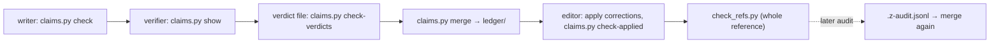

# Keeping the reference true

> **Scope:** how this reference stays correct as the code, the models and the measurements move:
> the claim ledger and its lifecycle, adding a claim or a page, what to do after a re-pin or rebase,
> after a model update and after a new measurement, the correction convention for later audits, and
> who may change what. **Out of scope:** the writing rules themselves ([`_work/style.md`](_work/style.md));
> what each script prints ([tools.md](tools.md#toolsagello-docs)); re-pinning the forks in the build
> ([build-and-release.md](litert-lm/build-and-release.md#re-pinning-litert-or-ml-drift)); posting
> anything upstream ([contributing.md](contributing.md)).
> **Pinned to:** the pins in `tools/agello-docs/pins.json` (LiteRT-LM `7b872544`, LiteRT
> `362759838`, ML Drift `15fa9e2`; shipped `85b1a776`).
> **Applies to:** the reference itself. **Last verified:** 2026-10-15

## Summary

Every statement of fact in the reference is a claim with sources, stored one per line in
`ledger/<group>.jsonl` with the verdict an independent verifier gave it; pages carry a hidden tag
after each tier-A sentence, and code citations carry the SHA-1 of the lines they cite. That makes the
reference re-checkable: `check_refs.py` proves every link, anchor, cited line range and tag still
holds, and after a pin moves, `check_refs.py --repin` lists the claims whose cited code changed. The
upkeep is four routines. After a re-pin or rebase: update `pins.json`, regenerate, list the moved
citations, re-verify them in a new verdict batch, merge, and fix the pages. After a model update:
regenerate the model tables and configs, re-check the model pages and the #3913 fix. After a
measurement: add the results file with its conditions, a claim that cites it, and a row in
[facts.md](facts.md). Later corrections go in `z-audit` verdict files, which win the merge.

## Concepts

| Thing | Where | What it is |
| --- | --- | --- |
| Pins | `tools/agello-docs/pins.json` | the commits documented (fork pin and upstream base per repository), the shipped wrapper, local and remote model files with SHA-256, Hugging Face config revisions |
| Generated tables | `generated/` | evidence made by scripts from the pins (inventories, flags, patch log, binaries, model tables, configs, engine runs); never edited by hand |
| Groups | `_work/groups.json` | which group writes which pages, under which claim-ID prefixes |
| Claims file | `_work/claims/<group>.jsonl` | a group's claims as written: ID, page, anchor, text, tier, kind, sources, applies-to, formula |
| Verdict file | `_work/verdicts/<group>.<batch>.jsonl` | one verdict per claim: `verified`, `corrected` (with `corrected_text`), `wrong` or `unverifiable`, and a note saying what was checked |
| Ledger | `ledger/<group>.jsonl` | claims merged with their verdicts; the only source pages may tag |
| Tag | `<!-- c:<claim-id> -->` after a sentence | binds the sentence to a verified or corrected claim |
| Returns | `_work/returns/<group>.md` | a group's notes for other pages: settings rows, terms, contradictions, open questions |
| Facts | [facts.md](facts.md) | the register of quotable numbers, each with an ID (`F-001` …) and the claims behind it |
| Results | `docs/agello/results/<device>/<date>/` | our measurement records, each folder with a README of files and conditions |
| Audits | [`_work/audits.md`](_work/audits.md) | spot re-checks of the ledger and what they found |

Verdicts in the ledger: a tier-A claim without a verdict is `unverified`, a tier-B claim outside the
verification sample is `unsampled`; neither may be tagged. Tier A covers numbers, model
architecture, anything that could reach user docs, commit messages or upstream text, and anything that
contradicts an existing doc; all tier-A claims are verified. Tier B claims are verified on a 30%
sample, more if errors show up (`_work/style.md`).

Citations come in two forms. In pages, a permalink made by `cite.py`: files our commits don't touch
link to Google's repository at the upstream base, files we change to our fork at the pin. In the
ledger, the same link plus `lines_sha1`, the SHA-1 of the cited lines, which is what lets a script
notice that the code under a claim changed.

## How it works

### The ledger lifecycle

All commands run from `tools/agello-docs/`:

1. **Write.** A writer adds claims to `_work/claims/<group>.jsonl`, with sources from
   `cite.py <repo> <path> <start> [<end>] --json` (or `--symbol "<text>"`), and tags its tier-A
   sentences. `claims.py check <group>` validates the file: IDs (`<PREFIX>-NNN`, a prefix of the
   group), page and anchor exist, tier, kind, a formula for every number, `applies_to`, each source
   (a code source must be at a pin or base and its `lines_sha1` must match; web sources need URL,
   publisher, version, retrieved date and a quote of at most 25 words; results sources need
   conditions; Agello sources a path that exists at the commit), and that every tier-A claim is tagged
   and every tag is either the group's tier-A claim or a verified ledger claim.
2. **Verify.** A verifier who hasn't seen the page runs `claims.py show <group> --ids A,B,...`, which
   prints each claim with its cited lines, checks it against the sources (and searches for
   counterexamples when a claim says "always", "never" or "only"), and writes
   `_work/verdicts/<group>.<batch>.jsonl`. `claims.py check-verdicts <group> <batch> --ids ...` checks
   that every listed claim has exactly one verdict with a note, and that a correction has its text.
3. **Merge.** `claims.py merge <group>` writes `ledger/<group>.jsonl`: each claim with its verdict,
   the batch that gave it and the verifier's note. A corrected claim's `text` becomes the corrected
   wording and the original is kept as `original_text` (and `original_sources` when sources were
   replaced). Verdict files are read in name order and later ones win, which is what makes the
   `z-audit` convention work.
4. **Apply.** The page editor rewrites corrected sentences to match the ledger text, removes tags of
   `wrong` and `unverifiable` claims (and the statements, or marks them as open questions), then runs
   `claims.py check-applied <group>`: every verified or corrected tier-A claim still tagged, no tag on
   a wrong, unverifiable or unsampled one.
5. **Check.** `check_refs.py` over the whole reference (permalinks, relative links and anchors, every
   ledger citation's line hash, every tag's verdict); `check_refs.py --numbers` also warns about
   numbers with units that carry neither a tag nor a fact ID. `claims.py stats [<group> ...]` prints
   verdict counts by tier.

Batch names in use: `v1` and `v2` for verification passes, `x1` for a further pass, `z-audit` for
corrections from spot audits. A new pass takes a new name that sorts before `z-audit` unless it is
meant to override it.

### Adding a claim

Make a claim for every fact a reader could rely on that the ledger doesn't already hold; to restate a
verified claim, write it in your own words consistent with the ledger text and tag that claim's ID.

1. Find the narrowest evidence: the code at the pin through `cite.py`, a generated table (an
   `empirical` source with the row), a results file (a `results` source with its conditions), a web
   page (URL, publisher, version or "unversioned", retrieved date, a short quote), or Agello's code
   (`{"type": "agello", "path": ..., "commit": ..., "lines": [a, b]}`).
2. Write the text so it stands alone: name the commit or build it is about, every condition that
   changes the result (backend, file revision, benchmark mode, MTP), and say "documented build" or
   "shipped" when the two differ. The two spot audits found no false claims, but four that left out a
   condition ([`_work/audits.md`](_work/audits.md)).
3. Numbers need a `formula` that recomputes them from cited inputs.
4. Pick the tier by the rules above, add the claim to your group's file with the next free ID, tag the
   sentence if tier A, run `claims.py check <group>`, and send the claim through a verification batch.

A fact that is only on a page and in no ledger is a gap: either back it with a claim, or mark it in
"Open questions" as not verified.

### Adding a page

1. Add the page to `_work/outline.md` (sections, questions, the contradictions it resolves) and to
   its group's `pages` in `_work/groups.json`, with a claim prefix of its own if it needs one.
2. Write it from the template in `_work/style.md`: the header block (scope, out of scope with links,
   pins, applies-to, last verified), then the sections that have something to say, under about 900
   lines. Link other pages relatively; never copy their depth.
3. Run `check_refs.py --only <page>` (add `--no-tags` while its claims aren't merged) and
   `claims.py check <group>`; after verification and merge, `claims.py check-applied <group>` and a
   full `check_refs.py`.
4. Link it from the README's page map and from the pages that should point readers to it.

### After a re-pin or rebase

When any pin in `pins.json` moves (a re-pin of LiteRT or ML Drift, a rebase of `agello-next` on a
newer upstream, a new shipped wrapper):

1. **Move the pins.** Edit `pins.json`: `pin`, and for a rebase `base` and `base_label`; the
   `litert-lm-shipped` entry when Agello vendors a new wrapper; the local paths if a checkout moved.
   The build side of a re-pin (overrides, `WORKSPACE`, rebuild) is in
   [build-and-release.md](litert-lm/build-and-release.md#re-pinning-litert-or-ml-drift).
2. **Regenerate.** `regen.sh --all` rebuilds every table, including the Swift symbol graph and the
   per-family engine runs (agello-bench's `.build-next` must be built against the new `dist/`; about
   ten minutes and about 2 GB of scratch per GPU family, deleted at the end; check `df -h /` first).
   Read the diffs of `generated/`: a changed row is a changed fact.
3. **List what moved.** `check_refs.py --repin` looks at every ledger code source whose commit is no
   longer a pin or base, finds its symbol at the new pin and compares the lines' hash: `unchanged`
   needs nothing; `changed: re-verify`, `symbol gone`, `file gone` and, for sources cited by line
   range without a symbol, `moved` need a new verdict.
4. **Re-verify.** Run a verification batch over the listed claims, plus claims whose evidence isn't
   a code citation but depends on the pin: counts of our commits and changed files, the binary
   comparisons from `generated/binaries.md`, engine-run and kernel-table numbers, claims that say
   something is absent upstream as of a date, and every claim whose text names the old commit. The
   verifier re-cites at the new pin (`cite.py --json`) and gives the new sources as
   `corrected_sources`; a claim that no longer holds is `wrong` and its sentence leaves the page.
5. **Merge and edit.** `claims.py merge <group>` per group, then update the pages: re-run `cite.py`
   for every permalink (`check_refs.py` reports links to commits that are no longer a pin or base),
   apply corrected wording, update the pages' "Pinned to" lines and "Last verified" dates, then
   `claims.py check-applied` and a full `check_refs.py`.
6. **Builds and records.** A re-pinned framework is not byte-identical to the one built with
   overrides: the stamped commit and so the build id change; compare replies, not bytes.
   <!-- c:LM-BLD-029 --> Measurements keep the build id they were made with
   ([versions.md](versions.md#telling-builds-and-versions-apart)).

When the shipped wrapper changes, Agello's own descriptions change with it: `Vendor/README.md`,
`NOTICE`, the README's "Vendored LiteRT-LM" section and `CLAUDE.md` together, which drifted once
(C3) <!-- c:OUR-003 -->; and the fork's landing page, which still describes an older layout (C4).
<!-- c:OUR-025 --> The rebase hotspots (files we patch that changed upstream) are listed in
[patches.md](patches.md).

### After a model update

A new model revision (ours or Google's), a new model, or new official configs:

1. **Pins.** Update `pins.json`: `models` (local path, SHA-256, Hugging Face repository and revision)
   or `remote_models` (a revision-pinned URL; `graphs: true` only when the graphs must be read, which
   downloads the file into `$SCRATCH` and deletes it). `gen_hf_configs.py --update` moves every
   `hf_repos` revision to the repository's current one, rewriting `pins.json`, then fetches the small
   config and template files.
2. **Tables.** `gen_model_tables.py --only <key>` in the tools venv
   (`~/.venvs/agello-tools/bin/python -I gen_model_tables.py --only e4b-ours`) rewrites
   `generated/models/<key>.md` and `.json`; `gen_hf_configs.py` rewrites `generated/hf/` and
   `hf-configs.md`.
3. **Pages.** Re-read the model pages ([gemma4-e4b.md](models/gemma4-e4b.md),
   [gemma4-e2b.md](models/gemma4-e2b.md), [embeddinggemma.md](models/embeddinggemma.md),
   [tokenizer-and-chat-format.md](models/tokenizer-and-chat-format.md)) against the new tables: sections,
   signatures, KV caches, quantization, metadata, the chat template; then the numbers that follow
   from them in [memory.md](memory.md) and [facts.md](facts.md). Claims that name a revision or a
   SHA-256 are re-verified.
4. **The #3913 checks**, for any Gemma 4 E2B or E4B file Agello might ship:
   - Our file must come from Google's by `patch_rope.py --split --block 512`; for the current pair
     the output is byte-identical to the file Agello downloads. <!-- c:MOD-E4B-069 --> A new Google
     revision means re-running the patch and publishing a new revision of ours
     ([tools.md](tools.md#rewriting-rotary-positions-patchropepy)).
   - The patch expects one rotary `CAST` per signature in the sections it edits, and only edits
     `tf_lite_prefill_decode` and `tf_lite_mtp_drafter`. <!-- c:MOD-E2B-072 --> <!-- c:MOD-E2B-060 -->
     If a new export changes that structure (or Google fixes the rotary math), re-check before
     patching.
   - Digit-copy fidelity at a 32K window on the Mac with agello-bench (`short`, `long`,
     `cross4096`, `xl`): the current file was exact in 88 of 88 copies <!-- c:MOD-E4B-070 -->; and on
     the iPhone with Agello's probe 12, 14 of 14 and 6 of 6 with MTP. <!-- c:MOD-E4B-071 -->
   - On an Apple7 GPU (A14, M1) the 512-token block is the one reported exact. <!-- c:MOD-E4B-063 -->
5. **Agello.** Its model catalog names each file with its size; a renamed file is downloaded again by
   every user (Agello's `CLAUDE.md`). Older notes that cite a deleted revision are flagged in
   [patches.md](patches.md#model-revisions-in-older-notes-c17). <!-- c:OUR-029 -->

### After a new measurement

The reference never runs measurements while it is being written; maintainers do, and then:

1. **Record it.** Put the raw records in `docs/agello/results/<device>/<date>/` (`bench/` for
   agello-bench JSONL with their `.load-telemetry.json`, `agello/` for harness reports) and list each
   file in that folder's README with what it measured and on which build. The conditions that make a
   number reusable: device and OS, runtime build id (and whether the tree was clean), model file and
   SHA-256, allocated context, MTP on or off, telemetry level, benchmark mode, prompt length, warm-ups,
   repetitions and order (ABAB for comparisons), thermal state. Several earlier records were made on
   builds with uncommitted changes and say so in their build ids. <!-- c:OUR-019 -->
2. **Claim it.** A claim with a `results` source (`path` and `conditions`), the numbers as recorded,
   and a formula for anything derived (medians, differences). Keep two numbers that measure different
   things side by side and say what each measures, as C10 did for the two sampling costs.
   <!-- c:LM-CMP-041 -->
3. **Register it.** Add or update the row in [facts.md](facts.md) (the value, the conditions, the
   claims behind it, the figure it replaces), and quote the fact ID where the number is used.
4. **Supersede, don't erase.** When a newer build changes a figure, keep the old one with its build
   and say which build each describes: the README's performance table and VALIDATION's calibration
   measure different binaries. <!-- c:LM-VER-023 --> <!-- c:LM-VER-024 -->
5. **Tell Agello.** User-facing numbers in Agello's docs follow
   [contributing.md](contributing.md#checklist-for-user-facing-docs).

### Corrections after a run: `z-audit`

A spot audit re-checks a random sample of verified claims (one or two per group) with fresh agents
that see only the sources. Its verdicts go to `_work/verdicts/<group>.z-audit.jsonl`; because merge
reads verdict files in name order, `z-audit` wins over the earlier batches. Then `claims.py merge`,
the page edits, `claims.py check-applied`, and an entry in [`_work/audits.md`](_work/audits.md) with
what held, what was imprecise and what was wrong. The rule from the two audits so far: more than one
wrong claim in an area sends the whole area back for re-verification; imprecise claims (a missing
condition) are corrected in place.

Contradictions with older notes (AUDIT, TELEMETRY, BUILD, VALIDATION, the skills) are recorded in the
claim's `conflicts_with` and resolved on the page that owns the topic; the register of all of them is
`_work/contradictions.md`. Fixing the older note itself is a separate change to that file, outside
this reference. Two found in this run are left for that: TELEMETRY.md's level table puts graph dumps
at level 4, while the code writes them at any level <!-- c:MD-MTL-034 -->; and agello-bench's README
misses three `run` options ([tools.md](tools.md#where-the-readme-is-stale)).

### Who may change what

| Who | May change | May not |
| --- | --- | --- |
| A research or Run C writer | its own pages, its group's claims file and returns file | other pages, the ledger, generated tables, code, the Agello repository |
| A verifier | its verdict file | claims, pages |
| The main loop (the maintainer) | `pins.json`, `groups.json`, the outline and style, the ledger through `claims.py merge`, `generated/` through the scripts, the README | — |
| Anyone | — | edit `generated/` or `ledger/` by hand; post, push or upload anything without the user's OK <!-- c:PRC-010 --> |

Writers don't run new performance measurements, download models or build with Bazel while writing,
and delete any scratch they create (`_work/style.md`). Changes to the forks, to Agello and to older
notes go through those repositories' own commits.

## Limits and failure modes

- **`--repin` sees cited lines only.** A claim like "no other caller exists" or "the only
  registration" depends on code nobody cited; after a re-pin it must be searched again even when its
  citations are `unchanged`.
- **Line ranges without a symbol always need a verdict.** `--repin` can't relocate them, so it lists
  them as `moved`.
- **Results and web sources aren't re-checked by script.** `check_refs.py` checks code citations and
  links; a results file or a web page that changes needs a person.
- **Generated tables need local inputs.** The model files, our `dist/` framework, agello-bench's
  `.build-google` and `.build-next` artifacts and network access to Hugging Face; a missing input
  fails that generator, not the others.
- **Model tables have known gaps.** `gen_model_tables.py` reads at most 256 MiB of a section's graph
  (E4B's per-layer embedder is larger), and the per-layer attention block in
  `generated/models/e4b-ours.md` renders its header without rows (the rows are in the `.json`).
- **The tooling isn't committed.** On 2026-10-15 `tools/agello-docs/` and this reference were
  untracked files in the fork checkout; until they are committed, the scripts have no history to
  cite and a lost checkout loses them.

## Where in the code

| Task | Script (in `tools/agello-docs/`) | Command |
| --- | --- | --- |
| A citation | `cite.py` | `cite.py litert-lm runtime/core/tasks.cc --symbol "Decode(" --json` |
| Validate claims and tags | `claims.py` | `claims.py check <group>` |
| Show claims for a verifier | `claims.py` | `claims.py show <group> --ids LM-ENG-001,LM-ENG-002` |
| Validate verdicts | `claims.py` | `claims.py check-verdicts <group> <batch> --ids ...` |
| Merge into the ledger | `claims.py` | `claims.py merge <group>` |
| Check edits after a merge | `claims.py` | `claims.py check-applied <group>` |
| Verdict counts | `claims.py` | `claims.py stats` |
| Check the reference | `check_refs.py` | `check_refs.py`, `--only <pages>`, `--no-tags`, `--numbers` |
| After moving a pin | `check_refs.py` | `check_refs.py --repin` |
| Regenerate | `regen.sh` | `regen.sh` (sources and files), `regen.sh --all` (plus symbol graph and engine runs) |
| Model tables | `gen_model_tables.py` | `~/.venvs/agello-tools/bin/python -I gen_model_tables.py --only <key>` |
| Official configs | `gen_hf_configs.py` | `gen_hf_configs.py [--update]` |

## Open questions

- Whether `x1` batches have a defined meaning beyond "a further pass" isn't written down anywhere in
  `_work/`; a sentence in `_work/style.md` would settle it.
- Claims whose sources are only in `tools/agello-docs/` (the scripts' own behavior) can't be cited
  until the folder is committed.
