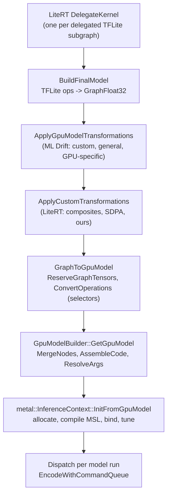

# ML Drift architecture

> **Scope:** ML Drift's core: the data structures (`GraphFloat32`, `GpuModel`, `GPUOperation`,
> tensor descriptors, precision), GPU detection (`GpuInfo`, Apple GPU families, our simulation
> switch), and the pipeline from a TFLite subgraph to a backend-ready `GpuModel` (transformations,
> builder, fusion, selectors). **Out of scope:** the kernels themselves ([kernels.md](kernels.md)),
> the Metal runtime that compiles and runs a `GpuModel` ([metal-backend.md](metal-backend.md)), how
> LiteRT partitions a model and calls ML Drift ([../litert/ml-drift-delegate.md](../litert/ml-drift-delegate.md)),
> other GPU APIs ([../other-platforms.md](../other-platforms.md)).
> **Pinned to:** ML Drift `15fa9e2` (Google's `1b18771` plus 8 commits of ours), LiteRT `362759838`,
> LiteRT-LM `7b872544`
> **Applies to:** Apple (iOS, macOS) unless a section says otherwise. **Last verified:** 2026-10-15

## Summary

ML Drift is Google's GPU inference engine behind LiteRT's GPU accelerator. LiteRT hands it each
delegated TFLite subgraph as a `GraphFloat32`; ML Drift rewrites the graph, picks a GPU kernel for
every operation from what it knows about the GPU (`GpuInfo`), fuses elementwise work into its
producers, and produces a `GpuModel`: a list of nodes, each a `GPUOperation` carrying generated
kernel source and its arguments. A backend (Metal for us) compiles and runs it.

What matters for Agello:

- Kernel choices depend on the **Apple GPU family**, which ML Drift derives from the Metal device
  *name*, not from `MTLGPUFamily`. A19/A19 Pro and M5/M6 are Apple10 and, with MSL 4.0, get
  `ConvAppleMPP`, the prefill convolution that reaches the GPU Neural Accelerators; Apple9 and below
  use simdgroup-matrix convolutions. A name ML Drift doesn't know falls back to Apple1.
- Precision is FP16 (`CalculationsPrecision::kF16`) in our configuration: LiteRT-LM asks for FP16
  and the Metal delegate maps it to F16 data and F16 math.
- Our `AGELLO_SIMULATE_APPLE_GPU` switch (ours: `ef08a67858`) makes ML Drift choose another Apple
  GPU's kernels on this device, which is how [../generated/kernels-by-family.md](../generated/kernels-by-family.md)
  was produced. It changes choices, not hardware.
- What Agello ships (Google's prebuilt v0.18.0 binary, built by Google on 2026-10-06) contains an ML
  Drift build, but none of our ML Drift commits.

## Concepts

| Term | What it is | Where |
| --- | --- | --- |
| `GraphFloat32` | ML Drift's input graph: a DAG of `Node`s (an `Operation`: a type string plus `std::any` attributes) and `Value`s (a `ValueId`, a `TensorRef<BHWC>` and optional quantization parameters). Values without a producer are inputs; outputs are the values without a consumer plus any values registered as known graph outputs | [`ml_drift/common/model.h:48-76`](https://github.com/google-ai-edge/ml-drift/blob/1b18771f44c0be3d972847b31a80f6dc3d6964b5/ml_drift/common/model.h#L48-L76), [`ml_drift/common/model.cc:50-73`](https://github.com/google-ai-edge/ml-drift/blob/1b18771f44c0be3d972847b31a80f6dc3d6964b5/ml_drift/common/model.cc#L50-L73) |
| `GpuInfo` | What ML Drift knows about the GPU: vendor, API, per-vendor info (`AppleInfo`), API info (`MetalInfo`), supported wave sizes and wave (simdgroup) matrix operations | [`ml_drift/common/gpu_info.h:938-1062`](https://github.com/google-ai-edge/ml-drift/blob/1b18771f44c0be3d972847b31a80f6dc3d6964b5/ml_drift/common/gpu_info.h#L938-L1062) |
| `AppleInfo` | Apple GPU type (`AppleGpu`: A7 … A20 Pro, M1 … M6) and family (`Family::kApple1` … `kApple10`) | [`ml_drift/common/gpu_info.h:271-332`](https://github.com/google-ai-edge/ml-drift/blob/1b18771f44c0be3d972847b31a80f6dc3d6964b5/ml_drift/common/gpu_info.h#L271-L332) |
| `CreateGpuModelInfo` | The build request: `precision`, default `storage_type`, `hints`, and tensors the caller provides (`predefined`, `external_immutable_tensors`, `external_mutable_tensors`) | [`ml_drift/common/gpu_model.h:62-113`](https://github.com/google-ai-edge/ml-drift/blob/1b18771f44c0be3d972847b31a80f6dc3d6964b5/ml_drift/common/gpu_model.h#L62-L113) |
| `GpuModel` | The result: input and output ids (with their TFLite tensor references), `nodes`, tensor descriptors for runtime tensors (`tensors`) and constants (`const_tensors`), and shared `subgraphs` | [`ml_drift/common/gpu_model.h:121-128`](https://github.com/google-ai-edge/ml-drift/blob/1b18771f44c0be3d972847b31a80f6dc3d6964b5/ml_drift/common/gpu_model.h#L121-L128) |
| `GpuNode` | One GPU dispatch: a `GPUOperation`, input and output `ValueId`s, a debug `name` (fused nodes read `a -> b -> c`), optional-node tags and a subgraph id | [`ml_drift/common/gpu_model.h:38-60`](https://github.com/google-ai-edge/ml-drift/blob/1b18771f44c0be3d972847b31a80f6dc3d6964b5/ml_drift/common/gpu_model.h#L38-L60) |
| `GPUOperation` | A kernel: generated source (`code_`), `Arguments` (`args_`), work-group size (default 8×4×1), grid mapping, FLOP count; `IsLinkable()` is true for elementwise operations, which can be fused into a producer | [`ml_drift/common/task/gpu_operation.h:97-191`](https://github.com/PowerBeef/ml-drift/blob/15fa9e2ba632145992299e3f04786dc1f575373c/ml_drift/common/task/gpu_operation.h#L97-L191) |
| `TensorDescriptor` | A tensor's data type, storage type, layout and shape; the backend allocates memory from it | [`ml_drift/common/task/tensor_desc.h:41-53`](https://github.com/google-ai-edge/ml-drift/blob/1b18771f44c0be3d972847b31a80f6dc3d6964b5/ml_drift/common/task/tensor_desc.h#L41-L53) |
| `TensorStorageType` | `kBuffer`, `kImageBuffer`, `kTexture2D`, `kTexture3D`, `kTextureArray`, `kSingleTexture2D` | [`ml_drift/common/task/tensor_desc.h:41-49`](https://github.com/google-ai-edge/ml-drift/blob/1b18771f44c0be3d972847b31a80f6dc3d6964b5/ml_drift/common/task/tensor_desc.h#L41-L49) |
| `CalculationsPrecision` | `kF32` (F32 data and math), `kF16` (F16 data and math), `kF32F16` (F16 data; convolution-like operations accumulate in F32) | [`ml_drift/common/precision.h:25-35`](https://github.com/google-ai-edge/ml-drift/blob/1b18771f44c0be3d972847b31a80f6dc3d6964b5/ml_drift/common/precision.h#L25-L35) |
| `ModelHints` | Bit flags (`kAllowSpecialKernels`, `kDisallow8bitConvs`, `kAllow4bitConvs`, `kPreferTextureWeights`, …) plus `use_metal_argument_buffers` | [`ml_drift/common/model_hints.h:22-89`](https://github.com/google-ai-edge/ml-drift/blob/1b18771f44c0be3d972847b31a80f6dc3d6964b5/ml_drift/common/model_hints.h#L22-L89) |
| `OpSelector` | The interface that turns graph nodes into GPU operations: `GPUOperationFromNode` (one node) and `GPUSubgraphFromGraph` (a pattern of several nodes) | [`ml_drift/common/gpu_model_util.h:30-45`](https://github.com/google-ai-edge/ml-drift/blob/1b18771f44c0be3d972847b31a80f6dc3d6964b5/ml_drift/common/gpu_model_util.h#L30-L45) |
| `GpuModelBuilder` | Builds `GpuModel` nodes and tensors; its methods (`FullyConnectedInt8ExternalWeights`, `Convolution`, `BatchedMatMul`, …) hold most of the kernel-choice logic | [`ml_drift/common/gpu_model_builder.h:62-160`](https://github.com/google-ai-edge/ml-drift/blob/1b18771f44c0be3d972847b31a80f6dc3d6964b5/ml_drift/common/gpu_model_builder.h#L62-L160) |

The structures, briefly:

- `GraphFloat32` keeps nodes and values in vectors indexed by id; erased entries leave holes, so
  ids stay stable. Nodes must be created in topological order. LiteRT builds it from the TFLite
  subgraph ([../litert/ml-drift-delegate.md](../litert/ml-drift-delegate.md)).
- `CreateGpuModelInfo` and `GpuModel` are plain structs. The caller-provided tensor sets
  (`predefined`, external immutable, external mutable) must not share ids, and their data type must
  match the precision. LiteRT uses external tensors to bind buffers it owns
  ([../litert/ml-drift-delegate.md](../litert/ml-drift-delegate.md)).
- A `GpuModel` node's input and output counts must equal its operation's source and destination
  tensor names; `GetGpuModel` checks this before returning.
  [`ml_drift/common/gpu_model_builder.cc:3949-3963`](https://github.com/google-ai-edge/ml-drift/blob/1b18771f44c0be3d972847b31a80f6dc3d6964b5/ml_drift/common/gpu_model_builder.cc#L3949-L3963)

### Precision

Two things are called "precision":

- **Data type** of each tensor (`DataType::kFloat32`, `kFloat16`, integer types).
- **Calculation precision** (`CalculationsPrecision`), chosen once per model.

Tensors the caller provides (predefined, external immutable or external mutable) keep the
descriptor they were given. For every other value, with `kF16` or `kF32F16`, `GetTensorDescForValue`
gives a FLOAT32 value a FLOAT16 descriptor, except graph outputs produced by a CAST, which keep
their type; with `kF32` the original types stay. <!-- c:MD-ARC-026 --> [`ml_drift/common/gpu_model_util.cc:189-211`](https://github.com/google-ai-edge/ml-drift/blob/1b18771f44c0be3d972847b31a80f6dc3d6964b5/ml_drift/common/gpu_model_util.cc#L189-L211)
Convolution-like kernels pick their own internal precision from the source data type:
FLOAT16 data gives `kF32F16` when the model asked for F32 accumulation and `kF16` otherwise;
any other type gives `kF32`. [`ml_drift/common/gpu_model_builder.h:123-133`](https://github.com/google-ai-edge/ml-drift/blob/1b18771f44c0be3d972847b31a80f6dc3d6964b5/ml_drift/common/gpu_model_builder.h#L123-L133)

On Apple, the Metal delegate maps LiteRT's precision option to a calculation precision: the
default picks `kF16` when the GPU rounds to nearest (every Apple GPU of family Apple4 or newer) and
`kF32F16` otherwise; an explicit FP16 request gives `kF16`, FP32 gives `kF32`, and "FP16 with FP32
accumulation" gives `kF32F16`. <!-- c:MD-ARC-028 -->
[`ml_drift_delegate/delegate/delegate_metal.mm:369-385`](https://github.com/google-ai-edge/LiteRT/blob/ca21dc99de51c76bdcc572afeea1dd937d3c9e5c/ml_drift_delegate/delegate/delegate_metal.mm#L369-L385)
LiteRT-LM requests FP16 for every activation type except FLOAT32, so ML Drift runs Gemma at `kF16`
in our build. <!-- c:MD-ARC-029 -->
[`runtime/executor/llm_executor_settings_utils.cc:92-96`](https://github.com/PowerBeef/agello-litert-lm/blob/7b872544fdbd81308f98b1e2acf8c5798a549df6/runtime/executor/llm_executor_settings_utils.cc#L92-L96)
Which activation type LiteRT-LM uses per model is on [../litert-lm/executors.md](../litert-lm/executors.md).

### Tensor storage

The storage type decides how a tensor is laid out in GPU memory and which accessors a kernel uses.
The delegate passes `GetStorageType()` as the default: `kBuffer` if the delegate option
`use_buffer_storage_type` is set, otherwise the backend's fastest type.
[`ml_drift_delegate/delegate/delegate_kernel.h:115-122`](https://github.com/google-ai-edge/LiteRT/blob/ca21dc99de51c76bdcc572afeea1dd937d3c9e5c/ml_drift_delegate/delegate/delegate_kernel.h#L115-L122)
On Metal the fastest type is `kTexture2D` for Apple1 and Apple2 GPUs and `kBuffer` for every newer
family. <!-- c:MD-ARC-014 --> [`ml_drift/metal/metal_spatial_tensor.mm:478-485`](https://github.com/google-ai-edge/ml-drift/blob/1b18771f44c0be3d972847b31a80f6dc3d6964b5/ml_drift/metal/metal_spatial_tensor.mm#L478-L485)
Values with fewer than 4 channels are switched to `kSingleTexture2D` on Metal when the shape fits
the texture limits. [`ml_drift/common/gpu_model_util.cc:216-228`](https://github.com/google-ai-edge/ml-drift/blob/1b18771f44c0be3d972847b31a80f6dc3d6964b5/ml_drift/common/gpu_model_util.cc#L216-L228) On Apple2 and newer
the Metal memory manager backs 2D textures with buffers ([metal-backend.md](metal-backend.md)).

## How it works

### Where ML Drift sits

Every step up to `GpuModel` is backend-neutral C++ and runs synchronously on the thread that
initializes the delegate kernel, during model load (which LiteRT-LM thread that is:
[../stack.md](../stack.md)). Steps G and H are on [metal-backend.md](metal-backend.md).

The fork LiteRT-LM builds is pinned in `WORKSPACE` as an `http_archive` of `PowerBeef/ml-drift` at
`15fa9e2`; it carries 8 commits on Google's `1b18771`, listed in
[../generated/patch-log.md](../generated/patch-log.md#ml-drift-powerbeefml-drift-agello-next).
<!-- c:MD-ARC-001 --> [`WORKSPACE:517-540`](https://github.com/PowerBeef/agello-litert-lm/blob/7b872544fdbd81308f98b1e2acf8c5798a549df6/WORKSPACE#L517-L540)

### GPU detection

#### From the Metal device to `GpuInfo`

`CreateGpuInfoFromMetalDevice` reads `[device name]` and passes it to
`GetGpuInfoFromDeviceDescription` with `GpuApi::kMetal`; then it fills `MetalInfo` from the device
(maximum threads per threadgroup, `maxBufferLength`, the highest Metal Shading Language version the
device and OS support) and the simdgroup matrix operations. <!-- c:MD-ARC-005 -->
[`ml_drift/metal/environment.mm:30-106`](https://github.com/google-ai-edge/ml-drift/blob/1b18771f44c0be3d972847b31a80f6dc3d6964b5/ml_drift/metal/environment.mm#L30-L106)

`GetGpuInfoFromDeviceDescription` lowercases the name, finds the vendor by substring (`"apple"` →
`kApple`), and for Apple builds `AppleInfo` from the lowercased name (or, in our fork, from
`AGELLO_SIMULATE_APPLE_GPU` when that is set and not empty; see below) and sets the supported wave
size to 32.
[`ml_drift/common/gpu_info.cc:1356-1377`](https://github.com/PowerBeef/ml-drift/blob/15fa9e2ba632145992299e3f04786dc1f575373c/ml_drift/common/gpu_info.cc#L1356-L1377) The vendor table:
[`ml_drift/common/gpu_info.cc:34-61`](https://github.com/PowerBeef/ml-drift/blob/15fa9e2ba632145992299e3f04786dc1f575373c/ml_drift/common/gpu_info.cc#L34-L61).

`AppleInfo` compares the lowercased name against a fixed table (`"apple a7"` … `"apple a20 pro"`,
`"apple m1"` … `"apple m6"`) by substring, keeping the longest key that matches, so
`"Apple A19 Pro GPU"` is the A19 Pro and not the A19; the family follows from the type.
[`ml_drift/common/gpu_info.cc:683-737`](https://github.com/PowerBeef/ml-drift/blob/15fa9e2ba632145992299e3f04786dc1f575373c/ml_drift/common/gpu_info.cc#L683-L737)

#### Apple GPU families

ML Drift's family for each GPU it knows ([`ml_drift/common/gpu_info.cc:739-767`](https://github.com/PowerBeef/ml-drift/blob/15fa9e2ba632145992299e3f04786dc1f575373c/ml_drift/common/gpu_info.cc#L739-L767)):

| ML Drift family | iPhone and iPad chips | Mac chips |
| --- | --- | --- |
| `kApple7` | A14 | M1, M1 Pro, M1 Max, M1 Ultra |
| `kApple8` | A15, A16 | M2, M2 Pro, M2 Max, M2 Ultra |
| `kApple9` | A17 Pro, A18, A18 Pro | M3 (all), M4, M4 Pro, M4 Max |
| `kApple10` | A19, A19 Pro, A20 Pro | M5, M5 Pro, M5 Max, M5 Ultra, M6 |
| `kApple2` … `kApple6` | A8 … A13 | |
| `kApple1` | A7, and any name not in the table (`AppleGpu::kUnknown`) | any name not in the table |

<!-- c:MD-ARC-003 -->

These are ML Drift's own labels, named after `MTLGPUFamily` but not read from it: the family comes
only from the device name. A name the table doesn't contain leaves `gpu_type` at `kUnknown` and the
family at `kApple1`, the oldest family, with the slowest kernel paths. <!-- c:MD-ARC-004 -->
[`ml_drift/common/gpu_info.cc:727-737`](https://github.com/PowerBeef/ml-drift/blob/15fa9e2ba632145992299e3f04786dc1f575373c/ml_drift/common/gpu_info.cc#L727-L737) For example, a chip named "Apple A20" (no
"Pro") would not match `"apple a20 pro"` and would fall back to Apple1. Our LiteRT build records
the telemetry fact `gpu` as `<Metal device name>, ML Drift family Apple<N>`; when the type is
unknown it appends ` (device not recognized)` and also reports a `kGpuFamilyUnknown` anomaly of
severity `kError` (ours).
[`ml_drift_delegate/delegate/gpu_backend_metal.mm:167-181`](https://github.com/PowerBeef/LiteRT/blob/362759838e34e1525f1cc27daddaf663a193c059/ml_drift_delegate/delegate/gpu_backend_metal.mm#L167-L181)

Observed names: the iPhone 17 Pro's Metal device is `Apple A19 Pro GPU`, classified Apple10
<!-- c:MD-ARC-006 -->; this Mac's is `Apple M6`, also Apple10 ([../generated/engine-run.md](../generated/engine-run.md)).
<!-- c:MD-ARC-007 -->

The compute-unit count, used by work-group and kernel heuristics, also comes from the type
([`ml_drift/common/gpu_info.cc:863-975`](https://github.com/PowerBeef/ml-drift/blob/15fa9e2ba632145992299e3f04786dc1f575373c/ml_drift/common/gpu_info.cc#L863-L975)); the code marks the M-series values
"approximate":

| GPU | A14 | A15 | A16 | A17 Pro | A18 | A18 Pro | A19 | A19 Pro | A20 Pro | M1 | M2 | M3 | M4 | M5 | M6 | unknown |
| --- | --- | --- | --- | --- | --- | --- | --- | --- | --- | --- | --- | --- | --- | --- | --- | --- |
| Compute units | 4 | 5 (4 on iPhone14,4 and iPhone14,5) | 5 | 6 | 5 | 6 | 5 | 6 | 7 | 8 | 10 | 10 | 10 | 10 | 12 | 4 |

<!-- c:MD-ARC-008 -->

The A15 exception reads the device model with `uname()`: the iPhone 13 mini and iPhone 13 have a
4-core A15. [`ml_drift/metal/environment.mm:34-44`](https://github.com/google-ai-edge/ml-drift/blob/1b18771f44c0be3d972847b31a80f6dc3d6964b5/ml_drift/metal/environment.mm#L34-L44)

#### What each family turns on

Family gates that change what runs on Apple GPUs (kernel details on [kernels.md](kernels.md)):

| Gate | Condition | Effect | Code |
| --- | --- | --- | --- |
| Texture storage | Apple1–Apple2 | Default storage `kTexture2D`, 8192-pixel image limit (16384 above) | [`ml_drift/metal/metal_spatial_tensor.mm:478-485`](https://github.com/google-ai-edge/ml-drift/blob/1b18771f44c0be3d972847b31a80f6dc3d6964b5/ml_drift/metal/metal_spatial_tensor.mm#L478-L485), [`ml_drift/metal/environment.mm:46-55`](https://github.com/google-ai-edge/ml-drift/blob/1b18771f44c0be3d972847b31a80f6dc3d6964b5/ml_drift/metal/environment.mm#L46-L55) |
| "Bionic" | Apple4+ | `IsRoundToNearestSupported()`: the Metal delegate's default precision becomes F16 | [`ml_drift/common/gpu_info.cc:849-861`](https://github.com/PowerBeef/ml-drift/blob/15fa9e2ba632145992299e3f04786dc1f575373c/ml_drift/common/gpu_info.cc#L849-L861) |
| Simdgroup matrices | Apple7+ and MSL ≥ 2.3 | 8×8×8 FP16 and FP32 wave matrix operations registered (BF16 too with MSL ≥ 3.1); `ConvWaveMatrix` becomes possible | [`ml_drift/metal/environment.mm:79-104`](https://github.com/google-ai-edge/ml-drift/blob/1b18771f44c0be3d972847b31a80f6dc3d6964b5/ml_drift/metal/environment.mm#L79-L104) |
| FP32 matrix speed | Apple8+ or M1 series | `IsSIMDMatMulFp32Perf2x()`: lowers the size threshold for F32 simdgroup convolutions | [`ml_drift/common/gpu_info.cc:857-859`](https://github.com/PowerBeef/ml-drift/blob/15fa9e2ba632145992299e3f04786dc1f575373c/ml_drift/common/gpu_info.cc#L857-L859) |
| Apple9 tuning | exactly Apple9 | Lower thresholds in `IsGoodTaskSizeForAppleConvSimd` (0.75 useful part, 512 FLOPs per thread, against 0.95 and 2048 on other families; at `kF32` on GPUs with `IsSIMDMatMulFp32Perf2x()` the useful part is 0.6) | [`ml_drift/common/kernels/conv_wave_matrix.cc:1523-1557`](https://github.com/PowerBeef/ml-drift/blob/15fa9e2ba632145992299e3f04786dc1f575373c/ml_drift/common/kernels/conv_wave_matrix.cc#L1523-L1557) |
| GPU Neural Accelerators | Apple10+ and MSL ≥ 4.0 | `SupportsConvAppleMPP`: `ConvAppleMPP`, and the int8 source-quantized convolution path | [`ml_drift/common/kernels/conv_apple_mpp.cc:536-540`](https://github.com/PowerBeef/ml-drift/blob/15fa9e2ba632145992299e3f04786dc1f575373c/ml_drift/common/kernels/conv_apple_mpp.cc#L536-L540) |

<!-- c:MD-ARC-010 --> <!-- c:MD-ARC-013 -->

Simdgroup matrix operations are registered only when the Metal language version is at least 2.3
and the family is Apple7 or newer; BF16 is added when the version is at least 3.1. (The BF16 test
also excludes the simulator, but `is_simulator` is set a few lines later, so the exclusion has no
effect at that point.) [`ml_drift/common/gpu_info.cc:1520-1522`](https://github.com/PowerBeef/ml-drift/blob/15fa9e2ba632145992299e3f04786dc1f575373c/ml_drift/common/gpu_info.cc#L1520-L1522) `ConvAppleMPP` requires the Metal API, an Apple GPU, family Apple10 or newer and
MSL 4.0 or newer. The MSL version comes from the device and OS, not from the name
([metal-backend.md](metal-backend.md)).

#### The simulation switch (ours)

`AGELLO_SIMULATE_APPLE_GPU` (ours: `ef08a67858`): when the environment variable is set and not
empty, `GetGpuInfoFromDeviceDescription` builds `AppleInfo` from the lowercased variable instead of
the device name. The vendor still comes from the real name, so it only works on an Apple GPU, and
the value must be a name the table knows (`"Apple A17 Pro"`, `"Apple M2"`, `"Apple M1"`).
<!-- c:MD-ARC-016 --> [`ml_drift/common/gpu_info.cc:1365-1376`](https://github.com/PowerBeef/ml-drift/blob/15fa9e2ba632145992299e3f04786dc1f575373c/ml_drift/common/gpu_info.cc#L1365-L1376)

What it changes: everything derived from `AppleInfo`: the family, the type, the compute-unit
count, and through them every family gate above, kernel choice and work-group heuristic. That
includes settings `CreateGpuInfoFromMetalDevice` derives from `AppleInfo`: the image2d size limits,
the simdgroup matrix operations and the A15 compute-unit override.

What stays the real device's: the Metal language version, threadgroup limits, `maxBufferLength`
and the simulator flag, which `CreateGpuInfoFromMetalDevice` reads from the real `MTLDevice` and
its name; the hardware's speed and arithmetic; the OS's shader compiler. <!-- c:MD-ARC-017 -->
[`ml_drift/metal/environment.mm:30-104`](https://github.com/google-ai-edge/ml-drift/blob/1b18771f44c0be3d972847b31a80f6dc3d6964b5/ml_drift/metal/environment.mm#L30-L104) So simulating an older family on a newer
device (the use we make of it) runs that family's kernel *code* on newer hardware: kernel coverage
and numerical paths are those of the older GPU, speeds are not. Simulating a newer family than the
hardware has (for example Apple10 on an Apple9 device with an OS that reports MSL 4.0) would select
`ConvAppleMPP` on a GPU without GPU Neural Accelerators; nobody has tested that, see
[Open questions](#open-questions).

LiteRT (ours: `362759838`) adds the simulated name to the program cache's options fingerprint and
to the weight cache's serialization prefix, so caches written for the real GPU are never restored
for a simulated one, and the other way round. <!-- c:MD-ARC-018 -->
[`ml_drift_delegate/delegate/delegate_kernel.cc:112-117`](https://github.com/PowerBeef/LiteRT/blob/362759838e34e1525f1cc27daddaf663a193c059/ml_drift_delegate/delegate/delegate_kernel.cc#L112-L117)
[`ml_drift_delegate/delegate/delegate_kernel.cc:858-862`](https://github.com/PowerBeef/LiteRT/blob/362759838e34e1525f1cc27daddaf663a193c059/ml_drift_delegate/delegate/delegate_kernel.cc#L858-L862)

The variable is read every time `GetGpuInfoFromDeviceDescription` runs, which is whenever a
`metal::Environment` is constructed: the delegate's shared device, and the `Environment` that each
`InferenceContext::InitFromGpuModel(id<MTLDevice>)` creates.
[`ml_drift/metal/environment.mm:110-117`](https://github.com/google-ai-edge/ml-drift/blob/1b18771f44c0be3d972847b31a80f6dc3d6964b5/ml_drift/metal/environment.mm#L110-L117)
[`ml_drift/metal/inference_context.mm:130-136`](https://github.com/PowerBeef/ml-drift/blob/15fa9e2ba632145992299e3f04786dc1f575373c/ml_drift/metal/inference_context.mm#L130-L136) Set it before the engine loads and
don't change it while the process runs, or kernel selection and compilation could see different
families.

Evidence: the kernel tables in [../generated/kernels-by-family.md](../generated/kernels-by-family.md)
come from this switch on the M6; on the iPhone 17 Pro, `AGELLO_SIMULATE_APPLE_GPU="Apple A17 Pro"`
logged `Apple A19 Pro GPU, ML Drift family Apple9`. <!-- c:MD-ARC-019 -->
How to use it from the harness and agello-bench is on [../tools.md](../tools.md).

### From TFLite to `GraphFloat32`

LiteRT's `BuildFinalModel` converts the delegated TFLite nodes to a `GraphFloat32` (with LiteRT's
operation and composite parsers) and then calls ML Drift's `ApplyGpuModelTransformations`.
[`ml_drift_delegate/tflite/model_builder.cc:7661-7675`](https://github.com/google-ai-edge/LiteRT/blob/ca21dc99de51c76bdcc572afeea1dd937d3c9e5c/ml_drift_delegate/tflite/model_builder.cc#L7661-L7675) The delegate then applies LiteRT's
own `litert::ml_drift::ApplyCustomTransformations` (its fusions are listed under
[Graph transformations](#graph-transformations)) to the graph before handing it to ML Drift. [`ml_drift_delegate/delegate/delegate_kernel.cc:286-294`](https://github.com/PowerBeef/LiteRT/blob/362759838e34e1525f1cc27daddaf663a193c059/ml_drift_delegate/delegate/delegate_kernel.cc#L286-L294)
The parsers and LiteRT's transformations are on [../litert/ml-drift-delegate.md](../litert/ml-drift-delegate.md).

The delegate also has an `IrModel` pipeline (`IrModelToGpuModel`), used only when the GPU option
`use_ir_model` is set; it defaults to false, so our build takes the `GraphFloat32` path described
here. [`ml_drift_delegate/delegate/delegate_kernel.cc:236-243`](https://github.com/PowerBeef/LiteRT/blob/362759838e34e1525f1cc27daddaf663a193c059/ml_drift_delegate/delegate/delegate_kernel.cc#L236-L243)
[`ml_drift_delegate/delegate/delegate_options.h:326`](https://github.com/google-ai-edge/LiteRT/blob/ca21dc99de51c76bdcc572afeea1dd937d3c9e5c/ml_drift_delegate/delegate/delegate_options.h#L326)

### Graph transformations

`ApplyGpuModelTransformations` runs three groups through a `ModelTransformer`, stopping with an
error if any transformation leaves the graph broken: <!-- c:MD-ARC-032 -->
[`ml_drift/common/transformations/model_transformations.cc:86-98`](https://github.com/google-ai-edge/ml-drift/blob/1b18771f44c0be3d972847b31a80f6dc3d6964b5/ml_drift/common/transformations/model_transformations.cc#L86-L98)

1. Custom transformations (`ApplyCustomTransformations` in `ml_drift/common/default`).
2. General transformations, in order: `add_quant_adjustments`, `remove_degenerate_upsampling`,
   `remove_single_input_add`, `remove_single_input_concat`, `remove_identity_reshape`,
   `merge_consecutive_reshapes`, `remove_identity_reshape` again, `remove_identity_strided_slice`,
   `make_padding_from_concat`, `make_fully_connected_from_convolution`, padding merges into
   convolution, pooling and depthwise convolution, `merge_convolution_with_mul`,
   `merge_convolution_with_add`, `merge_add_with_convolution`, `merge_mul_with_convolution`,
   `global_pooling_to_reduce_op`. [`ml_drift/common/transformations/model_transformations.cc:35-74`](https://github.com/google-ai-edge/ml-drift/blob/1b18771f44c0be3d972847b31a80f6dc3d6964b5/ml_drift/common/transformations/model_transformations.cc#L35-L74)
3. GPU-specific: `merge_padding_with_add`. [`ml_drift/common/transformations/model_transformations.cc:78-82`](https://github.com/google-ai-edge/ml-drift/blob/1b18771f44c0be3d972847b31a80f6dc3d6964b5/ml_drift/common/transformations/model_transformations.cc#L78-L82)

In the open source tree the custom group is empty: the `default` implementation returns `true`
without touching the graph, and the build picks the `default` package through
`mld_platform_alias`. LLM-specific graph fusions in our build therefore come from LiteRT's
separate `litert::ml_drift::ApplyCustomTransformations`, which `DelegateKernel` runs on the
`GraphFloat32` after parsing (QKV norm with RoPE, the short-conv step, the transposed SDPA reshape,
and our bounded attention), not from ML Drift's. <!-- c:MD-ARC-033 -->
[`ml_drift/common/default/custom_transformations.cc:21`](https://github.com/google-ai-edge/ml-drift/blob/1b18771f44c0be3d972847b31a80f6dc3d6964b5/ml_drift/common/default/custom_transformations.cc#L21)
[`ml_drift/common/build_config.bzl:19-20`](https://github.com/google-ai-edge/ml-drift/blob/1b18771f44c0be3d972847b31a80f6dc3d6964b5/ml_drift/common/build_config.bzl#L19-L20)
[`ml_drift_delegate/delegate/delegate_kernel.cc:293-294`](https://github.com/PowerBeef/LiteRT/blob/362759838e34e1525f1cc27daddaf663a193c059/ml_drift_delegate/delegate/delegate_kernel.cc#L293-L294)
[`ml_drift_delegate/delegate/composite/custom_transformations.cc:33-56`](https://github.com/PowerBeef/LiteRT/blob/362759838e34e1525f1cc27daddaf663a193c059/ml_drift_delegate/delegate/composite/custom_transformations.cc#L33-L56)

### From `GraphFloat32` to `GpuModel`

`GraphToGpuModel` ([`ml_drift/common/gpu_model_util.cc:422-467`](https://github.com/google-ai-edge/ml-drift/blob/1b18771f44c0be3d972847b31a80f6dc3d6964b5/ml_drift/common/gpu_model_util.cc#L422-L467)):

1. **Reserve tensors.** `ReserveGraphTensors` makes a `TensorDescriptor` for every graph value
   (data type from the precision rule above, storage type, layout `HWC` or `BHWC` by batch) and
   uploads the data of every constant node into a constant descriptor. Constants must be
   FLOAT32, FLOAT16, BOOL or INT32 tensors; anything else fails with "Constant node has unsupported
   tensor type". [`ml_drift/common/gpu_model_util.cc:253-307`](https://github.com/google-ai-edge/ml-drift/blob/1b18771f44c0be3d972847b31a80f6dc3d6964b5/ml_drift/common/gpu_model_util.cc#L253-L307)
2. **Make the builder.** A `GpuModelBuilder` with the hints, the default storage type and
   `use_f32_accum_for_f16_convolutions` set when the precision is `kF32F16`.
   [`ml_drift/common/gpu_model_util.cc:437-445`](https://github.com/google-ai-edge/ml-drift/blob/1b18771f44c0be3d972847b31a80f6dc3d6964b5/ml_drift/common/gpu_model_util.cc#L437-L445)
3. **Convert operations.** `ConvertOperations` walks the nodes in order, skipping constants and
   nodes already consumed. For each node it first asks the selector for a multi-node pattern
   (`GPUSubgraphFromGraph`); if that fails it maps the single node (`GPUOperationFromNode`). For
   associative linkable operations it first moves the most recently written input to position 0,
   so the result can be fused into that input's producer.
   [`ml_drift/common/gpu_model_util.cc:327-388`](https://github.com/google-ai-edge/ml-drift/blob/1b18771f44c0be3d972847b31a80f6dc3d6964b5/ml_drift/common/gpu_model_util.cc#L327-L388)
4. **Inputs and outputs.** Graph inputs and outputs become the model's id lists with their TFLite
   tensor references; values updated in place (`variable_inputs`, such as KV caches) are added to
   both lists. [`ml_drift/common/gpu_model_util.cc:447-466`](https://github.com/google-ai-edge/ml-drift/blob/1b18771f44c0be3d972847b31a80f6dc3d6964b5/ml_drift/common/gpu_model_util.cc#L447-L466)
5. **Finish.** `GpuModelBuilder::GetGpuModel`.

`GetGpuModel` merges nodes (`MergeNodes`), assembles each operation's final kernel code
(`AssembleCode`), resolves polymorphic arguments so the model survives serialization
(`ResolveArgs`), expands shared subgraphs into plain nodes (`ExpandSubgraphs`), and checks every
node's input and output counts against its operation. <!-- c:MD-ARC-037 -->
[`ml_drift/common/gpu_model_builder.cc:3938-3965`](https://github.com/google-ai-edge/ml-drift/blob/1b18771f44c0be3d972847b31a80f6dc3d6964b5/ml_drift/common/gpu_model_builder.cc#L3938-L3965)

The weights-conversion variant (`GraphToGpuModelWithWeightsConversion`) runs the same steps with a
`WeightsManager` and also returns a separate `GpuModel` that converts weights into GPU layouts.
[`ml_drift/common/gpu_model_util.cc:485-498`](https://github.com/google-ai-edge/ml-drift/blob/1b18771f44c0be3d972847b31a80f6dc3d6964b5/ml_drift/common/gpu_model_util.cc#L485-L498) Which one the delegate uses, and the
weight cache around it, is on [../litert/ml-drift-delegate.md](../litert/ml-drift-delegate.md).

### Fusion (`MergeNodes`)

`MergeNodes` runs three passes: `MergeReorderNodes`, `MergeElementwiseNodes`, `LinkNodes`.
[`ml_drift/common/merge_nodes.cc:682-687`](https://github.com/google-ai-edge/ml-drift/blob/1b18771f44c0be3d972847b31a80f6dc3d6964b5/ml_drift/common/merge_nodes.cc#L682-L687)

- `MergeReorderNodes` folds a reorder operation (reshape-like data movement) into its only
  consumer, either by combining two consecutive reorders or by letting the consumer read its input
  through the reorder ("input reshape fusion") when the consumer allows it.
  [`ml_drift/common/merge_nodes.cc:438-505`](https://github.com/google-ai-edge/ml-drift/blob/1b18771f44c0be3d972847b31a80f6dc3d6964b5/ml_drift/common/merge_nodes.cc#L438-L505)
- `MergeElementwiseNodes` combines chains of one- and two-input elementwise operations.
  [`ml_drift/common/merge_nodes.cc:70-100`](https://github.com/google-ai-edge/ml-drift/blob/1b18771f44c0be3d972847b31a80f6dc3d6964b5/ml_drift/common/merge_nodes.cc#L70-L100)
- `LinkNodes` appends a node's work to its producer's kernel when: the producer's first output has
  exactly one later consumer, which reads it as input 0; that output isn't a model output; the
  consumer is linkable (elementwise) with one output and all its other inputs already computed;
  both have the same optional-node tags; and the producer isn't part of a subgraph. The merged node
  takes the consumer's output and extra inputs and is named `producer -> consumer`.
  <!-- c:MD-ARC-039 --> [`ml_drift/common/merge_nodes.cc:50-58`](https://github.com/google-ai-edge/ml-drift/blob/1b18771f44c0be3d972847b31a80f6dc3d6964b5/ml_drift/common/merge_nodes.cc#L50-L58)
  [`ml_drift/common/merge_nodes.cc:399-417`](https://github.com/google-ai-edge/ml-drift/blob/1b18771f44c0be3d972847b31a80f6dc3d6964b5/ml_drift/common/merge_nodes.cc#L399-L417)

So a fused node runs one kernel for, say, a fully connected layer followed by a cast and a
multiply. That is why the kernel tables count a node by its first operation
(`fc1x1_int8_weights -> cast -> …` counts as `fc1x1_int8_weights`).

### Selectors

A selector decides which `GPUOperation` (which kernel, with which parameters) implements a graph
node. The layers:

1. **`OpSelector`** is the interface: `GPUOperationFromNode` is required, `GPUSubgraphFromGraph`
   defaults to "not implemented". [`ml_drift/common/gpu_model_util.h:30-45`](https://github.com/google-ai-edge/ml-drift/blob/1b18771f44c0be3d972847b31a80f6dc3d6964b5/ml_drift/common/gpu_model_util.h#L30-L45)
   ML Drift's `DefaultOpSelector` forwards both to the free functions of `ml_drift/common/selectors`.
   [`ml_drift/common/gpu_model_util.cc:390-420`](https://github.com/google-ai-edge/ml-drift/blob/1b18771f44c0be3d972847b31a80f6dc3d6964b5/ml_drift/common/gpu_model_util.cc#L390-L420) The LiteRT delegate passes its own
   `LiteRtOpSelector` instead: it builds LiteRT's custom operation types itself (add values to
   cache, gated delta update, our bounded mask and bounded softmax reduce, runtime batched matmul,
   transposed SDPA, MoE experts, SwiGLU, QKV norm with RoPE, short conv step, RoPE) and passes every
   other node to ML Drift's `GPUOperationFromNode`; multi-node patterns go straight to ML Drift.
   [`ml_drift_delegate/delegate/composite/litert_op_selector.cc:145-252`](https://github.com/PowerBeef/LiteRT/blob/362759838e34e1525f1cc27daddaf663a193c059/ml_drift_delegate/delegate/composite/litert_op_selector.cc#L145-L252)
2. **`GPUSubgraphFromGraph`** (special selector) recognizes multi-node patterns when the hints
   allow special kernels; the delegate always adds `kAllowSpecialKernels`.
   [`ml_drift/common/selectors/special_selector.cc:36-86`](https://github.com/google-ai-edge/ml-drift/blob/1b18771f44c0be3d972847b31a80f6dc3d6964b5/ml_drift/common/selectors/special_selector.cc#L36-L86)
   [`ml_drift_delegate/delegate/delegate_kernel.cc:335-344`](https://github.com/PowerBeef/LiteRT/blob/362759838e34e1525f1cc27daddaf663a193c059/ml_drift_delegate/delegate/delegate_kernel.cc#L335-L344)
3. **`GPUOperationFromNode`** is a switch on the operation type: elementwise operations, reductions,
   `BATCHED_MATMUL`, convolutions, fully connected (float, int2, int4, int8), RMS norm, RoPE,
   embedding lookup, softmax, transpose and the rest. Most cases call a `GpuModelBuilder` method, and
   the method chooses the kernel. An operation type with no case reaches `SelectDefault`, which in
   the open source build fails with "No selector for <type>". [`ml_drift/common/selectors/operation_selector.cc:1152-1156`](https://github.com/google-ai-edge/ml-drift/blob/1b18771f44c0be3d972847b31a80f6dc3d6964b5/ml_drift/common/selectors/operation_selector.cc#L1152-L1156)
   [`ml_drift/common/selectors/default/default_selector.cc:26-30`](https://github.com/google-ai-edge/ml-drift/blob/1b18771f44c0be3d972847b31a80f6dc3d6964b5/ml_drift/common/selectors/default/default_selector.cc#L26-L30)
4. **Per-GPU choice inside the builder.** Choices read `GpuInfo`, the precision, the hints and the
   shapes. Two examples that shape Gemma's graphs:

**Convolutions on Apple.** `SelectConvolutionApple` takes `ConvWaveMatrix` (simdgroup matrices)
when the GPU supports the wave matrix operation for the precision and the task is large enough for
`IsGoodTaskSizeForAppleConvSimd`, and `ConvGeneric` otherwise.
[`ml_drift/common/selectors/convolution_selector.cc:106-123`](https://github.com/google-ai-edge/ml-drift/blob/1b18771f44c0be3d972847b31a80f6dc3d6964b5/ml_drift/common/selectors/convolution_selector.cc#L106-L123) The size test uses the
compute-unit count (at least 16 waves per compute unit, 8 at `kF32`), so it changes with the GPU
type.
[`ml_drift/common/kernels/conv_wave_matrix.cc:1523-1557`](https://github.com/PowerBeef/ml-drift/blob/15fa9e2ba632145992299e3f04786dc1f575373c/ml_drift/common/kernels/conv_wave_matrix.cc#L1523-L1557)

**Quantized fully connected layers** (the int2, int4 and int8 weight matrices of every Gemma
projection). `FullyConnectedInt8ExternalWeights` decides by the number of tokens (the spatial size
of the destination) <!-- c:MD-ARC-046 -->:
[`ml_drift/common/gpu_model_builder.cc:1518-1589`](https://github.com/google-ai-edge/ml-drift/blob/1b18771f44c0be3d972847b31a80f6dc3d6964b5/ml_drift/common/gpu_model_builder.cc#L1518-L1589)

| Condition | Kernel | Typical use |
| --- | --- | --- |
| Spatial size ≤ `GetRecommendedMaxTotalSpatialSize(...)`, or ring-buffer weights | `fc1x1_int8_weights` (a `FullyConnected`) | decode, verify, the MTP drafter |
| Else, per-channel quantization with a weight sum, `SupportsConvolutionInt8`, and 8-bit convolutions allowed | `FullyConnectedInt8QuantizedWithSrcQuantization`: quantize the FP16 activations to int8, then an int8 convolution | prefill on Apple10 |
| Otherwise | `FullyConnectedSrcFloatExternalWeightsWithConversion`: convert the weights to float, then a float convolution | prefill on Apple9 and below |

`GetRecommendedMaxTotalSpatialSize` starts at 4, doubles for `kF16`, doubles again on any GPU that
isn't Mali (and once more on Adreno 7xx and newer), and is capped at 16. On Apple GPUs that is 16
tokens at `kF16` and 8 at `kF32F16` or `kF32`. <!-- c:MD-ARC-045 -->
[`ml_drift/common/kernels/fully_connected.cc:885-900`](https://github.com/PowerBeef/ml-drift/blob/15fa9e2ba632145992299e3f04786dc1f575373c/ml_drift/common/kernels/fully_connected.cc#L885-L900) `FullyConnectedInt4ExternalWeights` adds an `fc1x1_int4_weights` node when the destination's
batch × height × width is at most `GetRecommendedMaxTotalSpatialSize` at the source type's
convolution precision; larger outputs go to the source-quantized int4 or int8 paths or a
float-conversion path. The int2 builder also compares batch × height × width. Neither has the int8
builder's ring-buffer exception.
[`ml_drift/common/gpu_model_builder.cc:1617-1626`](https://github.com/google-ai-edge/ml-drift/blob/1b18771f44c0be3d972847b31a80f6dc3d6964b5/ml_drift/common/gpu_model_builder.cc#L1617-L1626)
[`ml_drift/common/gpu_model_builder.cc:1690-1696`](https://github.com/google-ai-edge/ml-drift/blob/1b18771f44c0be3d972847b31a80f6dc3d6964b5/ml_drift/common/gpu_model_builder.cc#L1690-L1696)

The int8 path needs 8-bit convolutions to be allowed. LiteRT-LM decides: unless the application
sets `allow_src_quantized_fc_conv_ops`, the engine enables it for models whose metadata names a
well-known LLM type (E4B's says `gemma4`) and disables it for generic models, and passes it to the GPU
options; when it's off the delegate adds `kDisallow8bitConvs` and prefill takes the float path on
every family. <!-- c:MD-ARC-058 --> [`runtime/engine/engine_settings.cc:477-490`](https://github.com/google-ai-edge/LiteRT-LM/blob/df6df5b84d5845b49889f631ed4cac80b4325dd3/runtime/engine/engine_settings.cc#L477-L490)
[`runtime/executor/llm_executor_settings_utils.cc:210-212`](https://github.com/PowerBeef/agello-litert-lm/blob/7b872544fdbd81308f98b1e2acf8c5798a549df6/runtime/executor/llm_executor_settings_utils.cc#L210-L212)

`SupportsConvolutionInt8` checks `SupportsConvAppleMPP` first, then other vendors' int8 paths;
the int8 convolution it selects on Apple10 is `ConvAppleMPP`.
[`ml_drift/common/selectors/convolution_selector.cc:333-339`](https://github.com/google-ai-edge/ml-drift/blob/1b18771f44c0be3d972847b31a80f6dc3d6964b5/ml_drift/common/selectors/convolution_selector.cc#L333-L339)
[`ml_drift/common/selectors/convolution_selector.cc:388-399`](https://github.com/google-ai-edge/ml-drift/blob/1b18771f44c0be3d972847b31a80f6dc3d6964b5/ml_drift/common/selectors/convolution_selector.cc#L388-L399)

The effect is visible in [../generated/kernels-by-family.md](../generated/kernels-by-family.md),
Gemma 4 E4B with an 8K window: <!-- c:MD-ARC-048 -->

| Graph | Apple M6 (Apple10, native) | Simulated A17 Pro, M2, M1 (Apple9, 8, 7) |
| --- | --- | --- |
| `prefill_1024` nodes | 1634 | 1424 |
| `convolution_int8(conv_apple_mpp)` | 210 | 0 |
| `quantize_float16_to_int8c4` | 210 | 0 |
| `convolution(conv_apple_mpp)` (+ `src softmax`) | 23 + 23 | 0 |
| `convolution(conv_wave_matrix)` (+ `src softmax`) | 0 | 233 + 23 |
| `decode` nodes; kernels | 1726; same counts in every column | 1726 |

Decode, verify and the MTP drafter pick the same kernels on all four families (their token counts
stay under the threshold, so they use `fc1x1_*` kernels); only prefill differs.
<!-- c:MD-ARC-049 --> The kernels themselves, and why each one is chosen, are on
[kernels.md](kernels.md).

### Hints the delegate sets

The delegate always adds `kAllowSpecialKernels`; it adds `kPreferTextureWeights` and `kFastTuning`
when the matching options are on, and `kDisallow8bitConvs` when
`allow_src_quantized_fc_conv_ops` is off. [`ml_drift_delegate/delegate/delegate_kernel.cc:327-344`](https://github.com/PowerBeef/LiteRT/blob/362759838e34e1525f1cc27daddaf663a193c059/ml_drift_delegate/delegate/delegate_kernel.cc#L327-L344)
On Apple, LiteRT-LM turns texture weights off. [`runtime/executor/llm_executor_settings_utils.cc:97-98`](https://github.com/PowerBeef/agello-litert-lm/blob/7b872544fdbd81308f98b1e2acf8c5798a549df6/runtime/executor/llm_executor_settings_utils.cc#L97-L98)
`kFastTuning` has no effect on Metal: the Metal backend always tunes with `TuningType::kFast`
([metal-backend.md](metal-backend.md)).

## On Apple

- **Only the Metal backend.** ML Drift's Metal code is Objective-C++ (`objc_library` targets in
  `ml_drift/metal/BUILD`), built only for Apple platforms; LiteRT-LM links LiteRT's GPU accelerator,
  and with it ML Drift, statically. [`ml_drift/metal/BUILD:157-166`](https://github.com/PowerBeef/ml-drift/blob/15fa9e2ba632145992299e3f04786dc1f575373c/ml_drift/metal/BUILD#L157-L166)
  [`WORKSPACE:517-524`](https://github.com/PowerBeef/agello-litert-lm/blob/7b872544fdbd81308f98b1e2acf8c5798a549df6/WORKSPACE#L517-L524)
- **Family from the name.** Kernel coverage on a device depends on its name being in the table;
  A-series and M-series chips released after the pin will be Apple1 until ML Drift's table learns
  their names.
- **What ships.** Agello ships Google's prebuilt v0.18.0 `CLiteRTLM.xcframework`, Google's own
  build (2026-10-06), so it contains none of our ML Drift commits (telemetry hooks, the window
  kernels, the simulation switch). Consistent with that, its iOS arm64 slice has 12 defined ML Drift
  Metal accelerator symbols and 0 Agello telemetry symbols (ours: 9 and 7). The ML Drift revision
  inside it isn't published. <!-- c:MD-ARC-053 -->
  ([../generated/binaries.md](../generated/binaries.md),
  [../generated/version-matrix.md](../generated/version-matrix.md))
- **OS gates.** Our xcframework's minimum OS is iOS 27 and macOS 27
  ([../generated/version-matrix.md](../generated/version-matrix.md)), so every `@available` branch
  in ML Drift's Metal code for iOS 18 and 26 (MSL 3.2 and 4.0 detection, residency sets, fast-math
  options) takes the new path.

## Settings

Rows for [../configuration.md](../configuration.md):

| Setting | Layer | Effect |
| --- | --- | --- |
| `AGELLO_SIMULATE_APPLE_GPU` (ours) | environment variable | Apple GPU name ML Drift uses for family and core-count decisions |
| GPU precision (`GpuOptions::Precision`) | LiteRT option | Calculation precision (`kF16` in our build) |
| `use_buffer_storage_type` | delegate option | Forces `kBuffer` storage |
| `allow_src_quantized_fc_conv_ops` | LiteRT-LM `AdvancedSettings` → LiteRT GPU option | Off adds `kDisallow8bitConvs`, which removes the int8 prefill path; LiteRT-LM turns it on for well-known model types |
| `prefer_texture_weights` | LiteRT option | `kPreferTextureWeights`; LiteRT-LM sets it false on Apple |
| `use_ir_model` | LiteRT option, Bazel define | `IrModel` pipeline instead of `GraphFloat32` (off) |

## Limits and failure modes

- **Unrecognized GPU → Apple1.** Correct but slow kernels: no simdgroup matrices, no GPU Neural
  Accelerators, texture storage rules of Apple1. Our telemetry flags it (`gpu_family_unknown`).
- **Unknown operation → build failure.** `SelectDefault` fails with "No selector for <type>";
  which operations LiteRT keeps off the GPU before that point is decided by the delegate's
  partitioning ([../litert/ml-drift-delegate.md](../litert/ml-drift-delegate.md)).
- **Transformations that fail** stop the build with "Graph custom/general/GPU specific
  transformations failed".
- **Simulation is not emulation.** It changes kernel choices only: speeds, memory limits, the
  Metal compiler and the arithmetic are the real device's. A family newer than the hardware is
  untested.
- **Constant types.** Only FLOAT32, FLOAT16, BOOL and INT32 constants are accepted in the graph
  (quantized weights come in as external weights instead).
- **Upstream argument check.** `MakeFullyConnectedExternalWeights` tests
  `inputs.size() < 2 && inputs.size() > 5`, which is never true, so its intended input-count error
  never fires. [`ml_drift/common/selectors/operation_selector.cc:161-164`](https://github.com/google-ai-edge/ml-drift/blob/1b18771f44c0be3d972847b31a80f6dc3d6964b5/ml_drift/common/selectors/operation_selector.cc#L161-L164)

## Where in the code

| Concept | Symbol | Code |
| --- | --- | --- |
| GPU name → vendor | `GetGpuVendor` | [`ml_drift/common/gpu_info.cc:34-61`](https://github.com/PowerBeef/ml-drift/blob/15fa9e2ba632145992299e3f04786dc1f575373c/ml_drift/common/gpu_info.cc#L34-L61) |
| GPU name → Apple type | `AppleInfo::AppleInfo` | [`ml_drift/common/gpu_info.cc:683-737`](https://github.com/PowerBeef/ml-drift/blob/15fa9e2ba632145992299e3f04786dc1f575373c/ml_drift/common/gpu_info.cc#L683-L737) |
| Type → family | `AppleInfo::GetGpuFamily` | [`ml_drift/common/gpu_info.cc:739-767`](https://github.com/PowerBeef/ml-drift/blob/15fa9e2ba632145992299e3f04786dc1f575373c/ml_drift/common/gpu_info.cc#L739-L767) |
| Compute units | `AppleInfo::GetComputeUnitsCount` | [`ml_drift/common/gpu_info.cc:863-975`](https://github.com/PowerBeef/ml-drift/blob/15fa9e2ba632145992299e3f04786dc1f575373c/ml_drift/common/gpu_info.cc#L863-L975) |
| Simulation (ours) | `GetGpuInfoFromDeviceDescription` | [`ml_drift/common/gpu_info.cc:1356-1377`](https://github.com/PowerBeef/ml-drift/blob/15fa9e2ba632145992299e3f04786dc1f575373c/ml_drift/common/gpu_info.cc#L1356-L1377) |
| Metal device → `GpuInfo` | `CreateGpuInfoFromMetalDevice` | [`ml_drift/metal/environment.mm:30-106`](https://github.com/google-ai-edge/ml-drift/blob/1b18771f44c0be3d972847b31a80f6dc3d6964b5/ml_drift/metal/environment.mm#L30-L106) |
| Transformations | `ApplyGpuModelTransformations` | [`ml_drift/common/transformations/model_transformations.cc:86-98`](https://github.com/google-ai-edge/ml-drift/blob/1b18771f44c0be3d972847b31a80f6dc3d6964b5/ml_drift/common/transformations/model_transformations.cc#L86-L98) |
| Graph → model | `GraphToGpuModel` | [`ml_drift/common/gpu_model_util.cc:422-467`](https://github.com/google-ai-edge/ml-drift/blob/1b18771f44c0be3d972847b31a80f6dc3d6964b5/ml_drift/common/gpu_model_util.cc#L422-L467) |
| Tensor descriptors | `GetTensorDescForValue` | [`ml_drift/common/gpu_model_util.cc:189-241`](https://github.com/google-ai-edge/ml-drift/blob/1b18771f44c0be3d972847b31a80f6dc3d6964b5/ml_drift/common/gpu_model_util.cc#L189-L241) |
| Node conversion | `ConvertOperations` | [`ml_drift/common/gpu_model_util.cc:327-388`](https://github.com/google-ai-edge/ml-drift/blob/1b18771f44c0be3d972847b31a80f6dc3d6964b5/ml_drift/common/gpu_model_util.cc#L327-L388) |
| Finishing | `GpuModelBuilder::GetGpuModel` | [`ml_drift/common/gpu_model_builder.cc:3938-3965`](https://github.com/google-ai-edge/ml-drift/blob/1b18771f44c0be3d972847b31a80f6dc3d6964b5/ml_drift/common/gpu_model_builder.cc#L3938-L3965) |
| Fusion | `MergeNodes`, `LinkNodes` | [`ml_drift/common/merge_nodes.cc:363-420`](https://github.com/google-ai-edge/ml-drift/blob/1b18771f44c0be3d972847b31a80f6dc3d6964b5/ml_drift/common/merge_nodes.cc#L363-L420) |
| Node selector | `GPUOperationFromNode` | [`ml_drift/common/selectors/operation_selector.cc:539-555`](https://github.com/google-ai-edge/ml-drift/blob/1b18771f44c0be3d972847b31a80f6dc3d6964b5/ml_drift/common/selectors/operation_selector.cc#L539-L555) |
| Convolution on Apple | `SelectConvolutionApple` | [`ml_drift/common/selectors/convolution_selector.cc:106-123`](https://github.com/google-ai-edge/ml-drift/blob/1b18771f44c0be3d972847b31a80f6dc3d6964b5/ml_drift/common/selectors/convolution_selector.cc#L106-L123) |
| Quantized FC choice | `FullyConnectedInt8ExternalWeights` | [`ml_drift/common/gpu_model_builder.cc:1498-1589`](https://github.com/google-ai-edge/ml-drift/blob/1b18771f44c0be3d972847b31a80f6dc3d6964b5/ml_drift/common/gpu_model_builder.cc#L1498-L1589) |
| Decode/prefill threshold | `GetRecommendedMaxTotalSpatialSize` | [`ml_drift/common/kernels/fully_connected.cc:885-900`](https://github.com/PowerBeef/ml-drift/blob/15fa9e2ba632145992299e3f04786dc1f575373c/ml_drift/common/kernels/fully_connected.cc#L885-L900) |
| Metal precision choice | `CreateMlDriftMetalDelegate` | [`ml_drift_delegate/delegate/delegate_metal.mm:369-385`](https://github.com/google-ai-edge/LiteRT/blob/ca21dc99de51c76bdcc572afeea1dd937d3c9e5c/ml_drift_delegate/delegate/delegate_metal.mm#L369-L385) |

## Open questions

- **Simulating a newer family** (Apple10 on Apple9 hardware with MSL 4.0) is untested: whether
  `ConvAppleMPP`'s MetalPerformancePrimitives code compiles and runs correctly without GPU Neural
  Accelerators is not verified.
- **The ML Drift revision in Google's v0.18.0 binary** isn't known; whether its family table and
  kernel choices match `1b18771` is not verified.
- **Device names.** The A19 Pro and M6 names are observed; the names other chips report (A19,
  A18, M5) are taken from ML Drift's table, not observed here.
