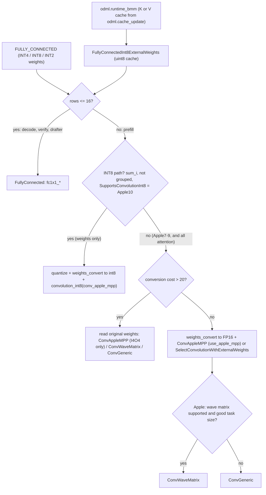
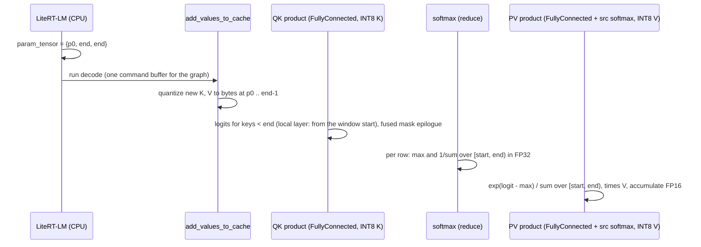

# ML Drift kernels for the Gemma 4 graphs

> **Scope:** the ML Drift kernels that Gemma 4 E4B's GPU graphs use on Apple GPUs at the pins, as
> [`generated/kernels-by-family.md`](../generated/kernels-by-family.md) records them for Apple10, 9, 8
> and 7: quantized fully connected, `ConvAppleMPP`, `ConvWaveMatrix`, `ConvGeneric`, the attention
> products (`odml.runtime_bmm`), softmax, RMS norm, rotary positions, embedding lookup, the KV cache
> update, and our bounded attention and sliding window. For each: what it computes, in which
> precision, and how ML Drift picks it by GPU family, precision and shape.
> **Out of scope:** ML Drift's architecture, GPU detection and selectors in general
> ([architecture.md](architecture.md)); the Metal backend, compilation and dispatch
> ([metal-backend.md](metal-backend.md)); the delegate, its graph passes and caches
> ([../litert/ml-drift-delegate.md](../litert/ml-drift-delegate.md)); what each graph is and how
> LiteRT-LM drives it ([../litert-lm/executors.md](../litert-lm/executors.md),
> [../models/gemma4-e4b.md](../models/gemma4-e4b.md)).
> **Pinned to:** ML Drift `15fa9e2`, LiteRT `362759838`, LiteRT-LM `7b872544`.
> **Applies to:** Apple (iOS, macOS); the generic kernels apply to all platforms. **Last verified:** 2026-10-15

## Summary

- **Decode, verify and the MTP drafter** run every weight product and both attention products in
  one kernel, ML Drift's `FullyConnected`, with identical node counts on Apple10, 9, 8 and 7: 258
  INT4, 127 INT8 (85 weight products and 42 query-key products), 42 probability-value products and 1
  INT2 product in decode. <!-- c:MD-KRN-001 --> At FP16 it accumulates in FP16. <!-- c:MD-KRN-028 -->
- **Prefill** (`prefill_128`, `prefill_1024`) runs as convolutions, and here the families split. On
  Apple10 (A19, M5, M6) the weight products are INT8 x INT8 products on the GPU Neural Accelerators
  through `ConvAppleMPP`, with activations quantized per token; on Apple7 to Apple9 they are FP16
  simdgroup-matrix products in `ConvWaveMatrix`. <!-- c:MD-KRN-081 -->
- **Attention** is not a dedicated attention kernel: LiteRT turns each `odml.runtime_bmm` into a
  fully connected product whose "weights" are the INT8 K or V cache, and our bounded-attention
  rewrite (ours) turns the select and softmax between them into a masked epilogue and a bounded
  reduction.
- **The sliding window (C12).** At ML Drift `15fa9e2` the kernels that skip keys below the local
  layers' 512-token window are `FullyConnected`, `Softmax`, `Softmax1x1`, `ConvAppleMPP` (only when
  it tiles K itself) and `ConvWaveMatrix`. <!-- c:MD-KRN-061 --> On Apple10, E4B's prefill
  query-key products don't qualify, so only the value products skip keys there. <!-- c:MD-KRN-059 -->
- **Rotary positions** run as ordinary elementwise kernels, and at LiteRT-LM's default FP16
  activations their angles are FP16 on the GPU, not FP32, so positions past 2,048 lose exactness
  (the mechanism behind LiteRT-LM #3913). <!-- c:MD-KRN-075 -->

## Concepts

### Names in the kernel tables

[`generated/kernels-by-family.md`](../generated/kernels-by-family.md) counts the GPU nodes ML Drift
built for each E4B graph (`e4b-ours`, 8K window, MTP on), natively on an Apple M6 and with
`AGELLO_SIMULATE_APPLE_GPU` set to Apple A17 Pro, M2 and M1. The names are the node names
`GpuModelBuilder` gives (`fc1x1_int4_weights`, `fc1x1_int8_weights`, `fc1x1_int2_weights`; only the
INT8 builder takes a softmax reduction as input, and then adds ` + src softmax`), and a fused node is
counted under its first operation's name.

| Name in the table | Kernel class | What it is |
| --- | --- | --- |
| `fc1x1_int4_weights`, `fc1x1_int8_weights`, `fc1x1_int2_weights` | `FullyConnected` | A weight product, or an attention product reading the INT8 K cache, with up to 16 rows |
| `fc1x1_int8_weights + src softmax` | `FullyConnected` | A probability-value product that computes the probabilities from a softmax reduction |
| `convolution_int8(conv_apple_mpp)` | `ConvAppleMPP` (INT8) | Apple10 prefill weight product, INT8 x INT8 |
| `convolution(conv_apple_mpp)` [`+ src softmax`] | `ConvAppleMPP` (FP16) | Apple10 prefill attention product |
| `convolution(conv_wave_matrix)` [`+ src softmax`] | `ConvWaveMatrix` | Apple7 to Apple9 prefill product (weights and attention) |
| `quantize_float16_to_int8c4` | quantization | Apple10: activations quantized per token before the INT8 product |
| `weights_convert_<from>_to_<to>` | `WeightsConverter` | A per-run copy of weights into the layout or type the product needs |
| `softmax (reduce)` | `Softmax` / `Softmax1x1` | The bounded softmax reduction: per row, 1 / sum and max |
| `agello_bounded_mask` | elementwise (ours) | The attention mask, when not fused into the query-key product |
| `rms_normalization` | `MeanStdDevNormalization` | `odml.rms_norm` |
| `sin`, `cos`, `mul`, `cast`, ... | elementwise | Rotary angles and the rest of the graph |

The node totals show where the families differ: 1,726 decode nodes everywhere, while
`prefill_1024` has 1,634 nodes on Apple10 against 1,424 on Apple9/8/7 and `prefill_128` 1,611
against 1,214. In `prefill_1024` the 210 extra nodes are Apple10's activation quantizations (both
sides have 256 weight conversions, of different kinds); in `prefill_128` the 397 extra nodes are
those 210 quantizations plus 187 more weight conversions (233 against 46). <!-- c:MD-KRN-004 -->
In decode, the 344 `FULLY_CONNECTED` ops are 258 INT4, 85 INT8 and 1 INT2 products, and the 127
`fc1x1_int8_weights` nodes are the 85 INT8 weight products plus the 42 query-key products.
<!-- c:MD-KRN-005 -->

### Precision

Three settings decide the arithmetic of every kernel on this page:

1. LiteRT-LM's static compiled-model executor (`LlmLiteRtCompiledModelExecutorStatic`) uses FP16
   activations unless the settings say otherwise, and passes LiteRT GPU precision `kFp16` for
   anything but FLOAT32; the dynamic variant (`LlmLiteRtCompiledModelExecutorDynamic`) always
   compiles with FLOAT32 ([`runtime/executor/llm_litert_compiled_model_executor.cc:2127-2132`](https://github.com/PowerBeef/agello-litert-lm/blob/7b872544fdbd81308f98b1e2acf8c5798a549df6/runtime/executor/llm_litert_compiled_model_executor.cc#L2127-L2132), [`runtime/executor/llm_executor_settings_utils.cc:92-96`](https://github.com/PowerBeef/agello-litert-lm/blob/7b872544fdbd81308f98b1e2acf8c5798a549df6/runtime/executor/llm_executor_settings_utils.cc#L92-L96), [`runtime/executor/llm_litert_compiled_model_executor.cc:2462-2465`](https://github.com/PowerBeef/agello-litert-lm/blob/7b872544fdbd81308f98b1e2acf8c5798a549df6/runtime/executor/llm_litert_compiled_model_executor.cc#L2462-L2465)). <!-- c:MD-KRN-008 -->
2. LiteRT's Metal delegate maps `kFp16` to ML Drift's `CalculationsPrecision::kF16` ([`ml_drift_delegate/delegate/delegate_metal.mm:369-385`](https://github.com/google-ai-edge/LiteRT/blob/ca21dc99de51c76bdcc572afeea1dd937d3c9e5c/ml_drift_delegate/delegate/delegate_metal.mm#L369-L385)).
   `kF32F16` (FP16 storage, FP32 accumulation) would take LiteRT's FP16-with-FP32-accumulation
   precision, which LiteRT-LM never requests: it asks for `kFp16` or `kFp32` only.
3. With `kF16` or `kF32F16`, ML Drift gives every FLOAT32 value of the graph an FP16 tensor, except
   graph outputs produced by a `CAST` and tensors the caller provides (predefined, external
   immutable or external mutable), which keep the descriptor they were given ([`ml_drift/common/gpu_model_util.cc:188-211`](https://github.com/google-ai-edge/ml-drift/blob/1b18771f44c0be3d972847b31a80f6dc3d6964b5/ml_drift/common/gpu_model_util.cc#L188-L211), [`ml_drift/common/gpu_model_util.cc:257-266`](https://github.com/google-ai-edge/ml-drift/blob/1b18771f44c0be3d972847b31a80f6dc3d6964b5/ml_drift/common/gpu_model_util.cc#L257-L266)). <!-- c:MD-KRN-007 -->

So at the default, activations, attention logits and rotary angles are FP16 on the GPU, and the
kernels below say where they accumulate in something wider.

### Quantized weights and the KV cache bytes

E4B's weights reach ML Drift as external weights of type `kUint4`, `kUint8` or `kUint2` (the
`weights_convert_uint4_...` names show it), and the fully connected kernel maps them to its INT4,
INT8 and INT2 paths ([`ml_drift/common/kernels/fully_connected_util.cc:515-526`](https://github.com/PowerBeef/ml-drift/blob/15fa9e2ba632145992299e3f04786dc1f575373c/ml_drift/common/kernels/fully_connected_util.cc#L515-L526)). The values are stored offset by half their range: on its
floating-point path (source not INT8) the kernel unpacks unsigned 2-, 4- or 8-bit fields and
dequantizes `w = u x scale - scale x (shift +
zero_point)` with shift 2, 8 or 128 ([`ml_drift/common/kernels/fully_connected.cc:477-488`](https://github.com/PowerBeef/ml-drift/blob/15fa9e2ba632145992299e3f04786dc1f575373c/ml_drift/common/kernels/fully_connected.cc#L477-L488), [`ml_drift/common/kernels/fully_connected_util.cc:104-124`](https://github.com/PowerBeef/ml-drift/blob/15fa9e2ba632145992299e3f04786dc1f575373c/ml_drift/common/kernels/fully_connected_util.cc#L104-L124), [`ml_drift/common/kernels/fully_connected_util.cc:33-43`](https://github.com/PowerBeef/ml-drift/blob/15fa9e2ba632145992299e3f04786dc1f575373c/ml_drift/common/kernels/fully_connected_util.cc#L33-L43)). With an INT8 source it accumulates integer
products instead and subtracts the source sum times the shift ([`ml_drift/common/kernels/fully_connected.cc:605`](https://github.com/PowerBeef/ml-drift/blob/15fa9e2ba632145992299e3f04786dc1f575373c/ml_drift/common/kernels/fully_connected.cc#L605), [`ml_drift/common/kernels/fully_connected_util.cc:227-231`](https://github.com/PowerBeef/ml-drift/blob/15fa9e2ba632145992299e3f04786dc1f575373c/ml_drift/common/kernels/fully_connected_util.cc#L227-L231)). <!-- c:MD-KRN-029 -->
The KV cache uses the same convention: one byte per element, the INT8 value plus 128 (see
[KV cache update](#kv-cache-update)).

### The runtime parameters

Every GPU graph takes `param_tensor` (INT32 `[1, 1, 1, 7]`), filled by LiteRT-LM before each run as
`{start_index, end_index, end_index, 0, 0, 0, 0}` ([`runtime/executor/litert_compiled_model_executor_utils.cc:678-697`](https://github.com/google-ai-edge/LiteRT-LM/blob/df6df5b84d5845b49889f631ed4cac80b4325dd3/runtime/executor/litert_compiled_model_executor_utils.cc#L678-L697)). <!-- c:MD-KRN-049 --> The kernels
read it at run time, so one compiled program serves every fill level:

| Entry | Value | Read by |
| --- | --- | --- |
| 0 | Position of the run's first new token | `add_values_to_cache` (write offset); our window start |
| 1 | End of the filled part after this run | `add_values_to_cache` (last position to write) |
| 2 | Same end | `dst_end_ch_index` / `src_end_ch_index` of the attention products and the bounded softmax |

ML Drift carries these bounds in `ConvRuntimeCheckDesc` (convolutions and fully connected) and
`SoftmaxRuntimeCheckDesc`; an end bound is rounded up to 32 channels (and capped at the tensor's
slices) by `GetRuntimeEndSlice`, and
our window adds `window_pos_index`, `window_size`, `dst_window` and `src_window`
([`ml_drift/common/task/gpu_operation.h:414-427`](https://github.com/PowerBeef/ml-drift/blob/15fa9e2ba632145992299e3f04786dc1f575373c/ml_drift/common/task/gpu_operation.h#L414-L427), [`ml_drift/common/task/gpu_operation.h:438-452`](https://github.com/PowerBeef/ml-drift/blob/15fa9e2ba632145992299e3f04786dc1f575373c/ml_drift/common/task/gpu_operation.h#L438-L452)).

## How it works

### From an op to a kernel

The delegate parses the TFLite ops into ML Drift's graph (including our bounded-attention rewrite),
and `GpuModelBuilder` builds nodes from it ([architecture.md](architecture.md)). The selection on
this page happens in the builder's fully connected functions and the convolution selector; the
rest of E4B's graph maps one op to one elementwise or reduction kernel, which ML Drift then fuses.

### Weight products: fully connected or convolution

**The row limit.** `FullyConnectedInt4ExternalWeights`, `FullyConnectedInt8ExternalWeights` and
`FullyConnectedInt2ExternalWeights` build a `FullyConnected` node when the destination's rows
(batch x height x width, without height for per-height weights in the INT8 case) are at most
`GetRecommendedMaxTotalSpatialSize`, or, for INT8 only, when the weights are ringed
(`ring_o_offset_index` or `ring_i_offset_index` set) ([`ml_drift/common/gpu_model_builder.cc:1518-1532`](https://github.com/google-ai-edge/ml-drift/blob/1b18771f44c0be3d972847b31a80f6dc3d6964b5/ml_drift/common/gpu_model_builder.cc#L1518-L1532), [`ml_drift/common/gpu_model_builder.cc:1621-1626`](https://github.com/google-ai-edge/ml-drift/blob/1b18771f44c0be3d972847b31a80f6dc3d6964b5/ml_drift/common/gpu_model_builder.cc#L1621-L1626), [`ml_drift/common/gpu_model_builder.cc:1530-1536`](https://github.com/google-ai-edge/ml-drift/blob/1b18771f44c0be3d972847b31a80f6dc3d6964b5/ml_drift/common/gpu_model_builder.cc#L1530-L1536), [`ml_drift/common/gpu_model_builder.cc:1694-1699`](https://github.com/google-ai-edge/ml-drift/blob/1b18771f44c0be3d972847b31a80f6dc3d6964b5/ml_drift/common/gpu_model_builder.cc#L1694-L1699)), and a
convolution otherwise. That limit is 16 on an Apple GPU at FP16 (8 at FP32) ([`ml_drift/common/kernels/fully_connected.cc:885-900`](https://github.com/PowerBeef/ml-drift/blob/15fa9e2ba632145992299e3f04786dc1f575373c/ml_drift/common/kernels/fully_connected.cc#L885-L900)).
<!-- c:MD-KRN-010 --> E4B's decode (1 row) and verify (4 rows) stay under it; `prefill_128` and
`prefill_1024` (128 and 1,024 rows) go to convolutions. <!-- c:MD-KRN-012 -->

**Above the limit**, the builder tries an integer path first. A 4-bit convolution needs
`ModelHints::kAllow4bitConvs` and `SupportsConvGenericInt4`, an OpenCL-only test; the INT8 path,
`FullyConnectedInt8QuantizedWithSrcQuantization`, needs per-channel (not grouped) weights with
precomputed sums, `SupportsConvolutionInt8`, and no `kDisallow8bitConvs` hint ([`ml_drift/common/gpu_model_builder.cc:1647-1660`](https://github.com/google-ai-edge/ml-drift/blob/1b18771f44c0be3d972847b31a80f6dc3d6964b5/ml_drift/common/gpu_model_builder.cc#L1647-L1660),
[`ml_drift/common/gpu_model_builder.cc:1578-1588`](https://github.com/google-ai-edge/ml-drift/blob/1b18771f44c0be3d972847b31a80f6dc3d6964b5/ml_drift/common/gpu_model_builder.cc#L1578-L1588), [`ml_drift/common/kernels/conv_generic.cc:4047-4056`](https://github.com/google-ai-edge/ml-drift/blob/1b18771f44c0be3d972847b31a80f6dc3d6964b5/ml_drift/common/kernels/conv_generic.cc#L4047-L4056)). <!-- c:MD-KRN-014 --> On Apple, `SupportsConvolutionInt8` reduces to
`SupportsConvAppleMPP`: its other tests need `cl_arm_matrix_multiply` (Mali), INT8 wave memory on
Adreno (`cl_qcom_dot_product8`) or PowerVR (`cl_img_pixel_subgroup_dot`), OpenCL, WebGPU or Vulkan
dot-product support (`ConvGeneric`), or Nvidia or Intel INT8 wave-matrix operations ([`ml_drift/common/selectors/convolution_selector.cc:333-339`](https://github.com/google-ai-edge/ml-drift/blob/1b18771f44c0be3d972847b31a80f6dc3d6964b5/ml_drift/common/selectors/convolution_selector.cc#L333-L339), [`ml_drift/common/kernels/conv_wave_matrix_mali.cc:281-286`](https://github.com/google-ai-edge/ml-drift/blob/1b18771f44c0be3d972847b31a80f6dc3d6964b5/ml_drift/common/kernels/conv_wave_matrix_mali.cc#L281-L286),
[`ml_drift/common/kernels/conv_wave_memory.cc:1113-1129`](https://github.com/google-ai-edge/ml-drift/blob/1b18771f44c0be3d972847b31a80f6dc3d6964b5/ml_drift/common/kernels/conv_wave_memory.cc#L1113-L1129), [`ml_drift/common/kernels/conv_generic.cc:3882-3899`](https://github.com/google-ai-edge/ml-drift/blob/1b18771f44c0be3d972847b31a80f6dc3d6964b5/ml_drift/common/kernels/conv_generic.cc#L3882-L3899), [`ml_drift/common/kernels/conv_wave_matrix.cc:1478-1518`](https://github.com/PowerBeef/ml-drift/blob/15fa9e2ba632145992299e3f04786dc1f575373c/ml_drift/common/kernels/conv_wave_matrix.cc#L1478-L1518)). <!-- c:MD-KRN-015 --> LiteRT-LM fills an unset
`AdvancedSettings.allow_src_quantized_fc_conv_ops` with true when the model's metadata names a
well-known `llm_model_type` and with false for generic or missing types, then enables LiteRT's
`AllowSrcQuantizedFcConvOps` GPU option unless the setting is false; only when that option is off
does the delegate add `kDisallow8bitConvs`. E4B's metadata names `gemma4`, so by default ML Drift
may run quantized-activation INT8 convolutions for it ([`runtime/engine/engine_settings.cc:477-490`](https://github.com/google-ai-edge/LiteRT-LM/blob/df6df5b84d5845b49889f631ed4cac80b4325dd3/runtime/engine/engine_settings.cc#L477-L490), [`runtime/executor/llm_executor_settings_utils.cc:210-212`](https://github.com/PowerBeef/agello-litert-lm/blob/7b872544fdbd81308f98b1e2acf8c5798a549df6/runtime/executor/llm_executor_settings_utils.cc#L210-L212), [`litert/runtime/accelerators/gpu/ml_drift_delegate_create.cc:119-121`](https://github.com/google-ai-edge/LiteRT/blob/ca21dc99de51c76bdcc572afeea1dd937d3c9e5c/litert/runtime/accelerators/gpu/ml_drift_delegate_create.cc#L119-L121),
[`ml_drift_delegate/delegate/delegate_kernel.cc:342-344`](https://github.com/PowerBeef/LiteRT/blob/362759838e34e1525f1cc27daddaf663a193c059/ml_drift_delegate/delegate/delegate_kernel.cc#L342-L344)).
<!-- c:MD-KRN-017 -->

**Apple10: INT8 x INT8.** The INT8 path quantizes the activations (next section), picks
`ConvAppleMPP`'s INT8 variant with an INT32 intermediate and a fused dequantization, and converts
the weights into its layout with a `WeightsConversion` node ([`ml_drift/common/gpu_model_builder.cc:1320-1323`](https://github.com/google-ai-edge/ml-drift/blob/1b18771f44c0be3d972847b31a80f6dc3d6964b5/ml_drift/common/gpu_model_builder.cc#L1320-L1323), [`ml_drift/common/gpu_model_builder.cc:1331-1340`](https://github.com/google-ai-edge/ml-drift/blob/1b18771f44c0be3d972847b31a80f6dc3d6964b5/ml_drift/common/gpu_model_builder.cc#L1331-L1340),
[`ml_drift/common/selectors/convolution_selector.cc:388-398`](https://github.com/google-ai-edge/ml-drift/blob/1b18771f44c0be3d972847b31a80f6dc3d6964b5/ml_drift/common/selectors/convolution_selector.cc#L388-L398), [`ml_drift/common/gpu_model_builder.cc:1345-1358`](https://github.com/google-ai-edge/ml-drift/blob/1b18771f44c0be3d972847b31a80f6dc3d6964b5/ml_drift/common/gpu_model_builder.cc#L1345-L1358), [`ml_drift/common/gpu_model_builder.cc:1041-1083`](https://github.com/google-ai-edge/ml-drift/blob/1b18771f44c0be3d972847b31a80f6dc3d6964b5/ml_drift/common/gpu_model_builder.cc#L1041-L1083)). For E4B that is
`weights_convert_uint4_to_int8` for the 163 INT4 tensors and `weights_convert_uint8_to_int8` for the
47 INT8 ones in each prefill graph. <!-- c:MD-KRN-019 --> The table shows the whole Apple10 prefill:
210 `convolution_int8(conv_apple_mpp)`, 23 `convolution(conv_apple_mpp)`, 23 with `+ src softmax`,
210 quantizations, 163 + 47 weight conversions and 46 (23 in `prefill_128`) K/V conversions to
FP16, and no `ConvWaveMatrix`. <!-- c:MD-KRN-002 -->

**Apple7 to Apple9: the conversion cost model.** Without the INT8 path, the products go to
`FullyConnectedSrcFloatExternalWeightsWithConversion`, which decides whether a convolution should
read the quantized weights itself or whether a separate node should first convert them to FP16. It
estimates `conversion_cost = 100 x (source weight bytes + weight bytes in the activation type, FP16
here) / (convolution FLOPs / weights height) x flops_per_byte`, with `flops_per_byte` 110 when the
`ConvAppleMPP` path applies and 32 on other Apple GPUs. It reads the original weights in a single
convolution only when that cost exceeds 20, the weights are not ringed, and `ConvAppleMPP`,
`ConvWaveMatrix` or `ConvGeneric` supports them; otherwise it adds a separate `weights_convert`
node to the graph ([`ml_drift/common/gpu_model_builder.cc:1173-1217`](https://github.com/google-ai-edge/ml-drift/blob/1b18771f44c0be3d972847b31a80f6dc3d6964b5/ml_drift/common/gpu_model_builder.cc#L1173-L1217), [`ml_drift/common/gpu_model_builder.cc:1107-1148`](https://github.com/google-ai-edge/ml-drift/blob/1b18771f44c0be3d972847b31a80f6dc3d6964b5/ml_drift/common/gpu_model_builder.cc#L1107-L1148)).
<!-- c:MD-KRN-021 --> A comment there ties the two figures to "M5/A19, GPUs with NA" and "M4/A18
and below" ([`ml_drift/common/gpu_model_builder.cc:1114-1123`](https://github.com/google-ai-edge/ml-drift/blob/1b18771f44c0be3d972847b31a80f6dc3d6964b5/ml_drift/common/gpu_model_builder.cc#L1114-L1123)). Then it tries, in order: `ConvAppleMPP` on the original weights,
`ConvWaveMatrix` on them, `ConvGeneric` on them (an OpenCL Intel path, never on Apple: [`ml_drift/common/kernels/conv_generic.cc:3715-3723`](https://github.com/google-ai-edge/ml-drift/blob/1b18771f44c0be3d972847b31a80f6dc3d6964b5/ml_drift/common/kernels/conv_generic.cc#L3715-L3723)),
`ConvAppleMPP` on converted FP16 weights, and the generic convolution selector ([`ml_drift/common/gpu_model_builder.cc:1173-1210`](https://github.com/google-ai-edge/ml-drift/blob/1b18771f44c0be3d972847b31a80f6dc3d6964b5/ml_drift/common/gpu_model_builder.cc#L1173-L1210),
[`ml_drift/common/gpu_model_builder.cc:1213-1217`](https://github.com/google-ai-edge/ml-drift/blob/1b18771f44c0be3d972847b31a80f6dc3d6964b5/ml_drift/common/gpu_model_builder.cc#L1213-L1217)).

For E4B's weights, with `FLOPs = 2 x rows x outputs x inputs` ([`ml_drift/common/flops_util.cc:21-25`](https://github.com/google-ai-edge/ml-drift/blob/1b18771f44c0be3d972847b31a80f6dc3d6964b5/ml_drift/common/flops_util.cc#L21-L25)):

| Weights | 128 rows | 1,024 rows |
| --- | --- | --- |
| INT4 (0.5 + 2 bytes per weight) | 31.25: read INT4 directly | 3.9: convert to FP16 first |
| INT8 (1 + 2 bytes per weight) | 37.5: read INT8 directly | 4.69: convert to FP16 first |

That matches the simulated Apple9/8/7 runs: 163 `weights_convert_uint4_to_float16` nodes in
`prefill_1024` and none in `prefill_128`. <!-- c:MD-KRN-022 --> All of their prefill products are
`ConvWaveMatrix` nodes (233, plus 23 with `+ src softmax`), with no `ConvAppleMPP`, INT8
convolution or quantization; `prefill_1024` adds 93 `weights_convert_uint8_to_float16` (47 INT8
weights and 46 K/V caches), `prefill_128` only the 46 caches. <!-- c:MD-KRN-003 -->

**Which kernel on the converted path.** On Apple, the generic selector builds `ConvWaveMatrix` when
it is supported and the task size suits it, and `ConvGeneric` otherwise ([`ml_drift/common/selectors/convolution_selector.cc:251-261`](https://github.com/google-ai-edge/ml-drift/blob/1b18771f44c0be3d972847b31a80f6dc3d6964b5/ml_drift/common/selectors/convolution_selector.cc#L251-L261),
[`ml_drift/common/selectors/convolution_selector.cc:125-149`](https://github.com/google-ai-edge/ml-drift/blob/1b18771f44c0be3d972847b31a80f6dc3d6964b5/ml_drift/common/selectors/convolution_selector.cc#L125-L149)). `use_apple_mpp` itself needs `SupportsConvAppleMPP`, `kF16` and a source with a
multiple of 32 channels ([`ml_drift/common/gpu_model_builder.cc:1099-1102`](https://github.com/google-ai-edge/ml-drift/blob/1b18771f44c0be3d972847b31a80f6dc3d6964b5/ml_drift/common/gpu_model_builder.cc#L1099-L1102)).

### The quantized fully connected kernel

`FullyConnected` computes `dst[row, o] = sum_i src[row, i] x w[o, i]` for up to 16 rows, each
thread producing one output slice (4 channels).

- **Weights.** On the floating-point path, quantized weights are unpacked and dequantized to the
  activation type inside the loop, four input channels at a time ([`ml_drift/common/kernels/fully_connected.cc:477-488`](https://github.com/PowerBeef/ml-drift/blob/15fa9e2ba632145992299e3f04786dc1f575373c/ml_drift/common/kernels/fully_connected.cc#L477-L488), [`ml_drift/common/kernels/fully_connected.cc:789-803`](https://github.com/PowerBeef/ml-drift/blob/15fa9e2ba632145992299e3f04786dc1f575373c/ml_drift/common/kernels/fully_connected.cc#L789-L803)); there is no separate
  conversion node in decode.
- **Accumulation.** FP16 at `kF16`, FP32 at other precisions, INT32 for an INT8 source
  ([`ml_drift/common/kernels/fully_connected.cc:642-647`](https://github.com/PowerBeef/ml-drift/blob/15fa9e2ba632145992299e3f04786dc1f575373c/ml_drift/common/kernels/fully_connected.cc#L642-L647), [`ml_drift/common/kernels/fully_connected_util.cc:169-200`](https://github.com/PowerBeef/ml-drift/blob/15fa9e2ba632145992299e3f04786dc1f575373c/ml_drift/common/kernels/fully_connected_util.cc#L169-L200)). <!-- c:MD-KRN-028 -->
- **Work groups.** On Apple, the reduction over input slices is split over 1 to 128 threads in y,
  in groups of 256 threads (128 below 16 compute units). The split follows the task size per
  compute unit: output slices, times the batch count for FCs with batched weights; the thresholds
  are scaled by 16/bits for weights of 8 bits or fewer, and y is 1 at 16,384 output slices or more.
  MoE packed-group FCs, and FCs whose caller passes a work-group size, use a fixed group
  ([`ml_drift/common/kernels/fully_connected.cc:96-140`](https://github.com/PowerBeef/ml-drift/blob/15fa9e2ba632145992299e3f04786dc1f575373c/ml_drift/common/kernels/fully_connected.cc#L96-L140)).
- **Runtime bounds.** With `dst_end_ch_index` it computes only output slices below the end read
  from the params buffer (rounded up to 32 channels and capped at the tensor's slices by
  `GetRuntimeEndSlice`); with `src_end_ch_index` it stops the reduction at
  `(params[src_end_ch_index] + 3) / 4` slices, except for block-quantized weights, whose loop runs
  over every scale group ([`ml_drift/common/kernels/fully_connected.cc:726-736`](https://github.com/PowerBeef/ml-drift/blob/15fa9e2ba632145992299e3f04786dc1f575373c/ml_drift/common/kernels/fully_connected.cc#L726-L736), [`ml_drift/common/kernels/fully_connected_util.cc:501-504`](https://github.com/PowerBeef/ml-drift/blob/15fa9e2ba632145992299e3f04786dc1f575373c/ml_drift/common/kernels/fully_connected_util.cc#L501-L504), [`ml_drift/common/kernels/fully_connected_util.cc:233-245`](https://github.com/PowerBeef/ml-drift/blob/15fa9e2ba632145992299e3f04786dc1f575373c/ml_drift/common/kernels/fully_connected_util.cc#L233-L245), [`ml_drift/common/kernels/fully_connected.cc:671-676`](https://github.com/PowerBeef/ml-drift/blob/15fa9e2ba632145992299e3f04786dc1f575373c/ml_drift/common/kernels/fully_connected.cc#L671-L676)).
- **Softmax input.** For a probability-value product after the delegate's bounded-attention
  rewrite (ours: LiteRT `ede28c641`), it turns each logit `v`
  into `exp(v - max) x (1 / sum)` from the reduction tensor, in the activation type
  ([`ml_drift/common/kernels/fully_connected.cc:765-768`](https://github.com/PowerBeef/ml-drift/blob/15fa9e2ba632145992299e3f04786dc1f575373c/ml_drift/common/kernels/fully_connected.cc#L765-L768), [`ml_drift_delegate/delegate/composite/bounded_attention.cc:280-287`](https://github.com/PowerBeef/LiteRT/blob/362759838e34e1525f1cc27daddaf663a193c059/ml_drift_delegate/delegate/composite/bounded_attention.cc#L280-L287)). <!-- c:MD-KRN-031 -->

Decode's single `fc1x1_int2_weights` node is the output projection: the
`tf_lite_prefill_decode` section's one INT2 tensor (167.8 MB) matches 262,144 x 2,560 weights at
2 bits, and decode outputs `logits [1, 1, 262144]`. <!-- c:MD-KRN-083 -->

### ConvAppleMPP: the GPU Neural Accelerators

`ConvAppleMPP` is ML Drift's convolution for Apple10 GPUs, written on Metal Performance Primitives:
the generated Metal includes `MetalPerformancePrimitives`, and each threadgroup of 4 simdgroups
(128 threads) runs `mpp::tensor_ops::matmul2d` on tiles of 64 rows x 128 output channels by
default (64 channels when the output channels aren't a multiple of 128; always 64 channels in the
variants that take external weights descriptions, where rows drop to 32 for packed groups averaging
32 rows or fewer), with a 32-channel K tile when the kernel tiles K itself
([`ml_drift/common/kernels/conv_apple_mpp.cc:142-153`](https://github.com/PowerBeef/ml-drift/blob/15fa9e2ba632145992299e3f04786dc1f575373c/ml_drift/common/kernels/conv_apple_mpp.cc#L142-L153), [`ml_drift/common/kernels/conv_apple_mpp.cc:302-305`](https://github.com/PowerBeef/ml-drift/blob/15fa9e2ba632145992299e3f04786dc1f575373c/ml_drift/common/kernels/conv_apple_mpp.cc#L302-L305), [`ml_drift/common/kernels/conv_apple_mpp.cc:509-517`](https://github.com/PowerBeef/ml-drift/blob/15fa9e2ba632145992299e3f04786dc1f575373c/ml_drift/common/kernels/conv_apple_mpp.cc#L509-L517), [`ml_drift/common/kernels/conv_apple_mpp.cc:666-674`](https://github.com/PowerBeef/ml-drift/blob/15fa9e2ba632145992299e3f04786dc1f575373c/ml_drift/common/kernels/conv_apple_mpp.cc#L666-L674), [`ml_drift/common/kernels/conv_apple_mpp.cc:754`](https://github.com/PowerBeef/ml-drift/blob/15fa9e2ba632145992299e3f04786dc1f575373c/ml_drift/common/kernels/conv_apple_mpp.cc#L754), [`ml_drift/common/kernels/conv_apple_mpp.cc:127-139`](https://github.com/PowerBeef/ml-drift/blob/15fa9e2ba632145992299e3f04786dc1f575373c/ml_drift/common/kernels/conv_apple_mpp.cc#L127-L139)). <!-- c:MD-KRN-034 --> These
tensor operations are how ML Drift reaches the GPU Neural Accelerators of Apple10 GPUs; the Apple
Neural Engine plays no part. ML Drift only builds it when `SupportsConvAppleMPP` holds: Metal, an
Apple GPU, ML Drift family Apple10 or later, and Metal Shading Language 4.0 or later
([`ml_drift/common/kernels/conv_apple_mpp.cc:536-558`](https://github.com/PowerBeef/ml-drift/blob/15fa9e2ba632145992299e3f04786dc1f575373c/ml_drift/common/kernels/conv_apple_mpp.cc#L536-L558)). <!-- c:MD-KRN-016 -->

| Use in E4B (Apple10 prefill) | Weights | Source | Accumulates in |
| --- | --- | --- | --- |
| Weight products (`convolution_int8`) | INT8, converted from uint4/uint8 by a separate node | INT8, quantized per token | INT32, dequantized in FP32 |
| Query-key products | FP16 copy of the K cache (`weights_convert_uint8_to_float16`) | FP16 queries (DHWBCC4 buffer) | FP16 |
| Probability-value products (`+ src softmax`) | INT8 V cache read directly in `prefill_128`, FP16 copy in `prefill_1024` | FP16 logits, turned into probabilities while staging | FP16 |

The matmul accumulates into a cooperative tensor of the destination's scalar type: FP16 for the
attention products at `kF16`, INT32 for the weight products ([`ml_drift/common/kernels/conv_apple_mpp.cc:302-305`](https://github.com/PowerBeef/ml-drift/blob/15fa9e2ba632145992299e3f04786dc1f575373c/ml_drift/common/kernels/conv_apple_mpp.cc#L302-L305), [`ml_drift/common/gpu_model_builder.cc:1320-1323`](https://github.com/google-ai-edge/ml-drift/blob/1b18771f44c0be3d972847b31a80f6dc3d6964b5/ml_drift/common/gpu_model_builder.cc#L1320-L1323)).
<!-- c:MD-KRN-035 --> When it reads I4O4 external weights itself, it dequantizes uint8, uint4 or
uint2 to half before the matmul, and for an INT8 weight type it turns offset uint4 nibbles into
signed INT8 by XOR with 8 and sign extension ([`ml_drift/common/kernels/conv_apple_mpp.cc:84-100`](https://github.com/PowerBeef/ml-drift/blob/15fa9e2ba632145992299e3f04786dc1f575373c/ml_drift/common/kernels/conv_apple_mpp.cc#L84-L100), [`ml_drift/common/kernels/conv_apple_mpp.cc:362-371`](https://github.com/PowerBeef/ml-drift/blob/15fa9e2ba632145992299e3f04786dc1f575373c/ml_drift/common/kernels/conv_apple_mpp.cc#L362-L371)). With a softmax input it
reads the source itself and computes `exp(src - max) x (1 / sum)` in half while staging the tile
([`ml_drift/common/kernels/conv_apple_mpp.cc:413-415`](https://github.com/PowerBeef/ml-drift/blob/15fa9e2ba632145992299e3f04786dc1f575373c/ml_drift/common/kernels/conv_apple_mpp.cc#L413-L415)).

Only I4O4 weights can be read directly ([`ml_drift/common/kernels/conv_apple_mpp.cc:536-558`](https://github.com/PowerBeef/ml-drift/blob/15fa9e2ba632145992299e3f04786dc1f575373c/ml_drift/common/kernels/conv_apple_mpp.cc#L536-L558)), and LiteRT gives the K cache of a
query-key product the O4I4 layout and the V cache I4O4 ([`ml_drift_delegate/delegate/composite/runtime_batched_matmul_parser.cc:170-192`](https://github.com/PowerBeef/LiteRT/blob/362759838e34e1525f1cc27daddaf663a193c059/ml_drift_delegate/delegate/composite/runtime_batched_matmul_parser.cc#L170-L192)). So in `prefill_128` on
Apple10 the 23 value products read the INT8 V cache directly while the 23 key products convert K
to FP16 first, and in `prefill_1024` all 46 convert. <!-- c:MD-KRN-024 --> The conversion costs
explain the split (see [Attention](#attention-the-runtime-batched-matmul)).

### ConvWaveMatrix: simdgroup matrices

`ConvWaveMatrix` multiplies 8 x 8 tiles with the GPU's cooperative matrix instructions: on Metal,
ML Drift lowers its `ucl::wave_matrix` type to `simdgroup_matrix` and `ucl::WaveMatrixMAC` to
`simdgroup_multiply_accumulate` ([`ml_drift/common/task/wave_matrix_util.cc:103-106`](https://github.com/google-ai-edge/ml-drift/blob/1b18771f44c0be3d972847b31a80f6dc3d6964b5/ml_drift/common/task/wave_matrix_util.cc#L103-L106), [`ml_drift/common/task/wave_matrix_util.cc:219-222`](https://github.com/google-ai-edge/ml-drift/blob/1b18771f44c0be3d972847b31a80f6dc3d6964b5/ml_drift/common/task/wave_matrix_util.cc#L219-L222)). <!-- c:MD-KRN-041 --> The Metal
environment registers 8x8x8 FP16 and FP32 multiplies only for Metal Shading Language 2.3 or later
on family Apple7 or later ([`ml_drift/metal/environment.mm:79-100`](https://github.com/google-ai-edge/ml-drift/blob/1b18771f44c0be3d972847b31a80f6dc3d6964b5/ml_drift/metal/environment.mm#L79-L100), [`ml_drift/common/gpu_info.cc:1491-1493`](https://github.com/PowerBeef/ml-drift/blob/15fa9e2ba632145992299e3f04786dc1f575373c/ml_drift/common/gpu_info.cc#L1491-L1493), [`ml_drift/common/gpu_info.cc:853-855`](https://github.com/PowerBeef/ml-drift/blob/15fa9e2ba632145992299e3f04786dc1f575373c/ml_drift/common/gpu_info.cc#L853-L855)). <!-- c:MD-KRN-040 -->
On Apple, `SupportsConvWaveMatrix` then needs that multiply in the precision's type at `kF32` or
`kF16`, an even number of input slices and a multiple of 4 output slices; reading external weights
directly also needs Metal, I4O4 and float, uint8, uint4 or uint2 weights ([`ml_drift/common/kernels/conv_wave_matrix.cc:1047-1066`](https://github.com/PowerBeef/ml-drift/blob/15fa9e2ba632145992299e3f04786dc1f575373c/ml_drift/common/kernels/conv_wave_matrix.cc#L1047-L1066),
[`ml_drift/common/kernels/conv_wave_matrix.cc:1448-1465`](https://github.com/PowerBeef/ml-drift/blob/15fa9e2ba632145992299e3f04786dc1f575373c/ml_drift/common/kernels/conv_wave_matrix.cc#L1448-L1465)). <!-- c:MD-KRN-039 -->

It accumulates in FP16 for float weights at `kF16`, in FP32 at other float precisions, and in INT32
or UINT32 for integer weight types; with external weights the weight type follows the precision,
so E4B's prefill products accumulate in FP16 on Apple7 to Apple9 ([`ml_drift/common/kernels/conv_wave_matrix.cc:173-182`](https://github.com/PowerBeef/ml-drift/blob/15fa9e2ba632145992299e3f04786dc1f575373c/ml_drift/common/kernels/conv_wave_matrix.cc#L173-L182), [`ml_drift/common/kernels/conv_wave_matrix.cc:1346-1355`](https://github.com/PowerBeef/ml-drift/blob/15fa9e2ba632145992299e3f04786dc1f575373c/ml_drift/common/kernels/conv_wave_matrix.cc#L1346-L1355)).
<!-- c:MD-KRN-042 --> With a softmax input it computes the probabilities before the multiply
([`ml_drift/common/kernels/conv_wave_matrix.cc:694-697`](https://github.com/PowerBeef/ml-drift/blob/15fa9e2ba632145992299e3f04786dc1f575373c/ml_drift/common/kernels/conv_wave_matrix.cc#L694-L697)). The task-size test that guards it on the converted path wants well-filled 32-wide
waves (75% on Apple9, 95% on other families, 60% at `kF32` on GPUs with `IsSIMDMatMulFp32Perf2x`),
at least 16 waves per compute unit (8 at `kF32`), and at least 512 FLOPs per thread on Apple9
(2,048 elsewhere) ([`ml_drift/common/kernels/conv_wave_matrix.cc:1523-1556`](https://github.com/PowerBeef/ml-drift/blob/15fa9e2ba632145992299e3f04786dc1f575373c/ml_drift/common/kernels/conv_wave_matrix.cc#L1523-L1556)).

In practice it runs on Apple7 to Apple9. For E4B on Apple10 at `kF16` the INT8 path and the
`use_apple_mpp` branches come first, so ML Drift builds no `ConvWaveMatrix` node there. In the
external-weights path that E4B's products take
(`FullyConnectedSrcFloatExternalWeightsWithConversion`), it would only be reached on Apple10 when
`use_apple_mpp` is false: a precision other than `kF16`, a source whose channels aren't a multiple
of 32, or a Metal Shading Language version below 4.0 ([`ml_drift/common/kernels/conv_apple_mpp.cc:536-558`](https://github.com/PowerBeef/ml-drift/blob/15fa9e2ba632145992299e3f04786dc1f575373c/ml_drift/common/kernels/conv_apple_mpp.cc#L536-L558), [`ml_drift/common/gpu_model_builder.cc:1173-1210`](https://github.com/google-ai-edge/ml-drift/blob/1b18771f44c0be3d972847b31a80f6dc3d6964b5/ml_drift/common/gpu_model_builder.cc#L1173-L1210), [`ml_drift/common/gpu_model_builder.cc:1099-1102`](https://github.com/google-ai-edge/ml-drift/blob/1b18771f44c0be3d972847b31a80f6dc3d6964b5/ml_drift/common/gpu_model_builder.cc#L1099-L1102)). <!-- c:MD-KRN-082 -->

### ConvGeneric

`ConvGeneric` is ML Drift's portable tiled convolution, the fallback of the Apple selector when
`ConvWaveMatrix` isn't supported or the task size doesn't suit it ([`ml_drift/common/selectors/convolution_selector.cc:125-149`](https://github.com/google-ai-edge/ml-drift/blob/1b18771f44c0be3d972847b31a80f6dc3d6964b5/ml_drift/common/selectors/convolution_selector.cc#L125-L149)), and of the
conversion chain. No E4B node uses it on Apple10, 9, 8 or 7 at the pins. It has no sliding window:
on a path where it ran attention, local layers would compute every filled key, which stays correct
because the mask hides the keys below the window.

### Weight conversion and activation quantization

**Activation quantization (Apple10 prefill).** The `quantize_<type>_to_<packed>` node quantizes
each token row of the activations asymmetrically over a range from the minimum to the maximum of
that row's channels, with the running minimum and maximum starting from the tensor's first element
(x 0, y 0, channel 0); it adds 0.5 and clamps to the packed integer range, and keeps the per-row parameters in an FP32 tensor; on Apple10 the
packed type is `kInt8C4` ([`ml_drift/common/gpu_model_builder.cc:1253-1280`](https://github.com/google-ai-edge/ml-drift/blob/1b18771f44c0be3d972847b31a80f6dc3d6964b5/ml_drift/common/gpu_model_builder.cc#L1253-L1280), [`ml_drift/common/kernels/quantize_and_dequantize.cc:303-337`](https://github.com/google-ai-edge/ml-drift/blob/1b18771f44c0be3d972847b31a80f6dc3d6964b5/ml_drift/common/kernels/quantize_and_dequantize.cc#L303-L337), [`ml_drift/common/kernels/quantize_and_dequantize.cc:242-245`](https://github.com/google-ai-edge/ml-drift/blob/1b18771f44c0be3d972847b31a80f6dc3d6964b5/ml_drift/common/kernels/quantize_and_dequantize.cc#L242-L245), [`ml_drift/common/selectors/convolution_selector.cc:341-346`](https://github.com/google-ai-edge/ml-drift/blob/1b18771f44c0be3d972847b31a80f6dc3d6964b5/ml_drift/common/selectors/convolution_selector.cc#L341-L346)).
<!-- c:MD-KRN-018 --> After the INT8 product, the fused dequantization runs in FP32: the integer
accumulator (INT32; on PowerVR's uint8 path a UINT32 first corrected by 128 x the source sum) times
the weight scale and the row's scale, plus the weight-sum and zero-point corrections ([`ml_drift/common/kernels/quantize_and_dequantize.cc:755-771`](https://github.com/google-ai-edge/ml-drift/blob/1b18771f44c0be3d972847b31a80f6dc3d6964b5/ml_drift/common/kernels/quantize_and_dequantize.cc#L755-L771), [`ml_drift/common/kernels/quantize_and_dequantize.cc:772-798`](https://github.com/google-ai-edge/ml-drift/blob/1b18771f44c0be3d972847b31a80f6dc3d6964b5/ml_drift/common/kernels/quantize_and_dequantize.cc#L772-L798)). <!-- c:MD-KRN-020 -->

**Weight conversion.** A `weights_convert_<from>_to_<to>` node copies weights into the layout and
type a convolution needs ([`ml_drift/common/gpu_model_builder.cc:1041-1083`](https://github.com/google-ai-edge/ml-drift/blob/1b18771f44c0be3d972847b31a80f6dc3d6964b5/ml_drift/common/gpu_model_builder.cc#L1041-L1083)). It is a node of the graph, and the Metal
`InferenceContext` encodes every node on each run, skipping only nodes whose optional tags are
disabled (no caller tags any): both `EncodeWithCommandQueue`, which the delegate's `Dispatch` uses
for the passive and active waits LiteRT-LM requests, and `EncodeWithCommandBuffer`, used for
`DoNotWait`, do this ([`ml_drift/metal/inference_context.mm:735-802`](https://github.com/PowerBeef/ml-drift/blob/15fa9e2ba632145992299e3f04786dc1f575373c/ml_drift/metal/inference_context.mm#L735-L802), [`ml_drift_delegate/delegate/gpu_backend_metal.mm:506-534`](https://github.com/PowerBeef/LiteRT/blob/362759838e34e1525f1cc27daddaf663a193c059/ml_drift_delegate/delegate/gpu_backend_metal.mm#L506-L534), [`runtime/executor/llm_executor_settings_utils.cc:220-232`](https://github.com/PowerBeef/agello-litert-lm/blob/7b872544fdbd81308f98b1e2acf8c5798a549df6/runtime/executor/llm_executor_settings_utils.cc#L220-L232)).
So `weights_convert` nodes in a prefill graph run on every prefill run. For E4B, the INT4 and
INT8 weights are converted on every prefill run on Apple10 (to INT8) and in `prefill_1024` on
Apple7 to Apple9 (to FP16). The K and V caches change every run, so their FP16 copies must be
remade anyway. The converter honors the runtime end bounds: it returns early for slices past the
filled length, so a K/V conversion stops at the filled part (rounded up), though it does not skip
keys below the window ([`ml_drift/common/kernels/conv_weights_converter.cc:1345-1358`](https://github.com/google-ai-edge/ml-drift/blob/1b18771f44c0be3d972847b31a80f6dc3d6964b5/ml_drift/common/kernels/conv_weights_converter.cc#L1345-L1358), [`ml_drift/common/gpu_model_builder.cc:1213-1217`](https://github.com/google-ai-edge/ml-drift/blob/1b18771f44c0be3d972847b31a80f6dc3d6964b5/ml_drift/common/gpu_model_builder.cc#L1213-L1217)). <!-- c:MD-KRN-063 -->

### Attention: the runtime batched matmul

Which composites the models Agello uses contain (from the files' bytes,
[models/e4b-ours.md](../generated/models/e4b-ours.md),
[models/e2b-google.md](../generated/models/e2b-google.md),
[models/embeddinggemma.md](../generated/models/embeddinggemma.md)):

| Graph | `odml.rms_norm` | `odml.cache_update` | `odml.runtime_bmm` | `odml.rope` |
| --- | --- | --- | --- | --- |
| E4B `decode`, `verify` | 302 | 24 | 84 | — |
| E4B `prefill_1024`, `prefill_128` | 188 | 24 | 46 | — |
| E4B `mtp_drafter` | 21 | — | 8 | — |
| E4B vision encoder (`vision_70/140/280`) | 112 | — | — | — |
| E2B `decode`, `verify` | 242 | 15 | 70 | — |
| E2B `prefill_*` | 116 | 15 | 28 | — |
| EmbeddingGemma 2 text 270m `encoder_1x1024` | 194 | — | — | 48 |

<!-- c:RT-DLG-021 --> No Gemma graph uses `odml.sdpa_transposed`, `odml.swiglu`, `moe`
or `gated_delta_update`; the E4B and E2B `-gpu` variants are not covered here (their graphs aren't
read). <!-- c:RT-DLG-022 -->

E4B's attention is two `odml.runtime_bmm` composites per layer: query x keys, then probabilities x
values. LiteRT's parser turns one whose right-hand side comes from `odml.cache_update` (or that is
quantized) into a fully connected product with external weights. A query-key product (`is_src`
false) is bounded by `dst_end_ch_index` 2 and reads K in layout O4I4; a probability-value product
(`is_src` true) is bounded by `src_end_ch_index` 2 and reads V in layout I4O4; INT8 caches become
`kUint8` weights with a scale tensor holding one value repeated per channel, taken from the
producing `cache_update`'s `scale_k` or `scale_v`, or from the `runtime_bmm`'s own `scale` attribute
when no `cache_update` produces the cache in the graph ([`ml_drift_delegate/delegate/composite/runtime_batched_matmul_parser.cc:170-192`](https://github.com/PowerBeef/LiteRT/blob/362759838e34e1525f1cc27daddaf663a193c059/ml_drift_delegate/delegate/composite/runtime_batched_matmul_parser.cc#L170-L192), [`ml_drift_delegate/delegate/composite/runtime_batched_matmul_parser.cc:194-230`](https://github.com/PowerBeef/LiteRT/blob/362759838e34e1525f1cc27daddaf663a193c059/ml_drift_delegate/delegate/composite/runtime_batched_matmul_parser.cc#L194-L230), [`ml_drift_delegate/delegate/composite/runtime_batched_matmul_parser.cc:42`](https://github.com/PowerBeef/LiteRT/blob/362759838e34e1525f1cc27daddaf663a193c059/ml_drift_delegate/delegate/composite/runtime_batched_matmul_parser.cc#L42)). <!-- c:MD-KRN-046 --> A composite with no `scale` or
`rhs_cache_update` attribute whose right-hand side isn't produced by `odml.cache_update` would go to
ML Drift's `BatchedMatMul` with `transpose_right` ([`ml_drift_delegate/delegate/composite/runtime_batched_matmul_parser.cc:155-172`](https://github.com/PowerBeef/LiteRT/blob/362759838e34e1525f1cc27daddaf663a193c059/ml_drift_delegate/delegate/composite/runtime_batched_matmul_parser.cc#L155-L172), [`ml_drift_delegate/delegate/composite/runtime_batched_matmul_kernel.cc:153-171`](https://github.com/PowerBeef/LiteRT/blob/362759838e34e1525f1cc27daddaf663a193c059/ml_drift_delegate/delegate/composite/runtime_batched_matmul_kernel.cc#L153-L171)); E4B has no such
node, since every `runtime_bmm` composite in its graphs (including the MTP drafter's, which has no
`cache_update`) carries a `scale` attribute.

<!-- c:RT-DLG-026 --> The node builder turns `RuntimeCheckParams` into ML Drift's
`ConvRuntimeCheckDesc` and calls `FullyConnectedInt8ExternalWeights`,
`FullyConnectedExternalWeights` or `BatchedMatMul` ([`ml_drift_delegate/delegate/composite/runtime_batched_matmul_kernel.cc:45-53`](https://github.com/PowerBeef/LiteRT/blob/362759838e34e1525f1cc27daddaf663a193c059/ml_drift_delegate/delegate/composite/runtime_batched_matmul_kernel.cc#L45-L53), [`ml_drift_delegate/delegate/composite/runtime_batched_matmul_kernel.cc:125-151`](https://github.com/PowerBeef/LiteRT/blob/362759838e34e1525f1cc27daddaf663a193c059/ml_drift_delegate/delegate/composite/runtime_batched_matmul_kernel.cc#L125-L151), [`ml_drift_delegate/delegate/composite/runtime_batched_matmul_kernel.cc:153-171`](https://github.com/PowerBeef/LiteRT/blob/362759838e34e1525f1cc27daddaf663a193c059/ml_drift_delegate/delegate/composite/runtime_batched_matmul_kernel.cc#L153-L171)).

The kernel builder then sends the `kUint8` weights to `FullyConnectedInt8ExternalWeights` with a
scale but no weight sums, so attention products never take the INT8-activation path: up to
`GetRecommendedMaxTotalSpatialSize` rows (16 at FP16 on Apple GPUs, 8 on Mali or at FP32) they run
in `FullyConnected`, above it as a floating-point-activation convolution ([`ml_drift_delegate/delegate/composite/runtime_batched_matmul_kernel.cc:121-142`](https://github.com/PowerBeef/LiteRT/blob/362759838e34e1525f1cc27daddaf663a193c059/ml_drift_delegate/delegate/composite/runtime_batched_matmul_kernel.cc#L121-L142),
[`ml_drift/common/gpu_model_builder.cc:1578-1588`](https://github.com/google-ai-edge/ml-drift/blob/1b18771f44c0be3d972847b31a80f6dc3d6964b5/ml_drift/common/gpu_model_builder.cc#L1578-L1588)). <!-- c:MD-KRN-048 --> Decode's query-key products have a `[1, 2, 4, T]` destination (2 KV
heads, 4 query heads per KV head, T keys) and the probability-value products a
`[1, 2, 4, head size]` one; the caches are per-KV-head weights (weights height 2), so ML Drift
counts 4 rows (batch x width) and uses `FullyConnected` for both. Verify has 16 rows (4 tokens x 4
heads), exactly the limit, and also uses `FullyConnected`. <!-- c:MD-KRN-013 -->

For prefill, the conversion cost of a K or V cache works out to `150 / W x flops_per_byte`, with W
the query rows per KV head (4 per token):

| Tokens | W | Apple10 (110) | Apple7 to Apple9 (32) |
| --- | --- | --- | --- |
| 128 | 512 | 32.2: read directly if the layout allows (V only) | 9.4: convert to FP16 |
| 1,024 | 4,096 | 4.0: convert to FP16 | 1.2: convert to FP16 |

<!-- c:MD-KRN-023 -->

### Bounded attention (ours)

Our LiteRT pass `FuseBoundedAttentionSoftmax` (LiteRT `ede28c641b`) matches tails of the form
`runtime_bmm(Q, K) -> SELECT_V2(mask, scores, c) [-> MAXIMUM -> MINIMUM] -> SOFTMAX ->
runtime_bmm(P, V)` and rewrites each one that matches: the select becomes `agello_bounded_mask`, an elementwise op
with the logits first so ML Drift fuses it into the query-key product; the softmax becomes
`agello_bounded_softmax_reduce` over channels up to `params[2]` (from channel 0, or from the
sliding window's start on local layers since LiteRT `3138631754`); and the value product reads the
masked logits with the reduction as its `src_exp` input ([`ml_drift_delegate/delegate/composite/bounded_attention.h:15-32`](https://github.com/PowerBeef/LiteRT/blob/362759838e34e1525f1cc27daddaf663a193c059/ml_drift_delegate/delegate/composite/bounded_attention.h#L15-L32), [`ml_drift_delegate/delegate/composite/bounded_attention.cc:144-158`](https://github.com/PowerBeef/LiteRT/blob/362759838e34e1525f1cc27daddaf663a193c059/ml_drift_delegate/delegate/composite/bounded_attention.cc#L144-L158),
[`ml_drift_delegate/delegate/composite/bounded_attention.cc:280-288`](https://github.com/PowerBeef/LiteRT/blob/362759838e34e1525f1cc27daddaf663a193c059/ml_drift_delegate/delegate/composite/bounded_attention.cc#L280-L288), [`ml_drift_delegate/delegate/composite/bounded_attention.cc:263-276`](https://github.com/PowerBeef/LiteRT/blob/362759838e34e1525f1cc27daddaf663a193c059/ml_drift_delegate/delegate/composite/bounded_attention.cc#L263-L276)). <!-- c:MD-KRN-050 --> The mask writes `mask ? logits : mask_value`, clamped when the
tail had the `MAXIMUM`/`MINIMUM` capping ([`ml_drift_delegate/delegate/composite/bounded_attention_kernel.cc:44-71`](https://github.com/PowerBeef/LiteRT/blob/362759838e34e1525f1cc27daddaf663a193c059/ml_drift_delegate/delegate/composite/bounded_attention_kernel.cc#L44-L71)); the reduction goes through
`GpuModelBuilder::SoftmaxReduce` ([`ml_drift_delegate/delegate/composite/bounded_attention_kernel.cc:86-91`](https://github.com/PowerBeef/LiteRT/blob/362759838e34e1525f1cc27daddaf663a193c059/ml_drift_delegate/delegate/composite/bounded_attention_kernel.cc#L86-L91), [`ml_drift_delegate/delegate/composite/litert_op_selector.cc:175-190`](https://github.com/PowerBeef/LiteRT/blob/362759838e34e1525f1cc27daddaf663a193c059/ml_drift_delegate/delegate/composite/litert_op_selector.cc#L175-L190)). The pass itself, its matching
rules and its place among the delegate's passes are on
[../litert/ml-drift-delegate.md](../litert/ml-drift-delegate.md).

`AGELLO_BOUNDED_ATTENTION=0` turns the rewrite off and `AGELLO_BOUNDED_WINDOW=0` only the window;
both are read once per process ([`ml_drift_delegate/delegate/composite/bounded_attention.h:62-75`](https://github.com/PowerBeef/LiteRT/blob/362759838e34e1525f1cc27daddaf663a193c059/ml_drift_delegate/delegate/composite/bounded_attention.h#L62-L75), [`ml_drift_delegate/delegate/composite/bounded_attention.cc:293-307`](https://github.com/PowerBeef/LiteRT/blob/362759838e34e1525f1cc27daddaf663a193c059/ml_drift_delegate/delegate/composite/bounded_attention.cc#L293-L307), [`ml_drift_delegate/delegate/composite/custom_transformations.cc:45-54`](https://github.com/PowerBeef/LiteRT/blob/362759838e34e1525f1cc27daddaf663a193c059/ml_drift_delegate/delegate/composite/custom_transformations.cc#L45-L54)). <!-- c:MD-KRN-051 -->

The tables show the result: one `softmax (reduce)` per attention (42 in decode and verify, 23 per
prefill graph, 4 in the drafter) and no `softmax (elementwise)` node. <!-- c:MD-KRN-072 --> Two
`agello_bounded_mask` nodes per graph stay separate on every family; the other masks are fused into
the query-key products. <!-- c:MD-KRN-084 --> Why those two aren't fused is an open question.

### Softmax

`GpuModelBuilder::SoftmaxReduce` writes, per row, a 4-channel tensor and uses `Softmax` with at
least 4 rows per compute unit and `Softmax1x1` below; the plain softmax
splits into a reduction and an elementwise pass at 256 or more rows per compute unit
([`ml_drift/common/gpu_model_builder.cc:2452-2498`](https://github.com/google-ai-edge/ml-drift/blob/1b18771f44c0be3d972847b31a80f6dc3d6964b5/ml_drift/common/gpu_model_builder.cc#L2452-L2498), [`ml_drift/common/gpu_model_builder.cc:2401-2412`](https://github.com/google-ai-edge/ml-drift/blob/1b18771f44c0be3d972847b31a80f6dc3d6964b5/ml_drift/common/gpu_model_builder.cc#L2401-L2412), [`ml_drift/common/gpu_model_builder.cc:2431-2443`](https://github.com/google-ai-edge/ml-drift/blob/1b18771f44c0be3d972847b31a80f6dc3d6964b5/ml_drift/common/gpu_model_builder.cc#L2431-L2443)). The reduction keeps a running maximum and sum in
FP32, rescaling the sum when the maximum grows, and writes `(1 / sum, max)` in the destination type
([`ml_drift/common/kernels/softmax.cc:78-130`](https://github.com/PowerBeef/ml-drift/blob/15fa9e2ba632145992299e3f04786dc1f575373c/ml_drift/common/kernels/softmax.cc#L78-L130), [`ml_drift/common/kernels/softmax.cc:244-262`](https://github.com/PowerBeef/ml-drift/blob/15fa9e2ba632145992299e3f04786dc1f575373c/ml_drift/common/kernels/softmax.cc#L244-L262)). <!-- c:MD-KRN-071 --> With our rewrite, the probabilities themselves are
only ever computed inside the value product, so no pass writes a full probability tensor.

### The sliding window (ours)

35 of E4B's 42 layers (and 3 of the drafter's 4) attend only to the last 512 positions; the model
computes that mask itself from `input_pos` ([../models/gemma4-e4b.md](../models/gemma4-e4b.md)).
Our change lets the kernels skip the keys below it.

**Finding W.** `FindSlidingWindow` reads W from every `LOGICAL_AND(GREATER_EQUAL(p, keys), LESS(p,
keys + W))` with INT32 constant keys and returns none unless all agree ([`ml_drift_delegate/delegate/composite/bounded_attention.cc:72-108`](https://github.com/PowerBeef/LiteRT/blob/362759838e34e1525f1cc27daddaf663a193c059/ml_drift_delegate/delegate/composite/bounded_attention.cc#L72-L108)); E4B's
configuration sets `sliding_window` 512. <!-- c:MD-KRN-052 --> The rewrite applies it only to tails
whose `runtime_bmm` says `is_global = false`: the query-key product gets `dst_window`, the value
product `src_window`, the reduction a start, all with `window_pos_index` 0 and `window_size` W
([`ml_drift_delegate/delegate/composite/bounded_attention.cc:263-275`](https://github.com/PowerBeef/LiteRT/blob/362759838e34e1525f1cc27daddaf663a193c059/ml_drift_delegate/delegate/composite/bounded_attention.cc#L263-L275), [`ml_drift_delegate/delegate/composite/runtime_batched_matmul_parser.cc:159-161`](https://github.com/PowerBeef/LiteRT/blob/362759838e34e1525f1cc27daddaf663a193c059/ml_drift_delegate/delegate/composite/runtime_batched_matmul_parser.cc#L159-L161)). <!-- c:MD-KRN-053 --> Our `runtime_bmm` kernel builder (`BuildRuntimeBatchedMatMulGpuGraph`;
ours: `313863175`) copies `window_pos_index`, `window_size`, `dst_window` and `src_window` from the
node's `RuntimeBatchedMatMulAttributes` `runtime_check`, which the rewrite above sets for local
layers, into ML Drift's `ConvRuntimeCheckDesc` ([`ml_drift_delegate/delegate/composite/runtime_batched_matmul_kernel.cc:46-53`](https://github.com/PowerBeef/LiteRT/blob/362759838e34e1525f1cc27daddaf663a193c059/ml_drift_delegate/delegate/composite/runtime_batched_matmul_kernel.cc#L46-L53)).

**The start.** `RuntimeWindowStartSlice` (ML Drift `6ae7c68`) starts a window at slice
`(max(0, params[0] - (W - 1)) / 32) x 8`, that is at channel `max(0, p0 - W + 1)` rounded down to a
multiple of 32 keys. Every kernel that implements the window computes this same start, and
`ConvWaveMatrix` then rounds its K-loop start further down to its K step ([`ml_drift/common/kernels/conv_wave_matrix.cc:590-596`](https://github.com/PowerBeef/ml-drift/blob/15fa9e2ba632145992299e3f04786dc1f575373c/ml_drift/common/kernels/conv_wave_matrix.cc#L590-L596), [`ml_drift/common/task/gpu_operation.cc:1823-1828`](https://github.com/PowerBeef/ml-drift/blob/15fa9e2ba632145992299e3f04786dc1f575373c/ml_drift/common/task/gpu_operation.cc#L1823-L1828)). <!-- c:MD-KRN-054 --> For a run whose first position is `p0`, every
query needs keys in `(p0 - W, p_last]`, so starting at `p0 - W + 1` serves the whole chunk; rounding
down only adds keys the mask already hides. Kernels without the window compute every key, which
stays correct for the same reason ([`ml_drift/common/task/gpu_operation.h:388-393`](https://github.com/PowerBeef/ml-drift/blob/15fa9e2ba632145992299e3f04786dc1f575373c/ml_drift/common/task/gpu_operation.h#L388-L393), [`ml_drift/common/task/gpu_operation.h:414-427`](https://github.com/PowerBeef/ml-drift/blob/15fa9e2ba632145992299e3f04786dc1f575373c/ml_drift/common/task/gpu_operation.h#L414-L427)).

**Per kernel:**

| Kernel | Commit (ours) | Query-key product (`dst_window`) | Value product / reduction (`src_window`) | Conditions |
| --- | --- | --- | --- | --- |
| `FullyConnected` | ML Drift `6ae7c68` | Threads whose output slice is below the window run no reduction; the fused mask writes the mask value | Reduction starts at the window | Not block-quantized, no packed groups ([`ml_drift/common/kernels/fully_connected.cc:702-720`](https://github.com/PowerBeef/ml-drift/blob/15fa9e2ba632145992299e3f04786dc1f575373c/ml_drift/common/kernels/fully_connected.cc#L702-L720)) |
| `Softmax`, `Softmax1x1` | ML Drift `6ae7c68` | | Reduction starts at the window | `window_pos_index` set ([`ml_drift/common/kernels/softmax.cc:84-90`](https://github.com/PowerBeef/ml-drift/blob/15fa9e2ba632145992299e3f04786dc1f575373c/ml_drift/common/kernels/softmax.cc#L84-L90), [`ml_drift/common/kernels/softmax.cc:317-326`](https://github.com/PowerBeef/ml-drift/blob/15fa9e2ba632145992299e3f04786dc1f575373c/ml_drift/common/kernels/softmax.cc#L317-L326), [`ml_drift/common/kernels/softmax1x1.cc:196-197`](https://github.com/PowerBeef/ml-drift/blob/15fa9e2ba632145992299e3f04786dc1f575373c/ml_drift/common/kernels/softmax1x1.cc#L196-L197), [`ml_drift/common/kernels/softmax1x1.cc:276-286`](https://github.com/PowerBeef/ml-drift/blob/15fa9e2ba632145992299e3f04786dc1f575373c/ml_drift/common/kernels/softmax1x1.cc#L276-L286)) |
| `ConvAppleMPP` | ML Drift `2184a7f` | Output tiles wholly below the window run no K iterations | K loop starts at the window | Only when the kernel tiles K itself, 1x1, no packed groups ([`ml_drift/common/kernels/conv_apple_mpp.cc:127-139`](https://github.com/PowerBeef/ml-drift/blob/15fa9e2ba632145992299e3f04786dc1f575373c/ml_drift/common/kernels/conv_apple_mpp.cc#L127-L139), [`ml_drift/common/kernels/conv_apple_mpp.cc:198-211`](https://github.com/PowerBeef/ml-drift/blob/15fa9e2ba632145992299e3f04786dc1f575373c/ml_drift/common/kernels/conv_apple_mpp.cc#L198-L211), [`ml_drift/common/kernels/conv_apple_mpp.cc:343-357`](https://github.com/PowerBeef/ml-drift/blob/15fa9e2ba632145992299e3f04786dc1f575373c/ml_drift/common/kernels/conv_apple_mpp.cc#L343-L357)) |
| `ConvWaveMatrix` | ML Drift `15fa9e2` | Workgroups whose output slices all lie below the window run no K iterations | K loop starts at the window rounded down to the K step | 1x1x1, no packed groups ([`ml_drift/common/kernels/conv_wave_matrix.cc:575-630`](https://github.com/PowerBeef/ml-drift/blob/15fa9e2ba632145992299e3f04786dc1f575373c/ml_drift/common/kernels/conv_wave_matrix.cc#L575-L630)) |
| `ConvGeneric`, `BatchedMatMul`, weights converter, elementwise | | none | none | |

In `FullyConnected` a probability-value product starts its reduction at the window and a query-key
product skips the reduction for output slices below it ([`ml_drift/common/kernels/fully_connected.cc:702-720`](https://github.com/PowerBeef/ml-drift/blob/15fa9e2ba632145992299e3f04786dc1f575373c/ml_drift/common/kernels/fully_connected.cc#L702-L720), [`ml_drift/common/kernels/fully_connected_util.cc:70-73`](https://github.com/PowerBeef/ml-drift/blob/15fa9e2ba632145992299e3f04786dc1f575373c/ml_drift/common/kernels/fully_connected_util.cc#L70-L73)).
<!-- c:MD-KRN-056 --> The softmax reductions start at the window ([`ml_drift/common/kernels/softmax.cc:317-326`](https://github.com/PowerBeef/ml-drift/blob/15fa9e2ba632145992299e3f04786dc1f575373c/ml_drift/common/kernels/softmax.cc#L317-L326), [`ml_drift/common/kernels/softmax1x1.cc:276-286`](https://github.com/PowerBeef/ml-drift/blob/15fa9e2ba632145992299e3f04786dc1f575373c/ml_drift/common/kernels/softmax1x1.cc#L276-L286)).
<!-- c:MD-KRN-057 --> `ConvAppleMPP` honors it only when it tiles K itself (a source end bound,
manual source reading, or in-kernel weight conversion), with 1x1 kernels ([`ml_drift/common/kernels/conv_apple_mpp.cc:127-139`](https://github.com/PowerBeef/ml-drift/blob/15fa9e2ba632145992299e3f04786dc1f575373c/ml_drift/common/kernels/conv_apple_mpp.cc#L127-L139),
[`ml_drift/common/kernels/conv_apple_mpp.cc:198-211`](https://github.com/PowerBeef/ml-drift/blob/15fa9e2ba632145992299e3f04786dc1f575373c/ml_drift/common/kernels/conv_apple_mpp.cc#L198-L211)). <!-- c:MD-KRN-058 --> `ConvWaveMatrix` honors it for 1x1x1 kernels in both
products ([`ml_drift/common/kernels/conv_wave_matrix.cc:575-630`](https://github.com/PowerBeef/ml-drift/blob/15fa9e2ba632145992299e3f04786dc1f575373c/ml_drift/common/kernels/conv_wave_matrix.cc#L575-L630)). <!-- c:MD-KRN-060 -->

**C12, resolved.** The window-aware kernels at ML Drift `15fa9e2` are `FullyConnected`, `Softmax`,
`Softmax1x1`, `ConvAppleMPP` (when it tiles K itself) and `ConvWaveMatrix`; nothing else, since our
commits change no other kernel file ([`generated/patch-log.md`](../generated/patch-log.md)).
<!-- c:MD-KRN-061 --> Track T4's list (fully connected, softmax, `ConvAppleMPP`) predates `15fa9e2`.
One refinement matters on Apple10: E4B's prefill query-key products run `ConvAppleMPP` with
FP16-converted K, a DHWBCC4 buffer source and no source end bound, so the kernel doesn't tile K
itself and the window is off for them; only the value products, whose softmax input forces manual
source reading, skip keys below the window there. <!-- c:MD-KRN-059 -->

| Graph | Apple10 | Apple7 to Apple9 |
| --- | --- | --- |
| decode, verify, drafter | QK and PV (`FullyConnected`), reduction | same |
| prefill | PV (`ConvAppleMPP`) and reduction; QK computes every filled key | QK and PV (`ConvWaveMatrix`), reduction |

**What it buys.** With the window in `FullyConnected` and the softmax reductions, decode on an Apple
M6 at a 32K window with a 16K-token prompt (MTP off) went from 39.7 to 46.4 tok/s in one binary
([`t4b-ab-t16k-kv32768.jsonl`](../../results/mac/2026-10-15/bench/t4b-ab-t16k-kv32768.jsonl)).
<!-- c:MD-KRN-062 --> Track T4 and VALIDATION.md report the prefill effects of the convolution
windows; the `ConvWaveMatrix` A/B on the Mac has no raw record in `results/` (open question).

### KV cache update

`odml.cache_update` becomes LiteRT's `add_values_to_cache` operation (`kAddValuesToCacheType`),
which writes the run's new K and V into the caches. For FP16 or FP32 input and a `uint8` cache, it
clamps to `[-128 x scale, 127 x scale]`, subtracts the minimum, multiplies by `1 / scale` and rounds,
so each byte holds the INT8 value plus 128 ([`ml_drift_delegate/delegate/composite/add_values_to_cache_kernel.cc:93-114`](https://github.com/google-ai-edge/LiteRT/blob/ca21dc99de51c76bdcc572afeea1dd937d3c9e5c/ml_drift_delegate/delegate/composite/add_values_to_cache_kernel.cc#L93-L114), [`ml_drift_delegate/delegate/composite/add_values_to_cache_kernel.cc:151-162`](https://github.com/google-ai-edge/LiteRT/blob/ca21dc99de51c76bdcc572afeea1dd937d3c9e5c/ml_drift_delegate/delegate/composite/add_values_to_cache_kernel.cc#L151-L162)). <!-- c:MD-KRN-064 -->
Token X of the run goes to index `params[0] + X` and is skipped at `cache_size` or `params[1]`; with
`is_ring_buffer` it would go to `(params[0] + X) mod cache_size` ([`ml_drift_delegate/delegate/composite/add_values_to_cache_kernel.cc:125-143`](https://github.com/google-ai-edge/LiteRT/blob/ca21dc99de51c76bdcc572afeea1dd937d3c9e5c/ml_drift_delegate/delegate/composite/add_values_to_cache_kernel.cc#L125-L143)).
<!-- c:MD-KRN-065 --> K is written in O4I4 (outputs are tokens) and V in I4O4 (inputs are tokens),
the layouts the two products read; the delegate types quantized cache outputs as `kUint8`, and for
those the kernel writes one byte per element ([`ml_drift_delegate/delegate/composite/add_values_to_cache_kernel.cc:151-167`](https://github.com/google-ai-edge/LiteRT/blob/ca21dc99de51c76bdcc572afeea1dd937d3c9e5c/ml_drift_delegate/delegate/composite/add_values_to_cache_kernel.cc#L151-L167), [`ml_drift_delegate/delegate/composite/add_values_to_cache_kernel.cc:170-204`](https://github.com/google-ai-edge/LiteRT/blob/ca21dc99de51c76bdcc572afeea1dd937d3c9e5c/ml_drift_delegate/delegate/composite/add_values_to_cache_kernel.cc#L170-L204), [`ml_drift_delegate/delegate/composite/add_values_to_cache_parser.cc:109-119`](https://github.com/google-ai-edge/LiteRT/blob/ca21dc99de51c76bdcc572afeea1dd937d3c9e5c/ml_drift_delegate/delegate/composite/add_values_to_cache_parser.cc#L109-L119)).

Each of the 24 cache composites in E4B's decode signature (`e4b-ours`) carries `cache_size` 32003
(the export's magic number), `kv_cache_batch_size` 2, `head_size` 256 (20 of them) or 512 (4), and its
own `scale_k` and `scale_v`; none has an `is_ring_buffer` attribute, so the non-ring path runs.
<!-- c:MD-KRN-068 --> The op selector adds it as
`add_values_to_cache`, which allows an input reorder to be fused into it ([`ml_drift_delegate/delegate/composite/litert_op_selector.cc:150-170`](https://github.com/PowerBeef/LiteRT/blob/362759838e34e1525f1cc27daddaf663a193c059/ml_drift_delegate/delegate/composite/litert_op_selector.cc#L150-L170),
[`ml_drift_delegate/delegate/composite/add_values_to_cache_kernel.cc:66-72`](https://github.com/google-ai-edge/LiteRT/blob/ca21dc99de51c76bdcc572afeea1dd937d3c9e5c/ml_drift_delegate/delegate/composite/add_values_to_cache_kernel.cc#L66-L72)); the kernel tables have no row of that name, so it is counted under another first
operation.

### RMS norm

The delegate parses `odml.rms_norm` with `CompositeRmsNormParser` ([`ml_drift_delegate/tflite/model_builder.cc:7253-7255`](https://github.com/google-ai-edge/LiteRT/blob/ca21dc99de51c76bdcc572afeea1dd937d3c9e5c/ml_drift_delegate/tflite/model_builder.cc#L7253-L7255)), and ML Drift
builds a `rms_normalization` node: the mean of squares in FP32, then `x x rsqrt(mean_sq +
epsilon)` converted to the destination type, with the scale applied as a separate multiplication
that ML Drift can fuse ([`ml_drift/common/gpu_model_builder.cc:3072-3099`](https://github.com/google-ai-edge/ml-drift/blob/1b18771f44c0be3d972847b31a80f6dc3d6964b5/ml_drift/common/gpu_model_builder.cc#L3072-L3099), [`ml_drift/common/kernels/mean_stddev_normalization.cc:306-312`](https://github.com/google-ai-edge/ml-drift/blob/1b18771f44c0be3d972847b31a80f6dc3d6964b5/ml_drift/common/kernels/mean_stddev_normalization.cc#L306-L312), [`ml_drift/common/kernels/mean_stddev_normalization.cc:770-789`](https://github.com/google-ai-edge/ml-drift/blob/1b18771f44c0be3d972847b31a80f6dc3d6964b5/ml_drift/common/kernels/mean_stddev_normalization.cc#L770-L789)). E4B's decode graph has 302 such nodes, one
per `odml.rms_norm` composite. <!-- c:MD-KRN-069 -->

### Rotary positions (RoPE)

E4B's graphs have no `odml.rope` composite: decode's composites are `odml.rms_norm`,
`odml.cache_update` and `odml.runtime_bmm`, and every graph runs 2 `sin` and 2 `cos` elementwise
kernels. <!-- c:MD-KRN-073 --> The rotary angles come from a `CAST` of the INT32 position, products
with the frequencies, then `SIN` and `COS` ([../models/gemma4-e4b.md](../models/gemma4-e4b.md)).

On Metal those kernels compute `sin(x)` and `cos(x)` in the tensor's own type, and `CAST` converts to
the destination's type ([`ml_drift/common/kernels/elementwise.cc:283-292`](https://github.com/google-ai-edge/ml-drift/blob/1b18771f44c0be3d972847b31a80f6dc3d6964b5/ml_drift/common/kernels/elementwise.cc#L283-L292), [`ml_drift/common/kernels/elementwise.cc:143-152`](https://github.com/google-ai-edge/ml-drift/blob/1b18771f44c0be3d972847b31a80f6dc3d6964b5/ml_drift/common/kernels/elementwise.cc#L143-L152), [`ml_drift/common/kernels/cast.cc:26-37`](https://github.com/google-ai-edge/ml-drift/blob/1b18771f44c0be3d972847b31a80f6dc3d6964b5/ml_drift/common/kernels/cast.cc#L26-L37)). <!-- c:MD-KRN-074 --> With the precision rules
above, the angle tensors are FP16 on the GPU at LiteRT-LM's default, though the file declares them
FLOAT32, and FP16 holds integers exactly only up to 2,048. <!-- c:MD-KRN-075 --> That is the
mechanism behind LiteRT-LM #3913: position, product and angle lose precision as positions grow, and
some GPUs (reported for M1-class Apple7 GPUs) lose it earlier in `MUL`/`SIN`/`COS`. Agello's model
file splits the position into 512-token blocks so every FP16 value stays small
([../models/gemma4-e4b.md](../models/gemma4-e4b.md), [../patches.md](../patches.md)).

ML Drift's dedicated RoPE kernels (`CreateRoPE`, `CreateSplitRoPEConcat`) would do better: they read
the position as float and compute the timescale, angle, sine and cosine in FP32, converting only the
results ([`ml_drift/common/kernels/rope.cc:68-82`](https://github.com/google-ai-edge/ml-drift/blob/1b18771f44c0be3d972847b31a80f6dc3d6964b5/ml_drift/common/kernels/rope.cc#L68-L82)). They serve RoPE composites such as `custom_call.rotary_positional_embedding`,
which E4B doesn't use. <!-- c:MD-KRN-076 --> The delegate's fused QKV/RMSNorm/RoPE pass is off by
default ([`ml_drift_delegate/delegate/delegate_options.h:328-331`](https://github.com/google-ai-edge/LiteRT/blob/ca21dc99de51c76bdcc572afeea1dd937d3c9e5c/ml_drift_delegate/delegate/delegate_options.h#L328-L331)).

### Embedding lookup

ML Drift has an embedding lookup kernel (`GpuModelBuilder::EmbeddingLookup`, [`ml_drift/common/gpu_model_builder.cc:1457-1487`](https://github.com/google-ai-edge/ml-drift/blob/1b18771f44c0be3d972847b31a80f6dc3d6964b5/ml_drift/common/gpu_model_builder.cc#L1457-L1487)),
but E4B's five GPU graphs contain none: off Android, LiteRT-LM compiles the text embedder with the
CPU accelerator ([`runtime/components/embedding_lookup/embedding_lookup_text.cc:292-298`](https://github.com/google-ai-edge/LiteRT-LM/blob/df6df5b84d5845b49889f631ed4cac80b4325dd3/runtime/components/embedding_lookup/embedding_lookup_text.cc#L292-L298)), and the GPU graphs take `embeddings` and `per_layer_embeddings`
as FLOAT32 inputs. <!-- c:MD-KRN-078 --> The CPU side is on
[../litert-lm/components.md](../litert-lm/components.md).

### The other kernels in the table

The remaining rows (`select_v2`, `subtract`, `mul`, `reshape`, `concat_*`, `strided_slice`,
`transpose`, `copy`, `reduce_maximum`, the comparisons, `cast`) are ML Drift's generic elementwise,
layout and reduction kernels. Most of them carry the rotary math, the per-layer embedding gating and
the masks; they run in the activation type and are the same on every family. Fusion merges many of
them into their producers ([architecture.md](architecture.md)).

## On Apple

**Families.** ML Drift derives its family from the GPU's name: A14 and M1 are Apple7; A15, A16 and
M2 Apple8; A17 Pro, A18, A18 Pro, M3 and M4 Apple9; A19, A19 Pro, A20 Pro, M5 and M6 Apple10
([`ml_drift/common/gpu_info.cc:739-767`](https://github.com/PowerBeef/ml-drift/blob/15fa9e2ba632145992299e3f04786dc1f575373c/ml_drift/common/gpu_info.cc#L739-L767)). <!-- c:MD-KRN-079 --> The table of devices is on [architecture.md](architecture.md) and
[../apple-platform.md](../apple-platform.md).

| | Apple10 | Apple9, Apple8, Apple7 |
| --- | --- | --- |
| Decode, verify, drafter | `FullyConnected`, FP16 accumulation | same |
| Prefill weight products | `ConvAppleMPP` INT8 x INT8 (activations quantized per token), INT32 accumulation, FP32 dequantization | `ConvWaveMatrix` FP16 x FP16 (INT4/INT8 read directly at 128 tokens, converted at 1,024), FP16 accumulation |
| Prefill attention | `ConvAppleMPP` FP16 (V read directly at 128 tokens) | `ConvWaveMatrix` FP16 |
| Window in prefill | value products and reduction | both products and reduction |
| Needs | MSL 4.0, Metal Performance Primitives | MSL 2.3, simdgroup matrices |

So the same prompt is computed in different arithmetic on the two sides: INT8 weight products on
Apple10, FP16 on Apple7 to Apple9; decode is the same kernel everywhere. <!-- c:MD-KRN-081 --> Both paths
copied digits exactly in a 32K-window suite (70 of 70 on each, before `15fa9e2`), but replies need
not be bit-identical across families. <!-- c:MD-KRN-090 -->

**Simulating a family.** Our ML Drift commit `ef08a67` builds `AppleInfo` from
`AGELLO_SIMULATE_APPLE_GPU` when it is set, so every family and core-count decision follows that GPU
while the arithmetic stays the real device's ([`ml_drift/common/gpu_info.cc:1366-1376`](https://github.com/PowerBeef/ml-drift/blob/15fa9e2ba632145992299e3f04786dc1f575373c/ml_drift/common/gpu_info.cc#L1366-L1376)). <!-- c:MD-KRN-080 --> That is how the
Apple9/8/7 columns of the kernel table were produced on an M6. It can't reproduce another GPU's
rounding (the #3913 behavior of an M1).

**What Agello ships.** The bounded attention, the window in all five kernels and the simulation
switch are our commits of 2026-10-14 and 2026-10-15 in `PowerBeef/LiteRT` and `PowerBeef/ml-drift`;
Google's prebuilt v0.18.0 binary that Agello ships is built from Google's sources and has none of
them. <!-- c:MD-KRN-085 --> Which kernels Google's binary picks on each family isn't recorded here
(open question).

## Settings

The knobs that change which kernel runs, or its arithmetic (rows for
[../configuration.md](../configuration.md)):

| Knob | Layer | Default | Effect here |
| --- | --- | --- | --- |
| Activation data type | LiteRT-LM executor settings | FLOAT16 | FLOAT32 gives `kF32`: FP32 tensors and accumulation, an 8-row FC limit (verify's 16-row attention becomes a convolution), float convolutions off `ConvAppleMPP` (Apple10 weight products keep the INT8 path) |
| `allow_src_quantized_fc_conv_ops` | LiteRT-LM `AdvancedSettings` | unset = on for well-known model types (E4B: `gemma4`), off for generic ones | `false` adds `kDisallow8bitConvs`: Apple10 prefill weight products leave the INT8 path for the FP16 one |
| GPU precision (`kFp16`, `kFp32`, FP16 with FP32 accumulation) | LiteRT GPU option | `kFp16` from LiteRT-LM | `kF32F16`: FC accumulates in FP32; `ConvWaveMatrix` and `use_apple_mpp` need `kF16`/`kF32`, so prefill float products fall to `ConvGeneric` (Apple10 weight products keep the INT8 path) |
| `AGELLO_BOUNDED_ATTENTION` | environment (ours) | on | `0`: original select and softmax over the whole capacity |
| `AGELLO_BOUNDED_WINDOW` | environment (ours) | on | `0`: bounded to the filled length, no window |
| `AGELLO_SIMULATE_APPLE_GPU` | environment (ours) | unset | Kernel choices of the named GPU |
| `enable_qkv_norm_rope_fusion` | delegate option | false | Fused QKV/RMSNorm/RoPE kernel (not used by E4B) |

## Limits and failure modes

- **FP16 rotary angles.** Past 2,048 positions the FP16 position and angle tensors lose exactness
  (#3913); some GPUs lose it earlier. Only the model file's split positions avoid it on this path.
- **FP16 accumulation.** `FullyConnected`, `ConvWaveMatrix` and `ConvAppleMPP`'s attention products
  accumulate in FP16 at the default precision, so long reductions (a value product over up to 32K
  keys) round in FP16. The FP16-with-FP32-accumulation precision makes `FullyConnected` accumulate in
  FP32 but also moves prefill's float products off `ConvWaveMatrix` and `ConvAppleMPP`, which accept
  only `kF16` or `kF32`.
- **Family-dependent arithmetic.** Apple10 quantizes prefill activations per token to INT8 and
  Apple7 to Apple9 don't, so prefill results differ in the last bits between families.
- **Per-run conversions.** Prefill runs re-convert weights (all families) and K/V (bounded to the
  filled length) on every run; on Apple10 the key products also skip no keys below the window.
- **Unfused masks.** Two `agello_bounded_mask` nodes per graph run as separate elementwise passes
  over their output tensors instead of inside the query-key products.
- **The window's assumptions.** It relies on the graph's own window mask: keys below the window must
  be masked, since a kernel may start below the window (rounding to 32 keys or the K step) or not
  apply it at all. A graph whose masks disagree on W gets no window.

## Where in the code

| Concept | Symbol | Citation |
| --- | --- | --- |
| FC vs convolution, INT4/INT8/INT2 | `FullyConnectedInt{4,8,2}ExternalWeights` | [`ml_drift/common/gpu_model_builder.cc:1621-1626`](https://github.com/google-ai-edge/ml-drift/blob/1b18771f44c0be3d972847b31a80f6dc3d6964b5/ml_drift/common/gpu_model_builder.cc#L1621-L1626), [`ml_drift/common/gpu_model_builder.cc:1530-1536`](https://github.com/google-ai-edge/ml-drift/blob/1b18771f44c0be3d972847b31a80f6dc3d6964b5/ml_drift/common/gpu_model_builder.cc#L1530-L1536), [`ml_drift/common/gpu_model_builder.cc:1694-1699`](https://github.com/google-ai-edge/ml-drift/blob/1b18771f44c0be3d972847b31a80f6dc3d6964b5/ml_drift/common/gpu_model_builder.cc#L1694-L1699) |
| Row limit | `GetRecommendedMaxTotalSpatialSize` | [`ml_drift/common/kernels/fully_connected.cc:885-900`](https://github.com/PowerBeef/ml-drift/blob/15fa9e2ba632145992299e3f04786dc1f575373c/ml_drift/common/kernels/fully_connected.cc#L885-L900) |
| Conversion cost model and chain | `FullyConnectedSrcFloatExternalWeightsWithConversion` | [`ml_drift/common/gpu_model_builder.cc:1107-1148`](https://github.com/google-ai-edge/ml-drift/blob/1b18771f44c0be3d972847b31a80f6dc3d6964b5/ml_drift/common/gpu_model_builder.cc#L1107-L1148), [`ml_drift/common/gpu_model_builder.cc:1173-1210`](https://github.com/google-ai-edge/ml-drift/blob/1b18771f44c0be3d972847b31a80f6dc3d6964b5/ml_drift/common/gpu_model_builder.cc#L1173-L1210) |
| INT8 path | `FullyConnectedInt8QuantizedWithSrcQuantization`, `SelectConvolutionInt8` | [`ml_drift/common/gpu_model_builder.cc:1331-1340`](https://github.com/google-ai-edge/ml-drift/blob/1b18771f44c0be3d972847b31a80f6dc3d6964b5/ml_drift/common/gpu_model_builder.cc#L1331-L1340), [`ml_drift/common/selectors/convolution_selector.cc:388-398`](https://github.com/google-ai-edge/ml-drift/blob/1b18771f44c0be3d972847b31a80f6dc3d6964b5/ml_drift/common/selectors/convolution_selector.cc#L388-L398) |
| Activation quantization | `GpuModelBuilder::Quantize`, `CreateQuantization` | [`ml_drift/common/gpu_model_builder.cc:1253-1280`](https://github.com/google-ai-edge/ml-drift/blob/1b18771f44c0be3d972847b31a80f6dc3d6964b5/ml_drift/common/gpu_model_builder.cc#L1253-L1280), [`ml_drift/common/kernels/quantize_and_dequantize.cc:303-337`](https://github.com/google-ai-edge/ml-drift/blob/1b18771f44c0be3d972847b31a80f6dc3d6964b5/ml_drift/common/kernels/quantize_and_dequantize.cc#L303-L337) |
| FC kernel | `FullyConnected::GetFullyConnectedKernelCode` | [`ml_drift/common/kernels/fully_connected.cc:642-647`](https://github.com/PowerBeef/ml-drift/blob/15fa9e2ba632145992299e3f04786dc1f575373c/ml_drift/common/kernels/fully_connected.cc#L642-L647), [`ml_drift/common/kernels/fully_connected.cc:702-720`](https://github.com/PowerBeef/ml-drift/blob/15fa9e2ba632145992299e3f04786dc1f575373c/ml_drift/common/kernels/fully_connected.cc#L702-L720) |
| Weight dequantization | `ReadScaleZeroPointLinear`, `GetRangeShift` | [`ml_drift/common/kernels/fully_connected_util.cc:104-124`](https://github.com/PowerBeef/ml-drift/blob/15fa9e2ba632145992299e3f04786dc1f575373c/ml_drift/common/kernels/fully_connected_util.cc#L104-L124), [`ml_drift/common/kernels/fully_connected_util.cc:33-43`](https://github.com/PowerBeef/ml-drift/blob/15fa9e2ba632145992299e3f04786dc1f575373c/ml_drift/common/kernels/fully_connected_util.cc#L33-L43) |
| Neural Accelerator convolution | `ConvAppleMPP`, `SupportsConvAppleMPP` | [`ml_drift/common/kernels/conv_apple_mpp.cc:302-305`](https://github.com/PowerBeef/ml-drift/blob/15fa9e2ba632145992299e3f04786dc1f575373c/ml_drift/common/kernels/conv_apple_mpp.cc#L302-L305), [`ml_drift/common/kernels/conv_apple_mpp.cc:536-558`](https://github.com/PowerBeef/ml-drift/blob/15fa9e2ba632145992299e3f04786dc1f575373c/ml_drift/common/kernels/conv_apple_mpp.cc#L536-L558) |
| Simdgroup-matrix convolution | `ConvWaveMatrix`, `SupportsConvWaveMatrix` | [`ml_drift/common/kernels/conv_wave_matrix.cc:1047-1066`](https://github.com/PowerBeef/ml-drift/blob/15fa9e2ba632145992299e3f04786dc1f575373c/ml_drift/common/kernels/conv_wave_matrix.cc#L1047-L1066), [`ml_drift/common/kernels/conv_wave_matrix.cc:173-182`](https://github.com/PowerBeef/ml-drift/blob/15fa9e2ba632145992299e3f04786dc1f575373c/ml_drift/common/kernels/conv_wave_matrix.cc#L173-L182) |
| Apple convolution selector | `SelectConvolutionExternalWeightsApple` | [`ml_drift/common/selectors/convolution_selector.cc:125-149`](https://github.com/google-ai-edge/ml-drift/blob/1b18771f44c0be3d972847b31a80f6dc3d6964b5/ml_drift/common/selectors/convolution_selector.cc#L125-L149) |
| Weights converter bounds | `WeightsConverter` | [`ml_drift/common/kernels/conv_weights_converter.cc:1345-1358`](https://github.com/google-ai-edge/ml-drift/blob/1b18771f44c0be3d972847b31a80f6dc3d6964b5/ml_drift/common/kernels/conv_weights_converter.cc#L1345-L1358) |
| Attention products | `RuntimeBatchedMatMulOperationParser::Parse`, `BuildRuntimeBatchedMatMulGpuGraph` | [`ml_drift_delegate/delegate/composite/runtime_batched_matmul_parser.cc:170-192`](https://github.com/PowerBeef/LiteRT/blob/362759838e34e1525f1cc27daddaf663a193c059/ml_drift_delegate/delegate/composite/runtime_batched_matmul_parser.cc#L170-L192), [`ml_drift_delegate/delegate/composite/runtime_batched_matmul_kernel.cc:121-142`](https://github.com/PowerBeef/LiteRT/blob/362759838e34e1525f1cc27daddaf663a193c059/ml_drift_delegate/delegate/composite/runtime_batched_matmul_kernel.cc#L121-L142) |
| Bounded attention (ours) | `FuseBoundedAttentionSoftmax`, `FindSlidingWindow` | [`ml_drift_delegate/delegate/composite/bounded_attention.cc:263-275`](https://github.com/PowerBeef/LiteRT/blob/362759838e34e1525f1cc27daddaf663a193c059/ml_drift_delegate/delegate/composite/bounded_attention.cc#L263-L275), [`ml_drift_delegate/delegate/composite/bounded_attention.cc:72-108`](https://github.com/PowerBeef/LiteRT/blob/362759838e34e1525f1cc27daddaf663a193c059/ml_drift_delegate/delegate/composite/bounded_attention.cc#L72-L108) |
| Window start (ours) | `RuntimeWindowStartSlice` | [`ml_drift/common/task/gpu_operation.cc:1823-1828`](https://github.com/PowerBeef/ml-drift/blob/15fa9e2ba632145992299e3f04786dc1f575373c/ml_drift/common/task/gpu_operation.cc#L1823-L1828) |
| Softmax reduction | `GpuModelBuilder::SoftmaxReduce`, `GetSoftmaxReducedExp` | [`ml_drift/common/gpu_model_builder.cc:2452-2498`](https://github.com/google-ai-edge/ml-drift/blob/1b18771f44c0be3d972847b31a80f6dc3d6964b5/ml_drift/common/gpu_model_builder.cc#L2452-L2498), [`ml_drift/common/kernels/softmax.cc:78-130`](https://github.com/PowerBeef/ml-drift/blob/15fa9e2ba632145992299e3f04786dc1f575373c/ml_drift/common/kernels/softmax.cc#L78-L130) |
| KV cache update | `CreateAddValuesToCache` | [`ml_drift_delegate/delegate/composite/add_values_to_cache_kernel.cc:93-114`](https://github.com/google-ai-edge/LiteRT/blob/ca21dc99de51c76bdcc572afeea1dd937d3c9e5c/ml_drift_delegate/delegate/composite/add_values_to_cache_kernel.cc#L93-L114), [`ml_drift_delegate/delegate/composite/add_values_to_cache_kernel.cc:125-143`](https://github.com/google-ai-edge/LiteRT/blob/ca21dc99de51c76bdcc572afeea1dd937d3c9e5c/ml_drift_delegate/delegate/composite/add_values_to_cache_kernel.cc#L125-L143) |
| RMS norm | `GpuModelBuilder::RMSNormalization` | [`ml_drift/common/gpu_model_builder.cc:3072-3099`](https://github.com/google-ai-edge/ml-drift/blob/1b18771f44c0be3d972847b31a80f6dc3d6964b5/ml_drift/common/gpu_model_builder.cc#L3072-L3099) |
| Rotary | elementwise `kSin`/`kCos`, `CreateRoPE` | [`ml_drift/common/kernels/elementwise.cc:283-292`](https://github.com/google-ai-edge/ml-drift/blob/1b18771f44c0be3d972847b31a80f6dc3d6964b5/ml_drift/common/kernels/elementwise.cc#L283-L292), [`ml_drift/common/kernels/rope.cc:68-82`](https://github.com/google-ai-edge/ml-drift/blob/1b18771f44c0be3d972847b31a80f6dc3d6964b5/ml_drift/common/kernels/rope.cc#L68-L82) |
| Tensor precision | `GetTensorDescForValue` | [`ml_drift/common/gpu_model_util.cc:188-211`](https://github.com/google-ai-edge/ml-drift/blob/1b18771f44c0be3d972847b31a80f6dc3d6964b5/ml_drift/common/gpu_model_util.cc#L188-L211) |
| Apple family, simulation | `AppleInfo::GetGpuFamily`, `GetGpuInfoFromDeviceDescription` | [`ml_drift/common/gpu_info.cc:739-767`](https://github.com/PowerBeef/ml-drift/blob/15fa9e2ba632145992299e3f04786dc1f575373c/ml_drift/common/gpu_info.cc#L739-L767), [`ml_drift/common/gpu_info.cc:1366-1376`](https://github.com/PowerBeef/ml-drift/blob/15fa9e2ba632145992299e3f04786dc1f575373c/ml_drift/common/gpu_info.cc#L1366-L1376) |
| Runtime parameters | `FillSingleBufferCacheParamTensor` | [`runtime/executor/litert_compiled_model_executor_utils.cc:678-697`](https://github.com/google-ai-edge/LiteRT-LM/blob/df6df5b84d5845b49889f631ed4cac80b4325dd3/runtime/executor/litert_compiled_model_executor_utils.cc#L678-L697) |

## Open questions

- **Unfused masks.** Why two `agello_bounded_mask` nodes per graph stay separate, which layers they
  belong to, and how much they cost. Not verified; a graph dump with node inputs would show it.
- **Where `add_values_to_cache` is counted.** The tables have no row for it; it is presumably fused
  behind a reorder, but the dumps that would show it were deleted after generation.
- **The `ConvWaveMatrix` window's gain.** VALIDATION.md reports prefill +2.4% to +35.8% on the Mac
  (A17 paths) with no raw record in `results/mac/`; only the iPhone suites (`*-sim-a17-window.json`)
  are recorded.
- **Google's binary.** Which ML Drift revision Google's v0.18.0 CLiteRTLM contains, and so which
  kernels it picks per family, is not recorded.
- **Hoisting weight conversions.** The INT4/INT8 weight conversions in prefill produce the same
  bytes every run; nothing in ML Drift at the pin caches them across runs. Whether doing so (at the
  cost of the converted copies' memory) is worth it is untested.
- **Precision of the matmul2d accumulator.** The cooperative tensor's element type is FP16 for the
  attention products; whether Metal Performance Primitives accumulate internally in higher precision
  is Apple's implementation, not visible in this code.
