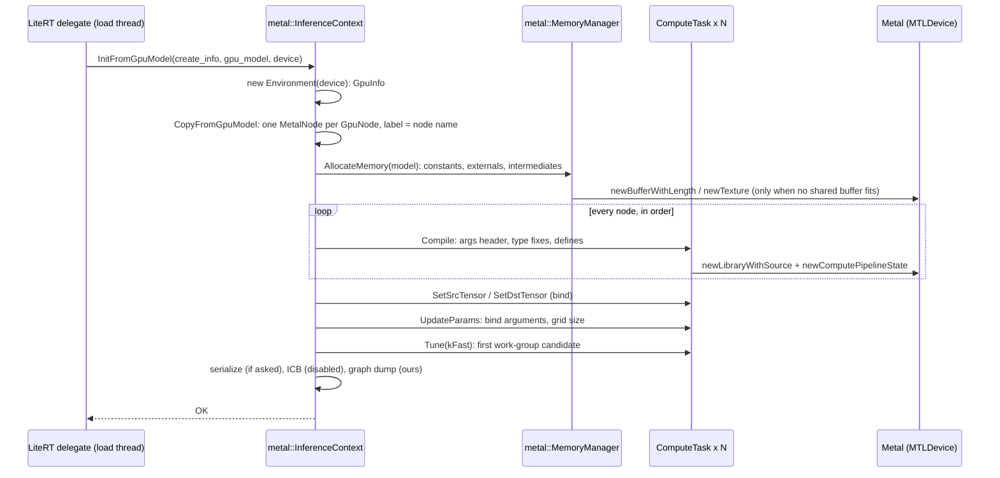

# ML Drift Metal backend

> **Scope:** how ML Drift turns a `GpuModel` into Metal work and runs it: `metal::Environment`,
> `InferenceContext` (initialization, memory, compilation, tuning, serialization), `ComputeTask`,
> runtime MSL compilation, argument binding and argument buffers, encoding into command buffers,
> indirect command buffers, residency sets, and our telemetry and graph-dump hooks.
> **Out of scope:** how the `GpuModel` is built and which kernels it contains
> ([architecture.md](architecture.md), [kernels.md](kernels.md)); when LiteRT calls `Dispatch`, waits,
> copies buffers and uses the program and weight caches ([../litert/ml-drift-delegate.md](../litert/ml-drift-delegate.md));
> the telemetry library and its tools ([../tools.md](../tools.md)).
> **Pinned to:** ML Drift `15fa9e2`, LiteRT `362759838`, LiteRT-LM `7b872544`
> **Applies to:** Apple (iOS, macOS). **Last verified:** 2026-10-15

## Summary

ML Drift's Metal backend is a thin, synchronous layer over the classic Metal API
(`MTLCommandQueue`, `MTLCommandBuffer`, `MTLComputeCommandEncoder`). At model load, an
`InferenceContext` allocates every tensor (sharing intermediate buffers between graphs), compiles
one compute pipeline per node from generated Metal Shading Language (MSL) source with
`newLibraryWithSource`, binds tensors, and picks a work-group size per node without measuring
anything. At run time, LiteRT's `Dispatch` calls `EncodeWithCommandQueue`, which re-encodes every
node into command buffers of 256 kernels and commits each as soon as it is full.

What it doesn't do: no binary archives or precompiled shaders (a program cache restore recompiles
the stored source), no indirect command buffers (the code exists but is switched off), no Metal 4
command objects. Residency sets exist but are off by default in LiteRT-LM. Argument buffers, which
LiteRT-LM requests on Apple, change how arguments are bound, not the per-dispatch re-encoding.

Our commits add pipeline labels, debug groups, per-command-buffer and per-kernel GPU timing, and a
JSON dump of each initialized graph ([../generated/patch-log.md](../generated/patch-log.md#ml-drift-powerbeefml-drift-agello-next)).

## Concepts

| Class | Role | Code |
| --- | --- | --- |
| `metal::Environment` (alias `MetalDevice`) | Wraps an `MTLDevice` and its `GpuInfo`; the constructor also calls `xnn_initialize` | [`ml_drift/metal/environment.h:29-49`](https://github.com/google-ai-edge/ml-drift/blob/1b18771f44c0be3d972847b31a80f6dc3d6964b5/ml_drift/metal/environment.h#L29-L49) |
| `metal::InferenceContext` | One compiled graph: its nodes, tensor ids, a `MemoryManager` (owned or shared) and the model id inside it | [`ml_drift/metal/inference_context.h:71-214`](https://github.com/PowerBeef/ml-drift/blob/15fa9e2ba632145992299e3f04786dc1f575373c/ml_drift/metal/inference_context.h#L71-L214) |
| `MetalNode` | A `ComputeTask` with its input and output ids, the node name, optional-node tags, and (ours) a debug label and per-run-kind telemetry span ids | [`ml_drift/metal/inference_context.h:48-68`](https://github.com/PowerBeef/ml-drift/blob/15fa9e2ba632145992299e3f04786dc1f575373c/ml_drift/metal/inference_context.h#L48-L68) |
| `ComputeTask` | One kernel: the `GPUOperation`, its `MTLComputePipelineState`, its `MetalArguments`, and the argument buffer if any | [`ml_drift/metal/compute_task.h:43-135`](https://github.com/PowerBeef/ml-drift/blob/15fa9e2ba632145992299e3f04786dc1f575373c/ml_drift/metal/compute_task.h#L43-L135) |
| `MetalArguments` | Binds a kernel's buffers, textures and scalar values, directly or through an argument buffer | [`ml_drift/metal/metal_arguments.h:35-63`](https://github.com/google-ai-edge/ml-drift/blob/1b18771f44c0be3d972847b31a80f6dc3d6964b5/ml_drift/metal/metal_arguments.h#L35-L63) |
| `metal::MemoryManager` | Allocates constant, intermediate and external tensors for one or more models, keyed by (model id, value id) | [`ml_drift/metal/memory_manager.h:43-132`](https://github.com/google-ai-edge/ml-drift/blob/1b18771f44c0be3d972847b31a80f6dc3d6964b5/ml_drift/metal/memory_manager.h#L43-L132) |
| `MetalSpatialTensor` | A tensor backed by an `MTLBuffer`, an `MTLTexture`, or a texture view over a buffer | [`ml_drift/metal/metal_spatial_tensor.h:33-118`](https://github.com/google-ai-edge/ml-drift/blob/1b18771f44c0be3d972847b31a80f6dc3d6964b5/ml_drift/metal/metal_spatial_tensor.h#L33-L118) |

Who holds what in our build: LiteRT's Metal delegate keeps one `GpuBackendMetal` (one device, one
command queue from the LiteRT environment, one shared `MemoryManager`, one residency set) and one
`InferenceContext` per delegated graph (each signature of the model: prefill, decode, verify, the
MTP drafter, and so on). The delegate side is on [../litert/ml-drift-delegate.md](../litert/ml-drift-delegate.md).

## How it works

### Environment

`Environment(id<MTLDevice>)` stores the device, builds `GpuInfo` from it
([architecture.md](architecture.md#gpu-detection)) and calls `xnn_initialize`.
[`ml_drift/metal/environment.mm:110-117`](https://github.com/google-ai-edge/ml-drift/blob/1b18771f44c0be3d972847b31a80f6dc3d6964b5/ml_drift/metal/environment.mm#L110-L117) It is cheap but not free: it reads the device
name, the MSL version and the device limits each time. `InferenceContext::InitFromGpuModel` has an
overload taking an `id<MTLDevice>`, which constructs a fresh `Environment` for that call; LiteRT's
backend uses that overload. <!-- c:MD-MTL-002 -->
[`ml_drift/metal/inference_context.mm:130-136`](https://github.com/PowerBeef/ml-drift/blob/15fa9e2ba632145992299e3f04786dc1f575373c/ml_drift/metal/inference_context.mm#L130-L136)
[`ml_drift_delegate/delegate/gpu_backend_metal_litert.mm:136-147`](https://github.com/PowerBeef/LiteRT/blob/362759838e34e1525f1cc27daddaf663a193c059/ml_drift_delegate/delegate/gpu_backend_metal_litert.mm#L136-L147)

The MSL version comes from `GetMaxSupportedMTLLanguageVersion`: 2.4 on iOS 15 or later, 3.2 when the
device supports `MTLGPUFamilyMetal3` on iOS 18 or macOS 15 or later, and 4.0 when it supports
`MTLGPUFamily` raw value 5002 (Metal 4) on iOS 26 or macOS 26 or later; the 4.0 test is compiled
only with an SDK of version 26 or newer. <!-- c:MD-MTL-003 -->
[`ml_drift/metal/common.mm:225-272`](https://github.com/PowerBeef/ml-drift/blob/15fa9e2ba632145992299e3f04786dc1f575373c/ml_drift/metal/common.mm#L225-L272) Our builds target iOS 27 and macOS 27, so on a
device that reports Metal 4 support, kernels compile as MSL 4.0, which `ConvAppleMPP` needs.

### Initialization

`InitFromGpuModel` does, in order: <!-- c:MD-MTL-004 -->
[`ml_drift/metal/inference_context.mm:138-203`](https://github.com/PowerBeef/ml-drift/blob/15fa9e2ba632145992299e3f04786dc1f575373c/ml_drift/metal/inference_context.mm#L138-L203)

1. If the caller wants a serialized model, encode the `GpuModel` into a FlatBuffer first.
2. `CopyFromGpuModel`: move each `GpuNode`'s operation into a `MetalNode`, with its inputs, outputs,
   name and optional tags; set the pipeline label from the name (ours) and whether to use argument
   buffers (`create_info.hints.use_metal_argument_buffers`).
   [`ml_drift/metal/inference_context.mm:110-128`](https://github.com/PowerBeef/ml-drift/blob/15fa9e2ba632145992299e3f04786dc1f575373c/ml_drift/metal/inference_context.mm#L110-L128)
3. `MemoryManager::AllocateMemory` for this model ([Memory](#memory)).
4. `GetMutableNodes`: record which nodes read or write each external mutable tensor, so `SetTensor`
   can rebind them later. [`ml_drift/metal/inference_context.mm:823-846`](https://github.com/PowerBeef/ml-drift/blob/15fa9e2ba632145992299e3f04786dc1f575373c/ml_drift/metal/inference_context.mm#L823-L846)
5. `CompileOperations`: compile every node, one after another, on the calling thread.
   [`ml_drift/metal/inference_context.mm:293-298`](https://github.com/PowerBeef/ml-drift/blob/15fa9e2ba632145992299e3f04786dc1f575373c/ml_drift/metal/inference_context.mm#L293-L298)
6. `BindTensorsToOperations`: give each task its source and destination tensors.
   [`ml_drift/metal/inference_context.mm:350-362`](https://github.com/PowerBeef/ml-drift/blob/15fa9e2ba632145992299e3f04786dc1f575373c/ml_drift/metal/inference_context.mm#L350-L362)
7. `UpdateParams`: each operation binds its arguments, then recomputes its grid and work-group count.
   [`ml_drift/metal/compute_task.mm:207-213`](https://github.com/PowerBeef/ml-drift/blob/15fa9e2ba632145992299e3f04786dc1f575373c/ml_drift/metal/compute_task.mm#L207-L213)
8. `Tune(TuningType::kFast)` ([Tuning](#tuning)).
9. Reset the temporary external mutable tensors to null: the caller must bind real ones with
   `SetTensor` before running.
10. Finish serialization (work-group sizes and programs), build the indirect command buffer (never:
    see [Indirect command buffers](#indirect-command-buffers)), and dump the graph if asked (ours).

Every step runs on the thread that called `InitFromGpuModel` (during model load); nothing is
parallel. Compilation is the expensive part: one `ComputeTask::Compile`, so one
`newLibraryWithSource` compilation, per node. Gemma 4 E4B's decode GPU graph (e4b-ours, 8K window,
MTP on) alone has 1726 nodes on the Apple M6, and also with the A17 Pro, M2 and M1 kernel choices
simulated on that M6 (`AGELLO_SIMULATE_APPLE_GPU`)
([../generated/kernels-by-family.md](../generated/kernels-by-family.md)). <!-- c:MD-MTL-005 -->
[`ml_drift/metal/compute_task.mm:143-163`](https://github.com/PowerBeef/ml-drift/blob/15fa9e2ba632145992299e3f04786dc1f575373c/ml_drift/metal/compute_task.mm#L143-L163)

### Compilation

`ComputeTask::Compile` prepares the source and calls `CompileProgram`:
[`ml_drift/metal/compute_task.mm:143-195`](https://github.com/PowerBeef/ml-drift/blob/15fa9e2ba632145992299e3f04786dc1f575373c/ml_drift/metal/compute_task.mm#L143-L195)

1. `MetalArguments::Init` (through `InitArgs`) creates the argument objects, packs scalar
   arguments into a `uniforms_buffer` struct of `float4`/`int4` fields, prepends
   `#include <metal_stdlib>` and the struct definitions, and writes the kernel's parameter list
   (each buffer and texture with its index, plus thread-position attributes the code uses).
   [`ml_drift/metal/metal_arguments.mm:101-161`](https://github.com/google-ai-edge/ml-drift/blob/1b18771f44c0be3d972847b31a80f6dc3d6964b5/ml_drift/metal/metal_arguments.mm#L101-L161)
2. Vector types that MSL reserves but doesn't define at width 8 or 16 (`float16`, `half8`, `int16`
   and so on) are replaced by generated structs.
3. Preprocessor defines map ML Drift's portable spelling to MSL: `MAIN_FUNCTION` becomes
   `kernel void ComputeFunction`, `__local` `threadgroup`, `__global` `device`, `__constant`
   `constant`. Every kernel's entry point is therefore named `ComputeFunction`.
   [`ml_drift/metal/compute_task.mm:61-66`](https://github.com/PowerBeef/ml-drift/blob/15fa9e2ba632145992299e3f04786dc1f575373c/ml_drift/metal/compute_task.mm#L61-L66)
4. `CreateComputeProgram` (or the argument-buffer variant) compiles and makes the pipeline.

`CreateFunction` compiles with `newLibraryWithSource` at run time, with the highest MSL version the
device supports, fast math (`MTLMathModeFast` and fast floating-point functions on iOS 18 and macOS
15 or later, `fastMathEnabled` before), and the defines as preprocessor macros; it then looks up the
function by name. <!-- c:MD-MTL-006 --> [`ml_drift/metal/common.mm:116-165`](https://github.com/PowerBeef/ml-drift/blob/15fa9e2ba632145992299e3f04786dc1f575373c/ml_drift/metal/common.mm#L116-L165)
A compile error returns `InternalError("newLibraryWithSource: …")` with Metal's message, and the
whole graph initialization fails.

**No binary archives.** Neither ML Drift nor LiteRT's `ml_drift_delegate` at the pins uses
`MTLBinaryArchive`, `newLibraryWithData` or any other precompiled form: every pipeline is compiled
from source in the process. <!-- c:MD-MTL-007 --> Whether the operating system's own shader cache
shortens later compilations of the same source is not verified here.

**Pipeline labels (ours: `5aaea039f9`).** When a task has a label, `CreateComputeProgram` builds the
pipeline from an `MTLComputePipelineDescriptor` with that label instead of
`newComputePipelineStateWithFunction`; `CopyFromGpuModel` sets every label to the node's name, so
Instruments and GPU captures show `fc1x1_int4_weights -> mul` instead of `ComputeFunction`.
<!-- c:MD-MTL-008 --> [`ml_drift/metal/common.mm:274-300`](https://github.com/PowerBeef/ml-drift/blob/15fa9e2ba632145992299e3f04786dc1f575373c/ml_drift/metal/common.mm#L274-L300)
[`ml_drift/metal/inference_context.mm:125`](https://github.com/PowerBeef/ml-drift/blob/15fa9e2ba632145992299e3f04786dc1f575373c/ml_drift/metal/inference_context.mm#L125)

### Tuning

Metal's `InitFromGpuModel` always calls `Tune(TuningType::kFast)`, and `ComputeTask::Tune` asks the
operation for its candidate work-group sizes and keeps the first one; it runs nothing and times
nothing. <!-- c:MD-MTL-009 --> [`ml_drift/metal/inference_context.mm:161`](https://github.com/PowerBeef/ml-drift/blob/15fa9e2ba632145992299e3f04786dc1f575373c/ml_drift/metal/inference_context.mm#L161)
[`ml_drift/metal/compute_task.mm:291-304`](https://github.com/PowerBeef/ml-drift/blob/15fa9e2ba632145992299e3f04786dc1f575373c/ml_drift/metal/compute_task.mm#L291-L304) The candidates come from each kernel's
`GetPossibleKernelWorkGroups`, so the choice is a per-kernel heuristic. The delegate's
`kFastTuning` hint and LiteRT's `enable_fast_tuning` option therefore change nothing on Metal.
(OpenCL can tune by measurement: [../other-platforms.md](../other-platforms.md).)

`ComputeTask::GetTaskTime` (a timed loop of repeated dispatches) exists for `Profile` and the
performance utilities, not for tuning. [`ml_drift/metal/compute_task.mm:311-351`](https://github.com/PowerBeef/ml-drift/blob/15fa9e2ba632145992299e3f04786dc1f575373c/ml_drift/metal/compute_task.mm#L311-L351)

### Memory

`MemoryManager::AllocateMemory` gives the model a new id and allocates, in order: external tensors,
constant tensors, buffer-backed intermediates, texture intermediates.
[`ml_drift/metal/memory_manager.mm:138-153`](https://github.com/google-ai-edge/ml-drift/blob/1b18771f44c0be3d972847b31a80f6dc3d6964b5/ml_drift/metal/memory_manager.mm#L138-L153)

- **External tensors.** Immutable ones are the caller's `MetalSpatialTensor`s, stored by pointer.
  For mutable ones the manager creates a temporary tensor per distinct descriptor (the caller
  resets them to null and binds real ones later). [`ml_drift/metal/memory_manager.mm:227-257`](https://github.com/google-ai-edge/ml-drift/blob/1b18771f44c0be3d972847b31a80f6dc3d6964b5/ml_drift/metal/memory_manager.mm#L227-L257)
- **Constants.** One `MetalSpatialTensor` per constant descriptor, created with its data.
  [`ml_drift/metal/memory_manager.mm:259-267`](https://github.com/google-ai-edge/ml-drift/blob/1b18771f44c0be3d972847b31a80f6dc3d6964b5/ml_drift/metal/memory_manager.mm#L259-L267)
- **Usage intervals.** For each runtime tensor, the first and last node index that touches it
  (inputs at 0, outputs at the end). [`ml_drift/metal/memory_manager.mm:187-225`](https://github.com/google-ai-edge/ml-drift/blob/1b18771f44c0be3d972847b31a80f6dc3d6964b5/ml_drift/metal/memory_manager.mm#L187-L225)
- **Buffer-backed intermediates.** `kBuffer` and `kImageBuffer` tensors, and also `kTexture2D` and
  `kSingleTexture2D` on every Apple family except Apple1, live in buffers.
  [`ml_drift/metal/memory_manager.mm:51-60`](https://github.com/google-ai-edge/ml-drift/blob/1b18771f44c0be3d972847b31a80f6dc3d6964b5/ml_drift/metal/memory_manager.mm#L51-L60) The manager computes two plans: separate
  shared objects (`kGreedyBest`) and offsets in one block (`kGreedyBySize`). It uses the single block
  when its total is no larger than the shared-objects total, at most 128 MiB (the code says "128 MB")
  and within the device's maximum buffer size; otherwise one buffer per shared object.
  <!-- c:MD-MTL-012 --> [`ml_drift/metal/memory_manager.mm:46-48`](https://github.com/google-ai-edge/ml-drift/blob/1b18771f44c0be3d972847b31a80f6dc3d6964b5/ml_drift/metal/memory_manager.mm#L46-L48)
  [`ml_drift/metal/memory_manager.mm:320-333`](https://github.com/google-ai-edge/ml-drift/blob/1b18771f44c0be3d972847b31a80f6dc3d6964b5/ml_drift/metal/memory_manager.mm#L320-L333) The code's comment gives the reason for
  the cap: one large block defeats memory compression of unused or zero-filled buffers.
- **Reuse across models.** Before allocating, the manager looks through the buffers it already owns
  (from earlier models) and takes the smallest one that fits; it allocates only when none does, and
  keeps every buffer until the manager is destroyed. <!-- c:MD-MTL-013 -->
  [`ml_drift/metal/memory_manager.mm:336-367`](https://github.com/google-ai-edge/ml-drift/blob/1b18771f44c0be3d972847b31a80f6dc3d6964b5/ml_drift/metal/memory_manager.mm#L336-L367) LiteRT's Metal backend passes its shared
  manager to every inference context it creates when allowed, and always to restored ones, so the
  prefill, decode and verify graphs share intermediate memory.
  [`ml_drift_delegate/delegate/gpu_backend_metal_litert.mm:136-157`](https://github.com/PowerBeef/LiteRT/blob/362759838e34e1525f1cc27daddaf663a193c059/ml_drift_delegate/delegate/gpu_backend_metal_litert.mm#L136-L157)
- **Texture intermediates** (none in our build, where 2D textures are buffer-backed) are assigned with the `kEquality` strategy:
  only tensors with the same descriptor and shape share a texture.
  [`ml_drift/metal/memory_manager.mm:406-431`](https://github.com/google-ai-edge/ml-drift/blob/1b18771f44c0be3d972847b31a80f6dc3d6964b5/ml_drift/metal/memory_manager.mm#L406-L431)

Alignment: offsets in the single block are aligned to a constant that is 16 when `TARGET_IOS` or
`TARGET_TVOS` is defined and 256 otherwise, combined with the linear-texture row alignment the
device reports. No build file in LiteRT-LM, LiteRT or ML Drift at the pins defines `TARGET_IOS`
(Apple's own macros are `TARGET_OS_IOS`), so our iOS build uses 256. <!-- c:MD-MTL-014 -->
[`ml_drift/metal/memory_manager.mm:282-305`](https://github.com/google-ai-edge/ml-drift/blob/1b18771f44c0be3d972847b31a80f6dc3d6964b5/ml_drift/metal/memory_manager.mm#L282-L305)

Storage modes on unified memory: every `MTLBuffer` ML Drift creates is
`MTLResourceStorageModeShared`; standalone textures are `MTLStorageModePrivate`; texture views
over buffers inherit the buffer's mode. <!-- c:MD-MTL-015 -->
[`ml_drift/metal/buffer.mm:65-95`](https://github.com/google-ai-edge/ml-drift/blob/1b18771f44c0be3d972847b31a80f6dc3d6964b5/ml_drift/metal/buffer.mm#L65-L95)
[`ml_drift/metal/metal_spatial_tensor.mm:72-110`](https://github.com/google-ai-edge/ml-drift/blob/1b18771f44c0be3d972847b31a80f6dc3d6964b5/ml_drift/metal/metal_spatial_tensor.mm#L72-L110) With `kBuffer` storage (Apple3 and
newer), intermediate tensors live in shared buffers that the CPU can read without a copy (constants
with fewer than 4 channels can still be private textures); how LiteRT uses shared buffers is on
[../litert/runtime.md](../litert/runtime.md).

`GetIntermediateTensorsSize` adds up the shared buffers and textures the manager owns, and
`GetConstantTensorsSize` the constants. [`ml_drift/metal/memory_manager.mm:465-483`](https://github.com/google-ai-edge/ml-drift/blob/1b18771f44c0be3d972847b31a80f6dc3d6964b5/ml_drift/metal/memory_manager.mm#L465-L483)
Where these appear in Agello's memory accounting: [../memory.md](../memory.md).

### Argument binding

Two modes, chosen per context by `create_info.hints.use_metal_argument_buffers`:

| | Direct | Argument buffers (requested by LiteRT-LM on Apple) |
| --- | --- | --- |
| Kernel signature | One parameter per buffer and texture, then the uniforms struct | `device ArgBuffer& args [[buffer(0)]]` |
| Per encode | `setBuffer`/`setTexture` for every resource, `setBytes` for the scalars | `useResource` (read and write) for every resource, then `setBuffer` of the task's argument buffer at index 0 |
| Scalars | Copied into the command stream on every encode | Written into the argument buffer when `UpdateArgumentBuffer` runs |
| Extra memory | none | One `MTLBuffer` of `encodedLength` per task |

[`ml_drift/metal/metal_arguments.mm:404-488`](https://github.com/google-ai-edge/ml-drift/blob/1b18771f44c0be3d972847b31a80f6dc3d6964b5/ml_drift/metal/metal_arguments.mm#L404-L488)
[`ml_drift/metal/compute_task.mm:176-186`](https://github.com/PowerBeef/ml-drift/blob/15fa9e2ba632145992299e3f04786dc1f575373c/ml_drift/metal/compute_task.mm#L176-L186)
[`ml_drift/metal/compute_task.mm:236-259`](https://github.com/PowerBeef/ml-drift/blob/15fa9e2ba632145992299e3f04786dc1f575373c/ml_drift/metal/compute_task.mm#L236-L259)

LiteRT-LM requests argument buffers on Apple.
[`runtime/executor/litert_compiled_model_executor_utils.cc:1032-1034`](https://github.com/google-ai-edge/LiteRT-LM/blob/df6df5b84d5845b49889f631ed4cac80b4325dd3/runtime/executor/litert_compiled_model_executor_utils.cc#L1032-L1034)
Which devices end up with them is under [Open questions](#open-questions).

### Encoding and command buffers

`ComputeTask::Encode` sets the pipeline, binds the arguments, and calls
`dispatchThreadgroups:threadsPerThreadgroup:` with the operation's work-group count and size.
[`ml_drift/metal/compute_task.mm:243-259`](https://github.com/PowerBeef/ml-drift/blob/15fa9e2ba632145992299e3f04786dc1f575373c/ml_drift/metal/compute_task.mm#L243-L259) `InferenceContext` offers three ways to
encode the whole graph; all skip nodes whose optional tags aren't enabled:

| Method | Encoders | Command buffers | Commits |
| --- | --- | --- | --- |
| `EncodeWithEncoder(encoder)` | the caller's one encoder for all nodes | caller's | no |
| `EncodeWithCommandBuffer(cb, tasks_per_encoder = 1)` | one encoder per `tasks_per_encoder` nodes (one per kernel at telemetry level 4) | caller's one | no |
| `EncodeWithCommandQueue(queue, flush_period)` | one per command buffer below telemetry level 4; one per kernel at level 4 (`EncodeTimed`, ours) | `DivideRoundUp(nodes, flush_period)` new ones | each, as soon as it's encoded |

The default telemetry level is 1, so the level-4 layout appears only when it is asked for.
<!-- c:MD-MTL-019 -->
[`agello/telemetry/agello/agello_telemetry.cc:52-56`](https://github.com/PowerBeef/agello-litert-lm/blob/7b872544fdbd81308f98b1e2acf8c5798a549df6/agello/telemetry/agello/agello_telemetry.cc#L52-L56)
[`ml_drift/metal/inference_context.mm:378-388`](https://github.com/PowerBeef/ml-drift/blob/15fa9e2ba632145992299e3f04786dc1f575373c/ml_drift/metal/inference_context.mm#L378-L388)
[`ml_drift/metal/inference_context.mm:735-802`](https://github.com/PowerBeef/ml-drift/blob/15fa9e2ba632145992299e3f04786dc1f575373c/ml_drift/metal/inference_context.mm#L735-L802)

LiteRT's `GpuInferenceContextMetal::Dispatch` picks by wait type. For every wait type except
`DoNotWait` it commits the command buffer left from the previous step, calls
`EncodeWithCommandQueue` with a flush period of 256, and then opens a new command buffer for output
conversion and the wait; with `DoNotWait` it encodes the whole graph into one command buffer with
`EncodeWithCommandBuffer` (one encoder per kernel) and leaves the commit to the caller.
<!-- c:MD-MTL-020 --> [`ml_drift_delegate/delegate/gpu_backend_metal.mm:506-534`](https://github.com/PowerBeef/LiteRT/blob/362759838e34e1525f1cc27daddaf663a193c059/ml_drift_delegate/delegate/gpu_backend_metal.mm#L506-L534)
[`ml_drift_delegate/delegate/gpu_backend_metal.mm:53`](https://github.com/PowerBeef/LiteRT/blob/362759838e34e1525f1cc27daddaf663a193c059/ml_drift_delegate/delegate/gpu_backend_metal.mm#L53) Our LiteRT commit makes the
passive wait use the same command-queue path, so the GPU starts while the CPU is still encoding;
the details and the wait types are on [../litert/ml-drift-delegate.md](../litert/ml-drift-delegate.md).

So one decode step of Gemma 4 E4B (1726 nodes) is 7 command buffers of at most 256 kernels, each
with one compute encoder below telemetry level 4; a `prefill_1024` run on the M6 (1634 nodes) is also 7, and an MTP drafter
step (162 nodes) is 1. <!-- c:MD-MTL-021 -->

What a dispatch costs on the CPU: every kernel is encoded again every time, because nothing is
recorded for reuse (the indirect command buffer path is disabled). `ComputeTask::Encode` sets the
pipeline state, then either binds each buffer, texture and constant (without argument buffers) or
calls `useResource` on each resource and binds the argument buffer encoded at `UpdateParams` (with
argument buffers, which LiteRT-LM requests on Apple), and dispatches. <!-- c:MD-MTL-022 -->
[`ml_drift/metal/compute_task.mm:206-212`](https://github.com/PowerBeef/ml-drift/blob/15fa9e2ba632145992299e3f04786dc1f575373c/ml_drift/metal/compute_task.mm#L206-L212)
[`runtime/executor/litert_compiled_model_executor_utils.cc:1032-1034`](https://github.com/google-ai-edge/LiteRT-LM/blob/df6df5b84d5845b49889f631ed4cac80b4325dd3/runtime/executor/litert_compiled_model_executor_utils.cc#L1032-L1034) Encoding runs on the thread that calls the compiled model's run (which
LiteRT-LM thread that is: [../stack.md](../stack.md)), inside an `@autoreleasepool`. Encoders are
created with plain `computeCommandEncoder`, without asking for a concurrent dispatch type.

### Indirect command buffers

The code for indirect command buffers is there: `CreateComputeProgramWithICBSupport` (pipelines
with `supportIndirectCommandBuffers`), `ComputeTask::EncodeToICB`, `InferenceContext::EncodeWithICB`
and a block in `InitFromGpuModel` that records every node into an `MTLIndirectCommandBuffer`.
[`ml_drift/metal/common.mm:334-367`](https://github.com/PowerBeef/ml-drift/blob/15fa9e2ba632145992299e3f04786dc1f575373c/ml_drift/metal/common.mm#L334-L367) [`ml_drift/metal/compute_task.mm:215-234`](https://github.com/PowerBeef/ml-drift/blob/15fa9e2ba632145992299e3f04786dc1f575373c/ml_drift/metal/compute_task.mm#L215-L234)
But the block is guarded by `bool add_icb_support = false && …`, so it never runs, `icb_` stays
null, and `EncodeWithICB` would execute a null buffer if anyone called it. The guard is upstream
(Google's `1b18771` has the same line), not ours. <!-- c:MD-MTL-023 -->
[`ml_drift/metal/inference_context.mm:175-200`](https://github.com/PowerBeef/ml-drift/blob/15fa9e2ba632145992299e3f04786dc1f575373c/ml_drift/metal/inference_context.mm#L175-L200)
`ComputeTask::need_icb_support_` starts false and is only ever copied or swapped, so compilation
never takes the ICB pipeline path either. [`ml_drift/metal/compute_task.mm:81-102`](https://github.com/PowerBeef/ml-drift/blob/15fa9e2ba632145992299e3f04786dc1f575373c/ml_drift/metal/compute_task.mm#L81-L102)
[`ml_drift/metal/compute_task.mm:165-176`](https://github.com/PowerBeef/ml-drift/blob/15fa9e2ba632145992299e3f04786dc1f575373c/ml_drift/metal/compute_task.mm#L165-L176) The recorded commands would also need
argument buffers (each command binds the task's argument buffer at index 0).

### Serialization (the program cache's payload)

With a `serialized_model` pointer, `InitFromGpuModel` writes an `InferenceContext` FlatBuffer: the
`GpuModel` (nodes with their operations, tensor descriptors, ids), the tuned work-group size of
every node, and for every node a `MetalProgram`: the final MSL source and the define names and
values. It holds no compiled code. <!-- c:MD-MTL-024 -->
[`ml_drift/metal/inference_context.fbs:19-34`](https://github.com/google-ai-edge/ml-drift/blob/1b18771f44c0be3d972847b31a80f6dc3d6964b5/ml_drift/metal/inference_context.fbs#L19-L34)
[`ml_drift/metal/inference_context.mm:249-274`](https://github.com/PowerBeef/ml-drift/blob/15fa9e2ba632145992299e3f04786dc1f575373c/ml_drift/metal/inference_context.mm#L249-L274)

`RestoreDeserialized` verifies the buffer (failing with `DataLossError("Deserialization failed.")`),
decodes the `GpuModel`, allocates memory through the (shared) manager, and for every node compiles
the stored source again (`ComputeTask::Init` → `CompileProgram`) and sets the stored work-group
size; then it restores the arguments, binds tensors and updates parameters. It doesn't tune.
<!-- c:MD-MTL-025 --> [`ml_drift/metal/inference_context.mm:205-247`](https://github.com/PowerBeef/ml-drift/blob/15fa9e2ba632145992299e3f04786dc1f575373c/ml_drift/metal/inference_context.mm#L205-L247)
[`ml_drift/metal/inference_context.mm:276-291`](https://github.com/PowerBeef/ml-drift/blob/15fa9e2ba632145992299e3f04786dc1f575373c/ml_drift/metal/inference_context.mm#L276-L291)

So a program-cache hit on Metal saves the TFLite parsing, the transformations, the selectors, code
generation and tuning, but not the Metal compilation, which happens either way. The cache's files,
keys and LiteRT's checks of a restored context are on [../litert/ml-drift-delegate.md](../litert/ml-drift-delegate.md).

Optional-node tags are not part of the serialized `GpuNode`, so a restored context has none; LiteRT
doesn't create optional nodes, so this doesn't matter for us. [`ml_drift/common/gpu_model.fbs:29-35`](https://github.com/google-ai-edge/ml-drift/blob/1b18771f44c0be3d972847b31a80f6dc3d6964b5/ml_drift/common/gpu_model.fbs#L29-L35)

### Residency sets

ML Drift's `MemoryManager` (and `InferenceContext`, forwarding) can add four groups of allocations
to an `MTLResidencySet` (iOS 18 and macOS 15 or later): constants; intermediates (shared buffers
and textures); external immutable tensors; external mutable tensors. It only adds them; creating,
committing and requesting residency is the caller's job. [`ml_drift/metal/memory_manager.mm:494-558`](https://github.com/google-ai-edge/ml-drift/blob/1b18771f44c0be3d972847b31a80f6dc3d6964b5/ml_drift/metal/memory_manager.mm#L494-L558)

LiteRT's `GpuBackendMetal`, built with LiteRT's command queue and the residency option: <!-- c:MD-MTL-027 -->

1. On iOS 18 and macOS 15 or later, always creates a residency set labelled
   "LiteRT Model Residency Set". [`ml_drift_delegate/delegate/gpu_backend_metal.mm:107-121`](https://github.com/PowerBeef/LiteRT/blob/362759838e34e1525f1cc27daddaf663a193c059/ml_drift_delegate/delegate/gpu_backend_metal.mm#L107-L121)
2. Attaches it to the command queue, calls `requestResidency` and starts a heartbeat thread that
   requests residency again every 100 ms, only when the option is on.
   [`ml_drift_delegate/delegate/gpu_backend_metal.mm:69-92`](https://github.com/PowerBeef/LiteRT/blob/362759838e34e1525f1cc27daddaf663a193c059/ml_drift_delegate/delegate/gpu_backend_metal.mm#L69-L92)
   [`ml_drift_delegate/delegate/gpu_backend_metal.mm:683-704`](https://github.com/PowerBeef/LiteRT/blob/362759838e34e1525f1cc27daddaf663a193c059/ml_drift_delegate/delegate/gpu_backend_metal.mm#L683-L704)
3. After creating or restoring each inference context, adds that context's constants and the
   external immutable tensors from `create_info`, and commits the set (requesting residency only
   when enabled). [`ml_drift_delegate/delegate/gpu_backend_metal.mm:653-679`](https://github.com/PowerBeef/LiteRT/blob/362759838e34e1525f1cc27daddaf663a193c059/ml_drift_delegate/delegate/gpu_backend_metal.mm#L653-L679)
4. When a tensor is bound later (`BindSpatialTensor`), adds its buffer and texture and commits.
   [`ml_drift_delegate/delegate/gpu_backend_metal.mm:464-491`](https://github.com/PowerBeef/LiteRT/blob/362759838e34e1525f1cc27daddaf663a193c059/ml_drift_delegate/delegate/gpu_backend_metal.mm#L464-L491)

Intermediates are never added: the delegate doesn't call `AddIntermediatesToResidencySet`.
<!-- c:MD-MTL-028 --> LiteRT-LM's `AdvancedSettings::gpu_enable_metal_residency_set` defaults to
false, and LiteRT-LM passes it to the GPU options on Apple. <!-- c:MD-MTL-029 -->
[`runtime/executor/llm_executor_settings.h:212-214`](https://github.com/google-ai-edge/LiteRT-LM/blob/df6df5b84d5845b49889f631ed4cac80b4325dd3/runtime/executor/llm_executor_settings.h#L212-L214)
[`runtime/executor/llm_executor_settings_utils.cc:97-100`](https://github.com/PowerBeef/agello-litert-lm/blob/7b872544fdbd81308f98b1e2acf8c5798a549df6/runtime/executor/llm_executor_settings_utils.cc#L97-L100)

### Profiling (upstream)

`InferenceContext::Profile` fills per-node FLOPs, read and write sizes, shapes and work-group sizes,
then times each kernel in a separate replay: with stage-boundary timestamps when the device has a
timestamp counter set, otherwise with `GetTaskTime`'s repeated dispatches, per kernel, on a new
queue. [`ml_drift/metal/inference_context.mm:407-465`](https://github.com/PowerBeef/ml-drift/blob/15fa9e2ba632145992299e3f04786dc1f575373c/ml_drift/metal/inference_context.mm#L407-L465)
LiteRT's Metal backend reaches it through `GpuInferenceContextMetal::Profile`, which the delegate
kernel calls only when a TFLite profiler is active or `enable_op_profiling_detailed_report` is set.
[`ml_drift_delegate/delegate/gpu_backend_metal.mm:573-574`](https://github.com/PowerBeef/LiteRT/blob/362759838e34e1525f1cc27daddaf663a193c059/ml_drift_delegate/delegate/gpu_backend_metal.mm#L573-L574)
[`ml_drift_delegate/delegate/delegate_kernel.cc:143-147`](https://github.com/PowerBeef/LiteRT/blob/362759838e34e1525f1cc27daddaf663a193c059/ml_drift_delegate/delegate/delegate_kernel.cc#L143-L147)
[`ml_drift_delegate/delegate/delegate_kernel.cc:389-392`](https://github.com/PowerBeef/LiteRT/blob/362759838e34e1525f1cc27daddaf663a193c059/ml_drift_delegate/delegate/delegate_kernel.cc#L389-L392)
Our per-kernel timing below measures the real runs instead.

### Our telemetry hooks

All in `inference_context.mm` (ours), driven by the Agello telemetry level, which the
`AGELLO_TELEMETRY` environment variable sets when the library loads (levels 0 off, 1 counters, 2
spans, 3 trace, 4 deep). [`agello/telemetry/agello/agello_telemetry.h:18-36`](https://github.com/PowerBeef/agello-litert-lm/blob/7b872544fdbd81308f98b1e2acf8c5798a549df6/agello/telemetry/agello/agello_telemetry.h#L18-L36) The
Metal `inference_context` target depends on `@agello_telemetry`, which ML Drift's own `MODULE.bazel`
doesn't declare; LiteRT-LM's `WORKSPACE` declares it as a `local_repository`
(`agello/telemetry`). So the fork's Metal inference context, and everything that depends on it,
builds only inside LiteRT-LM's workspace (or one that declares that repository). <!-- c:MD-MTL-031 --> [`ml_drift/metal/BUILD:157-166`](https://github.com/PowerBeef/ml-drift/blob/15fa9e2ba632145992299e3f04786dc1f575373c/ml_drift/metal/BUILD#L157-L166)
[`WORKSPACE:510-515`](https://github.com/PowerBeef/agello-litert-lm/blob/7b872544fdbd81308f98b1e2acf8c5798a549df6/WORKSPACE#L510-L515)

| Hook | When | What it does | Commit |
| --- | --- | --- | --- |
| Pipeline labels | always | Node name on every pipeline | `5aaea039f9` |
| Debug groups | level ≥ 3 | `pushDebugGroup(name)`/`popDebugGroup` around each kernel | `5aaea039f9` |
| Command-buffer timing | level ≥ 1 | `AttachGpuTiming` on each command buffer `EncodeWithCommandQueue` commits | `04fe7b712c` |
| Per-kernel timing | level 4 | `EncodeTimed`: one encoder per kernel with stage-boundary timestamps | `5aaea039f9` |
| Graph dump | `AGELLO_TELEMETRY_GRAPH_DIR` set (any level) | One JSON file per initialized graph | `55196d78cf` |

<!-- c:MD-MTL-032 -->

**Command-buffer timing.** `AttachGpuTiming` counts the command buffer at level 1 and up and, from
level 2, adds a completion handler that records the buffer's GPU time against the model run in
flight (prefill, decode, verify, drafter) and its queue delay, and reports command-buffer errors as
anomalies. [`agello/telemetry/agello/agello_telemetry_metal.mm:21-36`](https://github.com/PowerBeef/agello-litert-lm/blob/7b872544fdbd81308f98b1e2acf8c5798a549df6/agello/telemetry/agello/agello_telemetry_metal.mm#L21-L36)
`EncodeWithCommandQueue` calls it before each commit; `EncodeWithCommandBuffer` doesn't, because it
doesn't commit (LiteRT's `Dispatch` attaches it to the buffers it commits).
[`ml_drift/metal/inference_context.mm:767-802`](https://github.com/PowerBeef/ml-drift/blob/15fa9e2ba632145992299e3f04786dc1f575373c/ml_drift/metal/inference_context.mm#L767-L802)

**Per-kernel timing (level 4).** `EncodeTimed` replaces the normal encoding: one compute encoder
per kernel, each with a sample-buffer attachment taking timestamps at the start and end of the
encoder (when the device supports stage-boundary counter sampling), and a completion handler that
converts GPU ticks to nanoseconds and records them in a span named
`gpu.k.<run>:<kernel>`, where `<run>` is prefill, decode, verify, drafter or other and `<kernel>` is
the node name with any fused tail replaced by `+fused`. One encoder per kernel adds encoder
boundaries, so level 4 changes timing and is for diagnosis only. <!-- c:MD-MTL-033 -->
[`ml_drift/metal/inference_context.mm:681-733`](https://github.com/PowerBeef/ml-drift/blob/15fa9e2ba632145992299e3f04786dc1f575373c/ml_drift/metal/inference_context.mm#L681-L733)
[`ml_drift/metal/inference_context.mm:586-591`](https://github.com/PowerBeef/ml-drift/blob/15fa9e2ba632145992299e3f04786dc1f575373c/ml_drift/metal/inference_context.mm#L586-L591) The tick scale is measured once per
process by sampling CPU and GPU timestamps 5 ms apart. [`ml_drift/metal/inference_context.mm:610-625`](https://github.com/PowerBeef/ml-drift/blob/15fa9e2ba632145992299e3f04786dc1f575373c/ml_drift/metal/inference_context.mm#L610-L625)

**Graph dump.** When `AGELLO_TELEMETRY_GRAPH_DIR` is set and not empty, the end of
`InitFromGpuModel` and of `RestoreDeserialized` writes `gpu-graph-<n>-<nodes>-nodes.json` in that
directory (`<n>` is a per-process sequence number): `origin` (`built` or `restored`), and per node
its index, name, work-group size, FLOP count, and input and output shapes in BHWDC order. It
depends only on the variable, not on the telemetry level; a file that can't be opened is skipped
silently. <!-- c:MD-MTL-034 --> [`ml_drift/metal/inference_context.mm:637-674`](https://github.com/PowerBeef/ml-drift/blob/15fa9e2ba632145992299e3f04786dc1f575373c/ml_drift/metal/inference_context.mm#L637-L674)
These dumps are what [../generated/kernels-by-family.md](../generated/kernels-by-family.md) counts.

## On Apple

- **Classic Metal API only.** Command queues, command buffers and compute encoders are the Metal
  2/3 objects; there is no `MTL4CommandQueue`, `MTL4ArgumentTable` or `MTLTensor` in ML Drift or in
  LiteRT's delegate. Metal 4 appears only inside generated MSL: `ConvAppleMPP` includes
  MetalPerformancePrimitives and uses its `tensor_ops::matmul2d`, which is why it needs MSL 4.0.
  <!-- c:MD-MTL-035 --> [`ml_drift/common/kernels/conv_apple_mpp.cc:142`](https://github.com/PowerBeef/ml-drift/blob/15fa9e2ba632145992299e3f04786dc1f575373c/ml_drift/common/kernels/conv_apple_mpp.cc#L142)
- **The command queue is LiteRT's.** The Metal delegate takes it from the LiteRT environment
  option `kLiteRtEnvOptionTagMetalCommandQueue`; all graphs of an engine share it.
  [`ml_drift_delegate/delegate/delegate_metal.mm:358-367`](https://github.com/google-ai-edge/LiteRT/blob/ca21dc99de51c76bdcc572afeea1dd937d3c9e5c/ml_drift_delegate/delegate/delegate_metal.mm#L358-L367)
- **Unified memory.** Shared storage mode for every buffer means no staging copies between CPU and
  GPU memory; the CPU and the GPU must still be ordered by waits or events (LiteRT's job).
- **Not the simulator.** The Metal path has simulator-specific branches (no image buffers there),
  but Agello never runs in the simulator: there is no Metal path for LiteRT-LM in it.
  [`ml_drift/common/gpu_info.cc:1594-1608`](https://github.com/PowerBeef/ml-drift/blob/15fa9e2ba632145992299e3f04786dc1f575373c/ml_drift/common/gpu_info.cc#L1594-L1608)
- **Shipped vs documented.** Everything marked "ours" here is absent from Google's prebuilt v0.18.0
  binary that Agello ships ([architecture.md](architecture.md#on-apple)).

## Settings

| Setting | Layer | Default | Effect |
| --- | --- | --- | --- |
| `use_metal_argument_buffers` | LiteRT GPU option → `ModelHints` | set by LiteRT-LM on Apple | Argument-buffer binding |
| `gpu_enable_metal_residency_set` | LiteRT-LM `AdvancedSettings` → LiteRT GPU option | false | Residency set attached and requested |
| GPU wait type | LiteRT GPU option | (delegate default: active) | Which `Encode…` path `Dispatch` uses |
| `AGELLO_TELEMETRY` (ours) | environment variable | 0 | Debug groups at 3, per-kernel timing at 4, command-buffer timing at 1–2 |
| `AGELLO_TELEMETRY_GRAPH_DIR` (ours) | environment variable | unset | Graph dumps |

Rows with their citations are proposed for [../configuration.md](../configuration.md).

## Limits and failure modes

- **Cold start is compile-bound and serial.** One `newLibraryWithSource` per node on one thread,
  for every graph, on every load, cache or not.
- **Compile errors** fail the whole graph (`newLibraryWithSource: …`, `newFunctionWithName: …`,
  `newComputePipelineStateWithFunction error: …`).
- **Memory grows, never shrinks.** The shared manager keeps every buffer it allocated until the
  backend is destroyed; a later, larger graph adds buffers rather than resizing.
- **A full restore can't detect stale shapes by itself.** `RestoreDeserialized` trusts the stored
  `GpuModel`; LiteRT adds checks ([../litert/ml-drift-delegate.md](../litert/ml-drift-delegate.md)).
- **Timestamps need hardware support.** Without stage-boundary sampling, level 4 still splits
  encoders but records no kernel times.
- **Latent move bug (upstream and ours).** `ComputeTask`'s move constructor copies the operation,
  pipeline, arguments and argument-buffer state but not `defines_` (upstream) or `label_` (ours). The
  current code never moves a compiled task (nodes are created in place before compiling), so
  nothing is lost today. [`ml_drift/metal/compute_task.mm:81-92`](https://github.com/PowerBeef/ml-drift/blob/15fa9e2ba632145992299e3f04786dc1f575373c/ml_drift/metal/compute_task.mm#L81-L92)
- **BF16 in the simulator.** `CreateGpuInfoFromMetalDevice` registers the BF16 simdgroup matrix
  operation before it sets `is_simulator`, so the simulator check in `IsNativeBfloatSupported` has
  no effect there. [`ml_drift/metal/environment.mm:93-104`](https://github.com/google-ai-edge/ml-drift/blob/1b18771f44c0be3d972847b31a80f6dc3d6964b5/ml_drift/metal/environment.mm#L93-L104)

## Where in the code

| Concept | Symbol | Code |
| --- | --- | --- |
| Device wrapper | `Environment` | [`ml_drift/metal/environment.mm:110-117`](https://github.com/google-ai-edge/ml-drift/blob/1b18771f44c0be3d972847b31a80f6dc3d6964b5/ml_drift/metal/environment.mm#L110-L117) |
| MSL version | `GetMaxSupportedMTLLanguageVersion` | [`ml_drift/metal/common.mm:225-272`](https://github.com/PowerBeef/ml-drift/blob/15fa9e2ba632145992299e3f04786dc1f575373c/ml_drift/metal/common.mm#L225-L272) |
| Runtime compile | `CreateFunction` | [`ml_drift/metal/common.mm:116-165`](https://github.com/PowerBeef/ml-drift/blob/15fa9e2ba632145992299e3f04786dc1f575373c/ml_drift/metal/common.mm#L116-L165) |
| Pipeline | `CreateComputeProgram` | [`ml_drift/metal/common.mm:274-300`](https://github.com/PowerBeef/ml-drift/blob/15fa9e2ba632145992299e3f04786dc1f575373c/ml_drift/metal/common.mm#L274-L300) |
| Graph init | `InferenceContext::InitFromGpuModel` | [`ml_drift/metal/inference_context.mm:138-203`](https://github.com/PowerBeef/ml-drift/blob/15fa9e2ba632145992299e3f04786dc1f575373c/ml_drift/metal/inference_context.mm#L138-L203) |
| Restore | `InferenceContext::RestoreDeserialized` | [`ml_drift/metal/inference_context.mm:205-247`](https://github.com/PowerBeef/ml-drift/blob/15fa9e2ba632145992299e3f04786dc1f575373c/ml_drift/metal/inference_context.mm#L205-L247) |
| Serialized form | `MetalProgram`, `InferenceContext` tables | [`ml_drift/metal/inference_context.fbs:19-34`](https://github.com/google-ai-edge/ml-drift/blob/1b18771f44c0be3d972847b31a80f6dc3d6964b5/ml_drift/metal/inference_context.fbs#L19-L34) |
| Kernel compile | `ComputeTask::Compile`, `CompileProgram` | [`ml_drift/metal/compute_task.mm:143-195`](https://github.com/PowerBeef/ml-drift/blob/15fa9e2ba632145992299e3f04786dc1f575373c/ml_drift/metal/compute_task.mm#L143-L195) |
| Kernel dispatch | `ComputeTask::Encode` | [`ml_drift/metal/compute_task.mm:243-259`](https://github.com/PowerBeef/ml-drift/blob/15fa9e2ba632145992299e3f04786dc1f575373c/ml_drift/metal/compute_task.mm#L243-L259) |
| Tuning | `ComputeTask::Tune` | [`ml_drift/metal/compute_task.mm:291-304`](https://github.com/PowerBeef/ml-drift/blob/15fa9e2ba632145992299e3f04786dc1f575373c/ml_drift/metal/compute_task.mm#L291-L304) |
| Argument binding | `MetalArguments::Encode`, `AddResourcesToEncoder` | [`ml_drift/metal/metal_arguments.mm:404-458`](https://github.com/google-ai-edge/ml-drift/blob/1b18771f44c0be3d972847b31a80f6dc3d6964b5/ml_drift/metal/metal_arguments.mm#L404-L458) |
| Allocation | `MemoryManager::AllocateMemory` | [`ml_drift/metal/memory_manager.mm:138-153`](https://github.com/google-ai-edge/ml-drift/blob/1b18771f44c0be3d972847b31a80f6dc3d6964b5/ml_drift/metal/memory_manager.mm#L138-L153) |
| Buffer plan | `MemoryManager::AllocateMemoryForBuffers` | [`ml_drift/metal/memory_manager.mm:269-404`](https://github.com/google-ai-edge/ml-drift/blob/1b18771f44c0be3d972847b31a80f6dc3d6964b5/ml_drift/metal/memory_manager.mm#L269-L404) |
| Encoding | `EncodeWithCommandQueue` | [`ml_drift/metal/inference_context.mm:767-802`](https://github.com/PowerBeef/ml-drift/blob/15fa9e2ba632145992299e3f04786dc1f575373c/ml_drift/metal/inference_context.mm#L767-L802) |
| ICB (disabled) | `add_icb_support` | [`ml_drift/metal/inference_context.mm:175-200`](https://github.com/PowerBeef/ml-drift/blob/15fa9e2ba632145992299e3f04786dc1f575373c/ml_drift/metal/inference_context.mm#L175-L200) |
| Residency (ML Drift) | `MemoryManager::Add…ToResidencySet` | [`ml_drift/metal/memory_manager.mm:494-558`](https://github.com/google-ai-edge/ml-drift/blob/1b18771f44c0be3d972847b31a80f6dc3d6964b5/ml_drift/metal/memory_manager.mm#L494-L558) |
| Residency (LiteRT) | `GpuBackendMetal::PopulateResidencySet` | [`ml_drift_delegate/delegate/gpu_backend_metal.mm:653-679`](https://github.com/PowerBeef/LiteRT/blob/362759838e34e1525f1cc27daddaf663a193c059/ml_drift_delegate/delegate/gpu_backend_metal.mm#L653-L679) |
| Dispatch (LiteRT) | `GpuInferenceContextMetal::Dispatch` | [`ml_drift_delegate/delegate/gpu_backend_metal.mm:506-534`](https://github.com/PowerBeef/LiteRT/blob/362759838e34e1525f1cc27daddaf663a193c059/ml_drift_delegate/delegate/gpu_backend_metal.mm#L506-L534) |
| Per-kernel timing (ours) | `EncodeTimed` | [`ml_drift/metal/inference_context.mm:681-733`](https://github.com/PowerBeef/ml-drift/blob/15fa9e2ba632145992299e3f04786dc1f575373c/ml_drift/metal/inference_context.mm#L681-L733) |
| Graph dump (ours) | `DumpGraphForTelemetry` | [`ml_drift/metal/inference_context.mm:637-674`](https://github.com/PowerBeef/ml-drift/blob/15fa9e2ba632145992299e3f04786dc1f575373c/ml_drift/metal/inference_context.mm#L637-L674) |

## Open questions

- **OS shader cache.** Whether iOS caches `newLibraryWithSource` results across launches, and how
  much of a cold load that saves, is not measured.
- **Load time split.** How much of Agello's model load is MSL compilation versus graph building is
  not measured at the pins (the telemetry has no span around `CompileOperations`).
- **Argument buffers on device (settled).** Every Apple6 or newer GPU (every iPhone Agello supports)
  keeps argument buffers: the delegate drops them only on tier 1 <!-- c:RT-DLG-006 --> <!-- c:APL-052 -->,
  and LiteRT-LM requests them for the decoder and the encoders <!-- c:X-CFG-009 -->.
- **Argument buffers in practice.** Setting a scalar with `ComputeTask::SetInt` after
  `UpdateParams` doesn't call `UpdateArgumentBuffer`, so in argument-buffer mode such a change would
  not reach the kernel until the next bind. Whether anything on our path does this is not tested.
- **Residency sets' effect** on Agello's latency or memory pressure is not measured.
