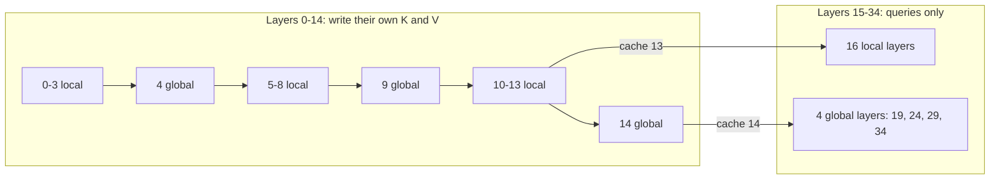

# Gemma 4 E2B (instruction-tuned)

> **Scope:** Gemma 4 E2B-it as trained (`google/gemma-4-E2B-it`), as exported by Google
> (`litert-community/gemma-4-E2B-it-litert-lm`: the regular `.litertlm` file and the `-gpu` "artisan"
> file), how LiteRT-LM treats those files, and what running E2B in Agello would change. This page is
> about E2B and its differences from E4B; the material both models share (per-layer embeddings, the
> attention graph's mechanics, the vision and audio pipelines, the rotary fix) is explained in
> [gemma4-e4b.md](gemma4-e4b.md). **Out of scope:** the family as a whole
> ([gemma4-family.md](gemma4-family.md)), the tokenizer and chat format
> ([tokenizer-and-chat-format.md](tokenizer-and-chat-format.md)), the container format
> ([../litert-lm/file-format.md](../litert-lm/file-format.md)), the executors that run the graphs
> ([../litert-lm/executors.md](../litert-lm/executors.md)), the memory budget ([../memory.md](../memory.md)).
> **Pinned to:** LiteRT-LM `7b872544` (documented build) and `85b1a776` (shipped wrapper, v0.18.0 sources);
> `google/gemma-4-E2B-it` revision `3e22461f`; `litert-community/gemma-4-E2B-it-litert-lm` revision `b3ca0d2f`.
> **Applies to:** all platforms for the model and the file; Apple for the parts about Agello.
> **Last verified:** 2026-10-15

## Summary

- E2B is the smaller of Gemma 4's two on-device ("effective") models: 35 decoder layers 1,536 wide,
  8 query heads over **one** KV head, a 4-local : 1-global attention pattern with a 512-token window,
  and per-layer embeddings (35 × 256 values per token). Layers 15–34 compute no keys or values: they
  read the caches of layers 13 (local) and 14 (global), and their feed-forward blocks are twice as
  wide (12,288).
- Google's file (`gemma-4-E2B-it.litertlm`, 2,588,147,712 bytes) has the same 12 sections and the same
  four main signatures as E4B's, but keeps every weight **inline** in its flatbuffers, stores the 20
  shared layers' feed-forward weights and the output projection in **INT2**, and stores the per-layer
  embedding tables in **INT4** (E4B: INT2), which makes that section larger than E4B's.
- Its KV cache is 15 INT8 caches of one head: **9,216 bytes per position**, 9/28 of E4B's 28,672. At
  an allocated context of 32,000 that is 294,912,000 bytes against E4B's 917,504,000.
- The rotary-position problem of LiteRT-LM issue #3913 affects E2B too, and others have shown that
  our `patch_rope.py --split` applies to Google's E2B file and fixes it (Mac WebGPU, M1 Max and
  M4 Max). Agello doesn't ship E2B; running it would need a patched file, a catalog entry and
  model-specific memory numbers.
- The `-gpu` files hold one closed-format `tf_lite_artisan_text_decoder` section for Google's closed
  GPU artisan executor; our build can't load them and Agello doesn't use them.

## Concepts

### Trained, exported and allocated

Three different things are easy to mix up for E2B, as for E4B:

| Layer | Where it's defined | E2B value |
| --- | --- | --- |
| Trained context | `text_config.max_position_embeddings` in the official config | 131,072 |
| Export window | the `32003` magic number in every context-sized dimension of the file | 32,003 |
| Allocated context | `maxNumTokens`, rewritten into the graph at load | ≤ 32,002 as asked, else 32,000 |
| Filled length | tokens currently in the KV cache | grows per turn |

The official config sets `max_position_embeddings` to 131,072 for E2B, and the model card lists a
128K context for E2B and E4B; Google's LiteRT-LM file exports every context-sized tensor with 32003,
and the litert-community card says the model "can support up to 32k context length". <!-- c:MOD-E2B-034 -->
LiteRT-LM replaces 32003 by `maxNumTokens` when that is smaller, and by 32,000 otherwise (an unset
`maxNumTokens` of 0 is first replaced by a multiple of 4,096)
([`runtime/executor/magic_number_configs_helper.cc:259-271`](https://github.com/google-ai-edge/LiteRT-LM/blob/df6df5b84d5845b49889f631ed4cac80b4325dd3/runtime/executor/magic_number_configs_helper.cc#L259-L271);
[../litert-lm/executors.md](../litert-lm/executors.md#magic-numbers-and-the-allocated-context)).

### Per-layer embeddings

Each decoder layer gets, besides the residual stream, a 256-value embedding of the current token
from its own table, gated and projected into the layer (the "PLE" of the model card). In
Hugging Face's reference code a layer applies `per_layer_input_gate` (1,536 → 256) and
`per_layer_projection` (256 → 1,536), and the model mixes the table lookup with a projection of the
token embedding (`per_layer_model_projection`, 1,536 → 35 × 256). <!-- c:MOD-E2B-005 --> The tables
are large but only looked up, never multiplied, so they run on the CPU in LiteRT-LM and only the rows
of tokens actually seen need to be in memory ([../litert/cpu-xnnpack.md](../litert/cpu-xnnpack.md#memory-on-the-cpu-path)).
The mechanism is the same as E4B's; see [gemma4-e4b.md](gemma4-e4b.md).

### KV sharing

`num_kv_shared_layers = 20` makes the last 20 of the 35 layers (15–34) KV-shared: they compute queries
but no keys or values. In Hugging Face's `modeling_gemma4.py` (transformers v5.17.0), a shared layer
reads the keys and values stored by the last non-shared layer of the same attention type
(`store_full_length_kv`). For E2B the non-shared layers are 0–14, the last sliding one is 13 and the
last full one is 14, so local layers 15–34 read layer 13's cache and global layers 19, 24, 29 and 34
read layer 14's. <!-- c:MOD-E2B-003 --> The exported graph does exactly this (see
[Attention per layer](#attention-per-layer)).

### Double-wide MLP in the shared layers

E2B's config sets `use_double_wide_mlp: true` (E4B: false). In the reference code the flag doubles
the feed-forward width of KV-shared layers only, so layers 0–14 have 6,144 intermediate units and
layers 15–34 have 12,288. <!-- c:MOD-E2B-004 --> The exported file confirms it through its weight
sizes ([Quantization of the main graph](#quantization-of-the-main-graph)).

## How it works

### The model as trained

From `generated/hf/google__gemma-4-E2B-it/config.json` at revision `3e22461f`
([../generated/hf-configs.md](../generated/hf-configs.md)):

| Field (`text_config`) | E2B | E4B | Note |
| --- | --- | --- | --- |
| `num_hidden_layers` | 35 | 42 | |
| `hidden_size` | 1,536 | 2,560 | |
| `intermediate_size` | 6,144 | 10,240 | E2B doubles it in layers 15–34 |
| `use_double_wide_mlp` | true | false | |
| `num_attention_heads` | 8 | 8 | |
| `num_key_value_heads` | 1 | 2 | E2B: one KV head for all 8 query heads |
| `head_dim` / `global_head_dim` | 256 / 512 | 256 / 512 | |
| `num_kv_shared_layers` | 20 | 18 | first shared layer 15 / 24 |
| `sliding_window` | 512 | 512 | |
| `layer_types` | 28 sliding, 7 full | 35 sliding, 7 full | E2B: full at 4, 9, …, 34 |
| `hidden_size_per_layer_input` | 256 | 256 | |
| `vocab_size`, `vocab_size_per_layer_input` | 262,144 | 262,144 | |
| `max_position_embeddings` | 131,072 | 131,072 | trained context |
| `attention_k_eq_v` | false | false | separate K and V |

E2B's text model has 35 layers, hidden size 1,536, 8 attention heads, 1 key-value head, head
dimension 256 (512 for full-attention layers), intermediate size 6,144 and a vocabulary of 262,144.
<!-- c:MOD-E2B-001 --> Its `layer_types` repeat four `sliding_attention` layers and one
`full_attention` layer seven times, so the full-attention layers are 4, 9, 14, 19, 24, 29 and 34
(the last layer is global), and `sliding_window` is 512. <!-- c:MOD-E2B-002 --> Rotary embeddings
use θ = 1,000,000 with `rope_type: proportional` and `partial_rotary_factor: 0.25` on full-attention
layers, and θ = 10,000 (`default`) on sliding layers; the final logits are soft-capped at 30, and the
output projection is tied to the token embedding (`tie_word_embeddings: true`). <!-- c:MOD-E2B-009 -->

Comparing the two official configs key by key, E2B and E4B differ only in `hidden_size`,
`intermediate_size`, `num_hidden_layers` (and so `layer_types`), `num_key_value_heads`,
`num_kv_shared_layers` and `use_double_wide_mlp`; their `audio_config` and `vision_config` are
identical, and so are their `chat_template.jinja`, `processor_config.json`, `tokenizer_config.json`
and `generation_config.json` files. <!-- c:MOD-E2B-010 -->

The model card describes E2B as "2.3B effective (5.1B with embeddings)" parameters, 35 layers, a
512-token window, a 128K context, a ~150M-parameter vision encoder and a ~300M-parameter audio
encoder. <!-- c:MOD-E2B-008 --> The card also says that "global layers feature unified Keys and
Values"; that is true of the configs with `attention_k_eq_v: true` (the 12B, 26B-A4B and 31B
configs and the 12B and 31B assistant configs), not of E2B (nor E4B), whose config has
`attention_k_eq_v: false` and whose file (`b3ca0d2f`) keeps separate K and V caches for its global
layers (`kv_cache_k_4` and `kv_cache_v_4`, 9 and 14). <!-- c:MOD-E2B-011 -->

### The parameter count

The card doesn't say how it counts "effective" parameters, but the config reproduces both of its
numbers if "effective" means the decoder plus the token embedding, without the per-layer tables and
the encoders:

| Part | Formula | Parameters |
| --- | --- | --- |
| Attention, layers 0–14 (12 local, 3 global) | local q, k, v, o = 1,536 × (2,048 + 256 + 256) + 2,048 × 1,536 = 7,077,888; global = 14,155,776 | 127,401,984 |
| Attention, layers 15–34 (q and o only; 16 local, 4 global) | local 6,291,456; global 12,582,912 | 150,994,944 |
| Feed-forward, layers 0–14 | 15 × 3 × 1,536 × 6,144 | 424,673,280 |
| Feed-forward, layers 15–34 | 20 × 3 × 1,536 × 12,288 | 1,132,462,080 |
| Per-layer gates and projections | 35 × 2 × 1,536 × 256 + 1,536 × (35 × 256) | 41,287,680 |
| **Decoder matrices** | | **1,876,819,968** |
| Token embedding (tied output) | 262,144 × 1,536 | 402,653,184 |
| **Decoder + embedding** | | **2,279,473,152** |
| Per-layer embedding tables | 262,144 × 35 × 256 | 2,348,810,240 |

Decoder matrices and token embedding come to 2,279,473,152 parameters (2.28 B) counting the weights
the model uses. The checkpoint also stores `k_proj` and `v_proj` for the 20 KV-shared layers, which
the model never uses: 18,874,368 more, 2,298,347,520 in all. Both match the card's 2.3 B effective
(norm weights are a few hundred thousand more). <!-- c:MOD-E2B-006 --> Adding
the per-layer tables (2,348,810,240) and the card's ~150M vision and ~300M audio encoder gives about
5.08 B, close to its 5.1 B "with embeddings". <!-- c:MOD-E2B-007 --> Of the decoder's feed-forward
parameters, 73% sit in the 20 shared layers (1,132,462,080 of 1,557,135,360) because of the
double-wide MLP.

### The exported file

`gemma-4-E2B-it.litertlm` at `litert-community/gemma-4-E2B-it-litert-lm` revision `b3ca0d2f` is
2,588,147,712 bytes (sha256 `18193810…139a63c`), container version 1.5.0 with a 1,872-byte header and 12
sections, created 2026-04-28T22:06:55 UTC. <!-- c:MOD-E2B-012 -->
Source: [../generated/models/e2b-google.md](../generated/models/e2b-google.md).

| # | `model_type` | Size (MB) | Items | E4B (Google's) |
| --- | --- | --- | --- | --- |
| 0 | `LlmMetadataProto` | 0.0 | | same layout |
| 1 | `SP_Tokenizer` | 4.7 | | same bytes range |
| 2 | `tf_lite_embedder` | 103.8 | | 170.9 |
| 3 | `tf_lite_per_layer_embedder` | 1,284.5 | | 836.8 |
| 4 | `tf_lite_audio_encoder_hw` | 94.1 | `backend_constraint=cpu` | 94.1 |
| 5 | `tf_lite_audio_adapter` | 9.4 | `backend_constraint=cpu` | 15.7 |
| 6 | `tf_lite_end_of_audio` | 0.0 | | 0.0 |
| 7 | `tf_lite_vision_encoder` | 224.1 | `prefer_activation_type=fp16` | 224.1 |
| 8 | `tf_lite_vision_adapter` | 4.7 | `backend_constraint=cpu` | 7.9 |
| 9 | `tf_lite_end_of_vision` | 0.0 | | 0.0 |
| 10 | `tf_lite_prefill_decode` | 818.3 | `prefer_activation_type=fp16` | 2,260.0 |
| 11 | `tf_lite_mtp_drafter` | 44.3 | | 45.1 |

(MB = 10⁶ bytes, as in the generated tables.) The E2B sections are embedder 103.8 MB, per-layer
embedder 1,284.5 MB, audio encoder 94.1 MB, audio adapter 9.4 MB, vision encoder 224.1 MB, vision
adapter 4.7 MB, main graph (`tf_lite_prefill_decode`) 818.3 MB and MTP drafter 44.3 MB.
<!-- c:MOD-E2B-013 -->

**Weights inline.** Every TFLite section of the E2B file keeps its weights inside the flatbuffer
(`Buffer.data`): the generator finds 0.0 MB after the graph and no `TFLiteWeights` section, while
Google's E4B main graph is a 62.1 MB flatbuffer (ours 63.1 MB, MOD-E4B-026) followed by 2,197.9 MB of weights in the same section.
<!-- c:MOD-E2B-014 --> The loader handles both ([../litert-lm/file-format.md](../litert-lm/file-format.md#external-weights)).
One practical consequence is that E2B's whole main section is a single flatbuffer smaller than
2 GiB, which `ModelInfo` reads in full (see [Metadata, template and capabilities](#metadata-template-and-capabilities)).

**The text embedder** is one per-channel INT2 table of 262,144 × 1,536 (100,663,296 bytes) whose
`embedder` signature returns `FLOAT32[1, 1, 1536]` per token; E4B's is an INT2 table of 167.8 MB.
<!-- c:MOD-E2B-020 -->

**The per-layer embedder** holds 35 per-channel INT4 tensors, 1,174.4 MB in all (35 × 262,144 × 256 /
2 bytes), and returns `FLOAT32[1, 1, 35, 256]` per token. E4B's section is smaller (836.8 MB) despite
42 layers because its tables are INT2: 42 INT4 tables would need 1,409,286,144 bytes, more than the
whole section, and 42 INT2 tables of 262,144 × 256 are 704,643,072 bytes. <!-- c:MOD-E2B-021 -->
In both files the rest of the section is consistent with 12 bytes of quantization parameters per
table row (a 4-byte scale and an 8-byte zero point): 35 × 262,144 × 12 = 110,100,480 bytes for E2B
(the section has 110,113,272 bytes beyond the weights).

### Quantization of the main graph

Section 10 holds 383.8 MB of INT2 (61 tensors), 351.5 MB of INT4 (145), 41.3 MB of INT8 (71),
1.1 MB of FLOAT32 (263) and 0.3 MB of INT32 (113); every INT2, INT4 and INT8 tensor is per-channel
quantized. <!-- c:MOD-E2B-015 --> The tensor counts and byte totals match the trained architecture
exactly, which tells which weights got which precision:

| Type | Tensors | Bytes | Accounted for by |
| --- | --- | --- | --- |
| INT2 | 61 | 383,778,816 | output projection 262,144 × 1,536 / 4 = 100,663,296, plus 60 feed-forward matrices of layers 15–34 (20 × 3) at 1,536 × 12,288 / 4 = 4,718,592 each |
| INT4 | 145 | 351,535,104 | 15 layers × 7 (q, k, v, o, gate, up, down) + 20 layers × 2 (q, o): attention 278,396,928 / 2 + feed-forward of layers 0–14 424,673,280 / 2 |
| INT8 | 71 | 41,287,680 | 35 × 2 per-layer gate and projection (1,536 × 256 each) + the per-layer model projection (1,536 × 8,960) |

So the 61 INT2 tensors are the tied output projection plus the 60 double-wide feed-forward
matrices of the 20 KV-shared layers (100,663,296 + 60 × 4,718,592 = 383,778,816 bytes).
<!-- c:MOD-E2B-016 --> The 145 INT4 tensors are the attention and feed-forward weights of layers 0–14
(7 each) and the query and output projections of layers 15–34 (2 each), 351,535,104 bytes.
<!-- c:MOD-E2B-017 --> The 71 INT8 tensors are the 70 per-layer input gates and projections and the
per-layer model projection, 41,287,680 bytes. <!-- c:MOD-E2B-018 --> The 277 quantized tensors are
also the 277 `FULLY_CONNECTED` ops of `decode`.

E4B's main graph is quantized differently: 258 INT4 tensors (every layer's attention and
feed-forward weights, shared layers included), one 167.8 MB INT2 tensor (its 262,144 × 2,560 output
projection) and 85 INT8 tensors. <!-- c:MOD-E2B-019 --> On average E2B's main graph spends
776,601,600 bytes of quantized weights on 2,279,473,152 parameters, about 2.7 bits per weight.

### Signatures

The main section has the same four signatures as E4B's, with E2B's widths:

| Signature | Ops | Inputs (export) | Outputs |
| --- | --- | --- | --- |
| `decode` | 2,068 | `embeddings [1,1,1536]`, `per_layer_embeddings [1,1,35,256]`, `input_pos [1]`, `mask BOOL[1,1,1,32003]`, `param_tensor INT32[1,1,1,7]`, 30 KV caches | `logits [1,1,262144]`, `activations [1,1,1536]`, 30 KV caches |
| `prefill_1024` | 1,107 | the same with 1,024 rows | 30 KV caches |
| `prefill_128` | 1,107 | the same with 128 rows | 30 KV caches |
| `verify` | 2,243 | the decode inputs with 4 rows | `logits [1,4,262144]`, `activations [1,4,1536]`, KV |

`decode` takes `embeddings FLOAT32[1, 1, 1536]`, `per_layer_embeddings FLOAT32[1, 1, 35, 256]`,
`input_pos INT32[1]`, `mask BOOL[1, 1, 1, 32003]`, `param_tensor INT32[1, 1, 1, 7]` and 15 K and 15 V
INT8 caches, and returns `logits FLOAT32[1, 1, 262144]`, `activations FLOAT32[1, 1, 1536]` and the
caches. <!-- c:MOD-E2B-023 --> `verify` is the same graph for 4 rows (2,243 ops), returning
`logits [1, 4, 262144]`; the MTP loop drafts `4 − 1 = 3` tokens per round with it, as for E4B
([../litert-lm/executors.md](../litert-lm/executors.md#mtp-speculative-decoding)). <!-- c:MOD-E2B-030 -->

`decode` has 277 `FULLY_CONNECTED`, 242 `odml.rms_norm`, 70 `odml.runtime_bmm`, 15
`odml.cache_update`, 35 `SOFTMAX` and 70 `GELU` ops, and outside the layers the same small ops as
E4B's `decode` (6 `CAST`, 2 `SIN`, 2 `COS`, 2 `REDUCE_MAX`, one `TANH`). <!-- c:MOD-E2B-027 -->
The counts follow the architecture: 9 weight products per layer in layers 0–14 and 7 in layers
15–34 plus the per-layer model projection and the output projection make 277; 8 norms per layer in
0–14, 6 in 15–34 (no key and value norms) plus 2 make 242; two attention products and one softmax
per layer.

**Prefill stops at the last cache writer.** `prefill_1024` and `prefill_128` contain 28
`odml.runtime_bmm`, 14 `SOFTMAX`, 28 `GELU`, 129 `FULLY_CONNECTED`, 116 `odml.rms_norm` and 15
`odml.cache_update` ops: full blocks for layers 0–13 (14 × 2 attention products, 14 × 9 weight
products, 14 × 8 norms) plus only the input norm and the key and value projections and norms of
layer 14, which are enough to write all 15 caches. <!-- c:MOD-E2B-028 --> Their 129 weight products
match 14 × 9 (layers 0–13) + 2 (layer 14's key and value) + 1 (the per-layer model projection), so
the prefill signatures of `tf_lite_prefill_decode` use neither the INT2 output projection nor the
INT2 feed-forward weights of layers 15–34, and read none of that section's INT2 weights (inferred from
op counts and the quantization breakdown; tensor names not read). The separate `tf_lite_embedder`
section, also INT2, is still looked up for every prompt token. <!-- c:MOD-E2B-029 -->

### Attention per layer

From the generated `decode` table ([../generated/models/e2b-google.md](../generated/models/e2b-google.md),
"Attention per layer"):

| Layers | Kind | K / V cache read | K scale | V scale | Mask | Softmax shape |
| --- | --- | --- | --- | --- | --- | --- |
| 0–3, 5–8, 10–13 | local, head 256 | its own (0–3, 5–8, 10–13) | 0.005685–0.006216, per layer | 0.047244 | window from `input_pos` | `[1, 1, 8, 32003]` |
| 4, 9, 14 | global, head 512 | its own | 0.001156, 0.001073, 0.001091 | 0.017857 | `mask` input | `[1, 1, 8, 32003]` |
| 15–18, 20–23, 25–28, 30–33 | local | **cache 13** | 0.005955 | 0.047244 | window | `[1, 1, 8, 32003]` |
| 19, 24, 29, 34 | global | **cache 14** | 0.001091 | 0.017857 | `mask` | `[1, 1, 8, 32003]` |

Layers 0–14 read and write their own caches; the 16 local layers among 15–34 read cache 13 and the
4 global ones (19, 24, 29, 34) read cache 14, and no layer after 14 writes a cache.
<!-- c:MOD-E2B-025 --> Local layers build their 512-token window from `input_pos` and ignore the
`mask` input; global layers use the runtime's `mask` input; every softmax spans 8 query heads over
the single KV head and the whole export window. The K caches of local layers are dequantized with a
per-layer scale between 0.005685 and 0.006216, the V caches of every local layer with 0.047244, and
the global layers' K and V with 0.001156 / 0.001073 / 0.001091 and 0.017857. <!-- c:MOD-E2B-026 -->
The window, the bounded attention and the mask mechanics are the same as E4B's
([gemma4-e4b.md](gemma4-e4b.md), [../ml-drift/kernels.md](../ml-drift/kernels.md#the-sliding-window-ours)).

### KV caches and bytes per position

The 15 caches are INT8 with one KV head: `kv_cache_k_N` is `[1, 1, 32003, H]` and the transposed
`kv_cache_v_N` is `[1, 1, H, 32003]`, with H = 512 for caches 4, 9 and 14 and 256 for the other 12.
<!-- c:MOD-E2B-024 -->

Per position of allocated context, the 12 local caches hold 256 K + 256 V bytes and the 3 global ones
512 + 512, so E2B needs 12 × 512 + 3 × 1,024 = 9,216 bytes per position. <!-- c:MOD-E2B-031 -->
LiteRT-LM allocates one bank of these buffers on the GPU for files like this one (`param_tensor`
present: `kGpuOptimizedInplace`, [../litert-lm/executors.md](../litert-lm/executors.md#kv-state)).

| Allocated context | E2B (9,216 B/position) | E4B (28,672 B/position) |
| --- | --- | --- |
| 4,096 | 37,748,736 bytes (37.7 MB) | 117,440,512 bytes (117.4 MB) |
| 8,192 | 75,497,472 bytes (75.5 MB) | 234,881,024 bytes (234.9 MB) |
| 16,384 | 150,994,944 bytes (151.0 MB) | 469,762,048 bytes (469.8 MB) |
| 32,000 (asked 32,768) | 294,912,000 bytes (294.9 MB) | 917,504,000 bytes (917.5 MB) |

At 9,216 bytes per position, E2B's KV cache takes 37,748,736 bytes at 4,096 positions, 75,497,472 at
8,192, 150,994,944 at 16,384 and 294,912,000 at 32,000. <!-- c:MOD-E2B-032 --> That is 9/28 (32%) of
E4B's 28,672 bytes per position: one KV head instead of two, and 15 written caches instead of 24.
<!-- c:MOD-E2B-033 -->

Attention activations don't shrink with the KV heads. In `prefill_1024` each layer's softmax input is
8 query heads × 1,024 rows × T positions; in FP16 at T = 32,000 that is 524,288,000 bytes per layer,
the same as E4B's 2 × 4 × 1,024 × T. <!-- c:MOD-E2B-035 -->

### The MTP drafter

Section 11 (44.3 MB) is the speculative-decoding drafter: 13 INT4 tensors (36.7 MB) and 10 INT8
tensors (3.8 MB); its `mtp_drafter` signature (198 ops) takes `activations [1, 1, 3072]` (the token
embedding and the main model's last activations, 2 × 1,536), `input_pos`, `mask`, `param_tensor` and
the main model's caches 13 and 14, and returns `logits [1, 1, 262144]` and
`projected_activations [1, 1, 1536]`; it has 8 `odml.runtime_bmm` ops (four attention blocks, three
local and one global) and no `odml.cache_update`. <!-- c:MOD-E2B-036 --> LiteRT-LM binds those inputs
to the main model's state buffers, so the drafter adds no KV memory
([../litert-lm/executors.md](../litert-lm/executors.md#mtp-speculative-decoding)).

E2B's drafter dequantizes cache 13 with K scale 0.0059552486 and cache 14 with 0.001091228, the same
scales the main graph's layers use for those caches. E4B's drafter uses 0.00596147 and 0.00109086
where its main graph uses 0.0059552486 and 0.001091228 for caches 22 and 23, so the scale mismatch
noted for E4B is not in E2B's file. <!-- c:MOD-E2B-037 --> The two drafters share the INT4 part
(36,700,160 bytes in both); their INT8 parts differ by 786,432 bytes (3,801,088 against 4,587,520),
the size difference of projections into and out of the main model's width.

### Vision and audio

The encoders are the same size as E4B's, and only the adapters, which project into the decoder's
width, differ:

| Section | E2B | E4B | Runs on |
| --- | --- | --- | --- |
| `tf_lite_vision_encoder` | 224,137,936 bytes; 112 INT8 tensors (151.0 MB) + 65.5 MB FLOAT32; `vision_70/140/280` | identical size and op counts | CPU or GPU per settings |
| `tf_lite_vision_adapter` | FLOAT32 768 → 1,536 (4.7 MB); `vision_adapter_70/140/280` → `mm_embedding [1, N, 1536]` | 768 → 2,560 (7.9 MB) | CPU (constraint and code) |
| `tf_lite_audio_encoder_hw` | 94,052,280 bytes; INT2 108 tensors, INT4 12; `mask [1,1,816]`, `src_inputs [1,1,816,128]` → `features [1,204,1536]` | identical | CPU (constraint) |
| `tf_lite_audio_adapter` | FLOAT32 1,536 → 1,536 (9.4 MB) | 1,536 → 2,560 (15.7 MB) | CPU |
| end-of-image / end-of-audio | `FLOAT32[1, 1, 1536]` | `[1, 1, 2560]` | CPU |

The vision encoder section is 224,137,936 bytes in both E2B and E4B, with 112 INT8 tensors
(151.0 MB) and the same three signatures and op counts: `vision_70`, `vision_140` and `vision_280`
take 630, 1,260 and 2,520 patches of 768 values with their `positions_xy` and return 70, 140 and 280
soft tokens of 768. <!-- c:MOD-E2B-040 --> E2B's vision adapter is a FLOAT32 projection from 768 to
1,536 (4.7 MB, `backend_constraint=cpu`) returning `mm_embedding [1, N, 1536]`, against 768 to 2,560
(7.9 MB) in E4B. <!-- c:MOD-E2B-041 -->

The file's `gemma4` metadata gives `max_num_patches: 2520` with 16 × 16 patches, and LiteRT-LM's
`ModelInfo` turns that into a maximum vision budget of 2,520 / 3² = 280 tokens
([`schema/model_info/model_info.cc:839-847`](https://github.com/google-ai-edge/LiteRT-LM/blob/df6df5b84d5845b49889f631ed4cac80b4325dd3/schema/model_info/model_info.cc#L839-L847)). The model card lists budgets of 70, 140, 280, 560 and 1,120 tokens;
the exported file covers only 70, 140 and 280. <!-- c:MOD-E2B-042 --> The reconciliation of the
budgets that appear in different documents (contradiction C2) is on [gemma4-e4b.md](gemma4-e4b.md).

The audio encoder section is 94,052,280 bytes in both files, marked `backend_constraint=cpu`, with
108 INT2 and 12 INT4 tensors; it takes 816 frames of 128 mel features and returns 204 features of
1,536 values. <!-- c:MOD-E2B-043 --> E2B's audio adapter is a FLOAT32 1,536 × 1,536 matrix (9.4 MB)
returning `[1, 204, 1536]`, against 1,536 → 2,560 (15.7 MB) in E4B. <!-- c:MOD-E2B-044 -->
With the processor config's 16 kHz sampling and 160-sample hop (10 ms per frame), one encoder call
covers 816 × 10 ms = 8.16 s and yields 204 tokens of 40 ms (`audio_ms_per_token`); the model card
gives 30 seconds as the maximum audio length. <!-- c:MOD-E2B-045 --> The end-of-image and
end-of-audio sections are single `FLOAT32[1, 1, 1536]` embeddings. <!-- c:MOD-E2B-046 -->
How LiteRT-LM runs these sections (adapters always on the CPU, encoder constraints) is in
[../litert-lm/executors.md](../litert-lm/executors.md#vision-executor).

### Metadata, template and capabilities

The E2B file's `LlmMetadata` is the same as E4B's: start token 2, stop tokens 1, 50 and 106, the
same Jinja template and one `thought` channel, and no `sampler_params`, `max_num_tokens` or
`supports_*` fields ([../litert-lm/conversation.md](../litert-lm/conversation.md#the-gemma-4-template-in-the-e2b-and-e4b-files),
[tokenizer-and-chat-format.md](tokenizer-and-chat-format.md)). Three consequences of the missing
fields:

- **Sampler.** With no `sampler_params`, LiteRT-LM fills in `TOP_P` with k = 1, p = 0.95 and
  temperature 1 for the CPU and GPU backends ([`runtime/engine/engine_settings.cc:417-432`](https://github.com/google-ai-edge/LiteRT-LM/blob/df6df5b84d5845b49889f631ed4cac80b4325dd3/runtime/engine/engine_settings.cc#L417-L432)); Agello passes its own sampler settings.
- **Capabilities.** `ModelInfo` copies `supports_thinking` and `supports_function_calling` from
  `LlmMetadata` fields 11 and 12, which the E2B (and E4B) file doesn't set, so both read false even
  though the model reasons and calls tools; Agello's planner deliberately ignores them.
  <!-- c:MOD-E2B-048 -->
- **Context.** With no `max_num_tokens`, `ModelInfo` falls back to reading the main graph to find the
  mask's last dimension, but only if the section is at most 2 GiB; it reads the whole section into
  memory to parse it. For E2B (818,275,184 bytes) that means an 818 MB read and a reported context of
  32,003 (a "dynamic" magic number); for E4B (2,260,043,376 bytes, over 2,147,483,648) the read is
  refused and the context is 0. The same code is in v0.18.0, which Agello ships.
  <!-- c:MOD-E2B-049 --> Sources: [`schema/model_info/model_info.cc:63-67`](https://github.com/google-ai-edge/LiteRT-LM/blob/df6df5b84d5845b49889f631ed4cac80b4325dd3/schema/model_info/model_info.cc#L63-L67), [`schema/model_info/model_info.cc:566-570`](https://github.com/google-ai-edge/LiteRT-LM/blob/df6df5b84d5845b49889f631ed4cac80b4325dd3/schema/model_info/model_info.cc#L566-L570), [`schema/model_info/model_info.cc:1007-1024`](https://github.com/google-ai-edge/LiteRT-LM/blob/df6df5b84d5845b49889f631ed4cac80b4325dd3/schema/model_info/model_info.cc#L1007-L1024), [`schema/model_info/model_info.cc:1351-1355`](https://github.com/google-ai-edge/LiteRT-LM/blob/df6df5b84d5845b49889f631ed4cac80b4325dd3/schema/model_info/model_info.cc#L1351-L1355);
  shipped: [`schema/model_info/model_info.cc:1007-1024`](https://github.com/google-ai-edge/LiteRT-LM/blob/b2f686e2ed4718fb84ec398a61dd59ca0f0aff27/schema/model_info/model_info.cc#L1007-L1024).

### Differences from E4B

| | E2B | E4B (Google's `2eee7ac3`) | Source |
| --- | --- | --- | --- |
| Layers; hidden | 35; 1,536 | 42; 2,560 | config |
| KV heads; query heads per KV head | 1; 8 | 2; 4 | config |
| Local : global | 4 : 1 (28 + 7) | 5 : 1 (35 + 7) | config |
| Layers writing KV | 0–14 (15) | 0–23 (24) | config, file |
| Shared layers read | caches 13, 14 | caches 22, 23 | file |
| Feed-forward width | 6,144 (0–14), 12,288 (15–34) | 10,240 | config, file sizes |
| Effective / total parameters (card) | 2.3 B / 5.1 B | 4.5 B / 8 B | card |
| File size | 2,588,147,712 | 3,659,530,240 | file |
| Main graph | 818.3 MB, weights inline | 62.1 MB graph + 2,197.9 MB after it | file |
| Main-graph INT2 | output projection + 60 shared-layer FFN matrices | output projection only | file |
| Per-layer embedder | 35 INT4 tables, 1,284.5 MB | 42 INT2 tables, 836.8 MB | file |
| Text embedder | INT2, 103.8 MB | INT2, 170.9 MB | file |
| KV bytes per position | 9,216 | 28,672 | file |
| KV at 32,000 positions | 294,912,000 | 917,504,000 | arithmetic |
| Drafter input width; scales | 3,072; match the caches | 5,120; differ slightly | file |
| Vision and audio encoders | identical sizes | identical sizes | file |
| Adapters, end-of-media width | 1,536 | 2,560 | file |
| Template, stop tokens, channel | identical | identical | file |
| `ModelInfo` context | 32,003 (after an 818 MB read) | 0 (section over 2 GiB) | code |
| `-gpu` variant | 2,008,432,640 bytes | 2,969,059,328 bytes | file |

### The artisan GPU variants

Both litert-community repositories also publish a `-gpu.litertlm` file
([../litert-lm/file-format.md](../litert-lm/file-format.md#the--gpu--web-and-task-variants)).

**What's in them.** `gemma-4-E2B-it-gpu.litertlm` (revision `b3ca0d2f`, 2,008,432,640 bytes, created
2026-08-06T00:44:27 UTC) is container 1.6.0 with a 704-byte header and three sections: `LlmMetadataProto`
(12,356 bytes), `SP_Tokenizer` (the same byte range as in the regular file, 4,689,013 bytes) and one
`TFLiteModel` of 2,003,697,664 bytes with `model_type = tf_lite_artisan_text_decoder`,
`backend_constraint = gpu_artisan` and `gpu_artisan_weights_version = 0.0`. <!-- c:MOD-E2B-053 -->
The E2B and E4B `-gpu` files contain only these three sections: no embedder, per-layer embedder,
vision, audio or `tf_lite_mtp_drafter` section, so LiteRT-LM finds no vision or audio model and no
speculative-decoding drafter section in them (the artisan section's graph was not read).
<!-- c:MOD-E2B-058 -->
The artisan section wasn't parsed (the generator reads only headers and metadata of these files), so
its internal layout and quantization are unknown. The E4B counterpart is the same shape with a
2,964,324,352-byte decoder section ([../generated/models/e4b-gpu.md](../generated/models/e4b-gpu.md)).

**Metadata differences.** The `-gpu` metadata adds `sampler_params` (`TOP_P`, k 64, p 0.95,
temperature 1, the model card's recommended settings), where the regular files have none.
<!-- c:MOD-E2B-054 --> Their template differs from the regular files' in one place: after a tool
response, with thinking enabled, it emits `<|channel>thought\n` as the generation prompt (the
regular template emits no generation prompt after a tool response); the E2B and E4B `-gpu` templates
are identical to each other. <!-- c:MOD-E2B-055 -->

**Which engine runs them.** At agello-next `7b872544`, when `EngineSettings::CreateDefault` finds a
`tf_lite_artisan_text_decoder` section it switches a GPU backend to `GPU_ARTISAN`
([`runtime/engine/engine_settings.cc:217-232`](https://github.com/google-ai-edge/LiteRT-LM/blob/df6df5b84d5845b49889f631ed4cac80b4325dd3/runtime/engine/engine_settings.cc#L217-L232)).
`EngineFactory`'s preferred engines for `GPU_ARTISAN` are `kAdvancedLegacyTfLite` and `kLegacyTfLite`
([`runtime/engine/engine_factory.h:202-206`](https://github.com/google-ai-edge/LiteRT-LM/blob/df6df5b84d5845b49889f631ed4cac80b4325dd3/runtime/engine/engine_factory.h#L202-L206)),
but the only registered engine is `kAdvancedLiteRTCompiledModel`
([`runtime/core/engine_advanced_impl.cc:1103-1108`](https://github.com/google-ai-edge/LiteRT-LM/blob/df6df5b84d5845b49889f631ed4cac80b4325dd3/runtime/core/engine_advanced_impl.cc#L1103-L1108)),
so `EngineFactory::CreateDefault`, which the C API uses, fails with "No available engine for backend"
([`runtime/engine/engine_factory.h:88-121`](https://github.com/google-ai-edge/LiteRT-LM/blob/df6df5b84d5845b49889f631ed4cac80b4325dd3/runtime/engine/engine_factory.h#L88-L121),
[`c/engine.cc:1044-1047`](https://github.com/google-ai-edge/LiteRT-LM/blob/df6df5b84d5845b49889f631ed4cac80b4325dd3/c/engine.cc#L1044-L1047)).
The compiled-model executor factory would reject `GPU_ARTISAN` as "Unsupported backend" anyway
([`runtime/executor/llm_litert_compiled_model_executor_factory.cc:315-331`](https://github.com/google-ai-edge/LiteRT-LM/blob/df6df5b84d5845b49889f631ed4cac80b4325dd3/runtime/executor/llm_litert_compiled_model_executor_factory.cc#L315-L331)).
So our build can't run the E2B or E4B `-gpu` files with a GPU backend. <!-- c:MOD-E2B-056 --> The artisan path lives in Google's closed code: Google's prebuilt v0.18.0 iOS
binary, which Agello ships, defines 166 symbols matching the GPU-artisan markers (ours 29,
[../generated/binaries.md](../generated/binaries.md)), among them `odml::infra::LlmGpuArtisanExecutor`,
and its strings include "Constructing legacy EngineImpl" and "Loading ArtisanTextDecoder model".
Whether that binary actually runs a `-gpu` file on an iPhone has not been
tried.

**Why Agello doesn't use them.**

1. Our build rejects them (above), and the shipped binary's artisan path is untested and closed.
2. They drop the features Agello uses beyond text: no vision, audio or MTP drafter sections.
3. Our #3913 fix can't be applied: `patch_rope.py` edits only the `tf_lite_prefill_decode` and
   `tf_lite_mtp_drafter` sections, and the artisan decoder is neither. <!-- c:MOD-E2B-060 -->
   Whether the artisan executor has the same FP16 position problem is unknown.
4. Agello's catalog doesn't list them (below).

### Rotary positions and #3913

LiteRT-LM issue #3913 is the FP16 loss of rotary positions above 2,048 on the GPU, fixed for E4B in
Agello by our 512-token-block file ([gemma4-e4b.md](gemma4-e4b.md), [../patches.md](../patches.md)).
E2B has the same rotary configuration (θ, `rope_type`, `partial_rotary_factor`, head sizes), and its
`decode` graph has the same non-layer ops as E4B's (6 `CAST`, 2 `SIN`, 2 `COS`), the shape of one
position cast feeding two angle computations, local and global. <!-- c:MOD-E2B-064 --> We did not read
E2B's tensor names (the file isn't local), but others did the decisive test in the issue thread:

- On a Mac (M4 Max, LiteRT-LM v0.17.1, WebGPU delegate) a 49-case copy-fidelity suite failed 6
  cases with E2B and 7 with E4B on `.gpu` at the runner's default `maxNumTokens` of 5,760 (7 and 9 at
  8,192), and none on `.cpu`; with FLOAT32 activations E4B failed none and E2B failed one different
  case, as reported on 2026-10-12. <!-- c:MOD-E2B-061 -->
- On an M1 Max (v0.18.0, WebGPU delegate) `patch_rope.py --split` was applied to Google's E2B file
  at revision `b3ca0d2f`; the 2048-token block left misses whose position modulo 2,048 passed about
  1,650, and the 512-token block made E2B exact in every set (15/15, 42/42, 25/25, 18/18), as reported
  on 2026-10-14. <!-- c:MOD-E2B-062 -->
- On an M4 Max (v0.18.0, WebGPU delegate) both block sizes made E2B exact on all four sets, the
  original E2B file's first wrong digit was at position 2,051, and with the block-512 file the
  49-case suite failed 0 cases for E2B, as reported on 2026-10-15. <!-- c:MOD-E2B-063 -->

In each signature of the sections it patches, `patch_rope.py` (commit `f2e7afa0`) looks for `CAST`
ops whose FLOAT32 output name contains `maybe_rope/convert_element_type`, skips signatures with none
and asserts exactly one otherwise; in `--split` mode it also asserts that the float position has
exactly two consumer `MUL`s, and it asserts at least one rotary path per section. A successful
`--split` run on E2B therefore also shows that E2B's graphs have the rotary structure the script
expects. It handles sections without weights after the graph by repacking the whole flatbuffer,
which is E2B's case. None of these runs
used our iOS Metal path with E2B.

## On Apple

### Would E2B run in Agello?

Nothing in E2B's file is outside what our runtime already runs for E4B: the same section roles, the
same signatures, composites (`odml.rms_norm`, `odml.cache_update`, `odml.runtime_bmm`) and op kinds,
static shapes, `param_tensor`, and the same CPU constraints on the audio encoder and the adapters
([../litert-lm/executors.md](../litert-lm/executors.md#signatures-in-the-gemma-4-files)). Two
things are new to our GPU path and haven't been exercised by Agello:

- **INT2 weights in the main graph.** E4B's main graph has one INT2 tensor (its output projection);
  E2B's decode runs 61. ML Drift has an INT2 fully connected path
  ([../ml-drift/kernels.md](../ml-drift/kernels.md#quantized-weights-and-the-kv-cache-bytes)), and
  E2B's prefill signatures use none of the main section's INT2 weights (above), so the convolution
  paths of prefill see only INT4 and INT8.
- **Inline weights.** E4B's main graph gives the delegate its weights from after the flatbuffer;
  E2B's are inside it. Whether the delegate's weight cache and constant handling treat both the same
  way was not checked.

Google reports for E2B on an iPhone 17 Pro with its own LiteRT-LM build (1,024 prefill and 256 decode
tokens at a 2,048-token context, revision `b3ca0d2f` of the card, as of 2026-10-15): GPU prefill
2,878 tok/s, decode 56.5 tok/s, 0.3 s to the first token and 1,450 MB of CPU/GPU memory; CPU 532 tok/s,
25.0 tok/s, 1.9 s and 607 MB. <!-- c:MOD-E2B-065 --> The same card says the quantization mixes 2-,
4- and 8-bit weights, that "for text only use cases the weight footprint in memory can be as low as
0.8 GB" with the embedding parameters memory-mapped, and that the vision and audio models are loaded
on demand. <!-- c:MOD-E2B-066 --> We have not run E2B on any Apple device: there are no E2B
measurements in `docs/agello/results/`.

### What would change

What Agello has today and what an E2B option would touch:

| Area | Today | With E2B |
| --- | --- | --- |
| Catalog | `ModelCatalog.all` is our E4B file and EmbeddingGemma; `ModelID` has `e4b` and `embeddingGemma`, and a stored `"e2b"` decodes to `e4b` | a new `ModelSpec` and `ModelID` case; the stored-value mapping changes |
| Model file | Google's E2B file is unpatched (#3913) | a 512-block E2B file made with `patch_rope.py --split --block 512` and hosted like ours |
| KV budget | `DeviceProfile.kvBytesPerToken` = 28,672 in the helper free-memory threshold, for every model | 9,216 for E2B |
| Context ceiling | `maxContextTokens` and `defaultMaxTokens` calibrated on E4B | E2B's smaller weights and KV would allow more; needs calibration |
| `ModelInfo` | E4B: context 0, no section read | E2B: an 818 MB read into memory on every load, context 32,003 |
| Capabilities clamp | no clamp (context 0) | `maxNumTokens` clamped to 32,003, which the runtime turns into 32,000 |

Agello's catalog lists only our E4B file and EmbeddingGemma 2, its `ModelID` enum has only `e4b` and
`embeddingGemma`, and a chat stored with an earlier model identifier such as `"e2b"` is decoded as E4B.
<!-- c:MOD-E2B-050 --> At Agello `93122b6`, `DeviceProfile.kvBytesPerToken` is the constant 28,672
(E4B's 24 INT8 caches), and `keepsConversationAcrossHelpers`, which takes no model parameter, keeps
the chat's conversation only when `availableBytes` is at least 28,672 × `maxNumTokens` + 400,000,000
bytes (or `availableBytes` is 0). It reserves nothing; for E2B (9,216 bytes per position) that
free-memory threshold would count about 3.1 times the KV copy E2B needs. <!-- c:MOD-E2B-051 --> `applyCapabilities`
lowers `maxNumTokens` to `ModelInfo`'s `maxContextTokens` when that is positive: for E2B's file that
would be 32,003 (allocated as 32,000), for E4B's it does nothing. <!-- c:MOD-E2B-052 -->

In memory, reading only the files (not measured): Google's E2B main graph carries 777,983,264 bytes
of weights inline, against 2,197.9 MB of weights after the graph in Google's E4B main graph; its KV
cache needs 9,216 instead of 28,672 bytes per position. In both files the text embedder (E2B:
100,663,296 bytes) and the per-layer embedder (E2B: 1,174,405,120 bytes) are separate sections that
LiteRT-LM loads from the memory-mapped file and, on iOS and macOS (every platform but Android, where
NPU is also allowed), runs on the CPU
([`runtime/components/embedding_lookup/embedding_lookup_text.cc:292-298`](https://github.com/google-ai-edge/LiteRT-LM/blob/df6df5b84d5845b49889f631ed4cac80b4325dd3/runtime/components/embedding_lookup/embedding_lookup_text.cc#L292-L298)).
<!-- c:MOD-E2B-070 --> Resident memory depends on how the delegate stores those weights on the GPU and
on how many embedding rows are touched; [../memory.md](../memory.md) owns the budget.

## Settings

E2B adds no setting of its own. The ones that matter are those of E4B: `maxNumTokens` (allocated
context), the activation type (FP16 by default through `prefer_activation_type`), the vision and
audio backends and `enable_speculative_decoding`; see [../configuration.md](../configuration.md) and
[gemma4-e4b.md](gemma4-e4b.md).

## Limits and failure modes

- **Long contexts on the GPU at FP16 with the original file** produce wrong digits past position
  2,048 (#3913); use a block-split file or FLOAT32 activations.
- **`maxNumTokens` of 32,003 or more** silently gives 32,000 positions, as for E4B.
- **Vision budgets above 280** have no signature in the file; 280 is the maximum.
- **Audio** is encoded in chunks of 816 frames (8.16 s) by a CPU-only encoder.
- **`ModelInfo` on E2B** allocates the size of the main section (818 MB) while it parses it; on a
  tight memory budget, call it before the engine loads or cache its result.
- **`-gpu` files** fail to load in our build: through `EngineFactory::CreateDefault` (the C API's
  path) no engine type is registered for `GPU_ARTISAN`, a `NotFound` error
  ([../litert-lm/engine-and-sessions.md](../litert-lm/engine-and-sessions.md#creating-an-engine)), and the
  executor factory would reject the backend too. In any build they lose vision, audio and MTP.
- **Capabilities** read `thinking=false` and `tools=false` from the file; don't gate features on them.

## Where in the code

| Concept | Symbol | Citation |
| --- | --- | --- |
| Artisan detection | `EngineSettings::CreateDefault` | [`runtime/engine/engine_settings.cc:217-232`](https://github.com/google-ai-edge/LiteRT-LM/blob/df6df5b84d5845b49889f631ed4cac80b4325dd3/runtime/engine/engine_settings.cc#L217-L232) |
| Artisan detection (shipped v0.18.0) | `EngineSettings::CreateDefault` | [`runtime/engine/engine_settings.cc:194-211`](https://github.com/google-ai-edge/LiteRT-LM/blob/b2f686e2ed4718fb84ec398a61dd59ca0f0aff27/runtime/engine/engine_settings.cc#L194-L211) |
| Engine types per backend | `EngineFactory` preference table | [`runtime/engine/engine_factory.h:196-206`](https://github.com/google-ai-edge/LiteRT-LM/blob/df6df5b84d5845b49889f631ed4cac80b4325dd3/runtime/engine/engine_factory.h#L196-L206) |
| The only engine registered | `LITERT_LM_REGISTER_ENGINE` | [`runtime/core/engine_advanced_impl.cc:1103-1108`](https://github.com/google-ai-edge/LiteRT-LM/blob/df6df5b84d5845b49889f631ed4cac80b4325dd3/runtime/core/engine_advanced_impl.cc#L1103-L1108) |
| Backends the executor accepts | `CreateLlmLiteRtCompiledModelExecutor` | [`runtime/executor/llm_litert_compiled_model_executor_factory.cc:315-331`](https://github.com/google-ai-edge/LiteRT-LM/blob/df6df5b84d5845b49889f631ed4cac80b4325dd3/runtime/executor/llm_litert_compiled_model_executor_factory.cc#L315-L331) |
| Default sampler without `sampler_params` | `MaybeUpdateAndValidate` | [`runtime/engine/engine_settings.cc:417-432`](https://github.com/google-ai-edge/LiteRT-LM/blob/df6df5b84d5845b49889f631ed4cac80b4325dd3/runtime/engine/engine_settings.cc#L417-L432) |
| Context target from `maxNumTokens` | `GetTargetNumber` | [`runtime/executor/magic_number_configs_helper.cc:259-271`](https://github.com/google-ai-edge/LiteRT-LM/blob/df6df5b84d5845b49889f631ed4cac80b4325dd3/runtime/executor/magic_number_configs_helper.cc#L259-L271) |
| Thinking and tool flags | `LoadLlmMetadataProtoIfPresent` | [`schema/model_info/model_info.cc:899-902`](https://github.com/google-ai-edge/LiteRT-LM/blob/df6df5b84d5845b49889f631ed4cac80b4325dd3/schema/model_info/model_info.cc#L899-L902) |
| Vision budget from `max_num_patches` | `CalculateMaxVisionTokenBudget` | [`schema/model_info/model_info.cc:839-847`](https://github.com/google-ai-edge/LiteRT-LM/blob/df6df5b84d5845b49889f631ed4cac80b4325dd3/schema/model_info/model_info.cc#L839-L847) |
| 2 GiB read limit | `kMaxVisionSectionSize` | [`schema/model_info/model_info.cc:63-67`](https://github.com/google-ai-edge/LiteRT-LM/blob/df6df5b84d5845b49889f631ed4cac80b4325dd3/schema/model_info/model_info.cc#L63-L67) |
| Context from the main graph | `InferContextTokensFallbackIfMissing`, `ExtractContextTokensFromTfliteBuffer` | [`schema/model_info/model_info.cc:1007-1024`](https://github.com/google-ai-edge/LiteRT-LM/blob/df6df5b84d5845b49889f631ed4cac80b4325dd3/schema/model_info/model_info.cc#L1007-L1024), [`schema/model_info/model_info.cc:961-993`](https://github.com/google-ai-edge/LiteRT-LM/blob/df6df5b84d5845b49889f631ed4cac80b4325dd3/schema/model_info/model_info.cc#L961-L993) |
| Agello catalog | `ModelCatalog`, `ModelID` | `Agello/ModelHub/ModelCatalog.swift`, `Agello/Inference/ChatTypes.swift` (Agello `93122b6`) |
| Agello KV and context policy | `DeviceProfile.kvBytesPerToken`, `InferencePlanner.applyCapabilities` | `Agello/Inference/DeviceProfile.swift`, `Agello/Inference/InferencePlanner.swift` (Agello `93122b6`) |

## Open questions

- **Not run by us.** E2B has never run on our build or in Agello; no measurement exists. Speed,
  resident memory and correctness on the iOS Metal path (INT2 decode weights, inline weights) are
  unverified.
- **Tensor names not read.** The page's assignment of INT2, INT4 and INT8 to individual weights comes
  from exact tensor counts and byte totals, not from tensor names; the E2B file isn't on this Mac.
- **Artisan section.** The layout, quantization and rotary computation inside
  `tf_lite_artisan_text_decoder` are unknown, as is whether Google's v0.18.0 binary runs it on iOS and
  what `gpu_artisan_weights_version` does.
- **`-web` file.** The `-web.litertlm` file has the `-gpu` file's byte size, and the card describes
  the web model as text-only; whether the two files are identical was not checked.
- **Card benchmark file.** Google's table lists a 2,583 MB model; the pinned file is 2,588.1 MB, so
  the benchmark may predate the current revision (the card asks users who downloaded before
  2026-05-05 to download again for speculative decoding).
- **MatFormer.** Neither the Gemma 4 model card nor the Gemma 4 Technical Report (arXiv
  2607.02770v2) mentions MatFormer or nested sub-models <!-- c:MOD-E4B-017 -->; whether E2B is nested
  in E4B, as Gemma 3n's models were, is not stated.
