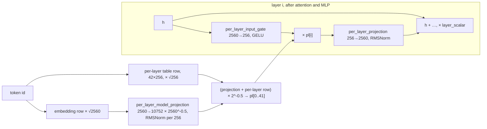

# Gemma 4 E4B

> **Scope:** Gemma 4 E4B instruction-tuned, the model Agello runs: the architecture as trained (official
> config, model card, technical report), the `.litertlm` export (sections, signatures, weights, per-layer
> attention, KV caches, MTP drafter, vision and audio sections), trained context against export window
> against allocated context, and the FP16 rotary-position problem (LiteRT-LM #3913) with Agello's
> 512-token-block file. **Out of scope:** how LiteRT-LM runs each section
> ([../litert-lm/executors.md](../litert-lm/executors.md), [../litert-lm/components.md](../litert-lm/components.md),
> [../litert-lm/file-format.md](../litert-lm/file-format.md)); the GPU kernels
> ([../ml-drift/kernels.md](../ml-drift/kernels.md)); E2B ([gemma4-e2b.md](gemma4-e2b.md)); the rest of
> the family ([gemma4-family.md](gemma4-family.md)); tokenizer and chat template
> ([tokenizer-and-chat-format.md](tokenizer-and-chat-format.md)); memory budgets
> ([../memory.md](../memory.md)).
> **Pinned to:** `google/gemma-4-E4B-it` config at `ee0ef602`; our file
> `PowerBeef02/gemma-4-E4B-it-litert-lm-fp16-rope` at `a1693e22` (sha256 `6353a233…f655c`); Google's file
> `litert-community/gemma-4-E4B-it-litert-lm` at `2eee7ac3` (sha256 `0b2a8980…52e0`); LiteRT-LM `7b872544`
> for runtime citations (v0.18.0 where it says so).
> **Applies to:** all platforms (the files are the same everywhere), with an "On Apple" section.
> **Last verified:** 2026-10-15

## Summary

Gemma 4 E4B is a 42-layer decoder (hidden 2,560) with five sliding-window layers (512 tokens) per
global layer, per-layer embeddings, and KV sharing from layer 24 on, plus a 16-layer ViT and a
12-layer conformer for images and audio. Google calls it 4.5B "effective" parameters out of 8B, the
difference being per-layer embedding tables used only for lookups.

The `.litertlm` file is a mobile-quantized export (INT4 transformer weights, INT2 embedding tables and
LM head, INT8 per-layer projections and KV cache) with every context dimension exported as 32003.
What matters for Agello:

- The KV cache is 24 INT8 caches, 28,672 bytes per position: 917.5 MB at the 32,000 positions a 32K
  request gets (C9). <!-- c:MOD-E4B-039 -->
- The model is trained for 131,072 positions; with this file LiteRT-LM allocates at most 32,002, and
  32,000 for a 32K request (C14). <!-- c:MOD-E4B-056 -->
- The file supports at most 280 vision tokens per image, not 560 or 1,120 (C2). <!-- c:MOD-E4B-050 -->
- Google's file computes rotary angles from an FP16 copy of the position on the GPU and corrupts
  verbatim text past position 2,048 (#3913). <!-- c:MOD-E4B-059 --> Agello ships the same weights
  with 512-token rotary blocks, whose FP16 rotary positions are exact up to 32,767.
  <!-- c:MOD-E4B-065 -->

## Concepts

| Term | Meaning here |
| --- | --- |
| Trained model | What `google/gemma-4-E4B-it` defines: `config.json`, the model card and the technical report. |
| Export, file | A `.litertlm` container: Google's `gemma-4-E4B-it.litertlm` or ours, `gemma-4-E4B-it-fp16-rope.litertlm`. Same weights; ours rewrites the rotary graph. |
| Local / global layer | `sliding_attention` (window of 512 positions, head dim 256) / `full_attention` (every position, head dim 512). Google's docs also say "sliding window" and "global". |
| Per-layer embeddings (PLE) | A second embedding table that gives every token a 256-value vector for each of the 42 layers. |
| KV sharing | Layers 24–41 compute no keys or values; they read layer 22's or layer 23's. |
| Effective parameters | Google's headline size ("E" in E4B), which leaves out the per-layer embedding tables. |
| Export window | The 32003 magic number in every context-sized dimension of the file. |
| Allocated context | The context LiteRT-LM sizes the KV caches and masks to at load: `maxNumTokens`, or 32,000. |
| Filled length | Positions written in the KV cache so far. |
| p-RoPE | Proportional RoPE: only a fraction of the global head's dimensions rotate (here 128 of 512). |

## How it works

### The model as trained

#### Text decoder dimensions

| Field (`text_config`) | Value | Notes |
| --- | --- | --- |
| `num_hidden_layers` | 42 | |
| `hidden_size` | 2,560 | |
| `intermediate_size` | 10,240 | gated GELU MLP (`gelu_pytorch_tanh`) |
| `num_attention_heads` / `num_key_value_heads` | 8 / 2 | grouped-query attention, 4 query heads per KV head |
| `head_dim` / `global_head_dim` | 256 / 512 | local / global layers |
| `vocab_size` | 262,144 | tied input and output embedding |
| `use_double_wide_mlp`, `enable_moe_block` | false, false | dense; E2B differs on the first ([gemma4-e2b.md](gemma4-e2b.md)) |

Source: [`config.json`](../generated/hf/google__gemma-4-E4B-it/config.json) at `ee0ef602`, summarized
with the other Gemma 4 models in [../generated/hf-configs.md](../generated/hf-configs.md). These are
the decoder's dimensions: 42 layers, hidden 2,560, MLP 10,240, 8 query and 2 KV heads, head dims 256
and 512, vocabulary 262,144, dense. <!-- c:MOD-E4B-001 -->

#### Local and global layers

Layers 5, 11, 17, 23, 29, 35 and 41 are global; the other 35 are local with a 512-token window, so the
pattern is five local layers then one global, and the last layer is global. <!-- c:MOD-E4B-002 -->

```text
layer:  0 1 2 3 4 [5] 6 7 8 9 10 [11] 12 … 16 [17] 18 … 22 [23] | 24 … 28 [29] 30 … 34 [35] 36 … 40 [41]
         local ×5  G   local ×5   G    local×5  G   local×5  G  |  KV-shared layers (read 22 / 23)
```

The model card says global layers use unified keys and values; the report excepts E2B and E4B, and
E4B's config has `attention_k_eq_v` false, a soft cap of 30 on the final logits, RMSNorm ε 1e-6, the
`gelu_pytorch_tanh` activation and tied embeddings. <!-- c:MOD-E4B-005 -->

#### Rotary positions per layer type

| Layer type | `rope_type` | θ | Rotating dimensions | Inverse frequencies in the file |
| --- | --- | --- | --- | --- |
| local (`sliding_attention`) | default | 10,000 | 256 of 256 | 128 values, all non-zero |
| global (`full_attention`) | proportional, `partial_rotary_factor` 0.25 | 1,000,000 | 128 of 512 | 256 values: 64 non-zero, 192 zero |

With transformers v5.5.0's proportional RoPE, the global head keeps `int(0.25 × 512 / 2)` = 64
rotating frequencies and pads the other 192 with zeros, while a local head has 128 frequencies over
its 256 dimensions. <!-- c:MOD-E4B-003 --> The exported graphs carry exactly those vectors as
constants: `[1,1,128]` for local layers and `[1,1,256]` with 64 non-zero values for global layers,
both starting at 1.0. <!-- c:MOD-E4B-004 --> The reference implementation computes the angles in
FP32 (autocast disabled), so positions are never FP16 there; that matters for
[#3913](#rotary-positions-and-litert-lm-3913). <!-- c:MOD-E4B-076 -->

#### Norms, scales and the soft cap

- RMSNorm everywhere, ε = 1e-6: before and after attention, before and after the MLP, after the
  per-layer-embedding branch; RMSNorm on queries and keys (with scale) and on values (without);
  attention scaling 1.0 instead of 1/√d.
- The decode graph has 302 `odml.rms_norm` composites, which is 42 × 5 + 42 query norms + 24 key
  norms + 24 value norms + the per-layer projection norm + the final norm (prefill has 188).
  <!-- c:MOD-E4B-007 -->
- The embedding is scaled by √2,560 = 50.596 and the logits are soft-capped as 30·tanh(x / 30); both
  constants are in the file. <!-- c:MOD-E4B-008 -->
- Each layer's output is multiplied by a per-layer constant (`layer_scalar` in transformers,
  `_maybe_apply_skip_scale` in the export).

#### Per-layer embeddings

`hidden_size_per_layer_input` 256 and `vocab_size_per_layer_input` 262,144: every token has a
42 × 256 vector, one 256-wide slice per layer. In transformers v5.5.0 the slice for layer *i* is
built once per token and enters layer *i* after its MLP, through a gated bottleneck and its own norm,
before the layer scalar: <!-- c:MOD-E4B-009 -->



In the export the two tables are separate sections run on the CPU (see
[Embedder and per-layer embedder](#embedder-and-per-layer-embedder)), and the projections are in the
main graph: one INT8 `per_layer_model_projection` [10752, 2560] and, per layer, an INT8 gate
[256, 2560] and projection [2560, 256], 85 tensors and 82,575,360 bytes. <!-- c:MOD-E4B-012 -->

#### KV sharing

`num_kv_shared_layers` 18: layers 24–41 compute no keys or values and reuse those of the last
non-shared layer of the same type, layer 22 (local) or layer 23 (global). <!-- c:MOD-E4B-013 -->
The report calls this sharing "with ratios … 18/42". The export follows it exactly
([Attention per layer](#attention-per-layer)).

#### Parameter counts and effective parameters

| Component (report Table 1) | E4B | Check against the config |
| --- | --- | --- |
| Audio encoder | 305M | |
| Vision encoder | 150M | |
| Embedder | 670M | 262,144 × 2,560 = 671,088,640 |
| Per-layer embeddings | 2,820M | 262,144 × 42 × 256 = 2,818,572,288 |
| Transformer weights ("einsums") | 3,940M | |
| MTP drafter | 77M | |
| Total | 7,962M ≈ 8B | |

The report gives these counts and calls E4B "4.5B effective out of … 8B total"; the model card says
"4.5B effective (8B with embeddings)". <!-- c:MOD-E4B-015 --> The two embedding counts follow from
the config. <!-- c:MOD-E4B-016 --> The report doesn't break the 4.5B down further. The card explains
"E" as effective parameters coming from per-layer embeddings. Neither the card nor the report
mentions MatFormer or nested sub-models for Gemma 4, so this page doesn't describe E4B as one; the
"E" models inherit per-layer embeddings from Gemma 3n.

#### Vision encoder

`vision_config`: a 16-layer ViT, hidden 768, MLP 3,072, 12 heads of 64, 16-pixel patches, 3 × 3
pooling into soft tokens, a 10,240-entry 2D position embedding, RoPE θ 100, 280 soft tokens per image
by default; 150M parameters by the report. <!-- c:MOD-E4B-018 --> As trained, the token budget per
image is one of 70, 140, 280, 560 or 1,120; the official processor uses 280 per image and 70 per
video frame. <!-- c:MOD-E4B-019 --> The export supports only the first three
([Vision sections](#vision-sections)).

#### Audio encoder

`audio_config`: a 12-layer conformer (hidden 1,024, 8 heads, convolution kernel 5, two subsampling
convolutions with 128 and 32 channels, chunked attention over chunks of 12 encoder steps with 13 steps of
left context, logit cap 50, output projected to 1,536). The processor feeds 16 kHz audio as 128 mel bins
from 320-sample frames with a 160-sample hop, and one audio token stands for 40 ms.
<!-- c:MOD-E4B-020 --> The card limits audio to 30 seconds, which is 750 tokens.
<!-- c:MOD-E4B-021 -->

#### Vocabulary and special tokens

262,144 entries (SentencePiece, details in [tokenizer-and-chat-format.md](tokenizer-and-chat-format.md)).
The config's ids: BOS 2, pad 0, EOS 1 and 106, image 258880, audio 258881, video 258884, begin and end
of image 255999 and 258882, begin and end of audio 256000 and 258883. `generation_config.json` adds 50
to the EOS list and samples at temperature 1.0, top-k 64, top-p 0.95 by default.
<!-- c:MOD-E4B-022 --> The `.litertlm` files stop on 1, 50 and 106 as well
([../litert-lm/components.md#stop-tokens](../litert-lm/components.md#stop-tokens)).

#### The MTP drafter as trained

The report describes a 4-layer drafter of width 256 (three local, one global attention layer) fed
with the main model's last activations and the token embedding, cross-attending to the main model's
KV cache, and says the E2B and E4B drafters use a top-k over token clusters (d × 4,096) instead of a
full-vocabulary projection. <!-- c:MOD-E4B-023 --> The exported E4B drafter does not do the latter
([The MTP drafter section](#the-mtp-drafter-section)).

### The exported file

#### Sections

| # | `model_type` | Size | Hints | Contents (both files) |
| --- | --- | --- | --- | --- |
| 0 | `LlmMetadataProto` | 12,192 bytes | | start/stop tokens, Gemma 4 type, Jinja template, `thought` channel |
| 1 | `SP_Tokenizer` | 4.7 MB | | SentencePiece model |
| 2 | `tf_lite_embedder` | 170.9 MB | | INT2 [262144, 2560] token table |
| 3 | `tf_lite_per_layer_embedder` | 836.8 MB | | 42 INT2 [262144, 256] tables |
| 4 | `tf_lite_audio_encoder_hw` | 94.1 MB | `backend_constraint=cpu` | conformer, INT2/INT4 |
| 5 | `tf_lite_audio_adapter` | 15.7 MB | `backend_constraint=cpu` | FP32 [2560, 1536] projection |
| 6 | `tf_lite_end_of_audio` | 10,868 bytes | | one constant row |
| 7 | `tf_lite_vision_encoder` | 224.1 MB | `prefer_activation_type=fp16` | ViT, INT8, `vision_70/140/280` |
| 8 | `tf_lite_vision_adapter` | 7.9 MB | `backend_constraint=cpu` | FP32 [2560, 768] projection |
| 9 | `tf_lite_end_of_vision` | 10,868 bytes | | one constant row |
| 10 | `tf_lite_prefill_decode` | 2,261.0 MB | `prefer_activation_type=fp16` | the decoder: 4 signatures |
| 11 | `tf_lite_mtp_drafter` | 45.3 MB | | the MTP drafter |

Our file is 3,660,726,272 bytes (container 1.5.0, 12 sections) against 3,659,530,240 for Google's.
<!-- c:MOD-E4B-024 --> The sizes and hints above are our file's
([../generated/models/e4b-ours.md](../generated/models/e4b-ours.md)). <!-- c:MOD-E4B-025 --> What the
hints do (only the main, vision-encoder and audio-encoder constraints are validated; `fp16` applies
when no activation type is set) is on
[../litert-lm/file-format.md#what-the-hints-do](../litert-lm/file-format.md#what-the-hints-do).

#### Our file against Google's

Sections 0–9 of our file (`a1693e22`) and Google's (`2eee7ac3`) are byte-identical, and so are the
2,197,937,696 bytes stored after the graph in `tf_lite_prefill_decode` (its external weights). Apart
from the header's section offsets, only the two graphs that compute rotary angles differ: the main
graph grows from 62,105,680 to 63,088,720 bytes (+983,040 = 60 × 16,384) and the drafter section from
45,126,160 to 45,339,152 bytes (+212,992 = 13 × 16,384), making the file 1,196,032 bytes larger.
<!-- c:MOD-E4B-026 --> Section offsets 0–10 are unchanged; the header records the new ends
([../litert-lm/file-format.md#our-e4b-file-against-googles](../litert-lm/file-format.md#our-e4b-file-against-googles)).
The [rotary section](#our-file-512-token-rotary-blocks) explains the change.

#### The main section's signatures

| Signature | Rows | Inputs | Outputs | Ops (ours / Google's) | Layers run |
| --- | --- | --- | --- | --- | --- |
| `decode` | 1 | `embeddings` [1,1,2560], `per_layer_embeddings` [1,1,42,256], `input_pos` [1], `mask` BOOL [1,1,1,32003], `param_tensor` INT32 [1,1,1,7], 48 KV caches | `logits` [1,1,262144], `activations` [1,1,2560], 48 KV caches | 2,749 / 2,712 | 0–41, LM head |
| `prefill_1024` | 1,024 | N rows of `embeddings`, `per_layer_embeddings`, `input_pos` and `mask`; `param_tensor` stays [1,1,1,7]; 48 KV caches | 48 KV caches only | 1,810 / 1,773 | attention 0–22, K/V of 23 |
| `prefill_128` | 128 | as `prefill_1024`, N = 128 | 48 KV caches only | 1,810 / 1,773 | attention 0–22, K/V of 23 |
| `verify` | 4 | same, 4 rows | `logits` [1,4,262144], `activations` [1,4,2560], 48 KV caches | 2,838 / 2,801 | 0–41, LM head |

Ops per signature differ by 37 between the files, and the drafter's (242 against 206) by 36.
<!-- c:MOD-E4B-027 --> The inputs and outputs are the same in both files. `decode` takes
`embeddings` FLOAT32[1,1,2560], `per_layer_embeddings` FLOAT32[1,1,42,256], `input_pos` INT32[1],
`mask` BOOL[1,1,1,32003], `param_tensor` INT32[1,1,1,7] and the 48 KV caches, and returns `logits`
FLOAT32[1,1,262144], `activations` FLOAT32[1,1,2560] and the 48 caches. `prefill_N` (N = 128 or
1,024) takes N rows of the embeddings, per-layer embeddings, positions and mask (`param_tensor` stays
[1,1,1,7]) plus the 48 caches, and returns only the 48 caches. `verify` takes 4 rows and returns
`logits` [1,4,262144], `activations` [1,4,2560] and the 48 caches. <!-- c:MOD-E4B-028 -->

Prefill skips everything that doesn't write KV: attention for layers 0–22 (23 SOFTMAX against 42),
only keys and values for layer 23, nothing of layers 24–41 or the LM head (210 FULLY_CONNECTED
against 344). <!-- c:MOD-E4B-029 --> So the first token of a reply comes from a `decode` run, and
the shared layers never run during prefill. How prompts are split across `prefill_1024` and
`prefill_128`, what `param_tensor` carries and who fills each input:
[../litert-lm/executors.md#prefill-and-prompt-chunking](../litert-lm/executors.md#prefill-and-prompt-chunking),
[../litert-lm/executors.md#paramtensor](../litert-lm/executors.md#paramtensor),
[../litert-lm/executors.md#inputs-and-who-fills-them](../litert-lm/executors.md#inputs-and-who-fills-them).

#### Weights and quantization

| Section | INT2 | INT4 | INT8 | FLOAT32 | Where |
| --- | --- | --- | --- | --- | --- |
| `tf_lite_embedder` | 167.8 MB (1 table) | | | | inline |
| `tf_lite_per_layer_embedder` | 704.6 MB (42 tables) | | | | inline |
| `tf_lite_prefill_decode` | 167.8 MB (LM head) | 1,945.1 MB (258) | 82.6 MB (85) | 3.0 MB | after the graph |
| `tf_lite_mtp_drafter` | | 36.7 MB (13) | 4.6 MB (10) | 0.2 MB | inline |
| `tf_lite_vision_encoder` | | | 151.0 MB (112) | 65.5 MB | inline |
| `tf_lite_vision_adapter` | | | | 7.9 MB | inline |
| `tf_lite_audio_encoder_hw` | 66.1 MB (108) | 12.6 MB (12) | | 12.0 MB | inline |
| `tf_lite_audio_adapter` | | | | 15.7 MB | inline |

All low-bit weights are quantized per channel (one scale per output row), and the main section keeps
its weights after the graph in the same section. In the main graph, activations go through QUANTIZE to
INT8 before the INT4 and INT8 products and DEQUANTIZE after them (decode: 253 QUANTIZE, 344
FULLY_CONNECTED, 343 DEQUANTIZE). The report calls the scheme "mobile quantization": per-channel INT2
and INT4 weights with INT8 activations; it lists E4B's text weights at 9.0 in bf16 and 2.3 quantized.
<!-- c:MOD-E4B-033 -->

The 258 INT4 tensors of the main section, by role: <!-- c:MOD-E4B-030 -->

| Role | Shape | Count | Bytes |
| --- | --- | --- | --- |
| MLP gate and up | [10240, 2560] | 84 (42 × 2) | 1,101,004,800 |
| MLP down | [2560, 10240] | 42 | 550,502,400 |
| Local query / output | [2048, 2560] / [2560, 2048] | 35 + 35 | 183,500,800 |
| Global query / output | [4096, 2560] / [2560, 4096] | 7 + 7 | 73,400,320 |
| Local key and value | [512, 2560] | 40 (20 × 2) | 26,214,400 |
| Global key and value | [1024, 2560] | 8 (4 × 2) | 10,485,760 |
| Total | | 258 | 1,945,108,480 |

Key and value weights exist only for layers 0–23 (20 local layers × 2 INT4 [512, 2560] tensors and
4 global layers × 2 INT4 [1024, 2560]); the 18 KV-shared layers 24–41 carry no key or value weights,
only query, output, MLP and per-layer-embedding gate and projection weights (plus norm scales).
<!-- c:MOD-E4B-031 --> The tied embedding is stored twice: the CPU lookup table in
`tf_lite_embedder` and an INT2 LM head of the same shape in the main section, 335,544,320 bytes of
INT2 in all. <!-- c:MOD-E4B-032 --> How ML Drift reads INT2, INT4 and INT8 weights on Apple GPUs:
[../ml-drift/kernels.md#quantized-weights-and-the-kv-cache-bytes](../ml-drift/kernels.md#quantized-weights-and-the-kv-cache-bytes).

#### Attention per layer

`odml.runtime_bmm` runs both attention products (QKᵀ with `is_src` false on the key cache, PV with
`is_src` true on the transposed value cache); `odml.cache_update` quantizes and writes new keys and
values. Both carry the cache's static INT8 scale. Per layer in `decode` (prefill and verify are the
same for the layers they run), from [../generated/models/e4b-ours.json](../generated/models/e4b-ours.json)
(`layer_table`, made by [`tools/model-surgery/inspect_e4b.py:117-145`](https://github.com/PowerBeef/agello-litert-lm/blob/85b1a77695bc90fc8b34a1f455bbe5b2c7fdceff/tools/model-surgery/inspect_e4b.py#L117-L145)):

| Layers | Kind | Head dim | Reads K / V cache | K scale | V scale | Mask |
| --- | --- | --- | --- | --- | --- | --- |
| 0–4, 6–10, 12–16, 18–22 | local | 256 | its own (0–22) | 0.005680–0.006216, per layer | 0.047244 | window from `input_pos` |
| 5, 11, 17, 23 | global | 512 | its own | 0.001091–0.001147, per layer | 0.017857 | `mask` input |
| 24–28, 30–34, 36–40 | local | 256 | cache 22 | 0.005955 (layer 22's) | 0.047244 | window from `input_pos` |
| 29, 35, 41 | global | 512 | cache 23 | 0.001091 (layer 23's) | 0.017857 | `mask` input |

Layers 0–23 each read the cache they write; the shared local layers read cache 22 and the shared
global layers cache 23, so 42 attention layers use 24 caches. <!-- c:MOD-E4B-014 --> The scales are
static and per cache: key scales vary by layer, value scales are one value for all local caches and
one for all global caches (in the trained model values are RMS-normalized without a learned
scale before they're cached). <!-- c:MOD-E4B-034 -->

The local layers ignore the `mask` input. The graph builds one window mask from `input_pos` and
shares it: key *k* is kept when `GREATER_EQUAL(pos, k)` and `LESS(pos, k + 512)`, with INT32
constants 0…32002 and 512…32514, which keeps the current position and the 511 before it. The global
layers use the `mask` input, which LiteRT-LM fills on the CPU. <!-- c:MOD-E4B-035 --> The window is
therefore exact at any context size, but without our kernel changes the attention products still
cover every filled key and the select and softmax the whole allocated row; our ML Drift and LiteRT
changes skip the keys outside the window
([../ml-drift/kernels.md#the-sliding-window-ours](../ml-drift/kernels.md#the-sliding-window-ours),
[../litert/ml-drift-delegate.md](../litert/ml-drift-delegate.md)). How the CPU mask is filled:
[../litert-lm/executors.md#the-attention-mask](../litert-lm/executors.md#the-attention-mask).

The softmax inputs are `[1, 2, 4, T]` in decode, `[1, 2, 4096, T]` in `prefill_1024` and
`[1, 2, 16, T]` in verify: 2 KV heads, then 4 query heads per KV head times the query rows.

#### KV caches

24 INT8 caches, keys as `[1, 2, T, D]` and values transposed as `[1, 2, D, T]`, D = 512 for caches
5, 11, 17 and 23 and 256 for the other 20. One position takes 2 heads × 256 × 2 (K and V) × 20 +
2 × 512 × 2 × 4 = 20,480 + 8,192 = 28,672 bytes. <!-- c:MOD-E4B-037 -->

| Allocated positions | Bytes | MB | MiB |
| --- | --- | --- | --- |
| 4,096 | 117,440,512 | 117.4 | 112 |
| 8,192 | 234,881,024 | 234.9 | 224 |
| 16,384 | 469,762,048 | 469.8 | 448 |
| 32,000 (what a 32K request gets) | 917,504,000 | 917.5 | 875 |
| 32,768 (never allocated for this file) | 939,524,096 | 939.5 | 896 |

The rows are 28,672 bytes times the positions. <!-- c:MOD-E4B-038 -->

**C9 resolved.** A 32K window (`maxNumTokens` 32,768) allocates 32,000 positions, because LiteRT-LM
replaces the magic number 32003 by the largest multiple of 256 below it whenever `maxNumTokens` is
32,003 or more ([`runtime/executor/magic_number_configs_helper.cc:243-271`](https://github.com/google-ai-edge/LiteRT-LM/blob/df6df5b84d5845b49889f631ed4cac80b4325dd3/runtime/executor/magic_number_configs_helper.cc#L243-L271)).
So the KV caches take 917,504,000 bytes, AUDIT's 918 MB; the 940 MB in E4B-GRAPH and track T4 is
32,768 positions, a size this file never gets. <!-- c:MOD-E4B-039 --> Both are decimal megabytes;
in MiB the figures are 875 and 896. The executor side of this (and what an unset `maxNumTokens`
becomes) is on
[../litert-lm/executors.md#magic-numbers-and-the-allocated-context](../litert-lm/executors.md#magic-numbers-and-the-allocated-context);
what the GPU allocates beyond the tensors' bytes is for [../memory.md](../memory.md).

Every cache is as long as the allocated context, although local layers read at most 512 positions,
and `odml.cache_update` carries no ring-buffer attribute in this export. A ring-buffer local cache
would need a re-exported model.

#### The MTP drafter section

`tf_lite_mtp_drafter` (45.3 MB in ours) is a separate graph that the runtime loads when speculative
decoding is on.

- **Inputs and outputs.** `activations` [1,1,5120] (the token embedding and the main model's last
  activations, concatenated on the host), `input_pos` [1], `mask` [1,1,1,32003], `param_tensor`, and
  the main model's `kv_cache_k_22`, `kv_cache_v_22`, `kv_cache_k_23` and `kv_cache_v_23`; it returns
  `logits` [1,1,262144] and `projected_activations` [1,1,2560]. There is no `odml.cache_update`: the
  drafter only reads the main model's caches. <!-- c:MOD-E4B-041 -->
- **Structure.** Four attention blocks of 4 query heads: three local blocks on cache 22 with a
  512-position window built from the drafter's `input_pos`, one global block on cache 23 under the
  `mask` input. Weights: INT8 pre-projection 5,120 → 256, INT8 query projections (1,024 or 2,048
  wide) and output projections, INT4 MLP of width 2,048, INT8 post-projection 256 → 2,560, and an INT4
  output head [262144, 256]. <!-- c:MOD-E4B-042 -->
- **Full-vocabulary head.** The head projects to all 262,144 tokens (33,554,432 bytes of INT4), not
  the clustered 4,096-wide head the report describes. <!-- c:MOD-E4B-043 -->
- **Mismatched key scales.** The local blocks dequantize cache 22's keys with 0.0059614750, layer
  4's scale, while layer 22 writes them with 0.0059552486; the global block uses layer 5's
  0.0010908608 for cache 23, written with 0.0010912281. The errors are 0.10% and 0.03%, they only
  touch drafts, and `verify` checks every draft. <!-- c:MOD-E4B-044 -->

How drafts are made and accepted (3 drafts per round, greedy acceptance), and that the drafter binds
the main model's state buffers:
[../litert-lm/executors.md#mtp-speculative-decoding](../litert-lm/executors.md#mtp-speculative-decoding).

#### Embedder and per-layer embedder

- `tf_lite_embedder`: signature `embedder`, `token_ids` INT32[1,1] → `embeddings` FLOAT32[1,1,2560],
  one INT2 [262144, 2560] table with a scale per row, then the √2,560 scale. <!-- c:MOD-E4B-045 -->
- `tf_lite_per_layer_embedder`: signature `per_layer_embedder`, `token_ids` INT32[1,1] →
  `embeddings` FLOAT32[1,1,42,256] through 42 EMBEDDING_LOOKUP ops over 42 INT2 [262144, 256] tables
  (704,643,072 bytes of INT2). The generator couldn't parse this section, so these facts come from
  reading the file directly. <!-- c:MOD-E4B-010 --> Most of the other 132 MB of the section is
  quantization parameters: a float scale and an int64 zero point per row of each table.
  <!-- c:MOD-E4B-011 -->

Both run on the CPU, once per token (two CPU model runs per token in prefill and decode):
[../litert-lm/components.md#embedding-lookups](../litert-lm/components.md#embedding-lookups),
[../litert-lm/executors.md#what-runs-on-the-cpu-for-every-token](../litert-lm/executors.md#what-runs-on-the-cpu-for-every-token).
The ML Drift GPU graphs therefore contain no embedding lookup.

#### Vision sections

| Signature | Patches in (`images` [1, N, 768], `positions_xy` [1, N, 2]) | Tokens out (`features` [1, M, 768], `mask`) | Adapter signature |
| --- | --- | --- | --- |
| `vision_70` | 630 | 70 | `vision_adapter_70` |
| `vision_140` | 1,260 | 140 | `vision_adapter_140` |
| `vision_280` | 2,520 | 280 | `vision_adapter_280` |

Each patch is 16 × 16 × 3 = 768 pixel values, and 3 × 3 pooling turns 9 patches into one token; each
encoder signature has 1,477 ops with 16 attention layers. <!-- c:MOD-E4B-046 --> The encoder holds
112 INT8 tensors (16 layers × 4 attention projections and 3 MLP matrices, 150,994,944 bytes) and
65.5 MB of FLOAT32, mostly two 768 × 10,240 position tables. <!-- c:MOD-E4B-047 --> The adapter
(section 8, constrained to the CPU) normalizes the soft tokens and projects them to 2,560 with one
FP32 matrix; `tf_lite_end_of_vision` and `tf_lite_end_of_audio` are constant rows.
<!-- c:MOD-E4B-048 -->

The metadata gives `patch_width` 16, `patch_height` 16, `max_num_patches` 2520 and no pooling size;
LiteRT-LM's default of 3 makes that 2520 / 9 = 280 tokens per image. <!-- c:MOD-E4B-049 -->

**C2 resolved.** The numbers seen in Agello's docs measure different things:

| Value | Where | What it is |
| --- | --- | --- |
| 70 / 140 / 280 / 560 / 1,120 | model card, report, Agello `ChatTypes.swift` comment | budgets the trained model supports |
| 70 / 140 / 280 | file signatures `vision_70/140/280` | what this export can run |
| 2,520 patches | `max_num_patches` | 280 tokens × 9 |
| 140 / 280 / 560 | Agello USER_GUIDE, Settings "Image detail" | Agello's presets; 560 isn't reachable |

LiteRT-LM (agello-next and v0.18.0 alike) derives 280 from the metadata (2520 / 9). When vision is
configured and the caller has not set `max_vision_tokens_per_image`, the engine stores 280 there; a
caller-set value is kept as is, and one above 280 fails engine creation because no vision signature
is that long
([`runtime/core/engine_advanced_impl.cc:85-114`](https://github.com/google-ai-edge/LiteRT-LM/blob/df6df5b84d5845b49889f631ed4cac80b4325dd3/runtime/core/engine_advanced_impl.cc#L85-L114),
[`runtime/core/engine_advanced_impl.cc:457-494`](https://github.com/google-ai-edge/LiteRT-LM/blob/df6df5b84d5845b49889f631ed4cac80b4325dd3/runtime/core/engine_advanced_impl.cc#L457-L494),
[`runtime/executor/model_signature_utils.cc:209-216`](https://github.com/google-ai-edge/LiteRT-LM/blob/df6df5b84d5845b49889f631ed4cac80b4325dd3/runtime/executor/model_signature_utils.cc#L209-L216);
v0.18.0: [`runtime/core/engine_advanced_impl.cc:301-322`](https://github.com/google-ai-edge/LiteRT-LM/blob/b2f686e2ed4718fb84ec398a61dd59ca0f0aff27/runtime/core/engine_advanced_impl.cc#L301-L322)).
A conversation whose visual token budget is above the stored value gets InvalidArgument from
`Conversation::SendMessageAsync`
([`runtime/conversation/conversation.cc:556-565`](https://github.com/google-ai-edge/LiteRT-LM/blob/df6df5b84d5845b49889f631ed4cac80b4325dd3/runtime/conversation/conversation.cc#L556-L565),
[`runtime/conversation/model_data_processor/model_data_processor_factory.cc:698-722`](https://github.com/google-ai-edge/LiteRT-LM/blob/df6df5b84d5845b49889f631ed4cac80b4325dd3/runtime/conversation/model_data_processor/model_data_processor_factory.cc#L698-L722);
v0.18.0: [`runtime/conversation/conversation.cc:564-573`](https://github.com/google-ai-edge/LiteRT-LM/blob/b2f686e2ed4718fb84ec398a61dd59ca0f0aff27/runtime/conversation/conversation.cc#L564-L573)).
A budget *b* resizes the image to at most 9*b* patches
([`runtime/conversation/model_data_processor/multimodal_processor_helper.cc:91-103`](https://github.com/google-ai-edge/LiteRT-LM/blob/df6df5b84d5845b49889f631ed4cac80b4325dd3/runtime/conversation/model_data_processor/multimodal_processor_helper.cc#L91-L103)),
and the vision executor runs the smallest signature that holds patches / 9 tokens
([`runtime/executor/vision_litert_compiled_model_executor.cc:143-198`](https://github.com/google-ai-edge/LiteRT-LM/blob/df6df5b84d5845b49889f631ed4cac80b4325dd3/runtime/executor/vision_litert_compiled_model_executor.cc#L143-L198)).
<!-- c:MOD-E4B-050 --> Agello offers Fast (140), Balanced (280) and Detailed (560), and its planner
lowers the budget to the file's `maxVisionTokenBudget` (280, from `ModelInfo`) before sending, so
Detailed behaves like Balanced with this file; the user guide's 560 is not what runs.
<!-- c:MOD-E4B-051 --> Agello's engine load log reports the file's capabilities as `mtp=true
thinking=false tools=false vision=true audio=true maxContext=0 maxVisionBudget=280`, both with
Google's v0.18.0 runtime on an iPhone 17 Pro and with our build `c5460a024e71` on an Apple M6 Mac.
Both runs (2026-10-15) predate Agello `93122b6`, when the app's catalog pointed to the first
fp16-rope revision `13d5aa4c` (2048-token blocks); the capabilities come from `LlmMetadata` and
section types that are the same in `a1693e22` and Google's `2eee7ac3` file. <!-- c:MOD-E4B-052 -->

#### Audio sections

`tf_lite_audio_encoder_hw` (constrained to the CPU) takes `src_inputs` [1,1,816,128] (816 frames of
128 mel bins) and a mask, and returns `features` [1,204,1536] and a mask: 12 conformer layers in
2,182 ops, with INT2 and INT4 weights (66.1 MB and 12.6 MB) and 12.0 MB of FLOAT32.
<!-- c:MOD-E4B-053 --> One run covers 816 frames × 10 ms = 8.16 s and gives up to 204 tokens of 40 ms;
the trained 30-second limit (750 tokens) is four runs. <!-- c:MOD-E4B-054 --> The adapter (also on
the CPU) normalizes the 1,536-wide features and projects them to 2,560 with one FP32 matrix.
<!-- c:MOD-E4B-055 --> The front end (miniaudio decoding to 16 kHz mono, 128 mel bins) and the
executor's windowing are on [../litert-lm/components.md#preprocessors](../litert-lm/components.md#preprocessors)
and [../litert-lm/executors.md#audio-executor](../litert-lm/executors.md#audio-executor).

#### Metadata

The `LlmMetadataProto` section names the Gemma 4 delimiters (`<|image>`, `<image|>`, `<|audio>`,
`<audio|>`, the tool-call fences and `<|tool_response>`), the patch metadata above, one `thought`
channel, the Jinja chat template, start token 2 and stop tokens 1, 50 and 106. It has no
`max_num_tokens` and no sampler parameters, so `ModelInfo` reports a maximum context of 0 and the
runtime picks its own sampler defaults
([../litert-lm/file-format.md#metadata-protos](../litert-lm/file-format.md#metadata-protos),
[../litert-lm/components.md#samplers](../litert-lm/components.md#samplers)). The template:
[tokenizer-and-chat-format.md](tokenizer-and-chat-format.md) and
[../litert-lm/conversation.md#the-gemma-4-template-in-the-e2b-and-e4b-files](../litert-lm/conversation.md#the-gemma-4-template-in-the-e2b-and-e4b-files).

### Trained context, export window, allocated context

| Kind | E4B | Source |
| --- | --- | --- |
| Trained context | 131,072 positions ("128K") | `max_position_embeddings`, model card |
| Export window | 32003 in every context dimension ("up to 32k") | the file; litert-community card |
| Allocated context | `maxNumTokens` if 1–32,002, 32,000 if 32,003 or more; if 0, first the smallest multiple of 4,096 above the prompt hint + 1,023 (4,096 with no hint) | LiteRT-LM at load |
| Rotary range of our file | positions 0–32,767 | `patch_rope.py --block 512` |

**C14 resolved.** Gemma 4 E4B is trained for 131,072 positions (`max_position_embeddings`; "128K" in
the model card), and its `.litertlm` export sizes every context dimension to the magic number 32003
(litert-community's card: up to 32k). The context LiteRT-LM allocates is `maxNumTokens` when it is set
between 1 and 32,002, and 32,000 when it is 32,003 or more; left at 0, it is first replaced by the
smallest multiple of 4,096 above the prompt hint plus 1,023 (4,096 with no hint)
([`runtime/executor/magic_number_configs_helper.cc:243-271`](https://github.com/google-ai-edge/LiteRT-LM/blob/df6df5b84d5845b49889f631ed4cac80b4325dd3/runtime/executor/magic_number_configs_helper.cc#L243-L271),
[`runtime/engine/engine_settings.cc:346-359`](https://github.com/google-ai-edge/LiteRT-LM/blob/df6df5b84d5845b49889f631ed4cac80b4325dd3/runtime/engine/engine_settings.cc#L346-L359),
[`runtime/core/engine_advanced_impl.cc:551-578`](https://github.com/google-ai-edge/LiteRT-LM/blob/df6df5b84d5845b49889f631ed4cac80b4325dd3/runtime/core/engine_advanced_impl.cc#L551-L578)).
Agello's and the archived plan's "128K context" describe the trained model, not anything the phone
can allocate with this file. <!-- c:MOD-E4B-056 --> The report's long-context results at 32k and 128k also describe the trained
model.

### Rotary positions and LiteRT-LM #3913

#### What the stock file computes

In Google's file, every signature of the main section and the drafter computes the rotary angles at
run time: `input_pos` (INT32) is CAST to a FLOAT32 tensor named `…/maybe_rope/convert_element_type`
(after a RESHAPE in `tf_lite_prefill_decode`; the drafter reshapes after the CAST), multiplied by the
inverse frequencies (MUL) and passed to SIN and COS, two of each per signature, one pair per layer
type. There is no `odml.rope` composite. <!-- c:MOD-E4B-058 --> On the GPU at FP16 activations (the
file's hint and LiteRT-LM's default), ML Drift stores
those FLOAT32 tensors as FP16
([../ml-drift/kernels.md#rotary-positions-rope](../ml-drift/kernels.md#rotary-positions-rope),
[../ml-drift/kernels.md#precision](../ml-drift/kernels.md#precision)).

#### Why FP16 breaks it past 2,048

FP16 has an 11-bit significand, so it holds every integer exactly only up to 2,048; between 2,048
and 32,768 the spacing of representable values is 2, 4, 8 and then 16. In Google's file at FP16, a
position near 30,000 therefore rounds to the same value, and gets the same rotary phases, as up to 16
neighbouring positions (15 or 17 positions per value under round-to-nearest-even), and is off by up
to 8 positions. <!-- c:MOD-E4B-059 -->

| Positions | FP16 spacing | Largest rounding error |
| --- | --- | --- |
| 0–2,048 | 1 | 0 |
| 2,048–4,095 | 2 | 1 (2049 → 2048) |
| 4,096–8,191 | 4 | 2 |
| 8,192–16,383 | 8 | 4 |
| 16,384–32,767 | 16 | 8 |

The fastest frequency of both layer types is exactly 1 radian per position, so a position rounded
by *d* moves the phase of those dimensions by *d* radians; near position 30,000 that is up to 8
radians, more than a full turn. <!-- c:MOD-E4B-060 --> Neighbouring tokens then look identical to the
fastest rotary dimensions, and verbatim copies stutter: digits and page numbers come out doubled.

The issue's measurements (iPhone 17 Pro, LiteRT-LM v0.18.0, Google's file, greedy): 48-digit copies
were exact in 15/15 cases whose reply digits all fell below position 2,048 and in 0/12 when all fell
above; with FLOAT32 activations 9/9 crossing or above 2,048 were exact; the earliest wrong digit was
at position 2,052. <!-- c:MOD-E4B-061 --> Shifting only the rotary position by −2,048 in INT32
before the CAST fixed 25/25 prompts of 2,094–3,983 tokens on a Mac and an iPhone, while the same shift
in float after the CAST fixed none: the precision is lost at the CAST's FP16 output.
<!-- c:MOD-E4B-062 -->

#### A second loss on M1-class GPUs

On an M1 Max (Apple7, the A14's GPU family; see [../apple-platform.md](../apple-platform.md)) another participant found errors below position
2,048 too, once the angle passed about 1,650 rad, in the MUL or SIN/COS that follow the CAST; a
2048-token split keeps that loss and a 512-token split removed it (E4B exact on 15/15, 42/42, 25/25
and 18/18). <!-- c:MOD-E4B-063 --> The same participant reported that on an M4 Max (macOS 27.0,
LiteRT-LM v0.18.0 WebGPU delegate) both the 2048- and 512-block E2B and E4B files were exact on every
case of the `research/3913` sets, while the original files failed once replies passed position 2,048,
and that the M4 Max showed no loss below 2,048. On a Pixel 8a (OpenCL, LiteRT-LM main `b7c40ea81`)
they ran only E2B, on a subset, where both patched files were exact on all 26 cases. In their own
49-case suite the block-512 E4B file missed 1/49 (a `$` dropped, digits intact).
<!-- c:MOD-E4B-064 -->

#### Our file: 512-token rotary blocks

`tools/model-surgery/patch_rope.py --split --block 512` (fork branch `agello`,
[`tools/model-surgery`](https://github.com/PowerBeef/agello-litert-lm/tree/agello/tools/model-surgery);
the first experiments are under the
[`research/3913`](https://github.com/PowerBeef/agello-litert-lm/tree/research/3913/research/issue-3913)
tag) rewrites each rotary path as position = 512·*h* + *l*: <!-- c:MOD-E4B-065 -->

1. *l* (0–511) goes through the original MUL, SIN and COS, so no FP16 value there exceeds 511.
2. The block *h* is found in INT32: the position plus offsets 0, −512, …, −32,256 is tested for
   0 ≤ x < 512, which gives a one-hot vector over 64 blocks and, through REDUCE_MAX, *l*.
3. The phase of 512·*h* comes from precomputed tables sin(512·*h*·f) + 2 and cos(512·*h*·f) + 2 of
   shape [F, 64]; multiplying by the one-hot and taking REDUCE_MAX over the last axis selects one
   column (the +2 keeps the selected value above the zeros), and −2 restores it.
4. Angle addition: sin(a + b) = sin a cos b + cos a sin b, cos(a + b) = cos a cos b − sin a sin b,
   on values in [−1, 1].

The tables are in the file: eight [256, 64] and eight [128, 64] FLOAT32 tensors in the main section
(a sin and a cos per layer type in each of the four signatures) and two of each in the drafter.
<!-- c:MOD-E4B-066 --> That is 37 more ops per main signature and 36 in the drafter, whose replaced
chain includes a RESHAPE. <!-- c:MOD-E4B-067 --> The largest angle the original MUL, SIN and COS see
is 511 rad, under the ~1,650 rad where M1-class GPUs lose precision. <!-- c:MOD-E4B-068 --> Every
new tensor is 4-D and every reduction runs over the last axis, the patterns the model already uses
(other layouts gave wrong results on the WebGPU delegate inside this graph, though not as single
ops).

The file is reproducible: `patch_rope.py --split --block 512` on Google's revision `2eee7ac3` gives
sha256 `6353a233…f655c`, and `--block 2048` gives the first published revision `13d5aa4c`
(`4a691f03…cb15f`); a participant on the issue reproduced both byte for byte.
<!-- c:MOD-E4B-069 -->

| Check (FP16 activations, greedy, 48-digit copies) | Result |
| --- | --- |
| Our build `fc71d704a349`, Apple M6, `maxNumTokens` 32,768, prompts 237–29,960 tokens | 88/88, as with 2048-token blocks <!-- c:MOD-E4B-070 --> |
| Our build `fc71d704a349`, iPhone 17 Pro, probe 12, prompts 703–29,960 tokens | 14/14, and 6/6 with MTP <!-- c:MOD-E4B-071 --> |
| Google's v0.18.0 macOS runtime (WebGPU), Apple M6, same cases | 88/88 <!-- c:MOD-E4B-072 --> |

Speed and the 2048-block comparison are in `docs/agello/VALIDATION.md` and
[../patches.md](../patches.md).

#### Other fixes

The issue lists two fixes that don't need a patched file: compute the angles in FP32 in the GPU
delegate (keeping the CAST output, MUL and SIN/COS in FP32, which M1-class GPUs need), or gather
precomputed sin/cos by the INT32 position in the converter. ML Drift's dedicated RoPE kernels already
compute angles in FP32, but this graph doesn't use the composite they serve
([../ml-drift/kernels.md#rotary-positions-rope](../ml-drift/kernels.md#rotary-positions-rope)).
FLOAT32 activations also avoid the problem, but the original report measured about half the decode
speed (16.1 s instead of 8.0 s for a ~250-word answer) and about 0.45 GB more memory.
<!-- c:MOD-E4B-082 --> Until Google ships one of these fixes, a patched file is how to get exact output
at FP16.

### How the runtime uses each section

| Section | Runs on (Agello) | Run by | Details |
| --- | --- | --- | --- |
| `tf_lite_prefill_decode` | GPU (Metal), FP16 | `LlmLiteRtCompiledModelExecutorStatic` | [executors](../litert-lm/executors.md#signatures-in-the-gemma-4-files), [kernels](../ml-drift/kernels.md) |
| `tf_lite_embedder`, `tf_lite_per_layer_embedder` | CPU, one run per token each | `EmbeddingLookupText` | [components](../litert-lm/components.md#embedding-lookups) |
| `tf_lite_mtp_drafter` | GPU, same options as the main model | `LlmLiteRtMtpDrafter` | [executors](../litert-lm/executors.md#mtp-speculative-decoding) |
| `tf_lite_vision_encoder` | CPU in Agello (GPU possible) | vision executor | [executors](../litert-lm/executors.md#vision-executor) |
| `tf_lite_vision_adapter`, `tf_lite_end_of_vision` | CPU | vision executor, embedding lookup | [executors](../litert-lm/executors.md#vision-executor) |
| `tf_lite_audio_encoder_hw`, `tf_lite_audio_adapter`, `tf_lite_end_of_audio` | CPU (required) | audio executor | [executors](../litert-lm/executors.md#audio-executor) |
| `SP_Tokenizer`, `LlmMetadataProto` | CPU | tokenizer, conversation | [components](../litert-lm/components.md#tokenizers), [conversation](../litert-lm/conversation.md) |

## On Apple

- Agello downloads our file: `PowerBeef02/gemma-4-E4B-it-litert-lm-fp16-rope` at `a1693e22`,
  3,660,726,272 bytes. <!-- c:MOD-E4B-074 -->
- Agello's `ChatEngine.makeEngine` (commit `93122b6`) creates the engine with the GPU or CPU main
  backend, the CPU for vision and audio when enabled, `maxNumTokens` and a cache directory, and sets
  no activation data type. LiteRT-LM then applies the file's `prefer_activation_type` fp16 (the same
  as its F16 default for the text executor), so the main graph runs with FP16 activations on Metal:
  exactly the configuration #3913 affects, and the reason the patched file matters.
  <!-- c:MOD-E4B-075 -->
- The weights reach ML Drift as external INT4, INT8 and INT2 tensors; on Apple10 GPUs (A19, M5 and
  later) the products use the GPU Neural Accelerators through `ConvAppleMPP`, on older ones simdgroup
  matrices ([../ml-drift/kernels.md](../ml-drift/kernels.md)).
- The KV caches live in GPU buffers; session switches copy them
  ([../litert-lm/engine-and-sessions.md#context-switches-what-is-copied-and-where](../litert-lm/engine-and-sessions.md#context-switches-what-is-copied-and-where)).
- Every token still costs two CPU embedding runs, a mask fill and, without a GPU sampler, a
  262,144-entry readback ([../litert-lm/executors.md#what-runs-on-the-cpu-for-every-token](../litert-lm/executors.md#what-runs-on-the-cpu-for-every-token)).

## Settings

The knobs that change how this model runs are LiteRT-LM's; rows live in
[../configuration.md](../configuration.md):

| Setting | Effect on E4B |
| --- | --- |
| `maxNumTokens` | allocated context: 1–32,002 as given, 32,003 or more gives 32,000, 0 gives a multiple of 4,096 from the prompt hint; KV = 28,672 bytes per position |
| activation type | FP16 by default on the GPU (the file's hint agrees); FLOAT32 avoids #3913 with Google's file at a cost |
| visual token budget (per conversation) | 70, 140 or 280 with this file; more is InvalidArgument |
| `max_vision_tokens_per_image` (engine) | 280 from the metadata when unset; a caller value is kept, and above 280 fails engine creation |
| speculative decoding | loads `tf_lite_mtp_drafter` |
| vision / audio backend | encoder placement; adapters always on the CPU, audio encoder must be CPU |

## Limits and failure modes

- **Long verbatim text with Google's file at FP16.** Past position 2,048, digits, IDs and citations
  stutter (#3913); on M1-class GPUs errors can start below 2,048. Use our file, or FLOAT32
  activations.
- **Our file's rotary range.** The tables cover positions 0–32,767 (`patch_rope.py`: blocks ×
  block size = 32,768); a position of 32,768 or more would select no block and get wrong phases.
  LiteRT-LM never reaches it with this file: the export window of 32,003 caps the allocated context at
  32,002 positions (a `maxNumTokens` below 32,003 is used as is; 32,003 or more gives 32,000).
  <!-- c:MOD-E4B-073 --> A re-export with a larger window would need
  more blocks.
- **No 128K.** The file can't allocate more than 32,002 positions, whatever `maxNumTokens` says (only
  a log warning).
- **No 560 or 1,120 vision tokens.** Budgets above 280 are rejected by LiteRT-LM; Agello clamps them.
- **Audio windows.** The encoder runs on fixed 8.16-second windows (816 frames); longer clips take
  several runs, and the trained limit is 30 seconds.
- **Drafter key scales.** The drafter reads caches 22 and 23 with layer 4's and layer 5's key scales;
  harmless for correctness (verify decides), possibly a little cost in acceptance.
- **Full-length local caches.** All 20 local caches are allocated at the full context although only
  512 positions are read: at 32,000 positions they take 655,360,000 of the 917,504,000 bytes, the 4
  global caches the other 262,144,000. <!-- c:MOD-E4B-081 -->

## Where in the code

| Concept | Symbol | Citation |
| --- | --- | --- |
| Context magic number → 32,000 | `GetDefaultTargetNumber`, `GetTargetNumber` | [`runtime/executor/magic_number_configs_helper.cc:243-271`](https://github.com/google-ai-edge/LiteRT-LM/blob/df6df5b84d5845b49889f631ed4cac80b4325dd3/runtime/executor/magic_number_configs_helper.cc#L243-L271) |
| Vision tokens per image from metadata | `GetVisionTokensPerImageFromMetadata` | [`runtime/core/engine_advanced_impl.cc:85-114`](https://github.com/google-ai-edge/LiteRT-LM/blob/df6df5b84d5845b49889f631ed4cac80b4325dd3/runtime/core/engine_advanced_impl.cc#L85-L114) |
| Engine's vision limit and signature selection | `EngineAdvancedImpl::Create` | [`runtime/core/engine_advanced_impl.cc:457-476`](https://github.com/google-ai-edge/LiteRT-LM/blob/df6df5b84d5845b49889f631ed4cac80b4325dd3/runtime/core/engine_advanced_impl.cc#L457-L476) |
| `ModelInfo` vision budget | `CalculateMaxVisionTokenBudget` | [`schema/model_info/model_info.cc:839-846`](https://github.com/google-ai-edge/LiteRT-LM/blob/df6df5b84d5845b49889f631ed4cac80b4325dd3/schema/model_info/model_info.cc#L839-L846) |
| Budget check | `ValidateVisualTokenBudget`, `Conversation::SendMessageAsync` | [`runtime/conversation/model_data_processor/model_data_processor_factory.cc:698-722`](https://github.com/google-ai-edge/LiteRT-LM/blob/df6df5b84d5845b49889f631ed4cac80b4325dd3/runtime/conversation/model_data_processor/model_data_processor_factory.cc#L698-L722), [`runtime/conversation/conversation.cc:556-565`](https://github.com/google-ai-edge/LiteRT-LM/blob/df6df5b84d5845b49889f631ed4cac80b4325dd3/runtime/conversation/conversation.cc#L556-L565) |
| Budget → patches | `ProcessMultimodalPrompt` | [`runtime/conversation/model_data_processor/multimodal_processor_helper.cc:91-103`](https://github.com/google-ai-edge/LiteRT-LM/blob/df6df5b84d5845b49889f631ed4cac80b4325dd3/runtime/conversation/model_data_processor/multimodal_processor_helper.cc#L91-L103) |
| Budget semantics (comment) | `Gemma4DataProcessorArguments` | [`runtime/conversation/model_data_processor/gemma4_data_processor_config.h:85-103`](https://github.com/google-ai-edge/LiteRT-LM/blob/df6df5b84d5845b49889f631ed4cac80b4325dd3/runtime/conversation/model_data_processor/gemma4_data_processor_config.h#L85-L103) |
| Vision signature choice | `GetVitSignatureIndex` | [`runtime/executor/vision_litert_compiled_model_executor.cc:143-198`](https://github.com/google-ai-edge/LiteRT-LM/blob/df6df5b84d5845b49889f631ed4cac80b4325dd3/runtime/executor/vision_litert_compiled_model_executor.cc#L143-L198) |
| Per-layer attention table | `layer_table` | [`tools/model-surgery/inspect_e4b.py:117-145`](https://github.com/PowerBeef/agello-litert-lm/blob/85b1a77695bc90fc8b34a1f455bbe5b2c7fdceff/tools/model-surgery/inspect_e4b.py#L117-L145) |
| The rotary split | `patch_section` | `tools/model-surgery/patch_rope.py` on branch `agello` ([folder](https://github.com/PowerBeef/agello-litert-lm/tree/agello/tools/model-surgery)); not part of a pinned tree |
| Generated tables | | [../generated/models/e4b-ours.md](../generated/models/e4b-ours.md), [../generated/models/e4b-google.md](../generated/models/e4b-google.md), [../generated/hf-configs.md](../generated/hf-configs.md) |

## Open questions

- **Report Table 3.** The report lists E4B at +0.14 for an int8 KV cache at 32k context (unit "Gb");
  the export allocates 917.5 MB at 32,000 positions. Window-sized local caches (512 positions) with
  separate keys and values would take about 0.28 GB at 32,768 positions; only keys reused as values in
  the global layers would bring that near 0.14 GB, and E4B doesn't reuse them. The table's basis is
  not stated. Not resolved.
- **Effective parameters.** 4.5B isn't derived in the report; summing Table 1 without the per-layer
  embeddings gives 5.1B with the encoders and drafter, or about 4.6B without them. Subtracting both
  embedding tables from the checkpoint's 7,996,156,490 parameters gives 4.51B, matching the card's
  4.5B <!-- c:MOD-FAM-023 --> ([F-037](../facts.md#f-037)); the card states no formula.
- **Drafter acceptance.** Whether the drafter's mismatched key scales lower acceptance measurably is
  untested.
- **Per-layer embedder internals.** The per-row scale and zero-point layout was read with the tools
  venv, not with the generator (which can't parse the section); the generator should be fixed so the
  table is regenerable.
- **The 2048-block file's M1 behaviour on an iPhone.** No A14/A15 iPhone run exists; the M1 Max
  report is the only evidence for Apple7.
