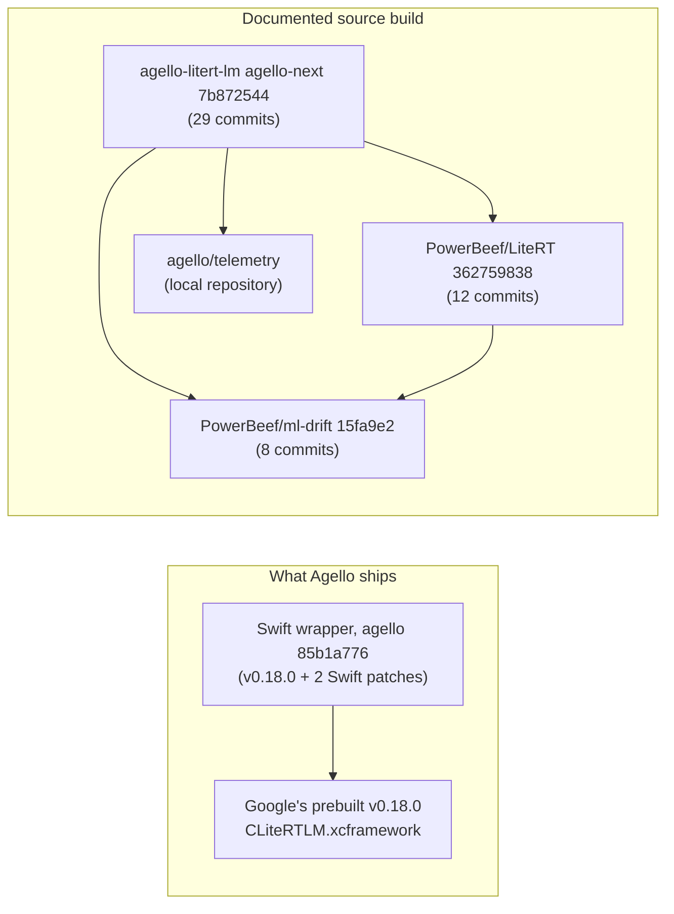

# Our patches

> **Scope:** every commit of ours on top of Google's code: the 29 commits of `PowerBeef/agello-litert-lm`
> `agello-next`, the 12 of `PowerBeef/LiteRT` and the 8 of `PowerBeef/ml-drift` (all `agello-next`),
> and the Swift wrapper Agello ships (`agello` `85b1a776`); grouped by purpose, with the evidence,
> the upstream status and when each can go. Also the fork's landing page (C4), the patch count in
> Agello's docs (C3), the draft count (C8) and the model revisions older notes cite (C17).
> **Out of scope:** what each patch does inside its subsystem, which the subsystem pages (linked per row)
> explain and verify; how to take a patch upstream, in [contributing.md](contributing.md); the
> rotary-position model fix itself, in [models/gemma4-e4b.md](models/gemma4-e4b.md).
> **Pinned to:** LiteRT-LM `7b872544` (base `df6df5b8`), LiteRT `362759838` (base `ca21dc99`),
> ML Drift `15fa9e2` (base `1b18771`); shipped wrapper `85b1a776` (base v0.18.0 `b2f686e2`).
> **Applies to:** Apple (iOS, macOS), with the parts that apply to all platforms marked.
> **Last verified:** 2026-10-15

## Summary

- Our work sits in four commit ranges, listed by
  [generated/patch-log.md](generated/patch-log.md). Only one of them reaches users today:
  the Swift wrapper at `85b1a776`, whose only source change from v0.18.0 is
  `swift/Conversation.swift`, with two behavior patches. Everything else (49 commits across the
  three forks) is in the documented source build, which Agello doesn't ship yet.
- By purpose: two Swift correctness fixes, three runtime correctness fixes (response formats
  without the closed constraint provider, a decode task left unfinished, XNNPACK's oversized
  scales), memory fixes for session switches and the weight cache, speed work on Metal host
  copies, attention bounds and host costs per token, telemetry and simulation tooling, and the
  build that links LiteRT's Metal accelerator statically.
- Upstream status as of 2026-10-15: nothing of ours is merged upstream or posted except issue
  #3913. Google has since landed fixes that overlap two of ours: XNNPACK's scale sizing (through a
  newer TensorFlow pin) and in-place writes to shared Metal buffers.
- What to watch: the passive Metal waits don't reach Agello (it runs in benchmark mode), several
  measurements were taken on working trees rather than the commits, and the fork's landing page
  is out of date.

## Concepts

### Where our commits live

| Range | Repository, branch | Base | Pin | Commits | Files that differ |
| --- | --- | --- | --- | --- | --- |
| Documented runtime | `PowerBeef/agello-litert-lm`, `agello-next` | `df6df5b8` (`0.19.0-nightly.20261013`) | `7b872544` | 29 | 65 |
| LiteRT | `PowerBeef/LiteRT`, `agello-next` | `ca21dc99` (main 2026-10-09) | `362759838` | 12 | 41 |
| ML Drift | `PowerBeef/ml-drift`, `agello-next` | `1b18771` (main 2026-10-07) | `15fa9e2` | 8 | 21 |
| Shipped wrapper | `PowerBeef/agello-litert-lm`, `agello` | v0.18.0 `b2f686e2` | `85b1a776` | 15 | 71 |

Those are the counts `git log --oneline <base>..<pin>` and `git diff --name-only <base> <pin>`
give for each repository in `pins.json`. <!-- c:OUR-001 --> The shipped range's 15 commits
include docs and the bench; only three touch the wrapper, and two of those change its behavior
([The two Swift patches](#the-two-swift-patches)). The LiteRT-LM fork pins the other two forks by
commit and archive sha256 in its `WORKSPACE`
([`WORKSPACE:493-508`](https://github.com/PowerBeef/agello-litert-lm/blob/7b872544fdbd81308f98b1e2acf8c5798a549df6/WORKSPACE#L493-L508),
[`WORKSPACE:517-527`](https://github.com/PowerBeef/agello-litert-lm/blob/7b872544fdbd81308f98b1e2acf8c5798a549df6/WORKSPACE#L517-L527));
see [litert-lm/build-and-release.md](litert-lm/build-and-release.md#external-repositories-and-pins).

### Tags in commit subjects

Our commit subjects end with the plan item they belong to. The tags come from
[../PLAN-MAC.md](../PLAN-MAC.md) and the track notes in [../tracks/](../tracks/):

| Tag | Meaning | Track note |
| --- | --- | --- |
| `M1.2`, `M1.3`, `M1.5` | Building the runtime from source with the Metal accelerator | [../BUILD.md](../BUILD.md) |
| `T0` | Telemetry | [../TELEMETRY.md](../TELEMETRY.md) |
| `T2`, `P6` | Host costs per token, the FP16 greedy path | [../tracks/T2-host-costs.md](../tracks/T2-host-costs.md), [../tracks/T7-sampler.md](../tracks/T7-sampler.md) |
| `T3` | Session switches (helper conversations) | [../tracks/T3-helpers.md](../tracks/T3-helpers.md) |
| `T4` | Attention bounded to the filled length and the local window | [../tracks/T4-attention.md](../tracks/T4-attention.md) |
| `T5` | Unified memory: host copies and waits | [../tracks/T5-unified-memory.md](../tracks/T5-unified-memory.md) |
| `T11` | One weight cache entry for every context size | [../tracks/T11-caches.md](../tracks/T11-caches.md) |
| `P1.x` | Ship readiness: build info, release script, notices | [../BUILD.md](../BUILD.md) |
| `CPU`, `SIM` | The XNNPACK fix; the simulated GPU family | [../VALIDATION.md](../VALIDATION.md) |

The track notes are leads: the numbers on this page come from the raw records in
[../results/](../results/) or from verified ledger claims.

### Upstream status: the terms

| Status | Meaning |
| --- | --- |
| Not filed | No draft and nothing posted |
| Drafted | A text in [../upstream/](../upstream/), not posted (see [contributing.md](contributing.md#our-drafts)) |
| Posted | An issue, comment or pull request exists upstream |
| Overlapped upstream | Google landed a change in the same place after our base; ours needs a rebase or less of it |
| Fixed upstream | Google's code makes ours unnecessary once we move past the commit named |

## How it works

Each table lists what a commit changes (with the claims that verify it), why, and the
evidence. Commits that only move a pin are grouped at the end of
[Build and packaging](#build-and-packaging).

### Correctness

| Commit | What it changes | Why | Evidence |
| --- | --- | --- | --- |
| LiteRT-LM [`f3408e06`](https://github.com/PowerBeef/agello-litert-lm/commit/f3408e067168d4ec2e47d68b98b7e37b778a876d) (shipped as [`a3c0d0ef`](https://github.com/PowerBeef/agello-litert-lm/commit/a3c0d0ef729c28d529e2b063785a0808dd19c062)) | Failed tool calls get an `error` tool response; the turn continues ([litert-lm/swift-api.md](litert-lm/swift-api.md#tools), LM-SWIFT-023, LM-SWIFT-024) | v0.18.0 rethrew any tool failure and ended the reply | Probe 15 ([below](#the-two-swift-patches)) |
| LiteRT-LM [`0b2ca12f`](https://github.com/PowerBeef/agello-litert-lm/commit/0b2ca12fc46ee105444397cef10c096677cef4d0) (shipped as [`85b1a776`](https://github.com/PowerBeef/agello-litert-lm/commit/85b1a77695bc90fc8b34a1f455bbe5b2c7fdceff)) | `StreamContext` holds its conversation weakly ([litert-lm/swift-api.md](litert-lm/swift-api.md#our-fix-a-stream-holds-its-conversation-weakly), LM-SWIFT-019 to -021) | A dropped conversation was deleted on the callback thread and waited for the 10-minute timeout | Probe 9 ([below](#the-two-swift-patches)) |
| LiteRT-LM [`d1488ce7`](https://github.com/PowerBeef/agello-litert-lm/commit/d1488ce7a99efcf8f483ab54648f27df814aee16) | Gemma 3, Gemma 4 and FunctionGemma processors build without the closed FST provider and keep response formats ([`gemma4_data_processor.cc:157-164`](https://github.com/PowerBeef/agello-litert-lm/blob/7b872544fdbd81308f98b1e2acf8c5798a549df6/runtime/conversation/model_data_processor/gemma4_data_processor.cc#L157-L164); [litert-lm/conversation.md](litert-lm/conversation.md#constraints), LM-CNV-073, LM-CNV-074) | Without the provider, any conversation with constrained decoding failed, JSON output included | Agello's Mac parity run in `results/mac/2026-10-14/agello/parity-ours/` (probe 2, constrained JSON), a build [../PARITY.md](../PARITY.md) describes as including it; its records carry no build id |
| LiteRT-LM [`9f619cf9`](https://github.com/PowerBeef/agello-litert-lm/commit/9f619cf9d28e4df96df981b0768b0e5932d6f2b6) | A decode task whose sampled-ID buffer can't be created finishes with the error ([litert-lm/engine-and-sessions.md](litert-lm/engine-and-sessions.md#our-changes-in-this-area), LM-ENG-094) | It stayed `kProcessing`, so waits on its session ran into the 10-minute timeout | Code only; no measurement |
| LiteRT-LM [`51f099fb`](https://github.com/PowerBeef/agello-litert-lm/commit/51f099fb7411204ce006d55ff79eb6b0bd06bea0), then [`b8f807ec`](https://github.com/PowerBeef/agello-litert-lm/commit/b8f807ecdc3667477aa7238659dff7f2cf9e671e) | XNNPACK declared at TensorFlow's pin with upstream XNNPACK `c72e2a4ae0`'s scale sizing as a patch ([`WORKSPACE:275-290`](https://github.com/PowerBeef/agello-litert-lm/blob/7b872544fdbd81308f98b1e2acf8c5798a549df6/WORKSPACE#L275-L290); [litert/cpu-xnnpack.md](litert/cpu-xnnpack.md#our-xnnpack-patch), RT-CPU-016) | The CPU engine for E4B held 5.5 GB of oversized scale buffers and iOS killed it | iPhone probe 6 before and after (RT-CPU-017) |

`b8f807ec` replaced `51f099fb`'s own patch with upstream's diff; the first commit's message says
upstream XNNPACK still had the bug, which the second corrects
([litert/cpu-xnnpack.md](litert/cpu-xnnpack.md#our-xnnpack-patch)).

### Memory

| Commit | What it changes | Why | Evidence |
| --- | --- | --- | --- |
| LiteRT-LM [`ed998d80`](https://github.com/PowerBeef/agello-litert-lm/commit/ed998d807248f468917f0447eda20878d39a4213) | The resource manager skips the snapshot of a released session's handler on a switch ([litert-lm/engine-and-sessions.md](litert-lm/engine-and-sessions.md#context-switches-what-is-copied-and-where), LM-ENG-056, LM-ENG-064) | The snapshot was a full KV copy nothing restored, held next to the chat's | Peak +944 MB → +472 MB over the control (LM-ENG-060) |
| LiteRT-LM [`585203d3`](https://github.com/PowerBeef/agello-litert-lm/commit/585203d326760c2e5a5ace0e769a8798f9176a2f) | Raw KV snapshots live in anonymous mappings unmapped on free (LM-ENG-052) | A freed `malloc` snapshot stayed resident in the allocator | Footprint after a helper back to the control's ([Evidence](#evidence-and-its-limits)) |
| LiteRT [`97e06d36`](https://github.com/PowerBeef/LiteRT/commit/97e06d36d7143995298d6bee396a0c25a22fa886) | The weight cache keys a subgraph by its content, not by tensor sizes ([litert/ml-drift-delegate.md](litert/ml-drift-delegate.md#weight-cache), RT-DLG-055) | Every context size wrote another copy of the same converted weights | Load times (RT-DLG-056); iPhone probe 14 ([Evidence](#evidence-and-its-limits)) |
| LiteRT-LM `51f099fb`, `b8f807ec` | XNNPACK scales (above) | | |

### Speed

| Commit | What it changes | Why | Evidence |
| --- | --- | --- | --- |
| LiteRT-LM [`aec81cb7`](https://github.com/PowerBeef/agello-litert-lm/commit/aec81cb780e0d735fe1c9e4a17536cd6a613f43f) | Session-switch snapshots copy shared `MTLBuffer` bytes as they are, no layout conversion (LM-ENG-051, LM-EXE-018) | Each switch converted every INT8 cache to row order and back | `t3-raw.jsonl` ([Evidence](#evidence-and-its-limits)) |
| LiteRT-LM [`e43f9a8d`](https://github.com/PowerBeef/agello-litert-lm/commit/e43f9a8d9684211e7b7be14663e5e593031ff19c) | No token-history copy and no new output buffer per decode step (LM-ENG-095, LM-EXE-013) | Work repeated for nothing every step | Counters ([Evidence](#evidence-and-its-limits)) |
| LiteRT-LM [`ef197a04`](https://github.com/PowerBeef/agello-litert-lm/commit/ef197a040071f36460b184b4e86a14557d56922b) | All-allowed masks are skipped ([litert-lm/components.md](litert-lm/components.md#logit-masks), LM-CMP-046) | A thinking budget masked all 262,144 logits every step while allowing them all | Within noise on the M6 |
| LiteRT-LM [`5e946049`](https://github.com/PowerBeef/agello-litert-lm/commit/5e9460494c9993efb2ad5c8d4cae64bca3db15bb) | Vocabulary size from `GetVocabSize()` ([litert-lm/components.md](litert-lm/components.md#tokenizers), LM-CMP-012, LM-ENG-082) | Every decode task built one string per vocabulary entry | Within noise on the M6 |
| LiteRT-LM [`fdd5bac7`](https://github.com/PowerBeef/agello-litert-lm/commit/fdd5bac73f106d6b5a976eca38ff1cd3465fb43c) | Greedy picks over FP16 logits compare the halves as integers ([litert-lm/components.md](litert-lm/components.md#fp16-logits-and-the-greedy-half-path), LM-CMP-030) | MTP's greedy samplers converted 262,144 halves per pick | Within noise ([Evidence](#evidence-and-its-limits)) |
| LiteRT [`e17213ea`](https://github.com/PowerBeef/LiteRT/commit/e17213ead251015d1aa30483b918bfbde846a4a0), [`584f3461`](https://github.com/PowerBeef/LiteRT/commit/584f3461080228a11bd70ba0aa66539a256a2b81) | Direct host reads and writes for linear Metal buffers ([litert/ml-drift-delegate.md](litert/ml-drift-delegate.md#the-metal-buffer-handler), RT-DLG-076) | Every lock went through ML Drift's per-element conversion; uploads made a command queue each time | Decode with MTP 132.3 → 150.2 tok/s (RT-DLG-079) |
| LiteRT-LM [`645aaf65`](https://github.com/PowerBeef/agello-litert-lm/commit/645aaf65ffe91b364db7c4889f75a0e7233a45b4) + LiteRT [`77ed9cab`](https://github.com/PowerBeef/LiteRT/commit/77ed9cab4735ac7ea1d9114595162bdaf6b81b76) | Passive (sleeping) GPU waits outside benchmark mode ([`llm_executor_settings_utils.cc:220-235`](https://github.com/PowerBeef/agello-litert-lm/blob/7b872544fdbd81308f98b1e2acf8c5798a549df6/runtime/executor/llm_executor_settings_utils.cc#L220-L235)), and passive waits commit command buffers as they're encoded ([`gpu_backend_metal.mm:506-521`](https://github.com/PowerBeef/LiteRT/blob/362759838e34e1525f1cc27daddaf663a193c059/ml_drift_delegate/delegate/gpu_backend_metal.mm#L506-L521); RT-DLG-063) | The default wait busy-spins a CPU core for the whole of every GPU wait | Bench records `busywait`, `passive`, `chunked` in `results/mac/2026-10-14/bench/`; **not active in Agello** (below) |
| LiteRT [`ede28c64`](https://github.com/PowerBeef/LiteRT/commit/ede28c641b8552965cdbc4a42414ef5a72ee573c), [`aa05bd2d`](https://github.com/PowerBeef/LiteRT/commit/aa05bd2d17acc15008b59602139b8ca4f4f56624), [`31386317`](https://github.com/PowerBeef/LiteRT/commit/3138631754051aeaf46a97d751c34401dae3fef3) | The bounded-attention graph pass, its tests, and the local window ([litert/ml-drift-delegate.md](litert/ml-drift-delegate.md#bounded-attention-ours-ede28c64-31386317), RT-DLG-032, RT-DLG-034) | The attention select and softmax ran over the whole KV capacity; local layers read every key | Prefill 1,135 → 2,726 tok/s at a 32K capacity (RT-DLG-041); decode 39.7 → 46.4 tok/s at 16K filled (MD-KRN-062) |
| ML Drift [`6ae7c68`](https://github.com/PowerBeef/ml-drift/commit/6ae7c681ce17bc9e17346893828625f76ef9abd0), [`2184a7f`](https://github.com/PowerBeef/ml-drift/commit/2184a7f71b47941a0204f4f1c02753a886303d76), [`15fa9e2`](https://github.com/PowerBeef/ml-drift/commit/15fa9e2ba632145992299e3f04786dc1f575373c) | The window start in FC, softmax, ConvAppleMPP and ConvWaveMatrix ([`gpu_operation.cc:1823-1828`](https://github.com/PowerBeef/ml-drift/blob/15fa9e2ba632145992299e3f04786dc1f575373c/ml_drift/common/task/gpu_operation.cc#L1823-L1828); [ml-drift/kernels.md](ml-drift/kernels.md#the-sliding-window-ours), MD-KRN-054, MD-KRN-058, MD-KRN-060, MD-KRN-061) | The kernels had an end bound and no start bound | As above; fidelity exact on the Apple10 and simulated Apple9 paths (MD-KRN-090) |

The passive-wait pair needs benchmark mode off, and Agello turns benchmark mode on at every load
(`ExperimentalFlags.enableBenchmark = true`), so the app gets the active wait from both its
shipped binary and our build. <!-- c:OUR-034 --> The path is verified as LM-EXE-038, RT-DLG-067
and RT-RUN-028. Text about the
CPU saving (user docs, commit messages, upstream reports) has to say it needs benchmark mode off.

### Telemetry and tooling

These record and don't change control flow (LM-ENG-097); the level defaults to 1 (counters and
anomalies) and `AGELLO_TELEMETRY` changes it (LM-CAPI-040,
[`agello_telemetry.cc:53`](https://github.com/PowerBeef/agello-litert-lm/blob/7b872544fdbd81308f98b1e2acf8c5798a549df6/agello/telemetry/agello/agello_telemetry.cc#L53)).

| Repository | Commits | What | Verified in |
| --- | --- | --- | --- |
| LiteRT-LM | [`4aed9274`](https://github.com/PowerBeef/agello-litert-lm/commit/4aed9274a4de31993c6005afb6de02412a60f6fd), [`a8458a02`](https://github.com/PowerBeef/agello-litert-lm/commit/a8458a028798892a2baa673d68a27932465c03cb), [`b5fe681e`](https://github.com/PowerBeef/agello-litert-lm/commit/b5fe681ea5c8870bf1e894dabeaee78cdb4bc5b9), [`a3a0c0ad`](https://github.com/PowerBeef/agello-litert-lm/commit/a3a0c0adeb104ef54d22b2b45c758c127574a770), telemetry half of `9f619cf9` and `645aaf65` | The `agello/telemetry` library (its own Bazel repository), probes in sessions, tasks, executor and sampler, the C (`litert_lm_telemetry_*`) and Swift (`Telemetry`) APIs, logits probes and gauges | [litert-lm/c-api.md](litert-lm/c-api.md#our-additions-telemetry-and-build-info) (LM-CAPI-039, -040), [litert-lm/swift-api.md](litert-lm/swift-api.md#buildinfo-and-telemetry-ours) (LM-SWIFT-044) |
| LiteRT | [`1b177bd9`](https://github.com/PowerBeef/LiteRT/commit/1b177bd9421c0ca64030476b2342b5c85313b237), [`b66a46e6`](https://github.com/PowerBeef/LiteRT/commit/b66a46e6d870eab04bff5377fa6fdf4e3cca4942), [`5083cfae`](https://github.com/PowerBeef/LiteRT/commit/5083cfaedaca90c748c7ffec19cf53902e6a9ba5) | Trace sites and command-buffer timing, GPU family and wait mode as facts, host copies, cache events and delegation coverage | [litert/runtime.md](litert/runtime.md#delegation-metrics) (RT-RUN-017), [ml-drift/architecture.md](ml-drift/architecture.md#gpu-detection) (MD-ARC-021) |
| ML Drift | [`04fe7b7`](https://github.com/PowerBeef/ml-drift/commit/04fe7b712c777a10d4d43388a6dca65d38597f66), [`5aaea03`](https://github.com/PowerBeef/ml-drift/commit/5aaea039f9bd25cec48f2194a9a7fa2c0dde76a1), [`55196d7`](https://github.com/PowerBeef/ml-drift/commit/55196d78cfd17dfa9b6e19ffc75d8d1b54156850) | Command-buffer timing, kernel names on pipelines, per-kernel GPU time at level 4, GPU graph dumps (`AGELLO_TELEMETRY_GRAPH_DIR`, [`inference_context.mm:638`](https://github.com/PowerBeef/ml-drift/blob/15fa9e2ba632145992299e3f04786dc1f575373c/ml_drift/metal/inference_context.mm#L638)) | [ml-drift/metal-backend.md](ml-drift/metal-backend.md#our-telemetry-hooks) (MD-MTL-008, -019, -032 to -034) |
| ML Drift, LiteRT | [`ef08a67`](https://github.com/PowerBeef/ml-drift/commit/ef08a6785834a9ea248c62c67f1c692aa1cf1c35), [`36275983`](https://github.com/PowerBeef/LiteRT/commit/362759838e34e1525f1cc27daddaf663a193c059) | `AGELLO_SIMULATE_APPLE_GPU` runs another Apple GPU's kernel choices ([`gpu_info.cc:1365-1375`](https://github.com/PowerBeef/ml-drift/blob/15fa9e2ba632145992299e3f04786dc1f575373c/ml_drift/common/gpu_info.cc#L1365-L1375)), and keys its own caches ([`delegate_kernel.cc:859-862`](https://github.com/PowerBeef/LiteRT/blob/362759838e34e1525f1cc27daddaf663a193c059/ml_drift_delegate/delegate/delegate_kernel.cc#L859-L862)) | [ml-drift/architecture.md](ml-drift/architecture.md#gpu-detection) (MD-ARC-016, MD-ARC-018) |
| LiteRT-LM | [`c7c744eb`](https://github.com/PowerBeef/agello-litert-lm/commit/c7c744ebc60a329a319657b7b5a81fbba66a10f4) | `litert_lm_get_build_info` and `LiteRTLM.BuildInfo` | LM-CAPI-041, LM-SWIFT-043 |

ML Drift's Metal inference context depends on `@agello_telemetry//:metal`
([`ml_drift/metal/BUILD:158-163`](https://github.com/PowerBeef/ml-drift/blob/15fa9e2ba632145992299e3f04786dc1f575373c/ml_drift/metal/BUILD#L158-L163)),
so our ML Drift fork builds only inside a workspace that declares that repository, as LiteRT-LM's
does ([`WORKSPACE:510-515`](https://github.com/PowerBeef/agello-litert-lm/blob/7b872544fdbd81308f98b1e2acf8c5798a549df6/WORKSPACE#L510-L515);
MD-MTL-031). The telemetry hooks are the main thing an upstream pull request would have to leave
out.

### Build and packaging

| Repository | Commits | What | Verified in |
| --- | --- | --- | --- |
| LiteRT-LM | [`43f0f5c3`](https://github.com/PowerBeef/agello-litert-lm/commit/43f0f5c32f9c3cf438ea5cc85c2a8551349d3382) | LiteRT's Metal accelerator linked statically on iOS and macOS ([`runtime/executor/BUILD:255-280`](https://github.com/PowerBeef/agello-litert-lm/blob/7b872544fdbd81308f98b1e2acf8c5798a549df6/runtime/executor/BUILD#L255-L280)); `--config=agello` | LM-BLD-006, LM-BLD-013, RT-RUN-005 |
| LiteRT-LM | [`3b2327cf`](https://github.com/PowerBeef/agello-litert-lm/commit/3b2327cfcdeb553ed49f93b447ef802dec8616a4) | `//agello:CLiteRTLM` XCFramework (iOS and macOS arm64), one local binary target in `Package.swift` ([`Package.swift:36-40`](https://github.com/PowerBeef/agello-litert-lm/blob/7b872544fdbd81308f98b1e2acf8c5798a549df6/Package.swift#L36-L40)) | LM-BLD-031, LM-BLD-047 |
| LiteRT-LM | [`e309971f`](https://github.com/PowerBeef/agello-litert-lm/commit/e309971f0638f21063e736333173ec7245ffe706) | LiteRT and ML Drift from our forks, by commit and sha256, replacing `patch_cmds` | LM-BLD-019 to -021 |
| LiteRT-LM | [`57376f53`](https://github.com/PowerBeef/agello-litert-lm/commit/57376f533ac97bfea04fe54457307db76076c9ea) | `release-xcframework.sh` (a dry run unless `--publish`, [`release-xcframework.sh:68-74`](https://github.com/PowerBeef/agello-litert-lm/blob/7b872544fdbd81308f98b1e2acf8c5798a549df6/agello/release-xcframework.sh#L68-L74)) and third-party notices | LM-BLD-044 |
| LiteRT | [`355e29ed`](https://github.com/PowerBeef/LiteRT/commit/355e29ed38e4425b683c756d838c1d970a6fbf2c) | Builds as an external repository: `@litert//third_party/` labels, a `no_module` alias, the open-source include path of `gpu_backend_metal_litert.h` ([`gpu_backend_metal_litert.mm:15`](https://github.com/PowerBeef/LiteRT/blob/362759838e34e1525f1cc27daddaf663a193c059/ml_drift_delegate/delegate/gpu_backend_metal_litert.mm#L15)) | [Upstream status](#equivalents-google-landed-after-our-bases) |
| ML Drift | [`e38276c`](https://github.com/PowerBeef/ml-drift/commit/e38276cbecf43b5e071316eec8d51b00b6fbc65c) | `@litert` labels for LiteRT's delegate packages; the GL target's flatc include path | |
| LiteRT-LM | [`1f0fc73f`](https://github.com/PowerBeef/agello-litert-lm/commit/1f0fc73fccea952c6c953125f8abb82c9831597e), [`42fc1533`](https://github.com/PowerBeef/agello-litert-lm/commit/42fc1533cc62d011f43891992f98a3a45c55f7be), [`23bfa376`](https://github.com/PowerBeef/agello-litert-lm/commit/23bfa376c0b9d5c3216bd20b96b0268b250f13b6), [`67d00f36`](https://github.com/PowerBeef/agello-litert-lm/commit/67d00f36c24402a2245518f59f68ba847a02aa91), [`12a0a818`](https://github.com/PowerBeef/agello-litert-lm/commit/12a0a818ab6c60fdc0a2af5c5f092993ff0590c4), [`7b872544`](https://github.com/PowerBeef/agello-litert-lm/commit/7b872544fdbd81308f98b1e2acf8c5798a549df6) | `WORKSPACE` re-pins as the forks moved; the last one pins ML Drift `15fa9e2` | LM-BLD-019, LM-BLD-020 |

## On Apple

Most of our runtime work only runs on Apple platforms, but not all of it:

| Patch | Where it applies | Why |
| --- | --- | --- |
| Raw KV snapshots (`aec81cb7`, `585203d3`) | Apple only | `//runtime/util:metal_raw_buffer` selects the Objective-C++ file on iOS and macOS and a stub elsewhere (LM-ENG-053) |
| Metal accelerator linked statically (`43f0f5c3`) | Apple only | `apple_static_gpu_accelerator` selects it for `@platforms//os:ios` and `macos`, empty elsewhere (LM-BLD-013) |
| Direct copies, passive-wait chunking (LiteRT `e17213ea`, `584f3461`, `77ed9cab`) | Apple only | `buffer_handler_metal.mm`, `gpu_backend_metal.mm` |
| Window in ConvAppleMPP (`2184a7f`) | Apple10 GPUs | The kernel ML Drift picks there for prefill (MD-KRN-058) |
| Window in ConvWaveMatrix (`15fa9e2`) | Apple GPUs ML Drift sends to simdgroup matrices (Apple9 in practice) | MD-KRN-060 |
| Bounded attention pass, window in FC and softmax, weight cache key | Every ML Drift backend in principle; measured only on Metal | Graph pass and common kernels |
| Host costs per token, `d1488ce7`, `9f619cf9`, XNNPACK | All platforms | Platform-independent C++ |
| Swift patches | Apple only | The Swift wrapper |

Agello's own Mac runs use the iPhone app on the Mac ("Designed for iPad/iPhone"), so they take
the same Metal path as the phone; see [apple-platform.md](apple-platform.md).

## What Agello ships (C3)

Agello vendors the wrapper at `85b1a776` byte for byte (LM-SWIFT-046) and links Google's
v0.18.0 binary, so none of the runtime patches above reach users (RT-DLG-083, MD-KRN-085).

### The two Swift patches

From v0.18.0 to `85b1a776`, the only file that changes in the wrapper's sources is
`swift/Conversation.swift` (73 lines added, 16 removed); `Package.swift` is v0.18.0's, with
Google's release URLs and checksums
([`Package.swift:36-50`](https://github.com/google-ai-edge/LiteRT-LM/blob/b2f686e2ed4718fb84ec398a61dd59ca0f0aff27/Package.swift#L36-L50)).
The change is two patches and a modification notice
([`swift/Conversation.swift:15-20`](https://github.com/PowerBeef/agello-litert-lm/blob/85b1a77695bc90fc8b34a1f455bbe5b2c7fdceff/swift/Conversation.swift#L15-L20)):
`a3c0d0ef` (failed tool calls) and `85b1a776` (the weak stream reference); `7c4ee32d` only
renames the repository in the notice. <!-- c:OUR-002 -->

1. **Failed tool calls don't end the reply** (`a3c0d0ef`; `f3408e06` on `agello-next`).
   Upstream's `handleToolCalls` skipped a call whose arguments weren't a JSON object and rethrew
   any tool error as `toolExecutionError`
   ([`swift/Conversation.swift:386-409`](https://github.com/google-ai-edge/LiteRT-LM/blob/df6df5b84d5845b49889f631ed4cac80b4325dd3/swift/Conversation.swift#L386-L409)).
   The patch treats missing or null arguments as `{}`, decodes a JSON string holding an object,
   answers anything else with an `error` response, and turns `notFound`, `DecodingError` and
   other thrown errors into messages the model reads
   ([`swift/Conversation.swift:349-378`](https://github.com/PowerBeef/agello-litert-lm/blob/85b1a77695bc90fc8b34a1f455bbe5b2c7fdceff/swift/Conversation.swift#L349-L378),
   [`swift/Conversation.swift:427-456`](https://github.com/PowerBeef/agello-litert-lm/blob/7b872544fdbd81308f98b1e2acf8c5798a549df6/swift/Conversation.swift#L427-L456)).
   <!-- c:OUR-004 --> Agello's probe 15 checks it: on our build `b2d0db54134f` on the M6, the
   failing tool was called once, nothing was thrown, and the reply explained that the order
   service was offline. <!-- c:OUR-007 -->
2. **A stream holds its conversation weakly** (`85b1a776`; `0b2ca12f` on `agello-next`).
   Upstream's `StreamContext` holds `let conversation: Conversation`
   ([`swift/Conversation.swift:781-784`](https://github.com/google-ai-edge/LiteRT-LM/blob/df6df5b84d5845b49889f631ed4cac80b4325dd3/swift/Conversation.swift#L781-L784));
   both of our wrappers hold `weak var conversation: Conversation?`
   ([`swift/Conversation.swift:798-800`](https://github.com/PowerBeef/agello-litert-lm/blob/85b1a77695bc90fc8b34a1f455bbe5b2c7fdceff/swift/Conversation.swift#L798-L800),
   [`swift/Conversation.swift:835-837`](https://github.com/PowerBeef/agello-litert-lm/blob/7b872544fdbd81308f98b1e2acf8c5798a549df6/swift/Conversation.swift#L835-L837)).
   <!-- c:OUR-005 --> The mechanism of the stall is verified in
   [litert-lm/swift-api.md](litert-lm/swift-api.md#our-fix-a-stream-holds-its-conversation-weakly)
   (LM-SWIFT-020). Agello's probe 9 creates a conversation, abandons its stream at the first
   chunk, then times the first token of a fresh conversation (`freshTTFT`). On the M6
   (`PLATFORM=mac`) that took 600.2 s with our build before the fix and 600.18 s with Google's
   0.19.0 nightly (2026-10-14), against 0.111 s with our build `b2d0db54134f`, which has the fix
   (2026-10-15). <!-- c:OUR-006 -->

Neither patch is upstream: Google's `main` at `d87575de` (2026-10-15) has no commit touching
`swift/Conversation.swift` after our base; the last one is `b4a9d0ec` (2026-10-01).
<!-- c:OUR-008 -->

**C3 resolution.** The wrapper Agello ships carries two patches. Agello's `Vendor/README.md`,
`NOTICE` and `agello-litert-update` skill say two; `CLAUDE.md` line 24 at `93122b6` still says
"v0.18.0 plus one tool-call patch", which was true before Agello vendored `85b1a776` on
2026-10-14 and is now stale. <!-- c:OUR-003 -->

### Other commits on the agello branch

The shipped range also holds the fork's landing page (`7c4ee32d`), `docs/agello/` notes and
results, `tools/agello-bench` and `tools/model-surgery/inspect_e4b.py`. After `85b1a776`, the
`agello` branch has 25 more commits up to `61c03d8e` (2026-10-15), touching only `docs/agello/`,
`tools/agello-bench/` and `tools/model-surgery/`; they include `patch_rope.py --block`
(`f2e7afa0`), the model-side #3913 fix Agello downloads (see
[models/gemma4-e4b.md](models/gemma4-e4b.md)). <!-- c:OUR-009 -->

## Upstream status

### Equivalents Google landed after our bases

Upstream `main` as fetched on 2026-10-15: LiteRT-LM `d87575de`, LiteRT `309cf084`, ML Drift
`6e803da`.

- **XNNPACK (fixed upstream).** Our base pins TensorFlow `a1179d3c`
  ([`WORKSPACE:10-12`](https://github.com/google-ai-edge/LiteRT-LM/blob/df6df5b84d5845b49889f631ed4cac80b4325dd3/WORKSPACE#L10-L12)),
  whose XNNPACK is `d89ef666`, 58 commits behind XNNPACK's fix `c72e2a4ae0`. Upstream LiteRT-LM
  `c05e67a2` (on `main`, committed 2026-10-14 02:17 UTC) moved TensorFlow from `ff42e955` (still
  XNNPACK `d89ef666`) to `5d071809`, whose XNNPACK `0a66ebb5` is 219 commits
  ahead of the fix. So the XNNPACK patch can go when `agello-next` moves to an upstream base at
  or after `c05e67a2`. <!-- c:OUR-012 -->
- **Writes to shared Metal buffers (overlapped upstream).** LiteRT `bd326784` (2026-10-14) makes
  `LiteRtUnlockMetalMemory`, after a write lock on a non-packed tensor whose storage is `kBuffer`
  or `kImageBuffer` in a shared-storage `MTLBuffer`, copy the converted data straight into the
  buffer instead of calling `UploadDescriptorData`. Our base calls `UploadDescriptorData`, which
  made a command queue and a blit, on every write unlock of a non-packed tensor; read-locked
  unlocks return early, and packed buffers use `WriteDataToBuffer`
  ([`buffer_handler_metal.mm:320-326`](https://github.com/google-ai-edge/LiteRT/blob/ca21dc99de51c76bdcc572afeea1dd937d3c9e5c/ml_drift_delegate/delegate/buffer_handler_metal.mm#L320-L326)
  at our base). `bd326784` still runs ML Drift's conversion first; our LiteRT commits `e17213ea`
  (reads) and `584f3461` (writes) copy linear-buffer tensors directly, without the conversion,
  when the host element type matches the GPU tensor's
  ([`buffer_handler_metal.mm:96`](https://github.com/PowerBeef/LiteRT/blob/362759838e34e1525f1cc27daddaf663a193c059/ml_drift_delegate/delegate/buffer_handler_metal.mm#L96)).
  `bd326784` is in neither our base nor the LiteRT commit upstream LiteRT-LM `main` `d87575de`
  pins (`9b8c7f77`). <!-- c:OUR-011 --> The direct-copies draft has to be rewritten on top of it
  (its 0.22–0.36 ms parameter-write row is the part Google fixed).
- **LiteRT-LM.** No upstream commit after our base touches `swift/Conversation.swift`,
  `runtime/executor/litert/state.cc`, the logit mask files, `top_p_cpu_sampler.cc`,
  `runtime/core/tasks.cc`, `threaded_execution_manager.cc`, `gemma4_data_processor.cc` or
  `llm_executor_settings_utils.cc`; the one commit touching `resource_manager.cc` and the
  compiled-model executor (`61dcfc77`, LoRA) changes code our patches don't.
  <!-- c:OUR-010 -->
- **LiteRT.** No upstream commit after our base touches `serialization_weight_cache.cc`,
  `custom_transformations.cc`, the `runtime_batched_matmul` parser and kernel, or
  `gpu_backend_metal.mm`. `delegate_kernel.cc` changed upstream (`cc2e0026`, Emscripten weights;
  `bf73b21c` and its revert `dc90c901`), and so did `delegate_kernel_litert.cc` (`88f2b777`) and
  `litert_op_selector.cc` (`120852c3`), so our cache-key, simulation, telemetry and op-selector
  edits there need a rebase check. <!-- c:OUR-013 --> Our external-repository fixes (`355e29ed`) aren't upstream either:
  upstream still imports `third_party/odml/litert/ml_drift/delegate/gpu_backend_metal_litert.h`
  ([`gpu_backend_metal_litert.mm:15`](https://github.com/google-ai-edge/LiteRT/blob/ca21dc99de51c76bdcc572afeea1dd937d3c9e5c/ml_drift_delegate/delegate/gpu_backend_metal_litert.mm#L15)
  at our base, unchanged on `main`). <!-- c:OUR-014 -->
- **ML Drift.** Four upstream commits change files our window (`6ae7c68`) and simulation
  (`ef08a67`) commits edit: `7f148ea` and `cef08e7` (both "internal change", 2026-10-07) rewrite
  `fully_connected.cc`, `cef08e7` in `GetFullyConnectedKernelCode` near our window hunk;
  `28ac13c` (2026-10-14, workgroup tuning) changes `fully_connected.cc`, `softmax1x1.cc` and
  `gpu_info.cc`; and `84028dc` (2026-10-13, perf stats) changes `softmax.cc`, `softmax1x1.cc` and
  `gpu_operation.cc`. No upstream commit after our base touches
  `conv_apple_mpp.cc`, `conv_wave_matrix.cc`, `fully_connected_util.cc`, `gpu_operation.h` or the
  Metal sources (`inference_context.mm`, `compute_task.mm`, `common.mm`); `ml_drift/metal/BUILD`
  changed (`f4b8342`, `7c58cf0`). <!-- c:OUR-015 -->

### Drafts and posts

Seven drafts in [../upstream/](../upstream/) cover four LiteRT-LM issues, three LiteRT pull
requests and one ML Drift pull request; the commit that added all seven (`8a1df223`) and
[../PLAN-MAC.md](../PLAN-MAC.md)'s P8 row say "three LiteRT-LM issues" and three PRs. The files
are the count (C8). <!-- c:OUR-016 --> None is posted: [contributing.md](contributing.md#our-drafts)
has the status, the gaps and the posting rule.

The drafts don't cover every commit. Not in any draft: `d1488ce7` (response formats without the
FST provider), `9f619cf9` (the unfinished decode task), `645aaf65`/`77ed9cab` (passive waits),
ML Drift `15fa9e2` (the ConvWaveMatrix window, which postdates the ML Drift draft's commit list
of `6ae7c68` and `2184a7f`), the telemetry, the simulation switch and the build commits.
<!-- c:OUR-017 -->

The drafts' test counts hold at the pin: `bounded_attention_test.cc` has 7 cases (3 at
`aa05bd2d`, when the T4 note counted 3) and `content_identifier_test.cc` has 2
([`bounded_attention_test.cc:130-234`](https://github.com/PowerBeef/LiteRT/blob/362759838e34e1525f1cc27daddaf663a193c059/ml_drift_delegate/delegate/composite/bounded_attention_test.cc#L130-L234),
[`content_identifier_test.cc:100-108`](https://github.com/PowerBeef/LiteRT/blob/362759838e34e1525f1cc27daddaf663a193c059/ml_drift_delegate/delegate/serialization_weight_cache/content_identifier_test.cc#L100-L108)).
<!-- c:OUR-033 -->

## When each patch can go

| Patch | Drop when | Check |
| --- | --- | --- |
| Swift tool-call errors | Google's wrapper answers tool failures to the model | Probe 15 with the unpatched wrapper |
| Swift weak stream | Google's `StreamContext` stops holding the conversation strongly, or the native delete stops waiting for the running callback's task | Probe 9 with the unpatched wrapper |
| `d1488ce7` | Upstream processors stop failing without the FST provider, or our build links a constraint provider | Probe 2 (constrained JSON) |
| `9f619cf9` | Upstream finishes the task on that error path | Code reading |
| XNNPACK patch | `agello-next` rebased onto upstream LiteRT-LM at or after `c05e67a2` | CPU probe 6 on the iPhone (its footprint) |
| T3 snapshots | Upstream snapshots Metal KV caches without layout conversion and skips orphaned handlers | Bench `helper-turn-check`, `helper-turn-cycles` |
| T2 and P6 | Upstream removes the same per-step work | The `decode_allocations` and `token_history_copies` counters |
| Direct copies | Upstream reads and writes linear shared buffers without conversion (writes partly done: `bd326784`) | `AGELLO_VERIFY_DIRECT_COPIES=1` and the T5 bench |
| Passive waits | Agello leaves benchmark mode, or never: today the app doesn't use them | — |
| Bounded attention and window | Upstream bounds the select, softmax and window, or Google's exporter emits SDPA composites ML Drift already bounds | Digit-copy suites at 32K; T4 bench |
| Weight cache key | Upstream's key ignores non-constant tensor sizes | Probe 14 |
| Telemetry, simulation | Never upstream as is; kept as long as we measure | — |
| Build commits | Upstream builds the Metal accelerator statically from source, or we ship Google's binary only | `agello/build-xcframework.sh` |

## Evidence and its limits

- **Measured builds aren't always commits.** Several bench records name builds with uncommitted
  changes: the T2 and T3 `post` and `post2` records (`b41954331c6e`, `bb8f7c0af673`) are
  LiteRT-LM `aec81cb7` plus local changes, the T11 records (`c8ae3242f192`) LiteRT `31386317`
  plus local changes, and the T4 window A/B records (`b2d0db54134f`) LiteRT `aa05bd2d` and ML
  Drift `55196d78`, each plus local changes. <!-- c:OUR-019 --> Those changes became the commits
  named in the tables, but the records measure the working trees.
- **Host costs (T2).** With `thinking-mask` on the M6 (700-token prompt, 256 tokens, MTP off),
  `decode_allocations` went from 256 to 0 per reply and `token_history_copies` from 257 (plain)
  and 258 (Think) to 1 and 2; decode medians went from 49.2 to 50.2 tok/s (plain) across
  separate runs, not an A/B in one binary. <!-- c:OUR-020 -->
- **Session switches (T3).** In `helper-turn-check` (M6, 16K window, MTP on, 2K history), the
  first reply after a helper took 0.187 s, then 0.152 s with the orphan skip, then 0.140 s with
  mapped snapshots; the footprint after the helper sat 615 MB, then 468 MB, then 0 MB above the
  no-helper control. <!-- c:OUR-021 --> Over 1, 25 and 100 helper rounds on one conversation the
  footprint read 2,796, 2,909 and 2,910 MB before the two memory fixes and 2,348, 2,348 and
  2,349 MB after. <!-- c:OUR-022 -->
- **One weight cache (T11) on the iPhone.** Probe 14 on the iPhone 17 Pro with build
  `2e54fbdb9ca9` loaded 8K, 4K, 16K and 8K into one folder, `kv-all-2e54fbdb9ca9`, which read
  2.47, 2.51, 2.56 and 2.56 GB, with loads of 7.2, 1.5, 1.7 and 1.0 s. <!-- c:OUR-023 --> The
  upstream key's file sizes (2.2 → 4.4 → 6.6 GB in the T11 note and the draft) have no raw record.
- **FP16 greedy path (P6).** With 1 warm-up and 5 repetitions on the M6, decode medians moved
  from 49.4 to 49.1 tok/s without MTP and from 159.7 to 159.6 with MTP: within noise. The
  "before" build was `d1c570842441` (LiteRT-LM `5e946049`); the "after" build, `f057206e0b1e`, was
  `5e946049` plus the uncommitted changes later committed as `fdd5bac7`.
  <!-- c:OUR-024 -->
- **Mac first.** Most speed evidence is from the M6 Mac; the iPhone run of 2026-10-15 used build
  `2e54fbdb9ca9` (LiteRT-LM `67d00f36`) and later builds for the XNNPACK fix and the simulated
  Apple9 paths; see [../VALIDATION.md](../VALIDATION.md) and
  [versions.md](versions.md#performance-figures-which-build) (LM-VER-024).

## The fork landing page (C4)

GitHub shows `.github/README.md` from the fork's default branch, `agello`. That file has not
changed since `7c4ee32d` (2026-10-14) and is out of date in four ways:

1. It lists three branches (`agello`, `main`, `research/3913`) and one patch on `agello`
   ([`.github/README.md:7-13`](https://github.com/PowerBeef/agello-litert-lm/blob/85b1a77695bc90fc8b34a1f455bbe5b2c7fdceff/.github/README.md#L7-L13),
   [`.github/README.md:15-21`](https://github.com/PowerBeef/agello-litert-lm/blob/85b1a77695bc90fc8b34a1f455bbe5b2c7fdceff/.github/README.md#L15-L21)).
   The branch holds two Swift patches, the fork also has `agello-next` (`7b872544`), and
   `research/3913` is an annotated tag (`2880d6c9`, pointing at commit `7cebaa0c`), not a branch.
   <!-- c:OUR-025 -->
2. It says the Metal GPU accelerator "is a prebuilt binary even upstream"
   ([`.github/README.md:23-28`](https://github.com/PowerBeef/agello-litert-lm/blob/85b1a77695bc90fc8b34a1f455bbe5b2c7fdceff/.github/README.md#L23-L28)).
   LiteRT's base `ca21dc99` has the accelerator's source and Bazel target
   ([`litert/runtime/accelerators/gpu/BUILD:365-368`](https://github.com/google-ai-edge/LiteRT/blob/ca21dc99de51c76bdcc572afeea1dd937d3c9e5c/litert/runtime/accelerators/gpu/BUILD#L365-L368)),
   ML Drift's Metal backend is in the public `google-ai-edge/ml-drift` (for example
   [`ml_drift/metal/environment.h:29`](https://github.com/google-ai-edge/ml-drift/blob/1b18771f44c0be3d972847b31a80f6dc3d6964b5/ml_drift/metal/environment.h#L29)
   at our base), and `agello-next` links
   the accelerator statically from those sources (LM-BLD-013). <!-- c:OUR-026 -->
3. "What isn't changed: the native runtime" is true of what Agello ships, not of the fork.
4. Its update steps cover only the `agello` branch.

**C4 resolution.** The landing page should list `agello` (v0.18.0 plus two Swift patches, what
Agello ships), `agello-next` (the source build, with LiteRT and ML Drift from our forks), `main`
(a mirror), and the `research/3913` tag; say that the Metal accelerator builds from open sources
since ML Drift's public release; and link this page and [../BUILD.md](../BUILD.md). The date of
that release isn't settled: the outline's 2026-10-08 is consistent with the oldest forks of
`google-ai-edge/ml-drift` (2026-10-09 01:46 UTC), but GitHub records no visibility change.
<!-- c:OUR-027 -->

## Model revisions in older notes (C17)

`PowerBeef02/gemma-4-E4B-it-litert-lm-fp16-rope` has two model revisions. At `13d5aa4c`
(2026-10-14) `gemma-4-E4B-it-fp16-rope.litertlm` is the 2048-token-block file, sha256
`4a691f03…`, 3,659,988,992 bytes; at `a1693e22` (2026-10-15) the same file name holds the
512-token-block file, sha256 `6353a233…`, 3,660,726,272 bytes, 737,280 bytes larger; the model
card commit `b58c33c6` after it keeps that file. <!-- c:OUR-028 --> The older file was replaced,
not deleted: it stays downloadable at `13d5aa4c`.

[../AUDIT.md](../AUDIT.md) and [../BASELINE.md](../BASELINE.md) cite revision `13d5aa4c` (AUDIT
also the sha256 `4a691f03…`); `pins.json` and Agello's model catalog at `93122b6` use `a1693e22`.
<!-- c:OUR-029 --> **C17 resolution:** AUDIT's and BASELINE's measurements and section sizes are
of the 2048-block file; the reference documents `a1693e22`. The two files differ in the
prefill/decode and MTP drafter sections only
([litert-lm/file-format.md](litert-lm/file-format.md#our-e4b-file-against-googles), LM-FMT-040).

## Settings

Our patches add these switches; their rows are in [configuration.md](configuration.md):
`--config=agello`, `AGELLO_TELEMETRY`, `AGELLO_TELEMETRY_OUT`, `AGELLO_TELEMETRY_GRAPH_DIR`,
`AGELLO_BOUNDED_ATTENTION`, `AGELLO_BOUNDED_WINDOW`
([`bounded_attention.cc:293-307`](https://github.com/PowerBeef/LiteRT/blob/362759838e34e1525f1cc27daddaf663a193c059/ml_drift_delegate/delegate/composite/bounded_attention.cc#L293-L307)),
`AGELLO_SHARED_WEIGHT_CACHE`
([`delegate_kernel.cc:110-125`](https://github.com/PowerBeef/LiteRT/blob/362759838e34e1525f1cc27daddaf663a193c059/ml_drift_delegate/delegate/delegate_kernel.cc#L110-L125)),
`AGELLO_VERIFY_DIRECT_COPIES`
([`buffer_handler_metal.mm:253-258`](https://github.com/PowerBeef/LiteRT/blob/362759838e34e1525f1cc27daddaf663a193c059/ml_drift_delegate/delegate/buffer_handler_metal.mm#L253-L258))
and `AGELLO_SIMULATE_APPLE_GPU`. `AGELLO_BOUNDED_ATTENTION`, `AGELLO_BOUNDED_WINDOW` and
`AGELLO_SHARED_WEIGHT_CACHE` default to on and are read once per process <!-- c:RT-DLG-038 --> <!-- c:RT-DLG-055 -->;
`AGELLO_VERIFY_DIRECT_COPIES` is off unless set to 1 <!-- c:RT-DLG-078 -->; `AGELLO_SIMULATE_APPLE_GPU` is read
for each Metal environment <!-- c:MD-ARC-020 -->.

## Limits and failure modes

- **Nothing here is in the app yet** except the Swift patches. Statements about our build don't
  describe what users run; see [versions.md](versions.md).
- **Passive waits** don't apply in Agello (benchmark mode); quoting their CPU saving for the app
  is wrong.
- **Rebase risk.** ML Drift's `fully_connected.cc`, `softmax1x1.cc` and `gpu_info.cc`, and
  LiteRT's `buffer_handler_metal.mm` and `delegate_kernel.cc`, changed upstream after our bases.
- **Telemetry dependency.** Our ML Drift fork doesn't build on its own (`@agello_telemetry`).
- **Simulation is code paths only**: speed, thermals and the older GPUs' arithmetic stay the real
  device's (MD-KRN-080).

## Where in the code

| Concept | Symbol | Citation |
| --- | --- | --- |
| Swift tool-call answers | `Conversation.toolArguments`, `toolErrorMessage` | [`swift/Conversation.swift:427-456`](https://github.com/PowerBeef/agello-litert-lm/blob/7b872544fdbd81308f98b1e2acf8c5798a549df6/swift/Conversation.swift#L427-L456) |
| Weak stream reference | `StreamContext.conversation` | [`swift/Conversation.swift:835-837`](https://github.com/PowerBeef/agello-litert-lm/blob/7b872544fdbd81308f98b1e2acf8c5798a549df6/swift/Conversation.swift#L835-L837) |
| Modification notice | header of `Conversation.swift` | [`swift/Conversation.swift:15-20`](https://github.com/PowerBeef/agello-litert-lm/blob/7b872544fdbd81308f98b1e2acf8c5798a549df6/swift/Conversation.swift#L15-L20) |
| Response formats without FST | `Gemma4DataProcessor::CreateConstraint` | [`gemma4_data_processor.cc:157-164`](https://github.com/PowerBeef/agello-litert-lm/blob/7b872544fdbd81308f98b1e2acf8c5798a549df6/runtime/conversation/model_data_processor/gemma4_data_processor.cc#L157-L164) |
| Passive waits | `CreateCompilationOptions` | [`llm_executor_settings_utils.cc:220-235`](https://github.com/PowerBeef/agello-litert-lm/blob/7b872544fdbd81308f98b1e2acf8c5798a549df6/runtime/executor/llm_executor_settings_utils.cc#L220-L235) |
| Fork pins | `AGELLO_LITERT_COMMIT`, `ML_DRIFT_COMMIT` | [`WORKSPACE:493-508`](https://github.com/PowerBeef/agello-litert-lm/blob/7b872544fdbd81308f98b1e2acf8c5798a549df6/WORKSPACE#L493-L508), [`WORKSPACE:517-527`](https://github.com/PowerBeef/agello-litert-lm/blob/7b872544fdbd81308f98b1e2acf8c5798a549df6/WORKSPACE#L517-L527) |
| XNNPACK patch | `http_archive(name = "XNNPACK")` | [`WORKSPACE:275-290`](https://github.com/PowerBeef/agello-litert-lm/blob/7b872544fdbd81308f98b1e2acf8c5798a549df6/WORKSPACE#L275-L290) |
| Static Metal accelerator | `apple_static_gpu_accelerator` | [`runtime/executor/BUILD:255-280`](https://github.com/PowerBeef/agello-litert-lm/blob/7b872544fdbd81308f98b1e2acf8c5798a549df6/runtime/executor/BUILD#L255-L280) |
| Direct copies | `CanCopyLinearBufferDirect` | [`buffer_handler_metal.mm:96`](https://github.com/PowerBeef/LiteRT/blob/362759838e34e1525f1cc27daddaf663a193c059/ml_drift_delegate/delegate/buffer_handler_metal.mm#L96) |
| Chunked commits | `GpuInferenceContextMetal::Dispatch` | [`gpu_backend_metal.mm:506-521`](https://github.com/PowerBeef/LiteRT/blob/362759838e34e1525f1cc27daddaf663a193c059/ml_drift_delegate/delegate/gpu_backend_metal.mm#L506-L521) |
| Window start | `RuntimeWindowStartSlice` | [`gpu_operation.cc:1823-1828`](https://github.com/PowerBeef/ml-drift/blob/15fa9e2ba632145992299e3f04786dc1f575373c/ml_drift/common/task/gpu_operation.cc#L1823-L1828) |
| GPU simulation | `GetGpuInfoFromDeviceDescription` | [`gpu_info.cc:1365-1375`](https://github.com/PowerBeef/ml-drift/blob/15fa9e2ba632145992299e3f04786dc1f575373c/ml_drift/common/gpu_info.cc#L1365-L1375) |

## Open questions

- **ML Drift's public date.** GitHub's events API lists a `PublicEvent` at the repository's
  creation (2026-05-14), while the oldest forks date from 2026-10-09; the day the Metal sources
  became public isn't established (C4).
- **`d1488ce7`'s evidence.** Its Mac suite results (inference 21/21, probes 12/12) are in the
  commit message; the parity records that cover it carry no build id.
- **Rebase cost.** Whether our ML Drift and LiteRT commits apply cleanly on upstream `main` was
  not tried (no merges in the pinned checkouts).
- **Passive waits in the app.** Whether Agello could run without benchmark mode (and what it
  would lose) is not measured.
- **Apache 2.0 notices.** Only `swift/Conversation.swift` carries a header notice; see
  [contributing.md](contributing.md#license-notices-in-modified-files).
