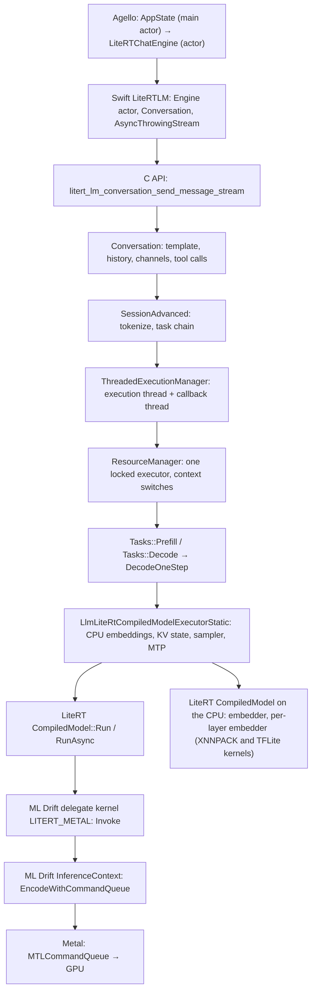

# The stack, end to end

> **Scope:** the layers from Agello down to Metal; one chat turn traced hop by hop (function, thread,
> device, what is copied); the threads (LiteRT-LM's execution and callback threads, Swift actors, the
> Metal command queue); who owns the engine, sessions, KV state and buffers; the open and closed parts
> of the binaries; the differences between the documented build and what Agello ships.
> **Out of scope:** the depth of each layer, which lives on its page: [Swift API](litert-lm/swift-api.md),
> [C API](litert-lm/c-api.md), [Conversation](litert-lm/conversation.md),
> [engine and sessions](litert-lm/engine-and-sessions.md), [executors](litert-lm/executors.md),
> [components](litert-lm/components.md), [LiteRT runtime](litert/runtime.md),
> [ML Drift delegate](litert/ml-drift-delegate.md), [ML Drift Metal backend](ml-drift/metal-backend.md);
> bytes and footprints in [memory.md](memory.md); settings in [configuration.md](configuration.md).
> **Pinned to:** LiteRT-LM `7b872544`, LiteRT `362759838`, ML Drift `15fa9e2`; shipped: LiteRT-LM
> `85b1a776` (v0.18.0 wrapper) with Google's prebuilt v0.18.0 `CLiteRTLM`; Agello `93122b647a`.
> **Applies to:** Apple (iOS, macOS). **Last verified:** 2026-10-15

## Summary

A chat reply in Agello goes from `AppState` and `LiteRTChatEngine` through the Swift package, the C
API, `Conversation`, `SessionAdvanced`, the execution manager, `Tasks`, the executor, LiteRT's
`CompiledModel` and the ML Drift delegate down to Metal. Templating, tokenizing and queuing run on
the thread that sends the message; the rest of the engine's work runs on one thread, `execution_threa`,
which runs the decode loop, waits for the GPU and delivers each streamed chunk up into the Swift
stream, while `callback_thread` delivers the final chunk and starts the decode after the prefill.
A plain decode step in our build moves at least 577,536 bytes between the CPU and GPU-visible memory
(embeddings in, FP16 logits out to the CPU sampler) <!-- c:X-STK-010 -->, and each released piece of
text becomes a JSON message, a C string and a Swift `Message`. Google's binary, which Agello ships,
adds a closed Metal sampler, a closed constraint provider and closed GPU-artisan code; none of our
runtime patches are in it. <!-- c:RT-DLG-083 -->

## Concepts

| Layer | What it is | Thread it runs on | Page |
| --- | --- | --- | --- |
| Agello `AppState` | `@MainActor` hub that runs generation and writes replies into SwiftData | main actor | Agello's `docs/` |
| Agello `LiteRTChatEngine` | an `actor` that owns the chat's LiteRT-LM `Engine` and `Conversation` | the actor (Swift's cooperative pool) | [swift-api.md](litert-lm/swift-api.md#how-agello-uses-it) |
| Swift `LiteRTLM` | `Engine` actor, `Conversation` class, `AsyncThrowingStream` streaming | caller's; stream callbacks on LiteRT-LM's threads | [swift-api.md](litert-lm/swift-api.md) |
| C API (`c/`) | opaque handles, JSON strings, status codes (1.0.0) or pointers and ints (0.2.0) | caller's; callbacks on LiteRT-LM's threads | [c-api.md](litert-lm/c-api.md) |
| `Conversation` | messages, templates, channels, tool calls, constraints over one session | caller's; callbacks on LiteRT-LM's threads | [conversation.md](litert-lm/conversation.md) |
| `SessionAdvanced` | a session ID, a context handler and a chain of tasks | caller's | [engine-and-sessions.md](litert-lm/engine-and-sessions.md#sessions) |
| `ThreadedExecutionManager` | schedules tasks with dependencies on one execution thread, final callbacks on one callback thread | both | [engine-and-sessions.md](litert-lm/engine-and-sessions.md#execution-managers-and-threads) |
| `ResourceManager` | owns the single executor behind a mutex; switches session contexts | execution thread (and caller's for step queries) | [engine-and-sessions.md](litert-lm/engine-and-sessions.md#the-resource-manager) |
| `Tasks` | `Prefill`, `Decode`, `Score`: drive the executor for one task; stop filter, detokenizer | execution thread | [engine-and-sessions.md](litert-lm/engine-and-sessions.md#tasksprefill-decode-and-score) |
| `LlmLiteRtCompiledModelExecutorStatic` | signatures, KV state, CPU embedding lookups, sampler, MTP drafter | execution thread | [executors.md](litert-lm/executors.md) |
| LiteRT `CompiledModel` | the TFLite interpreter with accelerators applied; tensor buffers | execution thread | [litert/runtime.md](litert/runtime.md) |
| ML Drift delegate (`LITERT_METAL`) | turns the delegated TFLite partition into an ML Drift GPU model and runs it | execution thread | [litert/ml-drift-delegate.md](litert/ml-drift-delegate.md) |
| ML Drift Metal backend | `InferenceContext`: kernels compiled from MSL source, encoded into command buffers | execution thread encodes; the GPU runs | [ml-drift/metal-backend.md](ml-drift/metal-backend.md) |

Terms used below: the **execution thread** is the one worker of `ThreadedExecutionManager`'s
execution pool (named `execution_threa` on Apple), the **callback thread** the one worker of its
callback pool (`callback_thread`); a **plain decode step** is one run of the `decode` signature; an
**MTP round** is three drafter runs and one `verify` run ([executors.md](litert-lm/executors.md#mtp-speculative-decoding)).

## How it works

### The layers



Where each layer starts in the code: the Swift `Engine` actor
([`swift/Engine.swift:28`](https://github.com/google-ai-edge/LiteRT-LM/blob/df6df5b84d5845b49889f631ed4cac80b4325dd3/swift/Engine.swift#L28)) and `Conversation` class
([`swift/Conversation.swift:64`](https://github.com/PowerBeef/agello-litert-lm/blob/7b872544fdbd81308f98b1e2acf8c5798a549df6/swift/Conversation.swift#L64)); the C handles
([`c/engine_internal.h:68`](https://github.com/google-ai-edge/LiteRT-LM/blob/df6df5b84d5845b49889f631ed4cac80b4325dd3/c/engine_internal.h#L68)); `Conversation`
([`runtime/conversation/conversation.h:511`](https://github.com/google-ai-edge/LiteRT-LM/blob/df6df5b84d5845b49889f631ed4cac80b4325dd3/runtime/conversation/conversation.h#L511)); `SessionAdvanced`
([`runtime/core/session_advanced.h:50`](https://github.com/google-ai-edge/LiteRT-LM/blob/df6df5b84d5845b49889f631ed4cac80b4325dd3/runtime/core/session_advanced.h#L50)); the engine
([`runtime/core/engine_advanced_impl.cc:237`](https://github.com/google-ai-edge/LiteRT-LM/blob/df6df5b84d5845b49889f631ed4cac80b4325dd3/runtime/core/engine_advanced_impl.cc#L237)); the execution manager
([`runtime/framework/resource_management/threaded_execution_manager.h:60`](https://github.com/google-ai-edge/LiteRT-LM/blob/df6df5b84d5845b49889f631ed4cac80b4325dd3/runtime/framework/resource_management/threaded_execution_manager.h#L60)) and resource manager
([`runtime/framework/resource_management/resource_manager.h:46`](https://github.com/google-ai-edge/LiteRT-LM/blob/df6df5b84d5845b49889f631ed4cac80b4325dd3/runtime/framework/resource_management/resource_manager.h#L46)); the executor
([`runtime/executor/llm_litert_compiled_model_executor.h:498`](https://github.com/PowerBeef/agello-litert-lm/blob/7b872544fdbd81308f98b1e2acf8c5798a549df6/runtime/executor/llm_litert_compiled_model_executor.h#L498)); LiteRT's compiled model
([`litert/runtime/compiled_model.h:78`](https://github.com/google-ai-edge/LiteRT/blob/ca21dc99de51c76bdcc572afeea1dd937d3c9e5c/litert/runtime/compiled_model.h#L78)); the ML Drift delegate
([`ml_drift_delegate/delegate/delegate_metal.mm:302`](https://github.com/google-ai-edge/LiteRT/blob/ca21dc99de51c76bdcc572afeea1dd937d3c9e5c/ml_drift_delegate/delegate/delegate_metal.mm#L302)); and ML Drift's encoder
([`ml_drift/metal/inference_context.mm:767`](https://github.com/PowerBeef/ml-drift/blob/15fa9e2ba632145992299e3f04786dc1f575373c/ml_drift/metal/inference_context.mm#L767)).

The C API creates every CPU or GPU engine as `EngineAdvancedImpl`; no other engine type is registered
in the open source. <!-- c:LM-ENG-002 --> That engine creates a `ThreadedExecutionManager` unless
single-threaded execution is requested, which Agello doesn't do. <!-- c:LM-ENG-016 --> For Gemma 4 E4B
and E2B the executor is always the static compiled-model executor, because the files have fixed-size KV
inputs and no `ExecutorMetadata`. <!-- c:LM-EXE-043 --> Below LiteRT-LM, the Metal accelerator is linked statically into our
framework on iOS and macOS (ours: `43f0f5c3`) <!-- c:LM-BLD-013 -->, registers as "GPU Metal" and
handles five Metal buffer types. <!-- c:RT-RUN-007 --> LiteRT-LM asks for the GPU accelerator alone on
the main graph, so a node the ML Drift delegate doesn't take fails compilation instead of falling back to
the CPU. <!-- c:RT-DLG-011 --> The two embedding models are the exception: they are compiled for the
CPU on every platform but Android. <!-- c:RT-CPU-001 -->

### One chat turn, hop by hop

The trace below is a text-only turn on a GPU engine in the documented build, with speculative
decoding (MTP) on, as Agello configures it, on a `Conversation` that already holds earlier turns.
Where the shipped binary behaves differently, the last section says so.

```mermaid
sequenceDiagram
  autonumber
  participant UI as AppState (main actor)
  participant CE as LiteRTChatEngine (actor)
  participant SW as Swift Conversation + C API (actor's thread)
  participant CV as Conversation / SessionAdvanced (same thread)
  participant EX as execution_threa
  participant GPU as Metal queue / GPU
  participant CB as callback_thread
  UI->>CE: send(text:) → AsyncThrowingStream<ChatEvent>
  CE->>SW: sendMessageStream(message, maxOutputTokens:)
  SW->>CV: litert_lm_conversation_send_message_stream(json, streamCallback)
  CV->>CV: render template diff, append history, tokenize
  CV->>EX: AddPrefillTask (queued); C call returns OK
  EX->>EX: acquire executor (context switch if another session ran)
  EX->>EX: CPU embedding lookups, fill inputs (prefill_1024 / prefill_128)
  EX->>GPU: CompiledModel::Run → LITERT_METAL Invoke → command buffers
  GPU-->>EX: completed (busy-wait in benchmark mode)
  EX->>CB: final prefill callback
  CB->>CV: save channel checkpoint, RunDecodeAsync → AddDecodeTask
  loop each plain step or MTP round
    EX->>EX: CPU embeddings, fill decode / verify inputs
    EX->>GPU: RunAsync (waits inside Invoke on Metal)
    GPU-->>EX: logits
    EX->>EX: sample on the CPU, stop filter, detokenize
    EX-->>SW: internal callback → Message JSON → C chunk → streamCallback
    SW-->>CE: continuation.yield(Message)
    CE-->>UI: yield(.chunk(ChatChunk))
    UI->>UI: append; write SwiftData at most every 100 ms
  end
  EX->>CB: final decode callback
  CB-->>SW: unflushed text, complete message, final chunk
  SW-->>CE: stream finishes
  CE-->>UI: .finished(stats)
```

| # | Hop | Function | Thread | Device | What is copied |
| --- | --- | --- | --- | --- | --- |
| 1 | Agello UI → engine | `AppState.generate` calls `engine.send(text:imageData:audioFileURL:)` and hands the stream to `consume` | main actor | CPU | the prompt `String` |
| 2 | engine → Swift wrapper | `LiteRTChatEngine.runSend` builds a `LiteRTLM.Message` and calls `sendMessageStream(_:maxOutputTokens:)` | `LiteRTChatEngine` actor | CPU | the text into `Content` |
| 3 | Swift → C | `sendToStream` serializes the message and calls `litert_lm_conversation_send_message_stream` with a retained `StreamContext` | same | CPU | message → JSON string |
| 4 | C → `Conversation` | parses the JSON and calls `Conversation::SendMessageAsync` | same | CPU | JSON string → a parsed `nlohmann` JSON object |
| 5 | `Conversation` | renders the turn (two full renders and their difference for a later turn), appends to history, builds input data, wires the prefill callback to start the decode | same | CPU | rendered prompt text |
| 6 | `SessionAdvanced` → manager | `RunPrefillAsync` tokenizes and calls `AddPrefillTask`; the C call then returns | same | CPU | text → token IDs |
| 7 | manager → executor | the prefill task acquires the executor with the session's context handler | execution thread | CPU (GPU-visible memory) | a KV snapshot out and in only if another session used the executor last |
| 8 | `Tasks::Prefill` → executor | `executor.Prefill` splits the prompt into `prefill_1024` / `prefill_128` runs, looks up embeddings on the CPU, fills inputs | execution thread | CPU | per token: 2,560 + 42 × 256 floats into the input buffers |
| 9 | executor → LiteRT → delegate | `CompiledModel::Run` (synchronous on Metal) → TFLite → the `LITERT_METAL` kernel's `Invoke` | execution thread | CPU | input conversions for non-external tensors |
| 10 | delegate → ML Drift → Metal | `Dispatch` → `EncodeWithCommandQueue`, one command buffer per 256 kernels, then a wait | execution thread encodes and waits | GPU | none (shared-storage buffers) |
| 11 | prefill done → decode | `FinishTask` → final callback → `Conversation`'s prefill callback saves a checkpoint and calls `RunDecodeAsync` → `AddDecodeTask` | callback thread | CPU | none |
| 12 | decode loop | `Tasks::Decode` → `DecodeOneStep` → `executor.Decode(params)` per step | execution thread | CPU | — |
| 13 | executor step | CPU embedding lookups, input writes, `RunAsync("decode")` or drafter + `verify` runs, CPU sampling | execution thread; GPU | CPU + GPU | embeddings in; logits out (see below) |
| 14 | `Tasks` | token IDs → stop filter → streaming detokenizer → callback with `Responses` | execution thread | CPU | IDs as host vectors; text as a `std::string`, moved |
| 15 | internal callback | accumulates text, splits channels and tool calls, builds a `Message` | execution thread | CPU | text appended to the reply buffer; a JSON object per released slice |
| 16 | C callback | `Message::dump()` into a `std::string`; a stack `LiteRtLmStreamChunk` | execution thread | CPU | JSON object → string |
| 17 | Swift `streamCallback` | copies the C string, parses it as JSON twice, yields a `Message` | execution thread | CPU | C string → Swift `String` → `Data` → objects → `Message` |
| 18 | Swift stream → Agello | `runSend` resumes, maps the `Message` to a `ChatChunk`, yields `.chunk` | `LiteRTChatEngine` actor | CPU | text and thought deltas |
| 19 | Agello → SwiftData | `consume` appends to an accumulator and writes the `ChatTurn` when 100 ms have passed | main actor | CPU | the accumulated reply text |
| 20 | end of reply | `FinishTask` → final callback → `SendCompleteMessage` → final chunk → stream finishes or tools run | callback thread | CPU | the whole reply re-parsed into the complete message |

The evidence for each hop:

1. `AppState` is a `@MainActor` class; its generation path passes the stream from
   `engine.send(...)` to `consume`, which accumulates chunks and publishes the text to the reply's
   `ChatTurn` only when at least 100 ms passed since the last write, plus once at the end (Agello
   `AppState.swift:24-26`, `:656-660`, `:1016-1063`). <!-- c:X-STK-001 -->
2. `LiteRTChatEngine` is an `actor`. Its `nonisolated send(...)` returns an `AsyncThrowingStream`
   whose build closure starts a `Task` running the actor-isolated `runSend` and cancels it when the
   stream terminates; `runSend` calls `conversation.sendMessageStream(message, maxOutputTokens:)` and,
   for each `Message`, yields a `ChatChunk` with `chunk.toString` as the text delta and the `thought`
   channel as the thought delta, so its loop body runs on the actor (Agello `ChatEngine.swift:68`,
   `:572-582`, `:684-704`). <!-- c:X-STK-002 --> It checks `Task.isCancelled` on every chunk and
   cancels the native conversation when the reply would overflow the room left in the KV cache.
   <!-- c:LM-SWIFT-060 -->
3. The wrapper's build closure starts the native stream at once and registers no `onTermination`
   handler. <!-- c:LM-SWIFT-013 --> `sendToStream` retains a `StreamContext` with
   `Unmanaged.passRetained` and passes it as `callback_data`. <!-- c:LM-SWIFT-014 -->
4. `litert_lm_conversation_send_message_stream` parses the message JSON, builds the optional
   arguments, calls `SendMessageAsync` with a callback from `CreateConversationCallback`, and returns
   `kLiteRtLmStatusOk` as soon as `SendMessageAsync` returns: it doesn't wait for the reply
   ([`c/conversation.cc:640-672`](https://github.com/google-ai-edge/LiteRT-LM/blob/df6df5b84d5845b49889f631ed4cac80b4325dd3/c/conversation.cc#L640-L672)). <!-- c:X-STK-003 -->
5. `SendMessageAsync`, on the calling thread, renders the turn's prompt text, appends the message to
   the history and converts it to input data with the model data processor. Unless the turn is being
   appended (a message sent with `has_pending_message` in its optional arguments, which the C API
   never sets; that path only queues a prefill and returns), it then builds the internal callback and
   calls `RunPrefillAsync` with a callback that, once the prefill reports `kDone`,
   saves the channel checkpoint (when filtering is on) and calls `RunDecodeAsync` with that internal
   callback ([`runtime/conversation/conversation.cc:556-575`](https://github.com/google-ai-edge/LiteRT-LM/blob/df6df5b84d5845b49889f631ed4cac80b4325dd3/runtime/conversation/conversation.cc#L556-L575),
   [`runtime/conversation/conversation.cc:650-654`](https://github.com/google-ai-edge/LiteRT-LM/blob/df6df5b84d5845b49889f631ed4cac80b4325dd3/runtime/conversation/conversation.cc#L650-L654),
   [`runtime/conversation/conversation.cc:655-686`](https://github.com/google-ai-edge/LiteRT-LM/blob/df6df5b84d5845b49889f631ed4cac80b4325dd3/runtime/conversation/conversation.cc#L655-L686),
   [`runtime/conversation/conversation.cc:787-797`](https://github.com/google-ai-edge/LiteRT-LM/blob/df6df5b84d5845b49889f631ed4cac80b4325dd3/runtime/conversation/conversation.cc#L787-L797),
   [`runtime/conversation/conversation.cc:799-856`](https://github.com/google-ai-edge/LiteRT-LM/blob/df6df5b84d5845b49889f631ed4cac80b4325dd3/runtime/conversation/conversation.cc#L799-L856)). <!-- c:X-STK-004 -->
   With the Gemma 4 file template, a later turn's prefill text is the difference between two full
   renders of the conversation, so only the new turn is prefilled. <!-- c:LM-CNV-018 --> <!-- c:LM-CNV-021 -->
6. `RunPrefillAsync` templates and tokenizes on the calling thread before it queues the task
   <!-- c:LM-ENG-024 -->, then queues it with `AddPrefillTask`; `RunDecodeAsync` queues the decode with
   `AddDecodeTask`
   ([`runtime/core/session_advanced.cc:139-147`](https://github.com/PowerBeef/agello-litert-lm/blob/7b872544fdbd81308f98b1e2acf8c5798a549df6/runtime/core/session_advanced.cc#L139-L147),
   [`runtime/core/session_advanced.cc:301-314`](https://github.com/PowerBeef/agello-litert-lm/blob/7b872544fdbd81308f98b1e2acf8c5798a549df6/runtime/core/session_advanced.cc#L301-L314)).
   Each new task depends on the session's last one. <!-- c:LM-ENG-023 -->
7. The prefill task runs on the execution thread: it starts, checks the cancel flag, acquires the
   executor with the session's context handler, encodes any images or audio, runs `Tasks::Prefill`
   with `wait_for_completion = true`, records the last prefilled token, releases the executor and
   finishes the task
   ([`runtime/framework/resource_management/threaded_execution_manager.cc:866-895`](https://github.com/PowerBeef/agello-litert-lm/blob/7b872544fdbd81308f98b1e2acf8c5798a549df6/runtime/framework/resource_management/threaded_execution_manager.cc#L866-L895),
   [`runtime/framework/resource_management/threaded_execution_manager.cc:963-1001`](https://github.com/PowerBeef/agello-litert-lm/blob/7b872544fdbd81308f98b1e2acf8c5798a549df6/runtime/framework/resource_management/threaded_execution_manager.cc#L963-L1001)).
   <!-- c:X-STK-006 --> The executor's mutex is held from acquisition to just before `FinishTask`, so
   all executor use is serialized across sessions. <!-- c:LM-ENG-047 --> If another session used the
   executor last, acquisition snapshots its KV state and restores this session's
   ([engine-and-sessions.md](litert-lm/engine-and-sessions.md#context-switches-what-is-copied-and-where)). <!-- c:LM-ENG-048 -->
8. `Tasks::Prefill` rejects an input of `max_num_tokens` tokens or more and calls `executor.Prefill`
   ([`runtime/core/tasks.cc:560-593`](https://github.com/PowerBeef/agello-litert-lm/blob/7b872544fdbd81308f98b1e2acf8c5798a549df6/runtime/core/tasks.cc#L560-L593)), through the locked
   executor, which first drops input tokens the executor already holds. <!-- c:LM-ENG-067 --> The
   executor splits the prompt across `prefill_1024` and `prefill_128` (2,049 tokens: 1024 + 1024 + 1)
   <!-- c:LM-EXE-010 -->, and each text-token lookup is a CPU model run of the embedder and of the
   per-layer embedder. <!-- c:LM-EXE-015 -->
9. On Metal the executor runs every prefill work group synchronously with `CompiledModel::Run`.
   <!-- c:LM-EXE-012 --> `Run` invokes the TFLite interpreter, and the ML Drift delegate replaced its
   partition with one kernel registered as `LITERT_METAL`, whose `Invoke`, inside an
   `@autoreleasepool`, binds external buffers, converts inputs, dispatches and converts outputs
   ([`litert/runtime/compiled_model.cc:2343-2356`](https://github.com/PowerBeef/LiteRT/blob/362759838e34e1525f1cc27daddaf663a193c059/litert/runtime/compiled_model.cc#L2343-L2356),
   [`ml_drift_delegate/delegate/delegate_metal.mm:157-168`](https://github.com/google-ai-edge/LiteRT/blob/ca21dc99de51c76bdcc572afeea1dd937d3c9e5c/ml_drift_delegate/delegate/delegate_metal.mm#L157-L168),
   [`ml_drift_delegate/delegate/delegate_metal.mm:252-258`](https://github.com/google-ai-edge/LiteRT/blob/ca21dc99de51c76bdcc572afeea1dd937d3c9e5c/ml_drift_delegate/delegate/delegate_metal.mm#L252-L258)).
   <!-- c:X-STK-007 --> The full step list is in
   [ml-drift-delegate.md](litert/ml-drift-delegate.md#one-run-step-by-step). <!-- c:RT-DLG-081 -->
10. `Dispatch` commits the pending command buffer and encodes the graph with
    `EncodeWithCommandQueue(queue, 256)`, which commits a command buffer after every 256 kernels.
    <!-- c:MD-MTL-020 --> Every kernel is re-encoded on every dispatch. <!-- c:MD-KRN-089 --> One
    E4B decode dispatch is 7 command buffers, an MTP drafter dispatch 1. <!-- c:MD-MTL-021 --> The
    run then waits: with an active wait, the execution thread spins until a completion handler sets a
    flag. <!-- c:RT-DLG-065 --> Agello always gets the active wait, because it turns on LiteRT-LM's
    benchmark mode. <!-- c:OUR-034 -->
11. `FinishTask` schedules the prefill's final callback on the callback thread and then waits up to
    10 s for it. <!-- c:LM-ENG-038 --> `Conversation` calls `RunDecodeAsync` from inside that
    callback, so the decode task is added on the callback thread. <!-- c:LM-ENG-040 --> With the
    channel filter on, the checkpoint used to strip thinking from the KV cache is saved there, after
    the user turn's prefill. <!-- c:LM-CNV-050 -->
12. `Tasks::Decode` stops after a step on a stop sequence, the output limit, a full KV cache, a cancel
    or an error. <!-- c:LM-ENG-077 --> With internal sampling, `DecodeOneStep` calls `executor.Decode`
    with the cancel flag, the speculative-decoding choice and the constrained decoder, and gets token
    IDs back. <!-- c:LM-ENG-084 -->
13. A plain decode step does its embedding lookups, input writes, mask and parameter fills and the
    sampling on the CPU <!-- c:LM-EXE-014 -->; the `decode` run goes through `RunAsync`
    <!-- c:LM-EXE-062 -->, but the ML Drift delegate never attaches an event, so `Invoke` waits for the
    GPU before returning. <!-- c:RT-DLG-066 --> <!-- c:RT-DLG-068 --> Our build has no Metal sampler
    and samples on the CPU. <!-- c:LM-EXE-019 --> With MTP, a round drafts 3 tokens and emits 1 to 4
    <!-- c:LM-EXE-022 -->, every emitted token being the verifier's greedy pick. <!-- c:LM-EXE-024 -->
14. Per executor step, `Tasks::Decode` passes the host token IDs through the stop filter and the
    streaming detokenizer and calls the callback once with that step's text and IDs (moved), only if
    some text was released; with MTP one callback can carry several tokens. <!-- c:LM-ENG-085 -->
    Streamed chunks are delivered on the execution thread between decode steps; the final one on the
    callback thread. <!-- c:LM-ENG-039 -->
15. The internal callback appends each step's text to the reply's accumulated string, looks for
    channel and tool-call delimiters from a cursor, and calls the user callback with a `Message` made
    by the model data processor from a copy of the released slice, or with a
    `{"role": "assistant", "channels": {...}}` message for channel text, plus `"reasoning_content"`
    for a reasoning channel such as `thought`; a tool call is held back until
    its end delimiter; at the end, `SendCompleteMessage` sends what is left, builds the complete message,
    calls the completion callback and then sends an empty `Message`
    ([`runtime/conversation/internal_callback_util.cc:61-71`](https://github.com/google-ai-edge/LiteRT-LM/blob/df6df5b84d5845b49889f631ed4cac80b4325dd3/runtime/conversation/internal_callback_util.cc#L61-L71),
    [`runtime/conversation/internal_callback_util.cc:76-92`](https://github.com/google-ai-edge/LiteRT-LM/blob/df6df5b84d5845b49889f631ed4cac80b4325dd3/runtime/conversation/internal_callback_util.cc#L76-L92),
    [`runtime/conversation/internal_callback_util.cc:95-149`](https://github.com/google-ai-edge/LiteRT-LM/blob/df6df5b84d5845b49889f631ed4cac80b4325dd3/runtime/conversation/internal_callback_util.cc#L95-L149),
    [`runtime/conversation/internal_callback_util.cc:330-357`](https://github.com/google-ai-edge/LiteRT-LM/blob/df6df5b84d5845b49889f631ed4cac80b4325dd3/runtime/conversation/internal_callback_util.cc#L330-L357)). <!-- c:X-STK-008 -->
16. The C callback dumps each partial `Message` to a JSON string <!-- c:LM-CAPI-025 --> and builds
    the chunk on its stack around that temporary string, so a reader must copy it before returning.
    <!-- c:LM-CAPI-027 -->
17. Swift's `streamCallback` is that C callback, so it runs on the execution thread for streamed
    chunks and on the callback thread for the final one. <!-- c:LM-SWIFT-015 --> It copies the C string
    into a Swift `String`, converts it to `Data`, parses it with `JSONSerialization`, and for an object
    with `content` or `channels` calls `jsonToMessage` on the same string, which converts and parses it
    again, then yields the `Message`; both wrappers do this
    ([`swift/Conversation.swift:906-922`](https://github.com/PowerBeef/agello-litert-lm/blob/7b872544fdbd81308f98b1e2acf8c5798a549df6/swift/Conversation.swift#L906-L922),
    [`swift/Conversation.swift:744-750`](https://github.com/PowerBeef/agello-litert-lm/blob/7b872544fdbd81308f98b1e2acf8c5798a549df6/swift/Conversation.swift#L744-L750),
    shipped: [`swift/Conversation.swift:850-866`](https://github.com/PowerBeef/agello-litert-lm/blob/85b1a77695bc90fc8b34a1f455bbe5b2c7fdceff/swift/Conversation.swift#L850-L866)). <!-- c:X-STK-009 -->
    A chunk with only tool calls is collected, not yielded. <!-- c:LM-SWIFT-016 -->
18. See hop 2: the `for try await` loop in `runSend` resumes on the `LiteRTChatEngine` actor.
19. See hop 1: `consume` writes to SwiftData at most about ten times a second.
20. On the final chunk with pending tool calls, the wrapper starts a Swift `Task` that runs the tools
    and sends their responses as a new stream round. <!-- c:LM-SWIFT-017 --> When the reply carried
    channel content, `Conversation` rewinds to the checkpoint and prefills the reply without it before
    sending the final sentinel. <!-- c:LM-CNV-052 -->

The one engine run in [generated/engine-run.md](generated/engine-run.md) shows the shape: a 2,049-token
prompt and 17 generated tokens made 2 scheduled tasks, 1 context switch, 4 MTP rounds and 4 stream
chunks. <!-- c:LM-ENG-086 --> The 17 tokens came from 1 plain priming step and 4 rounds of 3 accepted
drafts plus a bonus token. <!-- c:LM-EXE-025 -->

### What is copied per token

| Boundary | Per plain decode step (E4B, documented build) | Evidence |
| --- | --- | --- |
| CPU → GPU-visible inputs | the token's embedding (2,560 floats) and per-layer embedding (42 × 256 floats): 53,248 bytes; `input_pos` and `param_tensor`; the attention mask, one byte per allocated position | <!-- c:LM-EXE-014 --> |
| GPU-visible logits → CPU sampler | 262,144 FP16 logits: 524,288 bytes, read every step | <!-- c:LM-CMP-031 --> |
| Executor → `Tasks` | the step's token IDs as host `std::vector<std::vector<int>>` | <!-- c:LM-ENG-085 --> |
| `Tasks` → `Conversation` | one `Responses` with the released text (a `std::string` per candidate) and IDs, moved | <!-- c:LM-ENG-085 --> |
| `Conversation` → C | the text appended to the reply buffer, a copy of the released slice, a `Message` JSON object | <!-- c:X-STK-008 --> |
| C → Swift | the JSON object dumped to a `std::string`, read through a pointer valid only during the call | <!-- c:LM-CAPI-025 --> |
| Swift wrapper | `String`, `Data`, two JSON parses, a `Message` | <!-- c:X-STK-009 --> |
| Agello | a `ChatChunk`; the accumulated text written to SwiftData at most every 100 ms | <!-- c:X-STK-001 --> |

Together, the two fixed host-GPU transfers of a plain E4B decode step in our build are 577,536 bytes:
53,248 bytes of embeddings written and 524,288 bytes of logits read, before the mask and the 32 bytes
of position and parameters. <!-- c:X-STK-010 --> On Apple's unified memory these are memory copies in
shared storage, not bus transfers: ML Drift allocates every `MTLBuffer` in shared storage.
<!-- c:MD-MTL-015 --> The read of a GPU tensor goes through LiteRT's Metal buffer handler, whose host
shadow and direct copies are described in
[ml-drift-delegate.md](litert/ml-drift-delegate.md#the-metal-buffer-handler). <!-- c:RT-DLG-074 -->

With MTP, a round adds per draft step one more embedder run and a greedy pick over the drafter's
logits, and per verification the embeddings for 4 positions and a greedy pick over 4 rows of logits
([executors.md](litert-lm/executors.md#what-runs-on-the-cpu-for-every-token)). <!-- c:LM-EXE-063 -->
Our `e43f9a8d` stopped copying the whole token history into the mask fill every step and reuses the
sampled-ID buffer; v0.18.0 still does both. <!-- c:LM-EXE-035 --> In the engine run, Metal
tensor-buffer read locks copied 15,419,392 bytes in 29 copies over the whole case.
<!-- c:LM-EXE-086 -->

What the layers above `Tasks` cost per chunk has not been measured separately: the telemetry span
`stream_callback` covers the C callback and everything it calls for the chunks streamed inside the
decode loop, but not the last call after the loop, which delivers text flushed from the detokenizer
([tools.md](tools.md#telemetry)). <!-- c:X-TLS-002 -->

### Threads

| Thread | Created by | Runs |
| --- | --- | --- |
| Main thread | the app | `AppState`, `consume`, SwiftData writes |
| `LiteRTChatEngine` actor | Swift's cooperative pool | `runSend` and its `for try await` loop; the native `sendMessageStream` call (so templating, tokenizing and queuing); `getTokenCount()` and other step queries |
| Detached task | Agello's `makeEngine` | `Engine.initialize()`: the whole native load <!-- c:LM-SWIFT-057 --> |
| Tokenizer future | `EngineAdvancedImpl::Create` | building the tokenizer during the load (Gemma 4 files) <!-- c:LM-ENG-005 --> |
| `execution_threa` | `ThreadedExecutionManager` | every prefill, decode, clone and scoring task of every session, context switches, encoders, `CompiledModel` runs, Metal encoding and waits, streamed callbacks |
| `callback_thread` | `ThreadedExecutionManager` | final callbacks; `Conversation`'s decode start; the channel-refill prefill; Swift's final stream chunk and the tool `Task` start |
| Metal's threads | Metal | command-buffer completion handlers (the active wait's flag, our GPU timing) |

- **The decode loop.** `Tasks::Decode` runs on the execution thread, and all sessions of one engine
  share that thread and the one executor: a decode task runs every step until it stops before the next
  queued task starts. <!-- c:LM-ENG-061 --> The pools hold one thread each. <!-- c:LM-ENG-030 -->
  On Apple they are POSIX threads with default attributes, named `execution_threa` and
  `callback_thread`, with no QoS class. <!-- c:LM-ENG-032 -->
- **Who delivers chunks to Swift.** The execution thread, from inside `Tasks::Decode`, for every
  streamed chunk; the callback thread for the final chunk and any text flushed with it.
  <!-- c:LM-SWIFT-015 --> Time spent in the Swift callback is time the decode loop doesn't run, and the
  execution thread waits up to 10 s for a final callback before it takes the next task.
  <!-- c:LM-CAPI-028 -->
- **Swift.** The `Engine` actor's `initialize()` runs the whole native load on the actor's thread.
  <!-- c:LM-SWIFT-001 --> `Conversation` is a `Sendable` class with no actor or lock, so nothing in
  Swift serializes calls on one conversation <!-- c:LM-SWIFT-010 -->; Agello does, by keeping all
  native calls inside its actor. `sendMessage` (the blocking form) holds its caller's thread for the
  whole reply. <!-- c:LM-SWIFT-011 -->
- **Step queries on the caller's thread.** `GetCurrentStep` and the checkpoint calls acquire the
  executor on the calling thread, so a context switch can happen there. <!-- c:LM-ENG-058 -->
  Agello's `getTokenCount()` after a helper is one such call. <!-- c:LM-ENG-065 -->
- **LiteRT and ML Drift.** Compiled-model creation holds a process-wide mutex. <!-- c:RT-RUN-014 -->
  ML Drift compiles kernels one after another on the calling thread during a load.
  <!-- c:MD-MTL-005 --> At run time the delegate's `Invoke`, and with it ML Drift's binding, encoding
  and waiting, runs inside `Run` on the thread that calls it, the execution thread. <!-- c:X-STK-007 -->
- **The Metal command queue.** The ML Drift delegate keeps one Metal device per process and creates a
  new `MTLCommandQueue` for each GPU environment it sets up <!-- c:RT-DLG-007 --> <!-- c:RT-RUN-009 -->;
  the LiteRT-LM engine passes no device or queue of its own. <!-- c:RT-RUN-008 --> The residency-set
  heartbeat thread exists only when residency is requested, which Agello doesn't do.
  <!-- c:RT-DLG-069 -->
- **The CPU models.** The embedder and per-layer embedder run through LiteRT's CPU path on the
  execution thread; how many XNNPACK threads they use is in [litert/cpu-xnnpack.md](litert/cpu-xnnpack.md).

### Who owns what

| Object | Owner | Lifetime | Notes |
| --- | --- | --- | --- |
| Swift `Engine`, `Conversation` | Agello's `LiteRTChatEngine` | until unload | each `Conversation` holds its `Engine` strongly, so the native engine is deleted only after every conversation made from it has been released <!-- c:LM-SWIFT-063 --> <!-- c:LM-SWIFT-005 --> |
| C handles | the caller | until `*_delete` | not reference-counted; children must go before the engine <!-- c:LM-CAPI-009 --> |
| `EngineAdvancedImpl` | the C engine handle | the engine | owns the execution manager, the LiteRT environment, the tokenizer and the model resources, released in that order <!-- c:LM-ENG-017 --> |
| The executor (`LlmExecutor`) | `ResourceManager` | the engine | one per engine, behind a mutex <!-- c:LM-ENG-047 --> |
| A session | `Conversation` (or the C session handle) | until deleted | an ID, a context handler, a task chain; deleting it waits for its tasks up to 10 minutes <!-- c:LM-ENG-027 --> |
| Live KV cache | the executor's `LitertState` | the engine | GPU output buffers on a GPU engine with a `param_tensor` input (E4B, E2B) <!-- c:LM-EXE-017 --> |
| KV snapshots | the session's `SharedProcessedContext` | until that session next acquires the executor | a deep copy taken at a context switch <!-- c:LM-ENG-049 --> <!-- c:LM-ENG-064 -->; ours are raw byte copies in pages of their own <!-- c:LM-ENG-051 --> <!-- c:LM-ENG-052 --> |
| Model file | `MemoryMappedFile` | the engine | mapped `MAP_PRIVATE`, `MADV_DONTNEED` on Apple <!-- c:LM-FMT-020 -->; CPU and GPU models built from the mapped section bytes <!-- c:LM-CMP-069 --> |
| GPU weights | the delegate's shared memory manager | the delegate | read from the weight cache as mapped data and wrapped without a copy on Apple <!-- c:RT-DLG-058 --> |
| GPU intermediates | ML Drift's `MemoryManager` | the manager | reused across models, never shrunk while the manager lives <!-- c:MD-MTL-013 --> |
| Metal device | the delegate (process-wide) | reference-counted | one per process <!-- c:RT-DLG-007 --> |
| Disk caches | the cache directory | until deleted | program cache and weight cache files per model token <!-- c:RT-DLG-062 --> |

The bytes behind these rows (weights mapped and resident, KV per token, snapshots, activations) are in
[memory.md](memory.md).

### The open and closed parts

[generated/binaries.md](generated/binaries.md) compares the iOS arm64 slices of Google's v0.18.0
`CLiteRTLM` (what Agello ships) and ours. Google's is 61.6 MB with 212 exported `litert_lm_*`
functions and the closed FST constraint provider; ours is 37.5 MB with 220 functions and no FST
symbols. <!-- c:LM-BLD-056 --> The other rows:

| Component | Google v0.18.0 (defined symbols) | Ours | What it means |
| --- | --- | --- | --- |
| TopK Metal sampler (closed) | 39 | 7 | the open target that should link a GPU sampler is empty in both sources; Google's binary links the closed one in, ours samples on the CPU <!-- c:LM-CMP-021 --> <!-- c:LM-BLD-015 --> <!-- c:LM-CMP-022 --> |
| Gemma constraint provider / FST (closed) | 17 | 0 | a prebuilt library in the open tree; `--config=agello` leaves it out <!-- c:LM-CNV-075 --> <!-- c:LM-CNV-076 --> |
| GPU artisan executor (closed) | 166 | 29 | Google's binary carries a legacy engine and `LlmGpuArtisanExecutor` for `-gpu` files; the open engine fails on them <!-- c:MOD-E2B-057 --> <!-- c:LM-FMT-017 --> |
| TENSOR_LLM / Google Tensor | 62 | 13 | Google Tensor (Android) code present in Google's slice <!-- c:X-STK-011 --> |
| ML Drift Metal accelerator (open) | 12 | 9 | the same open component, built by Google from its sources and by us from our forks <!-- c:RT-RUN-029 --> |
| KleidiAI, XNNPACK (open) | 638, 6 | 637, 6 | the same CPU kernels <!-- c:RT-CPU-011 --> |
| C API | 212 functions | 220 | ours adds `wait_until_done`, the version call, build info and telemetry; only Google's has `get_last_error_code` <!-- c:LM-CAPI-036 --> |

What Google's shipped binary runs that ours doesn't:

- **The closed Metal TopK sampler**, expected from the symbols; no run of the shipped binary has
  recorded which sampler it used ([components.md](litert-lm/components.md#samplers)).
- **The FST constraint provider.** In builds that include it, `Gemma4DataProcessor::Create` creates it
  whenever constrained decoding is enabled, although a JSON response format still goes through
  llguidance. <!-- c:LM-CNV-078 --> Agello's JSON helpers enable response formats; its chat
  conversations don't enable constrained decoding. <!-- c:LM-CNV-079 -->
- **The GPU artisan path**, only for `-gpu` model files, which Agello doesn't use
  ([models/gemma4-e2b.md](models/gemma4-e2b.md#the-artisan-gpu-variants)).
- **Google's builds of LiteRT and ML Drift**, without any of our delegate or kernel commits.
  <!-- c:RT-DLG-083 --> <!-- c:MD-KRN-085 -->

The Metal accelerator itself is open: LiteRT has its source and Bazel target, and ML Drift's Metal
backend is public. <!-- c:OUR-026 --> LiteRT-LM's `prebuilt/` folder also carries Google's closed
dylibs (the Metal TopK sampler and the Gemma constraint provider among them) for builds that link
them dynamically. <!-- c:RT-OTH-004 -->

### The documented build and what Agello ships

Agello ships the v0.18.0 wrapper with two Swift patches of ours on Google's prebuilt v0.18.0 binary;
this reference documents `agello-next`. <!-- c:LM-VER-027 --> Agello vendors the shipped wrapper byte
for byte. <!-- c:LM-SWIFT-046 --> The two halves don't mix: each wrapper compiles only against its own
headers. <!-- c:LM-SWIFT-048 --> What changes along the trace above:

| Hop | Documented build (`agello-next`) | What Agello ships (v0.18.0 binary) |
| --- | --- | --- |
| C API | 1.0.0: status codes and out-parameters | 0.2.0: pointers and ints <!-- c:LM-CAPI-037 --> |
| Swift stream | the same `streamCallback` parse, weak `StreamContext` | the same, weak `StreamContext` (ours) <!-- c:LM-SWIFT-019 --> |
| Thinking removed from the KV cache | eagerly, right after the reply | lazily, before the next user message <!-- c:LM-CNV-053 --> <!-- c:LM-CNV-054 --> |
| Context switch restore | snapshot copied into the live device buffers | snapshot swapped in as the live state, which the GPU delegate doesn't use <!-- c:LM-ENG-055 --> |
| KV snapshot | raw `MTLBuffer` byte copy in mapped pages (ours) | through tensor-buffer locks <!-- c:LM-EXE-035 --> |
| Decode step host work | no history copy for the mask, a reused ID buffer (ours) | both per step <!-- c:LM-EXE-035 --> |
| MTP priming | an explicit primed flag | skipped whenever the last run was a decode <!-- c:LM-EXE-026 --> |
| Sampler | CPU `TopPSampler` over FP16 logits, integer greedy pick (ours) | Google's closed Metal sampler <!-- c:LM-CMP-030 --> |
| Logit masks | `LiteRtLogitMaskRunner` on the GPU | logits copied to the host, masked, written back <!-- c:LM-CMP-049 --> |
| Delegate and kernels | bounded attention, sliding window, direct copies, content weight-cache key (ours) | none of them <!-- c:RT-DLG-083 --> |
| Metal wait | active in Agello (benchmark mode); passive only outside it (ours) | active <!-- c:RT-RUN-028 --> |
| Telemetry, build info | yes (ours) | no |

Two more differences sit outside the turn. Our framework has no simulator slice, Google's does
<!-- c:APL-066 --> <!-- c:APL-069 -->; and on a Mac, a macOS app built on the shipped package would
use Google's `CLiteRTLM_mac` (the WebGPU accelerator) <!-- c:RT-OTH-005 -->, but the iPhone app run
on a Mac uses the iOS slice and its Metal accelerator. <!-- c:APL-061 --> Every one of our commits is
listed with its evidence in [patches.md](patches.md); version numbers and how to tell builds apart are
in [versions.md](versions.md#what-ships-and-what-is-documented).

## On Apple

- The whole GPU path is Metal through ML Drift: the accelerator is linked statically on iOS and macOS
  in our build ([apple-platform.md](apple-platform.md#static-linking-of-the-metal-accelerator)).
- iOS builds have no NPU LLM executor; on macOS the NPU accelerator fails to register.
  <!-- c:LM-EXE-001 --> <!-- c:LM-EXE-087 -->
- Raw KV snapshots exist only in Apple builds (a stub elsewhere). <!-- c:LM-ENG-053 -->
- The residency-set flag reaches the main executor's run options only under `__APPLE__`.
  <!-- c:LM-ENG-093 -->
- The iPhone app on a Mac runs the same iOS binary and Metal path
  ([apple-platform.md](apple-platform.md#the-iphone-app-on-a-mac)).

## Limits and failure modes

- **One engine, one thread.** A helper prompt on a second conversation waits behind the chat's decode
  and costs a context switch each way. <!-- c:LM-ENG-061 -->
- **Cancellation is coarse.** The cancel flag is read between executor decode steps, so a running
  prefill or MTP round finishes first. <!-- c:LM-ENG-045 --> Dropping the Swift stream doesn't stop
  the native work; only `cancel()` does. <!-- c:LM-SWIFT-013 -->
- **Callbacks block the engine.** Anything slow in the Swift callback slows decoding; deleting a
  conversation from inside its own final callback waits for the 10-minute timeout
  ([c-api.md](litert-lm/c-api.md#deleting-while-work-runs)). <!-- c:LM-SWIFT-020 -->
- **Busy-waiting.** In Agello's configuration the execution thread spins on the CPU while the GPU
  runs; the cost on the iPhone hasn't been measured at this pin.
- **No CPU fallback for GPU graphs.** A node the delegate doesn't take fails engine creation.
  <!-- c:RT-RUN-016 -->
- Failure messages and their causes are collected in [troubleshooting.md](troubleshooting.md).

## Where in the code

| Concept | Symbol | Citation |
| --- | --- | --- |
| Agello's generation entry | `AppState.generate`, `consume` | Agello `AppState.swift:656-660`, `:1016-1063` |
| Agello's engine actor | `LiteRTChatEngine.send`, `runSend` | Agello `ChatEngine.swift:572-582`, `:684-704` |
| C stream entry | `litert_lm_conversation_send_message_stream` | [`c/conversation.cc:640-672`](https://github.com/google-ai-edge/LiteRT-LM/blob/df6df5b84d5845b49889f631ed4cac80b4325dd3/c/conversation.cc#L640-L672) |
| C stream callback | `CreateConversationCallback` | [`c/conversation.cc:44-71`](https://github.com/google-ai-edge/LiteRT-LM/blob/df6df5b84d5845b49889f631ed4cac80b4325dd3/c/conversation.cc#L44-L71) |
| Turn setup | `Conversation::SendMessageAsync` | [`runtime/conversation/conversation.cc:799-856`](https://github.com/google-ai-edge/LiteRT-LM/blob/df6df5b84d5845b49889f631ed4cac80b4325dd3/runtime/conversation/conversation.cc#L799-L856) |
| Streamed text → messages | `CreateInternalCallback`, `SendCompleteMessage` | [`runtime/conversation/internal_callback_util.cc:330-357`](https://github.com/google-ai-edge/LiteRT-LM/blob/df6df5b84d5845b49889f631ed4cac80b4325dd3/runtime/conversation/internal_callback_util.cc#L330-L357) |
| Queuing | `SessionAdvanced::RunPrefillAsync`, `RunDecodeAsync` | [`runtime/core/session_advanced.cc:139-147`](https://github.com/PowerBeef/agello-litert-lm/blob/7b872544fdbd81308f98b1e2acf8c5798a549df6/runtime/core/session_advanced.cc#L139-L147) |
| Thread pools | `ThreadedExecutionManager` constructor | [`runtime/framework/resource_management/threaded_execution_manager.cc:87-92`](https://github.com/PowerBeef/agello-litert-lm/blob/7b872544fdbd81308f98b1e2acf8c5798a549df6/runtime/framework/resource_management/threaded_execution_manager.cc#L87-L92) |
| Worker threads | `pthread_create` | [`runtime/framework/worker_thread_pthread.cc:77`](https://github.com/google-ai-edge/LiteRT-LM/blob/df6df5b84d5845b49889f631ed4cac80b4325dd3/runtime/framework/worker_thread_pthread.cc#L77) |
| Prefill task body | `AddPrefillTask` closure | [`runtime/framework/resource_management/threaded_execution_manager.cc:963-1001`](https://github.com/PowerBeef/agello-litert-lm/blob/7b872544fdbd81308f98b1e2acf8c5798a549df6/runtime/framework/resource_management/threaded_execution_manager.cc#L963-L1001) |
| Decode loop | `Tasks::Decode` | [`runtime/core/tasks.cc:614`](https://github.com/PowerBeef/agello-litert-lm/blob/7b872544fdbd81308f98b1e2acf8c5798a549df6/runtime/core/tasks.cc#L614) |
| Decode run | `BindTensorsAndRunDecode` | [`runtime/executor/llm_litert_compiled_model_executor.cc:1205-1231`](https://github.com/PowerBeef/agello-litert-lm/blob/7b872544fdbd81308f98b1e2acf8c5798a549df6/runtime/executor/llm_litert_compiled_model_executor.cc#L1205-L1231) |
| Interpreter invoke | `LiteRtCompiledModelT::Run` | [`litert/runtime/compiled_model.cc:2343-2356`](https://github.com/PowerBeef/LiteRT/blob/362759838e34e1525f1cc27daddaf663a193c059/litert/runtime/compiled_model.cc#L2343-L2356) |
| Delegate kernel | `Invoke`, `LITERT_METAL` registration | [`ml_drift_delegate/delegate/delegate_metal.mm:157-168`](https://github.com/google-ai-edge/LiteRT/blob/ca21dc99de51c76bdcc572afeea1dd937d3c9e5c/ml_drift_delegate/delegate/delegate_metal.mm#L157-L168) |
| GPU wait | `GpuBackendMetal::WaitForCompletion` | [`ml_drift_delegate/delegate/gpu_backend_metal.mm:203`](https://github.com/PowerBeef/LiteRT/blob/362759838e34e1525f1cc27daddaf663a193c059/ml_drift_delegate/delegate/gpu_backend_metal.mm#L203) |
| Encoding | `InferenceContext::EncodeWithCommandQueue` | [`ml_drift/metal/inference_context.mm:767`](https://github.com/PowerBeef/ml-drift/blob/15fa9e2ba632145992299e3f04786dc1f575373c/ml_drift/metal/inference_context.mm#L767) |
| Swift stream bridge | `streamCallback` | [`swift/Conversation.swift:906-922`](https://github.com/PowerBeef/agello-litert-lm/blob/7b872544fdbd81308f98b1e2acf8c5798a549df6/swift/Conversation.swift#L906-L922) |

## Open questions

- Which sampler Google's v0.18.0 binary actually uses on an iPhone: the symbols say the closed Metal
  sampler is linked, but no run of the shipped binary has recorded it.
- The per-chunk cost of hops 15 to 19 (JSON building, dumping and the two Swift parses) has not been
  measured on its own; with MTP a chunk can carry up to four tokens, which amortizes it.
- What the active wait costs in CPU time on the iPhone in Agello's configuration (benchmark mode on)
  has no results file at this pin.
- How Swift's cooperative pool schedules the `LiteRTChatEngine` actor while a native call holds its
  thread (template rendering and tokenizing a long first turn run there) has not been measured.
