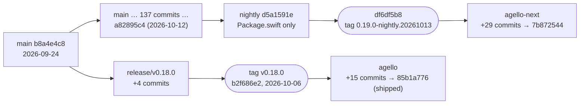

# Versions

> **Scope:** what Agello ships and what this reference documents; how LiteRT-LM numbers its releases,
> C API and container format; how upstream tags releases and nightlies; the changes from v0.18.0 to
> the documented build that matter to Agello; which build each performance figure was measured on.
> **Out of scope:** the generated table of every pin and model ([generated/version-matrix.md](generated/version-matrix.md));
> how builds and releases are made ([litert-lm/build-and-release.md](litert-lm/build-and-release.md));
> each of our commits ([patches.md](patches.md)); the C and Swift APIs in detail
> ([litert-lm/c-api.md](litert-lm/c-api.md), [litert-lm/swift-api.md](litert-lm/swift-api.md));
> the container format ([litert-lm/file-format.md](litert-lm/file-format.md)).
> **Pinned to:** LiteRT-LM `7b872544` (base `df6df5b8`), LiteRT `362759838`, ML Drift `15fa9e2`;
> shipped: LiteRT-LM `85b1a776` (base `b2f686e2`, v0.18.0).
> **Applies to:** all platforms (version scheme); Apple (what Agello ships). **Last verified:** 2026-10-15

## Summary

- **Agello ships** the Swift wrapper at `PowerBeef/agello-litert-lm` `85b1a776` (v0.18.0 plus two
  Swift patches) with Google's prebuilt v0.18.0 `CLiteRTLM.xcframework`, checksummed in its
  vendored `Package.swift`. <!-- c:LM-VER-001 --> <!-- c:LM-VER-002 -->
- **This reference documents** `agello-next` at `7b872544`: Google's `0.19.0-nightly.20261013`
  (`df6df5b8`) plus 29 commits of ours, built from source with our LiteRT (`362759838`) and ML Drift
  (`15fa9e2`). <!-- c:LM-VER-028 -->
- Between them: LiteRT-LM 0.18.0 → 0.19.0 (in development), C API 0.2.0 → 1.0.0 (every function
  returns a status code), container version 1.7.0 → 1.9.0. <!-- c:LM-VER-003 --> <!-- c:LM-VER-019 -->
- v0.18.0 is not an ancestor of the documented base: it was cut on `release/v0.18.0` from `main` as
  of 2026-09-24. <!-- c:LM-VER-010 -->
- The two Swift wrappers aren't interchangeable: the documented one needs a C API 1.0 binary with
  our build-info and telemetry functions. <!-- c:LM-VER-009 -->
- Performance figures: Agello's README table was measured with Google's v0.18.0 binary;
  VALIDATION's cooled calibration table of 2026-10-15 with our build `2e54fbdb9ca9`, four commits
  before the pin, and its afternoon follow-ups with builds `11beef01e805` and `fc71d704a349`
  ([C16](#performance-figures-which-build)).

## Concepts

| Version | Where it lives | At the pin | In what Agello ships |
| --- | --- | --- | --- |
| LiteRT-LM version | `VERSION` in `version.bzl`: the release in development | `0.19.0` | `0.18.0` |
| C API version | `C_API_VERSION` in `version.bzl`; since 1.0.0 also the `LITERT_LM_C_API_VERSION_*` macros in `c/engine.h` | `1.0.0` | `0.2.0` |
| Container version | `LITERTLM_{MAJOR,MINOR,PATCH}_VERSION` in `schema/core/litertlm_header.h` (the C++ runtime uses only the major) and in the Python builder's `litertlm_core.py`, whose values `litertlm_builder.py` writes into new `.litertlm` headers | `1.9.0` | `1.7.0` |
| Release tag | `vX.Y.Z` on `release/vX.Y.Z` | (none; `0.19.0` not released) | `v0.18.0` |
| Nightly tag | `<VERSION>-nightly.<YYYYMMDD>` on `nightly` | `0.19.0-nightly.20261013` (the base) | |
| Framework bundle version | `CFBundleShortVersionString` in the XCFramework's `Info.plist` | `0.19.0` (`agello/Info.plist`) | Google's |
| Build id | our stamp ([build-and-release.md](litert-lm/build-and-release.md#build-stamping)) | `7023fa1a61d4` for the local build of the pins | none (Google's binary has no stamp) |

`version.bzl`'s own comment says `VERSION` is "the next version", bumped after every release
([`version.bzl:17-23`](https://github.com/google-ai-edge/LiteRT-LM/blob/df6df5b84d5845b49889f631ed4cac80b4325dd3/version.bzl#L17-L23)): upstream bumped it to 0.19.0 in `93d74126` on 2026-10-06, the day
v0.18.0 was published. <!-- c:LM-VER-012 -->

## What ships and what is documented

| | Agello ships (today) | This reference documents |
| --- | --- | --- |
| LiteRT-LM source | `agello` `85b1a776`: tag `v0.18.0` (`b2f686e2`) plus 15 commits, of which two change the Swift wrapper's behavior (`a3c0d0ef` tool-call errors, `85b1a776` weak stream reference, both in `swift/Conversation.swift`) and a third, `7c4ee32d`, only renames the repository in that file's patch notice; the rest are docs and the agello-bench tool | `agello-next` `7b872544`: base `df6df5b8` plus 29 commits, 65 files ([generated/patch-log.md](generated/patch-log.md)) |
| Swift wrapper used | `swift/` at `85b1a776`, vendored into Agello `Vendor/LiteRT-LM` | `swift/` at `7b872544` |
| Native binary | Google's `CLiteRTLM.xcframework.zip` and `CLiteRTLM_mac.xcframework.zip` from the v0.18.0 GitHub release | `dist/CLiteRTLM.xcframework` built by `agello/build-xcframework.sh` |
| LiteRT | what Google built v0.18.0 with (closed build) | `PowerBeef/LiteRT` `362759838` (Google `ca21dc99` + 12) |
| ML Drift | what Google built v0.18.0 with | `PowerBeef/ml-drift` `15fa9e2` (Google `1b18771` + 8) |
| GPU on iPhone | Metal accelerator, plus the closed Metal TopK sampler | Metal accelerator, linked statically; CPU sampling |
| GPU on Mac | Google's `CLiteRTLM_mac`: the WebGPU accelerator (its strings name "GPU WebGPU", no "GPU Metal") <!-- c:RT-OTH-005 --> | Metal accelerator, same as iPhone |
| JSON / tool constraints | llguidance plus Google's closed FST provider | llguidance only (`--config=agello`) |
| Build info | none | `litert_lm_get_build_info()` |

<!-- c:LM-VER-027 -->

Agello's vendored `Vendor/LiteRT-LM/Package.swift` (at Agello `93122b6`) names the two v0.18.0
release zips with checksums `d765b99592d4…` and `5f6ee68d95ee…`, the same manifest as
[`Package.swift:34-56`](https://github.com/google-ai-edge/LiteRT-LM/blob/b2f686e2ed4718fb84ec398a61dd59ca0f0aff27/Package.swift#L34-L56). That file hasn't changed since Agello's first commit
(`f63e552`, 2026-10-07): Agello has only ever shipped Google's v0.18.0 binary. <!-- c:LM-VER-002 -->

The documented wrapper and Google's binary don't fit together, and neither do the shipped wrapper and
our binary:

- At the pin, `Engine` creates the engine with `litert_lm_engine_create(settings, out)`, the C API
  1.0 form that returns a status code ([`swift/Engine.swift:179-183`](https://github.com/google-ai-edge/LiteRT-LM/blob/df6df5b84d5845b49889f631ed4cac80b4325dd3/swift/Engine.swift#L179-L183),
  [`c/engine.h:1104-1109`](https://github.com/google-ai-edge/LiteRT-LM/blob/df6df5b84d5845b49889f631ed4cac80b4325dd3/c/engine.h#L1104-L1109)). The shipped wrapper calls the 0.2 form, which returns the engine
  pointer ([`swift/Engine.swift:148-150`](https://github.com/google-ai-edge/LiteRT-LM/blob/b2f686e2ed4718fb84ec398a61dd59ca0f0aff27/swift/Engine.swift#L148-L150), [`c/engine.h:826-828`](https://github.com/google-ai-edge/LiteRT-LM/blob/b2f686e2ed4718fb84ec398a61dd59ca0f0aff27/c/engine.h#L826-L828)).
- At the pin, `BuildInfo` and `Telemetry` call `litert_lm_get_build_info` and
  `litert_lm_telemetry_*` ([`swift/BuildInfo.swift:21`](https://github.com/PowerBeef/agello-litert-lm/blob/7b872544fdbd81308f98b1e2acf8c5798a549df6/swift/BuildInfo.swift#L21)), which only our binary exports
  ([generated/binaries.md](generated/binaries.md), "Ours only"). <!-- c:LM-VER-009 -->

So switching Agello to the documented build means vendoring both halves together, which is what
`Vendor/use-local-litert.sh` and `Vendor/use-release-litert.sh` do
([build-and-release.md](litert-lm/build-and-release.md#the-release-script)).

## How upstream versions and tags

- **Releases.** v0.18.0 targets `release/v0.18.0`, published 2026-10-06; it was the latest release
  on 2026-10-15. <!-- c:LM-VER-013 --> GitHub's comparison of `v0.18.0` with `df6df5b8` reports the two
  as diverged, merge base `b8a4e4c8`, the base 137 commits ahead and 4 behind. <!-- c:LM-VER-010 -->
  The four release-branch commits are a cherry-pick of the audio adapter backend change, a
  dependency update, the release notes, and a cherry-pick of `--output_size` for
  `embedding_litert_lm_main`; `main` has its own copies of the two cherry-picks.
- **Nightlies.** A GitHub workflow commits new binary-target URLs and checksums to `nightly` and
  force-pushes `<VERSION>-nightly.<YYYYMMDD>` daily
  ([build-and-release.md](litert-lm/build-and-release.md#upstream-releases-and-nightlies)). The
  documented base is such a commit: `main` at `a82895c4` plus two nightly commits that change only
  `Package.swift`. <!-- c:LM-VER-011 --> Its source is therefore `main` on 2026-10-12, and its
  `Package.swift` points at Google's nightly zips on `storage.googleapis.com`
  ([`Package.swift:35-57`](https://github.com/google-ai-edge/LiteRT-LM/blob/df6df5b84d5845b49889f631ed4cac80b4325dd3/Package.swift#L35-L57)).
- **Main's manifest** points at the latest stable release's GitHub assets; only the `nightly`
  branch rewrites it.

Upstream's tags live in our fork too (`v0.18.0`, `0.19.0-nightly.*`), with two of ours:
`agello-base-20261013` (the base, `df6df5b8`) and `research/3913` (an annotated tag on `7cebaa0c`; it
was a branch until 2026-10-15). The fork's branches are `main`, `agello` and `agello-next`.
<!-- c:LM-VER-029 -->

## From v0.18.0 to the documented build

### Upstream changes that matter to Agello

Listed from `git log b2f686e2..df6df5b8` (137 commits). The C API and Swift details are in
[litert-lm/c-api.md](litert-lm/c-api.md) and [litert-lm/swift-api.md](litert-lm/swift-api.md).

| Area | Change (upstream commit) | At the pin |
| --- | --- | --- |
| C API version | 0.2.0 → 1.0.0 (`72a3df75`, 2026-09-30); version macros and `litert_lm_get_api_version` (`f42a1bb8`) | [`c/engine.h:49-51`](https://github.com/google-ai-edge/LiteRT-LM/blob/df6df5b84d5845b49889f631ed4cac80b4325dd3/c/engine.h#L49-L51), [`c/engine.h:88-91`](https://github.com/google-ai-edge/LiteRT-LM/blob/df6df5b84d5845b49889f631ed4cac80b4325dd3/c/engine.h#L88-L91) <!-- c:LM-VER-004 --> |
| C API errors | Status codes from constructors, accessors, setters and result-producing functions (`1dc46339`, `7d9a2a39`, `b1bbf74d` and others, 2026-09-30 to 10-01); last error recorded on every silent failure (`a458481b`) | `litert_lm_engine_create` returns `LiteRtLmStatusCode` ([`c/engine.h:1104-1109`](https://github.com/google-ai-edge/LiteRT-LM/blob/df6df5b84d5845b49889f631ed4cac80b4325dd3/c/engine.h#L1104-L1109)) <!-- c:LM-VER-005 --> |
| C API removal | `litert_lm_get_last_error_code` removed (`1a14a114`, 2026-10-01) | present in v0.18.0 ([`c/error_reporter.h:183-185`](https://github.com/google-ai-edge/LiteRT-LM/blob/b2f686e2ed4718fb84ec398a61dd59ca0f0aff27/c/error_reporter.h#L183-L185)), gone at the pin <!-- c:LM-VER-006 --> |
| C API addition | `litert_lm_conversation_wait_until_done` (`e2952685`, 2026-09-25) | [`c/conversation.h:640-649`](https://github.com/google-ai-edge/LiteRT-LM/blob/df6df5b84d5845b49889f631ed4cac80b4325dd3/c/conversation.h#L640-L649); see the note below <!-- c:LM-VER-007 --> |
| Exported functions | | 212 in Google's v0.18.0 iOS binary, 220 in ours ([generated/binaries.md](generated/binaries.md)) <!-- c:LM-VER-008 --> |
| Logit masks | `LiteRtLogitMaskRunner` (`46de5eac`, 2026-09-28): masks applied in place on host memory, or on the device through lazily compiled LiteRT graphs, else on the host with copies | [`runtime/components/constrained_decoding/litert_logit_mask_runner.h:35-51`](https://github.com/google-ai-edge/LiteRT-LM/blob/df6df5b84d5845b49889f631ed4cac80b4325dd3/runtime/components/constrained_decoding/litert_logit_mask_runner.h#L35-L51); our `ef197a04` skips masks that allow every token <!-- c:LM-VER-014 --> |
| Optional parts | Centralized feature flags in `build_config/BUILD` (`200545f7`); noop targets for llguidance (`98524f63`), the Jinja template (`4d8a9a2d`) and the ANTLR tool-call parsers (`03d3979f`) | [`build_config/BUILD:81-83`](https://github.com/google-ai-edge/LiteRT-LM/blob/df6df5b84d5845b49889f631ed4cac80b4325dd3/build_config/BUILD#L81-L83), [`runtime/components/constrained_decoding/llg_constraint_provider_noop.cc:27-41`](https://github.com/google-ai-edge/LiteRT-LM/blob/df6df5b84d5845b49889f631ed4cac80b4325dd3/runtime/components/constrained_decoding/llg_constraint_provider_noop.cc#L27-L41) |
| Conversation | `Conversation::CountTokens` (`8eca57a5`); channel content (thinking) filtered from the KV cache eagerly after decode (`97e6dc7d`) | [`runtime/conversation/conversation.h:631-641`](https://github.com/google-ai-edge/LiteRT-LM/blob/df6df5b84d5845b49889f631ed4cac80b4325dd3/runtime/conversation/conversation.h#L631-L641) |
| MTP | Speculative decoding statistics (`b2f3d3c6`): `MtpRoundStats` holds drafted, accepted and emitted (accepted + 1 bonus) tokens, drafting time and verify time for the last successful `Draft()` call; the drafter re-primed after any non-speculative step (`deaaa643`) | [`runtime/executor/llm_litert_mtp_drafter.h:65-71`](https://github.com/google-ai-edge/LiteRT-LM/blob/df6df5b84d5845b49889f631ed4cac80b4325dd3/runtime/executor/llm_litert_mtp_drafter.h#L65-L71) |
| State | Host-memory snapshots copied into device buffers on restore (`76594366`) | base of our T3 raw snapshots ([litert-lm/engine-and-sessions.md](litert-lm/engine-and-sessions.md)) |
| Loading | Streaming model loading in the engine (`a50b5f5c`); pre-compiled model support in the compiled-model executor (`400273c4`) | [litert-lm/engine-and-sessions.md](litert-lm/engine-and-sessions.md) |
| Swift | `ExperimentalFlags.enableYnnpack` (`96a60092`), which needs a build with `--define=litert_enable_ynnpack=true`; setter status codes checked (`3bc51f14`) | [`swift/ExperimentalFlags.swift:205-217`](https://github.com/google-ai-edge/LiteRT-LM/blob/df6df5b84d5845b49889f631ed4cac80b4325dd3/swift/ExperimentalFlags.swift#L205-L217) |
| Container | Writer 1.7 → 1.8 (`56c420bc`, image-generation metadata) → 1.9 (`4a363c07`, protobuf session configs) | [`schema/core/litertlm_header.h:36-38`](https://github.com/google-ai-edge/LiteRT-LM/blob/df6df5b84d5845b49889f631ed4cac80b4325dd3/schema/core/litertlm_header.h#L36-L38) |
| Packaging | Swift nightly packages (`c10c6c40`); symbol visibility of `liblitert-lm` on Apple (`cb17ef03`) | [build-and-release.md](litert-lm/build-and-release.md#upstream-releases-and-nightlies) |
| Omni | ASR, TTS and text-to-image sessions (FLUX.2) | not in the C or Swift API ([other platforms](other-platforms.md)) |

<!-- c:LM-VER-015 --> <!-- c:LM-VER-016 --> <!-- c:LM-VER-017 --> <!-- c:LM-VER-018 -->

**`wait_until_done` and its version note.** The header says the function was "Added in version
0.2.0" ([`c/conversation.h:640-649`](https://github.com/google-ai-edge/LiteRT-LM/blob/df6df5b84d5845b49889f631ed4cac80b4325dd3/c/conversation.h#L640-L649)), but v0.18.0, whose C API is 0.2.0, doesn't declare or
export it: it landed on `main` on 2026-09-25, a day after v0.18.0's branch point. A client that
checks `litert_lm_get_api_version()` for 0.2 can't rely on it. <!-- c:LM-VER-007 -->

### Ours on top

29 commits from `df6df5b8` to `7b872544` ([generated/patch-log.md](generated/patch-log.md)),
grouped by purpose; [patches.md](patches.md) gives each one's reason, evidence and upstream status.

| Group | Commits | What |
| --- | --- | --- |
| Build and packaging | `43f0f5c3`, `3b2327cf`, `e309971f`, `c7c744eb`, `57376f53` | Static Metal accelerator, the XCFramework, LiteRT and ML Drift from our forks, build info, release and notices |
| Pins | `1f0fc73f`, `42fc1533`, `23bfa376`, `67d00f36`, `12a0a818`, `7b872544` | LiteRT and ML Drift re-pins (T0, T5, T4, T11, SIM) |
| CPU | `51f099fb`, `b8f807ec` | XNNPACK per-channel scales (now upstream's `c72e2a4ae0`, patched in) |
| Telemetry | `4aed9274`, `a8458a02`, `b5fe681e`, `a3a0c0ad`, `9f619cf9`, `645aaf65` | Probes with C and Swift APIs; Metal waits that sleep |
| Host costs (T2) | `ef197a04`, `e43f9a8d`, `5e946049` | Skip all-allow masks, no per-step copies, vocabulary size |
| Sessions (T3) | `aec81cb7`, `ed998d80`, `585203d3` | Raw Metal KV snapshots for session switches |
| Sampling (P6) | `fdd5bac7` | Greedy over FP16 logits |
| Constraints (M1.3) | `d1488ce7` | Response formats without the FST provider |
| Swift | `f3408e06`, `0b2ca12f` | The two patches Agello also ships |

<!-- c:LM-VER-028 -->

## Container versions

| File | Container version | Evidence |
| --- | --- | --- |
| Gemma 4 E4B, ours (`a1693e22`) and Google's (`2eee7ac3`) | 1.5.0 | [generated/models/e4b-ours.md](generated/models/e4b-ours.md), [generated/models/e4b-google.md](generated/models/e4b-google.md) |
| Gemma 4 E2B (`b3ca0d2f`) | 1.5.0 | [generated/models/e2b-google.md](generated/models/e2b-google.md) |
| Gemma 4 E2B and E4B `-gpu` | 1.6.0 | [generated/models/e2b-gpu.md](generated/models/e2b-gpu.md), [generated/models/e4b-gpu.md](generated/models/e4b-gpu.md) |
| EmbeddingGemma 2 text 270m (`9be6e8b9`) | 1.7.0 | [generated/models/embeddinggemma.md](generated/models/embeddinggemma.md) |
| Defined at the pin (C++ `litertlm_header.h`; the Python builder's `litertlm_core.py`, which `litertlm_builder.py` writes into new files) | 1.9.0 | [`schema/core/litertlm_header.h:36-38`](https://github.com/google-ai-edge/LiteRT-LM/blob/df6df5b84d5845b49889f631ed4cac80b4325dd3/schema/core/litertlm_header.h#L36-L38), [`python/litert_lm_builder/litertlm_core.py:25-26`](https://github.com/google-ai-edge/LiteRT-LM/blob/df6df5b84d5845b49889f631ed4cac80b4325dd3/python/litert_lm_builder/litertlm_core.py#L25-L26), [`python/litert_lm_builder/litertlm_builder.py:1494-1497`](https://github.com/google-ai-edge/LiteRT-LM/blob/df6df5b84d5845b49889f631ed4cac80b4325dd3/python/litert_lm_builder/litertlm_builder.py#L1494-L1497) |
| Defined at v0.18.0 (both files) | 1.7.0 | [`schema/core/litertlm_header.h:36-38`](https://github.com/google-ai-edge/LiteRT-LM/blob/b2f686e2ed4718fb84ec398a61dd59ca0f0aff27/schema/core/litertlm_header.h#L36-L38), [`python/litert_lm_builder/litertlm_core.py:25-27`](https://github.com/google-ai-edge/LiteRT-LM/blob/b2f686e2ed4718fb84ec398a61dd59ca0f0aff27/python/litert_lm_builder/litertlm_core.py#L25-L27) |

<!-- c:LM-VER-021 --> <!-- c:LM-VER-019 -->

The C++ runtime never writes these constants: the version in a new `.litertlm` file comes from the
Python builder.

All of these load in both builds: `ReadHeaderFromLiteRTLM` compares only the major version and
returns `Unimplemented` when it isn't 1; minor and patch are read and logged, never checked
([`schema/core/litertlm_read.cc:94-101`](https://github.com/google-ai-edge/LiteRT-LM/blob/df6df5b84d5845b49889f631ed4cac80b4325dd3/schema/core/litertlm_read.cc#L94-L101)). <!-- c:LM-VER-020 --> A file from a newer minor
version can still carry metadata an older runtime doesn't parse; what each section holds is
[litert-lm/file-format.md](litert-lm/file-format.md).

## Dependencies at the pin

The complete list, with the local build and every model file, is
[generated/version-matrix.md](generated/version-matrix.md). The ones that matter most:

| Component | Version | Source |
| --- | --- | --- |
| Bazel | 7.6.1 | [`.bazelversion:1`](https://github.com/google-ai-edge/LiteRT-LM/blob/df6df5b84d5845b49889f631ed4cac80b4325dd3/.bazelversion#L1) |
| LiteRT | `362759838e34…` (our fork) | [`WORKSPACE:499-501`](https://github.com/PowerBeef/agello-litert-lm/blob/7b872544fdbd81308f98b1e2acf8c5798a549df6/WORKSPACE#L499-L501) |
| ML Drift | `15fa9e2ba632…` (our fork) | [`WORKSPACE:525-527`](https://github.com/PowerBeef/agello-litert-lm/blob/7b872544fdbd81308f98b1e2acf8c5798a549df6/WORKSPACE#L525-L527) |
| TensorFlow | `a1179d3c…` | [`WORKSPACE:10-12`](https://github.com/PowerBeef/agello-litert-lm/blob/7b872544fdbd81308f98b1e2acf8c5798a549df6/WORKSPACE#L10-L12) |
| XNNPACK | `d89ef666…` + our patch | [`WORKSPACE:280-290`](https://github.com/PowerBeef/agello-litert-lm/blob/7b872544fdbd81308f98b1e2acf8c5798a549df6/WORKSPACE#L280-L290) |
| Abseil | `20260526.0` | [`WORKSPACE:92-103`](https://github.com/PowerBeef/agello-litert-lm/blob/7b872544fdbd81308f98b1e2acf8c5798a549df6/WORKSPACE#L92-L103) |
| llguidance, minijinja, tokenizers | 1.3.0, 2.14.0, 0.21.0 | [`Cargo.toml:18-22`](https://github.com/google-ai-edge/LiteRT-LM/blob/df6df5b84d5845b49889f631ed4cac80b4325dd3/Cargo.toml#L18-L22) |
| Minimum OS of our framework | iOS 27.0, macOS 27.0 | [`agello/BUILD:36-39`](https://github.com/PowerBeef/agello-litert-lm/blob/7b872544fdbd81308f98b1e2acf8c5798a549df6/agello/BUILD#L36-L39) |

## Performance figures: which build

**Contradiction C16.** Two sets of iPhone 17 Pro figures circulate, and they measure different
binaries:

| Source | Binary | How we know |
| --- | --- | --- |
| Agello `README.md` "Performance" table (at `93122b6`: "43 / 38 / 34 / 27 tok/s" decode at 4K/8K/16K/32K, with MTP) | Google's v0.18.0 `CLiteRTLM.xcframework` | Agello's `Package.swift` has named that binary since its first commit, and the README's decode row last changed in `619ff40` (2026-10-14 00:03 −0400), before the first source-build commit `43f0f5c3` (2026-10-14 17:30 −0400) |
| `docs/agello/VALIDATION.md`, the 2026-10-15 cooled calibration table ("Calibration, phone cool", `calibrate-cooled-*.json`) | Our build `2e54fbdb9ca9`: LiteRT-LM `67d00f36`, LiteRT `97e06d36`, ML Drift `2184a7f`, `--config=agello -c opt` | The device record's `runtimeBuild` in `results/iphone/2026-10-15/agello/calibrate-cooled-ours1.json` and `-ours2.json`; Google's run the same night, `calibrate-cooled-google.json`, has an empty `runtimeBuild` |

<!-- c:LM-VER-023 --> <!-- c:LM-VER-024 -->

The afternoon follow-ups in the same file use other builds, `11beef01e805` and
`fc71d704a349`; quote them with their own build ids.

The cooled calibration that night (iPhone 17 Pro, iOS 27.0.1, thermal state 0, MTP on, Gemma 4 E4B,
replies of 27–56 tokens) gave, decode in tok/s:

| Window (input tokens) | Google v0.18.0 | Ours, first run | Ours, second run |
| --- | --- | --- | --- |
| 4K (1,285) | 37.2 | 38.7 | 40.1 |
| 8K (2,302) | 38.5 | 39.7 | 42.2 |
| 16K (4,398) | 30.8 | 39.4 | 46.8 |
| 32K (8,607) | 20.3 | 37.3 | 44.6 |

<!-- c:LM-VER-025 -->

Both columns are older or newer than something: the README's numbers predate the 512-token rotary
block model and our runtime; build `2e54fbdb9ca9` predates the documented pin by four commits (the
XNNPACK fix `51f099fb`/`b8f807ec`, the SIM re-pin `12a0a818`, and the ConvWaveMatrix window
`7b872544`), which change the CPU path, the simulated-GPU cache keys and the Apple9 kernels, not the
Apple10 GPU path the iPhone 17 Pro runs: on the native M6 run in
[generated/kernels-by-family.md](generated/kernels-by-family.md) the prefill graphs use
`conv_apple_mpp`, not `conv_wave_matrix`, for these convolutions (`conv_wave_matrix` appears only in
the simulated A17 Pro, M2 and M1 columns). <!-- c:LM-VER-026 --> No iPhone results in
`docs/agello/results/` come from the pin's own build. Quote a figure only with its build and
conditions; for user docs, use the build Agello ships.

## Telling builds and versions apart

| Question | How to answer it |
| --- | --- |
| Is the loaded binary ours or Google's? | `LiteRTLM.BuildInfo.id` (Swift) or `litert_lm_get_build_info()` (C) exists only in ours and returns the build id; with Google's binary the symbol is missing at link time. Agello's harness records it as `runtimeBuild` (empty for Google's). |
| Which C API does the binary implement? | `litert_lm_get_api_version()` (1.0.0 and later). A binary without that symbol is 0.x (v0.18.0 is 0.2.0). |
| Which commits went into our binary? | `dist/BUILD-INFO.txt` beside the framework, or the `litert_lm`, `litert` and `ml_drift` fields of the build info; `+<hash>` means uncommitted changes, a path means a `.bazelrc.user` override. |
| Which upstream source is a nightly? | The tag `<VERSION>-nightly.<YYYYMMDD>` points at a `nightly` commit; its first parent that isn't a `[Nightly]` commit is the `main` source (for the documented base, `a82895c4`). |
| Which release is a commit in? | `git tag --contains <commit>`; release tags are on `release/vX.Y.Z` branches, so `main` commits after a branch point are in no release yet. |
| Which container version is a model file? | `litertlm_peek` or `generated/models/<file>.md` ("Container version"); the first 8 bytes are `LITERTLM`, then major, minor and patch as 32-bit little-endian integers. |
| Which LiteRT and ML Drift does a `WORKSPACE` use? | `AGELLO_LITERT_COMMIT` and `ML_DRIFT_COMMIT` in `WORKSPACE` ([`WORKSPACE:499-527`](https://github.com/PowerBeef/agello-litert-lm/blob/7b872544fdbd81308f98b1e2acf8c5798a549df6/WORKSPACE#L499-L527)), unless `.bazelrc.user` overrides them. |

When writing commit messages, user docs or upstream reports, name the build the same way every
time: "Google's v0.18.0 binary" for what Agello ships, "our build `<build id>` (LiteRT-LM
`<commit>`)" for ours, and "`0.19.0-nightly.YYYYMMDD`" for a nightly.

## On Apple

- Today's app runs Google's v0.18.0 binary on both iPhone and Mac. On the iPhone that's the Metal
  accelerator plus Google's closed Metal TopK sampler; on a Mac running the iPhone app ("Designed
  for iPad/iPhone") it is the iOS slice too.
- The documented build would replace both slices with ours: Metal on iPhone and Mac, CPU sampling,
  no FST provider, minimum OS 27.0.

## Limits and failure modes

- Mixing halves: the `agello-next` wrapper against Google's binary fails to link
  (`litert_lm_engine_create`'s signature, missing build-info and telemetry symbols); the shipped
  wrapper against our binary fails the same way in the other direction.
- `litert_lm_get_api_version` doesn't exist in v0.18.0's binary: a dynamic loader that can't resolve it
  must treat the library as older than 1.0.0 (the header's own advice, [`c/engine.h:58-91`](https://github.com/google-ai-edge/LiteRT-LM/blob/df6df5b84d5845b49889f631ed4cac80b4325dd3/c/engine.h#L58-L91)).
- Nightly tags are force-pushed; pin a commit, not a nightly tag, when reproducibility matters.

## Where in the code

| Concept | Symbol | Citation |
| --- | --- | --- |
| LiteRT-LM and C API versions | `VERSION`, `C_API_VERSION` | [`version.bzl:17-23`](https://github.com/google-ai-edge/LiteRT-LM/blob/df6df5b84d5845b49889f631ed4cac80b4325dd3/version.bzl#L17-L23) (v0.18.0: [`version.bzl:15-22`](https://github.com/google-ai-edge/LiteRT-LM/blob/b2f686e2ed4718fb84ec398a61dd59ca0f0aff27/version.bzl#L15-L22)) |
| C API version macros | `LITERT_LM_C_API_VERSION_*`, `litert_lm_get_api_version` | [`c/engine.h:49-51`](https://github.com/google-ai-edge/LiteRT-LM/blob/df6df5b84d5845b49889f631ed4cac80b4325dd3/c/engine.h#L49-L51), [`c/engine.h:88-91`](https://github.com/google-ai-edge/LiteRT-LM/blob/df6df5b84d5845b49889f631ed4cac80b4325dd3/c/engine.h#L88-L91) |
| Container version | `LITERTLM_*_VERSION` | [`schema/core/litertlm_header.h:36-38`](https://github.com/google-ai-edge/LiteRT-LM/blob/df6df5b84d5845b49889f631ed4cac80b4325dd3/schema/core/litertlm_header.h#L36-L38) |
| Container check | `ReadHeaderFromLiteRTLM` | [`schema/core/litertlm_read.cc:94-101`](https://github.com/google-ai-edge/LiteRT-LM/blob/df6df5b84d5845b49889f631ed4cac80b4325dd3/schema/core/litertlm_read.cc#L94-L101) |
| Nightly tag | `TAG_NAME` | [`.github/workflows/nightly-swift.yml:113`](https://github.com/google-ai-edge/LiteRT-LM/blob/df6df5b84d5845b49889f631ed4cac80b4325dd3/.github/workflows/nightly-swift.yml#L113) |
| Shipped manifest | `Package.swift` | [`Package.swift:34-56`](https://github.com/google-ai-edge/LiteRT-LM/blob/b2f686e2ed4718fb84ec398a61dd59ca0f0aff27/Package.swift#L34-L56) |

## Open questions

- Which LiteRT and ML Drift commits Google built v0.18.0's binaries from isn't recorded in the
  release. AUDIT names LiteRT `26895c9f` as v0.18.0's `LITERT_REF`; not rechecked here.
- No measurement of the pin's own build (`7023fa1a61d4`) on the iPhone exists yet.
